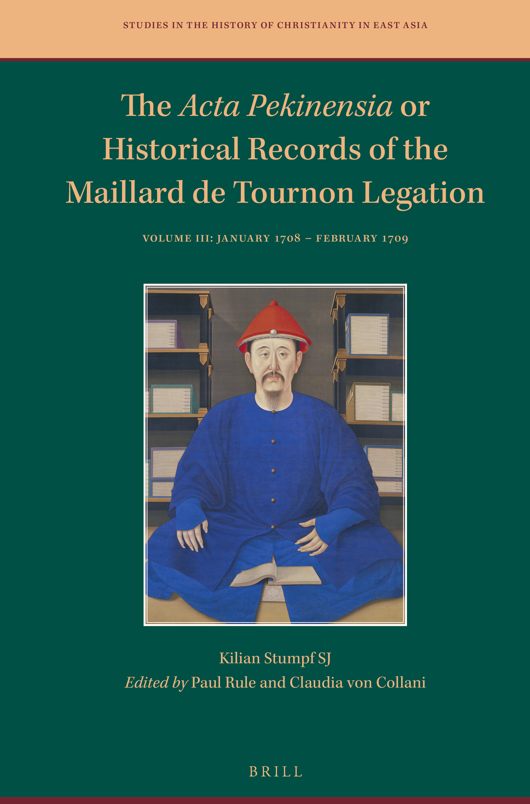

# Front Matter

> 原始文件：Acta Pekinensia Vol 3 - Jan 1708 to Feb 1709.pdf  
> PDF 页码：1-5

<!-- PDF page 1 -->

<!-- PDF page 2 -->

The Acta Pekinensia or Historical Records of the Maillard de Tournon

Legation

<!-- PDF page 3 -->

## Studies in the History of

## Christianity in East Asia

Editors-in-Chief

M. Antoni J. Ucerler, sj

Wu Xiaoxin 吳小新

Ricci Institute for Chinese-Western Cultural History–Boston College

Editorial Board

Donald L. Baker (University of British Columbia, Canada)

Anthony Clark (Whitworth University, usa)

Kiri Paramore (Leiden University, The Netherlands)

Stephen J. Roddy (University of San Francisco, usa)

volume 10

The titles published in this series are listed at brill.com/hcea

<!-- PDF page 4 -->

## The Acta Pekinensia or Historical

## Records of the Maillard de

## Tournon Legation

## Volume iii: January 1708 – February 1709

By

Kilian Stumpf, sj

Edited by

Paul Rule

Claudia von Collani

leiden | boston

<!-- PDF page 5 -->

Cover illustration: The Kangxi Emperor of the Qing dynasty, around his 40's. Collection of the Palace Museum, Beijing. Photo by Che Bing Chiu: Yuanming Yuan: le jardin de la Clarté parfaite. Paris 2000. Public domain. Wikimedia Commons.

The Library of Congress Cataloging-in-Publication Data is available online at https://catalog.loc.gov lc record available at https://lccn.loc.gov/2016450211

Typeface for the Latin, Greek, and Cyrillic scripts: “Brill”. See and download: brill.com/brill‑typeface.

issn 2542-3681 isbn 978-90-04-69688-4 (hardback) isbn 978-90-04-69762-1 (e-book) doi 10.1163/9789004697621

Copyright 2024 by Paul Rule and Claudia von Collani. Published by Koninklijke Brill bv, Leiden, The Netherlands. Koninklijke Brill bv incorporates the imprints Brill, Brill Nijhoff, Brill Schöningh, Brill Fink, Brill mentis, Brill Wageningen Academic, Vandenhoeck & Ruprecht, Böhlau and V&R unipress. Koninklijke Brill bv reserves the right to protect this publication against unauthorized use. Requests for re-use and/or translations must be addressed to Koninklijke Brill bv via brill.com or copyright.com.

This book is printed on acid-free paper and produced in a sustainable manner.
