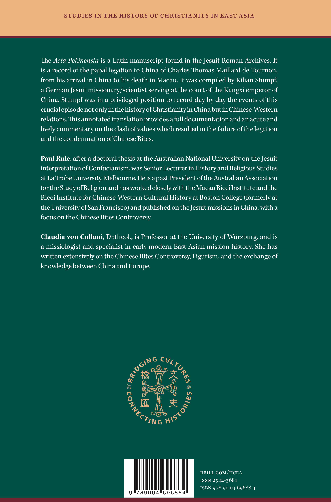

# Back Cover

> 原始文件：Acta Pekinensia Vol 3 - Jan 1708 to Feb 1709.pdf  
> PDF 页码：654-654

<!-- PDF page 654 -->

## Cover text (transcribed from the PDF image)

STUDIES IN THE HISTORY OF CHRISTIANITY IN EAST ASIA

The *Acta Pekinensia* is a Latin manuscript found in the Jesuit Roman Archives. It is a record of the papal legation to China of Charles Thomas Maillard de Tournon, from his arrival in China to his death in Macau. It was compiled by Kilian Stumpf, a German Jesuit missionary/scientist serving at the court of the Kangxi emperor of China. Stumpf was in a privileged position to record day by day the events of this crucial episode not only in the history of Christianity in China but in Chinese-Western relations. This annotated translation provides a full documentation and an acute and lively commentary on the clash of values which resulted in the failure of the legation and the condemnation of Chinese Rites.

**Paul Rule**, after a doctoral thesis at the Australian National University on the Jesuit interpretation of Confucianism, was Senior Lecturer in History and Religious Studies at La Trobe University, Melbourne. He is a past President of the Australian Association for the Study of Religion and has worked closely with the Macau Ricci Institute and the Ricci Institute for Chinese-Western Cultural History at Boston College (formerly at the University of San Francisco) and published on the Jesuit missions in China, with a focus on the Chinese Rites Controversy.

**Claudia von Collani**, Dr.theol., is Professor at the University of Würzburg, and is a missiologist and specialist in early modern East Asian mission history. She has written extensively on the Chinese Rites Controversy, Figurism, and the exchange of knowledge between China and Europe.

BRIDGING CULTURES · CONNECTING HISTORIES

BRILL.COM/HCEA

ISSN 2542-3681

ISBN 978-90-04-69688-4

Barcode: 9789004696884
