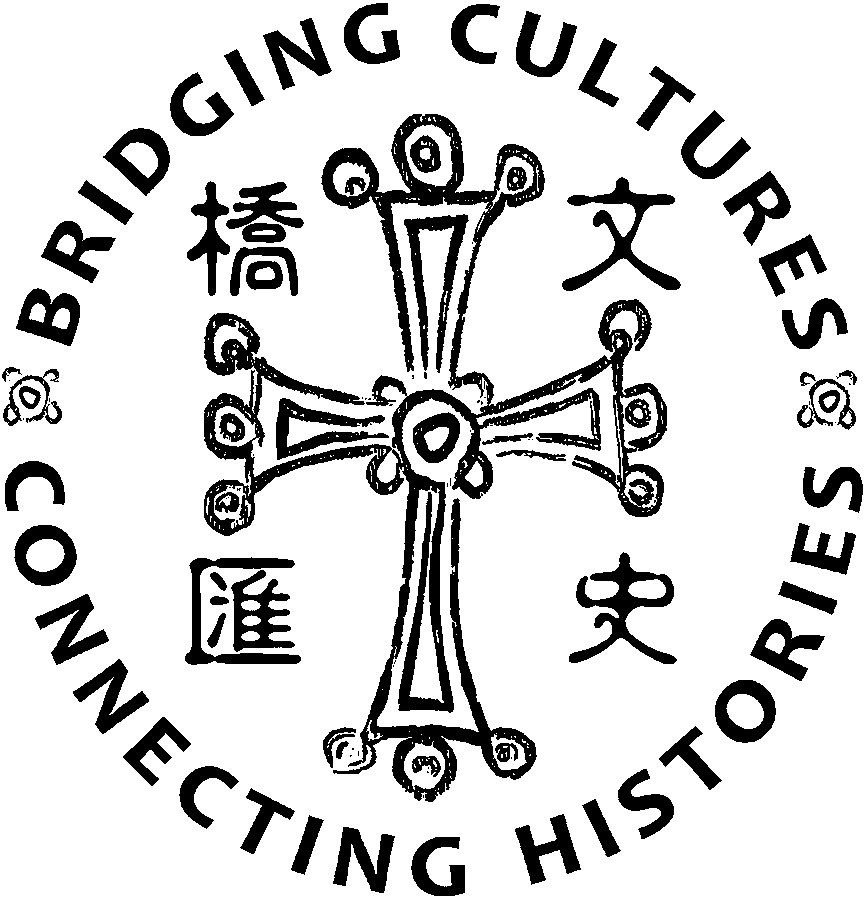

# 书前材料

> 原始文件：Acta Pekinensia Vol 2 - Sep 1706 to Dec 1707.pdf  
> PDF 页码：1—6；6页原PDF影像及英中内容已逐页通校，含第6页空白。

<!-- PDF page 1 -->

《北京纪事，或多罗使团历史记录》

<!-- PDF page 2 -->

## 东亚基督教史研究

主编

M. Antoni J. Ucerler，耶稣会士

吴小新（Wu Xiaoxin）

旧金山大学利玛窦中西文化历史研究所

编委会

Donald L. Baker（加拿大不列颠哥伦比亚大学）

Anthony Clark（美国惠特沃思大学）

Kiri Paramore（荷兰莱顿大学）

Stephen J. Roddy（美国旧金山大学）

第1册

本丛书已出版书目见 brill.com/hcea。

<!-- PDF page 3 -->

## 北京纪事，或多罗使团历史记录

## 第二卷 康熙四十五年七月廿五至四十六年十二月初八（公历1706年9月至1707年12月）

纪理安（Kilian Stumpf），耶稣会士，著

Paul Rule、Claudia von Collani 编

BRILL

莱顿 | 波士顿

<!-- PDF page 4 -->

封面图：《北京纪事》手稿本扉页，藏于罗马耶稣会档案馆（ARSI），档号 Jap. Sin. 138。

美国国会图书馆在版编目数据可于 http://catalog.loc.gov 查询。国会图书馆书目记录见 http://lccn.loc.gov/2016450211。

拉丁字母、希腊字母和西里尔字母所用字体：“Brill”。详情及下载见 brill.com/brill‑typeface。

ISSN 2542-3681  
ISBN 978-90-04-39631-9（精装本）  
ISBN 978-90-04-39657-9（电子书）

版权归荷兰莱顿 Koninklijke Brill NV 所有，2019年。Koninklijke Brill NV 旗下包括 Brill、Brill Hes & De Graaf、Brill Nijhoff、Brill Rodopi、Brill Sense、Hotei Publishing、mentis Verlag、Verlag Ferdinand Schöningh 和 Wilhelm Fink Verlag 等出版品牌。保留所有权利。未经出版者事先书面许可，本出版物的任何部分，均不得以任何形式或通过任何手段，包括电子、机械、影印、录音或其他方式，复制、翻译、存入检索系统或传播。Koninklijke Brill NV 准许为内部使用或个人使用而影印，但须将相应费用直接支付给版权许可中心（The Copyright Clearance Center），地址为美国马萨诸塞州丹弗斯市 Rosewood Drive 222号910室，邮编01923。费用可能调整。

本书以无酸纸印制，并采用可持续生产方式。

<!-- PDF page 5 -->

特别感谢耶稣会士 Gerard J. Hughes 神父博士对《北京纪事》学术翻译所作的贡献。

“一段文字的意义，应以具备相关语言能力的人在其原有语境中会如何理解它来界定。”

引自其《不陷于原教旨主义的忠实：与传统对话》（Fidelity without Fundamentalism: A Dialogue with Tradition）中〈翻译的陷阱〉（“The Pitfalls of Translation”），第22页。

∵

<!-- PDF page 6 -->
