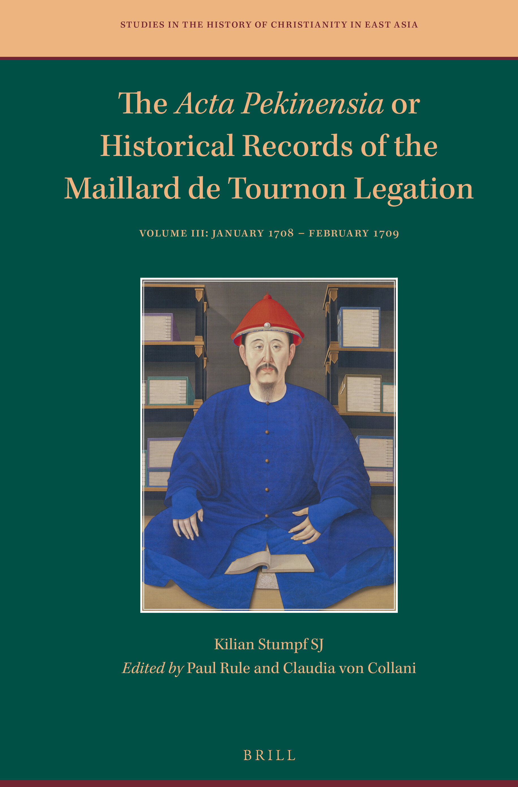
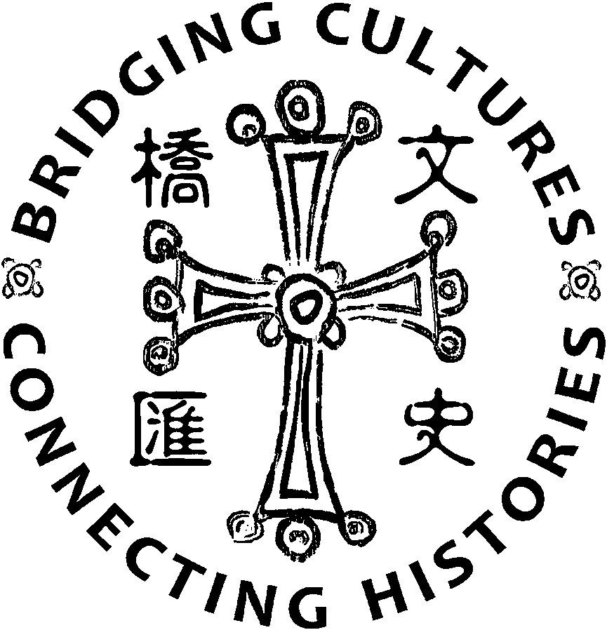

# 书前材料

> 原始文件：Acta Pekinensia Vol 3 - Jan 1708 to Feb 1709.pdf  
> PDF 页码：1—5；5页原PDF及英中书前内容已逐页通校，封面图内文字另附译读。

<!-- PDF page 1 -->

> 封面文字译读：东亚基督教史研究。
> 《北京纪事，或多罗使团历史记录》。
> 第三卷：康熙四十六年十二月初九至四十八年正月十九（公历1708年1月至1709年2月）。
> 纪理安（Kilian Stumpf），耶稣会士，著；Paul Rule、Claudia von Collani 编。
> BRILL。

<!-- PDF page 2 -->

《北京纪事，或多罗使团历史记录》

<!-- PDF page 3 -->

## 东亚基督教史研究

主编

M. Antoni J. Ucerler，耶稣会士

吴小新（Wu Xiaoxin）

波士顿学院利玛窦中西文化历史研究所

编委会

Donald L. Baker（加拿大不列颠哥伦比亚大学）

Anthony Clark（美国惠特沃思大学）

Kiri Paramore（荷兰莱顿大学）

Stephen J. Roddy（美国旧金山大学）

第10册

本丛书已出版书目见 brill.com/hcea。

<!-- PDF page 4 -->

## 北京纪事，或多罗使团历史记录

## 第三卷 康熙四十六年十二月初九至四十八年正月十九（公历1708年1月至1709年2月）

纪理安（Kilian Stumpf），耶稣会士，著

Paul Rule、Claudia von Collani 编

BRILL

莱顿 | 波士顿

<!-- PDF page 5 -->

封面图：清朝康熙皇帝四十多岁时的画像，北京故宫博物院藏。摄影：Che Bing Chiu，见《圆明园：圆明之园》（Yuanming Yuan: le jardin de la Clarté parfaite），巴黎，2000年。公有领域图片，来源为维基共享资源。

美国国会图书馆在版编目数据可于 https://catalog.loc.gov 查询。国会图书馆书目记录见 https://lccn.loc.gov/2016450211。

拉丁字母、希腊字母和西里尔字母所用字体：“Brill”。详情及下载见 brill.com/brill‑typeface。

ISSN 2542-3681  
ISBN 978-90-04-69688-4（精装本）  
ISBN 978-90-04-69762-1（电子书）  
DOI 10.1163/9789004697621

版权归 Paul Rule 和 Claudia von Collani 所有，2024年。由荷兰莱顿 Koninklijke Brill BV 出版。Koninklijke Brill BV 旗下包括 Brill、Brill Nijhoff、Brill Schöningh、Brill Fink、Brill mentis、Brill Wageningen Academic、Vandenhoeck & Ruprecht、Böhlau 和 V&R unipress 等出版品牌。Koninklijke Brill BV 保留保护本出版物免遭未经授权使用的权利。有关再利用和／或翻译的申请，须通过 brill.com 或 copyright.com 向 Koninklijke Brill BV 提出。

本书以无酸纸印制，并采用可持续生产方式。
