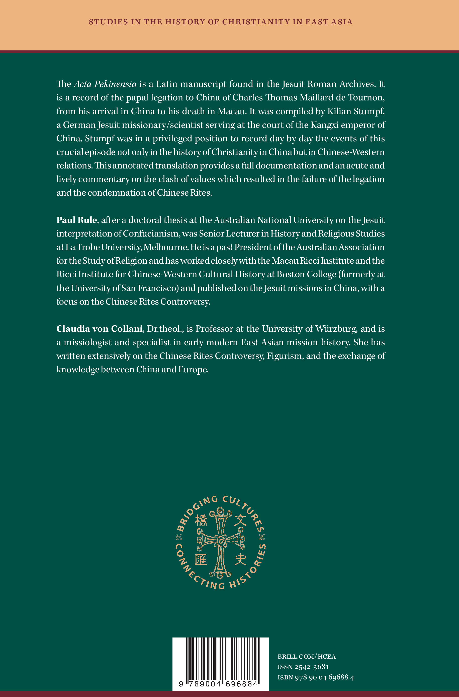

# 封底

> 原始文件：Acta Pekinensia Vol 3 - Jan 1708 to Feb 1709.pdf  
> PDF 页码：654  
> 封底原图及全部英中文案已逐行通校；英文MD另附可检索转录。以下文字对照原 PDF 封底翻译；作者任职等介绍均为本书出版时的表述。

<!-- PDF page 654 -->

**东亚基督教史研究**

《北京纪事》（Acta Pekinensia）是一部藏于罗马耶稣会档案馆的拉丁文手稿。它记载教宗使节 Charles Thomas Maillard de Tournon〔多罗〕使华的经过，起自他抵达中国，止于他在澳门去世。编纂者 Kilian Stumpf〔纪理安〕是一位德国耶稣会传教士兼科学家，供职于中国康熙皇帝的宫廷。纪理安所处的位置，使他得以逐日记录这一关键事件的经过；它在中国基督教史及中西关系史上都占有重要地位。这部附有注释的译本，提供了详尽的文献记录，并对价值观的冲突作出敏锐而生动的评述；正是这种冲突，最终导致此次使团的失败及中国礼仪遭到谴责。

**Paul Rule〔鲁保禄〕**在澳大利亚国立大学以耶稣会对儒学的诠释为题完成博士论文，后来曾任墨尔本拉筹伯大学历史与宗教学高级讲师。他曾任澳大利亚宗教学研究协会主席，并与澳门利氏学社及波士顿学院中西文化历史研究所〔利玛窦研究所，原设于旧金山大学〕密切合作。他发表过有关耶稣会在华传教的研究，重点关注中国礼仪之争。

**Claudia von Collani〔柯兰霓〕，神学博士**，为维尔茨堡大学教授，是传教学者及近代早期东亚传教史专家。她就中国礼仪之争、索隐说以及中国与欧洲之间的知识交流，撰有大量著述。

**沟通文化，联结历史**〔封底徽记：BRIDGING CULTURES · CONNECTING HISTORIES〕

出版信息：BRILL.COM/HCEA；ISSN 2542-3681；ISBN 978-90-04-69688-4。条码号码：9789004696884。

