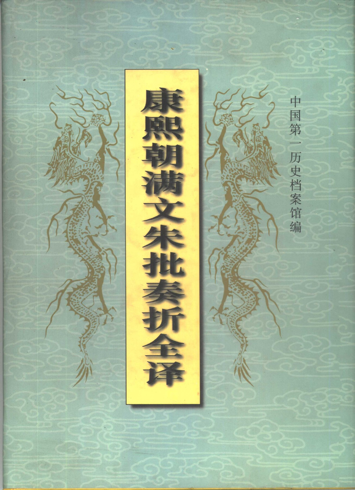
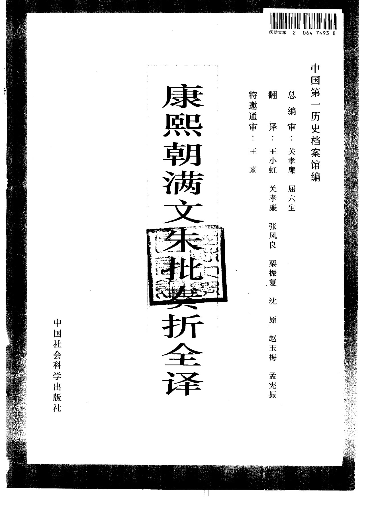
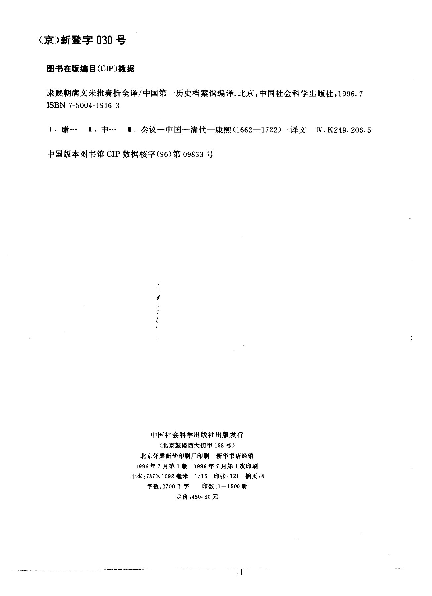
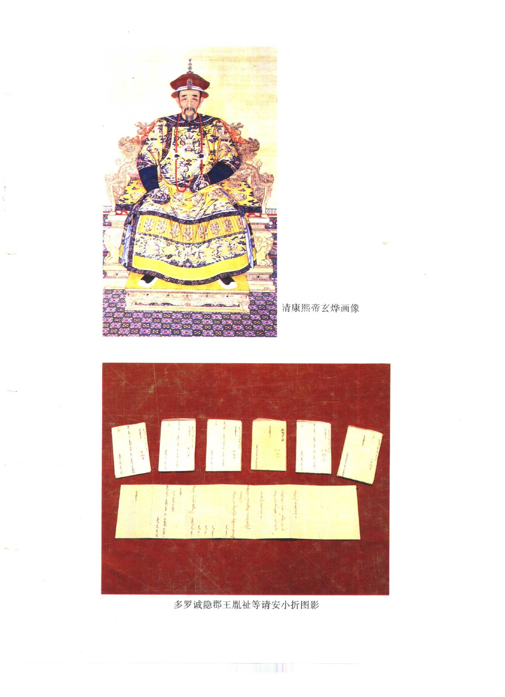
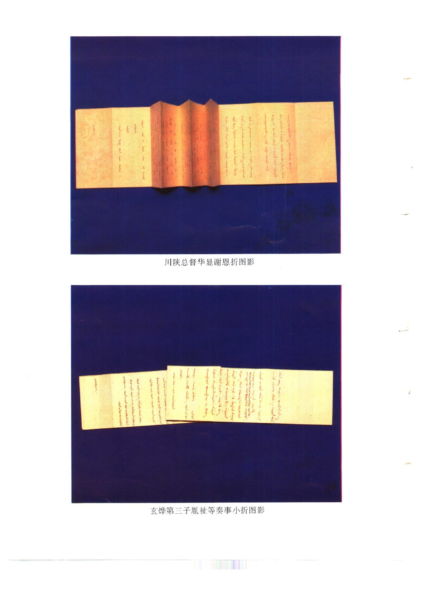
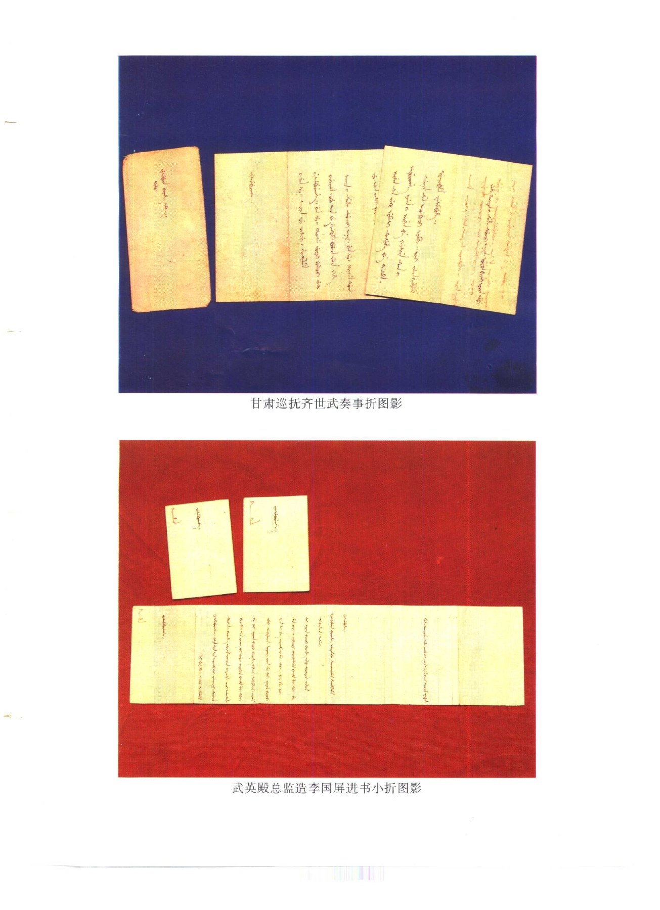

# 前言与目录

> 来源：康熙朝满文朱批奏折全译.pdf，PDF 第 1-211 页。

<!-- PDF page 1 -->

康熙朝满文朱批奏折全译

<!-- PDF page 2 -->

<!-- PDF page 3 -->

康熙朝满文朱批奏折全译/中国第一历史档案馆编译.北京：中国社会科学出版社，1996.7

<!-- PDF page 4 -->

多罗诚隐郡王胤祉等请安小折图影

<!-- PDF page 5 -->

川陕总督华显谢恩折图影

玄烨第三子胤祉等奏事小折图影

<!-- PDF page 6 -->

甘肃巡抚齐世武奏事折图影

武英殿总监造李国屏进书小折图影

<!-- PDF page 7 -->

重是一是一心是走多足起之雲上星少：書看走之起小星起h 多是泰美夏交美至起 13111上

上是也星超

9之1 t3322

tesai

中中し2 上上上之

江南总督邵穆布奏事折图影

J之うう3b 之今是上之走也輔香

Bn

之

tnfon

小3；e393? 先33人人人

hio tomerinriac merossnidmoe

山西巡抚苏克济请安中折图影

<!-- PDF page 8 -->

译编说明

为了向国内外学术界提供研究清史的最原始的史料，中国第一历史档案馆于

1984年套色影印出版了《康熙朝汉文朱批奏折》。至此，世人得见密藏于深宫200

余年的汉文朱批奏折的全貌。但令人美中不足的是，与汉文朱批奏折相得益彰、互

为整体的，内容完全不重复、数量较多、起始时间比汉文奏折早的满文朱批奏折，

却由于译、编、校工作的特殊性，而未能同步出版，给世人留下了缺憾。值得庆幸的

是，经过中国第一历史档案馆满文部翻译人员数年的共同努力，不仅完成了这一

部分满文朱批奏折的译审、编校工作，弥补了缺憾，而且在中国社会科学出版社的

鼎力支持下，这部分珍贵史料即将付梓出版，公诸于世。现主要对康熙朝满文朱批

奏折形成的前因后果、始行确切时间、运行特点、与清朝政治、经济、军事、文化之

间的关系和本辑史料的内容价值略加介绍和说明。

清朝是中国诸多封建君主专制王朝中的最后一个。其统治长达268年之久。

在这漫长曲折的历史程途中，清朝统治者在汲取历代专制统治经验的基础上，将

封建中央集权与君主专制制度推上历史的最高峰，自中央以迄地方，建立起庞大

的封建国家行政管理机构。为保障清朝封建国家机器的正常运转，进一步加强皇

权，制订了详密的君臣之间、中央和地方各衙门之间的文书制度。当时举凡皇帝下

达的文书，有制、诏、诰、敕、谕等；臣工上奏的文书，有题本、奏本、奏折、表文、笺文

等；各衙门上下互相行文，则用咨呈、咨文、札文、呈文、移会、申文、关文、交片、牌

文、照会、详文等。不仅君臣之间有严格的尊卑等级之分，而且各衙门间，由于在政

治上所处的地位不同，彼此行文关系亦各异。简而言之，大体上划分为上行、平行

和下行三种类型，而在这三种类型中又有不同的文件名目，由此体现机关大小上

下级的统属关系。清朝制订的一套较完整的文书制度，既沿袭历代旧制，远肇奏

汉，近承宋明，且根据其满族上层为主体而建立的封建统治的特点与需要，又有所

改造，有所创新。如目前所见臣工上奏文书中的奏折，即始用于清朝，为清朝所独

有。

奏折，又称折子、奏帖、折奏等，多用无格白折纸制成，故名。它是机密文书，不

同于其他文种，产生于宫而不存于宫内。其递转程序，均由具奏人员专差或驿传，

把折子直送宫门(景运门)，由内奏事处太监呈送皇帝亲自拆阅和批答，然后仍按

既定的运转程序，将朱批折子退回原具折人遵行，不在宫内留存，也不留抄件，皇

帝朱批亦不留底稿。其之所以历尽沧桑，完整保留至今并深藏宫中，则与回缴朱批

奏折的制度有关。

<!-- PDF page 9 -->

至于回缴朱批奏折制度的始行时间，现在史学界一般认为这项制度是在康熙

六十一年(1722年)十一月二十七日雍正帝胤禛即位之初颁旨实行的。该道上谕是

用满文书写的，其主要内容是：“军前将军、各省总督、巡抚、将军、提督、总兵官及

各地所有“朕之皇考朱批旨意，俱著敬谨查收，送到朕处。若抄写存留、隐匿、焚弃，

日后败露，断不宥恕，定行从重治罪。”可见雍正帝实施朱批奏折回缴制度，是非常

严肃认真的。其后各朝也继续严格执行朱批奏折的回缴制度。康熙朝有关缴回朱

批奏折的满文折子，时间最早的是康熙二十九年(1690年)三月初四日和六月初六

日山东巡抚佛伦的满文折子。兹将其中一件译录如下：“巡抚臣佛伦谨奏：叩请皇

上万安。再谨回缴皇上亲笔谕旨。”经查得知，折内所谓亲笔谕旨是指佛伦在康熙

二十八年十二月初九日奏报山东境内得大雪折内之朱批。第二件折内所说的上谕

是指佛伦在康熙二十九年五月十七日奏陈孙光祀劣迹折内之夹批。由此可以推

断，早在康熙朝前期就有回缴朱批奏折的规定，但由于执行的回缴规定不甚严格，

加之其他各种原因，当朝回缴宫中的折子为数不多，而其绝大多数是在雍正帝即

位颁布朱批奏折回缴制度后补缴的。康熙帝是否颁布过回缴朱批奏折的上谕，是

一个值得注意的问题，但至少到目前为止，尚未发现上谕实物，所以康熙朝有关回

缴朱批奏折的规定，往往被史学界所忽略。

总之，制定并推行回缴朱批奏折制度，暂且不论康熙、雍正二帝的主观意图是

什么，但这一制度的实施，却在客观上已经起到了保护这批清代珍贵档案史料的

作用。实施该项制度的结果，使本不存于宫内、分散于中央及地方各衙门大臣、官

员个人手中的朱批奏折得以收回，集中密藏于清宫殿堂之内，并流传至今，成为当

今研究清史的第一手珍贵资料。

通观康熙朝满汉文朱批奏折有以下特点：

第一，明万历二十七年(1599年)，女真族贝勒努尔哈齐令儒臣额尔德尼等借

用蒙文字母，拼写女真语，创制了无圈点满文，用来写文记事。天聪六年(1632年)

清太宗皇太极复令儒臣达海在初创的满文字母旁酌加圈点，以确定读音，固定字

形，设计特定字，从而改进和完善满文。至此，满文的体系已固定下来，继以新满文

记录事件，直至清王朝覆亡。清初定满语为国语，故称满文为清文，与外部文移往

来，写文记事，颁行重要谕令，均用满文书写。现存康熙朝满文奏折的起始时间为

康熙十二年，而汉文朱批奏折起自康熙二十八年。由此可知，在京科道满族官员首

先使用满文折子奏事进言，进而说明满文奏折文书的始用时间早于汉文奏折文

书。

第二，清朝政权是以满族贵族为主体的满汉地主阶级的联合专政。后来也允

准汉官用汉文折子奏事，这样在京衙门汉官也取得了折奏权，从而出现了满文折

子和汉文折子两种，按惯例满族官员写满文折子，汉官写汉文折子，甚至有满汉文

合璧者。清代把满文作为官方文字举国通用，是清代文书的一大特点。

第三，清代奏折，依其内容，可分为奏事折、请安折、谢恩折及庆贺折四种，由

<!-- PDF page 10 -->

于此四种折子奏事各有侧重，故其装璜亦随之有所分别。奏事折多以无格白泾纸

书写；请安折和谢恩折用黄笺纸为多，甚至还有黄绫，非常精致，为当时规格最高

的折子之一；庆贺折多用粉、红两种颜色笺纸书写，以示喜庆。有些请安、谢恩、庆

贺等折子的折面及内幅周边印有浮云飞龙的图案，更弥足珍贵。

第四，内外满汉官员具折，遣专差或由驿直送达御前，皇帝亲自拆阅后，除少

数原折留中不发外，其余均用朱笔批答，谓之朱批，又称御批。朱批二字，在习惯上

已成御笔的专用名词，亦为奏折的代称。满文折子用满文批答，称满文朱批奏折；

汉文折子用汉文批示，谓之汉文朱批奏折。但也有例外，即满文折子用汉文批答，

汉文折子以满文批示。这种情况一般不多见。至于满汉文合璧折子，送达御前后，

皇帝往往批改满文，其汉文只字不改，这就使折子的满文内容较之汉文更具有重

要的行政效用，而今利用则具有法律依据。皇帝的朱批，有的写在折面，有的批于

简端，有的逐行夹批，例以尾幅者居多。除此之外，遇有“国丧”，在折子上用蓝笔批

答，故称蓝批奏折。朱批字数不限，少则一字，多则数扣。康、雍两朝，在请安折上常

有长篇批语，而在乾隆朝以后则为罕见。此为康、雍两朝朱批奏折的突出特点。正

因如此，这两朝的朱批奏折内容不仅丰富，而且史料价值最高，成为当今学者治史

时必备而不可或缺的史料之一。

第五，奏折为机密文书，由皇帝与具折官员共同严守秘密。皇帝要求其臣僚亲

手写折，未经允准，其奏折内容及朱批严禁公开，不得互相传看，甚至对密折、密

批，皇帝密令销毁，不得存留。如康熙帝在陕西巡抚鄂海康熙四十三年正月初八日

满文请安折上批道：“朕体安善。以后奏折，尔亲手写来，即字不好有错亦不妨，但

不可令人知道，况且在尔等折内皆朕随手草写，再无一人知道，亦无底稿。”再有，

康熙帝在山西巡抚噶礼满文奏事折内亦曾批示：“知道了。此文断不可留。”据此可

知，康、雍两朝的奏折是机密文书。

第六，奏折尺寸初无规定单一纸式。仅以康熙朝题奏本章及奏折为例，题本长

22.3公分至26公分不等，宽11公分至11.9公分不等；奏本长23公分，宽10.6

公分。以尺量现存满文奏折纸式，有大中小三种规格。大折长20.9公分至25.3公

分，宽9.6公分至11.7公分，中折长11.9公分至15.2公分，宽7公分至7.3公

分；小折长9公分至10.2公分，宽5.4公分至6.4公分。从三者的比较中可以看

出，长折尺寸大小与题奏本章相仿。可以断定，奏折纸幅大小，在清初没有明文规

定，是具折者参照题奏本章纸式裁制为折子的。从现存满文奏折看，地方及在外有

具折权的一般朝廷命官、在京各部院大臣等皆用大折子奏事。至于中、小折子，则

为康熙朝所特有。中折为内外负有特殊使命的少数亲信满族官所专用。如皇十四

子胤祯以抚远大将军身份奏事则用中折；又如甘肃巡抚齐世武等。自皇子以下亲

王之嫡子以上及朝廷中地位特殊的极少数官员专用小折子报事，其内容与皇帝的

朱批都非常机密，不可披露。使用范围仅限于满文朱批奏折，如康熙帝在世子雅尔

江阿满文奏事折上批示“知道了。下次写小折子。”可见小折子是由康熙帝玄烨允

<!-- PDF page 11 -->

准使用的。由此可知，奏折文书始用之初，不拘其形式，而注重其内容。尤其是康熙

朝，能否使用满文中小折子，则是官员身份、地位、权势的象征。

第七，奏折内字画工拙各异。仅以康熙朝满文奏折为例，玄烨不时提醒臣工亲

手写折，词但达意，不计较字画工拙，一般楷书即可。康熙帝在两江总督傅拉塔满

文奏事折内批道：“尔好。字虽不好，亦不可令他人写。此事应慎之。”正因如此，满

文奏折内文字书写风格各异，大致有两种情况：一是奏事者如不能亲手写，可由亲

近幕友代笔，字体结构匀称，笔画工整，颇合公文式体。二是奏事者亲手书写，由于

出自众人之手，笔道粗细不一，字型大小各异，书法风格各具特色，甚至有错字，即

皇帝朱批中也有错别字，而且组词语言表达能力的高下也不尽相同。折内多以规

范前的满语书写，语言简朴，而语法结构不严谨，常夹杂些习惯用语或口头语，有

时新旧字并用，加之喜用蒙汉语借词，甚至用规范后被淘汰的旧清语。这是清初奏

折文书的又一突出特点，对研究满语言文字的发展颇有参考价值。

第八，清初奏折书写款式，没有明文规定。奏折文书的书写款式与题本、奏本

不同。清初对题奏本章的书写款式，皆有明文规定。《清会典事例》卷一千四十二

载：“题本格式，顺治八年(1651年)题准，每幅六行，每行二十格，平行写十八字，章

内称宫殿者，抬一字，称皇帝，称上谕，称御者，抬二字，称天地、宗庙、山陵、庙号、

列祖谕旨者，均出格一字。首行列衙门官衔，具奏人姓名，末幅具年月日。内外一式

通行。”顺治十年(1653年)三月上谕：“各部院本章内清字宜先书官员衔名，次书谨

题字样，次书所条陈为某事。”《清会典事例》卷十三载：“又议定凡内外官员题奏本

章，不得过三百字，虽刑名钱谷等事，难拘字数，亦不许重复冗长。”由上诸例可知，

对题奏本章的行款字数皆有严格的限制(自雍正始不限字数)。至于奏折文书，无

如题奏本章严格限制，有五种情况：一是请幕友代笔的折子，仍如题奏本章每幅六

行，但每行字数不加限制，是其不同之处。二是官员亲手书写的折子，每幅四至六

行不等，折内皇帝长篇批语，每幅四至五行。三是字数未加限制。满文折子一般每

行写六至十个字左右，汉文折每行写九至三十二字不等。四是凡官员亲笔书写的

折子，在尾幅年月日之后署名声明。如在陕西巡抚噶礼满文请安折尾幅写道：“奴

才噶礼亲手写。”五是诸皇子写满文折子，不论有无职衔，均一一列名。据此可知，

奏折文书的书写款式，均无明文规定。此即奏折与题奏本章的相异之处。然奏折是

由奏本转换而来，故而继承了题奏本章用笔简洁，内容扼要，层次分明的优点，它

篇幅短小，文字简练，语言朴实，便于阅读且不拘形式，是君臣喜用的独立的重要

上行官文书。

奏折文书的运转处理程序不同于题奏本章。由于奏折文书直达御前，皇帝亲

自拆阅，朱批直寄具奏者遵行，是机密文书，故其有一套与题奏本章截然不同的处

理办法。按清旧制，京内各部、院、府、寺、监衙门本章，直送内阁，称部本；外省将

军、督抚等衙门本章，先送通政使司，由司转送内阁，称通本。内阁接收题奏本章，

经票拟后送交批本处，登记进呈皇帝阅览。皇帝阅本认可后，发下内奏事处，送交

<!-- PDF page 12 -->

批本处。由批本处将本送交内阁红本处接收，转发六科，发抄各衙门分别执行。年

终汇缴内阁贮入红本库。可见全部运转和处理过程繁复迟缓，效率很低，而且国家

政事，庶政出入，总汇于内阁，阁臣掌握了决策之权，而皇帝处理政务，始终处于被

动地位，这对皇帝集权有所牵掣。奏折为机密文书，因而统治者极为重视其运转处

理程序。在京各衙门及其诸大臣奏折直送景运门外奏事处接收登记，再转送内奏

事处；外省各衙门及其官员们奏折，由驿递者至兵部捷报处，转送乾清门呈递；派

专差递送奏折至奏事处接收。内奏事处接到京城内外各地奏折后，交奏事太监呈

送给皇帝拆阅。皇帝批发的折子，在康熙朝，由外省呈递的朱批奏折，在内奏事处

封固后，发给原差或由兵部捷报处赍回，交给原具奏者遵行；京内各衙门奏折，由

外奏事处发交各衙门领回执行。将各地官员缴回的朱批奏折存于内奏事处。雍正

七年成立军机处后，内奏事处将朱批奏折送交军机处登记，并抄录一份留存，以备

查考，称录副奏折，而后其原折分别下发遵行。至此内外官员回缴的朱批奏折，皆

存于军机处，年终汇交内奏事处保存。于此可见奏折文书的运转过程简便迅捷而

又慎密，采用了由上而下的处理程序，由皇帝一人批答并处理，始终掌握着处理政

务的主动权，处于有力地位。而内阁除办理皇帝批示“具题”的奏折事件外，不可干

涉奏折文书的处理事务，从而完全避开了阁臣干政，进而加强了皇帝的专制权力。

奏折文书到底始行于清代何时，在清代文献中即有不同的记载。《啸亭杂录》

记载：“自明太祖立通政司，凡内外章奏，皆须于其司挂号后始能达入九重，故权相

多以其私人专主其任。宪皇帝夙知其弊，乃命内外诸臣，凡有紧密事务，改用奏折，

专命奏事人员若干以通喉舌，无不立达御前。”《东华录》记载：“我朝雍正年间，谕

令臣工将要事改为奏折，简易速览，远胜题本。”《清史稿》记载：“康熙五十一年

(1712年)正月壬子，命内外大臣具折陈事，折奏自此始。”《清圣祖实录》记载：“康

熙二十五年(1686年)三月初三日，圣祖谕大学士等云：“各省晴雨，不必缮写黄册

特本具奏，可乘奏事之便，写细字折子，附于疏内以闻。”《康熙起居注》康熙二十年

(1681年)十月初二日条载：“早，上御乾清门，听部院各衙门官员面奏政事。大学

士、学士等会同户部并仓场，为漕运冻阻，具折请旨。上顾阁臣曰：漕粮当照限运

解，该督抚等不行速运，但求宽限，皆图有便于己，不肯实为国家。户部亦不详为筹

画于事有益于否，惟草率照督抚所请，准其宽限。……此折著户部领去，具本奏来。

尔等将此情节票上，著严行议奏。”

由于上引文献记载不同，治史者援引得出的结论亦不尽相同。有的学者认为

奏折文书始用于雍正朝。现在存世的康熙朝满汉文奏折实物，约有万件，其中汉文

奏折，现已刊印发行，公之于世。这样一来，所谓奏折文书始于雍正朝之说不攻自

破，完全站不住脚了。有的学者认为奏折始于康熙三十年代，或者认为始于康熙二

十五年；有的学者推定始于康熙二十年。由此可见，史学界对清代奏折文书肇端于

康熙朝何年的问题上意见是不一致的。

从现存奏折来看，中国第一历史档案馆保存最早的满文奏折原件为康熙十二

<!-- PDF page 13 -->

年十一月二十九日内库郎中尚吉图的奏事折子。该件折子内容奏报太监等数次来

内库，指称上谕，领取银两、皮张、铜银器皿等物的经过。折面上有康熙帝亲笔朱批

“知道了”等字样。从文件形式，缮写款式，以及行文用语诸方面来看，均与其后密

折并无两样，是满文朱批奏折无疑。据此可知，至迟在康熙十二年已有满文奏折的

存在，进而说明满文奏折文书的始用早于汉文奏折文书。因此所谓清代奏折文书

出现于康熙二十年，以及其后各年的诸种结论与推断，均被这件康熙十二年满文

奏折实物所匡正了。同时又可以断言，奏折文书产生的时间早于康熙十二年。

从文献记载考查，“奏折”这一公文名称最早出现于清顺治年间。据《清世祖实

录》载：“顺治十三年(1656年)丙申六月甲申，谕吏部：向来科道及在京满汉各官奏

折，俱先送内院，今后悉照部例，径诣宫门陈奏。其外省所送通政使司题本及在京

各官本章，仍照旧送通政使司转送内院。”迄今为止史学界对顺治十三年这道上谕

中的“奏折”一词有不同的理解和解释。有的学者认为谕中所称的奏折，是指科道

等官言事所上的题奏文书，为了迅速批答，特允径送宫门陈奏。它与康熙皇帝实行

的奏折制度不同。有的认为谕令中所指的“奏折”，实际上是奏本之误。

依据顺治十三年这道上谕的内容，可将清代奏折制度的起源，追溯到清顺治

年间，并将为研究奏折文书的由来及其始用时间，提供有价值的重要线索。

第一，在上谕中同时出现了“奏折”、“题本”、“本章”(涵奏本)。这三种文书的

名称，在当时是不可能混淆的。《清世祖实录》康熙六年(1667年)开馆纂辑，于康熙

十一年(1672年)五月二十七日康熙帝玄烨为本书作了序。继之雍正十二年(1734

年)复令儒臣重加校订，未完。乾隆帝继饬校订。于乾隆四年(1739年)十二月初十

日乾隆帝弘历为本书写了序。当时参预修纂各史臣皆精通满汉文，且熟谙当时的

文书制度及其类别，成书的时间距离档案原件形成的时间很近，可以说是当时人

修当时史，对所收材料严加核对。《清世祖实录》经康熙朝纂辑并雍乾两朝校订，对

顺治十三年上谕中的“奏折”一词加以肯定而载入史册。

第二，积极改进本章的处理方法。题本和奏本产生于明代，清初沿用之，题奏

本章的票拟主于内阁，皇帝裁决政务总是处于被动地位。顺治帝亲政后，着手改变

题奏本章的处理程序，以加强皇帝的专制权力。顺治帝到内三院阅览各省官员奏

章，“问明时票本之制如何。”并发现了票拟方面的诸多弊端。对此《清世祖实录》卷

七十一载：“顺治十年(1653年)癸巳正月甲戌，谕曰：各部奏事，经朕面谕者，部臣

识其所谕，回署录之票签，送内院照票批红发科。如此，则错误必多。”顺治十年十

月“戊子，先是，各部奏事毕，仍携本章回部拟旨，方送内院。至是上以奏章繁多，若

竟送内院，又恐易滋弊窦。”为避免票拟错误，抑防篡改谕旨，顺治帝决定进行改

革。上谕“今后各部奏事，各臣照常面奏，候上览毕，退。”“本章或上亲批，或于上前

面批，若有更改之事，即面奏更改，庶几无弊。”据此可知，当时对部分题奏本章的

处理，已经采取了不经内院票拟，径由皇帝当面阅批或提出处理意见的方法。此即

是奏折文书最初形成时的特点之一。

<!-- PDF page 14 -->

第三，改变了本章的运转过程。题本、奏本、奏折，是清代满汉臣工向皇帝奏事

进言的主要上行官文书。奏折与题奏本章的另一根本区别在于运转过程不同。在

清顺治朝已有这方面的改革。《清世祖实录》卷七十一载：“于太和门内择一便室，

令大学士、学士等官，分班入值。”说明已开始设置专门机构，负责将部分官员或衙

门的本章，在御门听政时当面呈送给皇帝，以前必须经过通政使司转呈皇帝的运

转程序有所改变。

以上数例，可以说明如下问题：一是自顺治十年始，在有限的范围内改变了科

道及在京满汉官员所呈题奏本章的运转过程和处理程序，这就使题奏本章已失去

原来意义，形成独立的新型官文书，取名“奏折”，以与沿用明旧制的题本、奏本相

区别。由此可见奏折来源于奏本，进而又说明上谕中所称“奏折”即指改变转递与

处理程序后的奏本。二是奏折试用之初，并非机密文书，是以公开的渠道呈送或面

奏皇帝，皇帝亦利用衙门听政等公开场合亲手批改或处理，甚或发送内阁票拟。题

本、奏本、奏折三者所奏报的内容，各有侧重，彼此补充。三是顺治十三年颁布上

谕，奏折“今后悉照部例，径诣宫门陈奏。”这道上谕的颁布，不是为了题奏本章的

迅速批答，特允径送宫门陈奏，而是作为一种长期制度，颁令各部院衙门及诸官员

执行的。清代奏折制度自此始；清代密折亦自此使用。至此，清代臣工上报公务的

官文书，形成题本、奏本、奏折并用的局面。在颁布奏折制度，折子成为机密文书之

初，其使用范围甚小，仅限于在京少数满族科道官员使用，大量的外省题本及在京

各官本章，“仍照旧送通使司转送内院。”由于在顺治朝使用密折的时间短，使用的

范围小，所形成的奏折文书的数量亦少，加之并无康、雍两朝回缴朱批奏折的规

定，而是由具折人私藏或销毁，故其实物失传，不得其真实面目。清顺治朝奏折文

书实物虽未流传至今，但从本文上引同时期的文献记载，可以断定至迟在顺治朝

中期以后已始用奏折文书了。

综观前述，尽管奏折文书是由奏本演变而来，但它却具有许多与题奏本章不

同的特点。其试用虽始于顺治十年，但作为官文书正式颁行却始于顺治十三年。这

是清代文书制度的重大改革之一。书写慎密，格式不拘，程式简便，传递迅捷，便于

阅读是其突出特点。从此，皇帝亲自批答奏折，“阁臣不得与闻”，排除阁臣干政后，

皇帝的权力自然得到巩固和加强，保证了专制主义中央集权的进一步发展。奏折

作为统治者安邦治国的有力工具，至康、雍时扩大了使用范围。乾隆十三年(1748

年)废止使用奏本，实则为奏折文书所替代。从此，主要臣工上奏文书减为题本和

奏折两种。到光绪二十七年(1901年)又废止沿自明制、行用257年之久的题本，臣

工上奏政务的官文书仅存朱批奏折一种。可见奏折文书基本贯串于清代社会的自

始至终，显示出强大的生命力，并对清代社会发展产生了深远的影响。奏折文书伴

随清初社会政治的需要而产生，随之发展而盛，又随之没落而衰(指奏折制度)，直

至清王朝覆亡而止。

现存康熙朝朱批奏折共有9000余件。其中汉文朱批奏折有4000余件，起自

<!-- PDF page 15 -->

康熙二十八年二月，止于康熙六十一年十二月，分存于中国第一历史档案馆及台

北故宫博物院两处。中国第一历史档案馆曾将存放于两处之汉文朱批奏折汇集一

起，套色影印出版。康熙朝满文朱批奏折，是满族官员及少数汉官用满文书写奏事

的折子。现存有5000余件，起自康熙十二年十一月，止于康熙六十一年十二月，也

分两处保存。中国第一历史档案馆存有4400余件；台北故宫博物院存有700余

件，1977年原文影印出版。为给广大读者提供比较完整系统的康熙朝满文朱批奏

折，满文部此次将两处保存的康熙朝满文朱批奏折尽行译注，辑成《康熙朝满文朱

批奏折全译》一书出版。在康熙朝满文朱批奏折中，还有一部分请安折，所载内容

除有某某人：“跪请皇上万安”之类的套话，以及康熙帝的“saha”、“mini beye elhe”

等千篇一律的朱批外，别无任何其他内容，不具有什么史料价值，故未予译入。再

加之原档年代久远，其糟旧霉烂，大片脱落，严重污损的残折、残片，内容已无法弥

补，故放弃未译。所以译入本书的实际件数较原档总件数少些。

康熙朝满文奏折与汉文奏折的关系，从逐一核对的结果看不仅两者文件的作

者不同，内容互不重复，而且所反映的史事亦各有侧重。汉文奏折侧重反映内地政

治、经济、文化等情况，而满文奏折除反映上述内容外，还大量涉及边疆、民族、军

事等机密要务。

在康熙朝满文奏折中，由皇子书写的满文小折数量较多。每当康熙帝离京出

巡或行猎时，康熙诸子胤祉等联名写小折子，附邸报寄送，与康熙帝保持密切联

系，以奏报宫内外发生的事件，以及所打听到的一切信息，内容皆属机密。康熙帝

亦通过小折子及时了解到离京后宫内外的诸多情况，并针对小折子中的问题一一

批答，说些不便公之于众的私房话。同时康熙帝利用朱批通报出巡沿途所见所闻，

并将行猎所获物驰送宫内人员享用。通过这些小折子，可看到涉及康熙帝的生活，

以及他和主要家庭成员相互关系的真实情况，大都鲜为人知。较汉文朱批奏折而

言，满文朱批奏折，更为珍贵。

再以康熙朝满文朱批奏折内容与《康熙实录》、《康熙起居注》等官撰史书记载

作比较，《康熙实录》是记载康熙朝国政章制的典籍，《康熙起居注》是记载康熙帝

经常举行的御门听政、公开处理政务的具体过程。可见这两部史书所记载的内容，

均为经既定程序，公开讨论处理，形成制度，举国颁行后的事件。而奏折却是在处

理中央和地方的所有机密军政公私事务的过程中形成的文件。官员通过折子向皇

帝揭露所在地方的官场隐私，反映民间舆情，以及能够打听到的一切信息，康熙帝

玄烨也在这些折子上亲笔批示，具奏者所报内容及皇帝的朱批都比较随便、机密，

不得外传。按当时制度，绝大多数奏折内容，是不能载入上引两部史书中的。即或

载入，也是经公开处理，形成制度后的事件，而且载而不详，或载而不确的。

综上所述，康熙朝满文朱批奏折记录了康熙一朝的军政公私机密要务，内容

涉及经济、政治、军事、文化、民族、外交乃至风俗人情、宫廷生活、天文、地理、气象

等方面的资料。史料丰富，系统可靠，均系首次翻译，公诸于世，是研究清代前期政

<!-- PDF page 16 -->

治史、宫庭史、外交史、区域经济史、民族史、边疆史和纂修地方史的不可多得的第

一手材料。

由于康熙朝满文朱批奏折数量较多，内容包罗万象，而译文又出自数人之手，

故在文风上各有千秋，自成体系，很难作完全一致的修订，再加之时间仓促，译文

中的错误和欠妥之处在所难免，敬请治史者批评指正。

编译者

一九九六年七月

<!-- PDF page 17 -->

凡例

一、本书为编年体例，按具折(发文)的年月日为序，统一编定顺序号。正件带

附件，则其附件不编顺序号，仍附于该正件之后，并注明“附”字；无正件者，则编写

顺序号。原折只写明年月而没有日期者或只有年代而无月日者，则分别编排于该

月或该年之后。只能考定其为康熙朝而无年月日者，均编排于康熙六十一年十二

月之后。

二、本书所译各件为康熙一朝的满文朱批奏折，故在康熙六十一年十一月十

三日康熙帝去世、其继嗣之君雍正帝仍沿用康熙年号批发的满文奏折，亦均译入

本书。

三、本书内各件内容标题，均由译者所拟写。原折尾幅所署朝年月日，现均移

至每件标题之下。

四、凡奏折内皇帝的亲笔批语，均标明“朱批”二字，分别排于简端、尾幅，其行

批以及增写、改写的字句，则用（）号，有些满文字犹用罗马字转写，排于相应的

文句之下，以供读者参考。折子内被皇帝删去的文句，用\]号表示。

五、奏折内凡残缺、脱落、污损，不能辨认为何字者，均用【】号表示，内写“原

档残缺”等字样。

六、现存满文朱批奏折，由于年代久远，必有霉烂破损之处，有些折子或折片

看不出文件作者，所以，在文件标题中，用圆括号内注出“佚名”二字。

七、凡在文中译者需作注释的内容，采用脚注，以①②③……等符号表示。

八、奏折内原有的释文，有参考价值的，均予翻译，并注明“原注”字样。

九、文件作者与正文官员职名接连难以区别时，则在文件作者前面标有“具奏

者”等字样，以示区分。

十、凡在内容标题右上方标有\*’号之各件，均系译自台北故宫博物院影印

出版发行的《宫中档康熙朝奏折》一书第八、九辑。仍在本书第八辑中所收前四件

满文档案虽并非满文朱批奏折，但由于清前期满文档案甚少，而且其内容具有参

考价值，故亦译入本书。

十一、凡在满文奏折内的汉文折件，由译者照原文全抄，拟题，标点，分段，并

注明“原件系汉文”等字样，以与满文译文相区别。原件中的错字或疑系讹错之字，

在圆括号内注出其正字。

十二、原奏折中因封建礼仪等原因而采取的抬头等格式，经翻译后不予保留，

译者视译文之长短进行分段。

<!-- PDF page 18 -->

目录

1 和硕安亲王尚善奏报拘禁多罗贝勒诺尼及其母事\* (1)

康熙三年六月二十六日

2 康熙帝钦定鳌拜等十二条罪状谕…… …(1)

康熙八年五月十二日

3 康亲王杰书等宜票签上谕从宽减免鳌拜罪刑事… …(2)

康熙八年五月二十三日

4 康亲王杰书等议拟鳌拜罪时皇帝所颁票签\*……… …(2)

康熙八年五月二十四日

5 内库郎中尚吉图等奏报太监等指称上谕领取物品折… …(3)

康熙十二年十一月二十九日

6 九门提督费扬古奏报测量京城各门及四周里程折”.. …(3)

康熙十五年正月二十四日

7 遵康熙帝令焚毁各件奏书折… …(4)

康熙十六年三月初十日

8 康熙帝谕将奏疏誉抄于秘本档事… (4)

康熙十六年三月十四日

9 康熙帝墨笔上谕 …(4)

康熙十八年正月初五日

10 康熙帝墨笔上谕\* (5)

康熙十八年九月十八日

11 安珠瑚密奏开采金银铜矿等事宜折’ (5)

康熙十八年十月二十二日

附：康熙帝墨笔上谕\* 康熙十八年十一月初十日

12 奉天将军安珠瑚奏报安置新满洲人折 (6)

康熙十八年十二月十七日

13 康熙帝墨笔上谕\* (6)

康熙十九年九月初六日

14 康熙帝墨笔密谕" … (7)

康熙二十年十二月初八日

15 康熙帝墨笔上谕\* …(7)

康熙二十一年二月初二日

16 内务府总管图巴等奏报太皇太后中风诊治折…… …(7)

康熙二十四年八月二十九日

<!-- PDF page 19 -->

17 内务府奏报奉太皇太后懿旨新建房屋铁件铜金折 (7)

康熙二十六年八月初八日

18 大学士伊桑阿奏报蠲免钱粮百姓欢庆等情折…… (8)

康熙二十八年正月二十七日

19 大学士伊桑阿奏报枷号人犯指控千总折……… (8)

康熙二十八年正月三十日

附：赴直隶保定府官员返回单… …（8）

20 大学士伊桑阿奏报枷号人犯脱逃情形折…………

康熙二十八年二月初三日

21 大学士伊桑阿奏报恩免钱粮万民欢悦折………

康熙二十八年二月初六日

22 大学士伊桑阿奏报崇文门外居民草棚失火折…… (9)

康熙二十八年二月十五日

23 大学士伊桑阿奏报内阁学士赴阙里祭祀毕回署折… … (9)

康熙二十八年二月十八日

24 大学士伊桑阿奏报康亲王病故折… • (10)

康熙二十八年二月二十四日

25 大学士伊桑阿奏报接阅圣旨不胜欢忭折……… …(10)

康熙二十八年二月二十四日

26 大学士伊桑阿奏报京城得雨情形折………

康熙二十八年二月二十七日

附：得雨情形片…… (10)

27 大学士伊桑阿奏报往祭泰山等官员回署折…

康熙二十八年三月初四日

28 内务府总管费扬古等议奏拨给被旱庄头粮米折……… (11)

康熙二十八年十一月二十九日

29 山东巡抚佛伦奏报山东境内得大雪折………… (11)

康熙二十八年十二月初九日

30 山东巡抚佛伦请安并缴朱批折…… (12)

康熙二十九年三月初四日

31 山东巡抚佛伦奏为遵旨查明民人诬告西洋人情形折 (12)

康熙二十九年三月初四日

32 山东巡抚佛伦奏报西洋人被民无端诬告案情折… (12)

康熙二十九年三月初八日

33 山东巡抚佛伦奏请暂停巡查地方官员情形折…… …(12)

康熙二十九年三月初八日

34 山东巡抚佛伦奏陈前任抚臣品行及乡绅劣迹折… (13)

康熙二十九年三月十九日

35 山东巡抚佛伦奏陈孙光祀劣迹折……… (13)

康熙二十九年五月十七日

36 山东巡抚佛伦奏报雨水及春麦收成情形折…………

康熙二十九年五月十七日

<!-- PDF page 20 -->

37 山东巡抚佛伦奏缴上谕折…… … (16)

康熙二十九年六月初六日

38 山东巡抚佛伦奏请厘正赋税以除积弊折… (16)

康熙二十九年六月初六日

39 山东巡抚佛伦奏请万安折… (17)

康熙二十九年八月初四日

40 山东巡抚佛伦奏请停本年秋审事宜折……… (17)

·康熙二十九年八月二十九日

41 山东巡抚佛伦奏请圣躬好生颐养并自责奏事鲁莽折 …(17)

康熙二十九年十月初二日

42 山东巡抚佛伦奏请停止总督巡抚巡查折……… (18)

康熙二十九年十月初二日

43 山东巡抚佛伦奏请赴京覲见皇上金颜折………… … (18)

康熙二十九年十月十八日

44 内务府总管海拉逊奏报道士祈雨情形折……… (19)

康熙三十年四月十七日

45 山东巡抚佛伦奏请因会盟劳累颐养圣躬折…… (19)

康熙三十年五月初十日

46 山东巡抚佛伦奏报山东省本年麦子约收分数折… (19)

康熙三十年五月初十日

47 山东巡抚佛伦奏贺喀尔喀汗等来归折……… • (20)

康熙三十年六月初十日

48 山东巡抚佛伦奏报山东省麦子收成分数折……… (20)

康熙三十年六月初十日

49 山东巡抚佛伦奏请钦点知府员缺折……… (21)

康熙三十年六月初十日

50 山东巡抚佛伦奏报运河水骤涨情形折………… (21)

康熙三十年六月十二日

51 山东巡抚佛伦请安并报病愈折…… (21)

康熙三十年九月十六日

52 山东巡抚佛伦奏报秋粮收成分数折… (22)

康熙三十年九月十六日

53 山东巡抚佛伦奏进白鹰折… (22)

康熙三十年九月二十四日

54 山东巡抚佛伦奏报粮谷并民人生计情形折……… (22)

康熙三十年十一月十六日

55 山东巡抚佛伦奏报所闻事情折… (23)

康熙三十年十一月十六日

56 山东巡抚佛伦奏谢恩赐鹿狍等物折……… (23)

康熙三十年十二月初七日

57 两江总督傅拉塔奏陈枉遭江苏巡抚郑端诬陷折…… (24)

康熙三十一年正月初四日

<!-- PDF page 21 -->

58 两江总督傅拉塔奏报麦收并官民感戴蠲免钱粮折 (25)

康熙三十一年正月初四日

59 两江总督傅拉塔奏谢朱批谕示并陈报家计折…… (26)

康熙三十一年三月初九日

60 两江总督傅拉塔奏南赣总兵詹六奇瘫痪并报地方事宜折… (26)

康熙三十一年三月初九日

61山东巡抚佛伦奏请万安折 · (27)

康熙三十一年四月初三日

62 山东巡抚佛伦奏报麦子生长并借粮与民情形折… (27)

康熙三十一年四月初三日

63 山东巡抚佛伦奏报麦子收成分数折……… (27)

康熙三十一年五月初十日

64 山东巡抚佛伦奏报秋禾生长情形折……… (28)

康熙三十一年七月初四日

65 山东巡抚佛伦奏为遵旨劝民丰年捐粮以备凶年折… (28)

康熙三十一年七月初四日

66 山东巡抚佛伦奏请出游各地以颐养圣躬折……… (29)

康熙三十一年七月十六日

67 山东巡抚佛伦奏报秋禾收成分数折… …(29)

康熙三十一年九月十七日

68 山东巡抚佛伦请安并奏询口外雨水情形折……… (30)

康熙三十一年九月十七日

69 山东巡抚佛伦奏谢恩赏鹿肉等物折…… • (30)

康熙三十一年十月初一日

70 山东巡抚佛伦奏请覲见折… …(31)

康熙三十一年十月初一日

71 山东巡抚佛伦奏报户部尚书品行并家道折…………

康熙三十一年十月初一日

72 川陕总督佛伦奏请补授笔帖式员缺折……… (31)

康熙三十一年十月初十日

73 川陕总督佛伦奏报遵旨即将起程赴任折……… (31)

康熙三十一年十月初十日

74 川陕总督佛伦奏请拯救地方严肃吏治折…… … (32)

康熙三十一年十一月十六日

75 川陕总督佛伦奏请万安折 … (33)

康熙三十一年十一月十六日

76 川陕总督佛伦奏请敕谕折 (33)

康熙三十一年十一月十六日

77 川陕总督佛伦奏报捐纳银两数目不实折……… …(33)

康熙三十一年十一月十六日

78 川陕总督佛伦奏报得雪情形折……

康熙三十一年十一月二十五日

<!-- PDF page 22 -->

79 川陕总督佛伦奏谢颁旨折… (34)

康熙三十一年十一月二十五日

80 川陕总督佛伦奏请拣贤员补授道员知府员缺折… (34)

康熙三十一年十一月二十五日

81 两江总督傅拉塔奏为是否参劾施世纶等事折……… (35)

康熙三十一年十二月初一日

82 川陕总督佛伦奏报布喀等员品行折……… …(35)

康熙三十一年十二月二十一日

83 川陕总督佛伦奏陈山东任内未完案件折……… · (36)

康熙三十一年十二月二十一日

84 川陕总督佛伦奏报亲临踏查被灾州县情形折……… (36)

康熙三十一年十二月二十一日

85 川陕总督佛伦奏为保举贤能司员折……… …(37)

康熙三十一年十二月二十一日

86 两江总督傅拉塔奏报地方官员操守折…… (37)

康熙三十二年正月初四日

87 两江总督傅拉塔奏报雨雪及赡养新满洲等事折… · (38)

康熙三十二年正月初四日

88 川陕总督佛伦奏陈陕西被灾情形折……… (38)

康熙三十二年正月十八日

a

89 两江总督傅拉塔奏报修复工程及简补知府等事折 …(39)

康熙三十二年三月十一日

90 川陕总督佛伦奏请捐纳亏空银两展限补完折……… … (40)

康熙三十二年三月二十四日

91 两江总督傅拉塔奏报春景并送女至京城折……… • (41)

康熙三十二年四月十六日

92 两江总督傅拉塔奏补河南江宁知府员缺折……… … (41)

康熙三十二年四月十六日

93 川陕总督佛伦奏谢服用御药身体康复折…… (42)

康熙三十二年五月二十三日

94 川陕总督佛伦奏请捐纳亏空银两展限补完折…… (42)

康熙三十二年五月二十三日

95 川陕总督佛伦奏报麦收大概情形折……… (43)

康熙三十二年五月二十三日

96 川陕总督佛伦奏请圣躬欠安赴京请安折………… (43)

康熙三十二年五月二十六日

97 两江总督傅拉塔奏请赴京瞻仰天颜等事折……… … (43)

康熙三十二年五月二十八日

98 川陕总督佛伦奏报寻得偏方并请赴京请安折…… … (44)

康熙三十二年六月初九日

99 川陕总督佛伦奏报春麦等收成分数折……… (44)

康熙三十二年六月初九日

<!-- PDF page 23 -->

100 川陕总督佛伦奏请万安折…… (45)

康熙三十二年六月二十八日

101 川陕总督佛伦奏报兵民筑坛诵经祈祷情形折…… … (45)

康熙三十二年六月二十八日

102 川陕总督佛伦奏请今秋暂停巡查汉中折………… … (45)

康熙三十二年六月二十八日

103 川陕总督佛伦奏请将捐纳银盈余额存于官库折…… … (46)

康熙三十二年六月二十八日

104 两江总督傅拉塔奏报田禾雨水情形折………… ……(46)

康熙三十二年七月初六日

105 两江总督傅拉塔奏贺龙体大安并报将军情形折…… · (47)

康熙三十二年七月初六日

106 两江总督傅拉塔奏请以张纯修授江南知府折…… (47)

康熙三十二年七月初六日

107 川陕总督佛伦奏报秋禾生长情形折……… (48)

康熙三十二年七月二十一日

108 川陕总督佛伦奏请巡查西北三边折………… ……(48)

康熙三十二年七月二十一日

109 川陕总督佛伦奏陈漕运情形折…… …(49)

康熙三十二年七月二十一日

110 川陕总督佛伦奏请由山东运粮至盛京储备折……… … (49)

康熙三十二年七月二十一日

111 川陕总督佛伦奏请省城预筹积储粮米折…………

康熙三十二年七月二十一日

112 两江总督傅拉塔请安折…… (50)

康熙三十二年八月十四日

113 两江总督傅拉塔奏请审理江有良沙拜互参案折…… (51)

康熙三十二年八月十四日

114 两江总督傅拉塔奏请蠲免江南本岁漕米折……… (51)

康熙三十二年八月十四日

115 川陕总督佛伦奏请万安折…… …(52)

康熙三十二年十月十三日

116 川陕总督佛伦奏请巡边完毕赴京请安折……… · (52)

康熙三十二年十月十三日

117 两江总督傅拉塔请安折…… · (53)

康熙三十二年十一月十四日

118 两江总督傅拉塔奏报审理江有良沙拜互参案折…… (53)

康熙三十二年十一月十四日

119 两江总督傅拉塔奏报秋粮并赴京请安等事折……… (54)

康熙三十二年十一月十四日

120 两江总督傅拉塔奏进马匹画卷等物折………… · (55)

康熙三十二年十二月二十七日

<!-- PDF page 24 -->

121 两江总督傅拉塔请安折… (55)

康熙三十三年二月十五日

122 两江总督傅拉塔奏谢赏物并报雨雪麦子情形折…. … (55)

康熙三十三年二月十五日

123 两江总督傅拉塔奏请以观保为本衙门笔帖式折……

康熙三十三年二月十五日

124 两江总督傅拉塔奏报雨水麦田情形折……… … (56)

康熙三十三年三月初五日

125 两江总督傅拉塔奏荐按察使道员等员缺折……… …(56)

康熙三十三年三月初五日

126 两江总督傅拉塔请安折……… …(57)

康熙三十三年三月十七日

127 两江总督傅拉塔奏报众人议论情形折……… …(57)

康熙三十三年三月十七日

128 两江总督傅拉塔奏请巡抚马如龙年老解任折…… (58)

康熙三十三年三月十七日

129 川陕总督佛伦奏请万安并报麦子生长情形折……… · (59)

康熙三十三年四月初八日

130 川陕总督佛伦奏请调西安满洲兵赴宁夏换防折…… …(59)

康熙三十三年四月初八日

131 川陕总督佛伦奏荐驿道张林以备升用折………… …(59)

康熙三十三年四月初八日

132 川陕总督佛伦奏请劣员赵良栋应速离本地折……… • (60)

康熙三十三年四月初八日

133 川陕总督佛伦奏请恢复赵吉师原官折……… · (60)

康熙三十三年四月初八日

134 川陕总督佛伦奏请宽免所拿回子折………… (61)

康熙三十三年四月十七日

135 两江总督傅拉塔奏报雨水田禾情形折………… (61)

康熙三十三年闰五月十二日

136 两江总督傅拉塔奏报蠲免灾民钱粮并蝗虫情形折… (61)

康熙三十三年闰五月十二日

137 川陕总督佛伦请安折…… … (62)

康熙三十三年六月二十九日

138 川陕总督佛伦奏谢擢用并报地方无事折………… (62)

康熙三十三年六月二十九日

139 川陕总督佛伦奏请万安折……

康熙三十三年八月二十七日

140 川陕总督佛伦奏报郭琇等人情形折…… (63)

康熙三十三年八月二十七日

141 川陕总督佛伦奏陈徐乾学等人情形折………… (63)

康熙三十三年八月二十七日

<!-- PDF page 25 -->

142 川陕总督佛伦奏报边疆形势并秋粮收获情形折…… (64)

康熙三十三年八月二十七日

143 两江总督范承勋请安折…… (65)

康熙三十四年四月十二日

144 两江总督范承勋奏请属员可否为上司祝寿赠物折… …(65)

康熙三十四年四月十二日

145 两江总督范承勋奏报麦田情形并传谕江宁将军折… …(65)

康熙三十四年四月十二日

146 两江总督范承勋奏谢恭奉谕旨折……… …(66)

康熙三十四年五月二十七日

147 两江总督范承勋奏报春麦收成并秋禾情形折……… …(66)

康熙三十四年五月二十七日

148 两江总督范承勋奏请免征民人漕运费折……… (67)

康熙三十四年五月二十七日

149 阿尔比特呼等奏请如何答复厄鲁特人问语折……… …(67)

康熙三十四年八月二十六日

150 两江总督范承勋奏报江南地方秋收情形折……… … (68)

康熙三十四年九月十三日

151 两江总督范承勋请安折… … (68)

康熙三十四年十二月十六日

152 两江总督范承勋奏请将李玉皂命案交谁审讯折…… …(68)

康熙三十四年十二月十六日

153 皇太子胤初奏请补授太常寺卿员缺折…………… …(69)

康熙三十五年三月初五日

附：奏报内大臣阿尔第去世片· …(69)

154 皇太子胤初请安并报奉到上谕等事折\*…… …(69)

康熙三十五年三月十一日

155 皇太子胤初奏报运送军粮折… …(70)

康熙三十五年三月十一日

156 皇太子胤初奏报得雪并购马饲秣等情折……… …(70)

康熙三十五年三月十八日

附：向皇太后请安片\* (72)

157 皇太子胤初奏报捧接太后懿旨并追捕前任总兵官折\*… …(72)

康熙三十五年三月二十一日

附：康熙帝朱谕\* 康熙三十五年三月二十一日 ……(72)

158 皇太子胤初奏报遣员封闸蓄水折\*… …(73)

康熙三十五年三月二十一日

159 皇太子胤初奏报迎索伦贡马人并京城阴雨等情折\* …(73)

康熙三十五年三月二十七日

160 皇太子胤初请安并报噶尔丹之子来京日期折\*…… …(74)

康熙三十五年三月二十八日

161 抚远大将军费扬古奏报征讨噶尔丹进军日期折” … (74)

<!-- PDF page 26 -->

康熙三十五年四月初七日

162 皇太子胤初请安并奏调补侍郎及漕粮等事折…… …(75)

康熙三十五年四月十一日

附一：御制铭一件\* (77)

附二：皇太子胤仍奏报批办总督参劾按察使事折\*

附三：康熙帝朱谕\* 康熙三十五年四月十一日 (77)

163 康熙帝朱谕 (77)

康熙三十五年四月十五日

164 康熙帝朱谕 …(78)

康熙三十五年四月十六日

165 康熙帝朱谕 (78)

康熙三十五年四月二十三日

166 康熙帝朱谕 (79)

康熙三十五年四月二十五日

167 皇太子胤初奏报补放内阁学士及耕田漕米等事折\* (79)

康熙三十五年四月二十七日

168 康熙帝朱谕 (81)

康熙三十五年五月初一日

169 皇太子胤初奏报向皇太后请安并陈未进奏折缘由折 …(81)

康熙三十五年五月初一日

附一：朱谕一纸\*

附二：皇太子胤初请安并奏诸弟安好片 (82)

170 皇太子胤初奏为办理西路粮米马驼折

康熙三十五年五月初六日

171 康熙帝谕皇太子胤初亲征噶尔丹等情形……… …(83)

康熙三十五年五月初十日

172 康熙帝谕为噶尔丹抵克鲁伦情形等事\*……… (84)

康熙三十五年五月十三日

173 康熙帝谕皇太子胤极至噶尔丹驻处所见情形… (84)

康熙三十五年五月十五日

174 皇太子胤初奏为公主等启程及补放总兵官等事折 (85)

康熙三十五年五月十五日

175 平北大将军马思喀奏为解送噶尔丹属下人等折\* (86)

康熙三十五年五月十五日

176 皇太子胤初奏为赞颂康熙帝战功折……… (86)

康熙三十五年五月十七日

177 康熙帝谕皇太子胤初军马等情形…… …(87)

康熙三十五年五月十八日

178 皇太子胤初奏为康熙帝恭送衣食物折·……… (87)

康熙三十五年五月十八日

179 皇太子胤初奏为击败噶尔丹皇太后喜悦折\*…… (88)

康熙三十五年五月十九日

<!-- PDF page 27 -->

180 皇太子胤初奏为于克鲁伦大捷事折 (88)

康熙三十五年五月十九日

181 康熙帝谕皇太子胤初为费扬古大败噶尔丹事… (88)

康熙三十五年五月二十日

182 康熙帝谕皇太子胤初关于丹巴哈什哈口供事… (89)

康熙三十五年五月二十二日

183 皇太子胤初奏为迎接康熙帝回宫折\*…………… (89)

康熙三十五年五月二十四日

184 皇太子胤初奏为闻回子阿卜都什汗等归降事折… (90)

康熙三十五年五月二十四日

185 康熙帝及其诸子有马清单\*. (90)

康熙三十五年五月二十四日

186 康熙帝谕胤初为送衣物食物等事\*…… (91)

康熙三十五年五月二十六日

187 皇太子胤初奏为内大臣阿尔第病故折……… … (91)

康熙三十五年五月二十九日

188 两江总督范承勋奏贺亲征噶尔丹获胜折……… ……(92)

康熙三十五年六月十一日

189 康熙帝谕胤初蒙古人等喜闻灭噶尔丹之情形\*…… (93)

康熙三十五年六月初一日

190 议政大臣佟国维等议奏运米驰送军营事折……… …(93)

康熙三十五年六月十二日

191 两江总督范承勋请安折…… (94)

康熙三十五年七月二十四日

192 两江总督范承勋奏贺亲征噶尔丹获胜折……… • (94)

康熙三十五年七月二十四日

附：御制征讨噶尔丹书 … (94)

193 主事保住奏请至达赖喇嘛处如何答复折……… (102)

康熙三十五年八月初七日

194 康熙帝谕费扬古为噶尔丹饥寒交迫事 (102)

康熙三十五年九月初三日

195 噶尔丹博硕克图汗呈巴图尔台吉书\* (102)

康熙三十五年九月初三日

196 噶尔丹博硕克图汗呈车臣戴青书\*………… ……(103)

康熙三十五年九月初三日

197 康熙帝谕费扬古为办理噶尔丹战和事 … (103)

康熙三十五年九月十六日

198 康熙帝特谕费扬古为西路军务事… (104)

康熙三十五年九月十九日

199 抚远大将军费扬古知照理藩院为阿玉锡来归事 ……(104)

康熙三十五年九月二十日

200 皇太子胤初奏为遣员于大同喂养官马驼事折 (104)

<!-- PDF page 28 -->

康熙三十五年九月二十一日

201 康熙帝谕费扬古为沙克珠木等归降事折 (105)

康熙三十五年九月二十二日

202 康熙帝谕费扬古为招降噶尔丹事折…… (105)

康熙三十五年九月二十四日

203 皇太子胤极奏为噶尔丹益加途穷等折 (105)

康熙三十五年九月二十四日

204 阿巴亥乌尔占噶喇布王之母与后妃等相会及游览片\* (106)

康熙三十五年九月二十六日

205 皇太子胤初奏为和尔托谢恩贡物事折\* (106)

康熙三十五年九月二十七日

206 皇太子胤初奏为呈送所造佛像折… (106)

康熙三十五年九月二十七日

207 康熙帝奏为皇太后祝寿折\* · (107)

康熙三十五年九月二十八日

208 皇太子胤初奏为送鹰等事折 (107)

康熙三十五年九月三十日

209 康熙帝谕皇太子于独石打牲情形\* (108)

康熙三十五年十月初二日

210 皇太子胤初奏为皇太后圣诞献礼事折 (108)

康熙三十五年十月初三日

211 皇太子胤初奏为进献皇太后诞辰礼物事折 (108)

康熙三十五年十月初九日

212 康熙帝奏请皇太后安片\* (109)

康熙三十五年十月十三日

213 御用物品速送宫内片 (109)

康熙三十五年十月十六日

214 康熙帝谕驻跸围猎情形事\* • (109)

康熙三十五年十月十六日

215 御用枪片\* (110)

康熙三十五年十月十七日

216 皇太子胤初送弓箭启程日期折\* (110)

康熙三十五年十月十七日

217 皇太子胤初奏为阿里雅等人来京城赏赐等事折\* (110)

康熙三十五年十月十八日

218 理藩院侍郎满丕呈口供与抚远大将军费扬古 (111)

康熙三十五年十一月十九日

219 皇太子胤初奏为询厄鲁特归降者哈什哈等事折\* (112)

康熙三十五年十月二十四日

220 康熙帝谕费扬古为入宁夏事 (113)

康熙三十五年十月二十六日

221 康熙帝奏为叩皇太后恩事 (113)

<!-- PDF page 29 -->

康熙三十五年十月二十七日

222 皇太子胤初奏为寻蒙古奏乐歌唱人等事折\* (113)

康熙三十五年十一月初一日

223 康熙帝谕大将军费扬古为调兵事\* (114)

康熙三十五年十一月初四日

224 康熙帝谕皇太子驻跸黄河岸边各处围猎情形 • (114)

康熙三十五年十一月初六日

225 康熙帝谕告猎免情形事\* ……(115)

康熙三十五年十一月初六日

226 皇太子胤初奏为谕旨呈皇太后阅览等事折\*… …(115)

康熙三十五年十一月初八日

227 康熙帝谕皇太子为噶尔丹势穷情形事\* …(116)

康熙三十五年十一月初九日

228皇太子胤祁奏为叩谢康熙帝所赏之马石等事折 (116)

康熙三十五年十一月初十日

229 头等侍卫阿南达奏为询问噶尔丹使者事折 (117)

康熙三十五年十一月初十日

230 康熙帝谕皇太子胤初噶尔丹困迫情形事\* (117)

康熙三十五年十一月十四日

231 康熙帝谕胤初驻跸黄河诸处及围猎情形事\*… … (118)

康熙三十五年十一月十四日

附：皇太子胤初送康熙帝小刀事\* (119)

232 皇太子胤初奏为收到谕旨日期折\* (119)

康熙三十五年十一月十四日

233 皇太子胤初奏为思念皇父及办理杂务折\* (119)

康熙三十五年十一月十四日

234 抚远大将军费扬古奏为接待厄鲁特来使折\* … (120)

康熙三十五年十一月十七日

235 康熙帝谕皇太子于各处围猎情形\*· … (120)

康熙三十五年十一月二十日

236 皇太子胤初奏为各部所奏折\* … (121)

康熙三十五年十一月二十一日

237 康熙帝谕皇太子为于胡坦和硕地方围猎事\*…… (121)

康熙三十五年十一月二十三日

238 康熙帝谕皇太子为拿获噶尔丹之喇嘛等事…… (122)

康熙三十五年十一月二十三日

239 皇太子胤祁奏为收到噶尔丹欲降之谕旨等事折 (122)

康熙三十五年十一月二十三日

240 康熙帝为噶尔丹欲降实情奏皇太后折\* (122)

康熙三十五年十一月二十六日

241 抚远大将军费扬古条陈进剿噶尔丹之策折” (123)

康熙三十五年十一月二十六日

<!-- PDF page 30 -->

242 皇太子胤初汇奏谕旨折\* …(124)

康熙三十五年十一月二十七日

243 噶尔丹之奏书· … (124)

康熙三十五年十一月二十七日

244 皇太子胤极奏为噶尔丹欲降事折\* (125)

康熙三十五年十二月初一日

245 康熙帝谕\* (125)

康熙三十五年十二月初五日

246 皇太子胤初奏请皇上归朝过年等事折\*……… (126)

康熙三十五年十二月初七日

247 喇嘛金巴扎木素奏报颁敕书与王第巴情形折\* (127)

康熙三十五年十二月初十日

248 皇太子胤初请安并奏报官员赴任等事折 (127)

康熙三十五年十二月十三日

249 皇太子胤初请安并报各部奏事折\* (128)

康熙三十五年十二月十六日

250 两江总督范承勋奏请圣安折…… (128)

康熙三十五年十二月二十四日

251 两江总督范承勋奏报江南被水并秋收情形折…… (128)

康熙三十五年十二月二十四日

252 两江总督范承勋奏请全免江南灾区地丁钱粮折…… (129)

康熙三十五年十二月二十四日

253 皇太子胤初奏报皇太后宴请蒙古王母等情形折\* (129)

康熙三十五年

254 厄鲁特噶尔丹多尔济奏请赐地折\* (130)

康熙三十五年

255 噶尔丹博硕克图汗呈达赖喇嘛书\* (131)

康熙三十五年

256 噶尔丹博硕克图汗呈第巴书\* … (131)

康熙三十五年

257 噶尔丹博硕克图汗呈拉摩乃崇书\* (131)

康熙三十五年

258 噶尔丹博硕克图汗呈哲蚌寺乃崇文 (132)

康熙三十五年

259 噶尔丹博硕克图汗致买提庙喇嘛书 (133)

康熙三十五年

260 噶尔丹博硕克图汗致达赖戴青书\* (133)

康熙三十五年

261 噶尔丹博硕克图汗致拉卜藏书\* (133)

康熙三十五年

262 噶尔丹博硕克图汗致噶尔丹戴青博硕克图济农书\* (133)

康熙三十五年

<!-- PDF page 31 -->

263 噶尔丹博硕克图汗致根敦书 (134)

康熙三十五年

264 噶尔丹博硕克图汗致拉西巴图尔台吉书\*… (134)

康熙三十五年

265 靖海将军施琅临终保举沿海要地员缺折\* (135)

康熙三十五年

266 康熙帝朱谕 (136)

康熙三十六年正月十八日

267 主事保柱奏报出使乌斯藏传谕第巴情形折\*… (136)

康熙三十六年正月二十九日

268 副都统阿南达奏报押送噶尔丹之子事折\*…… (137)

康熙三十六年二月初三日

269 向导车克楚奏报勘路情形并启程日期折\* (137)

康熙三十六年二月初三日

270 皇太子胤初请安并报各部奏事折\* (138)

康熙三十六年二月初八日

附一：康熙帝朱谕\* 康熙三十六年二月初九日 (138)

附二：康熙帝朱谕\* 康熙三十六年二月十一日 (138)

附三：阿玉希口供\* (138)

271 康熙帝朱谕 (139)

康熙三十六年二月十一日

272（佚名)咨武备院赍送御用毡房文\* (139)

康熙三十六年二月十一日

273 皇太子胤初请安并奏遵奉上谕折\* (139)

康熙三十六年二月十一日

274 皇太子胤初奏报筹派三阿哥随行折\* (140)

康熙三十六年二月十一日

附：康熙帝朱谕\* 康熙三十六年二月十三日

275 皇太子胤初请安并报备齐御用物品折

康熙三十六年二月十五日

276 皇太子胤初奏报三阿哥随行人员名额折\* (141)

康熙三十六年二月十五日

277 康熙帝朱谕\* (142)

康熙三十六年二月十九日

278 康熙帝朱谕\* …(142)

康熙三十六年二月二十日

279 康熙帝朱谕\* …(142)

康熙三十六年二月二十四日

280 第巴布特达阿布第奏请赐与温纶折 (142)

康熙三十六年二月二十四日

281 第巴以平逆进物庆贺折\* …(143)

康熙三十六年二月二十四日

<!-- PDF page 32 -->

282 第巴奏请训旨并进宝珠等物折\*. (143)

康熙三十六年二月二十四日

283 达赖汗奏请颁旨并进物品折 …(144)

康熙三十六年二月二十四日

284 皇太子胤初奏报赐哲布尊丹巴呼图克图药物折\* (144)

康熙三十六年二月二十五日

285 康熙帝谕皇太子胤初造鱼网送来事 (145)

康熙三十六年二月二十五日

286 皇太子胤初进果品折 (145)

康熙三十六年二月二十五日

287 皇太子胤初奏报赶回军中瘦马分圈饲养折 (145)

康熙三十六年二月二十七日

288 皇太子胤初奏报牧场失火羊与人被焚死折\* (146)

康熙三十六年二月二十八日

289 皇太子胤初奏请择定五阿哥七阿哥婚日折\* …(146)

康熙三十六年二月二十八日

290 皇太子胤初恭请圣安并报三阿哥病势等事折\* (147)

康熙三十六年三月初四日

291 康熙帝朱谕\* (148)

康熙三十六年三月初四日

292 康熙帝朱谕\* (148)

康熙三十六年三月初四日

293 康熙帝朱谕\* (148)

康熙三十六年三月初四日

294皇太子胤初奏为遵奉谕旨折 (149)

康熙三十六年三月初十日

附：报谙达阿玉希逝世\* (149)

295 皇太子胤祁奏报解塞布腾巴尔珠尔往京城折\* (149)

·康熙三十六年三月十一日

附：报纳木达克王病势\* (150)

296 抚远大将军费扬古奏报厄鲁特来降人供词折\* • (150)

康熙三十六年三月十四日

297 康熙帝向皇太后请安谢恩折\* (151)

康熙三十六年三月十六日

298 噶尔丹部属多尔济之口供\* (151)

康熙三十六年三月二十一日

i

299 阿喇布坦属下达喇希口供\* (152)

康熙三十六年三月二十一日

300 博罗特寨桑和硕齐口供 (152)

康熙三十六年三月二十一日

301 侍郎满丕致书大将军费扬古告知使臣返回事\* (153)

康熙三十六年三月二十二日

<!-- PDF page 33 -->

4

302 员外郎博席希等奏报噶尔丹情形折\* (154)

康熙三十六年三月二十二日

303 侍郎满丕为解送格垒古英杜喇尔致将军费扬古文\* (155)

康熙三十六年三月二十二日

304 大将军费扬古奏报遣博席希等往行在折 (155)

康熙三十六年三月二十三日

305 康熙帝朱谕\* • (155)

康熙三十六年三月二十五日

306 皇太子胤祁奏报解塞布腾巴尔珠尔来京折…… (156)

康熙三十六年三月二十五日

307 皇太子胤祁奏贺擒获噶尔丹之子折 …(156)

康熙三十六年三月二十五日

308 皇太子胤初奏请圣安并报钦奉谕旨折\* (157)

康熙三十六年三月二十六日

309 大将军费扬古等奏报厄鲁特人来归折 (157)

康熙三十六年三月二十六日

310 笔帖式黑色等奏报前往阿喇布坦处情形折 (158)

康熙三十六年闰三月初四日

311 皇太子胤初奉旨奏报出宫祭寺庙缘委折\*… (158)

康熙三十六年闰三月初五日

312 皇太子胤极奏报东部土司并漕船等事折…… (159)

康熙三十六年闰三月初五日

313 康熙帝朱谕\* (159)

康熙三十六年闰三月初五日

314 康熙帝朱谕 (160)

康熙三十六年闰三月初六日

315 抚远大将军费扬古奏报厄鲁特逃人供词折\* (160)

康熙三十六年闰三月初六日

316 抚远大将军费扬古奏报使者返回折\* (160)

康熙三十六年闰三月初六日

317 皇太子胤初奏报观测京城日食情形折 (161)

康熙三十六年闰三月初七日

318 皇太子胤初奏谢赏物折\* (161)

康熙三十六年闰三月初七日

319 噶尔丹奏书 (162)

康熙三十六年闰三月初七日

320 格垒古英杜喇尔之子乌巴希口供…… (162)

康熙三十六年闰三月初七日

321 察罕岱口供\* (163)

康熙三十六年闰三月初七日

322 出使噶尔丹处之使者曼济之口供\* (164)

康熙三十六年闰三月初九日

<!-- PDF page 34 -->

323 额林臣哈希哈之口供\* (165)

康熙三十六年闰三月初九日

324 来降之厄鲁特人格垒古英寨桑之口供\*……… (166)

康熙三十六年闰三月初九日

325 噶尔丹使者拉玛扎布之口供 (167)

康熙三十六年闰三月初九日

326 察干台吉请安折\* (167)

康熙三十六年闰三月初十日

327 丹增旺布奏赞颂皇帝恩德折\* (167)

康熙三十六年闰三月初十日

328 阿喇布坦奏为多加体恤折\* (168)

康熙三十六年闰三月初十日

329 康熙帝朱谕 (168)

康熙三十六年闰三月初十日

附一：康熙帝朱谕” (170)

附二：康熙帝朱谕\*……… (170)

附三：康熙帝朱谕 (170)

330 厄鲁特人扎木素之口供\* (170)

康熙三十六年闰三月十一日

331 议政大臣苏努等奏报会议调兵等事情形折” (171)

康熙三十六年闰三月十一日

332 头等台吉阿喇布坦等奏报青海台吉愿赴京朝覲折\* (171)

康熙三十六年闰三月十三日

333 康熙帝朱谕 (171)

康熙三十六年闰三月十三日

334 头等台吉阿喇布坦等奏报遣人接收回子折\* (172)

康熙三十六年闰三月十五日

335 康熙帝朱谕 (172)

康熙三十六年闰三月十五日

336 皇太子胤初奏请御批内勿写请示折\*…… (172)

康熙三十六年闰三月十七日

337 皇太子胤初奏报漕船经过各闸口情形折\* (173)

康熙三十六年闰三月十七日

338 阿喇布坦使者藏布噶隆供词\* (174)

康熙三十六年闰三月十八日

339 议政大臣苏努等奏为筹办所需兵马情形折\* (175)

康熙三十六年闰三月十九日

340 议政大臣苏努等奏为擒拿伊拉古克三呼图克图折\* (176)

康熙三十六年闰三月十九日

341 议政大臣苏努等议奏运粮安台站情形折\* (176)

康熙三十六年闰三月十九日

342 议政大臣苏努等奏筹办马驼情形折\* …(177)

<!-- PDF page 35 -->

康熙三十六年闰三月十九日

343 皇太子胤初奏报日食分数等情折\* (178)

康熙三十六闰三月二十四日

344 皇太子胤祁请安并奏捧接谕旨转呈宫内阅视折\* (178)

康熙三十六年闰三月二十四日

附：原内大臣鄂齐等病故单\* 康熙三十六年闰三月二十四日…………………（179）

345 皇太子胤初恭请万安并报田禾得雨情形折…… (179)

康熙三十六年闰三月二十九日

346 来归厄鲁特人口供\* (180)

康熙三十六年四月初五日

347 议政大臣苏努等议奏青海台吉赴京朝觐折\* (180)

康熙三十六年四月初七日

348 皇太子胤初奏报口外牧场羊群情形折 (181)

康熙三十六年四月初七日

349 皇太子胤初恭请万安并受赏谢恩等情形折 (182)

康熙三十六年四月初七日

350 抚远大将军费扬古奏报丹济拉来归折 (182)

康熙三十六年四月初九日

351 皇太子胤初奏请万安并报接奉谕旨折 (183)

康熙三十六年四月十二日

附一：丹济拉使者齐奇尔寨桑口供\* 康熙三十六年四月十二日 (183)

附二：康熙帝朱谕\* 康熙三十六年四月十二日 (183)

352 兵部奏请补授杀虎口外驿站侍卫员缺折…… (183)

康熙三十六年四月十七日

353 皇太子胤初奏请如何处置塞布腾巴尔珠尔折 (184)

康熙三十六年四月十九日

354 皇太子胤初请安并报宫内闻大捷欢庆情形折\* (184)

康熙三十六年四月二十二日

355 皇太子胤初请安并奏允准赴行在迎驾折\* (185)

康熙三十六年四月二十八日

356 皇太子胤初奏报察罕诺尔等地粮米霉烂等情折\* (185)

康熙三十六年四月二十八日

357 康熙帝朱谕\* (186)

康熙三十六年四月三十日

358 康熙帝朱谕 (186)

康熙三十六年五月初二日

359 康熙帝朱谕\* (186)

康熙三十六年五月初九日

360 康熙帝朱谕 (187)

康熙三十六年五月十六日

361两江总督范承勋请安折 …(187)

康熙三十六年五月十八日

<!-- PDF page 36 -->

362 两江总督范承勋奏报麦收情形折… (187)

康熙三十六年五月十八日

363 两江总督范承勋奏贺亲征噶尔丹获胜折…… (187)

康熙三十六年五月十八日

364 康熙帝朱谕\* ……(188)

康熙三十六年五月十九日

365 两江总督范承勋请安折 (188)

康熙三十六年九月初三日

366 两江总督范承勋奏报秋收情形折…… (188)

康熙三十六年九月初三日

367 两江总督范承勋请安折… (189)

康熙三十六年十一月初十日

368 两江总督范承勋奏为遵旨救济灾民折……… (189)

康熙三十六年十一月初十日

369 两江总督范承勋奏请各省开捐纳之例折…… (189)

康熙三十六年十一月初十日

370 闽浙总督郭世隆奏报粮谷收成折……… (190)

康熙三十六年十二月二十三日

371 两江总督范承勋请安折… (190)

康熙三十七年二月二十五日

372 两江总督范承勋奏报雨水粮价折…… (190)

康熙三十七年二月二十五日

373 两江总督范承勋奏请分年征收拖欠钱粮折……… (190)

康熙三十七年二月二十五日

374 两江总督范承勋奏报赈济灾民情形折… (191)

康熙三十七年二月二十五日

375 两江总督范承勋请安折… (191)

康熙三十七年五月初五日

376 两江总督范承勋奏报江南地方雨水情形折…… (191)

康熙三十七年五月初五日

377 两江总督范承勋奏报宝阿寺塔失火折……… (192)

康熙三十七年五月初五日

378 两江总督范承勋奏请将张志栋治罪留于原任折… (192)

康熙三十七年十一月初十日

379 山东巡抚王国昌奏请出边迎驾折…… (192)

康熙三十八年二月初四日

380 山西巡抚噶礼奏报夏秋收成分数并请安折……… (193)

康熙三十八年九月十一日

381 山东巡抚王国昌奏请万安折… (193)

康熙三十八年九月二十日

382 山西巡抚噶礼奏参平阳府知府王福贪污折……… (193)

康熙三十八年十一月初一日

<!-- PDF page 37 -->

383 山西巡抚噶礼奏报田禾丰收粮价大减折…… … (194)

康熙三十八年十二月十七日

384 山东巡抚王国昌奏谢天恩并请调换官员折……… (194)

康熙三十九年正月十二日

385 山西巡抚噶礼奏请缓征三十六年钱粮折……… ……(195)

康熙三十九年正月二十八日

386 山西巡抚噶礼奏请调补知县以保钱粮完纳事折… (195)

康熙三十九年正月二十八日

387 山西巡抚噶礼奏请圣安并报军民安居乐业折…… ……(196)

康熙三十九年正月二十八日

388 山西巡抚噶礼奏报夏收分数并催征亏欠钱粮折… · (196)

康熙三十九年五月初五日

389 山西巡抚噶礼奏审知府王福贪污受贿情形折…… · (196)

康熙三十九年五月初五日

390 两江总督阿山奏贺恩赐匾联并报田禾情形折…… • (197)

康熙三十九年六月二十日

391 陕西巡抚华显奏报沿途雨水禾苗情形折…… (197)

康熙三十九年七月初一日

392 两江总督阿山奏报赴任沿途田禾生长情形折…… (198)

康熙三十九年八月初七日

393 内阁大学士伊桑阿奏谢御赏鹿肉折……………… (198)

康熙三十九年九月初三日

394 内阁大学士伊桑阿奏报京城无事折………… ……(198)

康熙三十九年九月初六日

395 山西巡抚噶礼奏请圣安并宣喻小民撙节积贮折… (199)

康熙三十九年九月十三日

396 两江总督阿山奏请作何了结盐商孔文泰案折…… …(199)

康熙三十九年九月十九日

397 陕西巡抚华显奏报秋收分数折… …(200)

康熙三十九年十月初四日

398 山西巡抚噶礼奏报居官优劣文武官员折………… (200)

康熙三十九年十月初六日

399 山西巡抚噶礼奏谢御赐鹿尾折… • (200)

康熙三十九年十月初六日

400 两江总督阿山奏谢恩赐鹿尾并报地方积弊折… (201)

康熙三十九年十月十二日

401 两江总督阿山奏报未能详审盐贩孔文泰缘由折… (201)

康熙三十九年十月十二日

402 两江总督阿山奏报鞠审民妇杨氏叩阍案折……… (202)

康熙三十九年十月十二日

<!-- PDF page 38 -->

403 两江总督阿山奏报河道总督张鹏翮袒护盐枭折… (202)

康熙三十九年十月十八日

404 山东巡抚王国昌奏报文武各员优劣情形折……… …(204)

康熙三十九年十月二十四日

405 山西巡抚噶礼奏报得雪粮价并民欠钱粮折……… …(205)

康熙三十九年十二月十八日

406 山西巡抚噶礼奏报复审王福案等事折…… …(205)

康熙三十九年十二月十八日

407 山西巡抚噶礼奏报饬令所属捐俸修城楼等事折… …(205)

康熙三十九年十二月十八日

408 山西巡抚噶礼奏报不能趋叩天颜缘由折……… (206)

康熙三十九年十二月十八日

409 山西巡抚噶礼奏谢御赏鹿尾等物折…… (206)

康熙四十年正月初四日

410 山西巡抚噶礼奏报游击随钦差侍郎前往四川折 (206)

康熙四十年正月初四日

411 陕西巡抚华显奏陈捐纳米石亏缺缘由折…… (206)

康熙四十年正月十二日

412 康熙帝上谕一纸… (207)

康熙四十年正月二十六日

413 山西巡抚噶礼奏请修整城墙盔甲等事折…………… (207)

康熙四十年正月二十八日

414 山西巡抚噶礼奏为保举太原府知府员缺折……… (208)

康熙四十年正月二十八日

415 两江总督阿山奏为荐举贤员以备皇上简用折… (208)

康熙四十年二月初七日

416 山西巡抚噶礼奏请圣安并报雨雪米价情形折…… (209)

康熙四十年三月十六日

417 山西巡抚噶礼奏报罗纶履历折… (210)

康熙四十年三月十六日

418 两江总督阿山奏陈知府居官优劣情形折…… (210)

康熙四十年三月二十五日

419 山西巡抚噶礼奏报雨水并预卜夏麦收成折……… (211)

康熙四十年五月十三日

420 两江总督阿山奏报江南麦收情形折… (211)

康熙四十年五月十六日

421 两江总督阿山奏陈安徽布政使居官情形折……… (211)

康熙四十年五月十六日

422 陕西巡抚华显奏报夏粮收成分数折…… … (212)

康熙四十年五月十八日

<!-- PDF page 39 -->

423 世子雅尔江阿奏报其父病势折 (212)

康熙四十年六月初八日

424 世子雅尔江阿奏报亲王病势折… (213)

康熙四十年六月二十八日

425 世子雅尔江阿奏报其父病势折…… (213)

康熙四十年七月初三日

426 世子雅尔江阿奏报其父遵旨停赴口外折……… (213)

康熙四十年七月初七日

427 世子雅尔江阿奏报其父病势折……… (213)

康熙四十年七月十一日

428 世子雅尔江阿奏报其父病势折… (213)

康熙四十年七月十五日

429 世子雅尔江阿奏报其父病势折… … (214)

康熙四十年七月十九日

430 世子雅尔江阿奏报其父试往曹桥折…… (214)

康熙四十年七月二十三日

431 世子雅尔江阿奏报其父病势折… … (214)

康熙四十年七月二十七日

432 世子雅尔江阿奏报其父病势折… …(214)

康熙四十年八月初一日

433 世子雅尔江阿奏报其父病势折… … (214)

康熙四十年八月初五日

434 世子雅尔江阿奏报其父病势折…… • (215)

康熙四十年八月初九日

435 理藩院奏请将青海之厄鲁特人编入佐领事折… (215)

康熙四十年八月初十日

436世子雅尔江阿奏报其父病势折…… (215)

康熙四十年八月十三日

437 世子雅尔江阿奏报其父病势折……… (216)

康熙四十年八月十七日

438 世子雅尔江阿奏报其父身体略壮折……… (216)

康熙四十年八月二十一日

439 世子雅尔江阿奏报其父病愈并迎驾日期折…… (216)

康熙四十年八月二十五日

440 两江总督阿山奏报承审高承爵参劾案情形折……… · (216)

康熙四十年九月初九日

附：审问张四教口供… (218)

441 两江总督阿山奏报秋收并田亩水退情形折… (222)

康熙四十年九月初九日

442 山西巡抚噶礼奏报秋粮收成并完粮情形折…… (222)

<!-- PDF page 40 -->

康熙四十年九月十五日

附：山西巡抚噶礼劝民撙节繁费加意积贮之刊示稿

康熙四十年九月初一日… ……(223)

443 陕西巡抚华显奏报秋粮收成分数折…………………

康熙四十年十月初二日

444 西安将军博霁等奏报旱情并遣员赈济等事折… … (224)

康熙四十年十月初六日

445 西安将军博霁等奏报扎西巴图鲁遭拉藏掳掠折 …(224)

康熙四十年十月初六日

446 山西巡抚噶礼奏谢御赏鹿肉等物折… (224)

康熙四十年十月初十日

447 陕西巡抚华显奏谢恩赏鹿肉折……… (225)

康熙四十年十月十三日

448 内务府奏报宫内各处饭房裁减腌鲜各菜数目折… (225)

康熙四十年十月二十六日

449 西安将军博霁等奏谢御赏鹿肉折…… (249)

康熙四十年十月二十七日

450陕西巡抚华显奏谢简补川陕总督折……………… (249)

康熙四十年十月二十九日

451 两江总督阿山奏请封印后赴京陛见折……… … (249)

康熙四十年十一月初二日

452 两江总督阿山奏报蠲免钱粮民众腾欢情形折…… …(250)

康熙四十年十一月初二日

453 山西巡抚噶礼奏请将兵丁月米按季支给折………

康熙四十年十一月初三日

454 山西巡抚噶礼奏为保举清廉爱民官员折………… · (251)

康熙四十年十一月初三日

455 山西巡抚噶礼奏为张示通传地方禁革私派折… (251)

康熙四十年十一月初三日

456 西安将军博霁等奏谢御批问好折……… (251)

康熙四十年十一月二十四日

457 理藩院奏报拉藏西图徒原委等事折…… (252)

康熙四十年十二月二十七日

458 川陕总督华显奏劾盐商王仁发情由折……… (260)

康熙四十一年正月初六日

459 山西巡抚噶礼奏报雨雪粮价并恭候临幸折………

康熙四十一年正月十三日

460 山西巡抚噶礼奏谢恩赏食物御书衣帽等物折… (261)

康熙四十一年三月初一日

461 山西巡抚噶礼奏请建万寿亭折… (261)

<!-- PDF page 41 -->

康熙四十一年三月初一日

462 甘肃巡抚齐世武奏请万安折… (261)

康熙四十一年三月二十六日

463 甘肃巡抚齐世武奏报甘肃雨雪情形折… (262)

康熙四十一年三月二十六日

464 川陕总督华显奏报陕西甘肃得雨日期折……… …(262)

康熙四十一年四月初一日

465 山西巡抚噶礼奏请将未完钱粮银分年带征折…… (262)

康熙四十一年四月二十九日

466 山西巡抚噶礼奏报部堂审案不公并请用省耙折…… (263)

康熙四十一年四月二十九日

附：山西巡抚噶礼晓谕百姓之告示康熙四十一年四月初四日

467 山西巡抚噶礼奏请将笔帖式达颜图戴罪效力折… (264)

康熙四十一年四月二十九日

468 山西巡抚噶礼请安并奏雨水粮价情形折………

康熙四十一年四月二十九日

469 川陕总督华显奏明甘肃属地储粮折……… (264)

康熙四十一年五月十六日

470 两江总督阿山请安折 (265)

康熙四十一年五月十七日

471 两江总督阿山奏报江南麦收情形折………… (265)

康熙四十一年五月十七日

472 山西巡抚噶礼奏请将笔帖式达颜图戴罪效力折… (266)

康熙四十一年五月十八日

473 西安将军博霁奏请将满洲兵分驻西安兰州折……… (266)

康熙四十一年五月二十一日

474 都统满丕等奏驻守满洲兵已撤回锦州折……… (266)

康熙四十一年五月二十四日

475 陕西巡抚鄂海奏报雨雪并收成分数折………… …(267)

康熙四十一年五月二十七日

476陕西巡抚鄂海奏请将捐纳米石分赴二处缴完折……… (267)

康熙四十一年五月二十七日

477 川陕总督华显奏报麦收分数并得雨情形折……… (268)

康熙四十一年五月二十九日

478 西安将军博霁等奏报得雨及田禾生长情形折…… (268)

康熙四十一年六月初三日

479 川陕总督华显奏请停止运米至甘肃折… (268)

康熙四十一年闰六月十六日

480 川陕总督华显奏报夏收分数并雨水情形折……… (269)

康熙四十一年闰六月十六日

481 陕西巡抚鄂海奏报麦子大麦豌豆收成分数折…… … (269)

康熙四十一年闰六月二十一日

<!-- PDF page 42 -->

482 两江总督阿山请安折 (270)

康熙四十一年七月初四日

483 陕西巡抚鄂海奏请允准官生赴被灾地方买米折… ……(270)

康熙四十一年七月初八日

484 两江总督阿山奏请宽恕折…… …. (271)

康熙四十一年七月二十八日

485 山西巡抚噶礼奏秋禾粮价并刊印敕书等事折…… · (271)

康熙四十一年八月初六日

486 山西巡抚噶礼奏报大盐商范世泰种种劣迹折…… ……(272)

康熙四十一年八月初六日

487 西安将军博霁奏报病愈并请点转呈奏折人折…… (272)

康熙四十一年八月十一日

488 川陕总督华显奏报夏粮收成分数折………… (272)

康熙四十一年八月十二日

489 山东巡抚王国昌请安并报收成分数折……… (273)

康熙四十一年九月初七日

490 山西巡抚噶礼奏谢恩赏鹿舌鹿尾等珍味折……… …(273)

康熙四十一年九月十一日

491 山西巡抚噶礼奏报知府知县操守折……… (273)

康熙四十一年九月十一日

492 山西巡抚噶礼奏谢升授胞弟为副都统折……… (274)

康熙四十一年九月十一日

493 川陕总督华显奏谢御賜鹿肉折……… (274)

康熙四十一年九月二十日

494 川陕总督华显奏报秋收分数折… (274)

康熙四十一年九月二十日

495 两江总督阿山奏报秋收分数折… (275)

康熙四十一年九月二十四日

496 陕西巡抚鄂海奏报秋粮收成分数折…… (275)

康熙四十一年九月二十七日

497 山西巡抚噶礼请安并奏报雨雪粮价折……… (275)

康熙四十一年十月二十八日

498 西安将军博霁奏谢传旨问候折……… (276)

康熙四十一年十一月十八日

499 西安将军博霁请安并奏请临幸西安城折………… (276)

康熙四十一年十一月十八日

500 川陕总督华显奏请颁御书折……… (276)

康熙四十一年十一月二十日

501 川陕总督华显奏谢御批问候折… (276)

康熙四十一年十一月二十日

502 川陕总督华显奏不能胜任缘由折… (277)

康熙四十一年十二月十九日

<!-- PDF page 43 -->

503 山西巡抚噶礼奏报得雪并粮价情形折…… (277)

康熙四十一年十二月二十一日

504 山西巡抚噶礼奏来年赴五台山诵万寿经折……… (277)

康熙四十一年十二月二十一日

505 山西巡抚噶礼奏请修建万寿碑亭折………… (277)

康熙四十一年十二月二十一日

506 山西巡抚噶礼奏谢恩赏鹿尾野鸡鲟鱼折…… (278)

康熙四十二年正月初六日

507 西安将军博霁奏谢恩赏鹿尾野鸡折…… (278)

康熙四十二年正月十八日

508 西安将军博霁奏贺皇上五旬大庆折… …(278)

康熙四十二年二月十六日

509 川陕总督华显奏报陕西甘肃雨水情形折……… (279)

康熙四十二年三月初六日

510 川陕总督华显奏报甘肃地方情形折… (279)

康熙四十二年三月初六日

511 山西巡抚噶礼奏田禾粮价并报共祝万寿折……… (280)

康熙四十二年三月初九日

512 山西巡抚噶礼奏谢宽免罚俸折……… (280)

康熙四十二年三月初九日

513 西安将军博霁奏谢朱批问候折… (280)

康熙四十二年四月二十六日

514 两江总督阿山奏报收麦情形折… (281)

康熙四十二年五月十三日

515 山西巡抚噶礼奏报雨水田禾并粮价折……… (281)

康熙四十二年五月十五日

516 山西巡抚噶礼请安并奏家母尚未返还山西折… (281)

康熙四十二年五月十五日

517 山西巡抚噶礼奏报百姓恳乞御驾幸山西折…… ……(281)

康熙四十二年五月十五日

518 山东巡抚王国昌谢恩并报麦秋分数折…………… (282)

康熙四十二年五月二十二日

519 山东巡抚王国昌奏请暂留刘皑于山东办事折…… (282)

康熙四十二年五月二十八日

520 川陕总督华显奏报夏收分数并雨水情形折…… (283)

康熙四十二年五月二十九日

521 康熙帝朱谕一纸 (283)

康熙四十二年六月初六日

522 康熙帝朱谕一纸 (283)

康熙四十二年六月十四日

523 康熙帝朱谕一纸 … (284)

康熙四十二年六月十四日

<!-- PDF page 44 -->

524 康熙帝朱谕一纸… · (284)

康熙四十二年六月十八日

525 川陕总督华显奏报夏粮收成并雨水情形折…… … (284)

康熙四十二年六月二十九日

526 建房监察御史雅思泰奏请借银建房折……… … (284)

康熙四十二年六月

527 山西巡抚噶礼奏报田禾雨水并粮价情形折……… (285)

康熙四十二年七月初四日

528 山西巡抚噶礼奏报裕亲王薨请节哀折……… (285)

康熙四十二年七月初四日

529 川陕总督华显奏报甘肃备粮并蝗蝻情形折…… (285)

康熙四十二年七月初七日

530 理藩院右侍郎伊道密奏阿喇布坦谋叛折……… (286)

康熙四十二年七月初九日

附：阿喇布坦奏书……

531 西安将军博霁奏谢奉御批问候折… (287)

康熙四十二年七月十六日

532 西安将军博霁请安并奏请巡幸西安折……… (287)

康熙四十二年七月十六日

533 川陕总督华显奏请临幸陕西折……… (287)

康熙四十二年七月十六日

534 胤祉等奏报索额图被禁后情形折…… (287)

康熙四十二年七月十八日

535 胤祉等奏报审讯索额图家人及其口供折……… (289)

康熙四十二年七月二十一日

536 山西巡抚噶礼奏报秋收日期及粮价折……………… (292)

康熙四十二年七月二十五日

537 山西巡抚噶礼奏明未照索额图指示行事折…… (293)

康熙四十二年七月二十五日

538 川陕总督华显密奏甘肃巡抚齐世武情形折…… (293)

康熙四十二年七月二十七日

539 甘肃巡抚齐世武奏报雨水并收成分数折……… • (294)

康熙四十二年八月初四日

540 山东巡抚王国昌奏报赈粮及贼船情形折…… …(294)

康熙四十二年八月十五日

541 川陕总督华显奏请巡幸陕西折……… (295)

康熙四十二年八月二十二日

542 川陕总督华显奏报秋禾长势并夏粮收成折……… … (295)

康熙四十二年八月二十二日

543 两江总督阿山奏报秋收分数折… (295)

康熙四十二年八月二十六日

544 胤祉等奏问十八阿哥病势折 …(296)

<!-- PDF page 45 -->

康熙四十二年八月二十八日

545 山西巡抚噶礼奏报田禾收成分数及粮价折…… (296)

康熙四十二年九月初六日

546 山西巡抚噶礼奏请修葺城墙楼阁并盔甲折……… (296)

康熙四十二年九月初六日

547 山西巡抚噶礼奏报备石建御书楼折……… (297)

康熙四十二年九月初六日

548 山西巡抚噶礼奏报整修道路并备轿车渡船折… (297)

康熙四十二年九月初六日

549 川陕总督华显奏请万安折… (297)

康熙四十二年九月二十六日

550 川陕总督华显奏谢御赐鹿肉折 (298)

康熙四十二年九月二十六日

551 川陕总督华显奏请停止军中追补积弊折……… …(298)

康熙四十二年九月二十六日

552 山西巡抚噶礼奏报御驾幸山西不胜腾欢折…… (298)

康熙四十二年九月二十八日

553 山西巡抚噶礼奏谢赏赐鹿肉折… (299)

康熙四十二年九月二十八日

554 山东巡抚王国昌谢恩并报秋收及贼船情形折…… (299)

康熙四十二年十月初二日

555 多罗直郡王胤禔奏报看护俄罗斯商人折……… (300)

康熙四十二年十一月十六日

556 川陕总督华显奏为节省军费折…… (301)

康熙四十二年十一月十七日

557 川陕总督华显奏请御驾多留西安数日折… (301)

康熙四十二年十一月十九日

558 川陕总督华显奏谢赐医治病折… …(302)

康熙四十二年十一月二十一日

559 川陕总督华显奏谢赐医赏物折… (302)

康熙四十二年十一月二十五日

560 武英殿总监造赫世亨奏报翁牛特王病愈折……… (303)

康熙四十二年十一月二十五日

561 川陕总督华显奏谢赐医治病折……… …(303)

康熙四十二年十一月二十七日

562 托和齐奏报头等侍卫府第被盗案情折………… (303)

康熙四十二年十二月初三日

563 陕西巡抚鄂海奏请万安折… (304)

康熙四十二年十二月初九日

564 陕西巡抚鄂海奏请赏赐碑文折… (304)

康熙四十二年十二月初九日

565 武英殿总监造赫世亨奏报翁牛特王痊愈折…… ………(304)

<!-- PDF page 46 -->

康熙四十二年十二月初十日

566 川陕总督华显奏请万安折… …(305)

康熙四十二年十二月十一日

567 川陕总督华显奏报身病稍愈折… …(305)

康熙四十二年十二月十一日

568 川陕总督华显奏报病重折… ……(305)

康熙四十二年十二月十三日

569 陕西巡抚鄂海奏请万安折 (306)

康熙四十二年十二月十八日

570 山西巡抚噶礼奏请圣安折

康熙四十二年十二月十九日

571 山西巡抚噶礼奏报监察御史无辜参劾折…… ………(306)

康熙四十二年十二月十九日

572 山西巡抚噶礼奏谢颁旨完结家事折……… ……(307)

康熙四十二年十二月十九日

573 山西巡抚噶礼奏谢恩赏诗文匾联衣物食品折……… …(307)

康熙四十二年十二月十九日

574 甘肃巡抚齐世武奏请万安折……… (308)

康熙四十二年十二月二十二日

575 甘肃巡抚齐世武奏请颁赐建房图纸折……… ……(308)

康熙四十二年十二月二十二日

576 陕西巡抚鄂海奏请万安所… (308)

康熙四十三年正月初八日

577 托和齐奏为检举奸佞折 … (309)

康熙四十三年正月初八日

578 山西巡抚噶礼请安并奏报得雪粮价折……… …(309)

康熙四十三年二月初一日

579 山西巡抚噶礼奏谢颁旨完结参奏案折………… …(309)

康熙四十三年二月初一日

580 陕西巡抚鄂海奏请停止增拨兵丁粮草银两折…… …(310)

康熙四十三年二月初三日

581 甘肃巡抚齐世武奏请万安所……… …(310)

康熙四十三年二月二十二日

582 甘肃巡抚齐世武奏报得雪情形并谢恩折…… (311)

康熙四十三年二月二十二日

583 西安将军博霁请安并奏报回署日期折… (311)

康熙四十三年二月二十六日

584 兵部奏报将年满三等守备分发各省候缺折…… (311)

康熙四十三年三月初四日

585 陕西巡抚鄂海奏报雨雪及田禾情形折……… ……(312)

康熙四十三年三月二十二日

586 西安将军博霁奏请圣安折 …(312)

<!-- PDF page 47 -->

康熙四十三年三月二十八日

587 西安将军博霁奏报甘肃雨水情形折……… …(313)

康熙四十三年三月二十八日

588 山西巡抚噶礼奏请万安所… (313)

康熙四十三年四月十八日

589 山西巡抚噶礼奏请增建御书楼折…… …(313)

康熙四十三年四月十八日

590 山西巡抚噶礼奏庆圣诞并雨水田禾粮价折……… (314)

康熙四十三年四月十八日

591 山西巡抚噶礼奏报小船已经制造完毕折……… (314)

康熙四十三年四月十八日

592 陕西巡抚鄂海奏报二麦生长情形折… (314)

康熙四十三年四月二十六日

593 西安将军博霁奏请万安折… … (315)

康熙四十三年五月初一日

594 西安将军博霁奏报雨水麦豆情形折… … (315)

康熙四十三年五月初一日

595 两江总督阿山奏报夏粮收成分数折…… (315)

康熙四十三年五月初七日

596 西安将军博霁等奏谢给帑建庙并赐匾额折……… …(316)

康熙四十三年五月十三日

597 山西巡抚噶礼奏谢恩授长子为工部主事折……… • (316)

康熙四十三年五月十五日

598 山西巡抚噶礼请安并报遣人赴京接梅玉峰折… (316)

康熙四十三年五月十五日

599 山西巡抚噶礼奏报雨水田禾收割情形折…… (317)

康熙四十三年五月十五日

600 广储司银库奏报装饰所用物件数目折……… …(317)

康熙四十三年五月二十一日

601 陕西巡抚鄂海奏报夏麦收成分数折…… (317)

康熙四十三年五月二十二日

602 西安将军博霁奏请万安折… (318)

康熙四十三年五月二十九日

603 西安将军博霁奏报夏粮收成分数折……… ……(318)

康熙四十三年五月二十九日

604 西安将军博霁奏谢拯救饥民颁旨问好折………… (318)

康熙四十三年五月二十九日

605 两江总督阿山奏报佟世禄叩阍折…… (319)

康熙四十三年五月二十九日

606 山西巡抚噶礼奏请圣安折… (320)

康熙四十三年六月初六日

607 山西巡抚噶礼奏报麦子收成分数折… ……(320)

<!-- PDF page 48 -->

康熙四十三年六月初六

608 胤祉奏报京城得雨情形折 (321)

康熙四十三年六月初十日

609 胤祉奏报患病求医人数折 … (321)

康熙四十三年六月十三日

附：大夫诊治书康熙四十三年六月十二日 (321)

610 山西巡抚噶礼奏请万安折… (322)

康熙四十三年六月十四日

611 山西巡抚噶礼奏报得雨水日期折… (322)

康熙四十三年六月十四日

612 胤祉奏报京城八旗人染病调治情形折…… ……(322)

康熙四十三年六月十六日

613 武英殿总监造赫世亨进书折… (322)

康熙四十三年六月二十二日

附：康熙帝朱谕一纸康熙四十三年六月十八日 ……(323)

614 陕西巡抚鄂海奏进新麦折 (323)

康熙四十三年六月三十日

615 西安将军博霁奏进新麦折 … (323)

康熙四十三年七月初一日

616 陕西巡抚鄂海奏报麦子等收成得雨日期折……… …(323)

康熙四十三年七月初一日

617 西安将军博霁奏请代捐官员监生分别录用折…… (324)

康熙四十三年七月初一日

618 胤祉等奏为裕王府扫墓折…… (324)

康熙四十三年七月初一日

附：上谕一纸…… (324)

619 两江总督阿山奏参江西巡抚张志栋大计作弊折… (324)

康熙四十三年七月初一日

620 两江总督阿山奏为禁止匣费折 …… (328)

康熙四十三年七月初一日

621 西安将军博霁奏请万安折… (328)

康熙四十三年七月初二日

622 西安将军博霁奏报夏粮收成及雨水情形折…… (329)

康熙四十三年七月初二日

623 西安将军博霁奏陈更改捐纳例缘由并雨水折… (329)

康熙四十三年七月初二日

624 山西巡抚噶礼奏报在汾河试船日期折……… ……(330)

康熙四十三年七月初四日

625 山西巡抚噶礼请安并报得雨沾足折……… …(330)

康熙四十三年七月初四日

626 山西巡抚噶礼奏参平阳府知府贪污钱粮折……… . (330)

康熙四十三年七月初四日

<!-- PDF page 49 -->

627 胤祉等奏报病人治愈并求医人情形折…… (331)

康熙四十三年七月初四日

附一：大夫诊治书康熙四十三年七月初二日 (331)

附二：大夫诊治书康熙四十三年七月初二日

628 两江总督阿山密奏两淮匣费等项清册折………

康熙四十三年七月初七日

629 山西巡抚噶礼奏报得雨日期折… (332)

康熙四十三年七月十四日

630 甘肃巡抚齐世武奏请万安折 … (332)

康熙四十三年七月十五日

631 甘肃巡抚齐世武奏报秋收有望并进碑帖折…… • (333)

康熙四十三年七月十五日

632 山西巡抚噶礼奏请万安折…

康熙四十三年七月十九日

633 山西巡抚噶礼奏报在汾河流域试船详情折……… …(334)

康熙四十三年七月十九日

634 胤祉奏报患病官员求医治愈谢恩折………… …(334)

康熙四十三年七月二十二日

635 胤祉奏报京城雨水情形折…… … (334)

康熙四十三年七月二十五日

636 西安将军博霁奏谢御批问好并赐御书扇折…… (335)

康熙四十三年七月二十七日

637 西安将军博霁奏请议定茶引价额以除积弊折…… …(335)

康熙四十三年七月二十七日

638 胤祉奏报遣人往寻为河水淹殁人折…… …(336)

康熙四十三年八月初二日

639 山西巡抚噶礼请安并报雨水田禾情形折…… …(336)

康熙四十三年八月初三日

640 山西巡抚噶礼奏报布政使雍泰等人情形折……… … (336)

康熙四十三年八月初三日

641 胤祉奏报阴雨情形折 …(336)

康熙四十三年八月初五日

642 胤祉奏报京城一带收粮情形折……… (337)

康熙四十三年八月初八日

643 山西巡抚噶礼为由兵部缚送四人事启本 ………… (337)

康熙四十三年八月初八日

644 两江总督阿山奏请稍禁盐价增数折…… (337)

康熙四十三年八月十二日

645 两江总督阿山以奏言不合请罪折……… … (338)

康熙四十三年八月十二日

646 两江总督阿山奏报秋收分数折… …(338)

康熙四十三年八月十五日

<!-- PDF page 50 -->

647 步军统领托和齐奏报部院情弊折… (339)

康熙四十三年八月十九日

648 陕西巡抚鄂海奏报秋禾生长秀穗情形折……… ……(339)

康熙四十三年八月二十二日

649 西安将军博霁奏请万安折… (340)

康熙四十三年八月二十五日

650 西安将军博养奏请就近办理捐纳事宜折……… (340)

康熙四十三年八月二十五日

651 步军统领托和齐奏报下五旗纪律松弛折……… (340)

康熙四十三年八月二十八日

652 西安将军博霁奏请万安折… ……(341)

康熙四十三年八月二十九日

653 西安将军博霁奏报夏粮收成分数折……… (341)

康熙四十三年八月二十九日

654 川陕总督博霁奏请千安折… (341)

康熙四十三年九月初一日

655 川陕总督博霁奏谢补授总督折……… (341)

康熙四十三年九月初一日

656 胤祉等奏报粮价折 (342)

康熙四十三年九月初二日

657 胤祉奏报京城天气情形折· (342)

康熙四十三年九月初五日

658 胤祉等奏报粮价情形折… (342)

康熙四十三年九月初八日

659 山西巡抚噶礼为将缚送人等已监禁事启本…… (343)

康熙四十三年九月十一日

660 胤祉等奏报粮面价折… • (343)

康熙四十三年九月十四日

661 山西巡抚噶礼奏报遵旨具题折…… (343)

康熙四十三年九月十六日

662 山西巡抚噶礼奏报秋粮收成并粮价情形折…… (344)

康熙四十三年九月十六日

663 山西巡抚噶礼奏请多赏鹿肉折… (344)

康熙四十三年九月十六日

664 两江总督阿山条陈张鹏翮劣迹折…… …(344)

康熙四十三年九月十六日

665 胤祉等奏请指示迎驾所折 (348)

康熙四十三年九月十七日

666 胤祉奏报粮面价折 (349)

康熙四十三年九月十九日

附：库使所供粮面价单…… (349)

胤祉奏报患疾官员病愈谢恩折… (349)

<!-- PDF page 51 -->

康熙四十三年九月二十日

668 胤祉等奏请指示迎驾请安所折 …… (350)

康熙四十三年九月二十三日

669 甘肃巡抚齐世武奏请万安折… (350)

康熙四十三年十月初五日

670 甘肃巡抚齐世武奏报建房银数并地方情形折…… (350)

康熙四十三年十月初五日

671 山西巡抚噶礼奏谢赏赐鹿肉折… (351)

康熙四十三年十月初六日

672 川陕总督博霁奏请万安折· (351)

康熙四十三年十月初十日

673 川陕总督博霁奏谢钦赐鹿肉折… (351)

康熙四十三年十月初十日

674 陕西巡抚鄂海奏请万安折 (351)

康熙四十三年十月初十日

675 陕西巡抚鄂海奏谢恩赐鹿肉折… (352)

康熙四十三年十月初十日

676 陕西巡抚鄂海奏报秋粮收成分数折…… …(352)

康熙四十三年十月初十日

677 川陕总督博霁奏报秋粮收成分数折…… (352)

康熙四十三年十月初十日

678 两江总督阿山奏谢宽恕折… (352)

康熙四十三年十月十七日

679 川陕总督博霁奏参总兵官魏勋年老应辞职折… (353)

康熙四十三年十一月初一日

680 川陕总督博霁奏请亏欠项展限偿还完结折……… (353)

康熙四十三年十一月初一日

681 山西巡抚噶礼奏请圣安折… …(354)

康熙四十三年十一月十二日

682 川陕总督博霁奏请万安折… (354)

康熙四十三年十一月十二日

683 山西巡抚噶礼奏雨雪田禾情形并报审案日期所… (354)

康熙四十三年十一月十二日

684 川陕总督博霁奏进麦面羊只等物折…… (354)

康熙四十三年十一月十二日

685 陕西巡抚鄂海奏谢赏鱼折… (355)

康熙四十三年十一月十二日

686 陕西巡抚鄂海奏进麦面羊只等物折… (355)

康熙四十三年十一月十二日

687 川陕总督博霁奏谢赏鱼并御批问好折…… (355)

康熙四十三年十一月十二日

688 甘肃巡抚齐世武奏谢赐鱼折 … …(356)

<!-- PDF page 52 -->

康熙四十三年十一月十八日

689 川陕总督博霁奏请万安折… (356)

康熙四十三年十二月十一日

690 川陕总督博霁奏谢赏赐鹿肉折… (356)

康熙四十三年十二月十一日

691 山西巡抚噶礼奏报雨雪粮价并审完案折……… (357)

康熙四十三年十二月二十日

附：原汉文告示康熙四十三年十二月初一日 (357)

692 山西巡抚噶礼奏报将人参送交学臣王浩折…… (357)

康熙四十三年十二月二十日

693 山西巡抚噶礼密奏按察使巴哈布诈取银两折…… (357)

康熙四十三年十二月二十日

694 川陕部督博霁奏请万安折… (358)

康熙四十四年正月初二日

695 陕西巡抚鄂海奏谢赏赐鹿尾折…… (358)

康熙四十四年正月初二日

696 川陕总督博霁奏谢恩赏鹿尾折…… (358)

康熙四十四年正月初二日

697 山西巡抚噶礼奏谢朱批训勉折… (358)

康熙四十四年正月二十四日

698 山西巡抚噶礼奏转学臣王浩谢恩折…… (359)

康熙四十四年正月二十四日

699 山西巡抚噶礼奏报山西省雨雪粮价情形折… (359)

康熙四十四年正月二十四日

700 川陕总督博霁奏请万安折 …(359)

康熙四十四年二月初六日

701 川陕总督博霁奏谢御批问好折… (359)

康熙四十四年二月初六日

702 川陕总督博霁奏请保留李志等人原职折……… (360)

康熙四十四年二月初六日

703 理藩院奏报迎送和硕格格礼仪折…………… (360)

康熙四十四年二月初八日

704 川陕总督博霁奏贺圣诞折 (360)

康熙四十四年二月十六日

705 陕西巡抚鄂海奏贺圣诞折 (361)

康熙四十四年二月十六日

706 川陕总督博霁奏谢御批问好折… (361)

康熙四十四年二月十六日

707 汉文朱谕一纸· …(361)

康熙四十四年三月十九日

708 川陕总督博霁奏请革除积弊折… … (361)

康熙四十四年三月十九日

<!-- PDF page 53 -->

709 总管托和齐奏报拿获抢银强盗折… (362)

康熙四十四年三月二十五日

710 川陕总督博霁奏请万安折… (362)

康熙四十四年四月十九日

711 川陕总督博霁奏报雨泽情形折…… (363)

康熙四十四年四月十九日

712 两江总督阿山奏报麦收情形折……… (363)

康熙四十四年四月二十五日

713 川陕总督博霁奏请万安折… (363)

康熙四十四年闰四月初八日

714 陕西巡抚鄂海奏请万安折… (364)

康熙四十四年闰四月初八日

715 川陕总督博霁等奏进两穗麦子大麦折… (364)

康熙四十四年闰四月初八日

716 川陕总督博霁奏谢训海并报布政使鄂罗情形折… (364)

康熙四十四年闰四月初八日

717 川陕总督博霁奏请变卖饲养年久闲置驼骡折… • (365)

康熙四十四年闰四月初八日

718 陕西巡抚鄂海奏报田禾生长情形折……… (365)

康熙四十四年闰四月初八日

719 山西巡抚噶礼奏报雨雪田禾及粮价情形折……… (365)

康熙四十四年闰四月初十日

720 山西巡抚噶礼奏报造船将要工竣折…… (366)

康熙四十四年闰四月初十日

721 山西巡抚噶礼奏请圣安并庆贺圣诞折……… (366)

康熙四十四年闰四月初十日

722 山西巡抚噶礼奏报刷印御制平定西北碑文折… (366)

康熙四十四年闰四月初十日

723 甘肃巡抚齐世武奏请万安折……… (366)

康熙四十四年闰四月二十六日

724 甘肃巡抚齐世武奏报兰州春夏雨水情形折……… …(367)

康熙四十四年闰四月二十六日

725 康熙帝上谕一纸 (367)

康熙四十四年五月初六日

726 陕西巡抚鄂海奏请万安折… (367)

康熙四十四年五月初九日

727 陕西巡抚鄂海奏报夏粮收成分数折………… (367)

康熙四十四年五月初九日

728 陕西巡抚鄂海奏报完结西安捐纳米事折……… (368)

康熙四十四年五月初九日

729 川陕总督博霁奏请万安折 (368)

康熙四十四年五月十四日

<!-- PDF page 54 -->

730 川陕总督博霁奏谢朱批问好折 (368)

康熙四十四年五月十四日

731 川陕总督博霁奏报布政使总兵官情形折…… (369)

康熙四十四年五月十四日

732 陕西巡抚鄂海奏谢准许看朱批谕旨折……… (369)

康熙四十四年五月十五日

733 山西巡抚噶礼奏报雨水粮价并收成分数折……… … (370)

康熙四十四年五月二十四日

734 川陕总督博霁奏请万安折… (370)

康熙四十四年五月二十六日

735 川陕总督博霁奏报拖欠银两已捐纳完结折……… · (370)

康熙四十四年五月二十六日

736 胤祉等奏报阴雨情形并保寿阿哥病势折… (370)

康熙四十四年五月二十七日

附一：御医诊治书康熙四十四年五月二十六日 (371)

附二：御医诊治书康熙四十四年七月二十五日 (371)

737 胤祉等奏请万安折 (371)

康熙四十四年五月三十日

738 山西巡抚噶礼请安并报田禾雨水粮价折……… (372)

康熙四十四年六月初六日

739 山西巡抚噶礼奏谢调补胞弟为副都统折…… (372)

康熙四十四年六月初六日

740 川陕总督博霁奏请万安折… (372)

康熙四十四年六月十一日

741 川陕总督博霁奏报收粮分数并得雨日期折……… (372)

康熙四十四年六月十一日

742 陕西巡抚鄂海奏报收到御书匾联等事折……… (373)

康熙四十四年六月十一日

743 川陕总督博霁奏请笔帖式办事勤敏仍留本署折… (373)

康熙四十四年六月十一日

744 陕西巡抚鄂海奏报各地粮价折……… (373)

康熙四十四年六月十一日

745 陕西巡抚鄂海奏报收成并雨水田禾情形折……… (374)

康熙四十四年六月十一日

746 川陕总督博霁等奏报捐送银两折… …(374)

康熙四十四年六月十一日

附：上谕一纸康熙四十四年五月二十三日 (375)

747 胤祉等奏报直隶蝗虫情形折…… (375)

康熙四十四年六月十五日

748 总管托和齐奏报太平仓米被盗折…… (375)

康熙四十四年六月十五日

749 胤祉等奏报得雨情形并田禾长势折… … (375)

<!-- PDF page 55 -->

康熙四十四年六月二十一日

750 胤祉待奏报阴雨情形折… …(376)

康熙四十四年六月二十七日

751 川陕总督博霁奏请万安折… ……(376)

康熙四十四年六月二十八日

752 川陕总督博霁奏请官生捐纳完结未完米石折…… (376)

康熙四十四年六月二十八日

753 川陕总督博霁奏报督抚平常奏折一并责进折… (377)

康熙四十四年六月二十八日

754 兵部奏请更换马匹到来日期折……… …(377)

康熙四十四年六月二十八日

755 陕西巡抚鄂海奏请万安折… (377)

康熙四十四年七月初一日

756 川陕总督博霁奏请万安折… (378)

康熙四十四年七月初一日

757 川陕总督博霁奏谢朱批问好并报西安天气折…… (378)

康熙四十四年七月初一日

758 川陕总督博霁奏进新麦并报雨水田禾情形折…… (378)

康熙四十四年七月初一日

759 陕西巡抚鄂海奏进新麦并报雨水禾稼情形折… (378)

康熙四十四年七月初一日

760 胤祉等奏报遵旨派人迎病人并阴雨情形折…… (379)

康熙四十四年七月初一日

761 山西巡抚噶礼奏请万安折… ………(379)

康熙四十四年七月初七日

762 山西巡抚噶礼奏报雨水田禾并粮价情形折…… …(379)

康熙四十四年七月初七日

763 山西巡抚噶礼奏报扑灭蝗蝻并田禾情形折……… (379)

康熙四十四年七月初七日

764 胤祉等奏报收粮阴雨情形并官员病势折……… (380)

康熙四十四年七月十六日

765 胤祉等奏报阴雨情形并僧图病势折… (380)

康熙四十四年七月十九日

附：御医诊治书康熙四十四年七月十九日 (380)

766 胤祉等奏报直隶下霜并秋收得雨情形折……… (381)

康熙四十四年八月初一日

767 胤祉等奏报直郡王福晋病势折… (381)

康熙四十四年八月初一日

附：御医诊治书康熙四十四年八月初一日…… (381)

768 山西巡抚噶礼奏报在汾河试船情形折…… (382)

康熙四十四年八月初二日

769 陕西巡抚鄂海奏报秋禾生长情形折… …(382)

<!-- PDF page 56 -->

康熙四十四年八月初二日

770 山西巡抚噶礼奏谢赏赐御书诗扇折……… (382)

康熙四十四年八月初二日

771 山西巡抚噶礼奏报科场事毕赴张家口请安折… (383)

康熙四十四年八月初二日

772 川陕总督博霁奏谢赏赐御诗扇并朱批问好折…… ………(383)

康熙四十四年八月初二日

773 川陕总督博霁奏报夏粮收成并秋禾情形折…… ……(383)

康熙四十四年八月初二日

774 山西巡抚噶礼奏报雨水田禾并粮价情形折…… …(384)

康熙四十四年八月初二日

775 山西巡抚噶礼奏报按察使巴哈布劣迹折………

康熙四十四年八月初二日

776 陕西巡抚鄂海奏报各地仓石斗相比较折……… (384)

康熙四十四年八月初二日

777 胤祉等奏贺鱼获丰收并报阴需情形折… (385)

康熙四十四年八月初四日

附：上谕一纸……… (385)

778 胤祉等奏报直郡王福晋病势折…

康熙四十四年八月初四日

附：御医诊治书康熙四十四年八月初四日 ……(385)

779 胤祉等请安并报粮价折…

康熙四十四年八月初八日

780 陕西巡抚鄂海奏请新建寺碑文并派喇嘛折……… ……(386)

康熙四十四年八月十九日

781 两江总督阿山奏报秋粮收成分数折……… • (386)

康熙四十四年八月二十日

782 总管托和齐奏报拿获盗马贼折……………… ……(387)

康熙四十四年八月二十四日

783 总管托和齐奏报拿获盗贼折… (387)

康熙四十四年八月二十四日

784 胤祉等奏报直隶地震情形折… (387)

康熙四十四年八月二十五日

785 胤祉等奏请万安折 ……(388)

康熙四十四年八月二十六日

786 胤祉等奏报天气并官员病势折…… … (388)

康熙四十四年八月二十八日

787 胤祉等奏报直隶地震情形折…… • (388)

康熙四十四年九月初一日

788 山西巡抚噶礼奏报收成分数粮价折………… ……(389)

康熙四十四年九月初一日

789 山西巡抚噶礼奏报噶尔弼前往西安任所折…… (389)

<!-- PDF page 57 -->

康熙四十四年九月初一日

790 胤祉等奏报苏麻拉祖母病势折…… …(389)

康熙四十四年九月初七日

791 胤祉等奏请派人陪伴十二阿哥折……… (390)

康熙四十四年九月十三日

792 川陕总督博霁奏请万安折… (390)

康熙四十四年九月十六日

793 陕西巡抚鄂海奏请万安折 (390)

康熙四十四年九月十六日

794 川陕总督博霁奏谢赏赐鹿肉折… ………(390)

康熙四十四年九月十六日

795 川陕总督博霁奏报秋粮收成分数折…… …(390)

康熙四十四年九月十六日

796 陕西巡抚鄂海奏报秋粮收成分数折…………… …(391)

康熙四十四年九月十六日

797 陕西巡抚鄂海奏谢赏赐鹿肉折……… · (391)

康熙四十四年九月十六日

798 甘肃巡抚齐世武奏请万安折……… (391)

康熙四十四年九月二十一日

799 甘肃巡抚齐世武奏报夏秋粮收成分数折…… (391)

康熙四十四年九月二十一日

800 胤祉等奏报八阿哥病势折… (392)

康熙四十四年九月二十六日

附：御医诊治书康熙四十四年九月二十六日 ………(392)

801 山西巡抚噶礼奏闻整修五台山路折……… (392)

康熙四十四年十月初四日

802 山西巡抚噶礼奏报按察使巴哈布称病不迎驾折… (393)

康熙四十四年十月初四日

803 山西巡抚噶礼奏报山西省得雪有利农田折……… (393)

康熙四十四年十月十一日

804 山西巡抚噶礼奏谢授长子甘都为牛录章京折… …(393)

康熙四十四年十月十一日

805 川陕总督博霁奏谢朱批问好折… …(394)

康熙四十四年十一月初六日

806 川陕总督博霁奏谢赏赐口外羊肉折…… (394)

康熙四十四年十一月初六日

807 陕西巡抚鄂海奏请建造万寿亭并修改碑文折…… (394)

康熙四十四年十一月初六日

808 陕西巡抚鄂海奏谢赏赐口外羊肉折……… (395)

康熙四十四年十一月初六日

809 川陕总督博霁奏进面鱼折… (395)

康熙四十四年十一月初八日

<!-- PDF page 58 -->

810 川陕总督博霁奏进面鱼折… (395)

康熙四十四年十一月初八日

811 甘肃巡抚齐世武奏请万安折… (395)

康熙四十四年十一月初八日

812 甘肃巡抚齐世武奏谢颁赐鹿肉折……… (395)

康熙四十四年十一月初八日

813 陕西巡抚鄂海奏进面鱼折… (396)

康熙四十四年十一月初九日

814 陕西巡抚鄂海奏谢降旨问好折…… · (396)

康熙四十四年十一月二十一日

815 陕西巡抚鄂海奏请用建寺余银买田租种折……… … (396)

康熙四十四年十一月二十一日

816 川陕总督博霁奏请修治军中糟坏甲胄折……… (397)

康熙四十四年十二月初三日

817 川陕总督博霁等奏请颁行新斗征收粮谷折……… (397)

康熙四十四年十二月初三日

818 川陕总督博霁奏谢赏赐野鸡鹿尾折…… (397)

康熙四十四年十二月初三日

819 陕西总督鄂海奏谢御改碑文折… (398)

康熙四十四年十二月初七日

820 山西巡抚噶礼奏报得雪并粮价情形折…… (398)

康熙四十四年十二月初九日

821 山西巡抚噶礼奏报大学士马齐下人滋事折……… …(398)

康熙四十四年十二月初九日

822 山西巡抚噶礼奏报扎克丹派人央求无罪情形折… (399)

康熙四十四年十二月初九日

823 议政大臣俄费等奏报拉藏班禅等奏本内容折……… (399)

康熙四十四年十二月二十六日

824 川陕总督博霁奏贺元旦折…… (404)

康熙四十五年正月初六日

825 川陕总督博霁奏谢赏赐鹿野鸡并鹿尾折…… (404)

康熙四十五年正月初六日

826 广储司银皮库奏报装饰养心殿所用物件数目折… (405)

康熙四十五年正月二十二日

827 两江总督阿山请安折 (405)

康熙四十五年正月二十五日

828 两江总督阿山奏荐知府员缺折 (405)

康熙四十五年正月二十五日

829 两江总督阿山奏请开捐以利河工折…… (406)

康熙四十五年正月二十五日

830 山西巡抚噶礼奏报春麦萌发并粮价等情形折……… • (406)

康熙四十五年正月二十六日

<!-- PDF page 59 -->

831 山西巡抚噶礼奏报捐银建斗姆阁并油画寺庙折… (407)

康熙四十五年正月二十六日

832 陕西巡抚鄂海奏请赐派镌刻御书碑文匠人折…… (407)

康熙四十五年正月二十六日

833 胤祉等奏报阴雨情形折 (407)

康熙四十五年二月初七日

834 山西巡抚噶礼奏报得雪日期折… (408)

康熙四十五年二月十二日

835 胤祉等奏请万安折 (408)

康熙四十五年二月十三日

836 胤祉等奏报七阿哥病势折… (408)

康熙四十五年二月十三日

837 胤祉等奏请万安折 (408)

康熙四十五年二月十六日

838 川陕总督博霁奏谢朱批问好折… …(409)

康熙四十五年二月十六日

839 陕西巡抚鄂海奏贺圣诞折 (409)

康熙四十五年二月十六日

840 川陕总督博霁奏报得雪情形折… (409)

康熙四十五年二月十六日

841 川陕总督博霁奏请遣广仁寺喇嘛赴京谢恩折…… …(409)

康熙四十五年二月十六日

842 甘肃巡抚齐世武奏报甘肃属地得雪情形折…… (410)

康熙四十五年二月十八日

843 胤祉等奏请万安折 (410)

康熙四十五年二月十九日

844 山西巡抚噶礼奏报雨雪情形折… (410)

康熙四十五年二月二十一日

845 胤祉等奏请万安折 … (411)

康熙四十五年二月二十二日

846 胤祉等奏报阴雨情形折 … (411)

康熙四十五年二月二十二日

847 山西巡抚噶礼奏谢赏赐鹿尾野鸡肉等物折…… (411)

康熙四十五年二月二十五日

848 康熙帝朱谕一纸 … (411)

康熙四十五年二月二十八日

849 川陕总督博养等奏报得雨雪情形折…… (412)

康熙四十五年二月二十八日

850 川陕总督博霁奏请留总兵官查案等事折…… (412)

康熙四十五年二月二十八日

851 川陕总督博霁奏谢用大斗发给粮谷折… (412)

康熙四十五年二月二十八日

<!-- PDF page 60 -->

852 胤祉等奏请万安折· …… (413)

康熙四十五年二月三十日

853 胤祉等奏请万安折 • (413)

康熙四十五年三月初六日

854 陕西巡抚鄂海奏报雨水并田禾生长情形折……… …… (413)

康熙四十五年四月初三日

855 川陕总督博霁奏报雨水情形折… (413)

康熙四十五年四月初三日

856 川陕总督博霁奏谢传谕问好折… (414)

康熙四十五年四月初三日

857 甘肃巡抚齐世武奏请万安折…… ……(414)

康熙四十五年四月初十日

858 甘肃巡抚齐世武奏谢颁赐鹿尾野鸡折……… …(414)

康熙四十五年四月初十日

859 山西巡抚噶礼奏报祝贺圣诞折……… (415)

康熙四十五年四月初十日

860 山西巡抚噶礼奏报油画五台山新建各寺庙折…… ……(415)

康熙四十五年四月初十日

861 山西巡抚噶礼奏报雨水粮价情形折………… (415)

康熙四十五年四月初十日

862 山西巡抚噶礼奏报得雨情形折… (416)

康熙四十五年四月二十二日

863 两江总督阿山奏请免毁龙潭房屋折……… (416)

康熙四十五年四月二十七日

864 两江总督阿山奏报麦收分数折 ……… … (416)

康熙四十五年四月二十七日

865 山西巡抚噶礼奏报雨水收割并粮价情形折……… • (417)

康熙四十五年五月二十一日

866 山西巡抚噶礼奏请圣安折… (417)

康熙四十五年五月二十一日

867 康熙帝朱谕一纸…… (417)

康熙四十五年五月二十二日

868 陕西巡抚鄂海奏报夏粮收成分数折……… (418)

康熙四十五年五月二十四日

869 武英殿总监造赫世亨奏报向洋人索取西洋药折… (418)

康熙四十五年五月二十四日

870 胤祉等奏报阴雨情形折… (419)

康熙四十五年五月二十四日

871 武英殿总监造赫世亨奏报药效并进书折……… …(419)

康熙四十五年五月二十七日

872 武英殿总监造赫世亨奏报西洋人情形折……… …(419)

康熙四十五年五月二十七日

<!-- PDF page 61 -->

873 武英殿总监造赫世亨进书并赐西洋人克食折…… (421)

康熙四十五年六月初一日

874 胤祉等奏请万安折 (421)

康熙四十五年六月初四日

875 武英殿总监造赫世亨进书并报西洋人情形折…… (421)

康熙四十五年六月初四日

876 武英殿总监造赫世亨等奏报西洋人情形折…… (422)

康熙四十五年六月初七日

877 川陕总督博霁奏请万安折…

康熙四十五年六月初八日

878 川陕总督博霁奏请宽展限期折… …(422)

康熙四十五年六月初八日

879 胤祉等奏请万安折 • (423)

康熙四十五年六月初十日

880 胤祉等奏请万安折 ……(423)

康熙四十五年六月十二日

881 胤祉等奏请万安折 (423)

康熙四十五年六月十三日

882 武英殿总监造赫世亨等奏报向西洋人传宣谕旨折 (423)

康熙四十五年六月十三日

883 武英殿总监造赫世亨进书并松鼠毫折… • (424)

康熙四十五年六月十三日

884 胤祉等奏报七阿哥病势折 …(424)

康熙四十五年六月十三日

885 康熙帝朱谕一纸 ……(425)

康熙四十五年六月十四日

886 山西巡抚噶礼奏报雨水田苗并蝗蝻情形折…… • (425)

康熙四十五年六月十五日

887 山西巡抚噶礼奏报派员查拿贩卖新钱人折……

康熙四十五年六月十五日

888胤祉等请安并报接阅御批折… (426)

康熙四十五年六月十六日

889武英殿总监造赫世亨等奏报西洋人起程日期折… (426)

康熙四十五年六月十六日

890 武英殿总监造赫世亨进书折… ……(426)

康熙四十五年六月十六日

891 胤祉等奏请万安折 • (426)

康熙四十五年六月十七日

892 胤祉等请安并报接阅御批折… …(427)

康熙四十五年六月十九日

893 胤祉等奏报七阿哥病势折… …(427)

康熙四十五年六月十九日

<!-- PDF page 62 -->

894 两江总督阿山预报秋成折 …(427)

康熙四十五年六月二十日

895 胤祉等奏请万安并报京城天热情形折……… …(427)

康熙四十五年六月二十一日

896 川陕总督博霁奏请万安折… (428)

康熙四十五年六月二十一日

897 川陕总督博霁奏进新麦折… … (428)

康熙四十五年六月二十一日

898 陕西巡抚鄂海奏报夏粮收成并雨水田苗情形折… (428)

康熙四十五年六月二十一日

899 川陕总督博霁奏报收成并雨水情形折…… (429)

康熙四十五年六月二十一日

900 川陕总督博霁奏谢御批问好并报代捐事宜折……

康熙四十五年六月二十一日

901 陕西巡抚鄂海奏进新麦折… …(429)

康熙四十五年六月二十一日

902 兵部奏报赶马到达博洛和屯日期折………… …(430)

康熙四十五年六月二十一日

903 胤祉等请安并报接阅御批折……… … (430)

康熙四十五年六月二十二日

904 胤祉等奏阴雨情形并报求医人员折… (430)

康熙四十五年六月二十二日

附：大夫诊治书康熙四十五年六月二十一日 (431)

905 胤祉等奏为御书扇字辉煌华美折…… … (431)

康熙四十五年六月二十四日

906 胤祉等请安并报京城一带阴雨情形折…………… (431)

康熙四十五年六月二十五日

907 胤祉等请安并报接阅御批折… (431)

康熙四十五年六月二十八日

908 山西巡抚噶礼奏报蝗蝻并田禾情形折…… (432)

康熙四十五年七月初二日

909 山西巡抚噶礼奏报修葺北岳恒山庙等事折……… … (433)

康熙四十五年七月初二日

910 胤祉奏报京城夏热并贺捕获猎鱼甚多折……… • (433)

康熙四十五年七月初二日

附：康熙帝朱谕一纸… · (433)

911 胤祉等奏请万安折… (434)

康熙四十五年七月初七日

912 武英殿总监造赫世亨进书折… (434)

康熙四十五年七月初九日

913 武英殿总监造赫世亨奏报诘问西洋人情形折…… …(434)

康熙四十五年七月初九日

<!-- PDF page 63 -->

914 武英殿总监造赫世亨等奏报西洋人情形折…… …(435)

康熙四十五年七月初十日

915 武英殿总监造赫世亨奏报看望西洋人情形折……

康熙四十五年七月初十日

916 武英殿总监造赫世亨奏报看望西洋人情形折…… (437)

康熙四十五年七月十一日

917 山西巡抚噶礼奏报雨水田禾并粮价情形折…… (437)

康熙四十五年七月十一日

918 山西巡抚噶礼奏报原任按察使密谋造谣等情折… • (437)

康熙四十五年七月十一日

919 胤祉等奏请万安折 ……(438)

康熙四十五年七月十二日

920 胤祉等奏报京城一带田禾情形折…… …(438)

康熙四十五年七月十二日

921 胤祉等奏报雇工伤势折… … (438)

康熙四十五年七月十二日

922 杭州织造孙文成请安并报到任日期折……… …(438)

康熙四十五年七月十二日

923 杭州织造孙文成奏报粮价并收成分数折 (439)

康熙四十五年七月十二日

924 步军统领托和齐奏报京城盗案折…… (439)

康熙四十五年七月十四日

925 武英殿总监造赫世亨进书折… … (440)

康熙四十五年七月十五日

926 胤祉等请安并报京城气候折… … (440)

康熙四十五年七月十五日

927 川陕总督博霁奏谢朱批教诲折… …(440)

康熙四十五年七月十七日

928 陕西巡抚鄂海奏报雨水田禾并粮价情形折……… … (441)

康熙四十五年七月十七日

929 山西巡抚噶礼奏报雨水田禾粮价情形折………… … (441)

康熙四十五年七月十八日

930 武英殿总监造赫世亨进书折……… (441)

康熙四十五年七月十八日

931 山西巡抚噶礼奏报原任按察使巴哈布劣迹折… … (442)

康熙四十五年七月十八日

932 胤祉等请安并报接阅御批折… …(444)

康熙四十五年七月二十日

933 武英殿总监造赫世亨进刷印样书折……… …(444)

康熙四十五年七月二十一日

934 胤祉等请安并报接阅御批折… …(444)

康熙四十五年七月二十三日

<!-- PDF page 64 -->

935 胤祉等奏请万安折 (444)

康熙四十五年七月二十四日

936 武英殿总监造赫世亨进书折… (445)

康熙四十五年七月二十四日

937 胤祉等奏报求医人员并往祭青海王之侍卫姓名折·

康熙四十五年七月二十四日

938 胤祉等奏请万安折 …(445)

康熙四十五年七月二十五日

939 杭州织造孙文成奏报资送高愈所进皮箱折\* (445)

康熙四十五年七月二十五日

940 胤祉等奏报雨水并官员情形折…… (446)

康熙四十五年七月二十七日

941 胤祉等奏报大阿哥福晋病势折… (446)

康熙四十五年七月二十八日

942 胤祉等请安并报接阅御批折… (446)

康熙四十五年七月二十九日

943 武英殿总监造赫世亨进书折 …(447)

康熙四十五年七月三十日

944 胤祉等奏谢恩赐鱼肉折 …(447)

康熙四十五年七月三十日

945 胤祉等奏为闻得皇上行幸捕猎获甚多折……… (447)

康熙四十五年八月初一日

946 胤祉等奏请万安折 …(447)

康熙四十五年八月初三日

947 胤祉等奏请万安折 • (448)

康熙四十五年八月初三日

948 武英殿总监造赫世亨进书折… (448)

康熙四十五年八月初三日

949 博津疏请恕罪折 (448)

康熙四十五年八月初三日

附：博津致张诚信康熙四十五年六月二十二日 …(448)

950 胤祉等奏请万安折 (449)

康熙四十五年八月初六日

951 胤祉等请安并报接阅御批折… (449)

康熙四十五年八月初六日

952 胤祉等奏报阴雨情形折 (449)

康熙四十五年八月初六日

953 胤祉等奏报遵旨分发油炸白鱼情形折………… …(450)

康熙四十五年八月初六日

954 武英殿总监造赫世亨进书折… (450)

康熙四十五年八月初七日

955 胤祉等请安并报京城气候情形折… (450)

<!-- PDF page 65 -->

康熙四十五年八月初九日

956 胤祉等奏请安并报京城气候情形折……… … (451)

康熙四十五年八月初九日

957 武英殿总监造赫世亨进书折…… • (451)

康熙四十五年八月十二日

958 胤祉等奏请万安折 ……(451)

康熙四十五年八月十二日

959 胤祉等报遵旨禁止打猎折 (451)

康熙四十五年八月十二日

960 胤祉等奏报京城内外粮价折… …(452)

康熙四十五年八月十二日

附：粮价单…… ……(452)

961 山西巡抚噶礼奏报田禾粮价情形折… (452)

康熙四十五年八月十二日

962 山西巡抚噶礼奏报原任按察使劣迹折……… (453)

康熙四十五年八月十二日

963 胤祉等请安并报接阅御批折 (454)

康熙四十五年八月十五日

964 胤祉等奏请万安折 (454)

康熙四十五年八月十五日

965 武英殿总监造赫世亨进书折… (455)

康熙四十五年八月十五日

966 川陕总督博霁奏请万安折 (455)

康熙四十五年八月十六日

967 陕西巡抚鄂海奏报秋禾生长情形折………… (455)

康熙四十五年八月十六日

968 陕西巡抚鄂海奏报官绅观看御书碑文情形折… (455)

康熙四十五年八月十六日

969 川陕总督博霁奏报夏粮收成并秋禾情形折…… (456)

康熙四十五年八月十六日

970 川陕总督博霁奏报资送御书匾字镌刻折……… ……(456)

康熙四十五年八月十六日

971 胤祉等请安并报接阅御批折… (456)

康熙四十五年八月十八日

972 武英殿总监造赫世亨进书折…… (457)

康熙四十五年八月十八日

973 胤祉等奏报京城阴雨情形并官员病势折……… (457)

康熙四十五年八月十八日

附：大夫诊治书康熙四十五年八月十八日 (457)

974 胤祉等奏请万安折 (458)

康熙四十五年八月十九日

975 胤祉等奏报奉旨恭阅口外情形折… (458)

<!-- PDF page 66 -->

康熙四十五年八月二十日

976 胤祉等奏请万安折 …(458)

康熙四十五年八月二十一日

977 胤祉等奏请万安折 ……(458)

康熙四十五年八月二十一日

978 胤祉等请安并报京城气候折… (459)

康熙四十五年八月二十一日

979 武英殿总监造赫世亨进书并请增印古文渊鉴等书折 (459)

康熙四十五年八月二十一日

980 甘肃巡抚齐世武奏请万安折……… (459)

康熙四十五年八月二十二日

981 甘肃巡抚齐世武奏夏收分数并报秋雨甚调折…… ……(459)

康熙四十五年八月二十二日

982 胤祉等奏请公主下嫁之日亲赴送行折……… (460)

康熙四十五年八月二十四日

983 胤祉等奏报遵旨调治莫尔洪病折……… (460)

康熙四十五年八月二十四日

984 胤祉等奏请万安折 (461)

康熙四十五年八月二十六日

985 胤祉等请安并报接阅御批折… (461)

康熙四十五年八月二十七日

986 胤祉等奏莫尔洪病故并报求医人员折… (461)

康熙四十五年八月二十七日

987 胤祉等奏请万安折 (461)

康熙四十五年八月二十九日

988 胤祉等请安并报接阅御批折 (462)

康熙四十五年八月三十日

989 胤祉等奏请万安折 (462)

康熙四十五年九月初三日

990 武英殿总监造赫世亨进书并报西洋人情形折…… (462)

康熙四十五年九月初六日

991 胤祉等请安请旨折 (463)

康熙四十五年九月初七日

992 胤祉等奏请万安折 (463)

康熙四十五年九月初九日

993 胤祉等奏报苏麻拉祖母逝世折… (463)

康熙四十五年九月初九日

994 胤祉等请安并报接阅御批折… … (463)

康熙四十五年九月初九日

995 山西巡抚噶礼奏报秋粮收成米价并劝民积贮折… (464)

康熙四十五年九月初九日

996 山西巡抚噶礼奏谢赏赐鹿肉条折… (464)

<!-- PDF page 67 -->

康熙四十五年九月初九日

997 胤祉等奏报八阿哥病势折· (464)

康熙四十五年九月初十日

附：大夫诊治书康熙四十五年九月初十日 …(465)

998 胤祉等请安并报接阅御批折…… …(465)

康熙四十五年九月十二日

999 胤祉等奏报遵旨出迎折…… (465)

康熙四十五年九月十二日

1000 胤祉等奏报蒙古台吉等来朝请安贡物折……… (466)

康熙四十五年九月十五日

1001 胤祉等请安并在何处迎驾折……… (466)

康熙四十五年九月十五日

附一：大夫诊治书康熙四十五年九月十七日……

附二：大夫诊治书康熙四十五年九月二十日…………… (467)

1002 胤祉等谨奏筹备保寿丧事折…… (467)

康熙四十五年九月十八日

1003 胤祉等奏请万安折… (467)

康熙四十五年九月二十七日

1004 川陕总督博霁奏请万安折…… (467)

康熙四十五年十月初六日

1005 川陕总督博霁奏报秋粮收成分数折……… (468)

康熙四十五年十月初六日

1006 陕西巡抚鄂海奏请万安折…… (468)

康熙四十五年十月初六日

1007 陕西巡抚鄂海奏报秋粮收成分数折……… (468)

康熙四十五年十月初六日

1008 胤祉等奏报出口外行猎并得雪情形折……… (468)

康熙四十五年十月十六日

1009 甘肃巡抚齐世武奏请万安折…… ………(469)

康熙四十五年十月二十五日

1010 甘肃巡抚齐世武谢恩并报所得银两数目折…… (469)

康熙四十五年十月二十五日

1011 陕西巡抚鄂海奏请补授布政使折……… (469)

康熙四十五年十月二十九日

1012 陕西巡抚鄂海奏报官员观瞻御书字情形折……… (470)

康熙四十五年十月二十九日

1013 陕西巡抚鄂海奏报完结陈年旧案折……… (470)

康熙四十五年十月二十九日

1014 山西巡抚噶礼奏报巴哈布在京陷害巡抚等情折…… (471)

康熙四十五年十月二十九日

1015 山西巡抚噶礼奏报雨雪粮价情形折………… (471)

康熙四十五年十月二十九日

<!-- PDF page 68 -->

1016 陕西巡抚鄂海奏请万安折…… (472)

康熙四十五年十一月十一日

1017 陕西巡抚鄂海奏进麦面折…… (472)

康熙四十五年十一月十一日

1018 川陕总督博霁奏谢迭蒙朱批折……… (472)

康熙四十五年十一月十一日

1019 川陕总督博霁奏进麦面折……… ……(472)

康熙四十五年十一月十一日

1020 川陕总督博霁奏请补授总督将军折……… … (473)

康熙四十五年十一月十一日

1021 胤祉等奏报喀喇沁遣使来朝贡物折……… ……(473)

康熙四十五年十一月二十四日

1022 杭州织造孙文成奏报送皮箱交付高愈折\*……… ……(473)

康熙四十五年十一月二十七日

1023 杭州织造孙文成奏报赍送高愈所进箱匣篓折\*… (473)

康熙四十五年十一月二十七日

1024 胤祉等奏请万安折…… (474)

康熙四十五年十二月初三日

1025 胤祉等奏请万安折… ……(474)

康熙四十五年十二月初三日

1026 胤祉等奏报官员患病求医情形折…… (474)

康熙四十五年十二月初三日

附：大夫诊治书… (474)

1027 川陕总督博霁等奏报洛南等县民为盗抢劫折…… (475)

康熙四十五年十二月初四日

1028 胤祉等奏报厄鲁特等部遣人来朝贡物折…… (475)

康熙四十五年十二月初六日

1029 胤祉等请安并赞亲射殖一虎折…… ……(476)

康熙四十五年十二月初九日

1030 武英殿总监造赫世亨奏报西洋人迎驾日期折…… …(476)

康熙四十五年十二月初九日

1031 胤祉等请安并报官员病势折…… (476)

康熙四十五年十二月初九日

附：大夫诊治书康熙四十五年十二月初八日…… (477)

1032 胤祉等奏报青海厄鲁特部遣使来朝折………

康熙四十五年十二月十二日

1033 胤祉等奏蒙古各部遣使来朝并报车臣汗病势折… (478)

康熙四十五年十二月十五日

1034 胤祉等请安并指定迎驾人员及地点折……… …(478)

康熙四十五年十二月十五日

1035 川陕总督博霁等奏报拿获为盗行抢之乡民情形折… … (479)

康熙四十五年十二月二十日

<!-- PDF page 69 -->

1036 山西巡抚噶礼奏报雨雪粮价情形折……… (479)

康熙四十五年十二月二十一日

1037 山西巡抚噶礼奏报感谢蠲免未完钱粮折………… (479)

康熙四十五年十二月二十一日

1038 江南总督邵穆布请安折…… (480)

康熙四十五年十二月三十日

1039 江南总督邵穆布奏报受印到任日期折……… (480)

康熙四十五年十二月三十日

1040 胤祉等奏报出猎情形折…… (480)

康熙四十五年

1041 胤祉等奏报出猎情形折…… (480)

康熙四十五年

1042 胤祉等奏报苏麻拉祖母病势折…… (481)

康熙四十五年

附：上谕一纸… • (481)

1043 山西巡抚噶礼奏谢赏赐羊鹿肉物折…… …(481)

康熙四十六年正月初六日

1044 山西巡抚噶礼奏报御书匾字诗文刊印颁布折…… (481)

康熙四十六年正月初六日

1045 川陕总督博霁奏谢赏赐羊肉鹿尾野鸡鱼等物折… (482)

康熙四十六年正月初八日

1046 川陕总督博霁奏请赴京瞻仰天颜折…… (482)

康熙四十六年正月初八日

1047 山西巡抚噶礼奏请严审监察御史袁桥诬陷案折…… …… (483)

康熙四十六年正月十二日

1048 山西巡抚噶礼奏报巴哈布行贿折……… …(484)

康熙四十六年正月十二日

1049 太医院大夫蒋燮诊治书… (485)

康熙四十六年正月十三日

1050 武英殿总监造赫世亨进书折……… (485)

康熙四十六年正月二十五日

1051 胤祉等奏请万安折…… (485)

康熙四十六年正月二十八日

1052 胤祉等奏报得雪情形折…… (485)

康熙四十六年二月初二日

1053 胤祉等请安并报接阅御批折……… • (485)

康熙四十六年二月初五日

1054 胤祉等代奏请安折并报接阅御批折………… … (486)

康熙四十六年二月初八日

1055 胤祉等奏报遵旨革职重杖徐元梦折………… … (486)

康熙四十六年二月十一日

1056 胤祉等请安并询问行抵何处折……… …(487)

<!-- PDF page 70 -->

康熙四十六年二月十一日

1057 胤祉等奏报遣班第还折… …(487)

康熙四十六年二月十一日

1058 武英殿总监造赫世亨等奏报西洋人感谢折……… …(487)

康熙四十六年二月十一日

1059 胤祉等奏报接阅御批折… • (488)

康熙四十六年二月十四日

1060 川陕总督博霁奏请万安折…… (488)

康熙四十六年二月十六日

1061 川陕总督博霁奏进麦面折…… (488)

康熙四十六年二月十六日

1062 太医院大夫蒋燮诊治书…… (488)

康熙四十六年二月十六日

1063 胤祉等请安并报接阅御批折……… (489)

康熙四十六年二月十七日

1064 胤祉等奏报接阅御批并京城阴雨情形折……… (489)

康熙四十六年二月二十日

1065 胤祉等请安并询问御驾到何处折…………… ……(489)

康熙四十六年二月二十三日

1066 胤祉等奏报台吉还部日期并病员求医折………… (490)

康熙四十六年二月二十三日

1067 胤祉等请安并议溜淮套河工折……… (490)

康熙四十六年二月二十六日

1068 陕西巡抚鄂海奏报赈济受灾被盗民人等情折……… (491)

康熙四十六年二月二十八日

1069 陕西巡抚鄂海奏请增设驻防官兵折…… (491)

康熙四十六年二月二十八日

1070 胤祉等奏报京城风向折…… (492)

康熙四十六年二月二十九日

1071 胤祉等请安并报接阅御批折… (492)

康熙四十六年三月初二日

附：上谕一纸…… (493)

1072 胤祉等奏报京城得雨并麦苗情形折……… (493)

康熙四十六年三月初五日

1073 胤祉等请安并报接阅御批折…… (493)

康熙四十六年三月初八日

1074 胤祉等奏报乌林德依看视病母缘由折……… (494)

康熙四十六年三月初八日

1075 胤祉等请安并报接阅御批折…… (494)

康熙四十六年三月十四日

1076 胤祉等奏报京城降雨情形折……… …(494)

康熙四十六年三月十七日

<!-- PDF page 71 -->

1077 胤祉等请安并报接阅御批折… (495)

康熙四十六年三月二十日

1078 胤祉奏请指定建房地折…… (495)

康熙四十六年三月二十日

1079 胤祉等奏报接阅御批折…… (495)

康熙四十六年三月二十四日

1080 胤祉等请安并报接阅御批折…… (496)

康熙四十六年三月二十七日

1081 胤祉等奏京城阴雨情形并报接阅御批折………… …(496)

康熙四十六年三月二十七日

1082 武英殿总监造赫世亨等奏报西洋人情形折……… …(497)

康熙四十六年三月二十七日

1083 胤祉等奏报蒙古部遣使来朝折…… (497)

康熙四十六年四月初一日

附：上谕一纸…… (498)

1084 胤祉等请安并报接阅御批折……

康熙四十六年四月初四日

1085 胤祉等奏报接阅御批折…… (498)

康熙四十六年四月初七日

1086 武英殿总监造赫世亨进书折……… (499)

康熙四十六年四月初七日

1087 甘肃巡抚齐世武奏请万安折…… (499)

康熙四十六年四月初九日

1088 甘肃巡抚齐世武奏报甘肃属得雨雪情形折……… (499)

康熙四十六年四月初九日

1089 胤祉等奏报蒙古部遣使请安贡马折………… …(500)

康熙四十六年四月初十日

1090 武英殿总监造赫世亨等请安并报西洋人情形折… (500)

康熙四十六年四月初十日

1091 胤祉等请安并报接阅御批折……… (501)

康熙四十六年四月初十日

1092 胤祉等奏报接阅御批折……… (501)

康熙四十六年四月十三日

附：上谕一纸… (502)

1093 胤祉等奏报车臣汗遣人来朝折…… (502)

康熙四十六年四月十三日

1094 胤祉等请安并报接阅御批折…… (503)

康熙四十六年四月十六日

附一：粮价单……

附二：粮价单

附三：粮价单……… (504)

1095 陕西巡抚鄂海奏报雨水田禾生长情形折…… (504)

<!-- PDF page 72 -->

康熙四十六年四月十八日

1096 陕西巡抚鄂海奏谢朱批教诲折…… (504)

康熙四十六年四月十八日

1097 川陕总督博霁奏请万安折… (505)

康熙四十六年四月十八日

1098 川陕总督博霁奏谢朱批教诲折……… (505)

康熙四十六年四月十八日

1099 川陕总督博霁奏报雨水田禾情形折………… … (505)

康熙四十六年四月十八日

1100 胤祉等奏报蒙古部遣使请安贡马驼折………… (506)

康熙四十六年四月十九日

1101 胤祉等奏报接阅御批谕旨折……… (506)

康熙四十六年四月十九日

1102 胤祉等请安并报接阅御批谕旨折……… • (507)

康熙四十六年四月二十二日

1103 胤祉等奏报备船输运冰水并阴雨情形折……… (507)

康熙四十六年四月二十五日

1104 山西巡抚噶礼奏请圣安折……… (508)

康熙四十六年四月二十七日

1105 山西巡持噶礼奏报雨雪田禾及粮价情形折……… (508)

康熙四十六年四月二十七日

1106 山西巡抚噶礼奏报万寿圣诞诵经祝贺折………… (508)

康熙四十六年四月二十七日

1107 山西巡抚噶礼奏报巴哈布财多人众折………… (508)

康熙四十六年四月二十七日

1108 胤祉等请安并报接阅御批谕旨折………… (509)

康熙四十六年四月二十八日

1109 胤祉等请安并请指示何处迎驾折……… (509)

康熙四十六年五月初二日

1110 胤祉等奏接阅御批并报京城阴雨情形折……… (510)

康熙四十六年五月初五日

1111 胤祉等请安并报接阅御批谕旨折………… (510)

康熙四十六年五月初八日

1112 胤祉等奏陈奏事遗漏理由折……… (511)

康熙四十六年五月初八日

1113 胤祉等请安并报接阅御批谕旨折……… …(511)

康熙四十六年五月十一日

1114 胤祉等奏报京城风雨并口外得雨田禾情形折…… (511)

康熙四十六年五月十一日

1115 江南总督邵穆布请安折…… (512)

康熙四十六年五月十三日

1116 胤祉等请安并报接阅御批谕旨折…… …(513)

<!-- PDF page 73 -->

康熙四十六年五月十四日

1117 胤祉等请安并报接阅御批谕旨折……… … (513)

康熙四十六年五月十七日

1118 川陕总督博霁奏请万安折…… (513)

康熙四十六年五月三十日

1119 川陕总督博霁奏报夏粮收成分数折……… (513)

康熙四十六年五月三十日

1120 陕西巡抚鄂海奏报夏粮收成分数折………… (514)

康熙四十六年五月三十日

1121 山西巡抚噶礼奏报雨水田禾并粮价情形折……… (514)

康熙四十六年六月初四日

1122 山西巡抚噶礼奏谢批谕南省田禾情形折……… (514)

康熙四十六年六月初四日

1123 山西巡抚噶礼奏报大同知府李恕贪赃劣迹折…… (515)

康熙四十六年六月初四日

1124 山西巡抚噶礼奏报地方官吏情形折……… (515)

康熙四十六年六月初四日

1125 杭州织造孙文成奏报资送高愈所进箱匣折’… (515)

康熙四十六年六月初八日

1126 杭州织造孙文成奏报浙江生丝麦子时价折…… · (516)

康熙四十六年六月初八日

1127 川陕总督博霁奏请万安折…… (516)

康熙四十六年六月初十日

1128 陕西巡抚鄂海奏进新麦折…… (516)

康熙四十六年六月初十日

1129 川陕总督博霁奏进新麦折… (516)

康熙四十六年六月初十日

1130 李国屏等进书折… • (517)

康熙四十六年六月初十日

1131 李国屏等进书并报赫世亨病势折……… …(517)

康熙四十六年六月十三日

1132 李国屏等进书并奏以赫世亨养身之道为戒折…… (517)

康熙四十六年六月十六日

1133 李国屏等进书伞并报传谕赫世亨折……… (517)

康熙四十六年六月十九日

1134 胤祉等奏报患病求医人员折…… (518)

康熙四十六年六月二十二日

1135 李国屏等进书扇折…… (518)

康熙四十六年六月二十二日

1136 李国屏等奏报赫世亨感激赐医情形折……… (518)

康熙四十六年六月二十二日

1137 内务府奏报去留人员数目折… … (519)

<!-- PDF page 74 -->

康熙四十六年六月二十三日

1138 李国屏等进书扇折…… (520)

康熙四十六年六月二十五日

1139 李国屏等奏报赫世亨病势折……… (520)

康熙四十六年六月二十五日

1140 陕西巡抚鄂海奏报夏粮收成并雨水秋禾情形折… (520)

康熙四十六年六月二十五日

1141 陕西巡抚鄂海奏报州县亏空钱粮缘由折………… (521)

康熙四十六年六月二十五日

1142 川陕总督博霁奏报夏粮收成并雨水情形折……… (521)

康熙四十六年六月二十五日

1143 川陕总督博霁请安并谢批谕南省情形折………… (522)

康熙四十六年六月二十五日

1144 川陕总督博霁奏请暂停捐纳折…………… (522)

康熙四十六年六月二十五日

1145 李国屏等奏报赫世亨病势折……… (522)

康熙四十六年六月二十八日

附：大夫诊治书 (523)

1146 李国屏等进书扇折…… (523)

康熙四十六年六月二十八日

1147 李国屏等进书扇折…… (523)

康熙四十六年七月初二日

1148 李国屏等奏报赫世亨病势折…… (523)

康熙四十六年七月初二日

附：大夫诊治书 (524)

1149 李国屏等进书扇折…… (524)

康熙四十六年七月初五日

1150 李国屏等奏报赫世亨病势折……… (524)

康熙四十六年七月初五日

附：大夫诊治书 (525)

1151 李国屏等奏报赫世亨病势折…… (525)

康熙四十六年七月初八日

附：大夫诊治书… (526)

1152 李国屏等进书扇折…… (526)

康熙四十六年七月初八日

1153 江南总督邵穆布请安折…… …(526)

康熙四十六年七月初十日

1154 江南总督邵穆布奏报旱情折…… …(526)

康熙四十六年七月初十日

1155 李国屏等进书扇折… · (526)

康熙四十六年七月十一日

1156 李国屏等奏报赫世亨病势折……… …(527)

<!-- PDF page 75 -->

康熙四十六年七月十一日

附：大夫诊治书 (527)

1157 李国屏等奏报赫世亨病势折…… (527)

康熙四十六年七月十四日

附：大夫诊治书 (528)

1158 李国屏等进书扇折……… (528)

康熙四十六年七月十四日

1159 李国屏等奏报赫世亨病势折…… (528)

康熙四十六年七月十七日

1160 李国屏等进书折…… (529)

康熙四十六年七月十七日

1161 胤祉等奏报京城酷暑折……… (529)

康熙四十六年七月十七日

1162 兵部等部奏报办理唐山营去留人员详情折…… (529)

康熙四十六年七月十七日

1163 兵部等部奏报喀喇沁米数并拨给唐山营米数折… … (530)

康熙四十六年七月十八日

1164 李国屏等奏报赫世亨病势折…… …(531)

康熙四十六年七月二十日

1165 李国屏等进《清文鉴》等书折…… (532)

康熙四十六年七月二十日

1166 胤祉等奏请有事与何官员商议折……… (532)

康熙四十六年七月二十日

1167 胤祉等奏报审案并粮价情形折…… (532)

康熙四十六年七月二十一日

附：粮价单… (533)

1168 李国屏等奏报奉御批转谕赫世亨情形折…… (533)

康熙四十六年七月二十三日

1169 李国屏等进书折… (533)

康熙四十六年七月二十三日

1170 李国屏等进书折… (533)

康熙四十六年七月二十六日

1171 江南总督邵穆布奏报雨水田禾粮价情形折…… (534)

康熙四十六年七月二十七日

1172 山西巡抚噶礼奏报雨水田禾并粮价情形折……… … (534)

康熙四十六年七月二十七日

1173 李国屏等进书折… (534)

康熙四十六年七月二十九日

1174 李国屏等奏报接旨转谕赫世亨情形折……… (534)

康熙四十六年七月二十九日

1175 胤祉等奏报麦价上涨缘由折…… (535)

康熙四十六年七月二十九日

<!-- PDF page 76 -->

1176 胤祉等奏报得雨情形折…… (535)

康熙四十六年八月初三日

1177 李国屏等进书折… (535)

康熙四十六年八月初六日

1178 李国屏等进书并报赫世亨病势折……… (535)

康熙四十六年八月初九日

1179 胤祉等奏已接御批折… (536)

康熙四十六年八月初九日

1180 李国屏等进书折… (536)

康熙四十六年八月十二日

1181 李国屏等进书折… (536)

康熙四十六年八月十三日

1182 胤祉等奏报京城周围田禾收割情形折……… (536)

康熙四十六年八月十四日

1183 李国屏等进书折… (536)

康熙四十六年八月十五日

1184 李国屏等进书折… (537)

康熙四十六年八月十五日

1185 江南总督邵穆布奏报秋收分数折…… (537)

康熙四十六年八月十六日

1186 李国屏等进书折… (537)

康熙四十六年八月十八日

1187 李国屏等进书折…… (537)

康熙四十六年八月二十一日

1188 胤祉等查报宫内官兵戴雨缨子凉帽情形折……… (538)

康熙四十六年八月二十一日

1189 李国屏等进书折… (538)

康熙四十六年八月二十四日

1190 川陕总督博霁奏请万安折…… (538)

康熙四十六年八月二十六日

1191 陕西巡抚鄂海奏报秋禾生长秀穗情形折……… (538)

康熙四十六年八月二十六日

1192 川陕总督博霁奏谢御批问好折…… (539)

康熙四十六年八月二十六日

1193 山西巡抚噶礼奏报劝谕军民加意积贮折……… (539)

康熙四十六年八月二十六日

1194 李国屏等进书折…… (539)

康熙四十六年八月二十七日

1195 江南总督邵穆布奏米价并报赈济灾民情形折…… (540)

康熙四十六年八月二十八日

1196 李国屏等进书折… (540)

康熙四十六年八月三十日

<!-- PDF page 77 -->

1197 李国屏等进书折… (540)

康熙四十六年九月初三日

1198 李国屏等进书折… (541)

康熙四十六年九月初六日

1199 胤祉等奏报以所赐鱼转赏宫内及诸臣情形折…… … (541)

康熙四十六年九月初六日

1200 李国屏等进书折… …(541)

康熙四十六年九月初九日

1201 李国屏等奏报赫世亨病势折…… (542)

康熙四十六年九月初九日

1202 李国屏等进书折… …(542)

康熙四十六年九月十二日

1203 胤祉等奏库使吴士回报行猎情形折…… (542)

康熙四十六年九月十二日

1204 李国屏等进书折… (543)

康熙四十六年九月十五日

1205 川陕总督博霁奏报陕西秋粮收成分数折……… • (543)

康熙四十六年九月十六日

1206 川陕总督博弄奏报鞠讯贼案不公折………… …(543)

康熙四十六年九月十六日

1207 李国屏等进书折… (544)

康熙四十六年九月十八日

1208 李国屏等奏报西洋人消息并赫世亨病势折…… (544)

康熙四十六年九月十八日

1209 胤祉等奏报七阿哥病势折……… (544)

康熙四十六年九月十九日

1210 胤祉等奏库使回报口外畋猎情形折…… (545)

康熙四十六年九月二十一日

1211 山西巡抚噶礼奏报雨水田禾并粮价情形折…… (545)

康熙四十六年九月二十二日

1212 李国屏等进书折… (545)

康熙四十六年九月二十四日

1213 陕西巡抚鄂海奏报秋粮收成分数折……… ……(546)

康熙四十六年九月二十六日

1214 李国屏等进书折… (546)

康熙四十六年九月二十七日

1215 胤祉等奏报患病人员求医折…… (546)

康熙四十六年九月二十七日

1216 胤祉等奏报已收阅御批折……… (546)

康熙四十六年十月初一日

1217 胤祉等奏奉命转进皇太后以奶皮子折……… (547)

康熙四十六年十月初一日

<!-- PDF page 78 -->

1218 李国屏等进书折……… (547)

康熙四十六年十月初一日

1219 李国屏等进书折… (547)

康熙四十六年十月初四日

1220 甘肃巡抚齐世武奏报夏秋粮收成分数折……… (547)

康熙四十六年十月初四日

1221 胤祉等奏报京城气候情形折…… (548)

康熙四十六年十月初七日

1222 李国屏等进书折… … (548)

康熙四十六年十月初七日

1223 胤祉等奏报资回请安折恭闻万安折……… (548)

康熙四十六年十月初十日

1224 李国屏等进书折… (548)

康熙四十六年十月初十日

1225 李国屏等进书折…… (548)

康熙四十六年十月十三日

1226 胤祉等奏报收到物品后未回文缘由折…… (549)

康熙四十六年十月十三日

1227 胤祉等奏请通报沿途围猎情形折……… (549)

康熙四十六年十月十五日

1228 山西巡抚噶礼奏报雨水田禾并粮价情形折……… (549)

康熙四十六年十月十五日

1229 山西巡抚噶礼奏谢赏赐鹿肉条并鱼等物折……… ……(549)

康熙四十六年十月十五日

1230 胤祉等奏报喀尔喀部遣人来朝贡马折………… (550)

康熙四十六年十月十六日

1231 胤祉等奏接阅谕旨不胜喜悦折……………… · (550)

康熙四十六年十月十八日

1232 胤祉等奏请在何地迎驾请安折…… (551)

康熙四十六年十月十八日

1233 胤祉等奏报接阅御批恭闻万安折……. (551)

康熙四十六年十月二十一日

1234 胤祉等奏为盼速回銮以瞻仰天颜折……… (551)

康熙四十六年十月二十四日

1235 陕西巡抚鄂海奏谢赏赐鹿肉条折……… … (551)

康熙四十六年十月二十六日

1236 胤祉等奏报接阅御批不胜喜悦折……… (552)

康熙四十六年十月二十七日

1237 胤祉等奏报遣侍卫马匹往迎驾折………… (552)

康熙四十六年十一月初四日

1238 陕西巡抚鄂海奏进麦面折……… (552)

康熙四十六年十一月初八日

<!-- PDF page 79 -->

1239 陕西巡抚鄂海奏报粮价折…… (552)

康熙四十六年十一月十三日

1240 江南总督邵穆布奏报赈济灾民情形折………… (553)

康熙四十六年十一月十八日

1241 甘肃巡抚齐世武奏请万安折……… (553)

康熙四十六年十一月二十六日

1242 甘肃巡抚齐世武奏谢御赐鹿肉条等珍味折……… (554)

康熙四十六年十一月二十六日

1243 川陕总督博霁奏请补授陕甘州县员缺折……… (554)

康熙四十六年十二月初五日

1244 川陕总督博霁奏请更改捐助三合米例折……… (554)

康熙四十六年十二月初五日

1245 川陕总督博霁奏请清查常平仓捐纳米折……… (555)

康熙四十六年十二月初五日

1246 江南总督邵穆布奏报江苏被灾并盗贼情形折…… (555)

康熙四十六年十二月十七日

1247 山西巡抚噶礼奏报得雪日期并粮价折……… (556)

康熙四十六年十二月二十日

1248 山西巡抚噶礼奏报拈香敬祝万寿无疆折……… (556)

康熙四十六年十二月二十日

1249 山西巡抚噶礼奏报士民感谢蠲粮赈济折……… (556)

康熙四十六年十二月二十日

1250 江南总督邵穆布奏报得雪日期折……… (556)

康熙四十六年十二月二十六日

1251 江南总督邵穆布奏报搜捕行盗人并取口供折……… … (557)

康熙四十六年十二月二十六日

附：犯人钱保等初供… (557)

1252 山西巡抚噶礼奏报得雪日期并粮价折…… (562)

康熙四十七年正月初九日

1253 山西巡抚噶礼奏报盼望巡幸五台山折………… (562)

康熙四十七年正月初九日

1254 陕西巡抚鄂海奏请万安折…… (563)

康熙四十七年正月十六日

1255 甘肃巡抚齐世武奏请万安折…… (563)

康熙四十七年正月二十六日

1256 川陕总督博霁奏请新年万安折……… (563)

康熙四十七年正月二十六日

1257 甘肃巡抚齐世武奏谢赐物并留苏尔布于衙门折…… (563)

康熙四十七年正月二十六日

1258 川陕总督博霁奏请千总缺出补授折……… (564)

康熙四十七年正月二十六日

1259 川陕总督博霁等奏请扎萨克喇嘛赴京朝拜折…… (564)

<!-- PDF page 80 -->

康熙四十七年正月二十六日

1260 （佚名)奏报副将游击都司金书员缺折……… (565)

康熙四十七年二月初四日

附：上谕一纸… (565)

1261 杭州织造孙文成奏报资送皮箱匣子折…… (565)

康熙四十七年二月十三日

1262 陕西巡抚鄂海奏请万安折…… (566)

康熙四十七年二月十七日

1263 川陕总督博霁奏请酌调文武各官以永固要塞折… (566)

康熙四十七年二月十九日

1264 山西巡抚噶礼奏报得雪日期并粮价折………… …(566)

康熙四十七年二月二十二日

1265 山西巡抚噶礼奏谢处分袁桥等人折……… · (567)

康熙四十七年二月二十二日

1266 江南总督邵穆布奏盗贼敛迹百姓乐业折……… (567)

康熙四十七年二月三十日

1267 江南总督邵穆布奏请补缺并报米价逃犯情形折…… …(568)

康熙四十七年二月三十日

1268 川陕总督博霁奏谢御赐泸定桥字匾额碑文折…… (568)

康熙四十七年三月二十三日

1269 川陕总督博霁等奏请缺出以记名官兵补授折…… (569)

康熙四十七年三月二十三日

1270 山西巡抚噶礼奏报得雪日期并粮价折… (569)

康熙四十七年三月二十四日

1271 山西巡抚噶礼奏报圣诞赴五台各寺庙诵经折…… …(569)

康熙四十七年三月二十四日

1272 陕西巡抚鄂海奏报田禾生长情形折……… · (570)

康熙四十七年三月二十九日

1273 山西巡抚噶礼请安并报得雨日期折……… • (570)

康熙四十七年闰三月初一日

1274 山西巡抚噶礼奏请吴存礼暂署印务折……… …(570)

康熙四十七年闰三月初一日

1275 陕西巡抚鄂海奏报梅玉峰临摹御笔镌刻折……… (571)

康熙四十七年闰三月初六日

1276 陕西巡抚鄂海奏报库存捐纳银米业已用完折…… (571)

康熙四十七年闰三月初六日

1277 杭州织造孙文成奏请万安折\*… (571)

康熙四十七年闰三月初七日

1278 杭州织造孙文成奏报佛船抵达杭州折…… … (571)

康熙四十七年闰三月初七日

1279 革职留任内务府总管灵朴等奏报闲役情形折……… …(572)

康熙四十七年闰三月十二日

<!-- PDF page 81 -->

1280 山西巡抚噶礼奏报地方得雨情形折…… (573)

康熙四十七年闰三月十八日

1281 山西巡抚噶礼奏报舒赫德呈请病退折………… …(573)

康熙四十七年闰三月十八日

1282 杭州织造孙文成奏报浙江海盗折\*……… (573)

康熙四十七年闰三月二十四日

1283 甘肃巡抚齐世武奏请万安折……… (574)

康熙四十七年四月初六日

1284 甘肃巡抚齐世武奏报总兵官及雨雪情形折……… … (574)

康熙四十七年四月初六日

1285 山西巡抚噶礼奏报收成粮价并劝民撙节折……… …(574)

康熙四十七年四月二十一日

1286 江南总督邵穆布奏报麦收分数折…… … (575)

康熙四十七年四月二十四日

1287 陕西巡抚鄂海奏请万安折…… (575)

康熙四十七年五月初一日

1288 陕西巡抚鄂海奏报夏粮收成并秋禾情形折……… (575)

康熙四十七年五月初一日

1289 江南总督邵穆布奏谢传旨问好折……… (576)

康熙四十七年五月初八日

1290 江南总督邵穆布奏谢简亲王女尚硕占折……… (576)

康熙四十七年五月二十日

1291 江南总督邵穆布奏请题补江安粮道员缺折……… … (576)

康熙四十七年五月二十日

1292 胤祉等奏报京城畅春园阴雨情形折………… (577)

康熙四十七年五月二十日

1293 陕西巡抚鄂海奏请万安折…… (577)

康熙四十七年五月二十四日

1294 陕西巡抚鄂海奏报收成并雨水田禾情形折……… (577)

康熙四十七年五月二十四日

1295 陕西巡抚鄂海奏进新麦折……… (577)

康熙四十七年五月二十四日

1296 杭州织造孙文成奏报粮米生丝时价折\*… (578)

康熙四十七年五月二十五日

1297 杭州织造孙文成奏报海盗劫船各案折…… ……(578)

康熙四十七年五月二十五日

1298 胤祉等奏报牛录章京觉色病故折……… …(578)

康熙四十七年五月二十六日

1299 胤祉等奏请总督博霁尸体进城折……… (579)

康熙四十七年五月二十六日

1300 山西巡抚噶礼奏报雨水田禾收成并粮价折……… …(579)

康熙四十七年五月二十七日

<!-- PDF page 82 -->

1301 胤祉等奏报阴雨情形折……… (579)

康熙四十七年五月二十九日

1302 胤祉等奏请万安折…… · (580)

康熙四十七年六月初二日

1303 川陕总督齐世武等奏进新麦折…… (580)

康熙四十七年六月初三日

1304 川陕总督齐世武等呈进新麦折…… (580)

康熙四十七年六月初三日

1305 胤祉等奏报求医人员折…… (580)

康熙四十七年六月初八日

1306 胤祉等奏请万安折… (581)

康熙四十七年六月十一日

1307 胤祉等奏报遣诸阿哥之奶公男童起行折……… (581)

康熙四十七年六月十四日

1308 胤祉等奏报安葬将军博霁尸体日期折………… (581)

康熙四十七年六月十七日

1309 胤祉等奏请万安折…… (582)

康熙四十七年六月二十日

1310 杭州织造孙文成奏报送交高愈皮箱折\*…… (582)

康熙四十七年六月二十一日

1311 杭州织造孙文成奏报资送皮箱匣子折\*…. (582)

康熙四十七年六月二十一日

1312 江南总督邵穆布请安折…… (582)

康熙四十七年六月二十二日

1313 江南总督邵穆布奏报擒获一念和尚折……… ……(582)

康熙四十七年六月二十二日

1314 胤祉等奏请谕示地方盛况幸巡情形并请安折…… (583)

康熙四十七年六月二十三日

1315 胤祉等奏报因病求医人员折……… (583)

康熙四十七年六月二十九日

1316 胤祉等奏请万安折…… (583)

康熙四十七年七月初三日

1317 山西巡抚噶礼奏报雨水田禾并粮价折……… (583)

康熙四十七年七月初六日

1318 山西巡抚噶礼奏报祈雨并得雨沾足折……… (584)

康熙四十七年七月初六日

1319 山西巡抚噶礼奏请调回京城任职折…………… (584)

康熙四十七年七月初六日

1320 武英殿总监造赫世亨进书折……… … (585)

康熙四十七年七月初九日

1321 胤祉等奏报遵旨召喇嘛诵经折…… (585)

康熙四十七年七月初九日

<!-- PDF page 83 -->

附：康熙帝朱谕一纸康熙帝四十七年七月初六日 …(585)

1322 胤祉等奏报各寺诵经喇嘛数目折…… (585)

康熙四十七年七月十二日

1323 武英殿总监造赫世亨奏报西洋人消息折……… (586)

康熙四十七年七月十二日

1324 西安将军席柱奏谢赏银折……… …(586)

康熙四十七年七月十五日

1325 陕西巡抚鄂海等奏谢朱批训诲并报粮米数目折… … (586)

康熙四十七年七月十五日

1326 胤祉等奏报因病求医人员折……… …(587)

康熙四十七年七月十六日

1327 多罗贝勒胤祺等奏报审理盗窃案情形折……………… (587)

康熙四十七年七月二十二日

1328 胤祉等奏请万安折…… (590)

康熙四十七年七月二十四日

1329 胤祉等奏报以御寄禾样进宫内看视折…… (591)

康熙四十七年七月二十四日

1330 江南总督邵穆布奏报田禾并海盗船等情形折……… …(591)

康熙四十七年七月二十四日

1331 江南总督邵穆布奏报会审陈鹏年情形折………… …(592)

康熙四十七年七月二十四日

1332 胤祉等奏报内外诸臣看视谷样情形折………… (593)

康熙四十七年七月二十七日

1333 武英殿总监造赫世亨奏报天球度数等情形折…… (593)

康熙四十七年七月二十七日

1334 江南总督邵穆布请安折…… (593)

康熙四十七年八月初四日

1335 江南总督邵穆布奏请宽留疏防文武各官折……… (593)

康熙四十七年八月初四日

1336 武英殿总监造赫世亨奏报博津坠马受伤折……… … (594)

康熙四十七年八月初四日

1337 胤祉等奏得雨并报拿获一念和尚折……… …(595)

康熙四十七年八月初七日

1338 胤祉等转奏桑额在京恭候御驾回銮折………… … (595)

康熙四十七年八月初七日

1339 赫世亨具疏自责奏事含胡并奏西洋人奏言折…… (595)

康熙四十七年八月初十日

1340 胤祉等奏报众喇嘛于中正殿等处诵经折………… (596)

康熙四十七年八月十六日

1341 胤祉等奏报遵旨查封寿成家产折…… (596)

康熙四十七年八月十六日

附：康熙朱谕一纸康熙四十七年八月初十日… (596)

<!-- PDF page 84 -->

1342 胤祉等奏报派大夫往医十八阿哥病折……… (597)

康熙四十七年八月二十二日

附：康熙朱谕一纸康熙四十七年八月十九日…… (597)

1343 江南总督邵穆布奏报江南被灾及收成折…………

康熙四十七年八月二十七日

1344 西安将军席柱奏请训练八旗未成丁折………… • (598)

康熙四十七年八月二十九日

1345 陕西巡抚鄂海奏报得雨并田禾情形折………… (599)

康熙四十七年八月三十日

1346 陕西巡抚鄂海奏报悬挂御书匾额折………… ……(599)

康熙四十七年八月三十日

1347 胤祉等奏报传谕大学士九卿步军统领折……… (599)

康熙四十七年九月初一日

附：康熙帝朱谕一纸康熙四十七年八月二十八日 (600)

1348 胤祉等奏为得知十八阿哥病稍愈折……… (600)

康熙四十七年九月初一日

1349 山西巡抚噶礼奏报劝民撙节积贮折……………… (600)

康熙四十七年九月初一日

1350 山西巡抚噶礼奏报收成并劝民撙节积贮折…… (601)

康熙四十七年九月初四日

1351 山西巡抚噶礼奏报祈祷万寿无疆折……… (601)

康熙四十七年九月初四日

1352 江南总督邵穆布奏报收成分数折………… (601)

康熙四十七年九月初四日

1353 胤祉等奏报遵旨前往四阿哥处折…… (602)

康熙四十七年九月初五日

1354 杭州织造孙文成奏报送交高愈皮箱折\*……… …(602)

康熙四十七年九月初九日

1355 杭州织造孙文成奏报渔船抢物情形折\*……… (602)

康熙四十七年九月初九日

1356 江南总督邵穆布奏请增设总兵官折……… (603)

康熙四十七年九月二十日

1357 山西巡抚噶礼奏谢赏赐鹿肉条折……… (603).

康熙四十七年九月二十一日

1358 山西巡抚噶礼奏报返回省城日期折…… (604)

康熙四十七年九月二十一日

1359 江南总督邵穆布奏报百姓生计并粮价等情折…… (604)

康熙四十七年九月二十七日

1360 江南总督邵穆布奏谢钦赐食物折………… (604)

康熙四十七年九月二十七日

1361 西安将军席柱奏谢赏赐鹿鱼肉折……… (605)

康熙四十七年十月初六日

<!-- PDF page 85 -->

1362 江南总督邵穆布请安并劝谏保重折…… (605)

康熙四十七年十月初九日

1363 杭州织造孙文成奏报资送皮箱木匣折\*………… (605)

康熙四十七年十月二十二日

1364 陕西巡抚鄂海奏请万安折…… (605)

康熙四十七年十一月十六日

1365 陕西巡抚鄂海奏进新面折… (605)

康熙四十七年十一ヨ十六日

1366 川陕总督齐世武奏请万安折……… • (606)

康熙四十七年十一月十七日

1367 川陕总督齐世武进麦面折…… …(606)

康熙四十七年十一月十七日

1368 山西巡抚噶礼奏报雨水并粮价情形折…………… (606)

康熙四十七年十一月十九日

1369 山西巡抚噶礼奏谏好生调养折………… (606)

康熙四十七年十一月十九日

1370 杭州织造孙文成奏谢恩赏折\*… (606)

康熙四十七年十一月二十四日

1371 山西巡抚噶礼奏报诵经祈祷日期折……… (607)

康熙四十七年十一月二十四日

1372 江南总督邵穆布请安折…… (607)

康熙四十七年十二月初五日

1373 陕西巡抚鄂海奏谢赏赐野鸡鹿尾折…………… (607)

康熙四十七年十二月初七日

1374 胤祉等奏贺皇帝出边猎获虎豹等兽折………… …(607)

康熙四十七年十二月十六日

1375 山西巡抚噶礼请安折…… (608)

康熙四十七年十二月十八日

1376 山西巡抚噶礼奏报得雪并粮价折………… (608)

康熙四十七年十二月十八日

1377 山西巡抚噶礼奏报回署日期并兵民祈祷万寿折…… (608)

康熙四十七年十二月十八日

1378 杭州织造孙文成奏请万安折\*…… (608)

康熙四十七年十二月二十九日

1379 杭州织造孙文成奏报御驳皮箱送交高愈折……. (608)

康熙四十七年十二月二十九日

1380 川陕总督齐世武等奏为盼望圣躬康复折………… (609)

康熙四十八年正月十七日

1381 山西巡抚噶礼请安折… … (609)

康熙四十八年正月十八日

1382 山西巡抚噶礼奏报得雪并粮价情形折………… …(609)

康熙四十八年正月十八日

<!-- PDF page 86 -->

1383 山西巡抚噶礼奏祝圣躬早日康复折…… (609)

康熙四十八年正月十八日

1384 甘肃巡抚舒图奏报各地得雪日期折……… (610)

康熙四十八年正月二十二日

1385 甘肃巡抚舒图奏为虔诚祈祷龙体康复折……… (610)

康熙四十八年正月二十二日

1386 江南总督邵穆布奏报田禾粮价民生情形折……… (610)

康熙四十八年正月二十八日

1387 胤祉等奏请万安折… … (610)

康熙四十八年二月初九日

1388 胤祉等奏问水猎并健康情形折……… (611)

康熙四十八年二月十一日

1389 杭州织造孙文成奏报御驳木匣送交高愈折”…… (611)

康熙四十八年二月十一日

1390 杭州织造孙文成奏报赍送皮箱木匣折\*……… (611)

康熙四十八年二月十一日

1391 胤祉等奏为日盼邸报到以闻万安折……… (611)

康熙四十八年二月十三日

1392 胤祉等奏报恭闻万安折… (612)

康熙四十八年二月十五日

1393 胤祉等奏报京城得雪情形折…… • (612)

康熙四十八年二月十五日

1394 川陕总督齐世武等进麦面折……… (612)

康熙四十八年二月十六日

1395 川陕总督齐世武等奏为皇体安康虔诚祈祷折…… (612)

康熙四十八年二月十六日

1396 杭州织造孙文成奏报发朱批给诸臣观瞻折\*…… · (613)

康熙四十八年二月十六日

1397 胤祉等奏报京城得雨情形折……… (613)

康熙四十八年二月十七日

1398 胤祉等请安并欲知御体康健情形折……… (613)

康熙四十八年二月十七日

1399 胤祉等奏报因连日降雨雪气候稍冷折……… (614)

康熙四十八年二月十九日

1400胤祉等请安并祝尽情游乐折……… (614)

康熙四十八年二月二十一日

1401 胤祉等奏请御驾到海子时前往请安折………… (614)

康熙四十八年二月二十三日

1402 江南总督邵穆布为代进西洋人贡物折………… (614)

康熙四十八年二月二十四日

1403 江南总督邵穆布奏请遣人赴京请安折…………… (615)

康熙四十八年二月二十四日

<!-- PDF page 87 -->

1404 山西巡抚噶礼奏报得雨雪并粮价折……… … (615)

康熙四十八年二月二十四日

1405 山西巡抚噶礼奏报诵经祈祷日期折……………… …(615)

康熙四十八年二月二十四日

1406 山西巡抚噶礼奏报雨水并粮价情形折……… (616)

康熙四十八年三月二十二日

1407 山西巡抚噶礼奏报回署日期并庆贺圣诞折……… (616)

康熙四十八年三月二十二日

1408 西安将军席柱请安并闻圣躬较前好些折………… …(616)

康熙四十八年四月初八日

1409 山西巡抚噶礼奏报雨水田禾并粮价情形折……… … (616)

康熙四十八年四月十八日

1410 江南总督邵穆布奏报二麦收成分数折……… · (617)

康熙四十八年四月十八日

1411 山西巡抚噶礼奏报雨水田禾情形折……… (617)

康熙四十八年四月二十四日

1412 山西巡抚噶礼奏谢升授户部侍郎折………… (617)

康熙四十八年四月二十四日

1413 山西巡抚噶礼奏陈诸事俱遵训旨办理折……… … (618)

康熙四十八年四月二十四日

1414 杭州织造孙文成奏览明刊浙省海图折\*…… · (618)

康熙四十八年四月二十八日

1415 杭州织造孙文成奏进设台驻兵图册折\*……… … (618)

康熙四十八年四月二十八日

1416 杭州织造孙文成奏报宁波府杀人抢劫案折\*…… … (619)

康熙四十八年四月二十八日

1417 杭州织造孙文成奏报三府盗案折\*……… • (619)

康熙四十八年四月二十八日

1418 杭州织造孙文成奏报送交御驳木匣交高愈折…… …(620)

康熙四十八年四月二十八日

1419 甘肃巡抚舒图奏报愿捐银以资军用折…………… (620)

康熙四十八年五月初一日

1420 甘肃巡抚舒图奏报得雨水日期折……… (620)

康熙四十八年五月初一日

1421 江南总督邵穆布奏报夏雨偏多洼田被水折…… (620)

康熙四十八年五月初四日

1422 胤祉等请安并奏恭闻万安折…… … (621)

康熙四十八年五月初九日

1423 嵩祝奏报拿获偷挖人参犯折…… … (621)

康熙四十八年五月十三日

1424 李国屏进书折… • (621)

康熙四十八年五月二十日

<!-- PDF page 88 -->

1425 胤祉等奏报散秩大臣硕岱病势折……… (622)

康熙四十八年五月二十一日

1426 李国屏进书并贡生等呈请供给钱粮等折……… (622)

康熙四十八年五月二十九日

1427 嵩祝奏报审讯偷挖人参案情形折………… (622)

康熙四十八年六月初三日

1428 胤祉等请安并奏自行在所回宫情形折……… (623)

康熙四十八年六月初六日

1429 川陕总督齐世武等奏请万安折……… …(623)

康熙四十八年六月初八日

1430 川陕总督齐世武等奏报夏粮收成分数折……… (623)

康熙四十八年六月初八日 ¿

1431 川陕总督齐世武等呈进新麦折……… (624)

康熙四十八年六月初八日

1432 胤祉等请安并奏恭闻万安折………… (624)

康熙四十八年六月初九日

1433 李国屏进书并报《佩文韵府》已装订成套折…… (624)

康熙四十八年六月初九日

1434 江南总督邵穆布奏报救济情形折……… (624)

康熙四十八年六月初十日

1435 胤祉等奏请万安折… (625)

康熙四十八年六月十二日

1436 胤祉等奏报京城得雨情形折…… … (625)

康熙四十八年六月十二日

1437 杭州织造孙文成奏请万安折\*… (626)

康熙四十八年六月十二日

1438 康熙帝朱谕 (626)

康熙四十八年六月十二日

1439 杭州织造孙文成奏报资送皮箱折\*……… (626)

康熙四十八年六月十二日

1440 杭州织造孙文成奏报擒获抢劫案犯折\*…… (626)

康熙四十八年六月十二日

1441 胤祉等奏请万安折… (627)

康熙四十八年六月十五日

1442 胤祉等奏报河水泛涨情形折……… ……(627)

康熙四十八年六月十六日

1443 胤祉等奏报接旨传谕皇太后及诸臣情形折……… (628)

康熙四十八年六月十八日

1444 胤祉等奏报得知河水尽退折……… (628)

康熙四十八年六月十八日

1445 李国屏进书并报洋人安多病势折…… (629)

康熙四十八年六月二十一日

<!-- PDF page 89 -->

附：大夫诊治书康熙四十八年六月二十日…… ………(629)

1446 胤祉等奏报八公主产下双胎后死亡折…… (629)

康熙四十八年六月二十二日

附一：公主产下二女 (629)

附二：大夫诊治书康熙四十八年六月二十一日… (630)

1447 胤祉等盛赞皇帝营救被水人员折…… (630)

康熙四十八年六月二十四日

1448 胤祉等奏请好生养身折…… (630)

康熙四十八年六月二十四

1449 李国屏奏报西洋人安多病故折…… (631)

康熙四十八年六月二十四日

1450 山西巡抚苏克济奏请万安折……… (631)

康熙四十八年六月二十八日

1451 户部侍郎噶礼奏请愿捐助热河工程折……… (631)

康熙四十八年六月二十九日

1452 胤祉等奏报蝗虫及田禾生长情形折…………… ……(632)

康熙四十八年六月三十日

附：朱谕一纸… (632)

1453 胤祉等请安并预卜口外必有十分收成折…… (633)

康熙四十八年七月初一日

1454 胤祉等奏请万安折…… (633)

康熙四十八年七月初三日

1455 李国屏等奏报西洋人谢恩折…… (633)

康熙四十八年七月初三日

1456 胤祉等奏报京城阴雨情形折……… (633)

康熙四十八年七月初六日

1457 李国屏奏报西洋人消息并进书折……… (634)

康熙四十八年七月初六日

1458 胤祉等请安并报胤初等拟前往行在所折… (634)

康熙四十八年七月初六日

1459 胤祉等奏请万安折… (634)

康熙四十八年七月十五日

1460 胤祉等奏报患病求医人员折……… (634)

康熙四十八年七月十五日

1461 山西巡抚苏克济请安折…… (635)

康熙四十八年七月十八日

1462 胤祉等奏报京城阴雨情形折……… (635)

康熙四十八年七月十八日

1463 胤祉等奏报扑捕蝻子并参怠慢人员折……… (635)

康熙四十八年七月十八日

1464 胤祉等奏秋禾割半并报各地田禾都好折………… … (636)

<!-- PDF page 90 -->

康熙四十八年七月十九日

1465 胤祉等奏请万安折…… (636)

康熙四十八年七月二十一日

1466 胤祉等奏报博定卒照例派员往吊折…… (636)

康熙四十八年七月二十一日

1467 胤祉等奏祝御体早日康复折…… (636)

康熙四十八年七月二十四日

1468 胤祉等奏请万安折… • (637)

康熙四十八年七月二十七日

1469 胤祉等奏请万安折… …(637)

康熙四十八年八月初一日

1470 胤祉等奏报拿获并审讯和尚林韬折……… …(637)

康熙四十八年八月初四日

1471 胤祉等奏报将御赐谷穗进皇太后阅视折……… (637)

康熙四十八年八月初四日

1472 胤祉等奏请万安折…… (638)

康熙四十八年八月初七日

1473 胤祉等奏报和尚石诚叩阉案折…… (638)

康熙四十八年八月初七日

1474 西安将军席柱奏请万安折…… …(639)

康熙四十八年八月初九日

1475 胤祉等奏祝圣躬强健折…… … (639)

康熙四十八年八月初十日

1476 山西巡抚苏克济奏为竭诚效力折……… …(639)

康熙四十八年八月初十日

1477 山西巡抚苏克济奏报田禾及粮价情形折………… … (640)

康熙四十八年八月初十日

1478 胤祉等报恭闻圣躬大安折…… • (640)

康熙四十八年八月十三日

1479 胤祉等请安并祝行幸如愿折……… • (640)

康熙四十八年八月十六日

1480 胤祉等请安并祝好生游猎养身折…… (641)

康熙四十八年八月十九日

1481 胤祉等奏请赏赐榛子折… (641)

康熙四十八年八月十九日

1482 胤祉等奏祝龙体早日康复折…… (641)

康熙四十八年八月二十二日

1483 胤祉等奏报各庙念经情形折…… … (642)

康熙四十八年八月二十二日

1484 杭州织造孙文成奏报寺庙年需口粮折\*…… (642)

康熙四十八年八月二十二日

1485 杭州织造孙文成奏报福建渔船抢劫案折\*…… (643)

<!-- PDF page 91 -->

康熙四十八年八月二十二日

1486 胤祉等奏祝游猎愉快折…… (643)

康熙四十八年八月二十五日

1487 胤祉等奏谢御赐榛子与鹿肉折…… (643)

康熙四十八年八月二十五日

1488 胤祉等汇奏求医人员折…… ……(643)

康熙四十八年八月二十八日

1489 胤祉等奏报得知龙体气色渐好不胜喜悦折……… … (644)

康熙四十八年八月二十八日

1490 胤祉等奏报得闻龙体康健不胜喜悦折……… … (644)

康熙四十八年九月初二日

1491 胤祉等奏报京城周围无有御用榛子折………… … (644)

康熙四十八年九月初二日

1492 胤祉等奏报赴热河等行宫瞻仰天颜折…………… (645)

康熙四十八年九月初五日

1493 甘肃巡抚舒图奏报收成分数折……… • (645)

康熙四十八年九月初六日

1494 甘肃巡抚舒图奏报甘肃军需银粮亏空数折……… … (645)

康熙四十八年九月初六日

1495 胤祉等奏报恭闻哨鹿甚多不胜喜悦折…………… ……(646)

康熙四十八年九月初八日

1496 杭州织造孙文成奏报送匣子交高愈折”…… … (646)

康熙四十八年九月初八日

1497 杭州织造孙文成奏报召诸臣观朱批折………… (646)

康熙四十八年九月初八日

1498 胤祉等奏报头等侍卫那尔善病故折………

康熙四十八年九月十一日

附：大夫诊治书康熙四十八年九月十一日……… (647)

1499 两江总督噶礼请安折…… …(647)

康熙四十八年九月十二日

1500 两江总督噶礼奏请赏赐驿马折…… …(647)

康熙四十八年九月十二日

1501 两江总督噶礼奏报雨水收成并粮价情形折……… …(647)

康熙四十八年九月十二日

1502 两江总督噶礼奏报州县官员勒索民财折……… (648)

康熙四十八年九月十二日

1503 两江总督噶礼奏报水灾并收成等情形折……… (648)

康熙四十八年九月十二日

1504 两江总督噶礼奏报熊赐履病故折……… • (648)

康熙四十八年九月十二日

1505 胤祉等奏报那尔善丁格臣两家以受赏谢恩折…… … (649)

康熙四十八年九月十四日

<!-- PDF page 92 -->

1506 胤祉等奏报各庙念经情形折…… (649)

康熙四十八年九月十四日

1507 李国屏奏报西洋人情形折…… (650)

康熙四十八年九月十四日

1508 山西巡抚苏克济奏报秋粮收成并粮价折……… …(650)

康熙四十八年九月十六日

1509 山西巡抚苏克济奏谢恩赐干鹿肉条折………… • (650)

康熙四十八年九月十六日

1510 胤祉等奏报患病求医人员折…… … (650)

康熙四十八年九月十七日

1511 西安将军席柱请安并御体大安不胜欢悦折……… …(651)

康熙四十八年九月二十二日

1512 西安将军席柱奏谢赏赐鹿肉折……… (651)

康熙四十八年九月二十二日

1513 山西巡抚苏克济奏报粮价折……… (651)

康熙四十八年十月初七日

1514 山西巡抚苏克济奏谢赏赐榛子折…… (651)

康熙四十八年十月初七日

1515 山西巡抚苏克济奏报州县各员亏空银两折…… (652)

康熙四十八年十月初七日

1516 西安将军席柱奏谢赏赐榛子折…… (652)

康熙四十八年十月二十四日

1517 山西巡抚苏克济奏报得雪并粮价折………… ……(652)

康熙四十八年十月二十七日

1518 山西巡抚苏克济奏报亏空根源折……… …(652)

康熙四十八年十月二十七日

1519 两江总督噶礼请安折…… (653)

康熙四十八年十一月初四日

1520 两江总督噶礼奏参于准等扣克银两折………… …(653)

康熙四十八年十一月初四日

1521 两江总督噶礼奏报邵穆布等动用库银情形折…… (654)

康熙四十八年十一月初四日

1522 两江总督噶礼奏参巡抚于准等扣克钱粮折……… (654)

康熙四十八年十一月初四日

1523 两江总督噶礼奏报巡抚等向地方索要财物折…… (655)

康熙四十八年十一月初四日

1524 两江总督噶礼奏谢赏赐榛子折……… ………(655)

康熙四十八年十一月初四日

1525 杭州织造孙文成奏为克尽厥职折\*……… … (655)

康熙四十八年十一月二十四日

1526 杭州织造孙文成奏报处州府属人闹事折\*…… … (656)

康熙四十八年十一月二十四日

<!-- PDF page 93 -->

1527 胤祉等奏报京城得雪情形折…… (656)

康熙四十八年十一月三十日

1528 两江总督噶礼奏报雨水粮价折………… (656)

康熙四十八年十二月初四日

1529 两江总督噶礼查报库银亏欠情形折…… ……(656)

康熙四十八年十二月初六日

1530 两江总督噶礼奏报雨雪粮价情形折……… …(657)

康熙四十八年十二月初六日

1531 两江总督噶礼查报于准等克扣河工银两案折…… (657)

康熙四十八年十二月初六日

1532 两江总督噶礼奏报赴苏州府密访贼案折………… …(657)

康熙四十八年十二月初六日

1533 两江总督噶礼奏请补授知府员缺折……… (658)

康熙四十八年十二月初六日

1534 两江总督噶礼奏请缓征被灾地旧欠钱粮折……… • (658)

康熙四十八年十二月初六日

1535 胤祉等奏请万安折…… …(658)

康熙四十八年十二月十五日

1536 胤祉等奏请前往海子迎驾折…… … (659)

康熙四十八年十二月十六日

1537 胤祉等奏报喀尔喀等部遣使来朝进物折……… … (659)

康熙四十八年十二月十八日

1538 两江总督噶礼奏报雨雪田禾粮价情形折…………… …(660)

康熙四十八年十二月二十五日

1539 两江总督噶礼奏报到任后地方大概情形折……… (660)

康熙四十九年正月十五日

1540 两江总督噶礼奏报审理江南盗案情形折……… (661)

康熙四十九年正月十五日

1541 两江总督噶礼奏报密访苏州府盗贼案情折……… … (661)

康熙四十九年正月十五日

1542 两江总督噶礼奏报雨雪田禾并粮价情形折……… …(662)

康熙四十九年正月十五日

1543 两江总督噶礼奏报于准等克扣钱粮情形折……… … (662)

康熙四十九年正月十五日

1544 侍郎赫寿等奏报拉藏汗妻车棱达希病逝折……… … (663)

康熙四十九年正月二十八日

1545 侍郎赫寿等奏报土伯特人生活等情形折……………… … (663)

康熙四十九年正月二十八日

1546 杭州织造孙文成奏报处州金华二府滋事折\*… (664)

康熙四十九年二月十六日

1547 西安将军席柱奏请万安折…… (664)

康熙四十九年二月十八日

<!-- PDF page 94 -->

1548 两江总督噶礼奏报粮道贾朴等侵蚀河工钱粮折… (664)

康熙四十九年二月二十日

1549 两江总督噶礼奏报雨雪粮价并谢缓征漕粮折…… … (665)

康熙四十九年二月二十日

1550 两江总督噶礼奏报浙江宁波海盗船情形折……… …(665)

康熙四十九年二月二十日

1551 两江总督噶礼奏报查获一念和尚案内同伙折…… … (665)

康熙四十九年二月二十日

1552 宁古塔等处将军孟俄洛奏报查获人参数目折…… (666)

康熙四十九年二月二十日

1553 杭州织造孙文成奏报资送高愈所进箱匣桶折\*… (666)

康熙四十九年二月二十一日

1554 两江总督噶礼请安折…… (666)

康熙四十九年三月初六日

1555 两江总督噶礼奏报雨水田禾并粮价情形折……… …(666)

康熙四十九年三月初六日

1556 两江总督噶礼奏报江宁官民同庆圣诞折……… …(667)

康熙四十九年三月初六日

1557 山西巡抚苏克济奏报田禾并粮价情形折………… (667)

康熙四十九年三月初十日

1558 山西巡抚苏克济奏报在五台各庙念经祝寿折…………

康熙四十九年三月初十日

附：上谕一件康熙四十九年正月二十四日…… (668)

1559 山西巡抚苏克济奏谢赏赐御用物件折……

康熙四十九年三月初十日

1560 西安将军席柱等奏报勤加操练兵卒折……… … (668)

康熙四十九年三月十一日

1561 都统嵩祝等奏报福陵被盗并谢罪折……………… … (669)

康熙四十九年三月十九日

1562 杭州织造孙文成奏转将军诺尔布请安折\*…… (669)

康熙四十九年四月初二日

1563 西安将军席柱奏为喜闻圣体强健恭请万安折…… (669)

康熙四十九年四月初六日

1564 山西巡抚苏克济请安折…… … (670)

康熙四十九年四月初八日

1565 山西巡抚苏克济奏报二麦秀穗并粮价折……… … (670)

康熙四十九年四月初八日

1566 两江总督噶礼奏报雨水田禾并粮价情形折……… (670)

康熙四十九年四月二十日

1567 两江总督噶礼奏陈张鹏翮张伯行等侵扣钱粮折…… · (671)

康熙四十九年四月二十日

1568 两江总督噶礼奏荐太原守备赵成业等折……… (672)

<!-- PDF page 95 -->

康熙四十九年四月二十日

1569 两江总督噶礼奏请简选贤能补授副将员缺折…… (672)

康熙四十九年四月二十日

1570 两江总督噶礼奏荐武职员缺折…… (672)

康熙四十九年四月二十日

1571 胤祉等奏报在黑龙潭祈雨折……… ………(673)

康熙四十九年五月初四日

附：朱谕一纸… …(673)

1572 内阁侍读学士和素等奏为谢罪折…… (673)

康熙四十九年五月初七日

1573 胤祉等奏请万安折… · (673)

康熙四十九年五月十三日

1574 胤祉等奏报在各庙祈雨并得雨情形折……… ……(674)

康熙四十九年五月十三日 ;

1575 杭州织造孙文成奏报将皮箱匣子交付高愈折\*… (674)

康熙四十九年五月十五日

1576 杭州织造孙文成奏闻未送请安折之缘由折\*…… …(674)

康熙四十九年五月十五日

1577 胤祉等奏请万安折…… (674)

康熙四十九年五月十六日

1578 胤祉等奏报在东岳庙等处祈雨折………… (675)

康熙四十九年五月十六日

1579 山西巡抚苏克济奏报夏秋禾及小米价情形折…… (675)

康熙四十九年五月十六日

1580 胤祉等奏报各侍卫名单请裁定折………… ……(675)

康熙四十九年五月十九日

1581 胤祉等奏报京城畅春园得雨情形折……… … (675)

康熙四十九年五月十九日

1582 理藩院奏请补授侍读学士员缺折……………… (676)

康熙四十九年五月十九日

1583 胤祉等奏报皇太后乐往行在所折………… ……(676)

康熙四十九年五月二十一日戌时

1584 胤祉等奏请万安折…… (677)

康熙四十九年五月二十二日

1585 胤祉等奏报患病求医人员折…… (677)

康熙四十九年五月二十二日

1586 胤祉等奏报大学士张玉书病势折…… …(677)

康熙四十九年五月二十二日

附：大夫诊治书康熙四十九年五月二十五日… (677)

1587 胤祉等奏报皇太后将于二十八日前往行在所折…… (678)

康熙四十九年五月二十三日未时

1588 胤祉等奏报派外科内科随皇太后前往折……… (678)

<!-- PDF page 96 -->

康熙四十九年五月二十五日

1589 胤祉等奏报患病求医人员折……… (678)

康熙四十九年五月二十五日

1590 胤祉等奏报恭闻圣躬渐强不胜喜悦折………… (679)

康熙四十九年五月二十五日

1591 胤祉等奏请万安折… …(679)

康熙四十九年五月二十八日

1592 胤祉等奏报京城等地阴雨并患病求医人员折……… … (679)

康熙四十九年五月二十八日

附：大夫诊治书康熙四十九年五月二十七日… (680)

1593 理藩院奏报郭莽喇嘛圆寂等事折…… (680)

康熙四十九年五月二十八日

1594 两江总督噶礼请安折…… (680)

康熙四十九年六月初一日

1595 两江总督噶礼奏报雨水收成并粮价等情形折…… …(681)

康熙四十九年六月初一日

1596 两江总督噶礼奏报张鹏翮审案徇庇情形折……… (681)

康熙四十九年六月初一日

1597 胤祉奏报已得知四阿哥等将返回折………… (682)

康熙四十九年六月初一日

1598 胤祉奏报京城得雨并田禾生长情形折………… (682)

康熙四十九年六月初七日

1599 胤祉奏报遣管领往吊达尔汉亲王丧折……… (682)

康熙四十九年六月初七日

1600 胤祉等奏请万安折… (683)

康熙四十九年六月初十日

1601 胤祉奏报京城阴雨情形折…… (683)

康熙四十九年六月初十日

1602 胤祉等奏请万安折… …(683)

康熙四十九年六月十三日

1603 胤祉奏报京城阴雨情形折…… (683)

康熙四十九年六月十三日

1604 山西巡抚苏克济请安折……… (684)

康熙四十九年六月十五日

1605 山西巡抚苏克济奏报收成秋禾并粮价等情折… (684)

康熙四十九年六月十五日

1606 山西巡抚苏克济奏荐同知员缺折…… (684)

康熙四十九年六月十五日

1607 胤祉等奏报胤祥等已起行前赴行在所折……… (684)

康熙四十九年六月十六日

1608 胤祉等奏报京城阴雨情形折…… (685)

康熙四十九年六月十六日

<!-- PDF page 97 -->

1609 胤祉等奏报令户部严查虚报粮价缘由折…… (685)

康熙四十九年六月十六日

1610 胤祉等奏报紫禁城内草被盗案折………… (685)

康熙四十九年六月十九日

1611 胤祉等奏报京城粮价并阴雨情形折………… (686)

康熙四十九年六月二十二日

附：粮价单… (686)

1612 胤祉等奏报患病求医人员折…… (686)

康熙四十九年六月二十二日

附一：大夫诊治书康熙四十九年六月二十二日…… (687)

附二：大夫诊治书康熙四十九年六月二十二日…… (687)

1613 胤祉等奏报喀尔喀部遣使来朝贡马折……… (687)

康熙四十九年六月二十二日

1614 山西巡抚苏克济奏为遵旨增兵驻右卫折……… (688)

康熙四十九年六月二十四日

1615 胤祉等奏报京城阴雨情形折……

康熙四十九年六月二十五日

1616 胤祉等奏询天颜圣躬如何折……… … (689)

康熙四十九年七月初二日、

1617 山西巡抚苏克济奏请圣安折……… (689)

康熙四十九年七月初五日

1618 山西巡抚苏克济奏报秋禾并粮价情形折……… (689)

康熙四十九年七月初五日

1619 胤祉等奏报患病求医人员折…… (689)

康熙四十九年七月初五日

附：大夫诊治书康熙四十九年七月初五日… (690)

1620 胤祉等奏报京城阴雨情形折……… • (690)

康熙四十九年七月初五日

1621 胤祉等奏祝圣体康复折…… (690)

康熙四十九年七月初八日

1622 胤祉等奏报御前头等侍卫海清病势折………… (690)

康熙四十九年七月初八日

1623 胤祉等奏报京城阴雨情形折…… (691)

康熙四十九年七月初八日

1624 胤祉等奏为遵旨赏赐海清以马匹银两折……… … (691)

康熙四十九年七月十一日

1625 山西巡抚苏克济奏报兵房开始修葺折……… … (692)

康熙四十九年七月十六日

1626 西安将军席柱奏为圣躬气色渐好恭请圣安折…… (692)

康熙四十九年七月十六日

1627 胤祉等奏报患病求医人员折……… (692)

康熙四十九年七月二十日

<!-- PDF page 98 -->

1628 两江总督噶礼奏报雨水田禾并粮价情形折…… … (692)

康熙四十九年七月二十九日

1629 两江总督噶礼奏报雨水田禾并布政使赴任折…… …(693)

康熙四十九年七月二十九日

1630 两江总都噶礼奏报新任布政使到任折…… …(693)

康熙四十九年七月二十九日

1631 两江总督噶礼奏为保举江常镇道员缺事折……… … (693)

康熙四十九年七月二十九日

1632 山西巡抚苏克济奏请圣安折……… (694)

康熙四十九年闰七月初六日

1633 两江总督噶礼奏请圣安折……… (694)

康熙四十九年闰七月十三日

1634 两江总督噶礼奏报雨水田禾并粮价情形折……… (694)

康熙四十九年闰七月十三日

1635 鄂海奏报秋禾生长情形折…… (694)

康熙四十九年闰七月十六日

1636 山西巡抚苏克济奏报秋禾生长并小米价折……… … (695)

康熙四十九年闰七月十六日

1637 理藩院奏请派员往吊科尔沁等部郡王折………… (695)

康熙四十九年闰七月十七日

1638 杭州织造孙文成奏报抢劫运糖船案折\*… …(695”)

康熙四十九年闰七月十八日

1639 理藩院奏请派员往吊科尔沁旗台吉折…………… …(695)

康熙四十九年八月初一日

1640 太仆寺奏请料理肥壮马匹折……… (696)

康熙四十九年八月初六日

1641 太仆寺卿巴查尔奏请亲赴牧地看视折……… …(696)

康熙四十九年八月初六日

1642 西安将军席柱奏谢赏赐鹿肉条折……… … (696)

康熙四十九年八月二十六日

1643 山西巡抚苏克济奏请圣安折……… …(697)

康熙四十九年八月二十八日

1644 山西巡抚苏克济奏报收成分数并小米价折………… (697)

康熙四十九年八月二十八日

1645 两江总督噶礼奏报提督师懿德情形折……… • (697)

康熙四十九年八月二十八日

1646 两江总督噶礼奏报江南科场舞弊折………… (697)

康熙四十九年八月二十八日

1647 两江总督噶礼奏报早稻已收晚稻生长畅茂折…… (697)

康熙四十九年八月二十八日

1648 两江总督噶礼奏报夏麦丰收并粮价情形折……… (698)

康熙四十九年八月二十八日

<!-- PDF page 99 -->

1649 山西巡抚苏克济奏请圣安折…… (698)

康熙四十九年九月十八日

1650 山西巡抚苏克济奏报地方宁谧百姓乐业折……… …(698)

康熙四十九年九月十八日

1651 山西巡抚苏克济奏谢御赐鹿肉条折……… …(699)

康熙四十九年九月十八日

1652 山西巡抚苏克济奏报修葺兵房工竣折………… (699)

康熙四十九年十月初四日

1653 山西巡抚苏克济奏报太原府知府办事勤敏折…… (699)

康熙四十九年十月初四日

1654 两江总督噶礼奏报运米赈济灾民折………… • (699)

康熙四十九年十月初六日

1655 两江总督噶礼奏报陈鹏年伪造假册案折………… … (700)

康熙四十九年十月初六日

1656 两江总督噶礼奏请将赵成业等调往两江候缺折… (700)

康熙四十九年十月初六日

1657 两江总督噶礼奏谢赏赐鹿鱼肉等物折……… (700)

康熙四十九年十月初六日

1658 西安将军席柱奏请赴京瞻仰天颜折…………… (701)

康熙四十九年十月初十日

1659 山西巡抚苏克济奏谢御赐匾联折……… (701)

康熙四十九年十月二十二日

1660 山西巡抚苏克济奏报得雪尺寸并米价折……… (701)

康熙四十九年十月二十二日

1661 内务府奏报各处年迈病残之太监折………… … (701)

康熙四十九年十一月初十日

1662 胤祉等奏请万安折… (702)

康熙四十九年十一月二十五日

1663 胤祉等奏报患病求医人员折…… (702)

康熙四十九年十一月二十五日

附：大夫诊治书康熙四十九年十一月二十四日…

1664 胤祉等奏请万安折… (703)

康熙四十九年十一月二十六日

1665 胤祉等奏请万安折… (703)

康熙四十九年十二月初一日

1666 胤祉等奏报公颇尔盆病危折…… (703)

康熙四十九年十二月初四日

附：大夫诊治书康熙四十九年十二月初四日… (703)

1667 胤祉等奏报求医人员并公颇尔盆病故折…… (704)

康熙四十九年十二月初七日

1668 胤祉等奏请万安折… (704)

康熙四十九年十二月初十日

<!-- PDF page 100 -->

1669 胤祉等奏报京城得雪情形折…… (704)

康熙四十九年十二月初十日

1670胤祉等奏请万安折…… (704)

康熙四十九年十二月十三日

1671 山西巡抚苏克济奏请展限折……… …(705)

康熙四十九年十二月十六日

1672 山西巡抚苏克济奏报得雪分寸并粮价折………… …(705)

康熙四十九年十二月十六日

1673 两江总督噶礼奏报巡抚等未搜捕海贼折………… • (705)

康熙四十九年十二月二十七日

1674 两江总督噶礼奏报雨雪田禾并粮价情形折………… · (705)

康熙四十九年十二月二十七日

1675 两江总督噶礼奏报赴普陀山诵经并回浙江折……… (706)

康熙四十九年十二月二十七日

1676 山西巡抚苏克济奏请亲赴产铅地察视折……… (706)

康熙五十年正月初二日

1677 山西巡抚苏克济奏为保举理事通判员缺折…… (706)

康熙五十年正月初二日

1678 理藩院奏请传谕青海王扎席巴图鲁知悉折…… …(707)

康熙五十年正月十八日

1679 甘肃巡抚乐拜奏请颁赏折子折……… …(707)

康熙五十年正月二十一日

1680 两江总督噶礼奏报熊赐履病卒折……… (707)

康熙五十年正月二十六日

1681 两江总督噶礼奏请补授江南驿盐道员缺折………

康熙五十年正月二十六日

1682 两江总督噶礼奏报田禾粮价情形折…………… (708)

康熙五十年正月二十六日

1683 胤祉等奏请万安折…… (708)

康熙五十年二月初六日

1684 两江总督噶礼奏报雨雪田禾并粮价情形折…… … (708)

康熙五十年二月初六日

1685 两江总督噶礼奏报遣员解海贼并资进海图折…… …(709)

康熙五十年二月初六日

1686 杭州织造孙文成奏报结伙出海抢劫折\*…… …(709)

康熙五十年二月十三日

1687 广东巡抚满丕奏请设水师营造船操练折……… (709)

康熙五十年二月十六日

1688 山西巡抚苏克济奏报察看产铜地方情形折…… (710)

康熙五十年二月十七日

1689 山西巡抚苏克济奏报雨雪并小米价值折……… (710)

康熙五十年二月十七日

<!-- PDF page 101 -->

1690 湖广总督鄂海奏报地方情形折…… (710)

康熙五十年二月二十九日

1691 两江总督噶礼奏报诵经祝贺圣诞折…………… (711)

康熙五十年三月初二日

1692 两江总督噶礼奏报雨水田禾并粮价情形折…… ……(711)

康熙五十年三月初二日

1693 西安将军席柱等奏报诵经祷祝圣寿折………… … (711)

康熙五十年三月初四日

1694 漕运总督赫寿奏谢赏物折…… · (712)

康熙五十年三月初七日

1695 漕运总督赫寿奏祝福寿折……… · (712)

康熙五十年三月初七日

1696 漕运总督赫寿奏报地方情形折…… (713)

康熙五十年三月初七日

1697 山西巡抚苏克济奏报得雨田禾情形并小米价折… (713)

康熙五十年三月二十二日

1698 山西巡抚苏克济奏报各寺庙诵经祝寿折………… (713)

康熙五十年三月二十二日

1699 山西巡抚苏克济奏请补授盐驿道员缺折……… …(714)

康熙五十年三月二十二日

1700 湖广总督鄂海奏报县民叩阉案折…………

康熙五十年三月二十四日

1701 甘肃巡抚乐拜奏报奏折必亲手书写折…………… (715)

康熙五十年四月初四日

1702 甘肃巡抚乐拜奏报雨水田禾万民欢乐折……… (715)

康熙五十年四月初四日

1703 山西巡抚苏克济奏请简选贤能补授要府员缺折… (715)

康熙五十年四月初六日

1704 杭州织造孙文成奏报泉州府人聚众闹事折… (716)

康熙五十年四月二十日

1705 胤祉等奏报京城畅春园阴雨情形折………… ……(716)

康熙五十年四月二十五日

1706 湖广总督鄂海奏报收成并粮价情形折………… … (716)

康熙五十年四月二十九日

1707 湖广总督鄂海奏报将流民陈四等人拿获折……… • (717)

康熙五十年四月二十九日

1708胤祉等奏请万安折…… ……(717)

康熙五十年五月初一日

1709 两江总督噶礼请安折…… (717)

康熙五十年五月初一日

1710 两江总督噶礼奏请补放参将员缺折…………… (718)

康熙五十年五月初一日

<!-- PDF page 102 -->

1711 两江总督噶礼奏报庆贺圣诞并海上无事折…… (718)

康熙五十年五月初一日

1712 两江总督噶礼奏报雨水田禾并粮价情形折…… …(718)

康熙五十年五月初一日

1713 胤祉等奏请万安折… (719)

康熙五十年五月初四日

1714 头等侍卫观保等奏参内务府总管折………… (719)

康熙五十年五月初六日

1715 胤祉等奏请万安折… (720)

康熙五十年五月初七日

1716 武英殿总监造和素进书折…… (720)

康熙五十年五月初七日

1717 胤祉等奏请万安折… (720)

康熙五十年五月初十日

1718 胤祉等奏报在各寺诵经析雨并京城病情折…… (720)

康熙五十年五月初十日

1719 武英殿总监造和素进书折…… • (721)

康熙五十年五月初十日

1720 杭州织造孙文成奏闻缴获闹事人文稿折\*……… (721)

康熙五十年五月初十日

1721 杭州织造孙文成奏报赍送皮箱匣子折”…… … (721)

康熙五十年五月初十日

1722 杭州织造孙文成奏览菩提树芽样折\*………… (722)

康熙五十年五月初十日

1723 胤祉等奏报京城畅春园得雨情形折………… (722)

康熙五十年五月十三日

1724 武英殿总监造和素等奏报举人替博津造词编句折… (722)

康熙五十年五月十三日

1725 武英殿总监造和素进书折… … (723)

康熙五十年五月十三日

1726 山西巡抚苏克济奏报收成秋禾并粮价折……… …(723)

康熙五十年五月十五日

1727 胤祉等奏请万安折… (723)

康熙五十年五月十六日

1728 王道化等奏报计算太阳位置折……… …(723)

康熙五十年五月十六日

1729 武英殿总监造和素进书折…… (724)

康熙五十年五月十九日

1730 王道化等奏报闵明鄂等人情形折…… (724)

康熙五十年五月十九日

1731 武英殿总监造和素进书折…… (724)

康熙五十年五月十九日

<!-- PDF page 103 -->

1732 胤祉等奏报京城阴雨情形折…… (724)

康熙五十年五月十九日

1733 胤祉奏为遵旨往吊大学士张玉书丧折……… ………(725)

康熙五十年五月二十二日

附：谕旨一纸…… (725)

1734 武英殿总监造和素进书折…… (725)

康熙五十年五月二十二日

1735 胤祉等奏请万安折… (725)

康熙五十年五月二十五日

1736 胤祉奏报往吊大学士张玉书丧情形折…… ……(725)

康熙五十年五月二十五日

1737 胤祉等奏报京城阴雨情形折…… ……(726)

康熙五十年五月二十五日

1738 武英殿总监造和素等奏报西洋人情形折……… (726)

康熙五十年五月二十五日

1739 漕运总督赫寿奏为宽放圣心以养太和折…… (726)

康熙五十年五月二十五日

1740 胤祉等奏请万安折… (727)

康熙五十年五月二十八日

1741 武英殿总监造和素进书折…… (727)

康熙五十年五月二十八日

1742 胤祉奏报大学士张玉书送丧日期折…… … (727)

康熙五十年五月二十八日

1743 胤祉等奏请万安折… · (727)

康熙五十年六月初一日

1744 胤祉等条陈诸阿哥分班赴热河避暑折………… ……(728)

康熙五十年六月初一日

1745 胤祉等奏报京城阴雨情形折…… (728)

康熙五十年六月初一日

1746 岳拜奏请万安折… (729)

康熙五十年六月初二日

1747 胤祉等奏报京城阴雨情形折…… … (729)

康熙五十年六月初四日

1748 胤祉等奏报大夫治疗胤祥毒疮情形折……… …(729)

康熙五十年六月初四日

附一：大夫诊治书康熙五十年五月初十日 ……(729)

附二：大夫诊治书康熙五十年六月初四日 (730)

1749 两江总督噶礼奏报灭蝗并雨水田禾粮价情形折… (730)

康熙五十年六月初四日

1750 两江总督噶礼奏报漕船迟误等缘由折………… ……(730)

康熙五十年六月初四日

1751 胤祉等奏报按班次前往行在所折…… (731)

<!-- PDF page 104 -->

康熙五十年六月初七日

1752 武英殿总监造和素进书折…… (731)

康熙五十年六月初七日

1753 胤祉等请安并报胤禄平安回京折…… (732)

康熙五十年六月初十日

1754 胤祉等奏报京城阴雨情形折……… …(732)

康熙五十年六月初十日

1755 武英殿总监造和素奏报西洋人奏言并进书折… (732)

康熙五十年六月初十日

1756 工部奏报水势折… (732)

康熙五十年六月初十日

1757 广东巡抚满丕奏报收成分数并进贡方物折…… (733)

康熙五十年六月初十日

1758 喀喇沁部遵旨奏报十二年粮食收支数目折……… (733)

康熙五十年六月十一日

175 武英殿总监造和素进图书折… (733)

康熙五十年六月十三日

1760 武英殿总监造和素进书折…… (734)

康熙五十年六月十六日

1761 湖广总督鄂海奏报秋稻情形折……… …(734)

康熙五十年六月十七日

1762 湖广总督鄂海奏报文武官员优劣情形折……… (734)

康熙五十年六月十七日

1763 工部奏报水势折… (735)

康熙五十年六月十九日

1764 武英殿总监造和素等奏看不懂洋人易经折…… (735)

康熙五十年六月十九日

1765 山西巡抚苏克济奏报秋收有望并粮价折……… (735)

康熙五十年六月十九日

1766 武英殿总监造和素奏报西洋人消息折………… (735)

康熙五十年六月二十二日

1767 武英殿总监造和素进书并奏请安折子折……… (736)

康熙五十年六月二十五日

1768 武英殿总监造和素奏报西洋人到京折…………… ……(736)

康熙五十年六月二十五日

1769 湖广总督鄂海奏请万安折…… …(736)

康熙五十年七月初七日

1770 湖广总督鄂海奏报镇 K 地方苗民情形折… (737)

康熙五十年七月初七日

1771 武英殿总监造和素奏报修改历代年表折……… (738)

康熙五十年七月十一日

1772 武英殿总监造和素进书折…… (738)

<!-- PDF page 105 -->

康熙五十年七月十四日

1773 武英殿总监造和素进书折…… (738)

康熙五十年七月十七日

1774 两江总督噶礼奏报雨水田禾粮价等情形折…… …(738)

康熙五十年七月十七日

1775 两江总督噶礼奏请知府赵鸿裕留任折………… … (739)

康熙五十年七月十七日

1776 两江总督噶礼奏许江苏巡抚张伯行劣迹折…… ……(739)

康熙五十年七月十七日

1777 两江总督噶礼奏许巡抚徇庇按察使折……………… ……(740)

康熙五十年七月十七日

1778 武英殿总监造和素进书折…… (741)

康熙五十年七月十八日

1779 武英殿总监造和素奏报西洋人消息折……… (741)

康熙五十年七月二十日

1780 武英殿总监造和素进书折… … (741)

康熙五十年七月二十六日

1781 武英殿总监造和素进书折…… … (741)

康熙五十年七月二十九日

1782 杭州织造孙文成奏报菩提树已发芽折\*………… (742)

康熙五十年八月初二日

1783 武英殿总监造和素进书折…… (742)

康熙五十年八月初五日

1784 武英殿总监造和素进书折…… (742)

康熙五十年八月初八日

1785 漕运总督赫寿奏请万安并报漕船情形折……… (742)

康熙五十年八月二十五日

1786 山西巡抚苏克济请安折…… (743)

康熙五十年八月二十六日

1787 山西巡抚苏克济奏秋禾无生蝗蝻并粮价折…… (743)

康熙五十年八月二十六日

1788 湖广总督鄂海奏报收成并粮价情形折………… …(743)

康熙五十年八月二十六日

1789 湖广总督鄂海奏报御体安善祝万寿无疆折……… (743)

康熙五十年八月二十六日

1790 甘肃巡抚乐拜奏报收成分数并时价折……… …(744)

康熙五十年九月初三日

1791 胤祉等奏报医治苏玛拉祖母病情形折…………… (744)

康熙五十年九月初四日

1792 两江总督噶礼奏报会试作弊折……… (745)

康熙五十年九月十七日

1793 两江总督噶礼奏报叩祝万寿无疆折…… (745)

<!-- PDF page 106 -->

康熙五十年九月十七日

附朱谕一道康熙五十年二月十六日 …(745)

1794 两江总督噶礼奏报海洋安静折…… (745)

康熙五十年九月十七日

1795 两江总督噶礼奏报教诫官员兵民并灭蝗等情折… (746)

康熙五十年九月十七日

1796 两江总督噶礼奏报早稻丰收晚稻陆续开镰折… (746)

康熙五十年九月十七日

1797 两江总都噶礼奏报收成并粮价情形折……… … (746)

康熙五十年九月十七日

1798 山西巡抚苏克济奏谢恩赐鹿肉条折………… (747)

康熙五十年九月十九日

1799 两江总督噶礼奏报知县等举荐富商入考折…… (747)

康熙五十年九月二十一日

1800 西安将军席柱奏请万安折……… (747)

康熙五十年九月二十二日

1801 杭州织造孙文成奏览御赐碑文拓片折………… (748)

康熙五十年九月二十七日

1802 杭州织造孙文成奏报遣人捉拿起事人折\*…… (748)

康熙五十年九月二十七日

1803 杭州织造孙文成奏报将军未奏请安折缘由折\* (748)

康熙五十年九月二十七日

1804 广东巡抚满丕奏报收成并进土产折……… …(748)

康熙五十年十月初四日

1805 广东巡抚满丕奏报亲临澳门等地海防折……… …(749)

康熙五十年十月初四日

1806 漕运总督赫寿奏陈漕运事宜管见折………… • (749)

康熙五十年十月初六日

1807 漕运总督赫寿奏报各省漕船迟误缘由折……… …(751)

康熙五十年十月初六日

1808 漕运总督赫寿奏谢赏赐鹿肉鱼干折………… (751)

康熙五十年十月初六日

1809 嵩祝奏谢升授为礼部尚书折…… (752)

康熙五十年十月十三日

1810 杭州织造孙文成奏报起事人致书将军祖良璧折 (752)\*

康熙五十年十月十八日

1811 两江总督噶礼奏报粮价并雨水田禾情形折……… (752)

康熙五十年十月二十二日

1812 两江总督噶礼奏报晚稻收成分数折…… (752)

康熙五十年十月二十二日

1813 两江总督噶礼奏谢赏赐鹿肉并鱼等物折……… …(753)

康熙五十年十月二十二日

<!-- PDF page 107 -->

1814 两江总督噶礼奏荐凤庐道员缺折…… (753)

康熙五十年十月二十二日

1815 湖广总督鄂海奏报镇 K 地方苗民情形折 (753)

康熙五十年十月二十八日

1816 两江总督噶礼奏报粮船开行渡江等情形折……… …(754)

康熙五十年十月二十九日

1817 两江总督噶礼奏呈诗词折…… (755)

康熙五十年十月二十九日

1818 两江总督噶礼奏报得雨情形折……… (755)

康熙五十年十月二十九日

1819 山西巡抚苏克济奏报秋成分数教民节约并粮价折……… (755)

康熙五十年十月二十九日

1820 山西巡抚苏克济奏报开采铅矿折……… (755)

康熙五十年十月二十九日

1821 山西巡抚苏克济奏报修葺关帝庙折……… (756)

康熙五十年十月二十九日

1822 广东巡抚满丕奏谢赏赐鹿肉折…… (756)

康熙五十年十一月初一日

1823 杭州织造孙文成奏报责送高愈所进皮箱折……… (756)

康熙五十年十一月初六日

1824 理藩院奏请巴汉额木齐探父母并往西地折…… (756)

康熙五十年十一月十四日

1825 理藩院奏请接待俄罗斯商人折…… (757)

康熙五十年十一月二十五日

1826 杭州织造孙文成奏报总督范时崇等公审起事人折 (757)

康熙五十年十一月二十六日

1827 杭州织造孙文成奏遵旨提防高愈其人折\*…… (757)

康熙五十年十一月二十六日

1828 湖广总督鄂海奏谢赏赐匾联折…… (758)

康熙五十年十一月二十六日

1829 杭州织造孙文成奏报监生王增奇之父等从杭州回京城折… … (758)

康熙五十年十二月初六日

1830 两江总督噶礼奏报江南地方雨雪粮价情形折…… …(758)

康熙五十年十二月十三日

1831 两江总督噶礼奏报拿获南山集序作者及其刻板等事折……… … (759)

康熙五十年十二月十三日

1832 两江总督噶礼奏报督催米船情形折……… (759)

康熙五十年十二月十三日

1833 湖广总督鄂海奏报镇 K地方红苗归诚折……… ……(760)

康熙五十年十二月十九日

1834 山西巡抚苏克济奏报派遣平阳府知府修庙折…… (760)

康熙五十年十二月十九日

<!-- PDF page 108 -->

1835 山西巡抚苏克济代为奏请年满高其倬再留任三年折…… (761)

康熙五十年十二月十九日

1836 山西巡抚苏克济奏请开采铜矿折……… (761)

康熙五十年十二月十九日

1837 山西巡抚苏克济奏报得雪并粮价折……… …(761)

康熙五十年十二月十九日

1838 山西巡抚苏克济奏请各州县亏空银展限赔完折… (762)

康熙五十年十二月十九日

1839 山西巡抚苏克济奏闻得雪日期及米价折……… (762)

康熙五十一年正月初八日

1940 山西巡抚苏克济奏闻王刚明雇工刨矿折… . (762)

康熙五十一年正月初八日

1841 两江总督噶礼奏闻得雪日期及米价折………… …(762)

康熙五十一年正月十八日

1842 两江总督噶礼参劾张伯行背违各款折……… …(763)

康熙五十一年正月十八日

1843 两江总督噶礼奏闻漕船不致耽延折……………… (763)

康熙五十一年正月十八日

1844 福建巡抚满保奏请万安折…… (764)

康熙五十一年正月二十七日

1845 福建巡抚满保奏请训示地方事宜折… (764)

康熙五十一年正月二十七日

1846 福建巡抚满保奏报到任日期及各府米价折”…… (764)

康熙五十一年正月二十七日

1847 康熙谕补《性理大全》第一册并装完……… … (764)

康熙五十一年二月初一日

1848 武英殿总监造和素等奏补《性理大全》所缺之板折… …(765)

康熙五十一年二月十一日

1849 武英殿总监造和素等奏注释抄完《御选唐诗》三节二篇折………… …(765)

康熙五十一年二月十一日

1850 杭州织造孙文成奏报将御驳皮箱送交高愈折\*… …(765)

康熙五十一年二月十一日

1851 杭州织造孙文成奏报资送皮箱匣子折\*………… (765)

康熙五十一年二月十一日

1852 杭州织造孙文成奏请万安折\* (766)

康熙五十一年二月十二日

1853 杭州织造孙文成奏报兵船与商船交战情形折 (766)

康熙五十一年二月十二日

1854 福建巡抚满保奏报雨水粮价及地方官吏情形折\* … (766)

康熙五十一年二月十二日

1855 福建巡抚满保奏报原任提督蓝理罪情折\*…… … (766)

康熙五十一年二月十二日

<!-- PDF page 109 -->

1856 武英殿总监造和素等奏览无暑清凉大门墙尺寸折… (767)

康熙五十一年二月十四日

1857 武英殿总监造和素等奏闻《御选唐诗》注释四篇折…. (767)

康熙五十一年二月十四日

1858 武英殿总监造和素等奏《河图洛书》二篇折……… (767)

康熙五十一年二月十四日

1859 武英殿总监造和素奏闻翻译《性理大全》情形折…… (767)

康熙五十一年二月十四日

1860 广东巡抚满丕奏闻贡进葡萄酒等折………… (768)

康熙五十一年二月十六日

1861 武英殿总监造和素等奏闻《河图洛书》注释三篇折…… (768)

康熙五十一年二月十七日

1862 武英殿总监造和素奏闻《御选唐诗》注释三篇折…… (768)

康熙五十一年二月十七日

1863 理藩院奏请遣员吊丧折…… (769)

康熙五十一年二月十七日

1864 两江总督噶礼奏江南科场案本人无弊被诬折…… (769)

康熙五十一年二月十九日

1865 武英殿总监造和素等奏闻刊刻《御选唐诗》等情折… (770)

康熙五十一年二月二十日

1866 武英殿总监造和素等奏进《河图洛书》三篇折…… (770)

康熙五十一年二月二十日

1867 理藩院奏请议定六世达赖喇嘛使臣待遇折……… (770)

康熙五十一年二月二十日

1868 武英殿总监造和素等奏进《河图洛书》二篇折…… (771)

康熙五十一年二月二十三日

1869 武英殿总监造和素等奏闻《御选唐诗》注释六篇折…… (771)

康熙五十一年二月二十三日

1870 漕运总督赫寿奏闻出查漕船折……… (772)

康熙五十一年二月二十三日

1871 理藩院奏请遣员吊丧折…… (772)

康熙五十一年二月二十三日

1872 福建巡抚满保奏报搜捕起事人情形折\*…… (772)

康熙五十一年二月二十六日

1873 福建巡抚满保奏报稻秧插蒔完并粮价折\*…… (773)

康熙五十一年二月二十六日

1874 福建巡抚满保奏报雨水米价情形折……… (773)

康熙五十一年三月十三日

1875 福建巡抚满保奏报搜捕聚众起事人折\*……… (773)

康熙五十一年三月十三日

1876 山西巡抚苏克济奏闻万寿节赴五台山拈香折…… (774)

康熙五十一年三月十五日

<!-- PDF page 110 -->

1877 山西巡抚苏克济奏闻得雨雪日期折……… ……(774)

康熙五十一年三月十五日

1878 漕运总督赫寿奏请调补苏松粮道折……… (775)

康熙五十一年三月二十七日

1879 漕运总督赫寿奏贺打围刚健折……… …(775)

康熙五十一年三月二十七日

1880 杭州织造孙文成奏报擒获海上闹事者四人折\*… (776)

康熙五十一年四月初九日

1881 杭州织造孙文成奏报将御驳箱匣送交高愈折\*. ………(776)

康熙五十一年四月初九日

1882 杭州织造孙文成奏报宁波府经历司衙门被盗折\* ……(776)

康熙五十一年四月初九日

1883 福建巡抚满保奏报雨水米价并贮粮事宜折…… … (776)

康熙五十一年四月十六日

1884 福建巡抚满保奏报擒获聚众行窃要犯折………… …(777)

康熙五十一年四月十六日

1885 福建巡抚满保奏谢颁训旨折… (777)

康熙五十一年四月十六日

1886 甘肃巡抚乐拜奏报得雨日期折…… · (778)

康熙五十一年四月十八日

1887 杭州织造孙文成奏报兵船遭袭击折\*…… (778)

康熙五十一年四月二十七日

1888 杭州织造孙文成奏报高愈近况折… …(778)

康熙五十一年四月二十七日

1889 山西巡抚苏克济奏闻得雨日期折………… … (779)

康熙五十一年四月二十八日

1890 武英殿总监造和素等奏览《御选唐诗》六本折…… • (779)

康熙五十一年四月三十日

1891 武英殿总监造和素等奏览《佩文韵府》内之人名单折…… (779)

康熙五十一年四月三十日

1892 武英殿总监造和素奏览《性理奥》太极图折…… (779)

康熙五十一年四月三十日

1893 杭州织造孙文成奏报黄岩游击自缢身死折… (780)

康熙五十一年四月三十日

1894 胤祉等奏报京城畅春园降雨日期折………… (780)

康熙五十一年五月初三日

1895 理藩院奏请在敕谕内可否列入厄鲁特官员名单折… · (780)

康熙五十一年五月初三日

1896 武英殿总监造和素等奏改正《性理奥》译文错处折… … (780)

康熙五十一年五月初六日

1897 武英殿总监造和素等奏纂完《中晚唐诗叩弹集》等书折…… · (781)

康熙五十一年五月初六日

<!-- PDF page 111 -->

1898 武英殿总监造和素等奏《中晚唐诗叩弹集》等书装两箱折…………

康熙五十一年五月初九日

1899 胤祉奏请择皇子一人送妃母赴热河折………… (781)

康熙五十一年五月初九日

1900 武英殿总监造和素奏明前折妄奏缘由折……… (782)

康熙五十一年五月初九日

1901 武英殿总监造和素等奏改正《性理奥》译文错处折… (782)

康熙五十一年五月初九日

1902 武英殿总监造和素等奏进《性理奥》节第四折…… …(783)

康熙五十一年五月十二日

1903 胤祉等奏报祈雨等情折…… (783)

康熙五十一年五月十二日

1904 武英殿总监造和素奏请宽宥折……… (783)

康熙五十一年五月十二日

1905 武英殿总监造和素等奏请宽宥折………… (783)

康熙五十一年五月十五日

1906 胤祉等奏报祈雨未得拟再祈雨三日折………… (784)

康熙五十一年五月十五日

1907 武英殿总监造和素奏闻前旨出示众人阅看情形折… (784)

康熙五十一年五月十五日

1908武英殿总临造和素等奏闻《新经说》《一统志》已装完折……… (784)

康熙五十一年五月十五日

1909 武英殿总监造和素等奏核对《性理奥》篇子折…… ……(785)

康熙五十一年五月十五日

1910 甘肃巡抚乐拜奏报收谷分数及时价折………… …(785)

康熙五十一年五月十六日

1911 武英殿总监造和素等奏嗣后遵旨同心协力修书折…… …(785)

康熙五十一年五月十八日

1912 胤祉等奏闻京城得雨日期折………… …(786)

康熙五十一年五月十八日

1913 武英殿总监造和素等奏对完《性理奥》六篇折…… (786)

康熙五十一年五月十八日

1914 漕运总督赫寿奏闻科场舞弊案审结拟罪折……… (786)

康熙五十一年五月十九日

1915 漕运总督赫寿奏闻审案及办糟粮事务情形折…… …(787)

康熙五十一年五月十九日

1916 胤祉等奏请由胤送妃母赴热河等情折… …(787)

康熙五十一年五月二十一日

1917 胤祉等奏闻京城得雨日期折……… … (788)

康熙五十一年五月二十一日

1918 李国屏奏请进书折何人缮写折……… • (788)

康熙五十一年五月二十一日

<!-- PDF page 112 -->

1919 武英殿总监造和素等奏进《性理奥》第七节折…… (788)

康熙五十一年五月二十一日

1920 武英殿总监造和素等奏缮《御选唐诗》底子九篇折… (788)

康熙五十一年五月二十一日

1921 武英殿总监造和素等奏已将《一统志》带给张常住折……… (789)

康熙五十一年五月二十一日

1922 武英殿总监造和素等奏请《御选唐诗》印刷多少部折…… (789)

康熙五十一年五月二十四日

1923 武英殿总监造和素等奏对完《性理奥》节第八折…… …(789)

康熙五十一年五月二十四日

1924 武英殿总监造和素等奏进《性理奥》卷一节九折…… …(789)

康熙五十一年五月二十七日

1925 武英殿总监造和素等奏缮《御选唐诗》底子六篇折…… (790)

康熙五十一年五月二十七日

1926 武英殿总监造和素等转奏汉折等情折……… (790)

康熙五十一年五月三十日

1927 武英殿总监造和素等奏对完《性理奥》卷第一节第八折…… (790)

康熙五十一年五月三十日

1928 胤祉等奏闻祈雨斋戒等情折……… (790)

康熙五十一年五月三十日

1929 胤祉等奏闻京城得雨日期折…… …(791)

康熙五十一年六月初三日

1930 武英殿总监造和素等奏进《性理奥》卷第一节第十一折……… … (791)

康熙五十一年六月初三日

1931 武英殿总监造和素等奏装完《诗文类举》折………… · (791)

康熙五十一年六月初三日

1932 武英殿总监造和素等奏对完《性理奥》卷第一节第十二折…… (792)

康熙五十一年六月初六日

1933 胤祉奏闻京城得雨日期折…… (792)

康熙五十一年六月初六日

1934 武英殿总监造和素等奏详查潘秉钧之呈文折…… (792)

康熙五十一年六月初六日

1935 理藩院奏请遣员吊丧折…… …(793)

康熙五十一年六月初六日

1936 甘肃巡抚乐拜奏明奏折俱系亲手写折……… (793)

康熙五十一年六月初七日

1937 武英殿总监造和素等奏书并潘秉钧复归缘由折… (793)

康熙五十一年六月初九日

1938 山西巡抚苏克济奏闻得雨日期及米价折……… (794)

康熙五十一年六月初九日

1939 山西巡抚苏克济奏逍遥楼毁坏无从查考折…… (794)

康熙五十一年六月初九日

<!-- PDF page 113 -->

1940 武英殿总监造和素等奏阅完《性理奥》卷第二节第九折… (794)

康熙五十一年六月初九日

1941 （佚名)奏报议叙编纂佩文韵府人员勤惰片\*…… (794)

康熙五十一年六月初九日

1942川陕总督殷泰奏闻病由折…… … (795)

康熙五十一年六月初十日

1943 武英殿总监造和素等奏览《两汉文选》折……… (795)

康熙五十一年六月十二日

1944 兵部尚书殷特布请安折…… (795)

康熙五十一年六月十二日

1945 武英殿总监造和素等奏对完《性理奥》卷第二节第二折…… … (795)

康熙五十一年六月十二日

1946 广东巡抚满丕奏闻早稻收成分数折………… … (796)

康熙五十一年六月十二日

1947 盛京将军唐保柱等奏马匹抵达日期折……… … (796)

康熙五十一年六月十三日

1948 武英殿总监造和素等奏《锦绣万花谷》一部装完折… … (796)

康熙五十一年六月十五日

1949 武英殿总监造和素等奏对完《性理奥》卷第二节第三折…… (796)

康熙五十一年六月十五日

1950武英殿总监造和素等奏《锦绣万花谷》一部装完折…… …(797)

康熙五十一年六月十五日

1951 武英殿总监造和素谢恩折…… (797)

康熙五十一年六月十五日

1952 武英殿总监造和素等奏进《性理奥》卷第二节第四等折…… (797)

康熙五十一年六月十八日

1953 武英殿总监造和素等奏缮《御选唐诗》底子十八篇折……… …(797)

康熙五十一年六月十八日

1954 盛京将军唐保柱奏闻总管穆克登等返回折…… …(798)

康熙五十一年六月十八日

1955 武英殿总监造和素等奏《性理奥》卷第二节第五折… …(798)

康熙五十一年六月二十一日

1956 武英殿总监造和素等奏闻打听西洋人之讯情形折… … (798)

康熙五十一年六月二十一日

1957 武英殿总监造和素等奏《性理奥》卷第二节第六折… …(798)

康熙五十一年六月二十四日

1958 武英殿总监造和素奏书单折…… (799)

康熙五十一年六月二十四日

1959 武英殿总监造和素等奏《新经说》另一部已装完折… … (799)

康熙五十一年六月二十四日

1960 武英殿总监造和素等奏上改定之《性理奥》一卷收到日期折………………………（799)

康熙五十一年六月二十七日

<!-- PDF page 114 -->

1961 武英殿总监造和素等奏谢赏扇子折…… ……(799)

康熙五十一年六月二十七日

1962 康熙帝谕再察再奏行在有无《说郭》……… (800)

康熙五十一年六月二十七日

1963 康熙帝谕《淮南万毕》一文出自何书察明奏和…… (800)

康熙五十一年六月二十七日

1964 武英殿总监造和素等奏遣员查看四书等情折…… (800)

康熙五十一年六月二十七日

1965 武英殿总监造和素等奏《易经》等书各刷印二十部折…… (800)

康熙五十一年六月二十九日

1966 武英殿总监造和素等奏查得满汉讲章等折……… (801)

康熙五十一年七月初一日

1967 武英殿总监造和素等奏上改定后再进新书折…… (801)

康熙五十一年七月初一日

1968 山西巡抚苏克济奏谢赏赐诗扇折………… …(801)

康熙五十一年七月初二日

1969 吉林将军孟俄洛奏谢赏扇折…… …(802)

康熙五十一年七月初二日

1970 山西巡抚苏克济奏报得雨日期及米价折……… (802)

康熙五十一年七月初二日

1971 武英殿总监造和素等奏缮《御选唐诗》底子十五篇折……… ……(802)

康熙五十一年七月初四日

1972 武英殿总监造和素等奏《陆贾文选》一部装完折…… (802)

康熙五十一年七月初七日

1973 武英殿总监造和素等奏减修书违误之处折…… (802)

康熙五十一年七月初七日

1974 兵部尚书殷特布请安折…… (803)

康熙五十一年七月初十日

1975 武英殿总监造和素等奏对完《性理奥》卷二节九一本折………

康熙五十一年七月初十日

1976 武英殿总监造和素等奏查书情形折……… …(803)

康熙五十一年七月初十日

1977 武英殿总监造和素等奏报西洋人消息折……… …(804)

康熙五十一年七月初十日

1978 广东巡抚满丕奏请将驻省城之道员迁驻邵州府折……

康熙五十一年七月十二日

1979 广东巡抚满丕奏闻察看虎头门及澳门情形折……… (804)

康熙五十一年七月十二日

1980 康熙帝谕将《算法统宗》寻得后带来……… (805)

康熙五十一年七月十三日

1981 武英殿总监造和素等奏请满文《诗经》刷印五十部折…… … (805)

康熙五十一年七月十三日

<!-- PDF page 115 -->

1982 武英殿总监造和素等奏《月令广义》一部装完折… (805)

康熙五十一年七月十三日

1983 武英殿总监造和素等奏核对《性理奥》缮写篇子三张折…… (805)

康熙五十一年七月十三日

1984 武英殿总监造和素等奏进《性理奥》卷第二节第十折…… (806)

康熙五十一年七月十六日

1985 胤祉奏览盖房图纸折…… (806)

康熙五十一年七月十六日

1986 武英殿总监造和素等奏缮《御选唐诗》底子八篇折… (806)

康熙五十一年七月十六日

1987 杭州织造孙文成奏请万安折 (806)

康熙五十一年七月十六日

1988 杭州织造孙文成奏报兵船遇贼船交战情形折\* (807)

康熙五十一年七月十六日

1989 武英殿总监造和素等奏缮《御选唐诗》底子六篇折… (807)

康熙五十一年七月十九日

1990 武英殿总监造和素等奏对完《性理奥》缮写篇子三张折…… (807)

康熙五十一年七月十九日

1991 理藩院奏请赏赍达赖喇嘛使者札咱堪布折……… (807)

康熙五十一年七月十九日

1992 武英殿总监造和素等奏闻传谕徐天爵情形折…… (808)

康熙五十一年七月二十二日

1993 武英殿总监造和素等奏《热河避暑山庄三十六景诗》八月初印完折………………（808)

康熙五十一年七月二十二日

1994 武英殿总监造和素等奏装完《性理大全》一部折…… …(809)

康熙五十一年七月二十二日

1995 武英殿总监造和素等奏进《性理奥》卷第二节第十一折…… …(809)

康熙五十一年七月二十二日

1996 理藩院奏报照例赏赍达赖喇嘛使者折……… (809)

康熙五十一年七月二十二日

1997 武英殿总监造和素等奏核对《性理奥》缮写篇子三张折………… …(809)

康熙五十一年七月二十五日

1998 武英殿总监造和素等奏进览《避暑山庄诗》样子二篇折…… (810)

康熙五十一年七月二十五日

1999 武英殿总监造和素等奏进《性理奥》卷第二节第十二折…… (810)

康熙五十一年七月二十八日

2000 武英殿总监造和素等奏缮《御选唐诗》底子十八篇折…… (810)

康熙五十一年七月二十八日

2001武英殿总监造和素等奏请《避暑山庄诗》印刷多少部折……… … (810)

康熙五十一年八月初一日

2002 武英殿总监造和素等奏核对《性理奥》缮写篇子三张折…… (810)

康熙五十一年八月初一日

<!-- PDF page 116 -->

2003 和素等奏《历代集诗年表》刻完折…… (811)

康熙五十一年八月初一日

2004 理藩院奏报达赖喇嘛之使者请求加拨驿车折…… (811)

康熙五十一年八月初一日

2005 福建巡抚满保奏报田禾粮价并请将蓝理送京城折\* (811)

康熙五十一年八月初三日

2006 武英殿总监造和素等奏装完《中晚唐诗叩弹集》折… (811)

康熙五十一年八月初四日

2007 武英殿总监造和素等奏闻闵明鄂阅朱批情形折…… (812)

康熙五十一年八月初四日

2008 武英殿总监造和素等奏汇总所得《性理奥》卷第二节第十三等折…………………（812）

康熙五十一年八月初四日

2009太医院左院判黄运等奏闻药方折…… (812)

康熙五十一年八月初五日

2010 胤祉等奏请大夫为布勒苏看病折………… (813)

康熙五十一年八月初七日

2011 武英殿总监造和素等奏为刊刻热河三十六景折… (813)

康熙五十一年八月初七日

2012 武英殿总监造和素等奏缮《御选唐诗》底子十四篇折…… (813)

康熙五十一年八月初七日

2013 武英殿总监造和素等奏写《性理奥》篇子三张折…… (814)

康熙五十一年八月初七日

2014 理藩院奏请承袭鄂尔多斯固山贝子折…………… (814)

康熙五十一年八月初八日

2015 武英殿总监造和素等奏缮《御选唐诗》底子十二篇折…… (814)

康熙五十一年八月初十日

2016 武英殿总监造和素等奏核对《性理奥》缮写篇子三张折…… (815)

康熙五十一年八月初十日

2017 吉林将军孟俄洛请安折…… (815)

康熙五十一年八月初十日

2018 武英殿总监造和素等奏汇总得《性理奥》卷第二节第十四本折……………………（815)

康熙五十一年八月十三日

2019 武英殿总监造和素等奏缮《御选唐诗》底子二十篇折… ………(/815)

康熙五十一年八月十三日

2020 武英殿总监造和素等奏核对《性理奥》缮写篇子三张折……… (815)

康熙五十一年八月十六日

2021 武英殿总监造和素奏请因病每报缮一折折……… (816)

康熙五十一年八月十六日

2022 武英殿总监造和素等奏缮《御选唐诗》底子十三篇折…… (816)

康熙五十一年八月十六日

2023 武英殿总监造和素等奏核对《性理奥》缮写篇子三张折…… (816)

康熙五十一年八月十九日

<!-- PDF page 117 -->

2024 武英殿总监造和素等奏缮《御选唐诗》底子十八篇等折… (816)

康熙五十一年八月十九日

2025 武英殿总监造和素等奏缮《御选唐诗》底子二十一篇折…… (817)

康熙五十一年八月二十二日

2026 武英殿总监造和素等奏汇总得《性理奥》卷第二节第十五折………………… (817)

康熙五十一年八月二十二日

2027 武英殿总监造和素等奏核对《性理奥》缮写篇子三张折…… (817)

康熙五十一年八月二十五日

2028 胤祉等奏闻都统索奈病情折……… (817)

康熙五十一年八月二十五日

2029 武英殿总监造和素等奏缮《御选唐诗》底子十七篇折…… (817)

康熙五十一年八月二十五日

2030 武英殿总监造和素等奏核对《性理奥》缮写篇子三张折… (818)

康熙五十一年八月二十八日

2031 武英殿总监造和素等奏缮《御选唐诗》底子十五篇折… (818)

康熙五十一年八月二十八日

2032 武英殿总监造和素等奏闻西洋人消息折……… (818)

康熙五十一年九月初二日

2033 武英殿总监造和素等奏汇总所得《性理奥》卷第二节第十六折……… (819)

康熙五十一年九月初二日

2034 武英殿总监造和素等奏缮《御选唐诗》底子十八篇折……… (819)

康熙五十一年九月初二日

2035 山西巡抚苏克济奏闻米谷收成及米价折……… (819)

康熙五十一年九月初四日

2036 武英殿总监造和素等奏缮《御选唐诗》底子十八篇折…… (819)

康熙五十一年九月初五日

2037 武英殿总监造和素等奏核对《性理奥》缮写篇子三张折…… (819)

康熙五十一年九月初五日

2038 武英殿总监造和素等奏核对《性理奥》缮写篇子二张折……

康熙五十一年九月初八日

2039 武英殿总监造和素等奏缮《御选唐诗》底子十七篇折…… (820)

康熙五十一年九月初八日

2040 武英殿总监造和素等奏缮《御选唐诗》底子十八篇折… (820)

康熙五十一年九月十一日

2041 武英殿总监造和素等奏核对《性理奥》缮写篇子二张折……… (820)

康熙五十一年九月十一日

2042 武英殿总监造和素等奏缮《御选唐诗》底子十九篇折…… (820)

康熙五十一年九月十四日

2043 武英殿总监造和素等奏核对《性理奥》缮写篇子二张等折…… (821)

康熙五十一年九月十四日

2044胤祉奏闻得雨日期折… (821)

康熙五十一年九月十四日

<!-- PDF page 118 -->

2045 胤祉等奏闻胤礼起程前往接妃母日期折…… (821)

康熙五十一年九月十七日

2046 武英殿总监造和素等奏缮《御选唐诗》底子十六篇折…… (821)

康熙五十一年九月十七日

2047 福建巡抚满保奏请补授布政使员缺折”……… (822)

康熙五十一年九月十八日

2048 福建巡抚满保奏陈沿海人出海抢劫并请补授水师提督等员缺折……………… (822)

康熙五十一年九月十八日

2049 福建巡抚满保奏报雨水米价情形折…………… (823)

康熙五十一年九月十八日

2050 福建巡抚满保奏请万安折…… (823)

康熙五十一年九月十八日

2051武英殿总监造和素等进览《御选唐诗》底子十九篇等折…… (823)

康熙五十一年九月二十日

2052 广东巡抚满丕奏闻进览西洋文书折………… (823)

康熙五十一年九月二十四日

2053 山西巡抚苏克济奏谢赏赐鹿肉干折………… (824)

康熙五十一年九月二十四日

2054 山西巡抚苏克济奏闻得雨日期折……… · (824)

康熙五十一年九月二十四日

2055 杭州织造孙文成奏报囚犯越狱折\*……… • (824)

康熙五十一年九月二十六日

2056 漕运总督赫寿谢赏鹿肉干之恩折………… (825)

康熙五十一年九月二十七日

2057 漕运总督赫寿奏陈调粮道陈义魁办理新粮事务缘由折…… (825)

康熙五十一年九月二十七日

2058 西安将军席柱奏谢赏赐鹿肉干折……… (825)

康熙五十一年九月三十日

2059 广东巡抚满丕奏闻秋禾开割及贡水果折……… (826)

康熙五十一年十月初四日

2060 福建巡抚满保奏请进京恭贺圣寿折\*……… (826)

康熙五十一年十月初六日

2061 福建巡抚满保奏报冬粮收成分数折\*……… (826)

康熙五十一年十月初六日

2062 甘肃巡抚乐拜奏谢宽免革职折……… … (827)

康熙五十一年十月十五日

2063 吉林将军孟俄洛奏兵丁过失请交部议罪折……… (827)

康熙五十一年十月二十一日

2064 两江总督赫寿奏请陛见折……… (828)

康熙五十一年十一月初三日

2065 广东巡抚满丕奏请来年入京恭贺万寿折……… (828)

康熙五十一年十一月初三日

<!-- PDF page 119 -->

2066 两江总督赫寿请安折… (828)

康熙五十一年十一月初三日

2067 山西巡抚苏克济奏闻得雨日期折…… (829)

康熙五十一年十一月初三日

2068 福建巡抚满保奏请皇上颐养圣体折……… (829)

康熙五十一年十一月十四日

2069 福建巡抚满保奏报解送蓝理起程日期折\*……… (829)

康熙五十一年十一月十四日

2070 山西巡抚苏克济奏请入京陛见折……… (829)

康熙五十一年十一月十九日

2071 甘肃巡抚乐拜奏闻仓贮米谷数目折……… (830)

康熙五十一年十一月二十五日

2072 杭州织造孙文成奏报将扇子已转赏仇兆鳌折… (830)

康熙五十一年十一年二十五日

2073 武英殿总监造和素等奏恭缮《御选唐诗》底子二十篇等折…

康熙五十一年十一月二十八日

2074 武英殿总监造和素等奏恭缮《御选唐诗》底子二十七篇等折………… …(831)

康熙五十一年十二月初一日

2075 武英殿总监造和素等奏恭缮《御选唐诗》底子十五篇等折… (831)

康熙五十一年十二月初四日

2076 内务府奏请胤禔胤初住处所挂对子之字应改折…… • (831)

康熙五十一年十二月初四日

2077武英殿总监造和素等奏恭缮《御选唐诗》底子十三篇等折…… (832)

康熙五十一年十二月初七日

2078 理藩院奏请颁诏内外扎萨克来朝庆贺元旦折…… (832)

康熙五十一年十二月初七日

2079 理藩院奏请来朝蒙古王等拨给盘缠银折………… (832)

康熙五十一年十二月初七日

2080 两江总督赫寿奏闻接任途中见闻折………… … (832)

康熙五十一年十二月初八日

2081 两江总督赫寿奏请将布政使金世扬留任折……… … (833)

康熙五十一年十二月初八日

2082 武英殿总监造和素等奏恭缮《御选唐诗》底子二十二篇折………… • (833)

康熙五十一年十二月初十日

2083 武英殿总监造和素等奏恭缮《御选唐诗》底子二十篇折…… (833)

康熙五十一年十二月十三日

2084 兵部尚书殷特布奏请将城门钥匙改由满洲协领掌管折…… (833)

康熙五十一年十二月十三日

2085 兵部等部奏报步军参领罗密叩阍案折……… (834)

康熙五十一年十二月十三日

2086 福建巡抚满保奏报查拿海上行劫人折\*… ………(835)

康熙五十一年十二月十五日

<!-- PDF page 120 -->

2087 武英殿总监造和素等奏恭缮《御选唐诗》底子二十三篇折…… (835)

康熙五十一年十二月十六日

2088 武英殿总监造和素等奏请将佛保押来惩治折…… (835)

康熙五十一年十二月十九日

2089 内务府议奏请将乱用节省银之总管等议罪折……… (836)

康熙五十一年十二月二十二日

2090 广东巡抚满丕奏咨行西洋信函已交付带往折…… (842)

康熙五十二年正月初十日

2091 两江总督赫寿奏闻江宁得雪雨日期折……… (842)

康熙五十二年正月十七日

2092 福建巡抚满保奏报查获为盗行劫人情形折…… (842)

康熙五十二年二月初一日

2093 胤祉等奏青海厄鲁特来使进贡物品折……… (843)

康熙五十二年二月十九日

2094 胤祉等奏闻京城雨泽情形折…… …(843)

康熙五十二年二月二十一日

2095 山西巡抚苏克济奏得雨雪日期及米价折………… (843)

康熙五十二年二月二十五日

2096 户部尚书穆和伦等奏请赏赐六旬大庆老人折…… (844)

康熙五十二年三月二十四日

2097 广东巡抚满丕奏请修理营船等事折……… (844)

康熙五十二年三月二十七日

2098 山西巡抚苏克济奏得雨雪及米价折…… (845)

康熙五十二年三月二十九日

2099山西巡抚苏克济奏诵祷万寿无疆折…… (845)

康熙五十二年三月二十九日

2100 福建巡抚满保奏报雨水米价折\*…… …(846)

康熙五十二年三月二十九日

2101 福建巡抚满保奏报办案实情折… … (846)

康熙五十二年三月二十九日

2102 康熙帝朱谕\* • (846)

康熙五十二年四月初五日

2103 福建巡抚满保奏报陈五显案并叩谢天恩折\*…… • (847)

康熙五十二年四月初六日

2104 内务府奏请新庙所需物派富户预备折………… (847)

康熙五十二年四月十六日

2105 福建巡抚满保奏谢朱批训示折\*. (847)

康熙五十二年四月二十六日

2106 福建巡抚满保奏报试种西瓜并田禾粮价折… (848)

康熙五十二年四月二十六日

2107 福建巡抚满保奏报安置行窃人折\*…… …(848)

康熙五十二年四月二十六日

<!-- PDF page 121 -->

2108 西安将军席柱奏闻属员闻圣安欢忭折…… (848)

康熙五十二年五月初二日

2109 广东巡抚满丕奏米价上涨缘由折………… … (849)

康熙五十二年五月初七日

2110 康熙帝谕《两汉文鉴》对完进览……… … (850)

康熙五十二年五月初十日

2111 兵部尚书孙澄灏等奏请和硕额驸之子入国子监读书折…… (850)

康熙五十二年五月十三日

2112 领侍卫内大臣阿灵阿等奏请回文策妄喇布坦片…… (850)

康熙五十二年五月十四日

2113 山西巡抚苏克济奏请开常平仓捐纳折……… (851)

康熙五十二年五月十六日

2114 山西巡抚苏克济奏请知州佟国龙留任折……… (851)

康熙五十二年五月十六日

2115 山西巡抚苏克济奏得雨日期及米价折………… (852)

康熙五十二年五月十六日

2116 武英殿总监造和素等奏已刷印《朱子全书》九篇折…… (852)

康熙五十二年五月十九日

2117 武英殿总监造和素等奏请补刻缺板经书印刷折… (852)

康熙五十二年五月十九日

2118 杭州织造孙文成奏请总督遣官招抚海贼折…… …(853)

康熙五十二年五月二十日

2119 两江总督赫寿奏江南各府州收成分数折………… (853)

康熙五十二年五月二十一日

2120 武英殿总监造和素等奏《两汉文鉴》已装订一函四卷折…… (853)

康熙五十二年五月二十二日

2121 福建巡抚满保奏请出果台湾仓粮折… (854)

康熙五十二年五月二十四日

2122 福建巡抚满保奏报福州等府田禾被水淹折\*… (854)

康熙五十二年五月二十四日

2123 福建巡抚满保奏报擒获海上合伙行抢人折…… (854)

康熙五十二年五月二十四日

2124 武英殿总监造和素等奏报刘洪义之名得来缘由折… (855)

康熙五十二年五月二十五日

2125 武英殿总监造和素等奏对完《性理奥》卷第二节第二十折………… (855)

康熙五十二年五月二十五日

2126 武英殿总监造和素等奏报刻完《朱子全书》十九篇折……… (855)

康熙五十二年五月二十五日

2127 武英殿总监造和素等奏校完《性理奥》卷第二节第十八折…… (856)

康熙五十二年五月二十八日

2128 康熙帝谕收拾御书房之《诗宿》…… (856)

康熙五十二年五月二十八日

<!-- PDF page 122 -->

2129 武英殿总监造和素等奏闻误奏《两汉文鉴》内人名折……… … (856)

康熙五十二年五月二十八日

2130 武英殿总监造和素等奏大学士李光地患病折…… (856)

康熙五十二年五月二十八日

2131 甘肃巡抚乐拜奏得雨雪日期折……… (857)

康熙五十二年闰五月初一日

2132 甘肃巡抚乐拜请安折…… (857)

康熙五十二年闰五月初一日

2133 武英殿总监造和素等奏对完《性理奥》卷第二节第二十一折………………………（857）

康熙五十二年闰五月初一日

2134 武英殿总监造和素等奏已改正《朱子全书》八篇内舛误折……

康熙五十二年闰五月初一日

2135 康熙帝谕御笔字若将就不来重写……………… • (858)

康熙五十二年闰五月初三日

2136 武英殿总监造和素等奏《御选唐诗》序文写行书双钩字折…………

康熙五十二年闰五月初四日

2137 武英殿总监造和素等奏校对《性理奥》卷第二节第十八折…… (858)

康熙五十二年闰五月初四日

2138 武英殿总监造和素等奏对完《性理奥》卷第二节第二十二折……… (859)

康熙五十二年闰五月初七日

2139 内务府奏请二阿哥身边之女亡故安葬折……… (859)

康熙五十二年闰五月初八日

2140 武英殿总监造和素等奏遵谕核对缮写篇子折…… … (859)

康熙五十二年闰五月初十日

2141 内务府奏钦安殿供献物项由广缮库采买折……… … (859)

康熙五十二年闰五月十四日

2142 内务府奏请更新制做道服折……… … (860)

康熙五十二年闰五月十四日

2143 武英殿总监造和素等奏写完《御选唐诗》《序》五篇折……… (860)

康熙五十二年闰五月十六日

2144 武英殿总监造和素等奏对完《性理奥》卷第二节第二十四折……… (860)

康熙五十二年闰五月十六日

2145 康熙帝谕寻宋仁宗《乐髓新经》等三部书……… (861)

康熙五十二年闰五月十八日

2146 武英殿总监造和素等奏《古文渊鉴》装订两部折…… (861)

康熙五十二年闰五月十九日

2147 武英殿总监造和素等奏对完《性理奥》卷第二节第二十五折………… ……(861)

康熙五十二年闰五月十九日

2148 内务府奏请太监杨达志带到交于何处折………… (861)

康熙五十二年闰五月二十日

2149 山西巡抚苏克济奏得雨日期及米价折……………… … (862)

康熙五十二年闰五月二十一日

<!-- PDF page 123 -->

2150 福建巡抚满保奏请择人暂署总兵副将二缺折\*… • (862)

康熙五十二年闰五月二十一日

2151 福建巡抚满保奏报水灾虫害并粮价等情形折…… (862)

康熙五十二年闰五月二十一日

2152 武英殿总监造和素等奏对完《性理奥》卷第三节第一折…… (863)

康熙五十二年闰五月二十二日

2153 武英殿总监造和素等奏已核对《朱子全书》第二卷十篇折…… (863)

康熙五十二年闰五月二十二日

2154 康熙帝谕将歌咏避暑山庄记等翻译带来……… (863)

康熙五十二年闰五月二十二日

2155 康熙帝谕和素奏过之两部《西游记》随报带来……… (863)

康熙五十二年闰五月二十二日

2156 武英殿总监造和素等奏对完《性理奥》卷第二节第二十三折…… … (863)

康熙五十二年闰五月二十三日

2157 康熙帝谕将《记》一篇作速刊刻………… (864)

康熙五十二年闰五月二十四日

2158 康熙帝谕和素等随报带《资政要览》等书……………… … (864)

康熙五十二年闰五月二十四日

2159 武英殿总监造和素等奏察到《资政要览》等书折…… (864)

康熙五十二年闰五月二十五日

2160 武英殴总监造和素等奏已粗钉《朱子全书》第二卷十二篇一本折……………… (864)

康熙五十二年闰五月二十五日

2161 武英殿总监造和素等奏《御选唐诗》已刻完折…… (865)

康熙五十二年闰五月二十五日

2162 武英殿总监造和素等奏已对完《性理奥》卷第三节第二折………… (865)

康熙五十二年闰五月二十五日

2163 武英殿总监造和素等奏已查到《乐髓新经》等书折… … (865)

康熙五十二年闰五月二十五日

2164 两江总督赫寿奏谢天恩折……… • (866)

康熙五十二年闰五月二十七日

2165 康熙帝谕将热河三十六景后部上紧刊刻…………… (866)

康熙五十二年闰五月二十七日

2166 两江总督赫寿奏荐参将员缺官员折……… (866)

康熙五十二年闰五月二十七日

2167 武英殿总监造和素等奏已核对《朱子全书》第二卷十二篇折………… (866)

康熙五十二年闰五月二十八日

2168 武英殿总监造和素等奏对完《性理奥》卷第三节第三折……… (867)

康熙五十二年闰五月二十八日

2169 武英殿总监造和素等奏满文本《西游记》已译折… (867)

康熙五十二年闰五月二十八日

2170 武英殿总监造和素等奏已核对《朱子全书》第二卷八篇折……

康熙五十二年六月初二日

<!-- PDF page 124 -->

2171 武英殿总监造和素等奏校完《性理奥》卷第三节第四折…… … (867)

康熙五十二年六月初二日

2172 兵部尚书殷特布奏闻建水师营事折…………… … (868)

康熙五十二年六月初三日

2173 康熙帝谕召西洋人计算《数表根源》来由……… (868)

康熙五十二年六月初五日

2174 武英殿总监造和素等奏《资政要览》等书重新装订折…… (868)

康熙五十二年六月初五日

2175 武英殿总监造和素等奏已核对《朱子全书》第三卷十八篇折………… ……(869)

康熙五十二年六月初五日

2176 武英殿总监造和素等奏已核对《性理奥》卷第三节第五折……

康熙五十二年六月初五日

2177 武英殿总监造和素等奏对完《性理奥》卷第三节第六折… … (869)

康熙五十二年六月初八日

2178 武英殿总监造和素等奏召西洋人推算《数表根源》来由折…… … (869)

康熙五十二年六月初八日

2179 武英殿总监造和素等奏已校对《朱子全书》第三卷十八篇折……………………(869)

康熙五十二年六月初八日

2180 和素等奏西洋人吉里安禀告翻译《数表根源》缘由折…… …(870)

康熙五十二年六月十一日

2181 武英殿总监造和素等奏对完《性理奥》卷第三节第七折…… (870)

康熙五十二年六月十一日

2182 山西巡抚苏克济谢恩折…… ……(870)

康熙五十二年六月十一日

2183 山西巡抚苏克济奏山西米价等情折……… … (871)

康熙五十二年六月十一日

2184 礼部尚书赫硕咨奏闻和尚诵经祈晴折………… · (871)

康熙五十二年六月十四日

2185 武英殿总监造和素等奏对完卷第三节第八折…… (871)

康熙五十二年六月十四日

2186 武英殿总监造和素等奏已装完《御制诗》三部折…… (871)

康熙五十二年六月十四日

2187 福建巡抚满保奏报夏收分数并米价折…… (872)

康熙五十二年六月十五日

2188 福建巡抚满保奏请修造战船火器折… (872)

康熙五十二年六月十五日

2189 内务府总管赫奕等奏于畅春园建大殿费用片…… … (873)

康熙五十二年六月十六日

2190 武英殿总监造和素等奏对完《性理奥》卷第三节第九折………… (878)

康熙五十二年六月十七日

2191 武英殿总监造和素等奏《律吕元声》等送到折…… ……(878)

康熙五十二年六月十七日

<!-- PDF page 125 -->

2192 武英殿总监造和素等奏西洋人已将数表算完翻译折……… (878)

康熙五十二年六月十七日

2193 内务府奏请将太监大夫王金超等人议罪折…… (878)

康熙五十二年六月十八日

2194 武英殿总监造和素等奏已装完《御选唐诗》一部折…… (880)

康熙五十二年六月二十日

2195 武英殿总监造和素等奏对完《性理奥》卷第三节第十一折…… (880)

康熙五十二年六月二十日

2196 康熙帝谕目录订两本…… (880)

康熙五十二年六月二十二日

2197 康熙帝谕《御选唐诗》装完多送几部……… (881)

康熙五十二年六月二十二日

2198 康熙帝谕《律吕元声》带回放于武英殿书房……… (881)

康熙五十二年六月二十二日

2199 武英殿总监造和素等奏对完《性理奥》卷第三节第十一折…………

康熙五十二年六月二十三日

2200 武英殿总监造和素等奏已装完《资政要览》大小二部折…… (881)

康熙五十二年六月二十三日

2201 武英殿总监造和素等奏已译《数表问答》八篇折… (881)

康熙五十二年六月二十三日

2202 吉林将军孟俄洛奏遣人往围猎处叩恩折……… (882)

康熙五十二年六月二十四日

2203 广东巡抚满丕奏进西洋人信函折………… ……(882)

康熙五十二年六月二十五日

2204 武英殿总监造和素等奏已装完《御制诗》二部折…… (882)

康熙五十二年六月二十六日

2205 武英殿总监造和素等奏请补写《读史管见》缺页折… (883)

康熙五十二年六月二十六日

2206 武英殿总监造和素等奏满文《御制诗》刻样二篇折… ……(883)

康熙五十二年六月二十六日

2207 武英殿总监造和素等奏对完《性理奥》卷第三节第十二折 (883)

康熙五十二年六月二十六日

2208 福建巡抚满保奏请万安折… (883)

康熙五十二年六月二十六日

2209 福建巡抚满保奏报秋收可望冬稻播完折… (884)

康熙五十二年六月二十六日

2210 福建巡抚满保奏报民鲁田丈聚众闹事折…… (884)

康熙五十二年六月二十六日

2211 武英殿总监造和素等奏已装完《御制诗》两部折…… (884)

康熙五十二年六月二十七日

2212 武英殿总监造和素等奏已装完《御选唐诗》一部折… … (885)

康熙五十二年六月二十九日

<!-- PDF page 126 -->

2213 武英殿总监造和素等奏对完《性理奥》卷第三节第十三折…. (885)

康熙五十二年六月二十九日

2214 康熙帝谕将《乐经内编》等书查明报来………… (885)

康熙五十二年七月初一日

2215 太仆寺卿阿锡鼐奏请查看马群折………… · (885)

康熙五十二年七月初二日

2216 武英殿总监造和素等奏进《乐经内编》《乐经》各二套折…… (886)

康熙五十二年七月初二日

2217 武英殿总监造和素等奏装完《御制诗》二部折…… (886)

康熙五十二年七月初二日

2218 武英殿总监造和素等奏满文《御制诗》印二百部折…… (886)

康熙五十二年七月初二日

2219 武英殿总监造和素等奏呈《朱子全书》第六卷二十篇折…… (887)

康熙五十二年七月初二日

2220武英殿总监造和素等奏对完《性理奥》卷第三节第十四折…… (887)

康熙五十二年七月初二日

2221 武英殿总监造和素等奏补《御选唐诗》刊刻者折…… (887)

康熙五十二年七月初二日

2222 山西巡抚苏克济奏闻圣颜甚好折…… (887)

康熙五十二年七月初四日

2223 山西巡抚苏克济奏请调补平阳府知府折………… (888)

康熙五十二年七月初四日

2224 山西巡抚苏克济奏遵旨效力折…………… (888)

康熙五十二年七月初四日

2225 武英殿总监造和素等奏装完《御选唐诗》一部折… (888)

康熙五十二年七月初五日

2226 武英殿总监造和素等奏已核对《朱子全书》第七卷三十一篇折……… (888)

康熙五十二年七月初五日

2227 武英殿总监造和素等奏对完《性理奥》卷第三节第十五折… (889)

康熙五十二年七月初五日

2228 武英殿总监造和素等奏请《御制避暑山庄诗》应印几部折………… …(889)

康熙五十二年七月初八日

2229 武英殿总监造和素等奏呈满文版《御制避暑山庄记》刻样折…… …(889)

康熙五十二年七月初八日

2230武英殿总监造和素等奏装完《御制诗》三部折…… (889)

康熙五十二年七月初八日

2231 武英殿总监造和素等奏补《御制诗》监修者折…… (890)

康熙五十二年七月十一日

2232 武英殿总监造和素等奏装完《御选唐诗》一部折… (890)

康熙五十二年七月十一日

2233 杭州织造孙文成奏报田禾生长并晴雨情形折\*. (890)

康熙五十二年七月十一日

<!-- PDF page 127 -->

2234 杭州织造孙文成奏报兵船遇贼船交战情形折” (891)

康熙五十二年七月十一日

2235 武英殿总监造和素等奏月内装完满文版《御制诗》折…… (891)

康熙五十二年七月十四日

2236 武英殿总监造和素等奏装完《御制唐诗》一卷折…… …(891)

康熙五十二年七月十四日

2237 武英殿总监造和素等奏对完《性理奥》卷第三节第十八折………… …(891)

康熙五十二年七月十四日

2238 武英殿总监造和素等奏报误释短鬓一词缘由折\* • (892)

康熙五十二年七月十四日

2239 甘肃巡抚乐拜奏收成分数及米价折………… …(892)

康熙五十二年七月十五日

2240 武英殿总监造和素奏为裁待诏高步骞原发房屋等项折…… (893)

康熙五十二年七月十七日

2241 武英殿总监造和素等具奏《数表问答》及其插图折… (893)

康熙五十二年七月十七日

2242 武英殿总监造和素等奏对完《性理奥》卷第三节第十九折………… (893)

康熙五十二年七月十七日

2243 武英殿总监造和素等奏装完一部《御选唐诗》折… … (893)

康熙五十二年七月十七日

2244 武英殿总监造和素等奏对完《性理奥》卷第三节第二十一折………… (894)

康熙五十二年七月二十日

2245 武英殿总监造和素等奏装完《御制诗》三部折…… (894)

康熙五十二年七月二十日

2246 福建巡抚满保奏报夏收田禾并粮价折……… (894)

康熙五十二年七月二十一日

2247 福建巡抚满保奏进试种西瓜折\*… (894)

康熙五十二年七月二十一日

2248 武英殿总监造和素等奏对完《性理奥》卷第三节第二十一折……… (895)

康熙五十二年七月二十三日

2249 武英殿总监造和素等奏已核对《朱子全书》第十卷二十篇折………………………(895)

康熙五十二年七月二十三日

2250福建巡抚满保奏请万安折 (895)

康熙五十二年七月二十四日

2251 福建巡抚满保奏报擒获焚烧民舍者鲁田丈折\*… (895)

康熙五十二年七月二十四日

2252 武英殿总监造和素等奏对完《性理奥》卷第三节第二十二折………………… (896)

康熙五十二年七月二十六日

2253 武英殿总监造和素等奏已核对《朱子全书》第十卷二十篇折…… (896)

康熙五十二年七月二十六日

2254 武英殿总监造和素等奏进《朱子全书》第十一卷二十八篇折…… (896)

康熙五十二年七月二十七日

<!-- PDF page 128 -->

2255 武英殿总监造和素等奏缮写篇子五篇折……… (896)

康熙五十二年七月二十九日

2256 武英殿总监造和素等奏进《朱子全书》第十一卷二十三篇折…… (896)

康熙五十二年八月初二日

2257 武英殿总监造和素等奏收到《性理奥》卷第三节第二十一折…… (897)

康熙五十二年八月初二日

2258 武英殿总监造和素等奏对完《性理奥》卷第三节第二十三折……… (897)

康熙五十二年八月初五日

2259 武英殿总监造和素等奏已核对《朱子全书》第十二卷二十八篇折…………………（897）

康熙五十二年八月初五日

2260 两江总督赫寿奏闻秋收分数折…… (897)

康熙五十二年八月初七日

2261 两江总督赫寿奏闻起程赴京口日期折………… … (898)

康熙五十二年八月初七日

2262 武英殿总监造和素等奏缮写篇子五篇折………… (898)

康熙五十二年八月初八日

2263 武英殿总监造和素等奏已核对《朱子全书》第十二卷十六篇折……… (898)

康熙五十二年八月初八日

2264 武英殿总监造和素等奏缮写篇子五篇折……… (899)

康熙五十二年八月十一日

2265 武英殿总监造和素等奏已核对《朱子全书》第十三卷十六篇折………………（899)

康熙五十二年八月十一日

2266 武英殿总监造和素等奏已核对《朱子全书》第十三卷十九篇折……………………（899)

康熙五十二年八月十四日

2267 福建巡抚满保奏报田禾并战船修造完竣折…… • (899)

康熙五十二年八月十五日

2268 福建巡抚满保奏报灭虫并严惩抢劫人等事折\*… · (900)

康熙五十二年八月十五日

2269 步军统领隆克多奏报拿获杨世俊属下马贼折…… (901)

康熙五十二年八月十七日

2270 武英殿总监造和素等奏请赴热河请安折…… (901)

康熙五十二年八月十七日

2271 武英殿总监造和素等奏已核对《朱子全书》第十四卷十九篇折………… … (902)

康熙五十二年八月十七日

2272 武英殿总监造和素等奏缮写篇子三篇折……… (902)

康熙五十二年八月二十日

2273 武英殿总监造和素等奏已核对《朱子全书》第十四卷二十五篇折…………………（902)

康熙五十二年八月二十日

2274 武英殿总监造和素等奏缮写篇子三篇折……… … (902)

康熙五十二年八月二十三日

2275 武英殿总监造和素等奏已粗订《朱子全书》一卷折…… …(902)

康熙五十二年八月二十三日

<!-- PDF page 129 -->

2276 山西巡抚苏克济奏秋禾收完等情折… (903)

康熙五十二年八月二十四日

2277 山西巡抚苏克济奏请升补平阳府知府折………… (903)

康熙五十二年八月二十四日

2278 武英殿总监造和素等奏缮写篇子一篇折………… (903)

康熙五十二年八月二十六日

2279 武英殿总监造和素等奏粗订《朱子全书》一本折…… (903)

康熙五十二年八月二十六日

2280 内务府等衙门奏请允准买卖人制造大制钱折…… (904)

康熙五十二年八月二十八日

2281 内务府奏请将制铜节省银等减半完纳折……… (905)

康熙五十二年八月二十八日

2282 武英殿总监造和素等奏已粗订《朱子全书》一卷折… (906)

康熙五十二年八月二十九日

2283 武英殿总监造和素等奏缮写篇子一篇折……… (907)

康熙五十二年九月初三日

2284 武英殿总监造和素等奏已装完《御制避暑山庄诗》三十部折……… (907)

康熙五十二年九月初三日

2285 两江总督赫寿奏闻下江秋收分数折……… (907)

康熙五十二年九月初四日

2286 两江总督赫寿奏闻查看战船情形折………… (907)

康熙五十二年九月初四日

2287 武英殿总监造和素等奏已核对《朱子全书》第十四卷二十七篇折…………………（908)

康熙五十二年九月初六日

2288 武英殿总监造和素等奏收到退回之篇子折……… • (908)

康熙五十二年九月初七日

2289 内务府奏照例给守行宫之太监建房折……… (908)

康熙五十二年九月初十日

2290 都统普奇奏请将噶礼之子及家产交刑部严查折… (908)

康熙五十二年九月十二日

2291 武英殿总监造和素等奏核对《朱子全书》第十四卷十四篇折…… (909)

康熙五十二年九月十二日

2292 武英殿总监造和素等奏对完《性理奥》卷第四节第二折 (909

康熙五十二年九月十二日

2293 甘肃巡抚乐拜奏哈密瓜业经起运折………… (909)

康熙五十二年九月十五日

2294 福建巡抚满保奏陈审案有误缘由折\*……… (910)

康熙五十二年九月二十一日

2295 福建巡抚满保奏报夏粮收成分数折\*……… … (910)

康熙五十二年九月二十一日

2296 都统普奇奏请遣员查核噶礼财物折…… … (911)

康熙五十二年九月二十八日

<!-- PDF page 130 -->

2297 甘肃巡抚乐拜奏秋禾收成分数及米价折……… (911)

康熙五十二年九月二十九日

2298 两江总督赫寿奏闻江西雩都等县农民抗租折…… (912)

康熙五十二年十月初一日

2299 广东巡抚满丕恭进土产折…… (912)

康熙五十二年十月初二日

2300 山西巡抚苏克济奏得雨雪日期及米价折……… (912)

康熙五十二年十月初五日

2301 杭州织造孙文成奏进仇兆鳌请安折及书章折… (912)

康熙五十二年十月十三日

2302 福建巡抚满保奏报平果粮米并收成分数折”… …(913)

康熙五十二年十一月初六日

2303 福建巡抚满保奏请牵连鲁田丈案内良民免罪折\*. (913)

康熙五十二年十一月初六日

2304 福建巡抚满保奏请万安折\*…… … (914)

康熙五十二年十一月初六日

2305 福建巡抚满保贡物清单\*… …(914)

康熙五十二年十一月初六日

2306 武英殿总监造和素等奏进篇子等情折…… (914)

康熙五十二年十一月十六日

2307 胤祉奏进所修律吕书第十四章折……… (914)

康熙五十二年十一月十九日

2308 武英殿总监造和素等奏装完《数表精详》一本折…… …(915)

康熙五十二年十一月十九日

2309 武英殿总监造和素等奏对完《朱子全书》内《书经》二十三篇折…………

康熙五十二年十一月十九日

2310 胤祉奏览《几何原本》第二本折……… …(915)

康熙五十二年十一月二十二日

2311 武英殿总监造和素等奏收到封皮奏折折………… · (915)

康熙五十二年十一月二十二日

2312 武英殿总监造和素等奏装完《数表精详》一本折…… ……(915)

康熙五十二年十一月二十二日

2313 武英殿总监造和素等奏李光地具奏篇子折……… (916)

康熙五十二年十一月二十二日

2314 杭州织造孙文成奏闻仇兆鳌进书匣折\*…… (916)

康熙五十二年十一月二十四日

2315 杭州织造孙文成代奏将军诺尔布谢恩折\*…… (916)

康熙五十二年十一月二十四日

2316 山西巡抚苏克济谢恩折…… (916)

康熙五十二年十一月二十五日

2317 胤祉等奏二公主病情及为二公主重新看房请旨折… (917)

康熙五十二年十一月二十五日

<!-- PDF page 131 -->

2318 武英殿总监造和素等奏李光地等具奏篇子折…… (917)

康熙五十二年十一月二十五日

2319 武英殿总监造和素等奏对完《性理奥》卷第五节第一折…… … (917)

康熙五十二年十一月二十五日

2320 武英殿总监造和素等奏李光地等具奏篇子折……… …(917)

康熙五十二年十一月二十八日

2321 胤祉奏律吕书第十五章修完折…… … (918)

康熙五十二年十一月二十八日

2322 赵昌等奏闻弗朗西亚国人郭仲川情形折……… … (918)

康熙五十二年十一月二十八日

2323 两江总督赫寿奏闻江南米装船启运折………… (918)

康熙五十二年十二月初一日

2324 胤祉奏呈改完之《几何原本》第三卷折………… · (918)

康熙五十二年十二月初二日

2325 武英殿总监造和素等奏已核对《朱子全书》第三十卷折…… (919)

康熙五十二年十二月初二日

2326 康熙帝谕有关新读数表事…… (919)

康熙五十二年十二月初二日

2327 武英殿总监造和素等奏呈李光地所奏篇子折…… … (919)

康熙五十二年十二月初五日

2328 武英殿总监造和素等奏照样制作新读数表折…… … (919)

康熙五十二年十二月初五日

2329 武英殿总监造和素等奏制新读数表折……… (920)

康熙五十二年十二月初五日

2330 武英殿总监造和素等奏对完《性理奥》卷第五节第二折……………………… (920)

康熙五十二年十二月初五日

2331 武英殿总监造和素等奏进李光地等所奏篇子折… (920)

康熙五十二年十二月初八日

2332 胤祉等奏请多罗淳亲王之女出嫁折…… (920)

康熙五十二年十二月初八日

2333 胤祉等奏筹买公主住房情形折…… … (921)

康熙五十二年十二月初八日

2334 胤祉奏大学士李光地病情折……… (921)

康熙五十二年十二月十一日

2335 胤祉奏呈缮完之数表折…… (921)

康熙五十二年十二月十一日

2336 山西巡抚苏克济奏闻百姓聚众抗交钱粮折……… … (922)

康熙五十二年十二月十一日

2337 武英殿总监造和素等奏对完《朱子全书》中《礼记》十八篇折…… (922)

康熙五十二年十二月十一日

2338 甘肃巡抚乐拜谢恩折…… (922)

康熙五十二年十二月十二日

<!-- PDF page 132 -->

2339.胤祉奏新型大数表小数表又缮写一部折……… (923)

康熙五十二年十二月十四日

2340 武英殿总监造和素等奏对完《朱子全书》中《礼记》十九篇折…………

康熙五十二年十二月十四日

2341 胤祉等奏奈曼等部进贡物品情形折……………… • (923)

康熙五十二年十二月十七日

2342 胤祉奏已将《志槃》二卷合编折……… (924)

康熙五十二年十二月十七日

2343 胤祉奏发回之新数表使用有益等情折……… (925)

康熙五十二年十二月十七日

2344 内务府奏请备御桌价值定例折……… (925)

康熙五十二年十二月二十六日

2345 山西巡抚苏克济奏闻得雪日期折…… (926)

康熙五十三年正月初四日

2346 川陕总督鄂海奏闻西安等处得雪日期折………… • (927)

康熙五十三年正月初八日

2347 福建巡抚满保奏报平巢粮米百姓欢悦折\*……… · (927)

康熙五十三年正月初九日

2348 福建巡抚满保奏进台湾试种西瓜折\*…………… (927)

康熙五十三年正月初九日

2349 两江总督赫寿奏谢赏羊等物之恩折………… (927)

康熙五十三年正月十四日

2350 江宁将军鄂克逊谢赏羊等物之恩折……… (928)

康熙五十三年正月二十日

2351 福建巡抚满保奏请每年进荔枝到京城折\*……… · (928)

康熙五十三年正月二十六日

2352 福建巡抚满保奏报署理总督印务并地方情形折\*. …(929)

康熙五十三年正月二十六日

2353 武英殿总监造和素等奏对完《朱子全书》中《性理》十八篇等折…………………(929)

康熙五十三年正月二十九日

2354 武英殿总监造和素等奏装完《御选唐诗》五部等情折……… (929)

康熙五十三年二月初二日

2355 胤祉奏览律吕书内排箫一篇折……… (929)

康熙五十三年二月初二日

2356 胤祉等奏科尔沁等部贡来马狗等情折………… (930)

康熙五十三年二月初五日

2357 武英殿总监造和素等奏修完装入洋漆匣内数表一份折…… (930)

康熙五十三年二月初五日

2358 武英殿总监造和素等奏对完《朱子全书》十四篇一本等折…………………… (930)

康熙五十三年二月初五日

2359 甘肃巡抚乐拜奏闻巡视春耕赈灾起程日期折…… • (930)

康熙五十三年二月初七日

<!-- PDF page 133 -->

2360 理藩院奏请补放热河庙之达喇嘛折…… (931)

康熙五十三年二月初八日

2361 武英殿总监造和素等奏对完《性理奥》卷第五节第六等情折………………………（932)

康熙五十三年二月初八日

2362 武英殿总监造和素等奏对完《朱子全书》中《性理》十四篇一本等情折……………(932)

康熙五十三年二月初八日

2363 胤祉等奏闻京城畅春园附近得雨日期折………… … (932)

康熙五十三年二月初八日

2364 胤祉奏《对属广韵》之整数等样本装完折…………… (932)

康熙十三年二月初八日

2365 胤祉奏进所修律吕书箫章折……… …(933)

康熙五十三年二月十一日

2366 武英殿总监造和素等奏对完《朱子全书》中《性理》二十篇一本等折…… ……(933)

康熙五十三年二月二十日

2367 江宁将军鄂克逊奏万寿圣节赴华山祝寿折……… (933)

康熙五十三年二月二十日

2368 两江总督赫寿奏闻江南米价等情折…………… (933)

康熙五十三年二月二十日

2369 山西巡抚苏克济奏闻得雨及米价折………… …(934)

康熙五十三年二月二十三日

2370 山西巡抚苏克济奏闻赴五台诵经庆万寿折……… … (934)

康熙五十三年二月二十三日

2371 甘肃巡抚乐拜恭奏得雨日期等情折…………… • (934)

康熙五十三年三月初七日

2372 山西巡抚苏克济奏祝圣寿无疆等情折………… …(935)

康熙五十三年三月十二日

2373 川陕总督鄂海奏闻万民诵经仰祈圣寿折……… (935)

康熙五十三年三月十四日

2374 川陕总督鄂海等奏闻各州县得雨日期等情折…… (935)

康熙五十三年三月十四日

2375 川陕总督鄂海奏闻西固所口外生哈番全部归附折… (936)

康熙五十三年三月十四日

2376 理藩院奏请派员看土谢图汗所贮米谷霉变与否折… (936)

康熙五十三年三月二十三日

2377 川陕总督鄂海奏闻甘肃赈灾及灾区情形折……… … (937)

康熙五十三年三月三十日

2378 川陕总督鄂海奏闻西安等处得雨日期折……… (937)

康熙五十三年三月三十日

2379 武备院奏御马辔头等之插子破旧更新办法请旨折…… (937)

康熙五十三年四月初二日

2380 山西巡抚苏克济奏闻遣员查看雨水情形折……… … (938)

康熙五十三年四月初六日

<!-- PDF page 134 -->

2381 福建巡抚满保奏报麦收米价并支库银买米等事折\* (938)

康熙五十三年四月十三日

2382 福建巡抚满保奏谢恩蠲钱粮并报聚众闹事情形折\* (938)

康熙五十三年四月十三日

2383 川陕总督鄂海奏闻甘肃地方小麦长势折………… (939)

康熙五十三年四月十四日

2384 杭州织造孙文成奏报菩提树开花并进花样折”… (939)

康熙五十三年四月十七日

2385 山西巡抚苏克济奏闻大同府等处雨水情形折…… (940)

康熙五十三年四月十八日

2386 武英殿总监造和素等奏对完《性理奥》卷第五节第九等情折………… …………(940)

康熙五十三年四月二十三日

2387 武英殿总监造和素等奏对完卷第五节第十折…… (940)

康熙五十三年四月二十六日

2388 武英殿总监造和素等奏对完《性理奥》卷第五节第十一折……… (940)

康熙五十三年四月二十九日

2389 都统孙渣齐等议复巢卖热河仓米请旨折…… (940)

康熙五十三年五月初三日

2390 武英殿总监造和素等奏对完《性理奥》卷第五节第十二折………… … (941)

康熙五十三年五月初三日

2391 武英殿总监造和素等奏进御纂《朱子全书》二卷等折…… • (941)

康熙五十三年五月初三日

2392 两江总督赫寿奏闻小麦收获分数折………… (941)

康熙五十三年五月初四日

2393 山西巡抚苏克济奏闻禾稼情形及得雨日期折…… • (942)

康熙五十三年五月初六日

2394 武英殿总监造和素等奏对完《性理奥》卷第五节第十三折…… (942)

康熙五十三年五月初六日

2395 武英殿总监造和素等奏进御纂《朱子全书》二本等折…… (942)

康熙五十三年五月初六日

2396 兵部尚书殷特布奏请补放空佐领员缺折……… (942)

康熙五十三年五月初六日

2397 武英殿总监造和素等奏对完《性理奥》卷第五节第十四折…

康熙五十三年五月初九日

2398 武英殿总监造和素等奏吏部核查考州同之档无郭元釘之名折…………………… … (943)

康熙五十三年五月初九日

2399 武英殿总监造和素等奏对完《性理奥》卷第五节第十五折… (943)

康熙五十三年五月十二日

2400 理藩院奏请更换派往喀尔喀公颜楚布多尔济旗之官员折……… (943)

康熙五十三年五月十二日

2401 福建巡抚满保奏报福建浙江各府米价折… (944)

康熙五十三五月十三日

<!-- PDF page 135 -->

2402 福建巡抚满保奏请万安折… (944)

康熙五十三年五月十三日

2403 武英殿总监造和素等奏进《月令广义》一本等折… (944)

康熙五十三年五月十五日

2404 武英殿总监造和素等奏对完《性理奥》卷第五节第十六等折……… … (945)

康熙五十三年五月十五日

2405 内务府奏将做鱼质劣之饭上人关保议罪请旨折…… … (945)

康熙五十三年五月十七日

2406 武英殿总监造和素等奏对完卷第五节第十七折…… … (945)

康熙五十三年五月十八日

2407 武英殿总监造和素等奏已印《诗韵》十部折……… …(945)

康熙五十三年五月十八日

2408 武英殿总监造和素等奏进《朱子全书》一套九卷等折……… (945)

康熙五十三年五月二十一日

2409 武英殿总监造和素等奏对完《性理奥》卷第五节第十八等折……… • (946)

康熙五十三年五月二十一日

2410 武英殿总监造和素等奏对完《性理奥》卷第五节第十九折…… (946)

康熙五十三年五月二十四日

2411 武英殿总监造和素等奏印《诗韵》十部等折……… …(946)

康熙五十三年五月二十四日

2412 武英殿总监造和素等奏对完《性理奥》卷第五节第二十折………… …(946)

康熙五十三年五月二十七日

2413 杭州织造孙文成奏报擒拿散发凉帽人并江海防范折 … (946)

康熙五十三年五月二十九日

2414 武英殿总监造和素等奏对完《性理奥》卷第五节第二十一等折…………

康熙五十三年五月三十日

2415 武英殿总监造和素等奏印《诗韵》十部等情折…… …(947)

康熙五十三年五月三十日

2416 理藩院议奏拉藏汗次子苏尔扎已来青海居住请旨折…… (947)

康熙五十三年五月三十日

2417 兵部尚书殷特布奏请引见官员日期折……… (948)

康熙五十三年六月初二日

2418 理藩院奏请俄商贸易日期展限后可否给发食物草料折…… … (948)

康熙五十三年六月初三日

2419 武英殿总监造和素等奏对完《性理奥》卷第五节第二十二等折……………………（949）

康熙五十三年六月初三日

2420 武英殿总监造和素等奏进《诗韵》十部等情折… (949)

康熙五十三年六月初三日

2421 山西巡抚苏克济奏闻得雨日期及米价折……… …(949)

康熙五十三年六月初四日

2422 山西巡抚苏克济奏闻河南雨泽情形折……………… (950)

康熙五十三年六月初四日

<!-- PDF page 136 -->

2423 山西巡抚苏克济查审临汾县知县杖毙案犯情形折… (950)

康熙五十三年六月初四日

2424 领侍卫内大臣阿灵阿转降拉藏汗防备厄鲁特之谕旨之咨文……………… …(950)

康熙五十三年六月初五日

2425 咨行索额图等与俄会议和好之道之谕旨咨文…… … (951)

康熙五十三年六月初五日

2426 川陕总督鄂海奏闻得雨日期及米价折………… …(951)

康熙五十三年六月初五日

2427 川陕总督鄂海请安折…… (951)

康熙五十三年六月初五日

2428 武英殿总监造和素等奏进《诗韵》十部等折…… (952)

康熙五十三年六月初六日

2429 武英殿总监造和素等奏对完《性理奥》卷第五节第二十三等折………… (952)

康熙五十三年六月初六日

2430 福建巡抚满保奏陈地方官员扰害民人等情弊折\* … (952)

康熙五十三年六月初六日

2431 福建巡抚满保奏进荔枝折 … (952)

康熙五十三年六月初六日

2432 福建巡抚满保奏报雨水粮价并浙闽地方被水情形折 (953)

康熙五十三年六月初六日

2433 康熙帝谕御笔之字甚差刻时宜修改………… …(953)

康熙五十三年六月初八日

2434 武英殿总监造和素等奏众臣盛赞御纂《朱子全书》之《序》等情折…………………（953)

康熙五十三年六月初九日

2435 武英殿总监造和素等奏对完《性理奥》卷第五节第二十四等折……

康熙五十三年六月初九日

2436 武英殿总监造和素等奏进《周易本义》刻样等情折… (954)

康熙五十三年六月初九日

2437 理藩院奏请钦派送俄商返回之官员折………… … (954)

康熙五十三年六月初九日

2438两江总督赫寿奏闻秋审定于苏州举行折……… …(954)

康熙五十三年六月十一日

2439 武英殿总监造和素等奏印刷《诗韵》十部等折…… • (955)

康熙五十三年六月十二日

2440 武英殿总监造和素等奏对完《性理奥》卷第六节第一等折…………

康熙五十三年六月十二日

2441 广东巡抚满丕奏闻早禾丰收并进土产折……… (955)

康熙五十三年六月十三日

2442 武英殿总监造和素等奏对完《性理奥》卷第六节第二折…… (956)

康熙五十三年六月十五日

2443 理藩院奏请班禅等之使臣恭瞻天颜折……… (956)

康熙五十三年六月十六日

<!-- PDF page 137 -->

2444 武英殿总监造和素等奏对完《性理奥》卷第六节第三折…… (957)

康熙五十三年武英六月十八日

2445 武英殿总监造和素等奏对完《性理奥》卷第六节第四折…… · (957)

康熙五十三年六月二十一日

2446 武英殿总监造和素等奏进《月令辑要》一本等折…… … (957)

康熙五十三年六月二十一日

2447 武英殿总监造和素等奏经查无郭元舒考州同之档折………… (957)

康熙五十三年六月二十四日

2448 武英殿总监造和素等奏对完《性理奥》卷第六节第五折…………………… (958)

康熙五十三年六月二十四日

2449 内务府议复将赌博太监治罪请旨折………… (958)

康熙五十三年六月二十五日

2450 武英殿总监造和素等奏对完《性理奥》卷第六节第六折…… (958)

康熙五十三年六月二十七日

2451 内务府复议将赌博太监治罪请旨折……… (959)

康熙五十三年六月二十八日

2452 武英殿总监造和素等奏对完《性理奥》卷第六节第七折…… (959)

康熙五十三年七月初一日

2453 吉林将军孟俄洛奏谢降旨之恩折………… (960)

康熙五十三年七月初二日

2454 武英殿总监造和素等奏进李光地之奏本折……… (960)

康熙五十三年七月初四日

2455 武英殿总监造和素等奏对完《性理奥》卷第六节第八折………………………… (960)

康熙五十三年七月初四日

2456 武英殿总监造和素等奏童生阎文召叩恩折……… (960)

康熙五十三年七月初七日

2457 两江总督赫寿奏闻苏州地方情形折……… (960)

康熙五十三年七月初七日

2458 武英殿总监造和素等奏对完《性理奥》卷第六节第九折…… … (961)

康熙五十三年七月初七日

2459 武英殿总监造和素等奏览御制《朱子全书续传》四篇等折……………………… … (961)

康熙五十三年七月初十日

2460 武英殿总监造和素等奏对完《性理奥》卷第六节第十折… … (961)

康熙五十三年七月初十日

2461 武英殿总监造和素等奏对完《性理奥》卷第六节第十一折………… … (961)

康熙五十三年七月十一日

2462 武英殿总监造和素等奏进《月令辑要》本等折… …(962)

康熙五十三年七月十三日

2463 山西巡抚苏克济奏闻雨泽禾苗等情折………… (962)

康熙五十三年七月十五日

2464 武英殿总监造和素等奏对完《性理奥》卷第六节第十二折……… (962)

康熙五十三年七月十六日

<!-- PDF page 138 -->

2465 吉林将军孟俄洛奏请新编佐领应否添补领催折…. • (962)

康熙五十三年七月十六日

2466 武英殿总监造和素等奏呈御纂《朱子全书》二十三卷等折” (963)

康熙五十三年七月十六日

2467 杭州织造孙文成奏报菩提树开花结果及凋谢情形折\* (963)

康熙五十三年七月十六日

2468 杭州织造孙文成奏报渔民行抢情形折\*…… (963)

康熙五十三年七月十六日

2469 武英殿总监造和素等奏为《朱子全书》之序折…… …(964)

康熙五十三年七月十九日

2470 武英殿总监造和素等奏览《性理奥》卷第六节十三折………… (964)

康熙五十三年七月十九日

2471 武英殿总监造和素奏请前往汤泉治病折\*…… (964)

康熙五十三年七月十九日

2472 内务府议复给发九额驸舜成颜牛羊等数目折……… … (964)

康熙五十三年七月二十一日

2473 福建巡抚满保奏报雨水粮价并巡察海疆折\*… (965)

康熙五十三年七月二十一日

2474 川陕总督鄂海奏闻陕西赴南方销凉帽者为好人折… (965)

康熙五十三年七月二十五日

2475 川陕总督鄂海等奏闻得雨日期及秋禾生长情形折…… (966)

康熙五十三年七月二十七日

2476 川陕总督鄂海等奏闻遣员查审边民争田械斗折… … (966)

康熙五十三年七月二十七日

2477 李国屏奏览御纂《朱子全书》一本等折………… · (967)

康熙五十三年七月二十八日

2478 李国屏奏请将武英殿房拨给编书折……………… (967)

康熙五十三年八月初一日

2479 内务府奏请看守热河行宫太监之钱粮米谷折…… …(967)

康熙五十三年八月初二日

2480 工部尚书赫奕等奏请改派税差笔帖式折……… (968)

康熙五十三年八月初四日

2481 山西巡抚苏克济奏闻乡试后办理边民械斗案事折… (968)

康熙五十三年八月初五日

2482 福建巡抚满保奏报浙闽雨水及播种情形折…… (968)

康熙五十三年八月初五日

2483 内务府奏请十大牧群于何处喂养折……… … (969)

康熙五十三年八月初八日

2484两江总督赫寿请安折…… … (969)

康熙五十三年八月十五日

2485 两江总督赫寿奏闻上江秋收分数折……………… (969)

康熙五十三年八月十五日

<!-- PDF page 139 -->

2486 川陕总督鄂海奏请布政使所送礼物应否照收折…… (970)

康熙五十三年八月二十一日.

2487 川陕总督鄂海奏闻得雨及秋禾长势情形折……… (970)

康熙五十三年八月二十一日

2488 川陕总督鄂海奏闻四川喽喽又欲归服缘由折……… … (971)

康熙五十三年八月二十一日

2489 两江总督赫寿奏江宁巡抚张伯行参劾案有伪折…… … (971)

康熙五十三年八月二十一日

2490 武英殿总监造和素奏闻已带十部星相书等情折…… … (972)

康熙五十三年八月二十二日

2491 杭州织造孙文成奏请万安折……… …(972)

康熙五十三年八月二十四日

2492 甘肃巡抚绰奇奏闻甘肃地方情形折……………… (972)

康熙五十三年九月初九日

2493 甘肃巡抚绰奇奏报甘肃属地米谷时价折……… (973)

康熙五十三年九月初九日

2494山西巡抚苏克济奏闻收成分数及米价折……… (973)

康熙五十三年九月初十日

2495 两江总督赫寿奏闻下江秋收分数折………… (973)

康熙五十三年九月十四日

2496 杭州织造孙文成奏请兼任浒墅关监督折\*…… …(974)

康熙五十三年九月十七日

2497 理藩院奏请验看五世达赖喇嘛之呼毕勒罕折…… (974)

康熙五十三年九月十八日

2498 内务府奏将庆丰司之羊就近分给庄屯喂养折…… …(976)

康熙五十三年九月十八日

2499 甘肃巡抚绰奇奏内廷所用哈密瓜已起运折……… (976)

康熙五十三年九月十八日

2500 川陕总督鄂海等奏闻秋粮收成分数折………… (976)

康熙五十三年九月二十一日

2501 吉林将军孟俄洛奏请所拿偷挖人参人犯如何处置折…… (977)

康熙五十三年九月二十二日

2502 两江总督赫寿奏谢赏鹿肉等物折……… (977)

康熙五十三年九月二十六日

2503 福建巡抚满保奏请万安折\* (977)

康熙五十三年十月初一日

2504 福建巡抚满保奏报雨水粮价并台湾仓储情形折\* …(977)

康熙五十三年十月初一日

2505 甘肃巡抚绰奇奏请甘肃地方捐纳军粮办法折…… (978)

康熙五十三年十月初三日

2506 甘肃巡抚绰奇奏办理固原等十六处赈灾事宜折… (978)

康熙五十三年十月初三日

<!-- PDF page 140 -->

2507 吉林将军孟俄洛奏误荐蓝翎喀尔库请罪折…… • (979)

康熙五十三年十月初四日

2508 广东巡抚满丕奏进土产折…… (979)

康熙五十三年十月初五日

2509 广东巡抚满丕奏进广东省全图折……… (980)

康熙五十三年十月初五日

2510 山西巡抚苏克济奏闻处置边民争地案后返任日期折……… …(980)

康熙五十三年十月初八日

2511 户部尚书穆和伦奏请准佐领尤温等捐纳折…… …(980)

康熙五十三年十月十一日

2512 户部尚书穆和伦奏为喂养马匹捐纳等事请旨折… …(981)

康熙五十三年十月十一日

2513 两江总督赫寿奏请陛见折…… (981)

康熙五十三年十月十七日

2514 杭州织造孙文成奏报赍送仇兆鳌之书匣折\*…… … (982)

康熙五十三年十月二十六日

2515 杭州织造孙文成奏报赍送普陀山莲子折\*…… (982)

康熙五十三年十月二十六日

2516 两江总督赫寿奏闻筹备赈济灾民事宜折……… (982)

康熙五十三年十月二十八日

2517 山西巡抚苏克济奏闻得雪日期及米价折………… … (982)

康熙五十三年十一月初四日

2518 山西巡抚苏克济奏闻拿问赊卖凉帽可疑之人折…… (983)

康熙五十三年十一月初四日

2519川陕总督鄂海等奏闻陕甘地方得雪日期折……… (983)

康熙五十三年十一月初十日

2520 福建巡抚满保奏报雨水粮价并请开垦台湾荒地折\* ……(983)

康熙五十三年十一月十五日

2521 理藩院奏请取西方丹珠尔经抄留一部折………… (984)

康熙五十三年十一月十七日

2522 武英殿总监造和素奏扬查尔书时间相合已讲折…… (985)

康熙五十三年十一月二十一日

2523 胤祉奏进所装拟加层之一本折……… (985)

康熙五十三年十一月二十四日

2524 内务府奏请将委校对刘文林等并入派差内分份银折… … (985)

康熙五十三年十一月二十五日

2525 内务府奏请将郎中萨木哈等议罪折……… (986)

康熙五十三年十一月二十七日

2526 武英殿总监造和素等奏览御纂《周易折中》第一卷三篇折…… … (987)

康熙五十三年十一月二十七日

2527 胤祉奏报修《志槃》情形折……… ……(987)

康熙五十三年十一月三十日

<!-- PDF page 141 -->

2528 兵部尚书殷特布等奏请查档后审都统赫利案折…… … (987)

康熙五十三年十一月三十日

2529 武英殿总监造和素奏览满汉合璧《易经》一本折… (987)

康熙五十三年十一月三十日

2530 甘肃巡抚绰奇奏闻奏本俱系亲笔缮写折………… (988)

康熙五十三年十二月初二日

2531 两江总督赫寿奏闻江宁米价等情折…………… (988)

康熙五十三年十二月初二日

2532 吏部尚书富宁安奏请给发看守行宫兵丁鸟枪折… …(988)

康熙五十三年十二月初三日

2533 武英殿总监造和素等奏呈御纂《周易折中》第二卷三篇折……… (989)

康熙五十三年十二月初三日

2534 武英殿总监造和素等奏刻完之《周易本义》一部两本装订成套折…………………（989)

康熙五十三年十二月初六日

2535 武英殿总监造和素等奏览满汉合璧《易经》内夹签折…… (989)

康熙五十三年十二月初六日

2536 武英殿总监造和素等奏览《月令辑要》一本折…… (989)

康熙五十三年十二月初九日

2537武英殿总监造和素等奏进御纂《周易折中》第三卷三篇折………… (989)

康熙五十三年十二月初九日

2538 吉林将军孟俄洛奏闻自身病情折………… (990)

康熙五十三年十二月初十日

2539 武英殿总监造和素等奏南书房翰林具奏之篇子一篇折…… (990)

康熙五十三年十二月十二日

2540 武英殿总监造和素等奏呈御纂《周易折中》第四卷三篇折…… (990)

康熙五十三年十二月十二日

2541 胤祉奏进所修书一本折……… (990)

康熙五十三年十二月十五日

2542 山西巡抚苏克济奏闻得雪日期折……… (991)

康熙五十三年十二月十八日

2543 两江总督赫寿奏闻江南得雨雪日期折……… (991)

康熙五十三年十二月十八日

2544 吉林将将军孟俄洛奏谢赏赐止血石及大夫调治折… (991)

康熙五十三年十二月十九日

2545福建巡抚满保奏请万安折 (992)

康熙五十三年十二月二十四日

2546 福建巡抚满保奏为严饬台湾知府道员亲督平巢仓粮折\* (992)

康熙五十三年十二月二十四日

2547 福建巡抚满保奏进台湾所种西瓜折…… (992)

康熙五十三年十二月二十四日

2548 福建巡抚满保奏请施行摊丁入地折……… …(993)

康熙五十三年十二月二十四日

<!-- PDF page 142 -->

2549 两江总督赫寿奏闻张伯行案舆论并参劾张伯行折…… (993)

康熙五十四年正月二十二日

2550 福建巡抚满保奏报雨水米价折\*… (994)

康熙五十四年正月二十八日

2551 浙江巡抚徐元梦奏闻浙江米价及得雨日期折…… • (994)

康熙五十四年正月三十日

2552 浙江巡抚徐元梦奏请平巢截留之九万石漕粮折…… (994)

康熙五十四年正月三十日

2553 浙江巡抚徐元梦奏闻修缮被火衙门折………… (994)

康熙五十四年正月三十日

2554 理藩院奏请台吉阿里雅病故遣官致祭折………… … (995)

康熙五十四年二月初七日

2555 武英殿总监造和素等奏进小型四书一部折……… (995)

康熙五十四年二月初七日

2556 甘肃巡抚绰奇奏闻米谷时价折…… (995)

康熙五十四年二月初九日

2557 胤祉奏接受大夫看疮之呈文折…… (996)

康熙五十四年二月十三日

2558 李国屏奏进《月令辑要》一本折……… … (996)

康熙五十四年二月十三日

2559 李国屏奏刻完御纂《周易折中》卷一《讼卦》七篇折…… … (996)

康熙五十四年二月十六日

2560 江宁将军鄂克逊请安折…… … (996)

康熙五十四年二月十六日

2561 李国屏奏照签改板重印《周易折中》折……… (996)

康熙五十四年二月十八日

2562 李国屏奏刻完御纂《周易折中》卷一《蒙卦》六篇折…… (997)

康熙五十四年二月十九日

2563 刑部尚书赖都等奏报审办贩运人参案折……… (997)

康熙五十四年二月十九日

2564 浙江巡抚徐元梦奏进观察日影之折子事折…… (998)

康熙五十四年二月二十日

2565 两江总督赫寿奏请陛见折…… … (998)

康熙五十四年二月二十二日

2566 两江总督赫寿奏闻审张伯行案情形折……… (998)

康熙五十四年二月二十二日

2567 李国屏奏刻完《周易折中》卷一《序卦》四篇折…… (998)

康熙五十四年二月二十二日

2568 山西巡抚苏克济奏闻诵经仰祈圣寿折……… (999)

康熙五十四年二月二十五日

2569 山西巡抚苏克济奏闻全省得雪日期折……………… (999)

康熙五十四年二月二十五日

<!-- PDF page 143 -->

2570 浙江巡抚徐元梦奏严惩滋事人等情折…… … (999)

康熙五十四年三月初七日

2571 礼部右侍郎荆山等奏报为已故蒙古公办理后事折…… …(999)

康熙五十四年三月初八日

2572甘肃巡抚绰奇奏闻得雪日期等情折……… (1000)

康熙五十四年三月初九日

2573 福建巡抚满保奏报雨水粮价并设保甲严查海防折\* (1000)

康熙五十四年四月初三日

2574 福建巡抚满保奏报停止在台湾招人垦地折… (1000)

康熙五十四年四月初三日

2575 甘肃巡抚绰奇奏闻官兵已前往哈密救援等情折… (1001)

康熙五十四年四月初六日

2576 山西巡抚苏克济奏闻米价及得雨日期折…… (1001)

康熙五十四年四月初九日

2577 甘肃巡抚绰奇奏请本人应否出边折……… (1001)

康熙五十四年四月十六日

2578 浙江巡抚徐元梦奏浙江米价等情折………… (1002)

康熙五十四年四月十九日

2579 浙江巡抚徐元梦奏报严惩滋事人折……… (1002)

康熙五十四年四月十九日

2580 浙江巡抚徐元梦承旨谢恩折…… (1002)

康熙五十四年四月十九日

2581 浙江巡抚徐元梦参奏官员亏空钱粮等情折…… (1003)

康熙五十四年四月十九日

2582 议政大臣苏努等议复于归化城推河备兵事折… (1003)

康熙五十四年四月二十三日

2583 甘肃巡抚绰奇奏闻由肃州往哈密运输军粮折…… (1005)

康熙五十四年四月二十六日

2584 浙江巡抚徐元梦奏请夏秋发巢截留之漕粮折… (1005)

康熙五十四年四月二十六日

2585 甘肃巡抚绰奇奏闻甘肃米价折…… (1005)

康熙五十四年四月二十六日

2586 甘肃巡抚绰奇奏甘肃地方雨泽情形折……… (1005)

1 康熙五十四年四月二十六日

2587 头等侍卫阿齐图等奏闻防备策妄喇布坦情形折… (1006)

康熙五十四年四月二十七日

2588 杭州织造孙文成奏请万安折 (1007)

康熙五十四年四月二十九日

2589 议政大臣苏努等议复派兵驻扎噶斯口事折…… (1007)

康熙五十四年四月三十日

2590 步军统领隆科多等奏报礼科衙门被盗案折… (1007)

康熙五十四年五月初五日

<!-- PDF page 144 -->

2591 文华殿大学士温达奏闻病情折… (1008)

康熙五十四年五月初六日

2592 赖温奏请查禁店房以端城内之风折… (1008)

康熙五十四年五月初六日

2593 两江总督赫寿奏闻小麦收成分数折……… (1008)

康熙五十四年五月初七日

2594 李国屏奏进《韵府拾遗》三本折… (1009)

康熙五十四年五月初八日

2595 福建巡抚满保奏报杜绝摊丁入地之情弊折 (1009)

康熙五十四年五月初八日

2596 福建巡抚满保奏谢准米过苏州并报雨水粮价折\* (1009)

康熙五十四年五月初八日

2597 福建巡抚满保奏请万安折\* (1010)

康熙五十四年五月初八日

2598 理藩院奏报蒙古被灾赈济养赡等情形折…… (1010)

康熙五十四年五月初九日

2599 议政大臣苏努等奏请给发官兵军器等情折… (1012)

康熙五十四年五月十四日

2600·康熙帝向厄鲁特人询问策妄喇布坦情形事…… (1012)

康熙五十四年五月十九日

2601 兵部尚书殷特布等奏请将马匹牧于何处折…… … (1015)

康熙五十四年五月二十日

2602 山西巡抚苏克济奏闻得雨日期等情折………… (1015)

康熙五十四年五月二十二日

2603 李国屏奏进《周易折中》书内之插图折……… (1016)

康熙五十四年五月二十六日

2604 和硕简亲王雅尔江阿等奏报阿音图愿赴军营效力折… (1016)

康熙五十四年五月二十九日

2605 镇国公吞珠等奏报富永呈请赴军前效力折…… (1016)

康熙五十四年五月二十九日

2606 刑部尚书赖都等奏请将司员书办案交吏部等部严审折 (1016)

康熙五十四年五月二十九日

2607 都统石文英奏同知变卖家产赔补银两折……… (1017)

康熙五十四年五月二十九日

2608 都统山旦等奏原前锋参领绰同欲解罪效力折…… (1017)

康熙五十四年五月三十日

2609 两江总督赫寿奏闻江南农情及米价折……… (1018)

康熙五十四年六月初六日

2610 两江总督赫寿奏愿捐银平定策妄喇布坦折…… (1018)

康熙五十四年六月初六日

2611两江总督赫寿请安折 (1018)

康熙五十四年六月初六日

<!-- PDF page 145 -->

2612 浙江巡抚徐元梦奏佃户钱粮未完数目等情折… (1018)

康熙五十四年六月初九日

2613 浙江巡抚徐元梦奏闻苏州巡抚张伯行之操守折 (1019)

康熙五十四年六月初九日

2614 户部尚书穆和伦密奏赵申乔乱行情形折……… … (1019)

康熙五十四年六月初九日

2615 内务府奏请商人拖欠铜铅限期催交折…… … (1019)

康熙五十四年六月初十日

2616 户部尚书穆和伦密奏赵申乔折底折…… (1021)

康熙五十四年六月十一日

2617 议政大臣苏努等奏报筹划剿灭策妄喇布坦事宜折… · (1021)

康熙五十四年六月十二日

2618 兵部尚书殷特布等奏请引见补缺官员折……… (1023)

康熙五十四年六月十二日

2619 议政大臣苏努等奏报看管运粮牲畜等情折…… (1023)

康熙五十四年六月十四日

2620 议政大臣苏努等奏请停遣王纳木札尔子弟往军中折 (1024)

康熙五十四年六月十四日

2621 议政大臣苏努等奏报备办进剿军需折……… (1024)

康熙五十四年六月十四日

2622 福建巡抚满保奏报雨水米价折 • (1029)

康熙五十四年六月十六日

2623 福建巡抚满保奏进荔枝折 (1029)

康熙五十四年六月十六日

2624 福建巡抚满保奏请如何用台湾节俭库储银两折\* … (1030)

康熙五十四年六月十六日

2625 行在刑部右侍郎博音岱等奏报审办诈骗犯情形折… (1030)

康熙五十四年六月十六日

2626 山西巡抚苏克济奏拟捐买马骡运送军粮等情折 (1031)

康熙五十四年六月十七日

2627 湖广总督额伦特奏报雨泽米价折… (1031)

康熙五十四年六月二十一日

2628 两江总督赫寿奏请将巡抚印交张鹏翮折……… …(1032)

康熙五十四年六月二十三日

2629 李国屏奏览《周易折中》十四卷至二十二卷折…… … (1032)

康熙五十四年六月二十四日

2630 理藩院奏请喀尔喀王采买军器等物折……… (1032)

康熙五十四年六月二十七日

2631 理藩院奏请头等台吉纳木扎尔病故致祭折……… …(1033)

康熙五十四年六月二十七日

2632 杭州织造孙文成奏请万安折\* (1033)

康熙五十四年七月初一日

<!-- PDF page 146 -->

2633 兵部尚书殷特布等奏请遣冠军使赴广西补缺折 (1033)

康熙五十四年七月初一日

2634 兵部尚书殷特布等奏请将冠军使李仙培如何升用折… (1034)

康熙五十四年七月初一日

2635 理藩院奏请应问俄商有关事宜折………… (1034)

康熙五十四年七月初五日

2636 理藩院奏请将原公获罪之衮布扎布遣往军中效力折… (1035)

康熙五十四年七月初八日

2637 陕西巡抚噶什图升任巡抚请训旨折… (1036)

康熙五十四年七月初九日

2638 陕西巡抚噶什图奏请允准要事折奏折……… • (1036)

康熙五十四年七月初九日

2639李国屏奏御纂《周易折中》棉纸印一百五十部等情折· (1036)

康熙五十四年七月初十日

2640 工部尚书赫奕等奏报直隶通州两侧埂堤被水冲决折 (1036)

康熙五十四年七月十三日

2641 甘肃巡抚绰奇奏闻兰州厅等十六处被灾折……… (1037)

康熙五十四年七月十七日

2642 李国屏奏御纂《周易折中》三十部往送日期折…… (1037)

康熙五十四年七月十九日

2643 行在兵部尚书孙澄灏奏请本部官员不敷折…… (1038)

康熙五十四年七月十九日

2644 议政大臣苏努等奏请总兵官路振声驻兵折…… (1038)

康熙五十四年七月十九日

2645 两江总督赫寿奏闻愿捐银购买漕粮折……… ……(1039)

康熙五十四年七月二十二日

2646 户部尚书穆和伦等奏闻九卿会议张六命案折… …(1040)

康熙五十五年七月二十二日

2647 户部尚书穆和伦奏请将欠部铜铅交付商人采买折 (1040)

康熙五十四年七月二十二日

2648 盛京将军唐保柱等奏闻米价稍昂情由折…… (1041)

康熙五十四年七月二十五日

2649 山西巡抚苏克济奏闻雨泽米价折 ……… (1042)

康熙五十四年七月二十六日

2650李国屏奏装完御纂《周易折中》二部折…… (1042)

康熙五十四年七月二十八日

2651 议政大臣苏努等奏请应咨文交涉俄人越界折… (1042)

康熙五十四年七月二十八日

2652 户部尚书穆和伦奏闻孀妇玉姑呈文认赵申乔为兄折 (1043)

康熙五十四年七月二十八日

2653 步军统领隆科多等奏报城墙被雨水坍塌情形折… (1043)

康熙五十四年七月二十八日

<!-- PDF page 147 -->

2654 杭州织造孙文成奏报御赐菩提子春分栽种折 (1044)

康熙五十四年八月初一日

2655 杭州织造孙文成奏进行宫种植菩提树子折\* (1044)

康熙五十四年八月初一日

2656 福建巡抚满保奏请兵械何时送往京城折… …………(1044)

康熙五十四年八月初一日

2657 福建巡抚满保奏报夏收分数并雨水米价情形折\* (1045)

康熙五十四年八月初一日

2658 李国屏奏给皇阿哥每人二部御纂《周易折中》折… (1045)

康熙五十四年八月初一日

2659 山西巡抚苏克济奏由鄂尔多斯等路运米折…… …(1045)

康熙五十四年八月初二日

2660 湖广总督额伦特奏闻秋禾情形及米价折……… • (1046)

康熙五十四年八月初六日

2661 内务府奏请杭州织造孙文成未及时报晴雨革职折 (1046)

康熙五十四年八月初六日

2662 江宁将军鄂克逊谢恩折… (1047)

康熙五十四年八月初七日

2663两江总督赫寿谢恩折… (1047)

康熙五十四年八月初十日

2664 两江总督赫寿请安折… (1048)

康熙五十四年八月初十日

2665 两江总督赫寿恭奏上江秋收分数折 (1048)

康熙五十四年八月初十日

2666 浙江巡抚徐元梦奏与浙省官员捐银助军需折… (1048)

康熙五十四年八月十四日

2667 浙江巡抚徐元梦奏闻浙江水稻米价情形折… (1048)

康熙五十四年八月十四日

2668 内务府奏请口外各屯应交米石折银交广储司折… (1049)

康熙五十四年八月二十日

2669 内务府奏请热河工程另派官员前往折……… (1049)

康熙五十四年八月二十一日

2670 山西巡抚苏克济奏谢赏赐《周易折中》折………… (1050)

康熙五十四年八月二十二日

2671 湖广总督额伦特奏闻米价下降折…… (1050)

康熙五十四年八月二十四日

2672 和硕简亲王雅尔江阿奏为补都统员缺折…… (1050)

康熙五十四年八月二十五日

2673 杭州织造孙文成奏为迟报晴雨录谢罪折\* (1051)

康熙五十四年八月二十七日

2674 康熙帝特命都统穆赛统领大军并详授机宜之谕旨 (1051)

康熙五十四年八月二十八日

<!-- PDF page 148 -->

2675 议政大臣苏努等奏请达克巴喇嘛返回事折… (1051)

康熙五十四年九月初一日

2676 议政大臣苏努等奏请兵由噶斯口返回肃州事折… (1052)

康熙五十四年九月初一日

2677 理藩院奏请巴特玛色布腾暂免来朝折……… (1053)

康熙五十四年九月初一日

2678 甘肃巡抚绰奇奏所需哈密瓜启运日期折……… …(1054)

康熙五十四年九月十二日

2679两江总督赫寿请安折 (1054)

康熙五十四年九月十三日

2680 两江总督赫寿奏办理苏州积压案件情形折…… (1054)

康熙五十四年九月十三日

2681 两江总督赫寿奏闻下江秋收分数折… (1054)

康熙五十四年九月十三日

2682 内务府奏请庄头恒宾田亩等被水拨补官田折… … (1055)

康熙五十四年九月十六日

2683 议政大臣苏努等奏请逃人处置办法折……… • (1056)

康熙五十四年九月十九日

2684 李国屏奏御纂《周易折中》颁给各省折……… (1057)

康熙五十四年九月二十日

2685 内务府奏报监察御史任奕弥被殴打案情折…… (1058)

康熙五十四年九月二十一日

2686 山西巡抚苏克济奏谢赏赐鹿尾等物之恩折…… (1060)

康熙五十四年九月二十二日

2687 山西巡抚苏克济奏闻收成分数及米价折……… (1060)

康熙五十四年九月二十二日

2688 山西巡抚苏克济奏得旨与省城官民欢悦折…… … (1060)

康熙五十四年九月二十二日

2689 山西巡抚苏克济奏知府赵凤诏侵吞银两数目折… (1061)

康熙五十四年九月二十二日

2690 议政大臣苏努等奏土默特兵所需之籽种等事折… (1061)

康熙五十四年九月二十二日

2691 理藩院奏请科尔沁一等台吉布达病故致祭折…… (1062)

康熙五十四年九月二十三日

2692 户部尚书穆和伦奏览所议铜斤事底子折……… … (1063)

康熙五十四年九月二十五日

2693 议政大臣苏努等报呼毕勒罕等情折… (1063)

康熙五十四年九月二十六日

2694 议政大臣苏努等奏请西藏青海纷争四川提督等应预备折… … (1065)

康熙五十四年十月初五日

2695 江宁将军鄂克逊谢恩折 … (1066)

康熙五十四年十月初八日

<!-- PDF page 149 -->

2696 浙江巡抚徐元梦奏谢御赐《周易折中》折…… (1066)

康熙五十四年十月初十日

2697 浙江巡抚徐元梦奏米谷收成及米价折…… (1067)

康熙五十四年十月初十日

2698 国子监学政伊尔登奏请任用满洲举人折……… (1067)

康熙五十四年十月初十日

2699 浙江巡抚徐元梦奏求匾字折…… (1067)

康熙五十四年十月初十日

2700 浙江巡抚徐元梦奏紧急修缮海宁海堤事折…… (1067)

康熙五十四年十月初十日

2701 福建巡抚满保奏谢恩赐御制书并干鹿肉折\* (1068)

康熙五十四年十月十五日

2702 福建巡抚满保奏报运送军械日期并冬收分数海面遭大风折\* …(1068)

康熙五十四年十月十五日

2703 湖广总督额伦特谢恩折 (1068)

康熙五十四年十月十八日

2704 两江总督赫寿奏明与赫卓并非相睦缘由折…… …(1069)

康熙五十四年十月十九日

2705 吏部尚书富宁安奏闻暂借粮给发满洲官兵等情折 (1069)

康熙五十四年十月二十五日

2706 吏部尚书富宁安奏新办军粮钱粮事务请训旨折… (1070)

康熙五十四年十月二十五日

2707 陕西巡抚噶什图奏欲亲率兵于军前效力折…… (1070)

康熙五十四年十月二十五日

2708 两江总督赫寿奏闻江苏已完未完事件折……… … (1071)

康熙五十四年十月二十六日

2709 两江总督赫寿奏闻母故送回灵枢等情折……… (1071)

康熙五十四年十月二十六日

2710 杭州织造孙文成代奏请安折并莲子折\*…… (1071)

康熙五十四年十一月初一日

2711 山西巡抚苏克济奏运米谷之路情形折……… (1072)

康熙五十四年十一月初一日

2712 甘肃巡抚绰奇奏谢赏《周易折中》及鹿肉干折… (1072)

康熙五十四年十一月初四日

2713 山西巡抚苏克济奏得雪日期折…… (1072)

康熙五十四年十一月初六日

2714 山西巡抚苏克济奏大同府米价折… (1073)

康熙五十四年十一月初九日

2715 福建巡抚满保奏报冬收米价并陆地海防情形折\* (1073)

康熙五十四年十一月十九日

2716 山西巡抚苏克济奏闻秋禾收成分数折… (1073)

康熙五十四年十一月二十二日

<!-- PDF page 150 -->

2717 浙江巡抚徐元梦奏请收纳所进物品折… (1073)

康熙五十四年十一月二十五日

2718 浙江巡抚徐元梦奏知圣体大安欢忭折… (1074)

康熙五十四年十一月二十五日

2719 浙江巡抚徐元梦奏到任一年银数等情折…… (1074)

康熙五十四年十一月二十五日

2720 福建巡抚满保奏请各府未完捐纳粮米宽限收完折\* (1074)

康熙五十四年十二月初十日

2721 两江总督赫寿奏复请陛见折… …(1075)

康熙五十四年十二月十一日

2722 两江总督赫寿奏请陛见顺带母亲灵柩安葬折…… (1075).

康熙五十四年十二月十一日

2723 福建巡抚满保奏谢擢为闽浙总督折…… (1075)

康熙五十四年十二月十三日

2724 理藩院奏请增设佐领折 (1076)

康熙五十四年十二月十五日

2725 议政大臣苏努等奏请另派大臣替费扬古统领大军折 (1076)

康熙五十四年

2726 吉林将军孟俄洛得旨谢恩折 (1077)

康熙五十四年

2727 江宁将军鄂克逊奏闻兵民呈请总督赫寿留任折 ∴(1077)

康熙五十四年

2728 浙江巡抚徐元梦奏未能亲缮奏折缘由折… (1077)

康熙五十四年

2729 杭州织造孙文成奏报转赏山楂与普陀山住持折\* (1078)

康熙五十五年正月初三日

2730 杭州织造孙文成奏报杭州民房失火情形折\* (1078)

康熙五十五年正月初三日

2731 甘肃巡抚绰奇奏请万安折… (1078)

康熙五十五年正月初九日

2732 闽浙总督满保奏请万安折\* …(1079)

康熙五十五年正月初九日

2733 闽浙总督满保奏报台湾西瓜田禾遭受风害折\* • (1079)

康熙五十五年正月初九日

2734 闽浙总督满保奏报外国商船劫民船并指参疏守官员折\* (1079)

康熙五十五年正月初九日

2735 闽浙总督满保奏报范时崇在任深得民心折 (1079)

康熙五十五年正月初九日

2736 理藩院奏请檄令察罕丹津将呼毕勒罕送往塔尔寺折· (1080)

康熙五十五年正月十九日

2737 杭州织造孙文成奏报粮道衙内失火折………… (1082)

康熙五十五年二月初三日

<!-- PDF page 151 -->

2738 甘肃巡抚绰奇奏谢朱批训勉折… (1082)

康熙五十五年二月初四日

2739 山西巡抚苏克济奏会审赵凤诏情形折… (1082)

康熙五十五年二月初四日

2740 山西巡抚苏克济奏全省得雪日期及米价折…… (1082)

康熙五十五年二月初四日

2741 山西巡抚苏克济奏请布政使留任丁忧折……… (1083)

康熙五十五年二月十二日

"

2742 浙江巡抚徐元梦奏闻眼疾情形折……… (1083)

康熙五十五年二月十二日

2743 浙江巡抚徐元梦奏闻得雪日期及米价折……… (1083)

康熙五十五年二月十二日

2744 湖广总督额伦特奏请朝觐折… (1083)

康熙五十五年二月十三日

2745 杭州织造孙文成奏报转奏仇兆鳌请安折 (1084)

康熙五十五年二月十五日

2746 议政大臣苏努等议复发羊只接济将军席柱军口粮折· (1084)

康熙五十五年二月十六日

2747 江宁将军鄂克逊奏贺万寿折… (1085)

康熙五十五年二月十八日

2748 两江总督赫寿奏报江南雨雪粮价折…… …(1085)

康熙五十五年二月十八日

2749 领侍卫内大臣鄂伦岱奏报齐兰保请其子孙袭职折\* (1085)

康熙五十五年二月十九日

2750 胤祉奏十五阿哥病情好转等情折……… (1086)

康熙五十五年二月二十一日

2751 山西巡抚苏克济奏闻审赵凤诏贪污案情形折… (1086)

康熙五十五年二月二十一日

2752 步军统领隆科多奏报海子内野鸡被盗案情折… (1086)

康熙五十五年二月二十七日

2753 湖广总督额伦特奏报署理将军事务日期折… (1087)

康熙五十五年二月二十八日

2754 胤祉奏十五阿哥患病情形折…… (1088)

康熙五十五年二月三十日

2755 闽浙总督满保奏请万安折\* (1088)

康熙五十五年二月三十日

2756 闽浙总督满保奏报与巡抚提督严查海面各处折\* (1088)

康熙五十五年二月三十日

2757 闽浙总督满保奏请入京觐见折\* (1089)

康熙五十五年二月三十日

2758 闽浙总督满保奏报雨水粮价折\* (1089)

康熙五十五年二月三十日

<!-- PDF page 152 -->

2759 闽浙总督满保奏请台湾生番归顺如何料理折\* … (1090)

康熙五十五年二月三十日

2760 甘肃巡抚绰奇奏请万安折… (1090)

康熙五十五年三月初四日

2761 吏部尚书富宁安奏请万安折… …(1090)

康熙五十五年三月初四日

2762 议政大臣苏努等议复向策妄喇布坦遣使等情折… (1090)

康熙五十五年三月十三日

2763 吏部尚书富宁安密奏将军席柱等人在军中情形折… · (1093)

康熙五十五年三月二十六日

2764 山西巡抚苏克济奏闻得雨日期及米价折…… (1094)

康熙五十五年闰三月初二日

2765 钦差大臣雅木布奏报赏赐西宁官兵蒙古官员情形折 (1094)

康熙五十五年闰三月初八日

2766 浙江巡抚徐元梦奏谢问其母安折……… (1094)

康熙五十五年闰三月初九日

2767 浙江巡抚徐元梦奏修竣仁和钱塘二县衙门折… (1095)

康熙五十五年闰三月初九日

2768 浙江巡抚徐元梦奏麦菜生长及米价等情折…… (1095)

康熙五十五年闰三月初九日

2769 陕西巡抚噶什图请安折… • (1095)

康熙五十五年闰三月十二日

2770 山西巡抚苏克济奏请拣放河东运使折……… (1095)

康熙五十五年闰三月二十三日

2771 杭州织造孙文成奏报转赏御书扇与仇兆鳌折\* (1096)

康熙五十五年四月初二日

2772 宗人府领侍卫内大臣奏宗室内未嫁之女情形折 (1096)

康熙五十五年四月初五日

2773 闽浙总督满保奏报总督衙门收支银两情形折\* (1097)

康熙五十五年四月初八日

2774 闽浙总督满保奏报雨水米价折\* (1098)

康熙五十五年四月初八日

2775 闽浙总督满保奏报赴京日期并大学士李光地情形折\* (1098)

康熙五十五年四月初八日

2776 闽浙总督满保条陈裁减军营空额兵丁钱粮折\* (1098)

康熙五十五年四月初八日

2777 闽浙总督满保奏县民潘邦蛟率众抢粮案折\* (1099)

康熙五十五年四月初八日

2778 闽浙总督满保奏请万安折\* (1100)

康熙五十五年四月初八日

2779 湖广总督额伦特奏请万安折… (1100)

康熙五十五年四月十四日

<!-- PDF page 153 -->

2780 湖广总督额伦特奏报署理将军事务折… (1100)

康熙五十五年四月十四日

2781 山西巡抚苏克济奏闻查核官员情形折…… (1100)

康熙五十五年四月十七日

2782 和硕简亲王雅尔江阿等奏报拿获越狱太监吴晋朝折 (1101)

康熙五十五年四月二十日

2783 步军统领隆科多等奏参协领私离汛地交部查议折· (1101)

康熙五十五年四月二十日

2784 理藩院奏请赈济鄂尔多斯众受灾蒙古折……… (1101)

康熙五十五年四月二十日

2785 工部尚书赫奕等奏请参领兼员外郎折…… (1103)

康熙五十五年四月二十三日

2786 内阁学士渣克旦等奏请处分太监李晋朝折……… (1103)

康熙五十五年四月二十四日

2787 议政大臣苏努等奏请派官兵驻特斯河折……… (11Q4)

康熙五十五年四月二十五日

2788 两江总督赫寿奏报江南麦子收成分数折……… (1105)

康熙五十五年四月二十六日

2789 署理湖广总督满丕奏报两省雨雪粮价折……… (1106)

康熙五十五年四月二十六日

2790 内务府奏报祈雨得雨情形折……… (1106)

康熙五十五年四月二十八日

2791 浙江巡抚徐元梦奏所收丝小麦等项分数折…… (1106)

康熙五十五年四月二十九日

2792 浙江巡抚徐元梦奏谢赏赐匾书折……… (1107)

康熙五十五年四月二十九日

2793 吏部尚书富宁安奏请万安折……… (1107)

康熙五十五年五月初一日

2794 户部尚书穆和伦奏请万安折…… (1107)

康熙五十五年五月初四日

2795 理藩院奏请承袭喀尔喀扎萨克头等台吉折…… (1107)

康熙五十五年五月初五日

2796 刑部尚书赖都等奏请将扎希塔是否仍发配黑龙江折 (1108)

康熙五十五年五月初五日

2797 山西巡抚苏克济奏得雨日期及米价折……… (1108)

康熙五十五年五月初七日

2798 内务府奏请赈济行宫兵丁及其家口折……… (1109)

康熙五十五年五月十一日

2799 理藩院奏请将监察御史顺塔撤回折……… (1109)

康熙五十五年五月十一日

2800 内务府总管赫奕奏报祈雨得雨情形折………… (1110)

康熙五十五年五月十三日

<!-- PDF page 154 -->

2801 步军统领隆科多奏报司库玛尔甘家被盗案情折 (1110)

康熙五十五年五月十七日

2802 内务府奏请更换还愿神杆支柱折……… (1111)

康熙五十五年五月十九日

2803 内务府总管董殿邦奏请将印信钥匙交付何人折… (1112)

康熙五十五年五月二十日

2804 江宁将军鄂克逊奏请万安折… (1112)

康熙五十五年五月二十日

2805 户部尚书穆和伦等奏报八旗米石暂停拨给折…… (1112)

康熙五十五年五月二十日

2806 钦差大臣雅木布奏请万安折… … (1112)

康熙五十五年五月二十一日

2807 浙江巡抚徐元梦奏被水赈济及米价等情折……… (1113)

康熙五十五年五月二十一日

2808 浙江巡抚徐元梦奏请出巢第二次截留之漕粮折… (1113)

康熙五十五年五月二十一日

2809 湖广总督满丕奏闻巴陵平江被水遣员赈济折…… (1113)

康熙五十五年五月二十二日

2810 内务府奏报豁免京畿一带地丁正赋情形折…… (1114)

康熙五十五年五月二十三日

2811 闽浙总督满保奏报雨水米价折\* (1115)

康熙五十年五月二十四日

2812 闽浙总督满保奏请万安折\* (1115)

康熙五十五年五月二十四日

2813 都统山丹等奏闻领旗官兵俸禄米石等情形折…… (1116)

康熙五十五年五月二十六日

2814 内务府奏报将所换旧还愿神杆支柱于除夕烧毁折 (1116)

康熙五十五年五月二十六日

2815 山西巡抚苏克济奏追赵凤诏贪赃之物品情形折… (1116)

康熙五十五年五月二十七日

2816 山西巡抚苏克济奏得雨日期及米价折……… (1117)

康熙五十五年五月二十七日

2817 杭州织造孙文成奏为抄报总兵扣发兵丁钱粮之汉文书折\* (1117)

康熙五十五年六月初二日

2818 和硕简亲王雅尔江阿等奏请天热运入大冰块折… (1117)

康熙五十五年六月初三日

2819 两江总督赫寿奏请捐银采买马匹折… (1117)

康熙五十五年六月初十日

2820 两江总督赫寿奏报收成分数及米价折……… (1118)

康熙五十五年六月初十日

2821 吏部尚书富宁安奏请万安折…… (1118)

康熙五十五年六月十四日

<!-- PDF page 155 -->

2822 步军统领隆科多奏报查获出逃太监李国泰折… (1118)

康熙五十五年六月二十一日

2823 浙江巡抚徐元梦奏倭子国不准无该国牙帖商人贸易折…………………… (1119)

康熙五十五年六月二十二日

2824 钦差大臣雅木布奏报席柱等人在军营之情形折… (1119)

康熙五十五年六月二十四日

2825 议政大臣苏努等奏请开垦种地储粮折…… (1119)

康熙五十五年六月二十五日

2826 湖广总督满丕奏请捐修江湖堤岸折… (1120)

康熙五十五年六月二十八日

2827 湖广总督满丕奏报收成及禾苗粮价情形折……… (1121)

康熙五十五年六月二十八日

2828 步军统领隆科多奏报查获行窃之人折……… (1121)

康熙五十五年七月初一日

2829 内务府奏请御医刘声芳等开错药方治罪折…… (1122)

康熙五十五年七月初六日

2830 杭州织造孙文成奏报御批折子已送交仇兆鳌折\* (1122)

康熙五十五年七月初八日

2831 杭州织造孙文成奏报民房失火折 (1122)

康熙五十五年七月初八日

2832 闽浙总督满保奏报赈济并雨水粮价等情形折\* (1123)

康熙五十五年七月初八日

2833 闽浙总督满保奏报查档并收成粮价情形折\* (1123)

康熙五十五年七月初八日

2834 山西巡抚苏克济奏米价等情折……… (1124)

康熙五十五年七月十一日

2835 署理仓场衙门侍郎事务张伯行奏回空船只总数折 (1124)

康熙五十五年七月十三日

2836 江宁将军鄂克逊奏报江南地方情形折……… (1124)

康熙五十五年七月十三日

2837 甘肃巡抚绰奇奏请万安折…… (1125)

康熙五十五年七月十六日

2838 甘肃巡抚绰奇奏进肃州金塔寺所产哈密瓜折… (1125)

康熙五十五年七月十六日

2839 兵部尚书殷特布等奏请简补向导头领员缺折… (1125)

康熙五十五年七月十六日

2840 议政大臣苏努等奏报麦子等生长情形折……… (1126)

康熙五十五年七月十六日

2841 陕西巡抚噶什图奏报雨水粮价情形折……… (1126)

康熙五十五年七月十九日

2842 闽浙总督满保奏请被灾地方缓征钱粮折…… (1127)

康熙五十五年七月二十二日

<!-- PDF page 156 -->

2843 闽浙总督满保奏请愿捐节省银修建热河工程折\* (1127)

康熙五十五年七月二十二日

2844 闽浙总督满保奏请万安折\* (1128)

康熙五十五年七月二十五日

2845 闽浙总督满保奏报雨水米价并转进李光地奏疏折\* (1128)

康熙五十五年七月二十五日

2846 闽浙总督满保奏报青水洋巡哨事宜折\*…… (1128)

康熙五十五年七月二十五日

2847 李国屏奏呈韵府拾遗书样折… (1129)

康熙五十五年七月二十五日

2848 理藩院奏请班禅额尔德尼等之使者返回赏给驿车折… (1129)

康熙五十五年七月二十五日

2849 山西巡抚苏克济奏自力租车运送兵粮折…… (1129)

康熙五十五年七月二十八日

2850 兵部尚书富宁安奏谢颁旨问疾折…… (1129)

康熙五十五年七月二十八日

2851 议政大臣苏努等奏报席柱等贻误军务案情折…… … (1130)

康熙五十五年七月三十日

2852 太仆寺少卿华善奏报马群马匹数目折……… (1133)

康熙五十五年八月初一日

2853 甘肃巡抚绰奇奏进藏香等物折……… (1133)

康熙五十五年八月初二日

2854 和硕简亲王雅尔江河等奏请汛地运入大小冰块折…… (11345)

康熙五十五年八月初四日

2855 两江总督赫寿奏请万安折… (1134)

康熙五十五年八月初七日

2856 两江总督赫寿奏闻上江秋收分数折…… (1134)

康熙五十五年八月十六日

2857 内务府郎中董殿邦奏报将炒米胡同官房拨为巡捕房折· (1134)

康熙五十五年八月十六日

2858 理藩院奏请照例赏赐班禅额尔德尼等之使者折… … (1135)

康熙五十五年八月二十二日

2859 理藩院奏请哨兵等擅入围场割芦苇查办折……… (1135)

康熙五十五年八月二十二日

2860 湖广总督满丕奏报田禾收成并米价等情折……… · (1136)

康熙五十五年八月二十二日

2861 闽浙总督满保奏报赈济灾民并田禾粮价情形折\* (1136)

康熙五十五年八月二十五日

2862 闽浙总督满保奏请万安折 (1137)

康熙五十五年八月二十五日

2863 闽浙总督满保奏请营伍文册繁多应裁减折\* (1137)

康熙五十五年八月二十五日

<!-- PDF page 157 -->

2864 闽浙总督满保奏报检阅各营兵操练情形折 (1138)

康熙五十五年八月二十五日

2865 甘肃巡抚绰奇奏报运哈密瓜往京城折……… ·(1138)

康熙五十五年八月二十七日

2866 甘肃巡抚绰奇奏请万安折… (1138)

康熙五十五年八月二十七日

2867 两江总督赫寿奏报收成分数及米价折…… (1138)

康熙五十五年九月初三日

2868 内务府奏参包衣牛录世仆鄂尔欢傲慢不恭治罪折 (1139)

康熙五十五年九月初六日

2869 礼部尚书荆山等奏抵达通州之船总数折……… (1139)

康熙五十五年九月初八日

2870 礼部尚书荆山奏闻卸粮及卸粮之船总数折…… (1139)

康熙五十五年九月初八日

2871 礼部尚书荆山等奏卸货后回空之船总数折…… (1139)

康熙五十五年九月初八日

2872 礼部尚书荆山奏被风之船过天津关日期折…… (1140)

康熙五十五年九月初八日

2873 山西巡抚苏克济奏秋禾收成分数及米价折… (1140)

康熙五十五年九月初九日

2874 山西巡抚苏克济奏启运兵粮等情折……… (1140)

康熙五十五年九月初九日

2875 理藩院奏报拉藏汗请颁法律遣员办事折……… (1140)

康熙五十五年九月十三日

2876 步军统领隆科多奏报盗卖内仓白米案情折…… (1142)

康熙五十五年九月十四日

2877 理藩院奏报尚书阿灵阿因病返家请另派大臣折… (1142)

康熙五十五年九月十五日

2878 胤祉等奏八阿哥红疹已渐好转折…… (1143)

康熙五十五年九月十七日

2879 胤祉奏进两部数表奏折等情折……… (1143)

康熙五十五年九月十七日

2880 闽浙总督满保奏请觐见贡献银两折\* (1143)

康熙五十五年九月二十三日

2881 闽浙总督满保奏谢恩赐鹿肉折\* (1144)

康熙五十五年九月二十三日

2882 内务府奏报行宫新修火炕潮湿审办督办官员折… (1144)

康熙五十五年九月二十三日

2883 两江总督赫寿等奏请万安折… (1145)

康熙五十五年九月二十四日

2884 两江总督赫寿奏报江南米价稍涨缘由折…… (1145)

康熙五十五年九月二十四日

<!-- PDF page 158 -->

2885 山西巡抚苏克济奏谢赏赐鹿肉折… (1145)

康熙五十五年九月二十八日

2886 古北口总兵保柱奏请罢免千总王敏史职折 (1146)

康熙五十五年十月初一日

2887 内务府奏报荣格格丧仪折… (1146)

康熙五十五年十月初六日

2888 户部尚书穆和伦奏陈减巢并官兵粮米分季支给折 (1147)

康熙五十五年十月初七日

2889 古北口总兵保柱奏请口外粮米在关口巢卖折\* (1147)

康熙五十五年十月初八日

2890 多罗豫郡王华齐奏请为洪育另派太监大夫等事折 (1147)

康熙五十五年十月十一日

2891 副包衣达杨进朝等奏报东药房用过药味数目折… (1148)

康熙五十五年十月十一日

2892 两江总督赫寿奏请覲见折… (1148)

康熙五十五年十月十六日

2893 两江总督赫寿奏报赈恤情形及雨雪粮价折……… (1149)

康熙五十五年十月十六日

2894 两江总督赫寿奏请豁免江南旧欠钱粮折……… (1149)

康熙五十五年十月十六日

2895 理藩院奏请选派官员监督商贾与俄罗斯贸易折… (1150)

康熙五十五年十月十八日

2896 山西巡抚苏克济奏二万石粮全部运至湖滩河朔折 (1150)

康熙五十五年十月二十日

2897 山西巡抚苏克济奏闻赵凤诏患病等情折…… (1150)

康熙五十五年十月二十日

2898 山西巡抚苏克济奏张贴告示晓谕御批等情折… (1151)

康熙五十五年十月二十日

2899 山西巡抚苏克济奏谢赏赐二千匹马折……… … (1151)

康熙五十五年十月二十日

2900 议政大臣苏努等奏报拨兵以防策妄喇布坦侵扰折 (1151)

康熙五十五年十月二十三日

2901 甘肃巡抚绰奇奏请万安折…… (1153)

康熙五十五年十月二十四日

2902 甘肃巡抚绰奇奏谢恩赐鹿肉条折………… (1153)

康熙五十五年十月二十四日

2903 湖广总督额伦特奏请万安折… (1153)

康熙五十五年十一月初一日

2904 湖广总督额伦特奏谢授其弟托留为将军折…. (1153)

康熙五十五年十一月初一日

2905 湖广总督额伦特奏报整饬西安官兵军械马匹情形折 (1154)

康熙五十五年十一月初一日

<!-- PDF page 159 -->

2906 胤祉奏报八阿哥病愈折 (1154)

康熙五十五年十一月初十日

2907 内务府奏报忻贵妃等丧仪折… (1155)

康熙五十五年十一月十一日

2908 浙江巡抚徐元梦奏请万安折… (1157)

康熙五十五年十一月十八日

2909 浙江巡抚徐元梦奏报米价折… (1157)

康熙五十五年十一月十八日

2910 山西巡抚苏克济奏请预先采买草豆以备军需折… (1157)

康熙五十五年十一月二十一日

2911 理藩院奏报会审逃兵情形折… (1157)

康熙五十五年十一月二十二日

2912 胤祉奏查看西洋人戴进贤所带之书情形折……… (1158)

康熙五十五年十一月二十五日

2913 工部右侍郎满丕奏报修筑湖广护堤折……… (1158)

康熙五十五年十一月二十五日

2914 杭州织造孙文成奏报和尚进请安折并莲子折 (1158)

康熙五十五年十一月二十六日

2915 杭州织造孙文成奏报杭州粮米时价折” (1159)

康熙五十五年十一月二十六日

2916 议政大臣苏努等奏参都统雅木布奏事不敬折…… (1159)

康熙五十五年十一月二十七日

2917 议政大臣苏努等奏请补授西安副都统折… (1159)

康熙五十五年十一月二十七日

2918 胤祉奏新来之西洋人计算平方之方法等情折…… (1160)

康熙五十五年十一月二十八日

2919 胤祉奏进缮西洋字之新样数表样子二篇等情折… (1160)

康熙五十五年十一月二十八日

2920 吏部尚书富宁安奏报贸易及雨水收成情形折…… (1160)

康熙五十五年十一月二十九日

2921 吏部尚书富宁安奏请万安折 ……… (1161)

康熙五十五年十一月二十九日

2922 兵部尚书股特布等奏请补授西安副都统员缺折… (1161)

康熙五十五年十二月初一日

2923 刑部尚书赖都等奏报审理妄肆叩阍一案折…… (1161)

康熙五十五年十二月初十日

2924 湖广总督额伦特奏谢赏赐鹿尾折…… (1162)

康熙五十五年十二月十三日

2925 山西巡抚苏克济奏谢赏赐羊等物折……… (1162)

康熙五十五年十二月十九日

2926 山西巡抚苏克济奏得雪日期及米价折……… (1162)

康熙五十五年十二月十九日

<!-- PDF page 160 -->

2927 山西巡抚苏克济奏所养马驼皆上膘折… (1162)

康熙五十五年十二月十九日

2928 兵部尚书殷特布等奏请派员审办盗案折……… (1163)

康熙五十五年十二月十九日

2929 两江总督赫寿奏请万安折… (1163)

康熙五十五年十二月二十日

2930 两江总督赫寿奏报赈济灾民并雨雪粮价折…… (1163).

康熙五十五年十二月二十日

2931 广东巡抚法海奏山东有私自贩盐之贼折…… (1164)

康熙五十五年十二月二十八日

2932 广东巡抚法海奏闻江南总督赫寿操守折……… (1164)

康熙五十五年十二月二十八日

2933 广东巡抚法海奏闻江西巡抚佟图勘操守等情折… (1164)

康熙五十五年十二月二十八日

2934 广东巡抚法海奏缮写满折字劣承罪折……… (1165)

康熙五十五年十二月二十八日

2935 黑龙江将军托留奏请入京陛见折……… (1165)

康熙五十五年

2936 汉军旗副都统李柱奏应追回汉军八旗车马钱粮银折… (1165)

康熙五十五年

2937 杭州织造孙文成奏报十二月粮米时价折\* (1166)

康熙五十六年正月初二日

2938 内务府奏为两贵人金棺置并一处折… (1166)

康熙五十六年正月十二日

2939 甘肃巡抚绰奇请安折 (1166)

康熙五十六年正月十二日

2940 甘肃巡抚绰奇请安折 (1166)

康熙五十六年正月十七日

2941 甘肃巡抚绰奇请安并示报效折… (1166)

康熙五十六年正月十七日

2942 甘肃巡抚绰奇奏谢赏鹿尾等物折……… (1167)

康熙五十六年正月十七日

2943 议政大臣巴珲岱等奏为四川备兵折… (1167)

康熙五十六年正月二十一日

2944 吏部尚书富宁安奏报巴里坤等处军营情形折… (1168)

康熙五十六年正月二十六日

2945 吏部尚书富宁安请安折 (1168)

康熙五十六年正月二十六日

2946 吏部尚书富宁安奏谢颁旨问好折… (1169)

康熙五十六年正月二十六日

2947 湖广总督满丕请安折 (1169)

康熙五十六年正月二十九日

<!-- PDF page 161 -->

2948 广东巡抚法海奏闻提督王文雄声名折… • (1169)

康熙五十六年正月二十九日

2949 广东巡抚法海奏断不可接受礼物折………… (1169)

康熙五十六年正月二十九日

2950 广东巡抚法海奏为向驻澳门之西洋人传旨折…… (1170)

康熙五十六年正月二十九日

2951 广东巡抚法海奏广东米价情形折…………… (1170)

康熙五十六年正月二十九日

2952 署理盛京将军唐保柱奏为赏送蒙古罪犯谢恩折… (1170)

康熙五十六年正月三十日

2953 杭州织造孙文成奏报正月杭州粮米时价折… (11714)

康熙五十六年二月初一日

2954 内务府奏为弘晟阿哥等举办婚礼排扬折……… (1171)

康熙五十六年二月初四日

2955 内务府等奏为亲王郡王之子成婚折……… (1171)

康熙五十六年二月初四日

2956 浙江巡抚徐元梦奏为朝见皇上折……… (1172)

康熙五十六年二月初五日

2957 浙江巡抚徐元梦奏雨雪粮价折……… (1172)

康熙五十六年二月初五日

2958 浙江巡抚徐元梦奏销银两折…… (1172)

康熙五十六年二月初五日

2959 户部尚书穆和伦奏请亏欠钱粮如何处理折…… (1172)

康熙五十六年二月初九日

2960 理藩院奏请翁牛特等三旗划界伐木折…… (1173)

康熙五十六年二月初九日

2961 理藩院奏为封赏王乌勒哲依图之养母折……… … (1173)

康熙五十六年二月初九日

2962 刑部员外郎佛保奏为究查谓三千岁游玩五省行文之源折… (1174)

康熙五十六年二月初九日

2963 湖广总督额伦特请安折… (1175)

康熙五十六年二月十四日

2964 湖广总督额伦特奏为西宁防备马匹被盗折……… (1175)

康熙五十六年二月十四日

2965 和硕简亲王雅尔江阿奏勒本特依患疯癫病情形折 (1175)

康熙五十六年二月十五日

2966 兵部尚书殷特布等奏为戴罪人员捐驼情形折… (1176)

康熙五十六年二月十五日

2967 杭州织造孙文成为转奏仇兆鳌请安事折 (1176)

康熙五十六年二月十六日

2968 江宁将军鄂克逊祝贺皇上诞辰折……… …(1176)

康熙五十六年二月二十二日

<!-- PDF page 162 -->

2969 多罗豫郡王花奇等奏报大阿哥另室二妇自缢折 (1177)

康熙五十六年二月二十三日

2970 理藩院奏请蒙古皇亲病故照例办理折… (1177)

康熙五十六年二月二十八日

2971 山西巡抚苏克济奏闻雨雪粮价折……… (1177)

康熙五十六年二月二十九日

2972 山西巡抚苏克济奏运米之马驼启程日期折…… (1177)

康熙五十六年二月二十九日

2973 杭州织造孙文成奏报杭州粮米时价及庄稼生长情形折\* (1178)

康熙五十六年三月初一日

2974 杭州织造孙文成奏报将御批折子恭送普陀山折\* (1178)

康熙五十六年三月初一日

2975 山西巡抚苏克济奏为祈祷圣诞情形折…… (1178)

康熙五十六年三月十四日

2976 康熙帝上谕 (1178)

康熙五十六年三月二十三日

2977 广东巡抚法海奏为严禁摊派等事折…… (1179)

康熙五十六年三月二十五日

2978 广东巡抚法海奏广东靖除盗贼情形折……… (1180)

康熙五十六年三月二十五日

2979 广东巡抚法海奏为官员及时到任折………… (1180)

康熙五十六年三月二十五日

2980广东巡抚法海奏为设立捐纳银例事折………… ….(1180)

康熙五十六年三月二十五日

2981 杭州织造孙文成奏报粮米时价并田禾生长情形折\* …(1181)

康熙五十六年四月初一日

2982 杭州织造孙文成奏报打听消息缮写汉文折一封折\* (1181)

康熙五十六年四月初一日

2983 山西巡抚苏克济奏请赏戴孔雀翎折……… (1181)

康熙五十六年四月初六日

2984 山西巡抚苏克济奏报办理骑乘马匹事折…… (1182)

康熙五十六年四月初六日

2985 山西巡抚苏克济奏闻雨水及粮价折………… (1182)

康熙五十六年四月初六日

2986 古北口等地总兵官保柱奏请粮米不准运过南天门巢卖折\* (1182)

康熙五十六年四月初九日

2987 傅尔丹为授振武将军谢恩折… (1182)

康熙五十六年四月初十日

2988 祈立德为授副将军谢恩折…… …(1183)

康熙五十六年四月初十日

2989 署理湖广总督满丕奏两麦长势及粮价折……… (1183)

康熙五十六年四月十四日

<!-- PDF page 163 -->

2990 署理湖广总督满丕奏闻官员声名事折…… (1183)

康熙五十六年四月十四日

2991 湖广总督满丕请安折… (1184)

康熙五十六年四月十四日

2992 吏部尚书富宁安奏为授靖逆将军谢恩折……… (1184)

康熙五十六年四月十七日

2993 山西巡抚苏克济为赏翎叩恩折…… (1184)

康熙五十六年四月十八日

2994 山西巡抚苏克济请安折… (1184)

康熙五十六年四月十八日

2995 理藩院奏派图理琛送俄罗斯大夫噶尔芬回国折 (1185)

康熙五十六年四月十九日

2996. 黑龙江将军托留奏为牲畜繁衍及赏赐叩恩折… (1185)

康熙五十六年四月十九日

2997 杭州织造孙文成奏报米丝时价及麦豆菜子收成折\* (1186)

康熙五十六年五月初一日

2998 和硕简亲王雅尔江阿等奏请副都统扬都丁忧差人署缺折……… · (1186)

康熙五十六年五月初八日

2999 山西巡抚苏克济奏闻雨水粮价情形折……… (1186)

康熙五十六年五月初十日

3000 工部尚书孙札齐等奏为半月档内错字折……… (1187)

康熙五十六年五月十四日

3001 理藩院奏为侍读学士禅里珲请往军中效力折… (1187)

康熙五十六年五月十六日

3002 内务府奏报补修热河诸小工程所用银两折…… ………(1188)

康熙五十六年五月十六日

3003 和硕简亲王雅尔江阿等奏为进冰折……… (1188)

康熙五十六年五月十六日

3004 内务府奏请每月两次清理粪土折…… (1188)

康熙五十六年五月十七日

3005 内务府奏请准护陵头目古赛等之子在陵当差折… (1189)

康熙五十六年五月十七日

3006 古北口等处总兵官保柱奏报有人在禁地采矿折\* (1189)

康熙五十六年五月十八日

3007 内阁大学士嵩祝请安折 (1190)

康熙五十六年五月十九日

3008 步军统领隆科多奏报马贼口供折…… (1190)

康熙五十六年五月二十日

3009 内务府奏为备雀食银及余银处理折……… · (1190)

康熙五十六年五月二十日

3010 行在刑部右侍郎刘相奏报拿审窃马逃犯情形折… (1091)

康熙五十六年五月二十一日

<!-- PDF page 164 -->

附：鄂尔和玛奏请赏赐该犯为奴片… (1192)

3011 署理内务府总管事务董殿邦等奏庄头擅垦占地折 (1192)

康熙五十六年五月二十三日

3012 步军统领隆科多奏报审理马贼情形折… (1193)

康熙五十六年五月二十三日

3013 步军统领隆科多奏为审办五十四家失窃一案折… …(1194)

康熙五十六年五月二十六日

3014 李国屏奏请印书套数折… … (1195)

康熙五十六年五月二十六日

3015 内阁大学士嵩祝奏报得雨情形折…… (1195)

康熙五十六年五月二十七日

3016 内务府奏王刚明等铜商限期偿还亏欠银两折…… (1195)

康熙五十六年五月二十九日

3017 杭州织造孙文成奏报粮价并田禾生长情形折\* (1199)

康熙五十六年六月初一日

3018 杭州织造孙文成奏报官兵出海巡查情形折 … (1199)

康熙五十六年六月初一日

3019 副都统法瑙奏为授前锋统领谢恩折……… …(1200)

康熙五十六年六月初二日

3020 吏部尚书富宁安奏闻哈密巴里坤官兵士气折… … (1200)

康熙五十六年六月初二日

3021 吏部尚书富宁安奏为赏戴花翎谢恩折……… (1200)

康熙五十六年六月初二日

3022 湖广总督额伦特奏报起程日期折……… (1200)

康熙五十六年六月初二日

3023 阿拉那奏闻迎军未失马驼等事折……… (1201)

康熙五十六年六月初二日

3024 满丕奏为署湖广总督谢恩折… (1201)

康熙五十六年六月初三日

3025 署理湖广总督满丕奏报水稻生长情形折……… …(1201)

康熙五十六年六月初三日

3026 闽浙总督满保奏报总督衙门失火缘由折\*… (1201)

康熙五十六年六月初七日

3027 闽浙总督满保奏报巡察浙闽沿海防务折\*…… (1202)

康熙五十六年六月初七日

3028 闽浙总督满保奏报巡海情形折……… (1202)

康熙五十六年六月初七日

3029 闽浙总督满保奏报夏粮收成并粮价折\*… (1203)

康熙五十六年六月初七日

3030 总管内务府参奏迟送莲籽有关人员折…… (1203)

康熙五十六年六月初七日

3031 山西巡抚苏克济奏报得雨水及田禾情形折… (1203)

<!-- PDF page 165 -->

康熙五十六年六月初九日

3032 山西巡抚苏克济请安折 (1203)

康熙五十六年六月初九日

3033 广东巡抚法海奏参缉捕海贼不力游击折……… (1204)

康熙五十六年六月十一日

3034 广东巡抚海法奏报虎头门修筑炮台情形折…… (1204)

康熙五十六年六月十一日

3035 广东巡抚法海奏报稻禾生长及米价情形折……… (1204)

康熙五十六年六月十一日

3036 理藩院奏祭祀病故头等台吉万舒克事折……… (1205)

康熙五十六年六月十七日

3037 步军统领隆科多等奏报缉审越墙入殿之人情形折 (1205)

康熙五十六年六月十七日

3038 甘肃巡抚绰奇请安折 (1206)

康熙五十六年六月十七日

3039 甘肃巡抚绰奇奏报雨水调匀折……… (1206)

康熙五十六年六月十七日

3040 谕张常住行文密查钦天监百岁老人临终情形 (1206)

康熙五十六年六月十七日

3041 步军统领隆科多奏为处理畅春园九经三事殿一案折 (1206)

康熙五十六年六月二十三日

3042 署理湖广总督满丕奏报两稻米价情形折……… (1207)

康熙五十六年六月二十四日

3043 两江总督长鼐奏报未收受下属官员礼银折…… (1208)

康熙五十六年六月二十五日

3044 两江总督长鼐请安折 … (1208)

康熙五十六年六月二十五日

3045 两江总督长鼐奏报田禾长势及粮价折… (1208)

康熙五十六年六月二十五日

3046 山西巡抚苏克济赏物折 (1209)

康熙五十六年六月二十七日

3047 工部尚书王项龄等奏报水势折… (1209)

康熙五十六年六月二十九日

3048 理藩院奏报班禅达赖奏请班兵并贡物折……… (1209)

康熙五十六年七月初一日

3049 杭州织造孙文成奏报粮米时价并大风毁船情形折\* (1211)

康熙五十六年七月初二日

3050 杭州织造孙文成奏报闽浙总督衙门失火折 (1211)

康熙五十六年七月初二日

3051 两江总督长鼐奏明切实参奏贪赃劣员折……… (1211)

康熙五十六年七月十一日

3052 两江总督长鼐奏报安徽省各州府粮价折…… (1211)

<!-- PDF page 166 -->

康熙五十六年七月十一日

3053 内务府总管奏请借银修建和硕格格陵园折… (1212)

康熙五十六年七月十三日

3054 山西巡抚苏克济奏报秋禾及米价情形折…… (1212)

康熙五十六年七月十六日

3055 甘肃巡抚绰奇奏报送瓜启程日期折……… (1213)

康熙五十六年七月十八日

3056 闽浙总督满保奏进台湾善跑番子折 (1213)

康熙五十六年七月十八日

3057 广东巡抚法海奏报稻秧生长及米价情形折…… (1213)

康熙五十六年七月二十二日

3058 闽浙总督满保奏报地方雨水米价折………… (1213)

康熙五十六年七月二十四日

3059 闽浙总督满保奏报温州总兵族亲货船遭劫折\* (1214)

康熙五十六年七月二十四日

3060 闽浙总督满保奏请处决聚众滋事人折… (1214)

康熙五十六年七月二十四日

3061 闽浙总督满保奏请万安折\* (1215)

康熙五十六年七月二十四日

3062 杭州织造孙文成奏报七月杭州粮价折 (1215)

康熙五十六年八月初一日

3063 杭州织造孙文成奏报钱塘江岸居民房失火折\* (1215)

康熙五十六年八月初一日

3064 杭州织造孙文成奏报官兵巡海情形折\*……… (1215)

康熙五十六年八月初一日

3065 和硕简亲王雅尔江阿等奏为进冰折…………… (1216)

康熙五十六年八月初一日

3066 吏部尚书富宁安请安折 (1216)

康熙五十六年八月初二日

3067 湖广总督额伦特请安折 (1216)

康熙五十六年八月初二日

3068 甘肃巡抚绰奇奏为赍送哈密瓜折… (1216)

康熙五十六年八月初二日

3069 步军统领隆科多奏报查拿马贼等情形折……… (1217)

康熙五十六年八月初四日

3070 广东巡抚法海为传递奏折事折……… (1220)

康熙五十六年八月初六日

3071 理藩院奏为头等台吉车凌扎布病故是否祭祀折· (1220)

康熙五十六年八月初七日

3072 两江总督长鼐请安折… (1220)

康熙五十六年八月初九日

3073 两江总督长鼐奏前往热河行宫疗养问安折… (1220)

<!-- PDF page 167 -->

康熙五十六年八月初九日

3074 理藩院奏请四等台吉毕里衮达赖病故致祭折… (1221)

康熙五十六年八月初十日

3075 步军统领隆科多奏报审讯马贼口供折……… (1221)

康熙五十六年八月十六日

3076 山西巡抚苏克济祈奏留用学道黄树万折……… (1221)

康熙五十六年八月十六日

3077 山西巡抚苏克济奏报运送军粮折……… (1222)

康熙五十六年八月十六日

3078 闽浙总督满保奏报修建炮台并进样图折\*… (1222)

康熙五十六年八月十六日

3079 议政大臣额伦岱等奏报征伐策妄喇布坦情形折… (1222)

康熙五十六年八月十七日

3080 刑部尚书赖都等奏审理护军校保德逃跑一案折 (1223)

康熙五十六年八月十九日

3081 署理湖广总督满丕奏报收成及米价情形折…… (1224)

康熙五十六年八月二十日

3082 甘肃巡抚绰奇为奉朱批谢恩折…… (1224)

康熙五十六年八月二十一日

3083 内务府闲散大臣官保等奏审理盗案折……… (1224)

康熙五十六年八月二十二日

3084 广东巡抚法海奏献《西洋算法》一书等事折……… (1226)

康熙五十六年八月二十四日

3085 广东巡抚法海奏报缉捕龙门县山贼情形折…… (1227)

康熙五十六年八月二十四日

3086 广东巡抚法海参奏提督王文雄捕贼不力折…… (1227)

康熙五十六年八月二十四日

3087 广东巡抚法海奏报所购铜炮留送事折…… (1227)

康熙五十六年八月二十四日

3088 议政大臣海金等奏报策妄喇布坦消息并请调驻军折 (1228)

康熙五十六年八月二十六日

3089 议政大臣海金等奏噶斯口至察罕乌苏地势并设防情形折… (1232)

康熙五十六年八月二十六日

3090 胤祉等奏审理盜案折 (1234)

康熙五十六年八月二十六日

3091 康熙帝谕纪利袭散秧大臣… (1236)

康熙五十六年八月二十八日

3092 两江总督长鼐奏请上海驻兵以防盗运米折…… (1236)

康熙五十六年八月二十九日

3093两江总督长鼐请安折… (1237)

康熙五十六年八月二十九日

3094 两江总督长鼐奏报安徽属地秋收折… (1237)

<!-- PDF page 168 -->

康熙五十六年八月二十九日

3095 步军统领隆科多奏报缉审盗鹿肉一案折…… (1237)

康熙五十六年九月初一日

3096 杭州织造孙文成奏报城内酒铺失火折 (1238)

康熙五十六年九月初一日

3097 杭州织造孙文成奏报八月杭州粮米时价折\* • (1238)

康熙五十六年九月初一日

3098 理藩院奏蒙古章京等巡察围场折 ……… (1239)

康熙五十六年九月初三日

3099 议政大臣海金等奏报借支俸饷以补置马畜及军械折 (1239)

康熙五十六年九月初六日

3100 胤祉等奏报审理盗窃鹿肉一案折……… (1240)

康熙五十六年九月初六日

3101 步军统领隆科多奏闻仓库花户向兵丁索钱案折 (1248)

康熙五十六年九月初十日

3102 山西巡抚苏克济请安折 (1249)

康熙五十六年九月初十日

3103 理藩院奏请准厄鲁特古鲁之子袭官折……… (1249)

康熙五十六年九月十七日

3104 闽浙总督满保奏报田禾雨水米价折\* (1250)

康熙五十六年九月十九日

3105 闽浙总督满保奏谢折子奉御旨折\*… (1250)

康熙五十六年九月十九日

3106 闽浙总督满保奏进福建产药用大酸枣折… (1251)

康熙五十六年九月十九日

3107 闽浙总督满保奏报拿获登岸海盗折……… (1251)

康熙五十六年九月十九日

3108 两江总督长鼐奏谢赏干鹿肉折… (1251)

康熙五十六年九月二十日

3109 内务府奏请祭堂子日期折. (1252)

康熙五十六年九月二十四日

3110 热河需用米麦数目清单\* (1252)

康熙五十六年九月二十五日

3111 署理湖广总督满丕奏报办理兵丁启程事宜折…… • (1252)

康熙五十六年九月二十七日

3112 兵部尚书逊柱等奏报赴西安等处军启程日期折… (1253)

康熙五十六年九月二十八日

3113 会计司郎中乌勒喀纳奏请售卖热河仓储高粱折… (1253)

康熙五十六年九月二十九日

3114 杭州织造孙文成奏报粮米时价折\* (1253)

康熙五十六年十月初一日

3115 杭州织造孙文成奏报乡试作弊案折\* (1253)

<!-- PDF page 169 -->

康熙五十六年十月初一日

3116 杭州织造孙文成奏陈米价贵贱缘由折\* (1254)

康熙五十六年十月初一日

3117 和硕简亲王雅尔江阿奏为宗室觉罗报效谢恩折· (1254)

康熙五十六年十月初二日

3118 康熙帝谕刑部尚书张廷枢严正审案事……… (1254)

康熙五十六年十月初六日

3119 山西巡抚苏克济奏报秋粮收成米价折…… (1255)

康熙五十六年十月初七日

3120 山西巡抚苏克济奏报驻防兵增赐马匹银两折… (1255)

康熙五十六年十月初七日

3121广东巡抚法海请安折 (1255)

康熙五十六年十月初七日

3122 广东巡抚法海贡物单 (1255)

康熙五十六年十月初七日

3123 广东巡抚法海奏报广东地方米价折……… (1256)

康熙五十六年十月初七日

3124 内阁学士勒什布密奏满汉官员关系折……… (1256)

康熙五十六年十月二十日

3125 康熙帝密谕内阁学士勒什布与汉官之关系事… (1256)

康熙五十六年十月二十日

3126 议政大臣巴浑德等奏遣往甘州巴里坤之军备拨粮草折… (1256)

康熙五十六年十月二十二日

3127 两江总督长鼐奏闻江南播种小麦应时折…… (1257)

康熙五十六年十月二十四日

3128 甘肃巡抚绰奇请安折 (1257)

康熙五十六年十月二十四日

3129 议政大臣巴浑德等奏报策妄喇布坦侵掠拉藏汗情形折… (1257)

康熙五十六年十月二十五日

3130 广东巡抚法海奏未及时报闻地方事而领罪折…… (1260)

康熙五十六年十月二十六日

3131 广东巡抚法海奏报广东地方垦田折…… (1260)

康熙五十六年十月二十六日

3132 广东巡抚法海奏报缉拿山贼情形折…… (1261)

康熙五十六年十月二十六日

3133 兵部尚书逊柱等奏署理阿喇纳印务折……… (1261)

康熙五十六年十月二十八日

3134 湖广总督额伦特奏为赏干鹿肉谢恩折……… (1261)

康熙五十六年十月二十九日

3135 杭州织造孙文成奏报法雨寺住持圆寂仇兆鳌病故折\* (1262)

康熙五十六年十一月初一日

3136 杭州织造孙文成奏报杭州粮米时价折\* (1262)

<!-- PDF page 170 -->

康熙五十六年十一月初一日

3137 署理内务府总管董殿邦为更派内管领等折…… (1262)

康熙五十六年十一月初一日

3138 山西巡抚苏克济奏报降雪米价情形折……… (1262)

康熙五十六年十一月初二日

3139 理藩院奏审办未接收蒙古人等所贡马驼一案折… (1263)

康熙五十六年十一月初八日

3140 重绘霸州河画片… (1264)

康熙五十六年十一月初九日

3141 乾清门侍卫喇锡等奏刻制甘珠尔经费用折…… (1264)

康熙五十六年十一月初九日

3142 内务府奏为热河等处贮冰事折… (1265)

康熙五十六年十一月初十日

3143 内务府奏由差巴彦改遣内管领折……… (1266)

康熙五十六年十一月十一日

3144 工部尚书孙渣齐奏为裱糊太和殿等处门窗折… (1266)

康熙五十六年十一月十三日

3145 两江总督长鼐奏闻所得份数银两并将余银用于公务折… (1267)

康熙五十六年十一月二十一日

3146 山西巡抚苏克济奏报至大同查视驼只折……… (1268)

康熙五十六年十一月二十一日

3147 山西巡抚苏克济奏谢御赏干鹿肉事折…… (1268)

康熙五十六年十一月二十一日

3148 内务府总管允祹等奏销养心殿等工程银两折… (1268)

康熙五十六年十一月二十二日

3149 刑部尚书张廷枢等奏报缉审兰阳县案要犯情形折 (1272)

康熙五十六年十一月二十四日

3150 议政大臣苏努等奏为松潘等处调军及军需折…… (1272)

康熙五十六年十一月二十八日

3151 理藩院奏为丧礼事外省格格等是否前来折…… (1274)

康熙五十六年十二月初五日

3152 两江总督长鼐奏报镶蓝旗喇玛参奏将军克扣养马银折 (1274)

康熙五十六年十二月初七日

3153 闽浙总督满保奏报将军祖良璧病势并参章京侵吞兵饷折\* (1275)

康熙五十六年十二月二十二日

3154 闽浙总督满保等奏福州汉军控告都统章京缘由折\* (1275)

康熙五十六年十二月二十二日

3155 将军拜音布奏报拣选兵马情形折… (1276)

康熙五十六年

3156 内阁大学士嵩祝请安折 (1276)

康熙五十六年

3157 内阁大学士嵩祝请安折 (1276)

<!-- PDF page 171 -->

康熙五十六年

3158 内阁大学士嵩祝请安折 (1276)

康熙五十六年

3159 内务府奏为查宫内各工程处所用工匠数目折· (1277)

康熙五十七年二月初六日

3160 内务府奏为修复昭陵祭祀器皿折…… … (1277)

康熙五十七年二月十四日

3161 领侍卫内大臣崴三等奏报安葬大行皇太后等事宜折 (1278)

康熙五十七年三月十四日

3162 领侍卫内大臣崴三等奏请大行皇太后仪仗马驼折… (1278)

康熙五十七年三月十四日

3163 领侍卫内大臣崴三等奏复大行皇太后梓宫事宜折 (1279)

康熙五十七年三月二十一日

3164 闽浙总督满保奏报署理将军事务日期并整饬旗务情形折\* (1280)

康熙五十七年三月二十四日

3165 闽浙总督满保奏报派官兵守护喇嘛折\* …(1280)

康熙五十七年三月二十四日

3166 闽浙总督满保奏请万安折\* (1281)

康熙五十七年三月二十四日

3167 闽浙总督满保奏请分拨福建四旗余丁以便管理折\* • (1281)

康熙五十七年三月二十四日

3168 闽浙总督满保奏请采买所用马匹折\* (1281)

康熙五十七年三月二十四日

3169 闽浙总督满保奏报雨水田禾并米价情形折 (1282)

康熙五十七年三月二十四日

3170 闽浙总督满保奏请颐养圣体折\* (1282)

康熙五十七年三月二十四日

3171 内务府奏为修复避暑山庄破损景点折……… (1282)

康熙五十七年三月二十七日

3172 为开新河及修挑水坝奉朱批事片…… (1285)

康熙五十七年四月初二日

3173 工部郎中牛纽奏请整修通州二堤折… (1285)

康熙五十七年四月初二日

3174 礼部尚书陈诜等奏为报熏坛所用诸物由广善库取用折… (1286)

康熙五十七年四月初三日

3175 内务府奏为安置治罪人员及子女折………… (1286)

康熙五十七年四月初三日

3176 兵部尚书逊柱等奏请署理都统事务折……… (1286)

康熙五十七年四月初九日

3177 内务府奏为补放太监折 (1287)

康熙五十七年四月十一日

3178 理藩院尚书赫寿等奏报察哈尔八旗蒙古遭大风雪折… …(1287)

<!-- PDF page 172 -->

康熙五十七年四月十五日

3179 理藩院奏报苏尼特等旗遭风雪赈济折…… (1289)

康熙五十七年四月十八日

3180 山西巡抚苏克济请安折 (1289)

康熙五十七年四月十九日

3181 山西巡抚苏克济奏报查看大同驼只及物件修理折 • (1290)

康熙五十七年四月十九日

3182 山西巡抚苏克济奏报得雨及粮价折… …(1290)

康熙五十七年四月十九日

3183 湖广总督满丕奏报二麦收成并粮价折……… (1290)

康熙五十七年四月二十五日

3184 湖广总督满丕奏报缉拿湖北等省行乱者情形折… (1290)

康熙五十七年四月二十五日

3185 内务府奏请殡宫等处太监病故补缺折……… (1291)

康熙五十七年四月二十九日

3186 杭州织造孙文成奏报四月杭州粮谷时价折\* (1291)

康熙五十七年五月初一日

3187 兵部尚书逊柱等奏请将披甲德森特遣回原籍折 (1291)

康熙五十七年五月初二日

3188 内务府奏为请神主祭祀折 (1292)

康熙五十七年五月初五日

3189 步军统领隆科多等奏请补放步军校折……… • (1292)

康熙五十七年五月初五日

3190 兵部尚书逊柱等奏请派员署理旗务折……… (1293)

康熙五十七年五月初八日

3191 山西巡抚苏克济请安折… …(1293)

康熙五十七年五月初八日

3192 山西巡抚苏克济奏报得雨并粮价折……… (1293)

康熙五十七年五月初八日

3193 山西巡抚苏克济奏报办理驼马事宜折… (1293)

康熙五十七年五月初八日

3194 山西巡抚苏克济叩谢赏赐折… (1294)

康熙五十七年五月初八日

3195 步军统领隆科多等奏为审理索诺木盗毡一案折 …(1294)

康熙五十七年五月十一日

3196 署理内务府总管事务董殿邦等奏报宫内太监赌博一案折… … (1294)

康熙五十七年五月十一日

3197 两江总督长鼐奏报雨水情形折……… (1297)

康熙五十七年五月二十日

3198 两江总督长鼐奏为更修江南海疆战船事折…… (1297)

康熙五十七年五月二十日

3199 杭州织造孙文成奏报五月杭州粮谷时价折\* (1298)

<!-- PDF page 173 -->

康熙五十七年六月初一日

3200 行在刑部右侍郎刘相等奏请审理偷猎案折……… (1298)

康熙五十七年六月十一日

3201 领侍卫内大臣海金等奏报进剿策妄喇布坦计划折 (1302)

康熙五十七年六月十七日

3202 振武将军傅尔丹等奏报庄稼长势折………… (31304)

康熙五十七年六月十九日

3203 闽浙总督满保奏报审理刘云青克扣兵饷案折 (1304)

康熙五十七年六月二十一日

3204 闽浙总督满保奏报雨水田禾并粮价情形折 (1304)

康熙五十七年六月二十一日

3205 闽浙总督满保奏请万安折 (1305)

康熙五十七年六月二十一日

3206 闽浙总督满保奏报查审乡试舞弊案情折\* (1305)

康熙五十七年六月二十一日

3207 山西巡抚苏克济奏报得雨并米价折……… (1305)

康熙五十七年六月二十一日

3208 湖广总督满丕奏报丰收折… (1305)

康熙五十七年六月二十八日

3209 两江总督长鼐奏报得雨田禾长势折……… (1306)

康熙五十七年六月二十八日

3210 理藩院奏报将离散蒙古人收归原旗折…… (1306)

康熙五十七年六月二十九日

3211 大学士萧永藻奏报官员效力于库务折…… (1307)

康熙五十七年六月二十九日

3212 李国屏奏西洋人吉利安请求赏药折……… (1307)

康熙五十七年六月三十日

3213 兵部尚书逊柱等奏请拣补孝陵总管等官员折… (1307)

康熙五十七年七月初一日

3214 兵部尚书逊柱等奏请补放陵寝官员折……… (1308)

康熙五十七年七月初一日

3215 两江总督长鼐请安折 … (1308)

康熙五十七年七月初十日

3216 两江总督长鼐奏报拿获蒋正荣等人犯情形折… (1308)

康熙五十七年七月初十日

3217 步军统领隆科多奏报审理李二等盗米一案折… (1309)

康熙五十七年七月十二日

3218 议政大臣海金等奏为进剿策妄喇布坦筹备军器折 (1310)

康熙五十七年七月十八日

3219陕西巡抚噶什图奏报赴汛地节收饷银折……… (1311)

康熙五十七年七月二十一日

3220 两江总督长鼐奏报雨水并粮价折… (1311)

<!-- PDF page 174 -->

康熙五十七年七月二十四日

3221 两江总督长鼐请安折 (1311)

康熙五十七年七月二十四日

3222 吏部尚书富宁安等请安折… …(1311)

康熙五十七年七月二十六日

3223 山西巡抚苏克济奏山西粮价昂贵缘由折……… (1312)

康熙五十七年七月二十六日

3224 闽浙总督满保奏请万安折\* (1312)

康熙五十七年七月二十七日

3225 闽浙总督满保奏报夏收分数并雨水米价折\*… …(1312)

康熙五十七年七月二十七日

3226 两江总督长鼐奏太平盛世人民安乐折…… (1312)

康熙五十七年七月二十九日

3227 两江总督长鼐奏报审案并洪水情形折…… (1313)

康熙五十七年七月二十九日

3228 大学士萧永藻奏请卸任折… (1313)

康熙五十七年八月初一日

3229 上谕查明清茶房太监调换面粉事 …(1313)

康熙五十七年八月初三日

3230 墨笔传旨一道\* (1314)

康熙五十七年八月初三日

3231 户部尚书赵申乔等奏报采买马匹并所用银两数目折\* (1314)

康熙五十七年八月初四日

3232 理藩院奏黑龙江水灾及赈济情形折……… (1314)

康熙五十七年八月初六日

3233 步军统领隆科多奏参柏唐阿巴泰擅赴甘肃探母折 (1315)

康熙五十七年八月初七日

3234 和硕简亲王雅尔江阿等奏为进冰折… (1316)

康熙五十七年八月初七日

3235 两江总督长鼐奏报各府州县秋粮收成折……… … (1316)

康熙五十七年八月初九日

3236 理藩院奏为看视设喀喇沁公主衙门等事折…… (1316)

康熙五十七年八月十一日

3237 三等侍卫赖保奏以所获西瓜银抵扣钱粮折……… (1317)

康熙五十七年八月十一日

3238 步军统领隆科多奏为审理吉二盗售官铅案折…… (1317)

康熙五十七年八月十三日

3239 理藩院寄密旨与署理将军事务额伦特等之咨文 (1317).

康熙五十七年八月十四日

3240 步军统领隆科多奏为缉审造谣惑众之罪犯折… (1318)

康熙五十七年八月十九日

3241 行在刑部右侍郎刘相等奏为审理偷售官马案折· … (1319)

<!-- PDF page 175 -->

康熙五十七年八月十九日

3242 闽浙总督满保奏报遭暴风雨并田禾粮价折\* (1320)

康熙五十七年八月二十六日

3243 闽浙总督满保奏报巡抚陈：病势折\* (1321)

康熙五十七年八月二十六日

3244 闽浙总督满保奏请万安折\* (1321)

康熙五十七年八月二十六日

3245 巴赛奏报到任日期折… (1321)

康熙五十七年八月二十六日

3246 山西巡抚苏克济奏报秋粮收成并粮价折……… (1321)

康熙五十七年闰八月初三日

3247 阿尔善等奏报杜尔伯特等蒙古遭灾赈济情形折… (1321)

康熙五十七年闰八月二十一日

3248 行在刑部右侍郎刘相等奏为审理斗殴案折……… (1323)

康熙五十七年闰八月二十七日

3249 理藩院奏请于白土厂柳条边内可否捕猎折…… (1323)

康熙五十七年闰八月二十八日

3250 杭州织造孙文成奏报杭州粮谷时价折 (1324)

康熙五十七年九月初一日

3251 杭州织造孙文成奏报官员住房失火折 (1324)

康熙五十七年九月初一日

3252 胤禛等奏报关于喀尔喀贡二马处理事折……… (1324)

康熙五十七年九月初二日

3253 胤禛等奏谢赏鹿肉折… (1324)

康熙五十七年九月初二日

3254 内务府奏请庄头子弟拓荒交粮折……… (1325)

康熙五十七年九月初六日

3255(佚名)奏报审理赖保未查超用钱粮银两一案折 (1325)

康熙五十七年九月初十日

3256 行在刑部右侍郎刘相等奏为审理诈取财物案折 (1325)

康熙五十七年九月初十日

3257 行在刑部右侍郎刘相等奏为审理以刀伤人案折 (1327)

康熙五十七年九月十一日

3258 领侍卫内大臣海金等奏为赏赉青海贝勒等折… (1328)

康熙五十七年九月十三日

3259 行在刑部右侍郎刘相等奏为将以刀刺人之福寿斩首示众折………………（1329)

康熙五十七年九月十三日

3260 议政大臣海金等奏为于西宁地方补充兵额折… (1329)

康熙五十七年九月十八日

3261 为征剿准噶尔军所发上谕一道……… (1330)

康熙五十七年九月十九日

3262 和硕简亲王雅尔江阿奏宗室德昌田舍处理事折 (1330)

<!-- PDF page 176 -->

康熙五十七年九月二十六日

3263 议政大臣巴珲德等奏报云南军务之员相互不睦折 (1331)

康熙五十七年十月初三日

3264 闽浙总督满保奏报巡抚陈：病势折………… (1332)

康熙五十七年十月初三日

3265闽浙总督满保奏陈阅操兵丁折\* (1333)

康熙五十七年十月初三日

3266 闽浙总督满保奏报风灾情形并田禾粮价折\* (1333)

康熙五十七年十月初三日

3267 闽浙总督满保奏请万安折\* (1334)

康熙五十七年十月初三日

3268 闽浙总督满保进物清单\* (1334)

康熙五十七年十月初三日

3269 工部郎中牛纽奏报有关铁炮情形折… : (1334)

康熙五十七年十月十三日

3270 吏部尚书富宁安等请安折… (1335)

康熙五十七年十月十九日

3271 吏部尚书富宁安奏报肃州等处训练并贸易情形折 (1335)

康熙五十七年十月十九日

3272 巴赛奏因三姓遭水灾请借宁古塔仓粮折……… (1335)

康熙五十七年十月二十一日

3273 山西巡抚苏克济奏请喂养驼只事折… (1336)

康熙五十七年十月二十四日

3274 内务府奏为补放陵寝尚膳总领折…… (1337)

康熙五十七年十月二十六日

3275 议政大臣巴珲德奏为将西藏贸易人解来京城折… (1337)

康熙五十七年十月三十日

3276 南海补陀罗迦山普济寺住持心明等奏请圣安折· (1338)

康熙五十七年十月日

3277 内务府奏请赏十四贝子食物折…… (1338)

康熙五十七年十一月初二日

3278 吏部尚书富宁安奏闻道士欲以神法训练军士折… (1338)

康熙五十七年十一月初四日

3279 吏部尚书富宁安密奏李庆安道士欲往寻师傅折… (1339)

康熙五十七年十一月初四日

3280 吏部尚书富宁安密奏道士请赏敕书折… (1339)

康熙五十七年十一月初四日

3281 兵部尚书逊柱等奏请原提督师懿德赴军营戴罪效力折 (1340)

康熙五十七年十一月初八日

3282 吏部尚书富宁安密奏道士以神法灭策妄喇布坦折 (1340)

康熙五十七年十一月十五日

3283 议政大臣巴珲德等奏请为西征官兵再赏茶折… …(1340)

<!-- PDF page 177 -->

康熙五十七年十一月十六日

3284 湖广总督满丕奏报驻省城荆州兵丁事折……… • (1341)

康熙五十七年十一月二十日

3285 吏部尚书富宁安等请安折……… (1341)

康熙五十七年十一月二十二日

3286 吏部尚书富宁安密奏道士祭神显灵情形折…… (1342)

康熙五十七年十一月二十二日

3287 江宁将军雍吉纳请安折 (1342)

康熙五十七年十二月初一日

3288 闽浙总督满保奏请万安折\* (1342)

康熙五十七年十二月初八日

3289 闽浙总督满保奏请每岁春夏开仓巢粮折… (1343)

康熙五十七年十二月初八日

3290 闽浙总督满保奏请节哀颐养折\*…… (1343)

康熙五十七年十二月初八日

3291 闽浙总督满保奏谢恩赐鹿尾折\*…… (1343)

康熙五十七年十二月初八日

3292 闽浙总督满保奏报将所赐人参转送陈：儿子折\* (1344)

康熙五十七年十二月初八日

3293 吏部尚书富宁安密奏道士另设营操练折……… (1344)

康熙五十七年十二月十二日

3294 吏部尚书富宁安奏为道士征剿策妄喇布坦折… (1344)

康熙五十七年十二月十二日

3295 吏部尚书富宁安奏为道士称以神法进兵折……… (1344)

康熙五十七年十二月十二日

3296 吏部尚书富宁安密奏道士在策妄喇布坦处折 … (1345)

康熙五十七年十二月十二日

3297 吏部尚书富宁安请安折 (1346)

康熙五十七年十二月十二日

3298 议政大臣鄂伦岱等奏为补放副都统之缺折……… (1346)

康熙五十七年十二月十四日

3299 刑部尚书赖都等奏为满丕等非属诸申折……… (1346)

康熙五十七年十二月十六日

3300 刑部尚书赖都等奏为德斯特等非属诸申折…… (1347)

康熙五十七年十二月十六日

3301 两江总督长鼐奏报降雪粮价折… (1348)

康熙五十七年十二月十八日

3302 内务府奏为区处太监双泉等隐奏折……… (1348)

康熙五十七年十二月二十四日

3303 胤祯奏报直隶等地方官员献物品折…… (1349)

康熙五十七年十二月二十四日

3304 胤祯奏请康熙帝训谕折… (1349)

<!-- PDF page 178 -->

康熙五十七年十二月二十四日

3305 存放和硕公主所进牛奶酥油记事”· (1349)

康熙五十七年十二月三十日

3306 山西巡抚苏克济请安折… (1350)

康熙五十八年正月初一日

3307 和硕诚亲王胤祉等奏为办理军务折…… (1350)

康熙五十八年正月初三日

3308 闽浙总督满保奏进台湾所种西瓜王瓜折\* (1353)

康熙五十八年正月初五日

3309 闽浙总督满保奏报两省粮价折\* (1353)

康熙五十八年正月初五日

3310 闽浙总督满保奏请将浙江巡抚等留任效力折\* (1353)

康熙五十八年正月初五日

3311 闽浙总督满保奏请万安折\* (1354)

康熙五十八年正月初五日

3312 两江总督长鼐请安折… (1354)

康熙五十八年正月初七日

3313 两江总督长鼐奏报落雪情形折…… (1354)

康熙五十八年正月初七日

3314 两江总督长鼐奏请赏官差效力折……… (1354)

康熙五十八年正月初七日

3315 胤祯奏报在山西经过情形折… (1355)

康熙五十八年正月初八日

3316 胤祯奏太原等地诸官员所献马驼等折……… (1355)

康熙五十八年正月初八日

3317 署理内务府总管事务海章等奏为备办国舅后事折 (1355)

康熙五十八年正月十一日

3318 康熙帝为平定准噶尔所发上谕一道………… (1355)

康熙五十八年正月十四日

3319 胤祉等奏康熙帝身体情形折…… (1356)

康熙五十八年正月十九日

3320 胤祯奏为长女婚配谢恩折 (1357)

康熙五十八年正月十九日

3321 胤祯等奏陕西等诸官献物情形折… (1357)

康熙五十八年正月十九日

3322 胤祯奏为长女许嫁事谢恩折…… (1357)

康熙五十八年正月十九日

3323 胤祯奏请康熙帝恕冒奏之罪折… (1358)

康熙五十八年正月十九日

3324 胤祯奏请入藏或取吐鲁番事由折……… (1359)

康熙五十八年正月十九日

3325 内务府奏为解送赏赐大将军银绸折…… (1360)

<!-- PDF page 179 -->

康熙五十八年正月二十一日

3326 内务府奏为制作祭佛用品折… (1361)

康熙五十八年正月二十四日

3327 阿喇纳奏为叩谢御赏物品折… (1361)

康熙五十八年正月二十五日

3328 吏部尚书富宁安奏保守道士李庆安神法折… (1361)

康熙五十八年正月二十五日

3329 吏部尚书富宁安奏为赏物谢恩折……… (1362)

康熙五十八年正月二十五日

3330 议政大臣海靳等奏为借给官兵俸饷马匹军器折… (1362)

康熙五十八年正月二十六日

3331 议政大臣海靳等奏为遣使等事折……… (1363)

康熙五十八年正月二十六日

3332 议政大臣巴珲德等奏请阿旺达希入京城折……… (1364)

康熙五十八年正月二十六日

3333 吏部尚书富宁安奏为圣体安善官兵喜悦折…… (1365)

康熙五十八年正月二十八日

3334 吏部尚书富宁安奏为道士以神法灭策妄喇布坦折 (1365)

康熙五十八年正月二十八日

3335 吏部尚书富宁安奏为道士李庆安称另立营操练折 (1366)

康熙五十八年正月二十八日

3336 吏部尚书富宁安密奏策妄喇布坦使臣进京折… (1366)

康熙五十八年正月二十八日

3337 吏部尚书富宁安密奏将拿获厄鲁特暂留军营折… (1367)

康熙五十八年正月二十八日

3338 吏部尚书富宁安密奏速送道士李庆安奏折折…… (1367)

康熙五十八年正月二十九日

3339 闽浙总督满保奏报雨水田禾米价情形折\*…… (1367)

康熙五十八年正月三十日

3340 闽浙总督满保奏进西洋小什物折……… (1367)

康熙五十八年正月三十日

3341 闽浙总督满保奏谢特旨永禁兵丁偿马折\*…………… (1368)

康熙五十八年正月三十日

附：康熙帝朱谕一道\* (1368)

3342 副都统勒钦图奏为报效折… (1368)

康熙五十八年二月初八日

3343胤祯奏为于安边定边流水事叩恩折… (1368)

康熙五十八年二月初十日

3344 胤祯奏谢皇父教诲事折…… (1369)

康熙五十八年二月初十日

3345 胤祯奏报甘肃等处献牲畜食物等折…………… (1369)

康熙五十八年二月初十日

<!-- PDF page 180 -->

3346 议政大臣海靳等奏为预发军士钱粮折… (1370)

康熙五十八年二月十二日

3347 甘肃巡抚绰奇奏为守备何文卫苛虐民人等事折… (1370)

康熙五十八年二月十三日

3348 胤祯奏为青海官员请安献物等折… (1371)

康熙五十八年二月二十日

3349 胤祯奏为抵宁夏地方官员献牲畜物品事折…… (1371)

康熙五十八年二月二十日

3350 胤祯奏为谒见呼毕勒罕事折… (1371)

康熙五十八年二月二十日

3351 胤祯奏于山陕宁夏查视兵民盛迎情形折……… (1372)

康熙五十八年二月二十日

3352 吏部尚书富宁安奏报道士李庆安前往策妄喇布坦处折… (1372)

康熙五十八年二月三十日

3353 杭州织造孙文成奏报粮米时价折… (1372)

康熙五十八年三月初一日

3354 胤祯奏贺万寿折… (1373)

康熙五十八年三月初一日

3355 胤祯奏报甘肃青海驻兵调防情形折… (1373)

康熙五十八年三月初五日

3356 胤祯奏报甘肃等地方官员献牲畜物品折……… (1373)

康熙五十八年三月初五日

3357 胤祯请安折 (1374)

康熙五十八年三月初五日

3358 闽浙总督满保奏请万安折\* (1374)

康熙五十八年三月初六日

3359 闽浙总督满保奏遵旨详查假传小报情形折 (1374)

康熙五十八年三月初六日

3360 闽浙总督满保奏报旗兵起程日期折\* (1375)

康熙五十八年三月初六日

3361 闽浙总督满保奏报春季雨水粮价折\* (1375)

康熙五十八年三月初六日

3362 胤祯奏于西宁会见呼毕勒罕使者事折…… (1375)

康熙五十八年三月十三日

3363 胤祯奏甘肃地方呼图克图喇嘛献牲畜物品折… (1376)

康熙五十八年三月十三日

3364 胤祯奏为巴里坤等地方官献牲畜物品折…… (1376)

康熙五十八年三月十三日

3365 胤祯奏为皇父赏物谢恩折… (1377)

康熙五十八年三月二十三日

3366 胤祯奏报会见古木布木寺呼毕勒罕情形折……… (1377)

康熙五十八年三月二十三日

<!-- PDF page 181 -->

3367 胤祯奏于尹馨寺祈祷皇帝万寿情形折… (1378)

康熙五十八年三月二十三日

3368 胤祯等请安折 (1378)

康熙五十八年三月二十三日

3369 胤祯等奏索洛木驻军平定准噶尔备战情形折… (1378)

康熙五十八年三月二十三日

3370 闽浙总督满保奏请万安折 (1380)

康熙五十八年三月二十八日

3371 闽浙总督满保奏进台湾蕃子及土产折\* (1380)

康熙五十八年三月二十八日

3372 吏部尚书富宁安遵旨密奏效力好汉职名单折… (1380)

康熙五十八年四月初四日

3373 吏部尚书富宁安奏报气候及兵民生计情形折… (1381)

康熙五十八年四月初四日

3374 吏部尚书富宁安请安折… (1381)

康熙五十八年四月初四日

3375 都统法喇请安折 …(1381)

康熙五十八年四月初七日

3376 内务府奏为修建传灯寺折 (1381)

康熙五十八年四月十三日

3377 内务府奏为多罗惇郡王已故福晋安葬折………… (1382)

康熙五十八年四月十三日

3378 胤祯奏报海山谢恩折 (1382)

康熙五十八年四月十六日

3379 胤祯奏报西宁等处官员献物情形折… (1382)

康熙五十八年四月十六日

3380 胤祯奏闻陕西省等官员献畜数目折 (1383)

康熙五十八年四月十六日

3381 胤祯为蒙赏等事谢恩折· (1383)

康熙五十八年四月十六日

3382 胤祯等请安折· (1383)

康熙五十八年四月十六日

3383 甘肃巡抚绰奇奏报民人聚集抵制运粮折……… (1384)

康熙五十八年四月十六日

3384 两江总督长鼐奏报二麦收成及粮价折……… …(1384)

康熙五十八年四月二十日

3385 闽浙总督满保奏请万安折\* (1384)

康熙五十八年四月二十二日

3386 闽浙总督满保奏请题补副将参将游击员缺折\* (1385)

康熙五十八年四月二十二日

3387 闽浙总督满保奏谢赏赐珐琅等珍宝折\* (1385)

康熙五十八年四月二十二日

<!-- PDF page 182 -->

3388 闽浙总督满保奏报春季雨水米价折\* (1385)

康熙五十八年四月二十二日

3389 闽浙总督满保奏进台湾产蕃酸茶叶等物折 (1386)

康熙五十八年四月二十九日

3390 闽浙总督满保奏请万安折\* (1386)

康熙五十八年四月二十九日

3391 署盛京将军唐保柱奏为查明盛京仓库情形折… (1386)

康熙五十八年五月初一日

3392 行在刑部右侍郎刘相等奏为审理逃跑案折…… (1387)

康熙五十八年五月初七日

3393 富宁安奏为赏物谢恩折 (1388)

康熙五十八年五月初九日

3394 阿喇纳奏为受赏谢恩折 (1388)

康熙五十八年五月初九日

3395 议政大臣海靳等奏为办理供给扎萨克军饷折… (1388)

康熙五十八年五月十一日

3396 胤祯奏青海等官员献物情形折… (1389)

康熙五十八年五月十二日

3397 胤祯奏陕西临洮府等官员献物折… (1390)

康熙五十八年五月十二日

3398 胤祯奏为祭奠阵亡之总督额伦特等折…… (1390)

康熙五十八年五月十二日

3399 胤祯为受赏等事谢恩折 (1390)

康熙五十八年五月十二日

3400 胤祯奏闻抚恤阵亡病故官兵情形折……… (1390)

康熙五十八年五月十二日

3401 胤祯等请安折 (1392)

康熙五十八年五月十二日

3402 胤祯密奏额伦特阵亡之战役详情折……… (1392)

康熙五十八年五月十二日

3403 吏部尚书富宁安奏闻遣往策妄喇布坦处之人员折 (1394)

康熙五十八年五月十四日

3404 议政大臣海靳等奏为羊只尚未解送汛地折… (1396)

康熙五十八年五月十九日

3405 行在刑部等部右侍郎刘相等奏为审理盗骗案折· (1397)

康熙五十八年五月十九日

3406 山西巡抚苏克济请安折 (1399)

康熙五十八年五月二十七日

3407 山西巡抚苏克济奏报麦收秋禾长势折……… (1399)

康熙五十八年五月二十七日

3408 托留为兄吊丧请旨折… (1399)

康熙五十八年五月二十八日

<!-- PDF page 183 -->

3409 内务府奏为筹办弘昉等阿哥婚礼事宜折… (1400)

康熙五十八年五月二十九日

3410 闽浙总督满保奏报庄稼长势收成并米价等折 (1400)

康熙五十八年六月初四日

3411 闽浙总督满保奏谢特恩擢升地方卓异官员折 (1400)

康熙五十八年六月初四日

3412 闽浙总督满保奏报新巡抚吕犹龙到任情形折 (1401)

康熙五十八年六月初四日

3413 行在刑部右侍郎刘相等奏为审理盗窃案折…… (1401)

康熙五十八年六月十一日

3414 步军统领隆科多奏为缉审盗窃贼犯折……… (1402)

康熙五十八年六月十二日

3415 行在刑部右侍郎刘相等奏为审理鸡奸案折… (1403)

康熙五十八年六月十三日

3416 胤祯奏闻秋禾长势折 …(1404)

康熙五十八年六月十三日

3417 胤祯奏闻四川总督年羹尧等献物折… (1404)

康熙五十八年六月十三日

3418 胤祯奏报收受御赏物件及西宁鸟兽花类折…… (1405)

康熙五十八年六月十三日

3419 湖广总督满丕奏报粮米收成折……… (1405)

康熙五十八年六月十七日

3420 湖广总督满丕请安折… (1405)

康熙五十八年六月十七日

3421 吏部尚书富宁安奏闻挑选军马征讨策妄喇布坦折 (1406)

康熙五十八年六月二十四日

3422 吏部尚书富宁安奏为道士李庆安觐见皇上折… (1406)

康熙五十八年六月二十四日

3423 山西巡抚苏克济请安折 (1406)

康熙五十八年六月二十七日

3424 胤祯奏报甘肃巡抚绰奇等献物折… (1406)

康熙五十八年七月初二日

3425 胤祯等请安折 (1406)

康熙五十八年七月初二日

附：朱谕一道……… (1407)

3426 胤祯奏闻四厄鲁特内部情形折 (1407)

康熙五十八年七月初二日

3427 胤祯奏闻唐古特三人所报消息折… (1408)

康熙五十八年七月初二日

3428 署理内务府总管事务郎中董殿邦奏为寻求郡主斋戒房折… (1410)

康熙五十八年七月初九日

3429 胤祯奏闻欲行猎折 (1410)

<!-- PDF page 184 -->

康熙五十八年七月初九日

3430 胤祯谢恩折 … (1410)

康熙五十八年七月初九日

3431 胤祯奏闻驻西宁等回子过节献礼物折…… (1411)

康熙五十八年七月初九日

3432 胤祯奏报宁夏等地方官员献物折… (1411)

康熙五十八年七月初九日

3433 胤祯奏闻于理塘巴塘等处探取信息折……… (1411)

康熙五十八年七月初九日

3434 胤祯奏闻蒙古回子叩谢皇上赏银折………… (1412)

康熙五十八年七月初九日

3435 胤祯奏闻海山为子订婚谢恩折……… (1413)

康熙五十八年七月初九日

3436 胤祯奏报归降之准噶尔萨木坦口供折……… (1413)

康熙五十八年七月初九日

附：康熙帝上谕一件……… (1415)

3437 步军统领隆科多奏报查拿罪犯情形折… (1415)

康熙五十八年七月初九日

3438 甘肃巡抚绰奇奏为献金塔寺之瓜折…… (1416)

康熙五十八年七月十三日

3439 行在刑部右侍郎刘相等奏为审理殴杀太监一案折 (1416)

康熙五十八年七月二十日

3440 李国屏奏明误缮书名之缘由折……… (1417)

康熙五十八年七月二十一日

3441 胤祯恭进物品折… (1418)

康熙五十八年七月二十六日

3442 胤祯转奏补放为西安将军叩谢折… (1418)

康熙五十八年七月二十六日

3443 胤祯奏报陕西巡抚噶什图等献物折… (1418)

康熙五十八年七月二十六日

3444 胤祯奏闻于西宁迎送果莽喇嘛等情形折…… (1419)

康熙五十八年七月二十六日

3445 胤祯奏闻准噶尔消息折 (1419)

康熙五十八年七月二十六日

3446 胤祯奏报教诲青海贝子丹忠折… (1422)

康熙五十八年七月二十六日

3447 胤祯奏办理里塘巴塘户口茶等情折……… (1424)

康熙五十八年七月二十六日

3448 和硕简亲王雅尔江阿奏为进冰折…………… (1426)

康熙五十八年七月二十七日

3449 步军统领隆科多奏报强盗口供折… (1426)

康熙五十八年八月初四日

<!-- PDF page 185 -->

3450 奴才官保奏为惩处逃犯案折…… (1427)

康熙五十八年八月十二日

3451 内务府奏为办理袁常在丧礼折…… (1427)

康熙五十八年八月十三日

3452 胤祯奏贝勒色布滕札勒福晋病故折…… (1428)

康熙五十八年八月二十二日

3453 胤祯奏报讯喇嘛敦多布加木措口供折…… (1428)

康熙五十八年八月二十二日

3454 胤祯等请安折 … (1430)

康熙五十八年八月二十二日

3455 胤祯奏报甘肃地方官员进献物品折…… (1430)

康熙五十八年八月二十二日

3456 胤祯奏报青海等地方官员献物折……… (1430)

康熙五十八年八月二十二日

3457 胤祯进贡皇父物品折 (1431)

康熙五十八年八月二十二日

3458 胤祯奏为皇父赏赐谢恩折… (1432)

康熙五十八年八月二十二日

3459 胤祯奏报准噶尔来归五人途经情形折…… (1432)

康熙五十八年八月二十二日

3460 胤祯奏报讯问喇嘛纳木喀坚赞来招折……… (1433)

康熙五十八年八月二十二日

3461 胤祯奏于青海围猎及蒙古人生计情形折……… (1435)

康熙五十八年八月二十二日

3462 胤祯奏闻宗室海山为受赏谢恩折……… (1435)

康熙五十八年八月二十九日

3463 胤祯奏为调宗查布任西安将军等事折……… (1436)

康熙五十八年八月二十九日

3464 和硕简亲王雅尔江阿等奏为内科大夫患病折…… (1436)

康熙五十八年九月十一日

3465 步军统领隆科多等奏为禁止大兴土木折……… (1436)

康熙五十八年九月十四日

3466 胤祯奏报哈密等地方官员献物折…… (1437)

康熙五十八年九月十六日

3467 胤祯等请安折 …(1437)

康熙五十八年九月十六日

3468 胤祯奏为献哈密瓜事折… (1437)

康熙五十八年九月十六日

3469胤祯奏教诲青海郡王、亲王、贝子和好折……… … (1438)

康熙五十八年九月十六日

3470 内务府奏为办理袁常在移葬折…… … (1438)

康熙五十八年九月二十日

<!-- PDF page 186 -->

3471 理藩院奏为扎萨克头等台吉病故折 … (1439)

康熙五十八年九月二十六日

3472 胤祯为诸子受皇上多方照顾谢恩折……… … (1439)

康熙五十八年十一月初六日

3473 胤祯等为奉朱批复奏折 …(1440)

康熙五十八年十一月初六日

3474 闽浙总督满保奏报复审民人抢劫案折\* … (1440)

康熙五十八年十一月十八日

3475 闽浙总督满保奏请万安折\* (1440)

康熙五十八年十一月十八日

3476 胤祯奏为皇父赏克食谢恩折…… (1440)

康熙五十八年十二月十一日

3477 胤祯奏报陕西等地方官员献物品折… (1441)

康熙五十八年十二月十一日

3478 古北口总兵官保住奏请口外米车入口内巢卖折\* (1441)

康熙五十八年十二月十三日

3479 康熙帝谕西征军大臣同心协力取招地事……… … (1442)

康熙五十八年十二月二十三日

3480 署理内务府总管事务海章等奏为审理人命案折… (1443)

康熙五十八年十二月二十四日

3481 胤祯奏为皇父赏鱼谢恩折…… (1446)

康熙五十八年十二月二十八日

3482 抚远大将军胤祯请安折… (1447)

康熙五十九年正月初五日

3483 抚远大将军胤祯奏报地方官员献礼物折……… (1447)

康熙五十九年正月初五日

3484 抚远大将军胤祯奏请进藏或往木鲁乌苏折…… (1447)

康熙五十九年正月初五日

3485 闽浙总督满保奏请万安折\* (1448)

康熙五十九年二月初一日

3486 抚远大将军胤祯奏贺万寿吉日进物折……… (1448)

康熙五十九年二月初四日

3487 抚远大将军胤祯奏查大臣内不睦等事折……… (1448)

康熙五十九年二月初九日

3488 抚远大将军胤祯奏谢赏物折…… (1449)

康熙五十九年二月初九日

3489 抚远大将军胤祯奏将王子等送返京城等事折… (1449)

康熙五十九年二月初九日

3490 抚远大将军胤祯等请安折… (1449)

康熙五十九年二月初九日

3491 抚远大将军胤祯等请安折… (1450)

康熙五十九年二月十二日

<!-- PDF page 187 -->

3492 谕大学士马齐等以年羹尧为将军赐印信事… (1450)

康熙五十九年二月十六日

3493 杭州织造孙文成奏报杭州二县失火情形折 (1450)

康熙五十九年二月二十日

3494 理藩院右侍郎特古忒等奏为往祭郡主折…… (1450)

康熙五十九年二月二十六日

3495 抚远大将军胤祯奏西宁得雨雪情形折…… (1451)

康熙五十九年三月二十一日

3496 抚远大将军胤祯奏报延信等人谢恩折……… (1451)

康熙五十九年三月二十一日

3497 抚远大将军胤祯奏报平逆将军延信祈赏妙药折… (1451)

康熙五十九年三月二十一日

3498 抚远大将军胤祯奏为遣返贝子卢斌等人折…… (1452)

康熙五十九年三月二十一日

3499 兵部尚书孙柱等奏请拣员署理都统事务折……… (1452)

康熙五十九年四月初二日

3500 掌仪司郎中三保等奏为酒醋房所需原料银折… (1452)

康熙五十九年四月初九日

3501 吏部尚书富宁安奏报所获消息折……… (1453)

康熙五十九年四月十二日

3502 闽浙总督满保奏请万安折 (1453)

康熙五十九年四月十三日

3503 闽浙总督满保奏报加固海宁上虞海堤折\*…… (1453)

康熙五十九年四月十三日

3504 闽浙总督满保奏报春麦收成并雨水米价折\*… (1454)

康熙五十九年四月十三日

3505 抚远大将军胤祯奏谢赏药折…… (1454)

康熙五十九年四月二十二日

3506 抚远大将军胤祯奏进经书折… (1454)

康熙五十九年四月二十二日

3507 抚远大将军胤祯等请安折… (1454)

康熙五十九年四月二十二日

3508 杭州织造孙文成奏报粮米生丝时价折\* … (1455)

康熙五十九年五月初一日

3509 闽浙总督满保奏请万安折\* …(1455)

康熙五十九年五月十一日

3510 和硕简亲王雅尔江阿等奏请进大块冰折……… (1455)

康熙五十九年五月十三日

3511 抚远大将军胤祯奏为遵训谕爱惜马畜折……… … (1455)

康熙五十九年五月二十一日

3512 抚远大将军胤祯等请安折…… (1456)

康熙五十九年五月二十一日

<!-- PDF page 188 -->

3513 抚远大将军胤祯奏谢赏药折… (1456)

康熙五十九年六月初二日

3514 抚远大将军胤祯奏观渔猎情形折… (1457)

康熙五十九年六月初二日

3515 抚远大将军胤祯奏报唐古特人来投折………… (1457)

康熙五十九年六月初七日

3516 抚远大将军胤祯等请安折… (1457)

康熙五十九年六月初七日

3517 抚远大将军胤祯等请安折 …(1458)

康熙五十九年六月二十二日

3518 抚远大将军胤祯奏谢赏马折…… (1458)

康熙五十九年六月二十二日

3519 抚远大将军胤祯奏报修路通车折…… (1458)

康熙五十九年六月二十二日

3520 抚远大将军胤祯等请安折… (1459)

康熙五十九年六月二十九日

3521 内务府奏为择阿哥回宫日期折… (1459)

康熙五十九年七月初五日

3522 侍郎刘相等奏为审理盗马案折… (1459)

康熙五十九年七月初五日

3523 抚远大将军胤祯转奏总兵官请赏孔雀翎折…… (1460)

康熙五十九年七月初十日

3524 抚远大将军胤祯等请安折… (1460)

康熙五十九年七月初十日

3525 镇国公乌尔詹等奏查尔久谎称谕旨开户折……… (1461)

康熙五十九年七月二十八日

3526 署理内务府印务衮泰等奏为审理盗窃布匹案折…… (1461)

康熙五十九年八月初九日

3527 议政大臣弘昇等奏为安置来投人等事宜折…… (1462)

康熙五十九年八月十七日

3528 康熙帝谕遣使往班禅额尔德尼处问安事……… (1463)

康熙五十九年八月十八日

3529 抚远大将军胤祯奏报地方官员献物折……… (1463)

康熙五十九年八月二十九日

3530 甘肃巡抚绰奇献物清单… (1463)

康熙五十九年九月十二日

3531 山西巡抚苏克济请安折 (1464)

康熙五十九年九月十八日

3532 抚远大将军胤祯奏谢赏物及大军进藏折……… (1464)

康熙五十九年九月二十八日

3533 抚远大将军胤祯奏地方官员献物品折…………… …(1465)

康熙五十九年九月二十八日

<!-- PDF page 189 -->

3534 抚远大将军胤祯奏为调军情形折… (1466)

康熙五十九年九月二十八日

3535 抚远大将军胤祯等请安折… (1466)

康熙五十九年九月二十八日

3536 抚远大将军胤祯奏为地方官迎接献物折…… (1466)

康熙五十九年九月二十八日

3537 抚远大将军胤祯请安折 (1467)

康熙五十九年十月十二日

3538 抚远大将军胤祯等请安折… (1467)

康熙五十九年十一月初四日

3539 兵部尚书孙柱等奏为署理翼长折……… (1467)

康熙五十九年十一月十三日

3540 议政大臣满都扈等奏为筹备撤军事宜折…… (1468)

康熙五十九年十一月十九日

3541 抚远大将军胤祯奏为通过贸易获取消息折…… (1469)

康熙五十九年十一月二十日

3542 抚远大将军胤祯奏为藏地情形折…… (1469)

康熙五十九十二月十二日

3543 抚远大将军胤祯奏谢赏物折… (1470)

康熙五十九年十二月十二日

3544 抚远大将军胤祯奏为遣藏地官员事折……… (1470)

康熙五十九年十二月十二日

3545 抚远大将军胤祯奏报平王讷尔苏班兵日期折…… (1470)

康熙五十九年十二月十二日

3546 礼部尚书贝和诺等奏拣府宴作东人员折……… (1470)

康熙六十年正月初九日

3547 两江总督长鼐奏报提督赵颇来京日期等事折… (1471)

康熙六十年二月初六日

3548 和硕简亲王雅尔江阿等奏为查明失落箭枝事折 (1471)

康熙六十年二月十四日

3549 经筵讲官蔡升元等奏贺登极六十大庆折……… (1472)

康熙六十年二月二十七日

3550 经筵讲官赖都等奏报熏坛祈雨情形折……… (1472)

康熙六十年四月二十三日

3551 兵部尚书孙柱等奏请将佐领常寿开复原级折…… (1472)

康熙六十年四月二十七日

3552 闽浙总督满保奏请招抚台湾起事人折…… (1473)

康熙六十年五月初八日

3553 理藩院奏请遭雹灾借粮折… (1474)

康熙六十年五月二十日

3554 兵部尚书孙柱等奏请官复原职折… (1474)

康熙六十年五月二十四日

<!-- PDF page 190 -->

3555 和硕简亲王雅尔江阿等奏为进大块冰折… (1475)

康熙六十年六月十二日

3556 礼部尚书赖都等奏报祈雨得雨情形折… (1475)

康熙六十年六月十三日

3557 胤祹奏为审理色黑胡乱行为事折… (1475)

康熙六十年六月二十一日

3558 议政大臣满都扈等奏请收吐鲁番回子折……… (1476)

康熙六十年六月二十五日

3559 胤祹奏为审色黑之案折 (1477)

康熙六十年闰六月十三日

3560 和硕简亲王雅尔江阿等奏为镇守处出缺差人署理折… (1478).

康熙六十年闰六月十六日

3561 吏部尚书张鹏翮等密奏为两江总督等员相互讦发情形折…… (1478)

康熙六十年闰六月十六日

3562 行在刑部右侍郎刘相等奏为审理殴毙家奴一案折 (1479)

康熙六十年闰六月二十八日

3563 理藩院尚书隆科多奏为拣派水师营员前往热河朝觐折 (1480)

康熙六十年闰六月二十八日

3564 杭州织造孙文成奏报台湾朱一贵聚众起兵折\* (1480)

康熙六十年七月初一日

3565 陕西巡抚噶什图奏报田禾长势及钱粮亏空等事折 … (1481)

康熙六十年七月初六日

3566 议政大臣弘昇等奏为派兵增援进驻吐鲁番折… (1481)

康熙六十年七月二十一日

3567 前锋统领穆克登奏闻由特斯河至巴里坤日期折 …(1481)

康熙六十年八月二十五日

3568 陕西巡抚噶什图奏请将各府州县仓库钱粮查明折… (1482)

康熙六十年八月三十日

3569 抚远大将军胤祯奏为皇父赏物品谢恩折…… (1482)

康熙六十年八月三十日

3570 抚远大将军胤祯奏报甘肃巡抚等地方官员献物折 (1483)

康熙六十年八月三十日

3571 抚远大将军胤祯奏为皇父体安喜悦折…… … (1483)

康熙六十年八月三十日

3572 议政大臣满都扈等奏为官员调遣办理军饷事折 (1483)

康熙六十年九月十三日

3573 议政大臣满都扈等奏为调兵进剿策妄喇布坦折 (1484)

康熙六十年九月十三日

3574 抚远大将军胤祯奏报厄鲁特兵侵犯吐鲁番折… …(1486)

康熙六十年九月十五日

3575 阿喇纳等请安折 (1487)

康熙六十年九月二十五日

<!-- PDF page 191 -->

3576 穆克登奏报启程及到达哈喇和卓日期折… (1487)

康熙六十年九月二十五日

3577 抚远大将军胤祯奏为四额驸等前往京城事折… (1487)

康熙六十年十月初八日

3578 胤祯奏为富宁安等办理协济银两等事折……… (1487)

康熙六十年十月初八日

3579 抚远大将军胤祯奏为年羹尧等献物品折…… (1488)

康熙六十年十月初八日

3580 湖广总督满丕等查奏盐员张英兆收受礼银折… (1488)

康熙六十年十月十五日

附：康熙帝上谕一纸…… (1489)

3581 上驷院郎中尚之勋等奏报郑家庄行宫工程用银数折\* (1489)

康熙六十年十月十六日

3582 阿喇纳等请安并表同心协力效力折……… (1489)

康熙六十年十一月二十四日

3583 山西巡抚德音奏闻到任日期折… (1490)

康熙六十一年正月初一日

3584 两江总督长鼐奏为审理盐员张英兆收受礼银折 (1490)

康熙六十一年正月十二日

3585 山西巡抚德音奏报查看喂养驼只情形折……… (1491)

康熙六十一年正月十三日

3586 山西巡抚德音奏报各府州得雪情形折……… (1491)

康熙六十一年正月十三日

3587 山西巡抚德音奏报各府州县亏空银两等情形折… (1492)

康熙六十一年正月十三日

3588 康熙帝谕进伐伊犁战略事… (1492)

康熙六十一年正月十四日

3589 礼部尚书赖都等奏报八阿哥女定婚事折…… (1493)

康熙六十一年正月十八日

3590闽浙总督满保奏报台湾风灾情形折\* (1493)

康熙六十一年正月二十一日

3591 理藩院尚书隆科多等奏为乌珠穆沁台吉病故祭祀折 …(1494)

康熙六十一年二月初二日

3592 礼部尚书赖都等奏为派员祭祀左右圣夫人折… (1494)

康熙六十一年二月初五日

3593 山西巡抚德音奏关于清查赵齐家产银两等事折 (1494)

康熙六十一年二月初八日

3594 山西巡抚德音奏为往五台山恒山拈香叩头折… …(1495)

康熙六十一年二月初八日

3595 山西巡抚德音奏为督催各州县偿还亏欠银粮折… (1495)

康熙六十一年二月初八日

3596 山西巡抚德音奏报往五台山拈香及雨雪粮价折 (1496)

<!-- PDF page 192 -->

康熙六十一年三月初九日

3597 山西巡抚德音奏为查处赵齐家财产及打杀家人案等事折…… (1496)

康熙六十一年四月初六日

3598 山西巡抚德音奏闻查驼赴任日期及小麦长势折… (1496)

康熙六十一年四月初六日

3599 山西巡抚德音奏为速催官员偿还所欠银米折… (1497)

康熙六十一年四月初六日

3600 内务府大臣马五等奏为审理监修官员错制小阿哥凉帽折… (1497)

康熙六十一年四月初七日

3601 礼部尚书赖都等奏为将大阿哥之女指配班第额驸子折… (1498)

康熙六十一年四月二十日

3602 议政大臣吴尔瞻等奏为遵旨办理运米至察罕瘦尔折… (1498)

康熙六十一年四月二十四日

3603 闽浙总督满保奏报浙江衢州等处遭受风雹情形折\* (1500)

康熙六十一年四月二十四日

3604 闽浙总督满保奏报春季开仓平巢以抑粮价折\* (1500)

康熙六十一年四月二十四日

3605 闽浙总督满保奏请万安折\* (1501)

康熙六十一年四月二十四日

3606 闽浙总督满保奏为防台湾土人互相械斗已派兵前往巡察折\*

康熙六十一年四月二十四日

3607 胤祐等奏为询问暹罗国贡使情形折… (1501)

康熙六十一年五月十一日

3608 议政大臣吴尔瞻等奏为罗卜藏丹津二母福晋想念子折… (1502)

康熙六十一年五月十一日

3609 阿尔纳等请安折 (1503)

康熙六十一年五月十六日

3610 吏部尚书富宁安等请安折… (1503)

康熙六十一年五月十七日

3611 山西巡抚德音奏衙署留革值班人员等事折… (1504)

康熙六十一年五月二十日

3612山西巡抚德音请安折 (1504)

康熙六十一年五月二十日

3613 山西巡抚德音奏报田禾长势折 …… (1504)

康熙六十一年五月二十日

3614 山西巡抚德音奏报各地方多积贮粮米折…… (1504)

康熙六十一年五月二十日

3615 闽浙总督满保奏报台湾御种西瓜被风并请种子折\* (1505)

康熙六十一年五月二十一日

3616 步军统领隆科多奏为补千总缺折………… (1505)

康熙六十一年五月二十三日

3617 吏部尚书富宁安奏报归降回子托洛克玛木特口供折 (1505)

<!-- PDF page 193 -->

康熙六十一年五月二十七日

3618 行在兵部咨呈抚远大将军王为撤军事…… (1506)

康熙六十一年六月初十日

3619 理藩院尚书隆科多等奏为噶勒藏与庄温公主合葬折 (1506)

康熙六十一年六月十二日

3620 山西巡抚德音奏为偿还赵齐代人捐纳银等事折 (1506)

康熙六十一年六月二十日

3621 山西巡抚德音请安折 (1507)

康熙六十一年六月二十日

3622 礼部尚书陈元龙等奏为十三阿哥女指婚折…… (1507)

康熙六十一年六月二十一日

3623 山西巡抚德音奏报得雨情形折… (1507)

康熙六十一年七月初六日

3624 山西巡抚德音奏报遵旨查访军中情形及拣补总兵官折… (1508)

康熙六十一年七月初六日

3625 理藩院尚书隆科多等奏为额林臣阵亡施恩祭祀折 (1508)

康熙六十一年七月十七日

3626 山西巡抚德音奏报雨雪粮价折… (1508)

康熙六十一年八月初一日

3627 山西巡抚德音奏请准弟护送母来署折……… (1509)

康熙六十一年八月初一日

3628 山西巡抚德音奏祝皇上万安折…… (1509)

康熙六十一年八月初一日

3629 陕西巡抚噶什图奏报垫补亏空钱粮折………… (1509)

康熙六十一年八月初五日

3630 山西巡抚德音奏报得雨粮价情形折…… (1510)

康熙六十一年八月二十一日

3631 山西巡抚德音奏为皇上赏物谢恩折… (1510)

康熙六十一年八月二十八日

3632 山西巡抚德音奏报粮价折… (1510)

康熙六十一年八月二十八日

3633 振武将军傅尔丹等请安折… (1511)

康熙六十一年八月二十八日

3634 理藩院左侍郎特古忒等奏为喀喇沁地方歉收折… (1511)

康熙六十一年九月初一日

3635 理藩院奏为差人往楚库柏姓探听俄罗斯讯息折… (1512)

康熙六十一年九月初八日

3636 内务府奏为审理太监金廷林醉酒吵闹折……… (1512)

康熙六十一年九月十九日

3637 山西巡抚德音奏为补购运米驼只事折……… (1513)

康熙六十一年九月二十四日

3638 山西巡抚德音奏报得雨及粮价情形折… (1514)

<!-- PDF page 194 -->

康熙六十一年九月二十四日

3639 山西巡抚德音奏报雪情粮价折…… (1514)

康熙六十一年十月十二日

3640 山西巡抚德音奏为捐购驼只事折…… (1514)

康熙六十一年十月十二日

3641 山西巡抚德音奏报降雪粮价折… (1515)

康熙六十一年十一月初二日

3642 山西巡抚德音奏报偿还亏欠银两折… (1515)

康熙六十一年十一月初二日

3643 乾清门头等侍卫喇锡等传谕哲布尊丹巴使臣来告情形折………

康熙六十一年十一月初五日

3644 理藩院郎中鄂赖奏报中俄交涉逋逃事宜折……… (1515)

康熙六十一年十一月十三日

3645 内务府奏请审拟四案妥否折\* (1516)

康熙六十一年十一月二十五日

3646 议叙修理中官行宫事折… (1517)

康熙六十一年十二月初六日

3647 夸兰达高朗为代转普奇缴康熙朱批谕旨事呈文 (1518)

康熙六十一年十二月初十日

3648 李秉忠奏报珐瑯作本年赴热河所用银两数目折\* (1518)

康熙六十一年十二月十四日

3649 李秉忠奏报养心殿造办处本年去热河所用银两数目折\* (1518)

康熙六十一年十二月十四日

3650 两江总督查弼纳奏报雨雪情形折……… · (1519)

康熙六十一年十二月十四日

3651两江总督查弼纳奏为荐举官员折…… (1519)

康熙六十一年十二月十四日

3652 两江总督查弼纳奏遵旨焚香折… (1519)

康熙六十一年十二月十四日

3653 总理上驷院事务胤祀奏请递补上驷院侍卫折 (1520)

康熙六十一年十二月十五日

3654 阿喇纳等奏请万安折\* (1520)

康熙六十一年十二月十五日

3655 阿喇纳等奏报遵旨停止入京朝贺折\* (1520)

康熙六十一年十二月十五日

3656 刑部尚书托赖等奏为郎中额森自缢案请旨折\* (1520)

康熙六十一年十二月十七日

3657 闽浙总督满保奏请节哀养慰圣体折……… (1521)

康熙六十一年十二月二十一日

3658 辅国公延信密奏遵雍正帝旨收缴胤祯奏书及朱批谕旨折 (1521)

康熙六十一年十二月二十一日

3659 两江总督查弼纳奏为审理收藏银两一案折…… · (1522)

<!-- PDF page 195 -->

康熙六十一年十二月二十七日

3660 两江总督查弼纳奏报得雨雪情形折… (1523)

康熙六十一年十二月二十七日

3661 公策旺诺尔布密奏青海台吉诺彦哈希哈等密札内情折 (1523)

康熙六十二年二月十八日①

3662 康熙帝朱谕一纸 (1524)

3663 康熙帝朱谕一纸 (1524)

3664 康熙帝朱谕一纸 (1524)

3665 康熙帝朱谕一纸 (1524)

3666 康熙帝为御前侍卫祁里德依起草书信 (1524)

3667 谕策妄喇布坦敕书… (1524)

3668 敕谕策妄喇布坦交还拉藏汗妻子及被掠人财事… (1526)

3669 敕谕厄鲁特台吉策妄喇布坦速来会盟事… (1526)

3670 敕谕策妄喇布坦派使人奏明杀害拉藏汗缘由事 (1528)

3671 敕谕厄鲁特台吉策妄喇布坦速派人奏明缘由事 (1529)

3672 敕谕策妄喇布坦择地面议并交还拉藏汗妻子事 (1529)

3673 谕策妄喇布坦防范哈萨克等来侵等事… (1530)

3674 谕策妄喇布坦当面会盟事… (1530)

3675 康熙帝朱谕一纸… (1531)

3676 康熙帝朱谕一纸 (1531)

3677 康熙帝朱谕一纸… (1531)

3678 谕拉藏汗派兵赴藏援剿策妄喇布坦事 (1531)

3679 上谕将讷恩特依扎克三等交部议罪事 (1532)

3680 上谕稽查俄罗斯被盗马匹如数给还事 (1532)

3681 敕谕达赖喇嘛封其父索诺木达尔扎为公事 (1532)

3682 谕尚书富宁安赴军中与将军商议相机而行事 (1532)

3683 谕调萨布素及蒙古兵前往打听消息事…… (1533)

3684 谕遣土尔扈特阿玉奇之子回籍与家人团聚事… (1533)

3685 谕二公主从速回府迎候病归之额驸事…… (1533)

3686 谕贝子阿喇布珠尔敕书… (1533)

3687 敕谕班禅额尔德尼宽心弘扬佛教事… (1534)

3688 谕侍郎满柱速赴青海审案事 (1534)

3689 康熙帝上谕一纸 (1534)

3690 康熙帝上谕一纸 (1535)

3691 康熙帝上谕一纸 (1535)

3692 康熙帝上谕一纸 (1535)

3693 康熙帝上谕一纸 (1535)

3694 朱谕一纸\* (1535)

朱谕一纸\* (1535)

朱谕一纸\* (1535)

<!-- PDF page 196 -->

3697 朱谕一纸 (1536)

3698 朱谕一纸\* (1536)

3699 朱谕一纸\* (1536)

3700 朱谕一纸\* (1536)

3701 康熙帝转发侍卫喇锡等呈文\* (1536)

3702 康熙帝转发御膳房呈文\* (1536)

3703 康熙帝转发尚膳总领常在等咨文\* (1536)

3704 兵部奏请副都统暂理将军事务折 (1537)

3705 内务府总管费扬古等奏进白绫子马褂折 (1537)

3706 内务府总管费扬古等奏请喂养堪达汉折 (1537)

3707 (佚名)奏内务府总管大臣费扬古等病故片\* (1537)

3708 (佚名)奏报料理总管大太监后事折\* (1537)

3709 赏蒙古王台吉等事片\* (1538)

3710 物品清单\* (1538)

3711 内务府总管图巴等奏报皇贵妃生女折 (1538)

3712 内务府总管图巴奏报喇嘛鄂木布噶隆圆寂折 (1538)

3713 内务府总管图巴等奏报祈雨并得雨情形折 (1539)

3714 内务府总管图巴等奏报不满月公主病死折 (1539)

3715 内务府总管图巴等奏报入官蒙古女择日种痘折 (1539)

3716 内务府总管图巴等奏为格格遇喜送主折 (1539)

3717 内务府总管图巴奏报二阿哥出痘情形折 (1540)

3718 内务府总管海拉逊等奏请万安折 (1540)

3719 内务府总管海拉逊等奏请万安折 (1540)

3720 内务府总管海拉逊奏请哈密葡萄交给何处折 (1540)

3721 内务府总管海拉逊奏为派人送金刚经等书折 (1540)

3722 内务府总管海拉逊等奏报房屋油画工竣折 (1541)

3723 内务府总管海拉逊等奏请万安折… (1541)

3724 内务府总管海拉逊等奏为择选房屋折 (1541)

3725 内务府总管哈雅尔图奏报景山草割完日期折… (1541)

3726 大学士伊桑阿奏请圣安折…… (1541)

3727 内务府总管马思喀等奏请万安折 (1542)

3728 内务府总管马思喀等奏报永定河石堤竣工折… (1542)

3729 内务府总管马思喀奏请宽养圣心折… (1542)

3730 内务府总管马思喀等奏报阿哥出殡情形折… (1542)

3731 内务府总管凌普奏请万安折 (1543)

3732 内务府总管凌普等奏请万安折 (1543)

3733 内务府总管凌普等奏请圣安折 (1543)

3734 内务府总管凌普等奏请圣安折 (1543)

内务府总管凌普等奏报稽查库务折 (1543)

内务府总管凌普奏进八宝散药折 (1543)

<!-- PDF page 197 -->

附：上谕一纸…… (1544)

3737 内务府总管凌普奏为取八宝散由驿速递折 …… (1544)

3738 内务府总管凌普奏报追捕拜色情形折… ………… (1544)

3739 内务府总管凌普奏为误奏马武错误缘由折 (1544)

3740 内务府总管凌普奏进策妄喇布坦所贡表折 (1545)

3741 内务府总管凌普奏请万安折… (1545)

3742 内务府总管凌普等奏报清查缎库情形折 (1545)

3743 内务府总管凌普奏报追捕拜色之情形折 (1545)

3744 内务府总管赫奕奏请万安折… (1546)

3745 内务府总管赫奕奏进画卷及扇子折 (1546)

3746 内务府总管赫奕奏进绘画扇子折. (1546)

3747 内务府总管赫奕奏进画卷及扇子折… (1546)

3748 内务府总管赫奕奏进画卷二幅折… (1546)

3749 内务府总管赫奕奏进画卷折 (1547)

3750 内务府总管赫奕奏进扇画折 (1547)

3751 内务府总管赫奕奏进扇画折 (1547)

3752 内务府总管赫奕奏进扇画折 (1547)

3753 内务府总管赫奕奏进扇画折 (1547)

3754 内务瘵总管赫奕奏进册页折 (1547)

3755 内务府总管赫奕奏进扇画折 (1547)

3756 内务府总管赫奕奏进扇画折 (1548)

3757 内务府总管赫奕奏进扇画折 (1548)

3758 内务府总管赫奕奏进扇画折 (1548)

3759 内务府总管赫奕奏进扇画折 (1548)

3760 内务府总管赫奕奏进画折· (1548)

3761 内务府总管赫奕奏进扇画折 (1548)

3762 内务府总管赫奕等奏谢赏赐扇子折… (1549)

3763 内务府总管赫奕等奏请圣安折 (1549)

3764 内务府总管赫奕等奏请圣安折 (1549)

3765 内务府总管赫奕等奏请圣安折 (1549)

3766 内务府总管赫奕等奏请圣安折 (1549)

3767 内务府总管赫奕等奏请圣安折 ………… (1549)

3768 内务府总管赫奕奏进画卷折· (1549)

3769 内务府总管赫奕奏进画卷及扇子折… (1550)

3770 内务府总管董殿邦奏报选择膳茶房地址折……… (1550)

3771 内务府总管何硕色奏为误报水沟修竣缘由折 (1550)

3772 川陕总督佛伦奏为荐举良臣吴赫折… (1550)

3773 闽浙总督郭世隆奏严吏治等情折… (1551)

闽浙总督郭世隆奏改统征为分年带征折 (1551)

闽浙总督郭世隆奏报彭鹏及其子行为折 (1551)

<!-- PDF page 198 -->

3776 闽浙总督郭世隆奏陈福建官员优劣折 (1552)

3777 闽浙总督郭世隆奏报得雨及民犯案情形折 (1553)

3778 闽浙总督郭世隆奏报福建浙江收成情形折 (1553)

3779 闽浙总督郭世隆奏报福建浙江收成情形折 (1553)

3780 闽浙总督郭世隆奏报福建浙江雨苗情形折 (1553)

3781 闽浙总督郭世隆奏请万安折 (1554)

3782 闽浙总督郭世隆奏请将加级官员分给各省任用折 (1554)

3783 闽浙总督郭世隆奏谢将子擢为甲喇章京折 (1554)

3784 闽浙总督郭世隆奏陈各提督总兵官优劣折 (1554)

3785 闽浙总督郭世隆奏陈台湾澎湖武官缺出折 (1555)

3786 闽浙总督郭世隆奏谢免罪留任折… (1555)

3787 闽浙总督郭世隆奏报闽浙二省收成情形折 (1555)

3788 闽浙总督郭世隆奏请在福建留贤能之员折 …… (1556)

3789 闽浙总督郭世隆奏贺亲征噶尔丹大捷折… (1556)

3790 闽浙总督郭世隆奏请朝见天颜折 (1556)

3791 副都统花鄯奏为蒙古人等伪讼折 (1557)

3792 巴赛请安折 (1557)

3793 领侍卫内大臣佟国维恭请万安折 (1557)

3794 武英殿大学士马齐奏请万安折 (1557)

3795 大学士马齐议奏王扎西巴图尔奏疏折 (1557)

3796 和硕简亲王雅尔江阿奏请万安折 (1558)

3797 和硕简亲王雅尔江阿奏请万安折 (1558)

3798 和硕简亲王雅尔江阿奏请毋将女指配于策旺多尔济折… (1558)

3799 和硕简亲王雅尔江阿奏请往汤泉治病折 (1558)

3800 皇太子胤初奏报尚书图纳脖子生疮折 (1559)

3801 胤祉等奏请万安折 (1559)

3802 胤祉奏请万安折 (1559)

3803 胤祉奏请万安折 (1559)

3804 胤祉等奏报京城周围田禾收割情形折 (1559)

3805 胤祉奏请随征折… (1560)

3806 胤祉等奏为恭闻驻跸热河游览山水胜地折 (1560)

3807 胤祉等奏报急待瞻仰天颜折 (1560)

3808 胤祉请安并请准远迎折 (1560)

3809 胤祉等奏报患疾官员病愈谢恩折 (1561)

3810 胤祉等奏请裁定吊丧大臣侍卫折 (1561)

3811 胤祉奏请万安折… (1561)

3812 胤祉奏报求医人员折 (1562)

3813 胤祉请安并奏祝大功告成折 (1562)

胤祉请安并奏未能随皇父同行折 (1562)

胤祉请安并奏待降旨折 (1562)

<!-- PDF page 199 -->

3816 胤祉等奏请应在何处迎接御驾折 (1563)

附：康熙帝朱谕一纸…… (1563)

3817 胤祉等请安并遵旨行走折 (1563)

3818 胤祉等奏报喀尔喀车臣汗等进贡马匹折 (1563)

附：康熙帝朱谕一纸…… … (1563)

3819 胤祉等奏请诸阿哥接班前赴行在所折 … (1563)

3820 胤祉等奏请万安折… …… (1564)

3821 胤祉等奏请万安折 (1564)

3822 胤祉奏报返京并沿途秋收情形折……… (1564)

3823 胤祉奏贺围猎得获甚多折… (1565)

3824 胤祉奏报将公主所寄匣子送交怡额驸折 (1565)

3825 胤祉等奏报科尔沁公主遣员请安进物折 (1565)

3826 胤祉等奏报各寺庙喇嘛诵甘珠尔经折… (1565)

3827 康熙帝朱谕一纸 … (1566)

3828 康熙帝朱谕一纸 (1566)

3829 康熙帝朱谕一纸 (1566)

3830 康熙帝朱谕一纸 (1566)

3831 胤祉等奏请万安折 (1567)

3832 胤祉等奏请万安折 (1567)

3833 胤祉等奏请万安折 (1567)

3834 胤祉等奏请万安折 (1567)

3835 康熙帝朱谕一纸… (1568)

3836 胤祉等奏报京城酷热折 (1568)

3837 胤祉等奏报侍卫胡纳病愈折 (1568)

3838 胤祉奏报各旗病愈谢恩人员折\* (1568)

3839 胤祉等奏报到达日期并进猎物折 (1568)

3840 胤祉等遵旨密办皇上所委大事折 … (1569)

3841 胤祉奏贺征灭噶尔丹折………………………………… (1569)

3842 胤祉奏贺征讨噶尔丹大捷折…… (1569)

3843 胤祀奏报试骑所赐马匹折… (1569)

3844 康熙帝上谕一纸… (1570)

3845 康熙帝谕获西藏消息 (1570)

3846 康熙帝谕勿惦念家事 (1570)

3847 康熙帝谕尚书赵申乔病故其子速返事………………… (1570)

3848 康熙帝谕朕躬安善… … (1570)

3849 康熙帝上谕一纸 (1570)

3850 康熙帝上谕一纸 (1570)

3851 康熙帝上谕一纸 (1571)

康熙帝上谕一纸 (1571)

康熙帝上谕一纸 (1571)

<!-- PDF page 200 -->

3854 康熙帝上谕一纸 (1571)

3855 康熙帝上谕一纸 (1571)

3856 康熙帝上谕一纸 (1571)

3857 康熙帝上谕一纸 (1571)

3858 康熙帝上谕一纸 (1571)

3859 康熙帝上谕一纸 (1572)

3860 康熙帝上谕一纸 (1572)

3861 康熙帝上谕一纸 (1572)

3862 康熙帝朱谕一纸… (1573)

3863 救封辅国公罗卜藏希喇布之诰命文 (1573)

3864 胤祉等奏请万安折… (1573)

3865 胤祉等请安并贺皇父哨鹿丰足折 (1573)

3866 胤祉等请安并贺哨鹿甚丰折… (1574)

3867 胤祉等奏为喜闻皇父游猎情形折 (1574)

3868 胤祉等奏贺圣主哨鹿得获甚多折 (1574)

3869 胤祉等奏报京师附近雨水已足情形折 (1575)

3870 胤祉等请安并赞哨鹿甚多折… (1575)

3871 胤祉等奏请万安折… (1575)

3872 胤祉等请安并贺又得仪径新算法折 (1575)

3873 胤祉等奏请前往石槽迎驾折 (1576)

3874 武英殿总监造赫世亨进书并翻译奏折事 (1576)

3875 武英殿总监造赫世亨进书折… (1576)

3876 武英殿总监造赫世亨奏报撰写《佩文韵府》一书折 (1576)

3877 武英殿总监造赫世亨奏报侍卫病故并请赐名折 (1577)

3878 武英殿总监造赫世亨奏报抄写《历代府卫抄》一书折 (1577)

3879 武英殿总监造赫世亨奏寻《诗韵》一书情形折… (1577)

3880 武英殿总监造赫世亨等转奏西洋人奏疏折 (1577)

3881 武英殿总监造赫世亨奏报选进御用物件折 (1578)

附：康熙帝朱谕一纸…… (1579)

3882 武英殿总监造赫世亨奏为查李起贺家人事… (1579)

3883 武英殿总监造赫世亨奏谢恩赏药方折 (1579)

3884 武英殿总监造赫世亨奏谢赏药折 (1579)

3885 武英殿总监造赫世亨奏报译旨颁西洋人折 (1579)

3886 武英殿总监造赫世亨奏报西洋人上告折· (1580)

3887 武英殿总监造和素奏谢奉旨折… (1580)

3888 武英殿总监造和素奏陈不能写奏章缘由折 (1580)

3889 武英殿总监造和素奏请宽免缮写奏章折 (1581)

3890 武英殿总监造和素奏请赏赐药方折… (1581)

武英殿总监造和素奏陈不能写奏章缘由折 (1581)

武英殿总监造和素奏进《佩文韵府》部分撰稿折 (1581)

<!-- PDF page 201 -->

3893 武英殿总监造和素奏报写奏疏字体不好缘由折 (1582)

康熙年五月二十七日

3894 武英殿总监造和素奏报将折子给各官阅视折… (1582)

3895 武英殿总监造和素奏请宽免缮写奏章折… (1582)

3896 武英殿总监造和素奏请赴热河觐见折… (1582)

3897 川陕总督博霁奏报捐银情形及盗米案件折… (1583)

3898 吉林将军孟俄洛奏请万安折 (1583)

3899 吉林将军孟俄洛奏请万安折 (1583)

3900 吉林将军孟俄洛奏请万安折 (1583)

3901 吉林将军孟俄洛奏请万安折 (1583)

3902 吉林将军孟俄洛奏请万安折 (1584)

3903 吉林将军孟俄洛奏请万安折 (1584)

3904 吉林将军孟俄洛奏请万安折 (1584)

3905 吉林将军孟俄洛奏请万安折 (1584)

3906 吉林将军孟俄洛奏请万安折 (1584)

3907 吉林将军孟俄洛奏请万安折 (1584)

3908 吉林将军孟俄洛奏请万安折 (1584)

3909 古北口总兵保柱奏请万安折\* (1585)

3910 吉林将军孟俄洛奏请恭养龙体折 (1585)

3911 和硕恒温亲王胤祺等奏报甄别柏唐阿职名折… (1585)

3912 广东巡抚满丕奏请万安折 (1586)

3913 广东巡抚满丕奏进物品折 (1586)

3914 兵部尚书逊柱奏请署理护军统领事务之人折… (1586)

3915 兵部尚书殷特布奏请不准有罪官员前往军前效力折 (1586)

3916 镶蓝汉军旗都统阿鲁奏为增驻岳州府官兵折… (1587)

3917 步军统领隆科多奏请万安折…… (1587)

3918 步军统领隆科多奏报本年谷物丰稔市井太平及粮谷时价折……… (1587)

3919 步军统领隆科多奏报遣员往勘西山等地铜矿情形折 (1588)

3920 步军统领隆科多奏报京城一带得雨情形折… (1588)

3921 步军统领隆科多奏报选派官兵前往热河访拿贼犯折 (1588)

3922 步军统领隆科多奏报京城炎热并田禾情形折… (1589)

3923 步军统领隆科多奏请畅春园园户盗窃太监值房送交刑部拟罪折…… (1589)

3924 步军统领隆科多奏报祗领朱批奏折及京城粮价折 (1589)

3925 步军统领隆科多奏报近三日谷价再跌折… (1590)

3926 步军统领隆科多奏报京城五月所获各案情折 (1590)

3927 步军统领隆科多奏报京城六月所获各案情折 …… (1590)

3928 步军统领隆科多奏报七月京城所获各案情折 (1590)

3929 步军统领隆科多奏报八月京城所获各案情折… (1591)

步军统领隆科多奏报四至五月京城窃盗案情折 (1591)

3931步军统领隆科多奏报京城五六月份所获各案情折 (1591)

<!-- PDF page 202 -->

3932 步军统领隆科多奏报京城六七月所获各案并新谷市价等事折… (1591)

3933 步军统领隆科多奏报七八月京城所获各案情折· (1592)

3934 步军统领隆科多奏报京城九月所获各案情折… (1592)

3935 步军统领隆科多奏报京城四五月份所获各案情折 (1592)

3936 步军统领隆科多奏报京城五六月所获各案情折 (1592)

3937 步军统领隆科多奏报京城六七月所获各案情折 (1593)

3938 步军统领隆科多奏报京城七八月所获各案情折 (1593)

3939 步军统领隆科多奏报京城八九月所获各案情折 (1593)

3940 步军统领隆科多奏报京城八九月份所获各案情折 (1593)

3941 步军统领隆科多奏报京城四五月份所获各案情折 (1594)

3942 步军统领隆科多奏报京城五六月所获各案情折 (1594)

3943 步军统领隆科多奏为京城六七月所获各案情折 (1594)

3944 步军统领隆科多奏报京城七八月所获各案情折 (1594)

3945 步军统领隆科多奏报京城八九月份所获各案情折… (1594)

3946 步军统领隆科多奏报京城四五月份所获各案情折 (1595)

3947 步军统领隆科多奏报京城拿获散发妖书之人折… (1595)

3948 步军统领隆科多奏报京城所获各案及正阳门菩萨庙失火折……… (1595)

3949 步军统领隆科多奏报六七月京城所获各案情折 (1596)

3950 步军统领隆科多奏报京城有人言略感地震折· (1596)

3951 步军统领隆科多奏报太监李环入狱释放情形折 (1596)

3952 步军统领隆科多奏请将擒贼不力官员视其轻重分别惩处折…… (1596)

3953 步军统领隆科多奏报京城七八月所获各案情折… (1597)

3954 步军统领隆科多奏报将太监李环关押于崇文门牢内折… (1597)

3955 步军统领隆科多奏报京城十一月内所获各案情折… (1597)

3956 步军统领隆科多奏报京城得雪情形折… (1598)

3957 步军统领隆科多奏报京城得雨水情形折 (1598)

3958 步军统领隆科多奏报京城雨水粮价折… (1598)

3959 步军统领隆科多奏报京城雨水粮价情形折 (1598)

3960 步军统领隆科多奏报京城雨水及谷物长势折 (1599)

3961 步军统领隆科多奏报京城雨雪情形折 (1599)

3962 步军统领隆科多奏报京城粮价下跌折 (1599)

3963 步军统领隆科多奏报京城雨水情形折 (1599)

3964 步军统领隆科多奏报京城雨水粮价情形折· (1599)

3965 步军统领隆科多奏报京城所获各案并粮米时价等事折 (1600)

3966 步军统领隆科多奏报京城所获各案并粮米时价情形折 (1600)

3967 步军统领隆科多奏报京城谷物开始收割并粮米时价等事折……… (1600)

3968 步军统领隆科多奏报京城雨水并粮价情形折 (1600)

3969 步军统领隆科多奏报京城粮价情形折 (1601)

步军统领隆科多奏报京城米价情形折 (1601)

步军统领隆科多奏报京城所获各案并雨水粮价情形折 (1601)

<!-- PDF page 203 -->

3972 步军统领隆科多奏报京城雨水粮价情形折 (1601)

3973 步军统领隆科多奏报京城谷物收割并粮米时价情形折 (1602)

3974 步军统领隆科多奏报京城雨水粮价情形折…… (1602)

3975 步军统领隆科多奏报京城雨水并庄稼生长情形折… (1602)

3976 步军统领隆科多奏报京城得雨沾足折 (1603)

3977 步军统领隆科多奏报京城得雨情形折 (1603)

3978 步军统领隆科多奏报京城得雨情形折 (1603)

3979 步军统领隆科多奏报京城雨水粮价情形折 (1603)

3980 步军统领隆科多奏报京城雨水粮价并中暑病患情形折…… (1603)

3981 步军统领隆科多奏报京城雨水情形折 (1604)

3982 步军统领隆科多奏报京城雨水情形折 (1604)

3983 步军统领隆科多奏报京城雨沾足折… (1604)

3984 步军统领隆科多奏报京城雨水粮价情形折· .(1604)

3985 步军统领隆科多奏报京城雨水并庄稼生长情形折… (1605)

3986 步军统领隆科多奏报京城粮价略降折 (1605)

3987 步军统领隆科多奏请万安折… (1605)

3988 步军统领隆科多奏报京城连续降雨情形折 (1605)

3989 步军统领隆科多奏报京城米价并五城官米价情形折 (1606)

3990 步军统领隆科多奏报京城得雨情形折… (1606)

3991 步军统领隆科多奏报京城田禾生长并得雨情形折 (1606)

3992 步军统领隆科多奏报京城雨水并田禾生长情形折 (1606)

3993 步军统领隆科多奏报京城雨水并田禾生长情形折 (1607)

3994 步军统领隆科多奏请安折…… (1607)

3995 步军统领隆科多奏报两淮盐商穷困不堪并张英昭送银回籍等事折… (1607)

3996 步军统领隆科多奏请将所选日行二百里者送往行在兵部折……… (1607)

3997 步军统领隆科多奏请万安折 (1607)

3998 步军统领隆科多奏请万安折 (1608)

3999 步军统领隆科多奏请万安折 (1608)

4000 步军统领隆科多奏请万安折 (1608)

4001 步军统领隆科多奏请万安折 ·.(1608)

4002 步军统领隆科多奏请万安折 (1608)

4003 步军统领隆科多奏报京城得闻平定青海大捷咸俱欢喜折……… (1608)

4004 步军统领隆科多奏请万安折… (1609)

附：上谕一纸康熙年正月二十六日 (1609)

4005 步军统领隆科多奏请万安折 (1609)

4006 步军统领隆科多奏请万安折 (1609)

4007 步军统领隆科多奏报大阿哥心有怨言等情折… (1609)

4008 步军统领隆科多奏请万安折 (1610)

步军统领隆科多奏请万安折 (1610)

步军统领隆科多奏请觐见折 (1610)

<!-- PDF page 204 -->

4011 步军统领隆科多奏请万安折 (1610)

4012 步军统领隆科多奏请万安折 (1611)

4013 步军统领隆科多奏请将围场案于衙内了结折… (1611)

4014 步军统领隆科多奏报打听景禧公掩埋法书事折 (1611)

附：上谕一纸……… (1611)

4015 步军统领隆科多奏报查探太监赌博之事折 (1611)

4016 步军统领隆科多奏报京城六七月所获各案折 (1612)

4017 步军统领隆科多奏报将酗酒伤人犯解部审理折 (1612)

4018 步军统领隆科多奏报拿获在逃犯折 (1612)

4019 步军统领隆科多奏请万安折… (1613)

4020 步军统领隆科多奏报拿获于小抄内擅录妖言之人员折 (1613)

4021 步军统领隆科多奏报访查正蓝旗叔侄互讼一案折… (1614)

4022 步军统领隆科多奏请将流放逃犯赵七等解送刑部审理折……… (1614)

4023 步军统领隆科多奏报访查奎绪家人钱二出逃缘由折… (1615)

4024 步军统领隆科多奏谢朱批教诲折… (1615)

4025 步军统领隆科多奏报参领收受囚犯馈银折 (1615)

附：上谕一纸…… (1616)

4026 步军统领隆科多奏谢御赏鹿尾等物折 (1616)

4027 步军统领隆科多奏谢赏赐御书扇折… (1616)

4028 步军统领隆科多奏报京城各处增兵严守折 (1616)

4029 步军统领隆科多奏谢赏赐鹿肉折… (1616)

4030 步军统领隆科多奏为闻知圣躬大安不胜欣慰折 (1617)

4031 步军统领隆科多奏为闻知圣躬渐次复元折… (1617)

4032 步军统领隆科多奏报张应诏侵扣银物等情折 (1617)

4033 步军统领隆科多奏报护军校保德前往热河叩阉等事折… (1617)

4034 步军统领隆科多奏报革职总兵丘吉作恶多端折 (1618)

4035 步军统领隆科多奏谢赏赐御题诗扇等事折… (1618)

4036 步军统领隆科多奏请宽养圣躬折… (1618)

4037 步军统领隆科多奏报麦子丰收并雨水田禾生长情形折 (1619)

4038 步军统领隆科多奏为拿获偷窃旧太仓老米之贼折… (1619)

4039 步军统领隆科多奏报寻获护军钱楚喀折 (1619)

4040 步军统领隆科多奏请择人署理印务折 (1619)

4041 步军统领隆科多奏请将卖身太监应否交送内务府折 (1620)

4042 步军统领隆科多奏报拿获盗取富新仓米之贼折… (1620)

4043 步军统领隆科多奏请增添畅春园之守兵折 (1620)

4044 步军统领隆科多奏报拿获强盗送交刑部折 (1621)

4045 步军统领隆科多奏报京城酷热中暑伤亡并得雨情形折… (1621)

4046 步军统领隆科多奏报拿获于京城一带抢劫之响马折… (1622)

步军统领隆科多奏报拿获于热河沿路抢劫之贼折 (1623)

步军统领隆科多奏报京城周围得雨情形折 (1624)

<!-- PDF page 205 -->

4049 步军统领隆科多奏报拿获再逃犯折 (1624)

4050 步军统领隆科多奏为署理九门提督恳请圣训折 (1624)

4051 步军统领隆科多奏请将拿获赌博太监等严审折… (1624)

4052 步军统领隆科多奏报拿获噶礼家管领之妻等事折… (1625)

4053 步军统领隆科多奏请将所获太监送交内务府总管验定折……… (1625)

4054 步军统领隆科多奏报拿获屡盗仓米之首犯折 (1625)

4055 步军统领隆科多奏报拿获陕西来京行窃之贼人等事折 (1626)

4056 步军统领隆科多奏报拿获入室抢劫财物强盗折… (1628)

4057 步军统领隆科多奏报拿获偷捕五龙亭池鱼之人折… (1628)

4058 步军统领隆科多奏报拿获入室行窃之马甲关德折… (1629)

4059 步军统领隆科多奏报鞫审陈鹏年等人情形折… (1629)

4060 步军统领隆科多奏报拿获于通州西山等处抢劫之伙盗折… (1630)

4061 步军统领隆科多奏报将盗窃胜化寺之人并疏防官兵从严惩处折…… (1631)

4062 步军统领隆科多奏报拿获窃盗人数折 (1632)

4063 步军统领隆科多奏报拿获强盗折… (1632)

4064 步军统领隆科多奏闻拿获入室窃银之伙盗事 (1633)

4065 步军统领隆科多奏报拿获盗窃骡马之伙贼折 (1633)

4066 步军统领隆科多奏报缉获抢劫民宅之伙盗折 (1634)

4067 步军统领隆科多奏报将聚赌太监及设赌之人拿送内务府折……… (1635)

4068 步军统领隆科多奏报缉获偷盗漕米各犯折… (1636)

4069 步军统领隆科多奏报缉获行劫之强盗折 (1637)

4070 理藩院尚书隆科多密奏江南总督长鼐等情形折… (1638)

4071 都统阿喇纳等奏请往西安启程日期折 (1638)

4072 步军统领托和齐参奏裕王狂妄并张廷枢徇情折· (1638)

4073 步军统领托和齐参奏噶尔桑骄横折… (1639)

4074 步军统领托和齐奏报有人向宫内讨信传言情形折… (1639)

4075 步军统领托和齐奏报盗窃案情形折… (1640)

4076 步军统领托和齐奏请迎送御驾临幸水猎折· (1640)

康熙年二月初二日

4077 步军统领托和齐奏请令盐商张琳修石路折… (1640)

康熙年二月十一日

4078 步军统领托和齐奏报佛保等人劣迹折…… (1641).

康熙年三月初四日

4079 步军统领托和齐奏报满洲都统赌钱好酒折… (1641)

康熙年三月二十三日

4080 步军统领托和齐奏报宗室内行为悖乱之人折 (1642)

康熙年四月初三日

4081 步军统领托和齐奏报承办部院事务者劣迹折 (1642)

康熙年闰四月十三日

4082 步军统领托和齐奏报尽力缉拿盗贼折… (1643)

<!-- PDF page 206 -->

4083 步军统领托和齐奏报国人议论朝臣情形折… (1643)

康熙年五月初四日

4084 步军统领托和齐奏报骗取官地之人折…… (1643)

康熙年五月十五日

4085 步军统领托和齐奏报擒获盗贼情形折… (1644)

4086 步军统领托和齐奏报擒获盗贼情形折 (1644)

4087 步军统领托和齐奏报国人盛赞圣主洞察官吏优劣折… (1645)

康熙年六月十七日

4088 步军统领托和齐奏报摆牙喇章京醉打同等章京情形折 (1645)

康熙年六月十九日

4089 步军统领托和齐奏报火漆可疑并翰林官行贿折 (1646)

康熙年七月初九日

4090 步军统领托和齐奏报盗米情弊折… (1646)

康熙年七月二十四日

4091 步军统领托和齐奏报刑部办案不合定例折…… (1647)

康熙年八月十七日

4092 步军统领托和齐奏报有人出差获利情形折…… (1647)

康熙年八月二十四日

4093 步军统领托和齐奏报西安捐米情形折……… (1648)

康熙年八月二十九日

4094 步军统领托和齐奏报刑部事件废弛情形折…… (1648)

康熙年十一月初三日

4095 步军统领托和齐奏请惩治巨奸言行悖乱者折… (1649)

康熙年十一月二十五日

4096 步军统领托和齐奏请将河工委令三富户修建折 (1649)

康熙年十二月初五日

4097 步军统领托和齐奏报平郡王打伤步甲情形折… (1650)

4098 步军统领托和齐奏报慎防火盗并疾痊愈折… (1650)

4099 步军统领托和齐奏报御体大安举国欢忭折… (1651)

4100 步军统领托和齐奏报众民感激皇帝为民祈雨折……… (1651)

4101 步军统领托和齐奏报各尚书之品行折… (1651)

4102 步军统领托和齐奏报云南金银矿折… (1652)

4103 步军统领托和齐奏请富豪之子可授职效力折…… (1652)

4104 步军统领托和齐奏为誓死效力折…… (1652)

4105 步军统领托和齐奏陈国人议论官员情形折……… (1652)

4106 康熙帝谕旨一纸……… (1653)

4107 步军统领托克齐奏报大阿哥图谋不轨折… (1653)

4108 步军统领托和齐奏请取缔报恩寺集市等事折… (1654)

4109 步军统领托和齐奏报绰奇劣迹并拿获盗米贼折… (1654)

步军统领托和齐奏报官员情形折… (1655)

浙江巡抚徐元梦奏报杭州等地得雨情形折… (1655)

多

<!-- PDF page 207 -->

4112 大理寺卿常泰奏禁苦役兵丁折 (1656)

4113 议政大臣议奏招抚巴塘里塘等事折 (1656)

4114 抚远大将军胤祯奏报各部进物问好等情形折… (1657)

4115 抚远大将军胤祯奏为赏赐阵亡病殁官兵折… (1658)

4116 康熙帝朱谕一纸……… (1658)

4117 抚远大将军胤祯奏报侍卫射断兔之双耳折 … (1658)

4118 胤禛等奏为盼望跟随皇父饱览山水名胜折 (1658)

4119 内大臣明珠奏报八阿哥定婚宴情形折… (1658)

4120 内大臣公坡尔盆等奏报八贝勒婚宴情形折 (1659)

4121 议政大臣等奏进致总督额伦特等文稿 (1659)

4122 议政大臣奏进咨行总督年羹尧之文稿 (1659)

4123 议政王大臣等奏进咨行图理琛之文稿 (1659)

4124 散秩大臣诺尔布之妻索诺木呈请转奏事折· (1660)

4125 刘进启等奏报雅玩斋等处所禽畜生殖情形折… (1660)

4126 都统崇固礼等奏请发给吴礼等人俸禄折 (1661)

4127 都统希尔根奏陈简补拨什库员缺折… (1661)

4128 都统希尔根奏陈补放包衣甲喇章京折 (1661)

4129 都统巴里米特奏请大清门等由五旗摆牙喇看守折… (1662)

4130 副都统玛拉奏报八旗官兵演射情形折… (1662)

4131 副都统巴尔呼达奏陈满蒙哨府兵行兵出猎折… (1662)

4132 纛章京阿林保奏请甲喇章京不能同兼文武二职折… (1663)

4133 副都统图克善奏陈当差披甲不足并请教习之人当班折… (1663)

4134 副都统博第奏陈世袭官家谱核实存于旗署折…… (1663)

4135 副都统达尔玛奏前锋操练擒拿格斗折… (1664)

4136 副都统钦拜奏请各省赍送印敕分别给骑驿马折… (1664)

4137 副都统岳勒岱奏请定祭祀排班迎送礼仪折… (1664)

4138 副都统岳勒岱奏请各旗制定礼仪折…… (1665)

4139 国子监学正伊勒登奏请征战效力者发给文凭折… ……… (1665)

4140 主事杜楞奏请停止每季行文查拿在逃犯折… …… (1665)

4141 苑丞尚志舜奏请皇太后圣诞诵经做道场折 (1665)

4142 苑丞尚志舜等奏报囚禁太监梁九功病情折 (1666)

4143 苑丞尚志舜奏报胜化寺被盗情形折… (1666)

4144 佐领伯奇奏请将宗堆暂隶诺尔布佐领折 (1666)

4145 翁牛特王仓津奏请随皇子往征策妄喇布坦折… (1667)

4146 王车凌旺布奏请返原籍探母折… (1667)

4147 额驸达尔玛达都等禀报分两班来京事… (1667)

4148 孟克奏请于何处放围折… (1667)

4149 马维潘等奏报汤泉行宫庄稼菜蔬牲畜情形折…… (1668)

马维潘等奏报汤泉行宫淘井折… (1668)

马维潘等奏报汤泉行宫田禾牲畜情形折 (1668)

<!-- PDF page 208 -->

4152 马维潘等奏报汤泉行宫田禾牲口情形折 (1668)

4153 马维潘等奏报汤泉行宫割草及腌菜数目折 (1668)

4154 都统官保奏报祭祀斋戒折… (1669)

4155 都统官保奏报阿哥一行抵达公主府等情形折 (1669)

康熙年八月二十七日

4156 常观保奏请万安折 (1669)

4157 常观保奏请在何处率兵行围折 (1669)

4158 诺木齐奏请旗员引见时不得佩刀折… (1670)

4159. 领侍卫内大臣阿灵阿等奏进致丹济拉之咨文稿 (1670)

4160 头等侍卫喇锡奏进致哲布尊丹巴呼图克图文稿 (1670)

4161 侍卫喇锡奏进致厄鲁特策妄喇布坦之文稿… (1670)

4162 头等侍卫喇锡奏请抄校刊刻丹珠尔经等事折 (1672)

4163 哈朗阿奏请假折… (1672)

4164 哲布尊丹巴呼图克图奏进致策妄喇布坦文书稿 (1672)

4165 哲布尊丹巴呼图克图奏进致策妄喇布坦之文稿 (1673)

4166 土谢图汗等奏闻额尔德尼班第达被弑杀折… (1674)

4167 土谢图汗呈请转奏车凌旺布台吉虔诚效力事 (1675)

4168 来降蒙古奏请于行围处设团营进宴折…… (1675)

4169 闵明鄂等奏请万安折… (1675)

4170 闵明鄂吉利安奏折译文 (1675)

4171 西洋人苏琳等奏请万安折 (1676)

4172 西洋人苏琳等奏请万安折 (1676)

4173 西洋人苏琳等奏请万安折 (1676)

4174 西洋人苏琳等恭请万安折 (1676)

4175 礼部奏请三等辅国将军萨音图病故赐恩折 (1676)

4176 兵部奏请署理正白旗护军统领印务折 (1677)

4177 行在兵部奏报以参将赵鸿基补河间副将员缺折· (1677)

4178 刑部奏报未察出复奏折内错字折… (1677)

4179 理藩院奏进致厄鲁特台吉色楞多尔济等咨文折… (1677)

4180 理藩院奏请钦派官员护送俄罗斯商人返回折 (1678)

4181 理藩院奏请照例赏赐青海和硕亲王等之来使折 (1678)

4182 理藩院奏请安置厄鲁特男妇折 (1678)

4183 理藩院奏请接待来京贸易之俄罗斯国商人折 (1679)

4184 理藩院奏请科尔沁等旗派出官兵车马运米折 (1679)

4185 理藩院审理喀尔喀贝勒等讼告案情形 (1679)

4186 理藩院奏报土谢图汗之孙前来谢恩折 (1680)

4187 理藩院奏请达赖喇嘛使者来京迎驾请安折… (1680)

4188 理藩院奏请行文俄罗斯严禁边民越界等事折… (1681)

理藩院奏请赏给色棱多尔济等台吉小什物带去折… (1681).

理藩院奏报孟克等未于古都里呼山围猎缘由折… (1681)

<!-- PDF page 209 -->

4191 理藩院奏请派员往接俄罗斯商人折 (1682)

4192 理藩院大臣等奏请将准噶尔人驿送京城折 (1682)

4193 理藩院奏报额骑孙成运病势折… (1682)

4194 理藩院奏报乌珠穆沁亲王色登敦多布赴多伦诺尔折 (1682)

4195 理藩院报回子医治中暑者之偏方折 (1682)

4196 理藩院奏报行围线路折… (1682)

4197 理藩院喀喇沁侍卫因病暂不能放围折 (1683)

4198 理藩院奏报御前台吉罗卜藏古木布患病求医折 (1683)

4199 理藩院奏进蒙古扎萨克王公贝勒等致策妄喇布坦来降书……… (1683)

4200 理藩院奏进辉特公巴济致扎尔布等书稿 (1684)

4201 理藩院等部奏报台吉根敦叩阍案情折 (1684)

4202 理藩院奏报赏赐颇罗鼐银两折… (1686)

4203 理藩院奏报蒙古大夫谈头痛医治法折 (1686)

4204 理藩院奏报蒙古旗进贡马驼羊清单… (1686)

4205 理藩院奏报策凌敦多布等情形折… (1687)

附一：朱谕一纸……… (1687)

附二：回答绰依为何人等事稿… (1687)

附三：道路图…… (1687)

4206 理藩院奏进致伊拉古克三呼图克图之咨文 (1687)

4207 内务府奏报武清县所属地方田亩被水情形折… (1689)

4208 内务府奏报京城雨水情形折… (1689)

4209 内务府奏请将奏本三日一送改为五日一送折 (1690)

4210 内务府奏报侍卫柏唐阿等人名单… (1690)

4211 内务府奏报可用茶上柏唐阿名单… (1691)

4212 内务府奏报甄别养鸦鹘处柏唐阿名单 (1691)

4213 内务府奏报甄别鹰鹞处柏唐阿名单 (1691)

4214 内务府奏报外养狗处柏唐阿名单… (1693)

4215 内务府奏报甄别御犬处等柏唐阿名单 (1694)

4216 内务府奏报甄别御犬处等柏唐阿名单 (1695)

4217 内务府奏报甄别养母狗柏唐阿名单 (1696)

4218 内务府奏报甄别饭房柏唐阿名单· (1696)

4219 赏赐扎鲁特旗各福晋等物品清单 (1697)

4220 赏赐科尔沁旗福晋等物品清单 (1697)

4221 潘育龙等进物清单\* (1698)

4222 赖锡带来鱼干清单\* (1698)

4223 赏赐物清单\* (1698)

4224 赏贵州提督张文焕等鹿肉干清单\* (1699)

4225 各牧群进羊数目清单\* (1699)

赏赖图之母各物清单\* (1699)

甘肃提督江琦等进物清单\* (1699)

<!-- PDF page 210 -->

4228 巡抚鹿祐等之进物清单\* (1699)

4229 赏坡尔盆妻等四人之清单\* (1700)

4230 文渊阁大学士陈廷敬等进物清单 (1700)

4231 黑龙江将军杨福等进物清单\* (1700)

4232 内务府所带各物及需车马驮驼数目清单\* (1701)

4233 为皇太后皇子公主等预备猪鹅鸡等数目清单\* (1706)

4234 捕获并赏给各大臣鱼数目清单\* (1708)

4235 (佚名)奏报游击员缺折…… (1708)

4236 (佚名)奏报游击都司守备等员缺折 (1709)

4237 (佚名)奏报游击都司佥书员缺折 (1709)

4238 (佚名)奏报副将员缺折… (1709)

4239 (佚名)奏报游击员缺折 (1709)

4240 (佚名)奏报游击守备员缺折 (1709)

4241 (佚名)奏报游击守备员缺折 (1709)

4242 (佚名)奏报副将员缺折 (1710)

4243 (佚名)奏报副将参将游击都司员缺折 (1710)

4244 镶黄正白旗侍卫前锋护军参领名单… (1710)

4245 (佚名)奏报守备员缺折 (1711)

4246 (佚名)奏报守备员缺折 (1711)

4247 (佚名)奏报守备员缺折 (1711)

4248 (佚名)奏报守备员缺折 (1711)

4249 (佚名)奏报守备员缺折 (1711)

4250 (佚名)奏报守备员缺折 (1711)

4251 (佚名)奏报守备员缺折 (1712)

4252 (佚名)奏报守备员缺折 (1712)

4253 (佚名)奏报守备员缺折 (1712)

4254 (佚名)奏报守备员缺折 (1713)

4255 (佚名)奏报守备员缺折 (1713).

4256 (佚名)奏报守备员缺折 (1713)

4257 (佚名)奏报守备员缺折 (1713)

4258 (佚名)奏报守备员缺折 …… …… (1714)

4259 (佚名)奏报守备员缺折 ………… (1714)

4260 (佚名)奏报守备员缺折 (1714)

4261 (佚名)奏报守备员缺折 (1714)

4262 (佚名)奏报守备员缺折 (1714)

4263 (佚名)奏报游击都司守备员缺折 (1715)

4264 (佚名)奏报游击守备员缺折 (1715)

4265 (佚名)奏报记名游击折… (1715)

(佚名)奏报参将游击都司佥书员缺折 (1716)

(佚名)奏报参将游击守备员缺折… (1716)

<!-- PDF page 211 -->

4268 (佚名)奏报参将游击都司佥书员缺折 (1716)

4269 (佚名)奏报参将游击都司佥书员缺折 (1716)

4270 (佚名)奏报参将员缺折 ………… (1717)

4271 (佚名)奏报参将员缺折 (1717)

4272 (佚名)奏报参将员缺折 (1717)

4273 (佚名)奏报副将参将员缺折 (1717)

4274 (佚名)奏报年满千总名单折 (1717)

4275 (佚名)奏请盛京所送各兽交付何处折\* (1718)

4276 (佚名)奏请立碑敕令和尚保护藏经等事折… (1718)

4277 (佚名)奏请制备已逝贵人丧仪折… (1719)

4278 (佚名)奏报王色棱之母福晋病情折… (1719)

4279 (佚名)奏片一件… (1719)

4280 (1719佚名)奏为忠诚办事折… (1719)

附：康熙帝朱谕一纸…… …… (1719)

4281 (佚名)奏报购粮草并遣士兵巡查折… (1720)

4282 (佚名)奏报阿哥等晓谕采购草料规定折……… (1720)

4283 (佚名)奏为安置俘获人员折 (1720)

4284 (佚名)奏为保举折… (1720)

4285 (佚名)奏为择选向导折 (1720)

4286 (佚名)奏报各旗正副甲喇章京名额及每月每年所需银两清单……… (1720)

4287 (佚名)奏报妥备粮饷以供兵马之需等事折… (1721)

4288 鄂伦泰等会议派人至山海关清查私带物件稿\* (1722)

4289 陕西布政使斡希布满文楷字书法稿 (1722)

4290 路康满文楷字书法稿… (1722)

4291 直隶按察使全保满文楷字书法稿 (1722)

4292 陕西按察使何明满文楷字书法稿 (1722)

4293 胤祉奏闻前折代笔情由折… (1722)

4294 喀尔喀归附天朝之歌… (1723)

4295 叩谢圣恩之歌… (1723)

4296 在乌兰布通地方大败噶尔丹之歌… (1723)

4297 在克鲁伦地方靖扫噶尔丹之歌… (1724)

跋 (1725)
