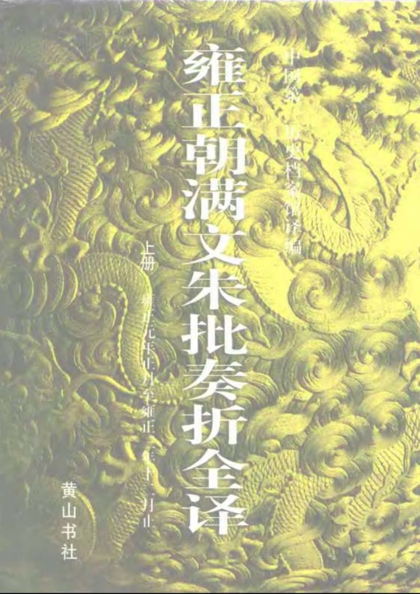
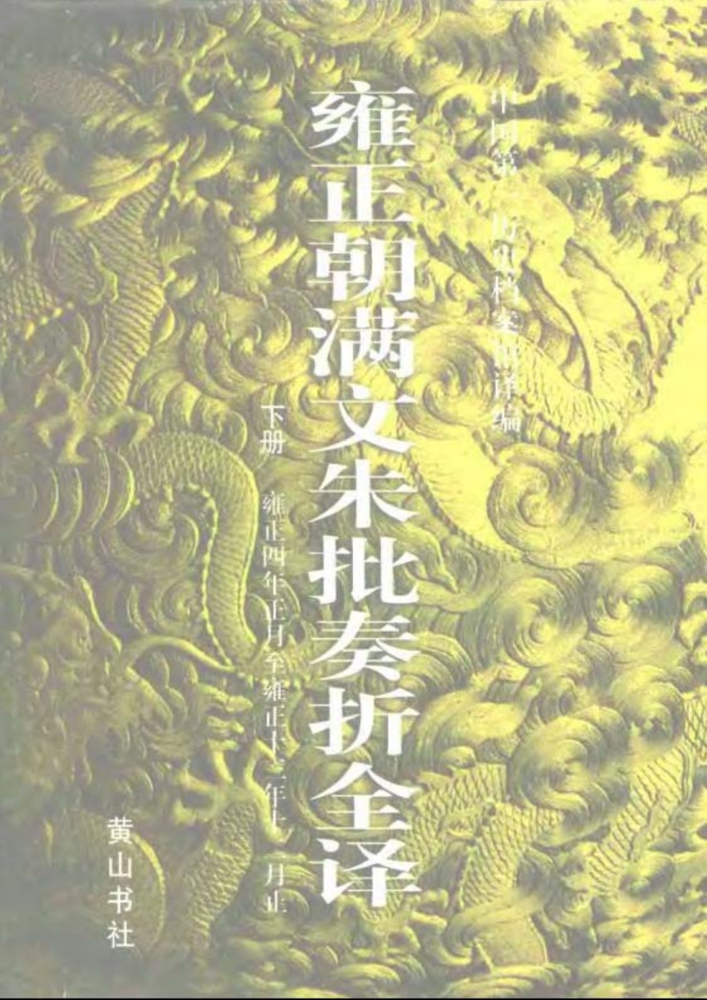
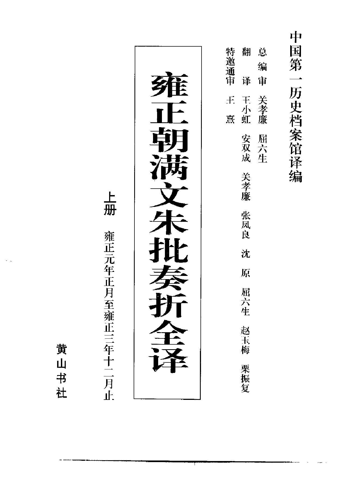
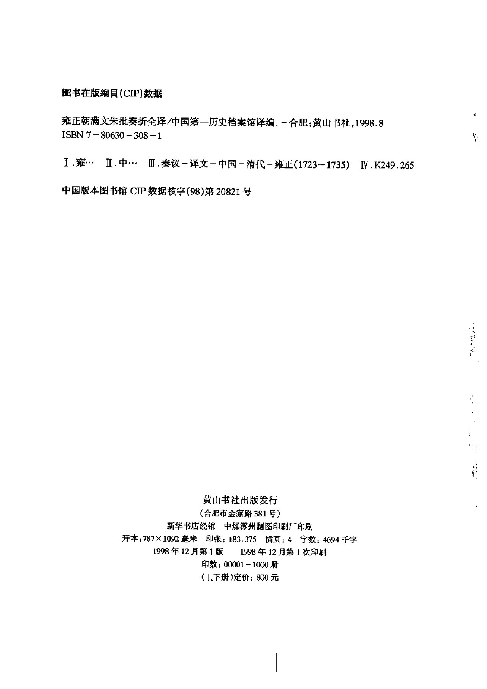
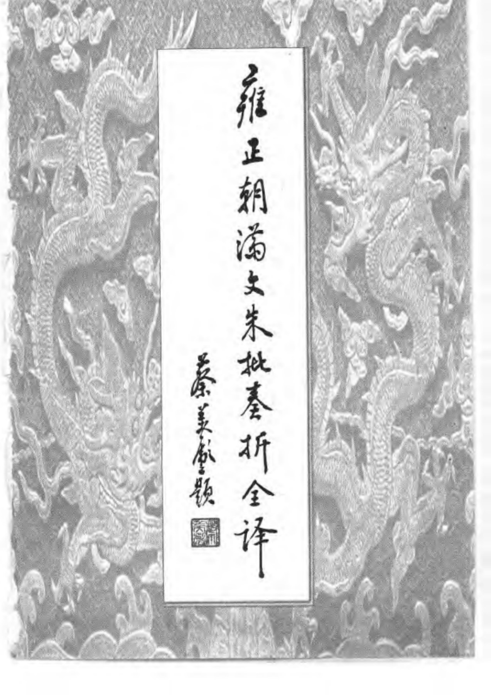
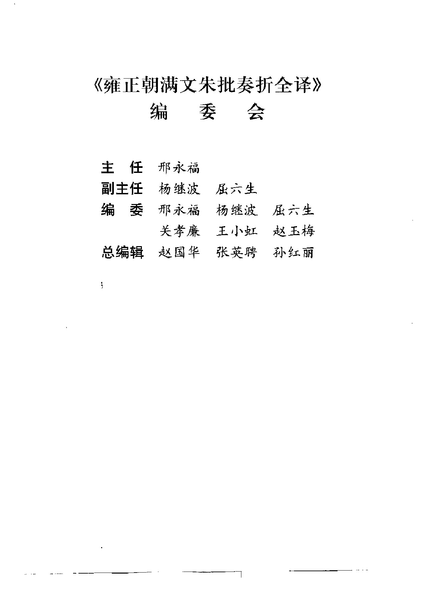
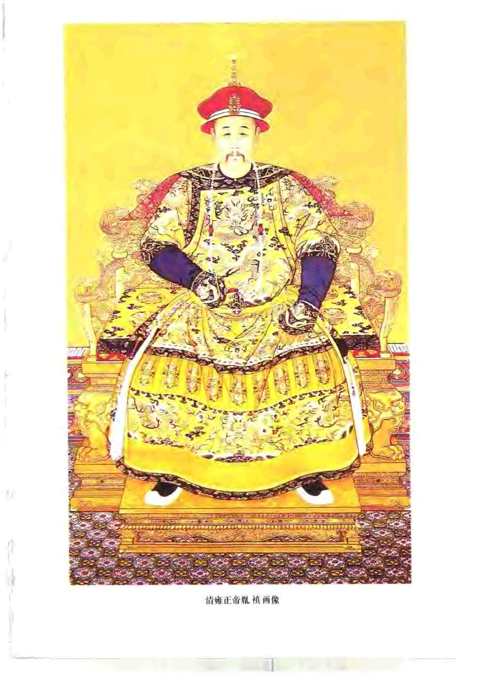
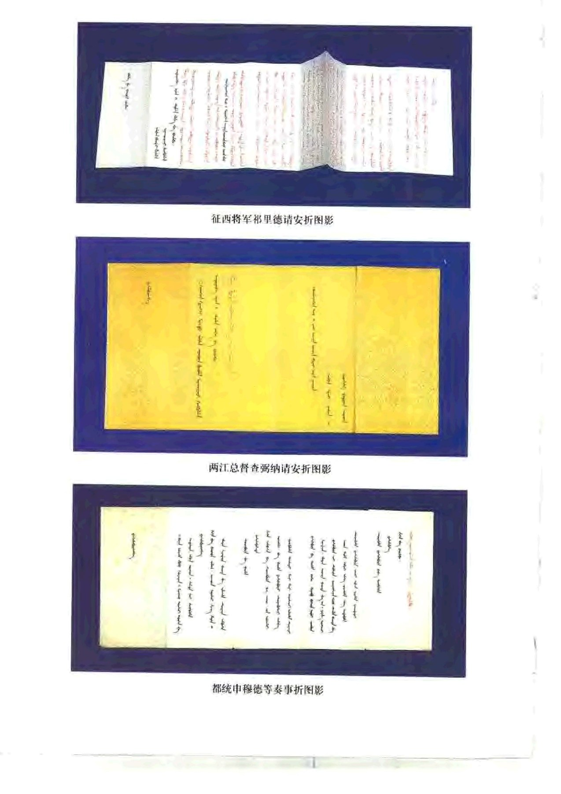
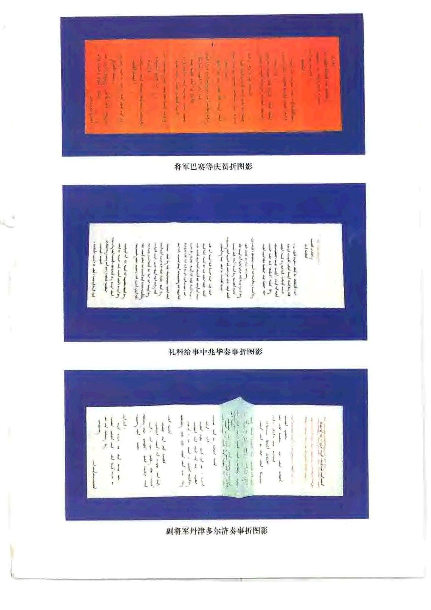
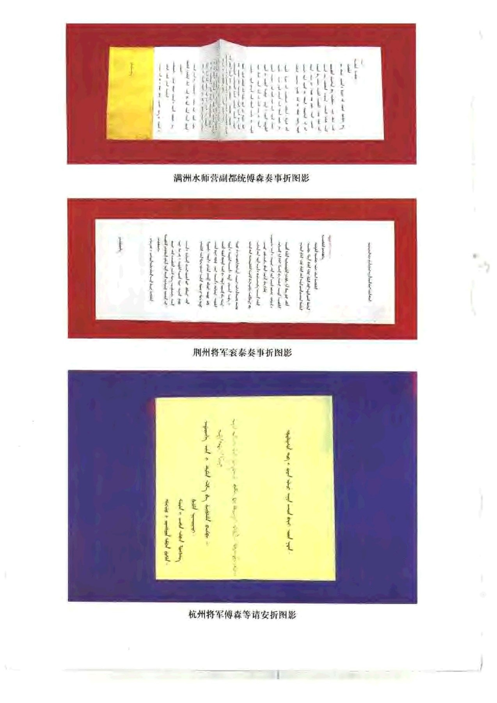

# 前言与目录

> 来源：雍正朝满文朱批奏折全译.pdf，PDF 第 1-283 页。

<!-- PDF page 1 -->

<!-- PDF page 2 -->

<!-- PDF page 3 -->

雍正朝满文朱批奏折全译译王小虹安双成关孝廉张凤良沈原屈六生赵玉梅栗振复

<!-- PDF page 4 -->

雍正朝满文朱批奏折全译/中国第一历史档案馆译编.-合肥：黄山书社，1998.8

<!-- PDF page 5 -->

<!-- PDF page 6 -->

《雍正朝满文朱批奏折全译》

<!-- PDF page 7 -->

<!-- PDF page 8 -->

征西将军祁里德请安折图影

两江总督查弼纳请安折图影

都统申穆德等奏事折图影

<!-- PDF page 9 -->

将军巴赛等庆贺折图影

礼科给事中兆华奏事折图影

副将军丹津多尔济奏事折图影

<!-- PDF page 10 -->

满洲水师营副都统傅森奏事折图影

荆州将军衮泰奏事折图影

杭州将军傅森等请安折图影

<!-- PDF page 11 -->

序

邢永福

《雍正朝满文朱批奏折全译》一书经过我馆满文部业务工作人员多年辛勤劳

动，终于正式面世，可庆可贺。作为《康熙朝满文朱批奏折全译》的姊妹篇，可说是

交相辉映，相得益彰。它的面世，对于进一步深入研究清代前中期史、清代边疆民

族史，乃至清代宫廷史等都具有推动作用。

我曾在中央档案馆、档案出版社工作多年，后又调至中国第一历史档案馆任

职，深知满文档案史料之珍贵，翻译出版之不易。1985年《康熙朝汉文朱批奏折》由

档案出版社出版发行，1987年《雍正朝汉文朱批奏折》也已由江苏古籍出版社出版

发行。而满文朱批奏折因为翻译难度大、周期长，考证释疑，费时费力。满文部编译

组全组人员齐心协作，不懈努力，发扬了不畏艰苦，不图名利，甘为人梯，默默奉献

的精神，终于完成了《雍正朝满文朱批奏折全译》。它是满文翻译工作者多年成果

的结晶，也是翻译大型编年体档案史料的又一部力作。参加本书翻译工作的有满

文部翻译组研究馆员关孝廉、屈六生、安双成、栗振复，副研究馆员张凤良以及王

小虹、赵玉梅、沈原同志。最后由关孝廉、屈六生同志统编定稿。

清代雍正朝只有十三年时间，虽较短促，但承上启下，十分重要。康熙皇帝为

中国封建社会少见之英主，而晚年吏治松弛，失之于“宽”；雍正皇帝一扫因循怠惰

之风，大力整顿吏治，清理财赋，改革政府行政体制及文书制度，设立军机处，加强

中央集权，表现出办事果断、雷厉风行的魄力。然而，在对待政敌和处理政务上，又

难免过于严酷，是应该否定的。尽管如此，由于有了雍正皇帝在位时的大力整治，

<!-- PDF page 12 -->

才保证了乾隆时期国家的政治、经济、军事、文化等各方面继续向前发展，最终统

一了幅员辽阔、民族众多的中国，使清朝的统治达到鼎盛时期。因此过去称“康乾

盛世”，并不十分准确，应该是“康雍乾盛世”。这是因为，正是雍正时期的诸多改革

和努力，才为乾隆盛世创造了条件。

我馆馆藏满文档案数量巨大，根据初步统计，达二百万件之多，约占我馆馆藏

档案总数的五分之一，占全国满文档案总数的百分之八十。我馆始终重视满文档

案的翻译与整理工作和满文档案翻译人才的培养工作，将此作为一项大事来抓，

积极鼓励开展有关满文与满文档案的研究、教学工作和学术交流活动，这些年可

谓成果丰硕、成绩斐然，从编译工作看，经过二十多年的不懈努力，已出版了十余

种、一千余万字的史料。并从1986年起，先后有《清代中俄关系史料》、《满文老

档》、《清初内国史院满文档案译编》、《康熙朝满文朱批奏折全译》等十项成果分别

获档案学、满学优秀成果奖。满文档案的整理编目工作也取得长足进展，不但详细

整理了军机处全部满文录副奏折近20万件，还将目录输入电脑，准备建立数据

库，内阁满文题本的深加工整理也已过半。但这些工作只能说是初步的，与满文档

案总数相比，与社会各界特别是学术界的需求相比，还有很大差距。已编译的档案

只占满文档案总数很小部分。军机处、内阁、内务府、宗人府、黑龙江将军衙门等重

要全宗档案，还未曾涉及。就宫中全宗满文朱批奏折而言，也仅仅刚翻译了清代前

期的康熙、雍正二朝档案，从乾隆朝开始，满文朱批奏折还有很多很多。我们有责

任、有义务，进一步加快满文档案整理编译步伐，争取把这批珍贵的民族文化遗产

高标准、高质量的编译出来，奉献给社会。

一九九八年六月八日

<!-- PDF page 13 -->

序

张德信

近半个世纪以来，中国通史和断代史的研究，无论在开拓领域、出版成果，还

是文献资料的整理、利用和开发，都取得了令人瞩目的成就。其中在断代史方面，

明清史的研究尤其具有突出的地位。这主要是因为明清历史在中国封建社会发展

中所具有的特殊性和重要性开始为世人所认识，所重视；其次是明清时期遗存的

丰富典籍资源，如实录、官书、正史以及文集、笔记、小说、方志资料，特别是数量巨

大的中央档案和地方档案资料的发掘和整理，为后人深入研究明清时期的历史发

展概貌，提供了大量的更为直接的依据。客观而论，在这些典籍中，官方如藏于秘

府的御批档案的特殊作用是其他文献所不能替代的。这是因为，它绝不是只言片

语的残缺史料，抑或可有可无的一堆故纸，而是可以对文献史料起到补其阙，述其

详，纠其谬的作用。因此，对文献材料与档案材料的充分理解和正确运用，便可以

相辅相成，相得益彰，交相辉映；也才能使我们有可能将某些历史事件、人物活动、

战争场面的情景描绘得更切合历史实际，并从中给人们以生动的历史启迪。从而

使我们的研究领域愈来愈广，路子愈走愈宽，成果更多。

历史研究要以史实为依据。丰富的明清档案，确实为研究者提供了其他断代

史研究无法比拟的优越条件。中国第一历史档案馆继编辑出版《康熙朝满文朱批

<!-- PDF page 14 -->

奏折全译》等系列满汉文档案史料之后，现又编译出版《雍正朝满文朱批奏折全

译》一书，奉献给中外学者，这对中国通史和清代历史研究来说，的确是可喜可贺

的事。

清承明制，这是史学界通常的说法。其实满族统治者在继承明制的同时，顺应

历史和时代发展潮流，充分表现出了其励精图治，积极向上，勇于开拓，兼容并蓄

的民族特性，大大丰富并完善了中国封建政治的内容，创立了许多较为完备的典

章制度，从而谱写了清前期国泰民安，政治一统，多民族共存的“康雍乾”盛世。而

《雍正朝满文朱批奏折全译》一书的出版，为我们研究雍正帝及其时代安邦治国的

卓越成就以及满族统治者之所以能够开创盛世，超越前代，缔造多民族统一封建

帝国的深层原因，提供了最为直接的史料依据。

清史在断代史研究中可资利用的资料最为丰富，研究成果颇多。而对雍正朝

的研究，由于语言文字的缘故，使许多研究者无法充分利用满文档案资料，从而影

响并局限了人们的研究视野，留下诸多遗憾。而雍正朝满文朱批奏折的翻译出版，

正好弥补了这一历史性的缺憾，也为我们全面系统地认识、研究清朝前期历史以

及雍正帝时代的伟业，评判已有的研究成果，提供了极为丰富的史料和衡量尺度，

这对开拓清史研究视野和领域，并将其引向深入，无疑是十分有益的。

值此《雍正朝满文朱批奏折全译》一书出版之际，思绪万千，感慨良多。如此嘉

惠学人之善举，功德无量，当大力宣扬。

是为序。

一九九八年九月十八日于东厂胡同一号

<!-- PDF page 15 -->

序三

马大正

清代是中国历史上最后一个封建王朝，也是由古代社会向近代半封建半殖民地

社会转变的开端和起点。其前期，既出现过延续达138年之久的“康雍乾盛世”，更有

着社会安定、经济发展、文化繁荣、民族和睦的封建统一大帝国时代的夕阳余晖。其

中，雍正一朝(1723—1735年)，虽然仅有13年的历史，可谓短促的弹指一挥间，然

而它的承上启下作用和雍正帝的诸多影响所及，却是其它时代所无法替代的。

作为雍正朝“盛世”开创者的清世宗雍正帝，是一位政治上有远见卓识、统治

手段干练坚决、施政作风雷厉风行的统治者。同时，他又是一位推行社会政治、经

济改革的改革家和实践者，其推陈出新意识和举措，远在诸多帝王之上。然而因其

“夺嫡”一说的存在，却颇遭后世责难，致使“瑕”掩其“玉”、“过”盖其“功”，加之重

要史料的阙如，研究者各抒己见，众说纷纭，使诸多问题至今或涉足者寡，或莫衷

一是，难成定论。

新近由中国第一历史档案馆满文部编译、黄山书社出版的《雍正朝满文朱批

奏折全译》一书，不仅为研究雍正朝提供了新的契机和条件，而且在历史资料运用

方面开拓了新的途径和天地。从而使海内外众多研究者得以开启历史沉湮多年的

“门户”，步入其“殿堂”，探察其本来面目。由此可知本书编译者、出版者的辛勤劳

作，真可谓功德无量。

《雍正朝满文朱批奏折全译》一书，对雍正朝的社会政治、经济、军事、文化、宫

中活动等均有较详的记载。尤其是对雍正帝的治国思想、安邦之道、用人之术、军

事谋略、文化政策、谕民教化、社会风尚、家庭教育、宫中生活情趣旨向的形成、发

展、演变的轨迹有更为详真的载录，为其它史料所不能替代。

通观全书，并与该期同类的汉文载录比较，该书在内容、史料价值诸方面，有

<!-- PDF page 16 -->

六大特点，值得世人注目：

特点之一是真实性。《雍正朝满文朱批奏折全译》一书，所收录、编译的朱批奏

折，是清代最珍贵、最具特色、最有政治权威性和机密性的历史档案遗存之一。其

仔，既有中国第一历史档案馆所珍藏的满文原件，也有台北故宫博物院所藏雍正

朝满文朱批奏折原件的复印件。两者合而为一，成为完整的系列。其内容的原始

性、真实性、可靠性无容置疑。通过这些高度机密的满文折奏和雍正帝的满文朱批

谕旨，既可明瞭诸多历史事件发生发展的过程，解开某些历史谜团，又有助于窥知

雍正帝的政治心态及其治术的真面目。

特点之二是实证性。在《雍正朝满文朱批奏折全译》一书中，编译的满文朱批

奏折，均是雍正朝文武大臣及其亲信对有关军国大事发生发展的“实”具、“实”折、

“实”奏与雍正帝朱批的“实”意、“实”图、“实”谕、“实”策。同时，它也是特定历史时

代、特定事件、特定人物、特定权力集团演变和荣辱沉浮过程的“实录”。海内外读

者和研究者，通过查阅利用这些具有历史“实证性”的满文档案资料，参照其它汉

文档案、文献史料，相互比勘，将会对诸多历史事件的过程及内幕，有更加清楚翔

实的了解，进而使认识与研究迈向一个新的高度。

特点之三是广博性。《雍正朝满文朱批奏折全译》一书，从内容而言，所包容、

涉及的方面极其广博。雍正帝实施的一些重大政治、军事、边疆、外交举措，改革行

动，诸如打击政敌集团势力，清理财政，设立军机处，加强中央集权，改革八旗事

务；实行改土归流，平定边疆军事叛乱；禁天主教，驱逐西洋传教士；划定中俄边界

等，在满文朱批中，均有较详的载述。该书的出版问世，将对雍正朝政治史、经济

史、军事史、文化史、民族史、边疆史、社会史、宫廷史、宗教史、思想史、中外关系史

的深入研究，提供无与伦比的宝贵依据。

特点之四是宏富性。从特定意义上而言，《雍正朝满文朱批奏折全译》一书，公

诸于世的珍稀满文朱批奏折，本身就是一个档案史料宏富的资料库。这些不仅表

现在朱批奏折内容丰富，涉及朝政的各个领域，而且就朱批谕旨本身来看，雍正帝

的朱批既是对军政大臣呈奏事项及处理办法的直接谕示，又是对执行政策与改革

<!-- PDF page 17 -->

意图的阐释。因此，其“宏富”的特色，在档案内容的广度与深度上，可使雍正一朝

的历史，得以准确、科学、立体、多元的生动再现。

特点之五是独具性。《雍正朝满文朱批奏折全译》一书收录的奏折、朱批，在文

字上均使用与汉文有别的满文，以增强机密性，使用臣下折奏这种特定的官方文

书形式，以与题本、奏章相区别；奏折均由雍正皇帝亲自审阅并加朱批，以显示其

权威性；满文朱批奏折，经编译者的考订、编译成汉文后，使海内外的研究者，在检

索、阅读、使用时，更为快捷方便。

特点之六是特定性。有清一代，高级官员普遍实行奏折制，始自雍正朝。它的

实施，既是雍正皇帝在政治上加强中央集权的重要举措，同时与朝廷中实施军政

大权的核心机构“军机处”的建立有关。清政府规定，中央各部院堂官、科道官及地

方两司以上、武职副都统、总兵以上大员，才有权具折奏事。具折官员须派员或通

过驿递，直接呈进，由皇帝拆阅并用朱笔批谕。凡经朱批者，即称朱批奏折。雍正元

年（1723年)明令，凡经朱批者，在发还具奏人遵照执行后，必须定期缴还皇宫保

存，这使大批珍贵的历史档案资料，得以传承至今。但雍正朝的满文朱批奏折，却

有其特定的历史价值，故尤为世人所珍视。然因其语言文字上的缘故，迟迟未能编

译出版，公布面世。现在，这项工作终得圆满完成，实为史学界，特别是清史学界的

一件幸事。

雍正一朝，时间虽短，但却风云变幻，新政迭出；平定边乱，用兵频繁；驱逐教

士，与俄订约；推行保甲，强化宗教；立军机处，行奏折制；耗羡归公，官吏养廉；惩

治贪官，清理财政；摊丁入粮，豁除贱籍；改革八旗，削弱王公；减少政争，秘密立

储；文化专制，兴文字狱；西南边疆，改土归流等等历史事件，在该书中均有涉及和

反映。因此，海内外学者研究分析这些公诸于世的珍贵史料，肯定会对过去已研究

的许多重要课题，有新的理解和认识，从而推动清史研究的深入。

有感于此，是为序。

一九九八年七月一日于中国社会科学院边疆研究中心

<!-- PDF page 18 -->

序四

周绍泉

从1898年下半年发现有字甲骨至今，恰好一百年。在甲骨文发现的第二年，

即1899年以后，汉晋木简相继在新疆和甘肃敦煌、居延面世。敦煌石窟的宝藏

——敦煌文书则在1900年重见天日。历经磨难、劫后余存的“大内档案”明清

故宫档案，在本世纪初才为人所知。上述甲骨文、简帛、敦煌文书和明清故宫档案，

被誉为上个世纪末和本世纪初中国历史文化的四大发现。在甲骨文发现后差不多

整整六十年的1957年，中国历史文化的第五大发现见诸报端，这就是徽州文书。

由于中国历史文化五大发现而出现的甲骨学、简帛学、敦煌学和徽学，有的已

成为世界的显学。进入九十年代，有学者提出建立以明清故宫档案和各地收藏的

明清档案为研究对象的明清档案学。这个新学科的建立和发展是历史的必然。一

个世纪的历史学的发展表明，新资料的发现，促进新学科的产生。正如王国维先生

所说：“古来新学问起，大都由于新发见。”

我国有清一代经学极盛，而史学却委靡。究其原因，大凡是“清代经学发展过

甚，所以转致史学之不振也。”(陈寅恪语)那时的学问的对象只限于书本，而书本

又以经书为主体，经学又只要三年通一经，便为专门之学。声誉既易致，而利禄亦

随之。于是一世才智之士，能为考据之学者，群舍史学而趋于经学之一途。其余绪

延至本世纪初，有人仍固守几本经书不放，甚至说：“八部书外皆狗屁。”

我国传统学术向现代学术的转变，是以上世纪末本世纪初中国历史文化的四

大发现，特别是以甲骨文和敦煌文书的发现及由此而导致甲骨学和敦煌学的建立

为契机而实现的。当时学者多为新发现的资料而振奋，王国维先生在《古史新证》

中写道：“吾辈生于今日，幸于纤上材料外，更得地下之新材料。由此种材料，我辈

固得据以补正纸上之材料，亦得证明古书之某部分全为实录，即百家不雅驯之言

亦不无表示一面之事实。此二重证据法惟在今日始得为之。”这些新发现，使人们

<!-- PDF page 19 -->

从纠缠不清的经学争论中解脱出来，使历史学以新发现的新资料为立足之根基发

展起来。

不过，当时学人都把精力集中在殷墟甲骨、北邙明器、敦煌佚籍、新疆木简上，

学界流行着“书不读隋唐以下”的说法。所以，那时的学人多作古史，如陈寅恪先生

所说：“今日吾国治学之士，竟言古史。”

在此情况下，治明清史者很少。即使有治明清史者，亦只据官书正史铺陈其大

致脉络。三十年代初，始有人系统搜辑野史稗乘，以考证旧闻，订补正史。迨至五、

六十年代，随着“资本主义萌芽”问题的讨论，明清社会经济史的研究有了飞速的

发展，才有更多的学者开始搜求实录、官书、正史之外的文集、笔记、小说、方志资

料。其时虽有人开始注意故宫档案和地方文书档案的逢录、搜集和整理，然因当时

条件所限，难以为继。改革开放之后，特别是1980年中国第一历史档案馆成立之

后，使明清档案的整理刊布工作进入一个新的阶段。

此后的十余年中，中国第一历史档案馆先后整理刊布了《康熙起居注》、《康熙

统一台湾史料选辑》、《郑成功档案史料选辑》、《康熙朝汉文朱批奏折》、《雍正朝汉

文朱批奏折》、《雍正起居注》、《雍正朝汉文谕旨汇编》、《鸦片战争档案史料》、《清

政府镇压太平天国档案史料》、《近代教案》、《中日战争续编》等十余个专题档案资

料。与此同时，北京和一些地方的档案馆、博物馆、图书馆、研究机构、大专院校也

整理出版了各自收藏的历史文书档案，如《清代吉林档案史料选编》《三姓副都统

衙门满文档案译编》、《明代辽东档案汇编》、《曲阜孔府档案史料选编》、《自贡盐业

契约档案选辑》、《清代乾嘉道巴县档案选编》、《清代巴县档案汇编》、《明清徽州社

会经济资料丛编》、《徽州千年契约文书》、《清代武定彝族那氏土司档案史料校

编》、《明清福建经济契约文书选辑》等数十部，使研究明清史的学者，得以利用这

批珍贵的第一手资料，推动了海内外的清史研究。

在现在的中国，从南到北，从东到西，发现了许多历史文书档案，除中国第一

历史档案馆收藏的明清大内档案之外，还有清代香港土地文书、清代珠江三角洲

土地文书、明清福建闽北文书、清代台湾淡新档案、明清浙江严州等府文书和兰溪

鳞图册、清代四川巴县档案、明清四川自流井档案、清代贵州文书、清代云南武定

彝族那氏土司档案、清代江苏商业文书和太湖厅档案、从宋到民国徽州文书、明清

安徽除徽州文书之外的历史文书(如清代宁国府南陵县档案)、山东曲阜孔府档

<!-- PDF page 20 -->

案、清代河北获鹿土地文书、清代顺天府宝坻县档案、明清东北和内蒙古文书等

等。整理、编辑、出版这些历史文书档案，对于推动我国学术研究，特别是对推动明

清史研究起着无可估量的作用。它使我们可以避免只用古代人的眼睛看当时社

会，而能够直接观察当时社会，做社会实态研究。

我国史学大师陈寅恪先生在《陈垣敦煌劫余录序》中说：“一时代之学术，必有

其新材料与新问题。取用此材料，以研求问题，则为此时代学术之新潮流。”什么是

我们这个时代学术研究的新材料和新问题，是许多学者关注的问题。能否把被誉

为中国历史文化的第四大发现—明清故宫档案和第五大发现——徽州文书，或

扩大和概括地说，以明清故宫档案和徽州文书为代表的历史文书档案，看作我们

这个时代学术研究的新材料呢？能否把取用此材料，综合研究从中央到地方的社

会实态，作为我们这个时代学术之新潮流呢？假若这两个设问都可以做肯定的回

答，那末，是否可以说，以明清故宫档案和各地收藏的明清档案为研究对象的明清

档案学，以徽州文书研究为中心，综合研究社会实态，探讨中国封建社会后期发展

变化规律的徽学，就是我们这个时代的学术潮流呢？果如此，则明清档案学和徽学

就不能不是我们这个时代学术潮流中的一个主流，特别是在明清史研究中尤其如

此。

当明清历史文书档案的研究价值逐渐为人们认识的时候，却出现了难以利用

的困惑。因为这些历史文书档案大都深藏不露，难得一见；有些档案是用少数民族

文字书写的，不谙于此，就无法利用。此次中国第一历史档案馆继公布《康熙朝满

文朱批奏折全译》之后，又将雍正朝满文朱批奏折全部翻译出版，实在是令学人欢

心鼓舞的事，也是为这个时代学术主流添砖加瓦、功德无量的事。

正值《雍正朝满文朱批奏折全译》出版之际，余不揣翦陋，草就数语如上。是为

序。

一九九八年八月十日识于劲松半空室

<!-- PDF page 21 -->

序五

毛佩琦

历史的客观与真实，是一切严肃的史学家追求的最终目标。然而，什么样的历

史是客观的与真实的，如何去把握历史的客观与真实，则是见仁见智。

依我看，史学家笔下历史的客观与真实，至少应包括两个层面的意义，一是史

实的准确无误，二是对历史的论断准确，反映了历史的本质。简言之，一是史，二是

论。这两个方面都做好了，才谈得上历史的客观与真实。史与论的关系曾一度是史

学界的热门话题，或曰“论从史出”，或曰“以论带史”，或曰“史论结合”。更有“有一

分材料说一分话”的说法。这几说相争不分伯仲，只有所谓“以论代史”者则遭到了

普遍唾弃。这一争论突出说明了史的不可忽视，不管论得如何，它必须以史为基

础，为前提。

这实际上是重复了一个最简单的也是最基本的老话题，即研究历史必须首先

有史，必须以史实为依据。明代史学家王世贞称用以编织史著的材料为史料，史家

手中没有材料是无法凭虚架构历史的。因为史料一词准确地表达了材料与史著之

间的关系，因而被后世沿用。中国是个史学大国，史学著述浩如烟海，在我们今天

看来，它们都可以作为史料，而史料则又不限于史书，举凡文集、方志、碑铭乃至家

谱、诗歌、小说，莫不有史料之用。各种史料杂芜繁琐，真伪相兼，考据、辨伪成为运

用史料首先要解决的问题。近代考古学在我国兴起后，史实考据有所谓二重证据

法，这样考古发现也就成了史料和准史料了。然而近数十年以来，档案史料在史学

研究中的重要性是无以取代的。

史学家陈寅恪先生有一种“入流”说，他认为：

一代之学术，必有其新材料与新问题。取用此材料以研求问题，则为此时

代学术之新潮流。治学之士得预于此潮流者，谓之预流(借用佛教初果之名)。

其未得预者，谓之未入流。此古今学术史之通义，非彼闭门造车之徒，所能同

喻者也。

自敦煌文献被发现以来，受到学术界的普遍关注，而于此后治隋唐史者不用

敦煌文献，是不可想象的。陈寅恪盛赞陈垣所编的《敦煌劫余录》，称“今后斯录既

<!-- PDF page 22 -->

出，国人获兹凭藉，宜益能取用材料以研求问题，勉作敦煌学之预流。庶几内不可

以不负此历劫仅存之国宝，外有以襄进世界之学术于将来”。可以断定，一个未入

流的学者必不能作为一流学者。而众多学者得借此《劫余录》而预流，则又可以看

出史料编纂于学术进步之无量功德。

清帝逊位后，清代档案已开始流散民间。袁世凯称帝后又曾有明令烧毁档案。

1921年，北洋政府教育部因经费困难竟将清代档案八千麻袋论斤出售，引起了学

界的轩然大波。经有识之士多方奋力抢救，才使这批档案大体保存下来，正是“初

将销毁，夺于火劫。终将造纸，夺于永劫”(金梁：《内阁大库档案访求记》，《东方杂

志》第二十卷第四号，民国十二年二月出版。)。如今，这批分别收藏于北京中国第

一历史档案馆、台北故宫博物院和流散于世界各地的明清档案，成为研究清史的

一大宝库。借用陈寅恪先生的话说，能利用这批档案研治清史的可称为“预流”，研

治清史而不利用这批档案则为“未入流”。然而，这批档案不仅分散于各地而且数

量庞大头绪繁多。要想“预流”，要想在有限的时间内获得更多的成果，一要靠自己

勤奋，直接到档案的海洋中去搜觅，二就要靠熟悉档案的专业人士帮忙了。所幸的

是，自从罗振玉编印《史料丛刊初编》以后，一代又一代的档案工作者和史学工作

者投入了明清档案的整理、编纂工作，他们从尘封山积的档案中整理出一批又一

批各种各样的专题档案。特别是1980年中国第一历史档案馆成立，使明清档案的

整理公布工作推进到了一个新的阶段。在短短十余年中便有《康熙起居注》、《康熙

统一台湾史料选辑》、《郑成功档案史料选辑》《康熙朝汉文朱批奏折》、《雍正朝汉

文朱批奏折汇编》、《雍正起居注》、《雍正朝汉文谕旨汇编》、《鸦片战争档案史料》、

《清政府镇压太平天国档案史料》《近代教案》、《中日战争续编》等大量专题档案

整理公布出版。这些档案的公布出版，不仅使众多的清史研究者得以“预流”，而且

推动了海内外的清史研究，实实在在地起到了“襄进世界学术”之功。档案整理者

们的精神令人感动，他们的功绩应给予盛赞。

1996年7月，中国第一历史档案馆推出了煌煌270万字的《康熙朝满文朱批

奏折全译》，将中国第一历史档案馆所藏康熙朝满文朱批奏折4400余件和台北故

宫博物院所藏700余件全部译成汉文出版，在清史学界引起了不小的轰动，不仅

因为其大其全，不仅因为将满文译成汉文较之编纂汉文档案工作尤难，工作量尤

巨，更因为这批史料的珍贵。它使人们看到了康熙朝更为隐秘的另一面，推动了对

康熙朝的深入研究也从而推进了对整个清史的进一步了解。

如今刚刚一年过去，中国第一历史档案馆的各位同仁又向大家公布了这部部

<!-- PDF page 23 -->

头更大的《雍正朝满文朱批奏折全译》，当我们捧读在手的时候，就不能不为之惊

叹了！

雍正朝在号称的康雍乾盛世适当其中，依我看，毋宁说正是雍正帝绍述乃父，

经过十三年的治理将清朝推向盛世。雍正朝历时虽短，而可述之事偏多。雍正朝在

清史研究中的重要性是不用说的。从孟森(心史)先生起，几代史学家都给予雍正

朝以相当的注意。特别是近十余年来，关于雍正帝研究的专著陆续出版，有关于其

密折制度研究的，有为其写传记的，其中不少著作用功甚勤，颇有创获，然一些著

述惜乎限于条件或限于学力，未能充分利用这批满文文献，仍借用陈寅恪先生的

话说叫作“未入流”吧！

清代的奏折制度起源于顺治年间。奏折可直达御前，由皇帝亲自拆阅，朱批直

寄具奏者遵行，较之题奏本章更为机密。现存满文朱批奏折的6600余件(其中中

国第一历史档案馆5600件、台北故宫博物院970余件），远远超过康熙朝满文朱

批奏折。这批档案的宝贵不仅因为其数量大，更因为它与通常见到的汉文朱批奏

折内容完全不同，又因为其用满文书写而少为外人所知。熟悉中国政治历史的人

都知道，官方公布的文书与实际的政治运转是不一致的，社会政治的表象常常是

被当政者暗中操纵的。不管对于雍正帝的政绩如何评价，大家对于雍正帝是玩弄

阴谋权术的高手的看法则是一致的。这批满文朱批奏折作为雍正一朝机密政务的

载体，它的公布，揭示了雍正朝政治中的许多隐秘，对于加深和推动雍正朝和雍正

帝研究的重要程度是毋庸赘言的。许多学子得因此而“预流”，步入雍正朝史研究

的新境地，亦何其幸也！

不管人们对历史如何评说，客观而真实的历史只有一个。随着社会的进步，随

着人的知识的丰富和理论素养的提高，以前对历史的结论可能随时会加以修改，

但历史的基本事实是不可改变的。中国第一历史档案馆的同仁们做的工作，就是

把历史史实展现给人们看。若干年后，也许一些我们现在认为正确的论点成了昨

日黄花和过眼烟云被抛弃了，而这些基本史料却永远不会褪色，随着时间流逝更

显示其永恒的价值。

是为序。

一九九七年八月十日序于中国人民大学静园

<!-- PDF page 24 -->

译编说明

清入关初期，由于长期的战乱，社会经济遭到严重的破坏，全国各地呈现一片

荒凉萧条的景象。经过顺治、康熙两时期的相继进行调整和改革，采取各种措施，

社会经济得以复苏，结束了大规模的战乱，阶级斗争趋于平稳，社会发展呈现上升

势头，到康熙中期出现了历史上的康熙“盛世”。清朝经过半个多世纪引人注目的

发展，到康熙晚期，皇帝倦勤，官吏玩愒，库帑亏绌，国力渐衰，社会矛盾亦趋尖锐，

统治阶级内部的权力斗争日臻激烈，出现停滞不前的状态。皇四子胤禛即位，改元

雍正，亲政伊始，便力除时弊。雍正帝作为一个最高统治者，他具有杰出的统治才

能，勤于政务，洞悉世情，能言善辩，办事认真，御下严格，以雷厉风行的姿态纠正

了康熙晚年社会诸弊端，结束了皇族内部的长期争夺。雍正帝在西北用兵并在西

南实行“改土归流”，保证喀尔喀蒙古、西藏、青海、云南、贵州、四川的安宁，以巩固

国家的统一。他整顿财政，清查钱粮，正式颁诏推行了“摊丁入亩”，“耗羡归公”，

“除豁贱籍”等一系列有利于国计民生的政策，一定程度上适应了社会生产力的发

展，促成了吏治的相对澄清，财政有所好转，农民负担有所减轻，政治相对稳定。雍

正一朝十三年，时间虽不长，却是清朝统治的重要时期，上承康熙帝之政绩，兼有

巩固和开创之功，下启乾隆帝之升平，促进了我国封建后期的经济、政治和文化，

为以后的乾隆“盛世”奠定了基础。国内外清史研究者，尽管对雍正帝的继位有矫

诏篡立之疑，或对胤禛个人品质有看法，然而他继顺治、康熙之后的又一有作为的

皇帝，于雍正帝的治绩和雍正一朝的历史地位，都给予了较高的评价。为使治史者

深入研究这段历史，我馆继编译出版《康熙朝满文朱批奏折全译》之后，即赓续编

译《雍正朝满文朱批奏折全译》。雍正朝满文奏折，均系首次翻译，公诸于世，史料

价值弥足珍贵。它的出版，必将为研究清代前期政治史、宫廷史、外交史、区域经济

史、民族史、边疆史和纂修方志等提供鲜为人知的第一手材料。

奏折，又称折子、奏帖、折奏、密本，多用无格白折纸制成，故名。为臣工向皇帝

奏事进言的主要上行官文书，始行于顺治十三年，发展到康熙初期成为密折，至雍

<!-- PDF page 25 -->

正时期仍是机密文书，除奏折文书具有的共同特点(详见《康熙朝满文朱批奏折全

译》一书之《译编说明》外，所不同的是采取和建立了较康熙朝更加完善、严格的

一套相应措施和制度。其主要表现是：第一，确立并严格执行缴回朱批奏折制度。

康熙前期便有缴回朱批奏折的规定，但在执行中并不甚严格，因此多数奏折没有

缴回。雍正帝在自己即位之第八天，即康熙六十一年十一月二十七日下颁满文上

谕：“军前将军、各省督抚、将军、提镇、总兵官及各地，所有朕之皇父朱批旨意，俱

著敬谨查收，送来给朕，如果抄写存留、隐匿、焚弃，日后败露，断不宥恕，定行从重

治罪。”同时还规定：“嗣后朕亲批密旨，下次具奏事件内，务须呈进，亦不可抄写存

留。”可见雍正帝推行缴回朱批奏折制度是非常认真，十分严厉的。从此重新确立

了缴回朱批奏折的制度，成为定制，其后各朝亦继续严格执行缴回朱批奏折制度，

终清一代未改。现在存世的绝大部分康熙朝满汉文朱批奏折原件，即雍正帝颁行

缴回朱批奏折制度之后补缴的。雍正帝重新确立并严格执行缴回朱批奏折制度是

出于政治斗争的需要，但客观上将产生于宫而不存于宫中之朱批奏折原件得以集

中庋藏于皇宫内，并留存至今，为后人留下了珍贵的档案史料。第二，建立录副、发

抄和存档制度。自雍正八年设立军机处始，规定将皇帝朱批过的折子于发还具折

人遵行之先，均交由军机处抄录一份副本，称录副奏折。抄录副本毕，需交有关部

院衙门承办的奏折，军机处交由内阁领出，传抄于有关衙门，抄完缴回，称作发抄。

军机处将每日之录副奏折和未奉朱批的原折，连同随折进呈的各种附件如官员履

历、清单、舆图等，按日箍为一束，每半月合为一包，存放备查，故称“月折包”，此即

为存档。现存上百余万件满汉文录副奏折，可以补充奏折原件之缺。第三，扩大具

折人的范围。此时奏折之使用范围较康熙朝又有扩大，不仅中央各部院及地方亲

信大留具折奏事，而且还扩大到副将、部院司官等中下级官员，准许他们径上奏

折，其范围几乎遍布全国各地，从而进一步拓展了情报来源并加强了对各地官员

的互相监督，以利于有效控制全国之局势。第四，扩大奏事内容。从雍正帝的朱批

看，反复谕令经他批准可以用折子奏事的内外臣工，通过折子报告所在地方之官

场隐私，民间舆情，皇帝之一切举措或得或失，总之是“凡天下有关吏治、民生、兴

除、劝惩各事”，要求不必真知灼见，亦无须访查确实，但有心得听闻，都要密报毋

隐。这样，丰富了情报内容，为雍正帝提供大量的决策依据。第五，继续重申奏折为

<!-- PDF page 26 -->

机密文书，进一步加强保密措施。在反复告诫奏折即非露章，惟以慎密为要，“君不

密则失臣，臣不密则失身”的同时，雍正帝要求臣僚亲手写折，即他人代笔，亦要在

折内声明，未经允准，其奏折内容及朱批严禁公开，不得互相传看，或写入本章，甚

至对密折、密批，皇帝密令销毁，不得擅自存留，违者予以严惩。并自雍正朝始，赐

给具折官员以内制包封装置，以便于保护和保密。《雍正起居注》载：雍正二年十一

月初九日又奉上谕：凡督抚大吏，任封疆之寄，其所陈奏之事，皆有关于国计民生，

故于本章之外，准用奏折。以本章所不能尽者，则奏折可以详陈，而朕谕旨所不能

尽者，亦于奏折中详细批示，以定行止。此皆国家机密紧要之事，关系甚重，不得预

先轻泄于人，是以朕将内制皮匣发于诸臣，令其封锁奏达。盖取坚固慎密，他人不

敢私开也。”由于上述措施和制度的大力推行，是对清初文书制度的重大改革，奏

折的地位和作用日趋重要，成为雍正帝借以实施统治政治的工具，尤其是设立军

机处之后，奉命掌理机密要务，从而权力归于皇帝一身，标志着以皇权为核心的清

代封建专制主义发展到了最高峰。

雍正朝的满文朱批奏折原件，现在存世的有六千六百余件，分两地保存。中国

第一历史档案馆存有五千六百余件；台北故宫博物院藏有九百七十余件，前已原

件影印出版。为给国内外广大史学者提供雍正一朝比较系统、完整的珍贵满文史

料，将中国第一历史档案馆所存及台北故宫博物院影印出版的《宫中档雍正朝奏

折》一书中之满文奏折尽行译注，合辑《雍正朝满文朱批奏折全译》一书出版。此

外，在雍正朝满文奏折中，还有一部分清安折，因其所载内容除有某人“跪请圣主

万安”之类的例行套话，以及雍正帝的“saha(知道了)”、“mini beye elhe(朕安)”等

千篇一律的朱批外，别无任何其他内容，不具有什么史料价值，故未译入。所译雍

正朝满文奏折，除绝大多数为经这皇帝批答过的“朱批奏折”外，还有一部分是“留

中”或未奉朱批而军机处交由内阁领出的原折，亦予译入。

雍正朝满文朱批奏折与雍正朝汉文朱批奏折内容不相重复。清入关建立全国

性政权，为使自已相对微弱的力量有效地稳固地统治广大的汉族地区，不能不与

汉族地主结成联盟，它所组成的政府必然是以满族贵族为核心的满汉地主阶级的

联合专政。在这联合统治集团中，满族贵族极力维护自己的特权地位，标举和贯彻

“首崇满洲”的民族统治原则，并采取一定的机构和制度加以巩固。一般在内地广

<!-- PDF page 27 -->

大的汉族地区任用汉官，奏折所报内容侧重反映内地政治、经济、文化等情况，而

满洲官员始终紧紧抓住中枢机关的权力，从中央到池方、边疆乃至沿海军政重地

要职，均用满洲亲信奴才，他们与皇帝关系密切，无话不谈，无事不报，都用满文具

折奏事，除奏报所在部门和地区的一般情报外，还大量报告边疆、民族、军事、外交

等国家重大机密的军政事务以及一切能够打听到的消息，雍正帝本人亦往往在这

些折子上亲笔批示不宜公开的私房话，内容翔实可信，可以说满文奏折较汉文奏

折内容丰富重要。总之，雍正朝满文奏折与雍正朝汉文奏折不仅具折人不同，而且

内容亦不相重复，两者互为补充，各具特殊而重要的价值。

雍正朝满文奏折的内容多为《雍正实录》《雍正起居注》等官撰史书所不载。

《雍正实录》是记载雍正朝国政章制的典籍；《雍正起居注》为记录雍正帝经常举行

的御门听政、公开处理政务的具体这程。可见这两部官撰史书所记载的内容，均为

经既定程序，公开处理，形成制度，举国颁行后的事件。而奏折却是在处理中央和

地方的所有机密军政公私事务的过程中形成的文件，其中有的是属于告密或君臣

之间私下通信性质的情报材料，皇帝的批答亦甚机密，规定密折、密批，严禁公开，

不得写入本章。所以雍正朝满文朱批奏折的内容均未在清代官撰史书或其他史料

中译载。即或收入一些，也是经具题公开后的事件，其折文和批文业经修饰增删，

与朱批奏折的原件颇多歧异。从而朱批奏折又成为校正清官撰史书谬误的原始凭

证。

由于雍正朝满文朱批奏折的件数较多，文字量大，加之翻译和编审时间都比

较匆猝，译文中的错误和欠妥之处在所难免；而译文出自多人之手，故在文风上也

容有差异，很难作完全一致的修订。还望读者批评指正。

编译者

一九九八年五月

<!-- PDF page 28 -->

凡例

一、本书为编年体例，其所收各件的排列顺序，要遵循以下原则：一是原件具

明时间者，以具折(发文)之年月日为序，统一编定顺序号；二是正件带附件如清

单、谕旨等者，仍附于各该件之后，不编文件顺序号，并注明“附”字；三是仅有附件

而无正件者，则顺上编号；四是原件只写明年月而无日或有年无月日者，则分别编

排于该年月或该年之后；五是原件未具时间者，均系于雍正十三年十二月之后，其

具折人，基本按《清代职官年表》一书内排列的顺序编列。

二、本书所译各件为雍正一朝的满文朱批奏折，起自雍正元年正月，止于雍正

十三年十二月，而不是雍正帝即位至病逝期间所形成的满文奏折。是以雍正十三

年八月二十三日雍正帝胤禛去世，其继嗣之君乾隆帝弘历仍沿用雍正年号批发至

本年十二月底的满文奏折，亦皆译入本书；而康熙六十一年十一月十三日康熙帝

玄烨去世，雍正帝继位之后，仍用康熙年号批发至该年十二月底的满文奏折，业已

译入《康熙朝满文朱批奏折全译》一书。

三、本书内各件内容标题，均由译者拟写；原件尾幅所署朝年月日，现俱移至

每件标题之下。

四、原折内皇帝的朱批，分别批于折面、折首、折中、折尾，译后仍置于上述各

该原处，并注有“朱批”字样。

五、凡原折尾幅所列具奏人职名与正文内容难以区分者，由译者在具奏者职

名前面增写“具奏者”等字样，以示区别。

六、满文奏折内原有的释文，其有参考价值者，均予翻译，附于该件之后，并注

<!-- PDF page 29 -->

明“原注”字样。

七、有在满文奏折内夹杂的汉文奏折原件与满文奏折内容不相重复者，由译

者用汉文简体字全文抄录，拟题，标点，长者酌情分段。

八、凡在满文原件中出现的数字，译时俱用汉字数字的小写；汉文原折中出现

的汉字数字的大写，在抄录时也都改为小写。

九、原奏折中因封建礼仪等原因而采取的抬头等格式，经翻译后不予保留，由

译者视译文的长短自行分段。

十、凡奏折内皇帝的行批以及皇帝亲笔增写、改写的字句用()号，被皇帝删

除的文句则用\[\]号。

十一、凡在译文中所遇遍查无考的专名等用圆括号，内用罗马字转写满文字

原音，以资读者参考；凡系汉文原件也用此圆括号，内写明“原件系汉文”等字样，

以与译文相区分；有些原折和折片看不出文件作者，是以在文件标题中，用圆括号

内注出“佚名”二字。

十二、原件内凡残缺、脱落、污损的文字，经译者考证恢复者，用□号内写明考

证恢复之字；仍无法判明为何意者，则用【】号，内写“原档残缺”等字样。

十三、凡在译文中译者需作注释的内容，采用脚注，以①②③……等符号表

示。

十四、凡纠正汉文原折中的错字、别字或不规范的字，都用（〕号，内注明正

字，系于该错别字或不规范字之后。

十五、凡在本书各件内容标题右上方标有\*号的译文，均系译自台北故宫博

物院于1980年影印出版发行的《宫中档雍正朝奏折》一书第二十八辑至第三十二

辑(满文谕折第一辑至第五辑)。

<!-- PDF page 30 -->

目录

1 署理大将军事务延信等奏请西藏设第巴总理藏务折

雍正元年正月初二日

2 闽浙总督满保奏请万安折

雍正元年正月初三日

3 闽浙总督满保奏进西瓜折

雍正元年正月初三日

4 闽浙总督满保奏报冬收并米价情形折…… 2

雍正元年正月初三日

5 内务府奏查赵昌家产事折\* 2

雍正元年正月初六日

6 河南河北总兵官吴如译奏报起程赴任日期折……… 4

雍正元年正月初八日

7 和硕恒亲王允祺等奏议咸安宫饭茶头目等人升迁事折\* 4

雍正元年正月初九日

8 署理内务府总管事务允禄等奏请拿获李煦之子并查清其家产折 4

雍正元年正月初十日

9 都统拉锡奏请晋封青海诸王折… 5

雍正元年正月十一日

10 都统拉锡奏陈防范策妄阿喇布坦之对策折………… 5

雍正元年正月十一日

11 理藩院尚书允裡等奏请嘉貺育海台吉后嗣折………

雍正元年正月十二日

12 玛尔齐哈奏谢升为监察御史折…… 8

雍正元年正月十二日

13 都统拉锡奏请敕谕策妄阿喇布坦宜合其俗等事折… 8

雍正元年正月十三日

14 内务府奏请新任苏州织造兼何职折\*… 9

雍正元年正月十八日

15 甘肃巡抚绰奇奏缴朱批折子折…… 9

雍正元年正月十九日

16 甘肃巡抚绰奇奏请万安折……… 9

雍正元年正月十九日

17 甘肃巡抚绰奇奏谢蠲免偿驼之恩折……

雍正元年正月十九日

<!-- PDF page 31 -->

18 振武将军傅尔丹奏请叩谒大行皇帝梓宫折………

雍正元年正月二十日

19 征西将军祁里德奏请叩谒梓宫折……… … 10

雍正元年正月二十日

20 两江总督查弼纳奏报粮米时价折……

雍正元年正月二十二日

21 两江总督查弼纳奏谢赐衣帽等物折…… 11

雍正元年正月二十二日

22 两江总督查弼纳奏缴御批折子折… … 11

雍正元年正月二十二日

23 两江总督查弼纳奏报江宁雨雪情形折……

雍正元年正月二十二日

24 马尔赤哈奏报豫省河工百姓苦累之情折……… 12

雍正元年正月二十二日

25 马尔赤哈奏报河道总督陈鹏年殁于工所等事折……

雍正元年正月二十二日

26 靖逆将军富宁安等奏报祗领继位诏书折………

雍正元年正月二十二日

27 山西巡抚德音奏报山西普降瑞雪折………………

雍正元年正月二十四日

28 都统拉锡奏请借使臣奉劝策妄阿喇布坦遵旨修好折 13

雍正元年正月二十四日

29 理藩院奏请来京之格格拨给食宿并指名奉移梓宫折 15

雍正元年正月二十四日

30 工部尚书孙渣齐奏陈裁撤驿站同知折……………

雍正元年正月二十六日

31 都统拉锡奏报策妄阿喇布坦之使祈请瞻觐圣颜折… 16

雍正元年正月二十六日

32 归化城都统丹津等奏请前往奉移梓宫折…………… 17

雍正元年正月二十六日

33 抚远大将军延信奏报明舒等人已起程驰赴京城折…

雍正元年正月三十日

34 抚远大将军延信奏谢赏赐皮帽等物折………………

雍正元年正月三十日

35 双全等奏缴雍正元年正月谕旨折…… 18

雍正元年正月

36 闽浙总督满保奏报清查布政司库银两折…… 21

雍正元年二月初一日

37 副将军阿喇衲等奏报赏赐罗布淖尔回子折\*

雍正元年二月初一日

38 闽浙总督满保奏请将桂林副将调任澎湖员缺等事折

雍正元年二月初一日

<!-- PDF page 32 -->

39 闽浙总督满保奏报总督衙门每年各项进银数目折… 23

雍正元年二月初一日

40 闽浙总督满保奏报台湾水师破损战船甲胄修竣等情折

雍正元年二月初一日

41 副将军阿喇衲等奏谢祗领即位诏书折……… 24

雍正元年二月初一日

42 和硕康亲王崇安等奏议圣祖梓宫由王大臣送山陵折 24

雍正元年二月初二日

43 吏部右侍郎傅绅奏请事繁紧要之县增设知县折… 24

雍正元年二月初三日

44 和硕康亲王崇安等奏议由皇上指定应袭庄亲王之阿哥折\* 25

雍正元年二月初五日

45 监察御史诺米奏陈新建天桥大桥以祭祀天坛折…… 25

雍正元年二月初六日

46 浙江道监察御史杨保奏请准许八旗兵丁买民为奴折 26

雍正元年二月初六日

47 巡城御史莫尔浑奏陈限制高价出售烧酒等事折… 26

雍正元年二月初六日

48 山西巡抚德音奏报大同骆驼及太原等地得雪折… 26

雍正元年二月初六日

49 山西巡抚德音奏谢钦命家弟补任主事折……… 27

雍正元年二月初六日

50 山西巡抚德音奏缴朱谕二纸折 …27

雍正元年二月初六日

51 监察御史莽鹄立奏陈选员择士等臆见折……… 27

雍正元年二月初六日

52 京畿道监察御史席禄奏请复设起居注衙门等折…… … 28

雍正元年二月初七日

53 户科给事中鄂托拜奏报销算西地用兵所耗钱粮等事折 28

雍正元年二月初七日

54 兵科给事中苟色奏请严禁兵丁服用僭越等事折…… 29

雍正元年二月初八日

55 户科给事中增寿奏报禁止八旗官兵典卖田宅折…… 29

雍正元年二月初八日

56 工科给事中何硕色奏陈防止台湾祸乱之策折………… 29

雍正元年二月初八日

57 山东道监察御史迈柱奏陈摊丁入亩折…………… 30

雍正元年二月初九日

58 西城巡城御史鄂齐善奏请准许变色米运出卢沟桥折 … 30

雍正元年二月初九日

59 礼科给事中法敏奏报禁止加入天主教等三款折……

雍正元年二月初十日

<!-- PDF page 33 -->

60 和硕简亲王雅尔江阿等奏请将宣召迟到之敦郡王议处折 31

雍正元年二月十一日

61 巡城御史富贵奏报派钦差之臣访查官吏兵器折……

雍正元年二月十二日

62 都统马尔萨奏请廉王舅舅等族抬旗各按管领编制折 … 32

2

雍正元年二月十二日

63 山西巡抚德音奏参保举人员折…… 32

雍正元二月十五日

64 孝陵总管奇尔萨等奏覆陵南可砍枯树割草折… …33

雍正元年二月十五日

65 署理内务府总管事务允禄等奏请派考官拣员补笔帖式等缺折

雍正元年二月十六日

66 吏部尚书隆科多等奏请补放翻译中书等人名拟公布折 33

雍正元年二月十六日

67 两江总督查弼纳奏请皇上节哀颐养圣躬折………… 34

雍正元年二月十六日

68 内务府奏请将妃娘家人李煤之族出旗折\*………… 34

雍正元年二月十七日

69 刑部侍郎阿锡鼐奏请将牧群总管留任引见折… 34

雍正元年二月十七日

70 定西将军策旺诺尔布等奏报青海诸台吉会盟密谋反叛折… … 35

雍正元年二月十八日

71 定西将军策旺诺尔布等奏请万安折 ………

雍正元年二月十八日

72 吏部尚·书隆科多等奏请太医院院使刘声芳给荫生折 36

雍正元年二月二十二日

73吏部奏请补授陕甘藩臬员缺折\* 36

雍正元年二月二十四日

74 闽浙总督满保奏谢训谕及御赐先帝宝物折… 37

雍正元年二月二十四日

75 闽浙总督满保奏报稽查太监亲戚王府幕宾捐官者折… …37

雍正元年二月二十四日

76 江南道监察御史孙塔奏报锡伯随侍欺凌其主折… 38

雍正元年二月二十五日

77 川陕总督年羹尧奏报出兵降服松潘口外生番缘由折 38

雍正元年二月二十五日

78 川陕总督年奠尧奏查凉州等三道亏欠捐纳银两折 39

雍正元年二月二十五日

79 刑部尚书佛格等奏请人犯索柱援引恩诏释放折 40

雍正元年二月二十五日

80 刑部尚书佛格等奏请处置军前逃人哈尔岱等事折

雍正元年二月二十五日

<!-- PDF page 34 -->

81 川陕总督年奠尧奏请将笔帖式升职留于军前效力折… … 41

雍正元年二月二十八日

82吏部奏请选补少詹事折 41

雍正元年三月初一日

83 驻柴达木之西安将军宗札布等奏报罗卜藏丹津行将反叛折… 42

雍正元年三月初一日

84 监察御史颜德讷奏请禁止官员私用驿马等事折…… 43

雍正元年三月初二日

85 署理抚远大将军印务延信奏报甘肃雨雪情形折…… 43

雍正元年三月初四日

86 监察御史佟吉图奏报赈灾所见直隶河南等地情形折 43

雍正元年三月初四日

87 巡城御史鄂齐善奏报候补各员宜先效力试用事折… … 44

雍正元年三月初四日

88 闽浙总督满保等奏报官兵追拿福州府越狱牢犯等情折…… 44

雍正元年三月初五日

89 闽浙总督满保奏报两省雨水稼禾米价折…… …45

雍正元年三月初五日

90 巡城御史舒库奏陈钱粮亏空缘由折…… 45

雍正元年三月初八日

91 吉林将军巴赛奏请万安折… 46

雍正元年三月初九日

92 靖逆将军富宁安奏谢奉谕追加其父阿兰泰恩典折… 46

雍正元年三月初九日

93 川陕总督年奠尧奏荐李世卓为神木道员折……… 46

雍正元年三月初十日

94 川陕总督年奠尧奏请择员驻防察木多折……………… 47

雍正元年三月十二日

95 兵科给事中苟色奏请副将任满再准升转事折…… 47

雍正元年三月十二日

96 山东道监察御史尹达里奏陈将八旗恣意挥霍钱粮之人治罪折

雍正元年三月十三日

97 吏部奏请引见湖州府通判等员折 47

雍正元年三月十四日

98 两江总督查弼纳奏报二麦雨木情形折……… 48

雍正元年三月十五日

99 两江总督查弼纳奏报吴存礼居官情形折………… 48

雍正元年三月十五日

100 山西巡抚德音奏报雨水粮价折………… 49

雍正元年三月十六日

107陕西巡抚噶什图奏谢抬为上旗并请赴军前效力折………

雍正元年三月十六日

<!-- PDF page 35 -->

102 东城巡城御史富贵奏请再减五城米价以抑时价折… 49

雍正元年三月十六日

103 刑科给事中托尔海奏报八旗官兵粮米按时发放折…… … 50

雍正元年三月十八日

104 侍郎常寿奏报罗卜藏丹津欲遣格勒克代替觐见折……

雍正元年三月十八日

105 山东布政使佟吉图奏谢升布政使折………… 51

雍正元年三月十八日

106 山东布政使佟吉图奏报兖州等府得雨情形折’… 51

雍正元年三月十八日

107 侍郎常寿奏报罗卜藏丹津等会议遣使准噶尔折…… 51

雍正元年三月十八日

108 侍郎常寿奏报防备罗卜藏丹津阴谋叛乱折……… 52

雍正元年三月十八日

附：上谕侍郎常寿调提督岳钟琪前往西宁探青海消息 57

109 监察御史莽鹄立奏报遵旨访查行盐情弊折

雍正元年三月二十日

110 刑科给事中施图奏请村民贮粮以备荒年折………… 57

雍正元年三月二十一日

111吏部奏报祖秉圭履历折

雍正元年三月二十一日

112 侍郎常寿等奏报派人颁宣青海诸王加封之情及暂缓撤兵折…… 58

雍正元年三月二十二日

附：雍正帝上谕一纸… 59

113 副将军阿喇衲等奏报派兵堵截罗卜藏锡拉布事折… 59

雍正元年三月二十二日

附：上谕副将军阿喇衲于布隆吉尔听凭大将军年羹尧调遣事……………

114 陕西巡抚噶什图奏报雨水谷物长势折……… 59

雍正元年三月二十三日

115多罗履郡王允梅等奏报取顺天乡试外帘官候钦点折 60

雍正元年三月二十三日

116 内务府奏请给发和硕怡亲王新收之柏唐阿等钱粮折… 60

雍正元年三月二十五日

117 监察御史鄂齐尔奏请养济院房屋狹小拨地扩建折…… 61

雍正元年三月二十五日

118 侍郎常寿奏报罗卜藏丹津呈书折……………… 61

雍正元年三月二十六日

119 署理抚远人将军印务延信奏报严守边关以防生变折…… 62

雍正元年三月二十七日

120 西安将军宗札布奏请赴青海效力折………

雍正元年三月二十八日

<!-- PDF page 36 -->

121 闽浙总督满保奏报将坐堂理事家人撤回府内并雨水米价折……… 64

雍正元年三月二十九日

附：上谕一纸…

122 闽浙总督满保等奏报拿获越狱逃犯折……

雍正元年三月二十九日

123 浙闽总督满保等奏报安置侍卫林祖成兄弟子嗣折…… · 65

雍正元年三月二十九日

124 闽浙总督满保奏报查访监察御史鄂齐尔任内进款数目折……………………… …65

雍正元年三月二十九日

125 两江总督查弼纳奏请万安折…… 66

雍正元年四月初二日

126 两江总督查弼纳奏报大麦收割小麦秀穗结籽折…… 66

雍正元年四月初二日

127 两江总督查弼纳奏参太监胞弟怀宁知县张廷宗折…… 66

雍正元年四月初二日

128两江总督查弼纳奏报严饬江西官兵缉拿福建人犯折…………

雍正元年四月初二日

129 山西巡抚德音奏报不赴大同缘由折……… 67

雍正元年四月初三日

130 山西巡抚德音奏谢朱批训示并报森图情形折……… 67

雍正元年四月初三日

131 山西巡抚德音奏谢赏缎等恩折…… 68

雍正元年四月初三日

132 山西巡抚德音奏报雨水折…… 68

雍正元年四月初三日

133 湖广巡抚纳齐哈奏报到任张榜拒收礼物及赴任途中情形折…… 68

雍正元年四戸初四日

134 两江总督查弼纳奏请万安折……… 69

雍正元年四月初六日

135 两江总督查弼纳奏报交送署理巡抚印信折………… 69

雍正元年四月初六日

136 工科给事中永福奏请剔除工程积弊以利国帑折…… 69

雍正元年四月初七日

137 雍正帝上谕一纸…… …70

雍正元年四月初八日

138 西安将军宗札布奏谢赏赐鼻烟壶等物折……………

雍正元年四月初八日

139 前锋统领丁寿奏谢御赐先帝衣帽折……… 71

雍正元年四月初九日

140监察御史傅色讷奏报满洲命案依法拟罪折…………

雍正元年四月初九日

<!-- PDF page 37 -->

141 川陕总督年奖尧奏请贯给驻站土司兵丁盐菜银折… 72

雍正元年四月初九日

142都统穆赛奏谢赏赐圣祖仁皇帝衣帽等物折……… 72

雍正元年四月初九日

143 傅尔丹奏报侍卫达福等奏谢赏赐圣祖仁皇帝衣帽等物折..

雍正元年四月初九日

144 副都统延寿奏谢赏赐圣祖仁皇帝衣帽等物折….

72

雍正元年四月初九日

145 步军统领图拉奏谢赏赐圣祖仁皇帝衣帽等物折…

… 73

雍正元年四月初九日

146 副都统勒勤图奏谢赏赐圣祖仁皇帝衣帽等物折\*…

73

雍正元年四月初九日

147 副都统根敦奏谢赏赐圣祖仁皇帝衣帽等物折……

… 73

雍正元年四月初九日

148 和硕简亲王雅尔江阿等奏报贝勒阿布兰领属佐领数目折………

74

雍正元年四月初十日

149 工科给事中何硕色奏报漕船夹带私货延误重运逃税情弊折……………………… 74

雍正元年四月初十日

150 兵部尚书逊柱等奏请各部遣派笔帖式替换军台人员折………

75

雍正元年四月初十日

151 和硕廉亲王允奏请商都牧马被盗处分官员折”

75

雍正元年四月十一日

152 吏部尚书隆科多等奏报知府李英等三员操守折 76

雍正元年四月十一日

153雍正帝谕旨一纸……

76

雍正元年四月十一日

154 侍郎常寿奏报王察罕丹津所报罗卜藏丹津之情折……

77

雍正元年四月十二日

155 侍郎常寿奏转青海受封各王贝勒等谢恩折…………

79

雍正元年四月十二日

156侍郎常寿奏缴朱批折子折………

80

雍正元年四月十二日

157 署理抚远大将军印务延信奏报接奉御批折………

81

雍正元年四月十二日

附：上谕一纸……

81

158 理藩院奏请将逃人首领色楞等正法等情事折………

81

雍正元年四月十二日

159 振武将军傅尔丹奏报遵旨裁撤多余官兵折………

83

雍正元年四月十三日

160 闽浙总督满保等奏报雨水米价及择员署理总兵印务折………

雍正元年四月十三日

<!-- PDF page 38 -->

161 闽浙总督满保奏报浙江截留漕粮以捐纳银补还等情事折… 84

雍正元年四月十三日

162 闽浙总督满保奏报浙江粮道擅动库银及克扣借贷银两折……… 85

雍正元年四月十三日

163 闽浙总督满保等奏报拿获福州名贼高颂祥等情形事折…… 85

雍正元年四月十三日

164 允袍等奏请主子荷包上用大东珠之罪折’……… 86

雍正元年四月十四日

165 监察御史宗颜奏报知府以下各官宜少带眷属等事折…… 86

雍正元年四月十四日

166 吏科给事中增寿奏请六部司员选任通识汉字者折… 86

雍正元年四月十六日

167 侍郎常寿奏报驰送公策旺诺尔布等密奏折子折…… 87

雍正元年四月十六日

168 礼部侍郎三泰等奏请年迈赞礼郎调动差事等情折 87

雍正元年四月十六日

169 两江总督查弼纳奏报拿获江西万载县贼犯事折…… 88

雍正元年四月十七日

附：札付一件… 90

170 两江总督查弼纳奏报江南地方雨水及二麦收割事折………………………………… 90

雍正元年四月十七日

171 监察御史颜德讷奏报佐领宜应秉公料理披甲折…… 90

雍正元年四月十七日

172 两江总督查弼纳奏报癸卯科乡试情形折…………… … 90

雍正元年四月十七日

173 两江总督查弼纳奏报钦遵上谕效力折………… 91

雍正元年四月十七日

174 甘肃巡抚绰奇奏谢赏赐先帝遗物折……………… 91

雍正元年四月十八日

175 刑部尚书佛格等奏报刑部不准援赦人犯及发杭州犯人等情折 92

雍正元年四月二十日

176 吏部等衙门奏报议叙案迟延缘由折 93

雍正元年四月二十日

177 萧永藻等奏请拣员照看子陵寝饲养之鸟兽折… 93

雍正元年四月二十一日

178 和硕廉亲王允摆奏请工部所管应改治之款项折… 94

雍正元年四月二十一日

179 内阁大学士马齐等奏请参领索林照例兼任员外郎行走折…… 95

雍正元年四月二十一日

180 理藩院奏请青海厄鲁特台吉之使离京发给雇骡费用折……… 95

雍正元年四月二十一日

.g.

<!-- PDF page 39 -->

181 雍正帝上谕…纸…… 96

雍正元年四月二十二日

182 兵部尚书逊柱奏报罢黜参革人员驻驿效力赎罪事折……… 96

雍正元年四月二十三日

183 监察御史杭奕禄奏陈直隶各道州县等官宜择满洲贤能补任折……………………… 97

雍正元年四月二十三日

184 都统席勒图奏报抵达西宁日期及请撤柴达木驻军折…… 97

雍正元年四月二十四日

185 山西巡抚德音奏报未报灾情缘由及各官捐资赈济折…… 98

雍正元年四月二十四日

186侍郎常寿奏报默尔根戴青拉察布来报罗卜藏丹津之情折…………

雍正元年四月二十四日

187侍郎常寿奏报侍读学士所报罗卜藏丹津备兵情形折 100

雍正元年四月二十四日

188 闽浙总督满保奏谢奉旨训谕折…… … 100

雍正元年四月二十四日

189闽浙总督满保奏谢赏赐内用果子点心等物折…… … 100

雍正元年四月二十四日

190闽浙总督满保奏谢钦奉上谕折… . 101

雍正元年四月二十四日

191 署理大将军印务贝子延信奏报奉旨遵行折……… 101

雍正元年四月二十四日

192 闽浙总督满保奏报接奉训谕亏空钱粮不摊派于民折 102

雍正元年四月二十四日

193 闽浙总督满保奏报浙江省内太监亲戚任职情形折 … 102

雍正元年四月二十四日

194 护军统领衮泰等奏请内城破损各处应修缮折……… 103

雍正元年四月二十四日

195 和硕廉亲王允裸等奏请委员防守石景山堤工折… · 103

雍正元年四月二十四日

196 和硕廉亲王允裸等奏参贻误煤炭官员折 … 104

雍正元年四月二十四日

197吏部奏报补用捐纳人员办法折 104

雍正元年四9月二十四日

198 闽浙总督满保等奏报擒获台湾贼首及效力千总补放守备折 104

雍正元年四月二十五日

199 两江总督查弼纳奏请爱养圣躬折……… 105

雍正元年四月二十五日

200 两江总督查弼纳奏明岁收各项礼物银两数目折… … 105

雍正元年四月二十五日

201 两江总督查弼纳奏报江西总兵官印务暂由督标副将护理折…

雍正元年四月二十五日

<!-- PDF page 40 -->

202 吏科给事中刘堂奏请移湖关仍归九江事折… 107

雍正元年四月二十五日

203 两江总督查弼纳奏报京口副都统甘国培居官名声不好折… … 107

雍正元年四月二十五日

204 理藩院奏议奖赏追击逃人罗卜藏锡拉布之立功人员事折……………………… … 107

雍正元年四月二十六日

205 山西巡抚德音奏请简放平阳府知府折………… … 110

雍正元年四月二十七日

206山西巡抚德音奏报平阳府雨泽田禾之情及遣员赈济折… 110

雍正元年四月二十七日

207 盛京户部侍郎格尔布奏请受任清查各事折……… . 111

雍正元年四月二十八日

208 宗人府和硕简亲王雅尔江阿等奏荐一等二等章京折 111

雍正元年四月二十八日

209 刑部侍郎阿锡鼐奏报遵旨选举一等章京折………… … 111

雍正元年四月二十八日

210 理藩院奏荐一等二等章京折…… … 112

雍正元年四月二十八日

211 内阁大学士马齐等奏荐一等二等章京折………… … 112

雍正元年四月二十八日

212 户科给事中鄂托拜奏报盐法道一年所得份银事折… … 113

雍正元年四月二十八日

213 礼科给事中硕色奏陈训练兵丁以为精锐折…… … 113

雍正元年四月二十八日

214 监察御史杨葆奏陈八旗各佐领官马减半拴养等事折 · 113

雍正元年四月二十九日

215 和硕怡亲王允祥奏请展限以完部积陈案折…… 114

雍正元年四月二十九日

216 正黄满洲旗都统马尔萨等奏请抬为上旗之家族编并佐领折… … 114

雍正元年四月

217 南城巡城御史八十九奏陈减少各省贼盗案件之策折 114

雍正元年五月初二日

278吏部奏请补用祖秉圭折\* … 115

雍正元年五月初二日

219(佚名)奏陈筹海事宜折… … 115

雍正元年五月初二日

220 礼科掌印给事中硕色奏请颁恩出征官兵以示鼓励折 … 116

雍正元年五月初二日

221 工科给事中永福奏请革除工程咨部核销之弊折… 116

雍正元年五月初二日

222 领侍卫内大臣阿尔松阿奏报八旗制做帐房数目及所用银两折

雍正元年五月初三日

<!-- PDF page 41 -->

223 户部尚书孙渣齐等奏陈浙江丝价折 118

雍正元年五月初四日

224 镶蓝汉军旗都统伊尔拜等奏请将马允孝及子孙送往盛京居住折…

雍正元年五月初六日

225 和硕简亲王雅尔江阿等奏请将公门都罚俸半年折… 119

雍正元年五月初六日

226 两江总督查弼纳奏报小麦收成分数等情折…… 119

雍正元年五月初六日

227 两江总督查弼纳奏报捐俸修建号房折… 120

雍正元年五月初六日

228 两江总督查弼纳奏请将吴江知县擢镇江知府折… 120

雍正元年五月初六日

229 川陕总督年羹尧奏报加紧备兵以防青海蒙古人折 … 121

雍正元年五月初八日

230 领侍卫内大臣普照等奏补理王之佐领等不足人数折 … 121

雍正元年五月初八日

231 兵部右侍郎阿克敦奏荐缪沅为湖北布政使折…… 122

雍正元年五月初八日

232 工部尚书徐元梦奏荐河南开归道员补任湖北布政使员缺折… 122

雍正元年五月初八日

233 工部右侍郎尹泰奏陈九卿会议诸事管见折…… … 122

雍正元年五月初九日

234刑部左侍郎阿锡鼐奏荐人员折 123

雍正元年五月初九日

235 礼部尚书苏库奏荐布政使员缺人员折…………… 123

雍正元年五月初九日

236 阿思亥奏报地方可用官员折 … 124

雍正元年五月十一日

237 盛京将军唐保住等奏报盛京地方雨水粮价折… … 124

雍正元年五月十--日

238 川陕总督年羹尧奏报咨行柴达木领兵都统之信函折 124

雍正元年五月十一日

239 川陕总督年羹尧奏报咨行驻西宁侍郎之信函折 124

雍正元年五月十一日

240 川陕总督年羹尧奏请补放打箭炉官员喇嘛等员折 … 125

雍正元年五月十一日

241 和硕亲王敦多布多尔济等奏谢晋封亲王郡王折… 125

雍正元年五月十一日

242 喀尔喀扎萨克图汗策旺札布等奏报多尔济托津罪行折… 126

雍正元年五月十一日

243 理藩院奏请严禁官员怠慢勒索蒙古扎萨克王公等折 … 126

雍正元年五月十一日

<!-- PDF page 42 -->

244 郎中众佛保奏报喀尔喀会盟推选商卓特巴总领其事折… … 128

雍正元年五月十一日

245 郎中众佛保奏报喀尔喀人痛恨多尔济托津等情折 … 130

雍正元年五月十一日

246 山西巡抚诺岷奏报五台山上香及沿途雨水米价折 132

雍正元年五月十二日

247 山西巡抚诺岷奏报转谕德音暂留山西折……… … 132

雍正元年五月十二日

248 刑科掌印给事中托尔海奏陈革退无户护军及披甲等事折… 133

雍正元年五月十二日

249 直隶巡查道法敏奏请处置霸占煤窑之恶人折… 133

雍正元年五月十二日

250 直隶巡查道法敏奏请严惩房山恶霸李欣父子等事折 134

雍正元年五月十二日

251 德音奏报暂留太原等候清查钱粮折…… 134

雍正元年五月十三日

252 东城巡城御史富贵奏请鼓励兵丁训练折………… … 135

雍正元年五月十四日

253 甘肃布政使傅德奏报雨水禾稼情形折 … 135

雍正元年五月十四日

254 闽浙总督满保奏报福建米价及乡试等情折……… … 135

雍正元年五月十四日

255 两江总督查弼纳奏报岁科补考录遗折……… … 136

雍正元年五月十四日

256 内务府奏请依例考选汉教习折…

雍正元年五月十四日

257 刑部尚书佛格奏荐人员折… 136

雍正元年五月十五日

258 吏部奏请拣选各部缮档之员折 137

雍正元年五月十五日

259吏部侍郎巴泰奏荐人员折 … 137

雍正元年五月十六日

260 理藩院奏荐一等二等笔帖式折… … 137

雍正元年五月十六日

261 詹事府詹事伊都立等奏荐一等二等笔帖式折…… 138

雍正元三五月十六日

262 吏科等科掌印给事中增寿奏荐笔帖式折……… … 138

雍正元年五月十六日

263 会考府和硕怡亲王允祥等奏荐笔帖式折………… ……139

雍正元年五月十六日

264 礼部侍郎兼太常寺卿三泰等奏荐笔帖式折……

雍正元年五月十六日

<!-- PDF page 43 -->

265 大学士马齐等奏荐笔帖式折… … 140

雍正元年五月十六日

266 銮仪卫衙门奏荐笔帖式折 140

雍正元年五月十六日

267宗人府奏荐笔帖式折 … 140

雍正元年五月十六日

268中书科掌印主事明德奏荐笔帖式折…… · 141

雍正元年五月十六日

269都统阿布兰等奏荐宫员袭任折… … 141

雍正元年五月十六日

270 刑科给事中石图奏陈以火耗银补给官员家用及亏空折… … 141

雍正元年五月十六日

271 刑部尚书佛格等奏请严惩偷人围场打牲人犯事折 142

雍正元年五月十六日

272侍郎常寿奏谢朱批折

雍正元年五月十七日

273 署理步军统领事务之兖泰奏荐笔帖式折……… … 143

雍正元年五月十七日

274 协理河南道监察御史莫尔浑奏陈常平社仓粮事宜折 143

雍正元年五月十七日

275 侍郎常寿奏报罗卜藏丹津捉拿索诺木达锡折…… 143

雍正元年五月十九日

276 监察御史尊谦奏陈闲散宗室无官职折…… 144

雍正元年五月二十日

277 和硕简亲王雅尔江阿等奏明锁拿允题管家未奏名姓缘情折… 144

雍正元年五月二十一日

278 和硕裕亲王保泰等奏请补放萧永藻佐领员缺折…… 145

雍正元年五月二十二日

279山西抚诺岷奏请万安折 … 146

雍正元年五月二十二日

280 山西巡抚诺岷奏报陕西米运抵绛州平价巢卖借贷事折… 146

雍正元午五月二十二日

281 山西巡抚诺岷奏请借调大同仓米驼运平阳汾州赈济折… 146

雍正元年五月二十二日

282 山西巡抚诺岷奏请开放禁米令以解民食之忧折… … 147

雍正元年五月二十二日

283 山西巡抚诺岷奏报密访官员善恶及请补平阳太原知府折… … 147

雍正元年五月二十二日

284 和硕恒亲王允祺等奏理王弘哲迁居郑各庄事宜折\* 148

雍正元年五月二十二日

285 靖逆将军富宁安奏报不宜征伐策妄阿喇布坦之缘由折

雍正元年五月二十三日

<!-- PDF page 44 -->

286 靖逆大将军富宁安奏报遵年羹尧办理之上谕施行折 150

雍正元年五月二十三日

287 山东巡抚黄炳奏报密访秀才范英行为仍送怡亲王府事折…… …150

雍正元年五月二十四日

288侍郎常寿奏报罗卜藏丹津决意叛乱情形折……… … 151

雍正元年五月二十四日

289 监察御史莽鹄立奏荐青州分司运同人选折……

雍正元年五月二十四日

290 川陕总督年羹尧奏报动用库银带往西藏折\* … 153

雍正元年五月二十四日

291 川陕总督年羹尧奏报西藏情形及处置折 154

雍正元年五月二十四日

292 两江总督查弼纳奏报稔知官员折……… 154

雍正元年五月二十六日

293 两江总督查弼纳奏报所知官员品行折…………… … 154

雍正元年五月二十六日

294 两江总督查弼纳奏报稻子即将插完及米麦时价折… 155

雍正元年五月二十六日

295两江总督查弼纳奏报清查李煦家产缴送查出之折子折… 155

雍正元年五月二十六日

296 闽浙总督满保奏请销算征剿台湾用银折……… … 156

雍正元年五月二十九日

297 署理抚远大将军印务延信奏报罗卜藏丹津叛乱严防折 156

雍正元年五月二十九日

附：上谕贝子延信准额尔德尼额尔克托克托鼐人马入关保护事………………… …157

298 闽浙总督满保奏谢将其兄冯泰简任起居注馆讲官折… … 157

雍正元年五月二十九日

299 都察院左都御史尹泰奏陈将军等职各按定额毋再裁减折… 157

雍正元年五月

300 原任太原总兵官金国正奏请缓扣兵丁所借库银折… 158

雍正元年五月

301 吏部右侍郎傅绅奏荐布政使员缺折……… 158

雍正元年五月

302 侍郎常寿奏报青海达尔扎布父子逃进边内诸情形折… 158

雍正元年六月初三日

303 都统席勒图奏报侍卫阿齐图等祗奉先帝遗物谢恩折 159

雍正元年六月初三日

304 都统席勒图等奏报柴达木兵撤至塔拉图尔根折… 159

雍正元年六月初三日

305 都统席勒图奏报官兵谢赏茶糕折……

雍正元年六月初三日

<!-- PDF page 45 -->

306 山西巡抚诺岷奏报五府三州民情及赈救饥民之策折 160

雍正元年六月初三日

307 山西巡抚诺岷奏请栾廷芳即送军前效力等情折… … 161

雍正元年六月初三日

308贝了延信奏报罗卜藏丹津派兵掳掠阿旺拉布坦等人折

雍正元年六月初四日

309 山西巡抚诺岷等奏请万安折… 162

雍正元年六月初六日

310 山西巡抚诺岷奏报太原得雨并米价情形折…………… 162

雍正元年六月初六日

311两江总督查弼纳奏报水稻栽完捕捉生蝗等情折… …163

雍正元年六月初六日

312 山西巡抚诺岷奏请节哀保养圣躬折…… 163

雍正元年六月初六日

313 两江总督查弼纳奏报恭进双岐瑞麦折… 163

雍正元年六月初六日

314 川陕总督年羹尧奏报致驻西宁侍郎之咨文折… 164

雍正元年六月初六日

315川陕总督年羹尧奏报致驻西宁侍郎之咨文折 164

雍正元年六月初六日

316川陕总督年羹尧奏报防备罗卜藏丹津滋事折… …164

雍正元年六月初六日

317 贝子延信奏额尔德尼额尔克托克托鼐来报消息折… … 165

雍正元年六月初七日

318山西巡抚诺岷奏报知府裘章等首告苏克济勒索财物折… 166

雍正元年六月初八日

319 闽浙总督满保等奏报总兵黄颖赵文弼居官情形折 167

雍正元年六月初九日

320 闽浙总督满保奏谢赏奶饼子及夏暑良药折…… 167

雍正元年六月初九日

321 川陕总督年羹尧奏转侍卫达鼐奏疏折…… 168

雍正元年六司初九日

附一：乾清门一等侍卫达鼐奏报赴西宁给罗卜藏丹津赍旨事………

雍正元年六月初八日

附二：寄提督岳钟琪书稿… 168

雍正元年六月初九日

附三：上谕年羹尧饬派普照署理西安将军印…

附四：上谕年羹尧罗卜藏丹津插罕丹津之事务求稳妥等事……………………… 169

附五：上谕年羹尧朕躬甚好不必过虑事…………

322 靖逆将军富宁安奏谢天恩折

雍正元年六月初十日

<!-- PDF page 46 -->

323 兵部尚书逊柱奏请解任懒恶官员折 170

雍正元年六月初十日

324 靖逆将军富宁安奏请将有病侍读学士音扎纳休致折… 170

雍正元年六月初十日

325 靖逆将军富宁安奏请音扎纳之缺由顾鲁署理折… … 171

雍正元年六月初十日

326 都统图拉奏谢赏圣祖仁皇帝衣帽之恩折………

雍正元年六月十一日

327刑部尚书阿尔松阿等奏报审理天津原任道台亏欠银两折……

雍正元年六月十二日

328 两江总督查弼纳奏报赴常州秋审沿途所见情形折 172

雍正元年六月十四日

329 两江总督查弼纳奏报遵旨严檄各属缉拿匪盗折… 172

雍正元年六月十四日

330 两江总督查弼纳奏报密访下问各员居官情形折… 173

雍正元年六月十四日

331 两江总督查弼纳奏报遵谕勉励文人勤奋读书等事折 173

雍正元年六月十四日

332 两江总督查弼纳奏请节哀及往谒皇太后梓宫折… 174

雍正元年六月十四日

333 江宁将军雍吉讷奏请节哀保重折………… 174

雍正元年六月十四日

334 贝子延信奏报额尔德尼额尔克托克托鼐被迫来投边关折…………………………

雍正元年六月十五日

335 署理大将军印务贝子延信奏报公噶尔旦达锡兵败来投折… 175

雍正元年六月十六日

336 贝子延信奏报调甘州兵马固守永固城以防叛逆来犯折… 176

雍正元年六月十六日

337 都统西伦图等奏报由柴达木撤军折 … 176

雍正元三六月十六日

338 闽浙总督满保等奏谢朱批训谕折……… 177

雍正元年六月十七日

339闽浙总督满保奏报澳湖有贼纯属讹传折……… … 177

雍正元年六月十七日

340闽浙总督满保奏谢朱批训谕并追取欠银事折…… … 178

雍正元年六月十七日

341 闽浙总督满保奏缴朱批及报闽省雨水调匀夏韬开割折…

雍正元年六月十七日

342 侍郎常寿奏报达赖喇嘛使者抵达西宁来京城折… … 179

雍正元年六月÷九日

343 贝子延信奏报额尔德尼额尔克托克托鼐属下人来投边关安置折………………… …… 180

雍正元年六月十九日

<!-- PDF page 47 -->

344 川陕总督年羹尧奏报致乾清门一等侍卫达鼐之咨文折\* 180

雍正元年六月二十日

345 和硕恒亲王允祺等奏请理王弘暂迁居折\*…… - 180

雍正元年六月二十日

346 黑龙江副都统鄂三奏谢赏圣祖仁皇帝衣服折 … 181

雍正元年六月二十日

347 征西将军祁里德奏谢赏圣祖仁皇帝衣帽折… 181

雍正元年六月二十口

348 副都统瓦哈利奏谢赏圣祖仁皇帝衣服折………… … 182

雍正元年六月二十日

349 副都统布柱奏谢赏圣祖仁皇帝衣服折\* … 182

雍正元年六月二十日

350 监察御史莫礼博等奏请严禁私税折\* 182

雍正元年六月二十日

351 监察御史莫礼博等奏请更换蓟州遵化州知州折 183

雍正元年六月二十日

352 和硕裕亲王保泰等奏报喀喇沁贝子前来吊丧被阻边外等缘由折……………………183

雍正元年六月二十日

353 兵部尚书逊柱等奏请选补副都统之缺各员引见折 … 184

雍正元年六月二十一日

354 贝子延信奏报保护额尔德尼额尔克托克托鼐及其属下折… … 184

雍正元年六月二十一日

355 贝子延信奏报调延绥等地兵丁防备罗卜藏丹津进犯折\* … 185

雍正元年六月二十一日

356 和硕恒亲王允祺等奏请理王弘皙迁移郑各庄事宜折 186

雍正元年六月二十一日

357 监察御史鄂齐善等奏报运米起程日期折\* 187

雍正元年六月二十二日

358 贝子延信奏报收存年羹尧寄送额尔德尼额尔克托克托鼐之书折… 187

雍正元年六月二十二日

359贝子延信奏报罗卜藏丹津等由郡王牧场撤回情形折 187

雍正元年六月二十二日

360 领侍卫内大臣阿尔松阿等奏参侍读学士朱志诚侵蚀盐银折… 188

雍正元年六月二十二日

361 兵部尚书逊柱等奏议迟延催取公主房租一案折… … 189

雍正元年六月二十二日

362 甘肃巡抚绰奇奏请巴里坤西宁两路所用钱粮分别造册奏销折… 189

雍正元年六月二十二日

363 内务府奏请变卖李新家产折 190

雍正元年六月二十三日

364 吏部奏请将郎中谢旻补授道员折

雍正元年六月二十三日

<!-- PDF page 48 -->

365 原山西巡抚德音奏覆地方灾情不实叩请宽宥折… 191

雍正元年六月二十四日

366 领侍卫内大臣额伦岱等奏报拨给果王佐领男丁数目折 … 191

雍正元年六月二十五日

367 两江总督查弼纳奏报所获文尚贵等人之口供事折… … 192

雍正元年六月二十五日

368 两江总督查弼纳奏报雨水稼禾情形折……… … 193

雍正元年六月二十五日

369 和硕恒亲王允祺等奏请理王弘哲迁移郑各庄折… … 193

雍正元年六月二十五日

370 和硕廉亲王允等奏请发遣人犯脱逃定罪折\* 194

雍正元年六月二十五日

371 青海郡王额尔德尼额尔克公噶尔旦达锡之奏书… 195

雍正元年六月二十六日

372 大学士马齐等奏谢宽宥错拟票签折……… 196

雍正元年六月二十六日

373 刑部尚书佛格等奏请审拟赵世纶讹兄银两案折 … 196

雍正元年六月二十六日

374 刑部尚书佛格等奏报八宝讹诈银两案折…… 197

雍正元年六月二十六日

375 内务府奏报分给亲王财物数日折”……… … 197

雍正元年六月二十七日

376 贝子延信奏报额尔德尼额尔克托克托鼐遣使赴京事折…

雍正元年六月二十八日

377 贝子延信奏报郡王额尔德尼额尔克等属下人口牲畜数目折……… 199

雍正元年六月二十八月

378 内务府奏请亏空钱粮令官赔补折 200

雍正元年六月二十八日

379 监察御史颜德讷奏报满人亦宜补授地方官职折… 200

雍正元年六月二十九日

380 闽浙总督满保等奏请闽省官员互调以利各尽其能折 201

雍正元年六月二十九日

381 闽浙总督满保等奏报惩办德化县纠伙抢劫首从各犯情形折 201

雍正元年六月二十九日

382 闽浙总督满保等奏请禁止商人行盐取缔各盐衙门盐课事折… 202

雍正元年六月二十九日

383 辅国公普照奏谢署理西安将军事务并到任日期折… 203

雍正元年六月二十九日

384 湖广巡抚纳齐哈奏报山西早灾之情折……… 203

雍正元年六月二十九日

385 吏部右侍郎傅绅等奏报漕运情形折…

雍正元年七月初一日

<!-- PDF page 49 -->

386 郎中本锡奏报税务任内所收支银两并献余银折 204

雍正元年七月初二日

387 川陕总督年羹尧奏报自柴达木撤兵情形折… 205

雍正元年七月初二日

388都察院左都御史徐元梦等奏参贺有章折……… 205

雍正元年七月初二日

389 山西巡抚诺岷奏请万安折… 206

雍正元年七月初三日

390 山西巡抚诺岷奏报雨水及黄河骤溢即退折……… 206

雍正元年七月初三日

391 山西巡抚诺岷奏荐补放道员等员缺折…… 206

雍正元年七月初三日

392 山西巡抚诺岷奏请府州县亏欠未完银两由各官分赔折 207

雍正元年七月初三日

393 山西巡抚诺岷奏谢简臣辅佐审案折… 208

雍正元年七月初三日

394山西巡抚诺岷奏谢批旨及所赏翎子折… 208

雍正元年七月初三日

395内务府奏请恒亲王妃母等皇妃离宫归王府居住折 209

雍正元年七月初三日

396 刑部尚书佛格等奏参奸商刘康时迟误京通仓工程折 210

雍正元年七月初三日

397 刑部尚书佛格等奏参举荐司员折…… 211

雍正元年七月初三日

398吏部尚书隆科多等奏请硕色补缺折…… 212

雍正元年七月初三日

399 两江总督查弼纳奏报雨水沾足并丰收在望折…… 212

雍正元年七月初四日

400 两江总督查弼纳奏报得大雨及早稻收成米价情形折 …213

雍正元年七月初四日

401 贝子延信奏报罗卜藏丹津掳掠额尔德尼额尔克所属蒙古等事折 ……213

雍正元三七月初五日

402 闽浙总督满保奏请颐养圣躬折…… … 214

雍正元年七月初六日

403 盛京将军唐保住奏请叩谒圣祖梓宫折………… 215

雍正元年七月初六日

404 吉林将军巴赛奏报乌拉等地雨水田禾情形折……… …215

雍正元年七月初六日

405 监察御史莽鹄立奏请处置商人冯奇诉讼案折’ 216

雍正元三七月初六日

406 监察御史莽鹄立奏报天津私盐情形折… … 216

雍正元年七月初六日

<!-- PDF page 50 -->

407 户科给事中鄂托拜奏报右卫修城奏销军饷等事折 … 217

雍正元年七月初七日

408 署理大将军印务贝子延信奏请万安折……… … 217

雍正元年七月初七日

409 内务府奏请依例筹算每年所需谷粮折………… . 218

雍正元年七月初七日

410佐领佛伦等咨呈内务府所属庄屯贮米短缺缘由折. 224

雍正元年七月初七日

411 雍正帝谕常寿寄书盆苏克旺扎尔等劝离罗卜藏丹津事 … 225

雍正元年七月初七日

412 河南道监察御史希禄奏请简用正直老臣教育阿哥折 …225

雍正元年七月初八日

413 闽浙总督满保奏谢钦奉训谕折……… … 226

雍正元年七月初八日

414 都察院左副都御史牛钮奏报修理堤防工程完竣折 …. 226

雍正元年七月初八日

415 都察院左副都御史牛钮奏报修治堤防工程事折.. …227

雍正元年七月初八日

416 领侍卫内大臣阿尔松阿等奏报审理商人讹诈银两一案折…… 228

雍正元年七月初九日

417 刑部尚书佛格等奏请钦点堂官审案折…………… … 229

雍正元年七月初九日

418 大学士萧永藻等奏諏吉清除孝景二陵枯树折\*. … 229

雍正元年七月初十日

419 正黄满洲旗都统马尔萨等奏请本旗人授任行差事折 230

雍正元年七月初十日

420 驻西宁之侍郎常寿咨贝勒盆苏克旺扎尔之文稿…… …… 230

雍正元年七月十一日

421 侍郎常寿咨贝勒垂拉克诺木齐勿附罗卜藏丹津作乱事折… …. 231

雍正元年七月十一日

422 侍郎常寿奏报寄书盆苏克旺扎尔等毋随罗卜藏丹津叛逆事折…… … 231

雍正元年七月十一日

423 侍郎常寿奏报往劝青海诸蒙古议和等事折………… … 232

雍正元年七月十一日

424 监察御史颜德讷奏陈禁止州县官员借故留居省城折 … 233

雍正元年七月十一日

425 副都统乌察拉奏请往谒皇太后梓宫折… 233

雍正元年七月十二日

426 两江总督查弼纳奏报江南雨水稼未折. 233

雍正元年七月十二日

427 两江总督查弼纳奏报奉谕折……

雍正元年七月十二日

<!-- PDF page 51 -->

428 两江总督查弼纳奏请诈骗银两之犯认交银两数目勒限完抵折… … 234

雍正元年七月十二日

429 管西安将军事务普照等奏报西安官员缺额折\* …235

雍正元年七月十二日

430 礼科给事中硕色奏请更换都统印之清字折…… … 236

雍正元年七月十三日

431 靖逆将军富宁安奏报巴里坤雨水稼禾情形折…… 236

雍正元年七月十三日

432 靖逆将军富宁安奏报钦遵上谕折…… 236

雍正元年七月十三日

433 靖逆将军富宁安奏请拨放贮银给巴里坤等地官兵折 ……237

雍正元年七月十三日

434 贝子延信奏报戴青和硕齐掳掠垂拉克诺穆齐之事折 … 237

雍正元年七月十五日

435 川陕总督年羹尧奏报动用库银赡养王托克托鼐等情折 238

雍正元年七月十五日

436 贝子延信奏报宁夏等三处官兵就地候令折………… … 238

雍正元年七月十五日

437 贝子延信奏报额尔德尼额尔克托克托鼐之子率部入嘉峪关折… 238

雍正元年七月十五日

438 兵科给事中苟色奏请直隶山东等地将朋扣银解部充饷折. 239

雍正元年七月十六日

439 议政大臣保泰等奏请派员往查逃入等事折…… ……239

雍正元年七月十六日

440 监察御史赫德布奏报盛京驿马草豆由户兵堂官监办事折… … 242

雍正元年七月十七日

441 盛京将军唐保住等奏请拿审亏空钱粮官员事折…. .…. 242

雍正元年七月十七日

442 领侍卫内大臣马尔赛等奏报驻陵官员子弟生计等情折\* . 243

雍正元年七月十九日

443 给事中托尔海奏报严禁现任州县官及管钱粮官员之子弟捐官折\*………………………244

雍正元年七月十九日

444 和硕廉亲王允裸等奏请核查养心殿换造条帘折 245

雍正元年七月十九日

445 闽浙总督满保奏报雨水米价情形并请买米折…… …245

雍正元年七月二十日

446 闽浙总督满保等奏谢训谕并陈完补库银臆见折……

雍正元年七月二十日

447 闽浙总督满保奏报宁波知府尚保等居官情形折…… … 247

雍正元年七月二十日

448 闽浙总督满保奏谢钦奉训谕折…… … 247

雍正元年七月二十日

<!-- PDF page 52 -->

449 闽浙总督满保等奏报嘉奖台湾千总何绵折……… 248

雍正元年七月二十日

450 监察御史唐吉纳奏报盛京各关木税由将军府尹兼管折 248

雍正元年七月二十日

451 刑科给事中石图奏请遣官清查各省绿旗兵额虚实等事折 …. 248

雍正元年七月二十二日

452 两江总督查弼纳奏报雨水稼禾及宁州等地暴雨情形折 . 249

雍正元年七月二十四日

453 两江总督查弼纳奏陈湖口关移往九江府之利弊折 249

雍正元年七月二十四日

454 两江总督查弼纳奏报钦遵上谕教训属员做好官折 250

雍正元年七月二十四日

455 兵部尚书逊柱等奏请引见折…… . 251

雍正元年七月二十五日

456 理藩院奏议锡呼图库伦十三喇嘛讼告一事折……… ……251

雍正元年七月二十五日

457 八旗都统和硕裕亲王保泰等奏请会议八旗兵丁婚丧给银数目折 … 252

雍正元年七月二十六日

458 东城巡城御史富贵奏报停派巡盐御史折…… … 253

雍正元年七月二十六日

459 阿尔松阿等奏请赴京面报天津讹诈商人银两一案情由折… … 254

雍王元年七月二十六日

460 和硕裕亲王保泰等奏请内务府咨部领取上三旗官兵饷米等事折

雍正元年七月二十七日

461 山西巡抚诺岷奏报平阳各营兵丁谢恩折……… … 254

雍正元年七月二十七日

462 山西巡抚诺岷奏谢朱批训示折…… · 255

雍正元年七月二十七日

463 山西巡抚诺岷奏谢御赐茶叶折……… … 255

雍正元年七月二十七日

464 山西巡抚诺岷奏请调补笔帖式员缺折. 255

雍正元年七月二十七日

465 山西巡抚诺岷奏报查出栾廷芳亏欠银两数日折…… 255

雍正元年七月二十七日

466 山西巡抚诺岷奏报赔补亏欠未完钱粮人员暂缓参革缘由折…… .. 256

雍正元年七月二十七日

467 领侍卫内大臣额伦岱等奏报苏克济之子不能回京折 … 256

雍正元年七月二十七日

468阿四海奏请叩谒皇太后之陵瞻仰圣主金颜折……… 257

雍正元年七月二十八日

469监察御史颜德讷奏参骄矜自傲之侍读学上折……… …257

雍正元年七月二十九日

<!-- PDF page 53 -->

470 闽浙总督满保等奏报西洋人干福安县传教感众等情折 … 257

雍正元年七月二十九日

471 内务府等奏请缮造旗务官员粮米册等事折… …258

雍正元年七月二十九日

472 雍正帝谕查弼纳匡正治理营伍事……… … 259

雍正元年七月

附：江北营伍废弛及庐州府合肥县等知县居官情形…… 259

473 多罗贝勒阿布兰等奏审仓场总督李英贵扰乱漕政折’…… 259

雍正元年八月初一日

474 山西巡抚诺岷奏报米价昂贵官兵折米银不足买米折 . 260

雍正元年八月初二日

475 山西巡抚诺岷奏请施恩免偿借贷银两赈济饥民折 …261

雍正元·月初二日

476 山西巡抚诺岷奏请嘉奖各州县效力人员折……… … 261

雍正元年八月初二日

477 山西巡抚诺岷奏请运米驼只由钦差都统赶回大同折 … 261

雍正元年八月初二日

478 镶黄满洲旗副都统阿林保奏陈养育满洲精锐旗兵等事折… … 262

雍正元年八月初三日

479 镶黄汉军旗都统席尔根奏报七旗所借银两尚未完结折 … 262

雍正元年八月初三日

480 正黄蒙古旗都统汪晤礼奏请严禁满洲兵丁服用过奢折…… . 263

雍正元年八月初三日

481 兵部尚书逊柱奏报参将副将之缺亟需荐举折……… … 263

雍正元年八月初三日

482 内阁侍读学士伊其纳奏请增加杀虎口关税折…… … 264

雍正元年八月初三日

483 通政使司通政使杨汝毅奏请分江南两闱乡试折…… 264

雍正元年八月初三日

484 刑部侍郎佛格等奏审私入围场人犯折………… … 264

雍正元年八月初三日

485 副将军阿喇衲奏报征伐罗卜藏丹津之策略折……… …265

雍正元年八月初四日

486 吏部奏请严核应试贡监诸生折 … 266

雍正元年八月初四日

487 副都统勒什布奏陈增调满洲兵丁驻防河南防匪折… …266

雍正元年八月初四日

488 山东道监察御史莫尔浑奏陈奏章驳回之弊折……… … 267

雍正元三八月初五日

489 果郡王允礼等奏请启送梓宫装运帐房等事折…… ……267

雍正元年八月初五日

490 理藩院尚书特古忒奏请赏给初降之厄鲁特人钱粮牲畜折… ……268

雍正元年八月初五日

491刑部尚书佛格等奏请查抄西伦家产折…… … 268

雍正元年八月初五日

<!-- PDF page 54 -->

492 刑部尚书佛格等奏请特查长卢盐商积欠银两久悬折\*. … 268

雍正元年八月初五日

493詹事府少詹事塞楞额奏请停补亏欠指俸捐纳折…… … 269

雍正元年八月初六日

494 礼部右侍郎三泰等奏请遣员祭祀大行皇太后折”. … 270

雍正元年八月初六日

495双全奏请查催积欠库银折 …270

雍正元年八月初六日

496 吏部奏请补放给事中等员缺事折… .. 270

雍正元年八月初六日

497 太常寺卿孙柱奏陈恣意挥霍俸银之满洲官兵交部治罪折… … 271

雍正元年八月初七日

498 镶白满洲旗副都统达色奏报无奏事折…… … 271

雍正元年八月初七日

499 吏科给事中巴图奏报举荐孝廉之策折… …271

雍正元年八月初七日

500 国子监祭酒伊尔登奏报开垦木兰肥沃之地等事折 … 272

雍正元年八月初七日

501 正白满洲旗都统满都呼奏请宗室章京升迁皆归都统办理折… … 272

雍正元年八月初七日

502 内阁侍读学士桑额奏报喂养八旗马驼事折…… ……272

雍正元年八月初八日

503 监察御史音达里奏陈作恶家奴解部速审发遣折…… 273

雍正元年八月初八日

504 正红蒙古旗都统伊尔哈岱奏陈宜设门禁笔帖式折 … 273

雍正元年八月初八日

505 正白满洲旗都统满都呼奏请随围马群送往京城事折 274

雍正元年八月初八日

506 礼部侍郎登德奏报满汉官员宜一并挑选补缺折…… … 274

雍正元年八月初九日

507 镶蓝满洲旗副都统雅亲奏报严禁兵丁聚饮赌博折 . 274

雍正元年八月初九日

508 都统查克且奏报宫禁宿卫增兵事折……… … 274

雍正元年八月初九日

509 镶白满洲旗副都统达色奏报八旗火班章京兵丁各设百名折… 275

雍正元年八月初九日

510 正白满洲旗都统满都呼奏请复准宗室人等入试乡试折 .… 275

雍正元年八月初九日

511 固原署理提督印务噶尔弼奏谢钦命署任折………… … 275

雍正元年八月初九日

512 礼部右侍郎三泰奏报九卿会议满汉对峙有碍决议折 … 275

雍正元年八月初十日

<!-- PDF page 55 -->

513 翰林院侍讲学士怀亲奏报漕船按时抵通之策折…… 276

雍正元年八月初十日

514 镶黄蒙古旗副都统奇尔萨奏请蒙古佐领学习蒙语折 276

雍正元年八月初十日

515 正白满洲旗都统满都呼奏报包衣佐领拴养之驼无用折… .… 276

第正元年八月初十日

516 两江总督查弼纳奏报遭旱涝蝗虫庄稼略有损伤折 276

雍正元年八月初十日

517 两江总督查弼纳奏报整饬驿站营伍等情折…… 277

雍正元年八月初十日

518 正黄蒙古旗副都统花色奏请八旗佐领择师教习幼丁折 …278

雍正元年八月十一日

519 兵部左侍郎伊都立奏请将卓异与保举者开缺一体补用折… … 278

雍正元年八月十一日

520（佚名)奏报处理劣员札日昌等事折………… … 279

雍正元年八月十一日

521御史莽鹄立奏题本档子免兼译满汉文折………… 279

雍正元年八月十一日

522 内务府奏报营造司官房收租修缮等情折\* 279

雍正元年八月十一日

523 正白满洲旗都统满都呼奏请给八旗官学生效力之途折 280

雍正元年八月十一日

524 兵部右侍郎牛钮奏报禁止民间穿服售卖龙金线纱缎折 280

雍正元年八月十二日

525 正白蒙古旗副都统萨哈察奏请京城增设笔帖式折 .… 281

雍正元年八月十二日

526 正白满洲旗都统满都呼奏请官员不可逾品服饰折 … 281

雍正元年八月十二日

527 闽浙总督满保奏报二省雨水田禾情形折……… … 281

雍正元年八月十二日

528 闽浙总督满保奏谢奉朱批训谕折…… 282

雍正元年八月十二日

529 刑部侍郎阿锡鼐奏陈防止白莲教蔓延之策折…… 282

雍正元年八月十三日

530 侍读学士班第奏陈各部笔帖式职低俸少无力养家折 283

雍正元年八月十三日

531 护军统领讷亲奏报满洲兵丁骑射生疏折……… 284

雍正元年八月十三日

532 正红蒙古旗副都统马起达奏报骁骑校补任免送京城看视折…. …… 284

雍正元年八月十三日

533 正白满洲旗都统满都呼奏请官员限期到任折…… …. 284

雍正元年八月十三日

<!-- PDF page 56 -->

534 兵部尚书逊柱等奏请升调刑部之员留部办事折…… 284

雍正元年八月十三日

535 多罗郡王策凌奏请赴京叩谒皇太后梓宫折………… … 285

雍正元年八月十三日

536 副都统吴光奏请满洲蒙古宜与汉军同补文武之缺折 … 285

雍正元年八月十四日

537 河南道监察御史锡禄奏请准许生员在京会试举人折

雍正元年八月十四日

538 和硕简亲王雅尔江阿等奏请清查钱粮折…………… 286

雍正元年八月十四日

539 都统满都呼奏报审理巴达子刺杀人命案折………… … 286

雍正元年八月十四日

540 都统满都呼奏报审理护军图占殴毙人命案折…… …288

雍正元年八月十四日

541 镶蓝蒙古旗都统德尔金奏请禁止出售牌色以绝赌博折 . 290

雍正元年八月十四日

542 正白满洲旗都统满都呼奏请宗室人等学习骑射折 290

雍正元年八月十四日

543 工部侍郎尹泰奏请增加披甲数额以使幼丁得生路折 290

雍正元年八月十五日

544 工部侍郎尹泰奏陈百官朝集当遵仪注而行折…… 290

雍正元年八月十五日

545 正白满洲旗都统满都呼奏请印务之员晋升之途折 291

雍正元年八月十五日

546 正蓝蒙古旗副都统吴尔泰奏请停止裁撤宝坻县之广善库折… 291

雍正元年八月十六日

547 户科给事中石图奏请刑部复审各案宜停驳回折…… … 291

雍正元年八月十六日

548 正白满洲旗都统满都呼奏报冬季喂养马匹折…… … 292

雍正元年八月十六日

549 工部右侍郎萨尔纳奏请九卿酌议工料价银事折…… . 292

雍正元年八月十六日

550监察御史杭奕禄奏请上三旗下五旗合为一体折…… 292

雍正元年八月十七日

551 兵部尚书逊柱等奏请简员署理镶黄蒙古旗务折…… … 293

雍正元年八月十七日

552 兵部尚书逊柱等奏请简员署理正白满洲旗都统印务折 293

雍正元年八月十七日

553 恒亲王允祺奏请裁属员拨给弘晟等情折………… 294

雍正元年八月十七日

554 和硕庄亲王允禄等奏报畅春园驻兵房屋建造用银数目折\* …. 294

雍正元年八月十七日

<!-- PDF page 57 -->

555 内阁大学士马齐等奏请拟将侍读学士伊齐那等解任折 … 295

雍正元年八月十七日

556 内阁大学士马齐等奏谢宽免过错折… ……295

雍正元年八月十七日

557 侍郎常寿奏报察罕丹津呈书口信折 ……295

雍正元年八月十七日

附：雍正帝上谕一纸…… 296

558 山西巡抚诺岷奏报干栾廷芳家挖出银两折……… ……296

雍正元年八月十八日

559 山西巡抚诺岷奏谢二子蒙恩擢用等事折………… … 297

雍正元年八月十八日

560 山西巡抚诺岷奏报田文镜等人品行折……… … 297

雍正元年八月十八日

567 靖逆将军富宁安奏谢朱批训示折…… … 297

雍正元年八月二十日

562 靖逆将军富宁安奏报官兵奉旨谢恩折… . 298

雍正元年八月二十日

563 靖逆将军富宁安奏请阻止路振声乞休折… 298

雍正元年八月二十日

564和硕怡亲王允祥等奏议罗卜藏丹津征伐戴青和硕齐折… …299

雍正元年八月二十日

附：雍正帝上谕一纸……… 301

565 兵部尚书逊柱等奏议禁止兵厂以口米典借银两折 301

雍正元年八月二十日

566 刑部尚书佛格等奏参拜他喇布勒哈番色莫尔德依等侵吞银两折\*……………… …… 302

雍正元年八月二十日

567 吏部奏请委署刑部堂官折…… ……303

雍正元年八月二十日

568 议政大臣允礼等奏议甘肃巡抚绰奇奏请军需钱粮折 …… 303

雍正元年八月二十一日

569 两江总督查弼纳奏请万安折…… ... 305

雍正元年八月二十一日

570两江总督查弼纳奏报奉谕并缴御批折子折……… …305

雍正元年八月二十一日

571 内阁大学士嵩祝奏查原旨折 …306

雍正元年八月二十一日

572 和硕裕亲王保泰等奏议巴林等七旗天旱失收祈求赈济一事折…… …306

雍正元年八月二十二日

573 川陕总督年羹尧奏请侍卫达鼐仍留西安折…… … 307

雍正元年八月二十二日

574 兵部郎中图理琛奏报清查广东布政司库银两折…… .… 308

雍正元年八月二十三日

<!-- PDF page 58 -->

575 侍郎常寿奏报王察罕丹津兵败准入关内折… 308

雍正元三八月二十五日

576-一等侍卫达鼐奏报遵总督年奠尧之令暂留西安候旨折 … 309

雍正元年八月二十六日

577 和硕怡亲王允祥等奏议察罕丹津请大军保护等事折 .. 309

雍正元年八月二十七日

578 侍郎常寿奏报遣员安插来投戴青和硕齐部等情折.. .. 310

雍正元年八月二十七日

579 闽浙总督满保等奏报福建田禾大雨并台湾番民口角致命折…

雍正元年八月二十七日

580 闽浙总督满保等奏报福建布政司库欠银来年补完折 … 313

雍正元年八月二十七日

581 镶红蒙古旗都统杨度奏陈严禁向兵丁放银折…… …. 313

雍正元三八月

582 两江总督查弼纳奏请万安折……… …… 314

雍正元年九月初一日

583 两江总督查弼纳奏报钦奉御赐装折匣子未便启阅折 .…. 314

雍正元年九月初一日

584 两江总督查弼纳奏请于江宁省城开设捐纳折…… …314

雍正元年九月初一日

585 两江总督查弼纳奏报社仓管理及靖匪安民等事折 … 315

雍正元年九月初一日

586 山西巡抚诺岷奏请保养圣躬折…… ……315

雍正元年九月初一日

587 山西巡抚诺岷奏报全省粮谷丰收折… … 316

雍正元年九月初一日

588 山西巡抚诺岷奏报增拨供给五台山喇嘛银两折…… . 316

雍正元年九月初一日

589 山西巡抚诺岷奏请暂停奏销清查各项钱粮折…… …316

雍正元年九月初一日

590 山西巡抚诺岷等奏报审问苏克济及其子达尔布情形折 .317

雍正元年九月初一日

591 侍郎常寿奏报罗卜藏丹津二母派人送来信件折. … 318

雍正元年九月初二日

592 兵部郎中图理琛奏报遵旨探访广东各官情形折…… … 318

雍正元年九月初三日

593 征西将军祁里德奏转喀尔喀贝勒车木楚克纳木扎尔请赴京叩恩折

雍正元年九月初四日

594 两江总督查弼纳奏请严缉盐枭以裕国帑安民折…… … 319

雍正元年九月初六日

595振武将军傅尔丹奏谢赏赐荔枝折……… … 320

雍正元年九月初六日

<!-- PDF page 59 -->

596振武将军傅尔丹奏转理藩院郎中保柱谢恩折…… … 321

雍正元年九月初六日

597 尚书孙渣齐等奏报魏柱侵占禁地修建墙院等情折… … 321

雍正元年九月初六日

598 都统图思海等奏请运米骆驼交付土默特旗牧放越冬折 …322

雍正元年九月初六日

599 镶白满洲旗都统弘昇等奏请恒王侍卫一家抬入何旗折 … 322

雍正元年九月初七日

600 黑龙江将军陈泰奏请折卖陈米以充兵饷等事折…… … 323

雍正元年九月初七日

601 署理抚远大将军印务延信奏谢晋封贝勒折………… .…. 323

雍正元年九月初七日

602 署理抚远大将军印务贝勒延信奏请万安折……… 324

雍正元年九月初七日

603 湖广巡抚纳齐哈奏报湖北地方被旱秋粮收成及米价折 ……324

雍正元年九月初七日

604 湖广巡抚纳齐哈奏请侍卫赵宏基俟开缺拟补折…… … 324

·雍正元年九月初七日

605湖广巡抚纳齐哈奏报钦差买米之员到达省城折…… 325

雍正元年九月初七日

606 盛京将军唐保住等奏报粮食收成米谷时价折……… . 325

雍正元年九月初十日

607 盛京将军唐保住等奏议边门添兵严防私采入参折 ……325

雍正元年九月初十日

608 护军统领衮泰等奏请协领张煦等辞官致仕折……… … 327

雍正元年九月十一日

609闽浙总督满保奏请万安折 327

雍正元年九月十一日

610 闽浙总督满保奏谢奉谕并缴朱批折子折….. …327

雍正元年九月十一日

611 闽浙总督满保奏报傅泽渊居官情形折… .…. 328

雍正元年九月十一日

612 闽浙总督满保奏缴上谕折… .…. 328

雍正元年九月十一日

613 闽浙总督满保奏报内河米船搁浅改由海运至宁波折 …328

雍正元年九月十一日

614 闽浙总督满保奏缴谕旨折…… ……… 329

雍正元年九月十一日

615 川陕总督年羹尧奏报致驻西宁侍郎常寿咨文折”. … 329

雍正元年九月十一日

616 川陕总督年羹尧奏报致罗卜藏丹津咨文底子折

雍正元年九月十一日

<!-- PDF page 60 -->

617 兵部尚书卢询等奏请将朱之珵解城核对盐课银两折\*… … 330

雍正元年九月十一日

618 兵部尚书卢询等奏请军前富户陈钰等回籍折\*. … 331

雍正元年九月十一日

619 国子监少卿博力奏请八旗子弟不限数额准入官学折 … 331

雍正元年九月十一日

620 都统济当阿奏陈景运门禁增添笔帖式办理出入登记折.. ……332

雍正元年九月十一日

621 镶蓝蒙古旗副都统博尔屯奏请增加官员上朝之日折 … 332

雍正元年九月十一日

622 礼科给事中博霁奏请八品笔帖式增加俸米折…… .… 332

雍正元年九月十一日

623 鸿胪寺卿希佛奏请遣员监督仓场放米折………… … 333

雍正元年九月十一日

624 内阁学士鄂托拜奏请革除克扣冒领仓米之弊折…… … 333

雍正元年九月十一日

625 礼部侍郎鄂托拜奏请专设查仓之官以济漕运折…… 333

雍正元年九月十一日

626 通政使司左参议常德奏陈革除保举参劾之弊折…… … 334

雍正元年九月十二日

627 内阁侍读学士双喜奏报禁止信奉天主教折……… 334

雍正元年九月十二日

628 内阁学士阿克敦奏陈丰年积贮及禁止劳役驿站折 … 334

雍正元年九月十二日

629 正白汉军旗都统观音保等奏报补放佐领折……… … 335

雍正元年九月十二日

附：补放蔡玉佐领人员之考评履历……………… 335

630刑部尚书佛格等奏请斩太监魏柱折\*………. 336

雍正元年九月十三日

631 刑部尚书佛格等奏请偷割陵区青草人犯拟罪折. 337

雍正元年九月十三日

632 吏部奏请补放西安同知员缺折… 342

雍正元年九月十三日

633 都察院左副都御史岳色奏陈藩臬之缺宜由汉官补任折 … 342

雍正元年九月十三日

634 镶白满洲旗都统弘昇等奏请袭职折…. … 343

雍正元年九月十三日

635 侍郎常寿奏报罗卜藏丹津兵征戴青和硕齐折……… …343

雍正元年九月十三日

636 侍郎常寿奏报罗卜藏丹津占取戴青和硕齐牧地折 … 344

雍正元年九月十三日

<!-- PDF page 61 -->

637 翰林院侍讲学士丰泰奏请择选进士入部历事折…… … 344

雍正元年九月十四日

638 正白汉军旗副都统哈达奏报赐给八旗办公之所折 … 345

雍正元年九月十四日

639 兵科给事中荷色奏陈军政之弊折…………………… ……345

雍正元年九月十四日

640雍正帝上谕一纸… ……… 345

雍正元年九月十四日

641 正红旗护军统领乌里布奏请议定官员服用则例折 … 346

雍正元年九月十五日

642 侍郎常寿奏报罗卜藏丹津已由戴青和硕齐牧地撤回折… … 346

雍正元年九月十六日

643 内阁侍读学士布展奏陈八旗闲散幼丁生计艰难折 …… 346

雍正元年九月十六日

644 内务府奏请和硕格格下嫁蒙古遣员办理诸事折 ……347

雍正元年九月十六日

645 和硕恒亲王允琪等奏议理王弘哲移居诸事折…. 347

雍正元年九月十六日

646 总管马尔浑奏报愿将任上余银捐纳皇上折”…… … 348

雍正元年九月十七日

647 刑科掌印给事中托尔海奏报禁止盐商奢靡亏欠盐课折 ……348

雍正元年九月十七日

648 正红旗护军统领乌里布奏报复设印房笔帖式折…. …348

雍正元年九月十七日

649 正蓝汉军旗副都统多赛奏报官兵盔甲区分不明折 … 348

雍正元年九月÷八日

650 监察御史赫德布奏报奉天等地杂税宜买粮改充俸饷折… … 349

雍正元年九月十八日

651 兵部尚书逊柱等奏请简员署理镶白满洲旗都统印务折 … 349

雍止元年九月十八日

652 山西巡抚诺岷奏谢朱谕嘉勉折……… … 349

雍正元年九月十八日

653 山西巡抚诺岷奏请简放粮驿道员折……… … 350

雍正元年九月十八日

654 山西巡抚诺岷奏报拟将未完欠银之官员革职治罪折 …350

雍正元年九月十八日

655 山西巡抚诺岷奏请调转现任之员以便清查亏欠折 … 350

雍正元年九月十八日

656 山西巡抚诺岷奏报自栾廷芳家中挖出藏银数目折 … 351

雍正元年九月十八日

附：搜出栾廷芳金银物件单………

<!-- PDF page 62 -->

657 川陕总督年羹尧奏陈调兵剿灭罗卜藏丹津有关事宜折\* …353

雍正元年九月十八日

658 署理西安将军印务普照奏请不会写清文楷字密折准用汉宇折…… .. 355

雍正元年九月十九日

659 署理西安将军印务普照奏请驰赴西宁军营效力折 …356

雍正元年九月十九日

660吏部奏请题补河东运使员缺折 … 356

雍正元年九月十九日

661 兵部尚书逊柱奏陈武举考试以外场为要折…… .. 356

雍正元年九月十九日

662 正红旗护军统领乌里布奏陈严禁兵丁挥霍折……… 357

雍正元年九月二十日

663 刑科给事中海寿奏陈区分窃犯情缘分别拟罪折…… … 357

雍正元年九月二十日

664 盛京兵部侍郎吴尔泰等奏请裁并盛京兵工二部折 …357

雍正元年九月二十日

665 和硕廉亲王允裡等奏议岳洲贻误内廷煤炭案折… … 358

雍正元年九月二十日

666 和硕廉亲王允棵等奏参拖欠架木等案折………… 359

雍正元年九月二十日

667 和硕廉亲王允等奏销修理文华殿等处用过钱粮折… … 360

雍正元年九月二十日

668 和硕廉亲王允摆等奏参拖欠钱粮各员折 361

雍正元年九月二十日

669 和硕廉亲王允等奏请物料价值详定划一折·… … 362

雍正元年九月二十日

670 兵部尚书逊柱等奏请简员署理镶红满洲旗都统事务折 … 363

雍正元年九月二十日

671 护军统领衮泰等奏请拿获外逃太监之弟发往打牲乌拉折… … 363

雍正元年九月二十日

672 护军统领衮泰等奏报缉拿太监魏柱管家等情折…… … 363

雍正元年九月二十一日

673 正黄满洲旗副都统永寿奏报扣朋银采买补足缺额骆驼折…… … 364

雍正元年九月二十一日

674 亲王戴青和硕齐奏谢奉旨折… … 364

雍正元年九月二十一日

675 刑部尚书佛格奏陈充盈常平仓及疏通木路折…… 364

雍正元年九月二十一日

676两江总督查弼纳奏请万安折…… … 365

雍正元年九月二十一日

677 两江总督查弼纳奏报江宁省城得雨等情形折…………

雍正元年九月二十一日

<!-- PDF page 63 -->

678 两江总督查弼纳奏请由前任督抚子弟赔补两江亏空钱粮折… 366

雍正元年九月二十一日

679 两江总督查弼纳奏报钦奉朱批谕旨折……… … 366

雍正元年九月二十一日

680 吏部奏请考试新旧荫生折 367

雍正元年九月二十一日

681 总理陵寝内外事务大学士萧永藻奏谢其子补为佐领折 … 367

雍正元年九月二十一日

682 监察御史莫礼博奏陈满官亦应专司理事折……… ……368

雍正元年九月二十一日

683 副都统佛抢奏陈复设宫庭门禁笔帖式折…………… .… 368

雍正元年九月二十二日

684 副都统佛抢奏陈遣官稽察民情折……… … 368

雍正元年九月二十二日

685 贝勒延信奏报择地安置额尔德尼额尔克托克托鼐折 … 369

雍正元年九月二十三日

附：雍正帝谕贝勒延信将额尔德尼额尔克托克托鼐内移另行安置……… … 370

686 署理抚远大将军印务延信奏请征讨罗卜藏丹津折… 370

雍正元年九月二十三日

687 兵部尚书逊柱等奏请简员署理正红满洲旗务折…. 370

雍正元年九月二十三日

688 正蓝满洲旗副都统和珅奏报挑选护军领催等补任边塞之职折……

雍正元年九月二十三日

689 和硕裕亲王保泰等奏议下旗佐领抬为上旗折…… 371

雍正元年九月二十三日

690 和硕裕亲王保泰等奏请于蒙古八旗设学折………… … 373

雍正元年九月二十三日

691 和硕裕亲王保泰等奏议八旗兵丁喂养马驼折……… … 374

雍正元年九月二十三日

692 和硕裕亲王保泰等奏议补放未成年佐领应选人协理折 … 375

雍正元年九月二十三日

693和硕裕亲王保泰等奏议八旗佐领拴养马匹折……… … 376

雍正元年九月二十三日

694 工科给事中永福奏请简补贤能部员充任边门章京折 … 377

雍正元年九月二十三日

695 侍郎常寿奏报策旺诺尔布将抵西宁折… . 378

雍正元年九月二十四日

附：雍正帝上渝一纸… 379

696 镶蓝满洲旗副都统达尔玛奏陈严禁兵丁典当兵器折 379

雍正元年九月二十四日

697 驻西宁办事侍郎常寿奏咨年羹尧折…………

雍正元年九月二十四日

<!-- PDF page 64 -->

698 副将军阿喇纳奏报钦奉谕旨折…… 380

雍正元年九月二十五日

699 江宁副都统吴纳哈奏请万安折……… … 380

雍正元年九月二十五日

700 江宁副都统吴纳哈奏谢奉赐圣祖遗物及请谒陵寝折 … 380

雍正元年九月二十五日

701 江宁副都统吴纳哈奏报自藏撤兵返抵云南日期折 ……381

雍正元年九月二十五日

702 靖逆将军富宁安奏报策妄阿喇布坦之使抵达卡伦折 ……381

雍正元年九月二十五日

703 和硕裕亲王保泰等奏议严禁家居教场兵丁聚赌等事折 …382

雍正元年九月二十六日

704 和硕裕亲王保泰等奏议八旗满洲选取披甲折……… …383

雍正元年九月二十六日

705 和硕裕亲王保泰等奏议八旗火备官兵编制人数折 … 385

雍正元年九月二十六日

706 都统噶尔弼奏请随军出征效力折………… ……386

雍正元年九月二十六日

707 内务府奏查本年索伦所贡貂皮等级及往年赏赐情形折\* 386

雍正元年九月二十七日

708 礼部右侍郎三泰等奏请赞礼郎年老应调任折… … 387

雍正元年九月二十七日

709 吏部右侍郎傅绅奏请疏浚山东泉水以济运河漕运折 .. 387

雍正元年九月二十七日

710 副都统缫达色奏请八旗应照前例查管不肖之人折 …388

雍正元年九月二十七日

711 东城巡城史富贵奏请督抚事务烦冗添官协理折…… … 388

雍正元年九月二十七日

712 正红旗护军统领乌里布奏请从速颁给追封诰命折 … 388

雍正元年九月二十八日

713 川陕总督奏咨青海亲王罗卜藏丹津二母之咨文折… …389

雍正元年九月二十八日

714 礼部右侍郎三泰等奏请太庙祭礼燃香照奉先殿折.. 389

雍正元年九月二十八日

附：雍正帝谕嗣后所有会议之事照此条陈遵行…… 389

雍正元年九月二十九日

715 山西巡抚诺岷等奏报审理苏克济父子之情折……… …389

雍正元年九月二十八日

716 两江总督查弼纳奏请万安折… … 390

雍正元年九月二十八日

717 两江总督查弼纳奏报江南安徽秋粮收成分数折……… … 390

雍正元年九月二十八日

<!-- PDF page 65 -->

718两江总督查弼纳奏报江南雨水米价折… … 392

雍正元年九月二十八日

719 侍郎常寿奏报亲王察罕丹津接旨回奏折………… … 392

雍正元年九月二十九日

附一：雍正帝渝侍郎常寿递送给察罕丹津之旨…… 393

雍正元年

附二：雍正帝谕戴青和硕齐调军将讨罗卜藏丹津…… 393

雍正元年

720 侍郎常寿奏报奉旨谢罪折. … 393

雍正元年九月二十九日

附：雍正帝谕侍郎常寿未准戴青和硕齐入关谪旨…… …394

721 侍郎常寿奏报察罕丹津部属情形折……… … 394

雍正元年九月二十九日

722 户部左侍郎常寿奏请停止驻省官兵尸解京城折…… ……394

雍正元年九月二十九日

723 工科给事中何硕色奏请严禁伪造黄历以昭历法折 …395

雍正元年九月二十九日

724 正白汉军旗都统观音保奏请严禁典当兵器折……… …395

雍正元年九月二十九日

725 和硕裕亲王保泰等奏报傅尔丹祁里德所余炮枪火药数目折…… ……395

雍正元年九月二十九日

726 工科掌印给事中永福奏陈管理威远堡等六边门方策折 … 401

雍正元年九月三十日

727 署理江南道监察御史尹达里奏请严缉逃人折…… 402

雍正元年九月三十日

728 通政使司参议武格奏请满洲官员量材择补部员折 402

雍正元年九月

729 兵部尚书逊柱等奏议补放常济保佐领员缺折…… ……402

雍正元年十月初二日

730 和硕裕亲工保泰等奏议八旗兵丁拴养马驼折……… 403

雍正元年十月初二日

731 和硕裕亲王保泰等奏议八旗披甲择优服甲折……… 404

雍正元年十月初二日

732 都统伊尔哈岱奏陈蒙古旗缺宜由蒙古旗择员题补折 ……406

雍正元年十月初二日

733 户部右侍郎托时奏请行文定限时日以速结案折…. … 406

雍正元年十月初二日

734 征西将军祁里德奏谢赏赐荔枝折……… … 406

雍正元年十月初三日

735 礼部左侍郎登德奏请考选翻译优良人员题补侍读学士折…… ……406

雍正元年十月初三日

<!-- PDF page 66 -->

736 川陕总督年羹尧奏报侍卫达鼐所探罗卜藏丹津等情形折 … 407

雍正元年十月初三日

737 和硕廉亲王允等奏请给发理郡王马匹草豆折\*.. …407

雍正元年十月初四日

738 请逆将军富宁安奏谢奉旨折 … 407

雍正元年十月初四日

739 靖逆将军富宁安奏谢奉旨折……… 408

雍正元年十月初四日

740 靖逆将军富宁安奏转路振声奉旨调养身体谢恩折 408

雍正元年十月初四日

741 靖逆将军富宁安奏请赏赐巴里坤耕田兵丁折……… . 408

雍正元年十月初四日

742 靖逆将军富宁安奏谢奉谕宽宥失察之过折……… … 409

雍正元年十月初四日

743 靖逆将军富宁安奏谢御赏平安丸折………… … 409

雍正元年十月初四日

744 镶蓝蒙古旗都统德尔金奏荐贤才之策折…………… 410

雍正元年十月初五日

745 镶黄旗护军统领寿智奏陈管见折……… … 410

雍正元年十月初六日

746河南道监察御史希禄奏请八旗生员在省考试折…… … 410

雍正元年十月初六日

747 内务府总管董殿邦奏请陵寝祭祀用器皿数量折. … 410

雍正元年十月初六日

748 江宁将军雍吉讷奏请委前锋补任骁骑校员缺折…… … 411

雍正元年十月初六日

749 闽浙总督满保等奏谢奉旨井缴御批折……………… … 412

雍正元年十司初六日

750江南学政法海奏请万安折...

…. 412

雍正元年十月初七日

751 川陕总督年羹尧奏报抵西宁日期折…… 412

雍正元年十月初七日

752 川陕总督年羹尧奏报常寿起程赴罗卜藏丹津处日期折 … 412

雍正元年十月初七日

753 户科掌印给事中石图奏陈部院行文办事酌情限定日期折… 413

雍正元年十月初八日

754 刑部侍郎阿锡鼐奏陈禁止佩带小刀以弭命案事折 413

雍王元年十月初八日

755 正黄满洲旗副都统勒什布奏陈领催披甲越佐领补取折… … 414

雍正元年十初八日

756 吏部奏报河南开归道戴锦到部日期折\*……………… … 414

雍正元年十月初八日

<!-- PDF page 67 -->

757 议政大臣阿布兰等奏请驻省城官兵灵柩照例送回京城折 . 414

雍正元年十月初九日

758 镶蓝满洲旗都统阿布兰等奏报查奏失察官员折….. …415

雍正元年十月初九日

759 正白满洲旗副都统诺穆齐奏陈八旗满洲升转之途折 … 415

雍正元年十月九日

760 和硕淳亲王允祐等奏参查报疏漏之佐领折……… … 416

雍正元年十月初十日

761 正红满洲旗副都统满丕奏报严缉在逃家奴折……… 416

雍正元年十月初十日

762 川陕总督年奠尧奏报遣使传谕青海诸王折……. … 416

雍正元年十月初十日

763 川陕总督年奠尧奏报入藏喇嘛官员遺往之事折. … 417

雍正元年十月初十日

764 领侍卫内大臣阿尔松阿等奏报审理宋师曾盐价亏空案折… .… 418

雍正元年十月初十日

765 兵部尚书逊柱等奏议擅自革退官兵之副都统革职折 … 425

雍正元年十月十一日

766 兵部尚书逊柱等奏请将涉及久查无据之案人员援赦免议折…… 426

雍正元年十月十一日

767 护军统领衮泰等奏报审问出逃太监张成全之弟口供折 · 427

雍正元年十月十一日

768 护军统领衮泰等奏报清查魏柱家产及其处置折…… …427

雍正元年十月十一日

769 镶白满洲旗副都统达色奏陈八旗兵丁赎田之策折 … 429

雍正元年十月十一日

770 监察御史杭奕禄奏陈因公事革职官员免充苦役折 …… 429

雍正元年十月十二日

771 镶红满洲旗副都统齐木布奏陈满洲火器营编制调配折 … 430

雍正元年十月上二日

772两江总督查弼纳奏报江南收粮分数及米价雨水诸情折 .… 430

雍正元年十月十二日

773 两江总督查弼纳奏报宝应知县吴之庭任职情形折 … 431

雍正元年十月十二日

774 正白满洲旗都统满都呼奏禁火班值宿替补入员擅自差委折…… … 431

雍正元年十月十三日

775 正红旗护军统领乌里布奏请部院章京停止兼任参领折 . 431

雍正元年十月十三日

776 正白汉军旗都统观音保等奏议绝嗣佐领补任缘情折 .… 431

雍正元年十月十三日

777 正蓝满洲旗副都统和珅奏准旗人各在本省考试折 … 432

雍正元年十月十三日

<!-- PDF page 68 -->

778 和硕裕亲王保泰等奏议满官补满蒙官缺折… 432

雍正元年十月十四日

779 和硕裕亲王保泰等奏请停止马兵护守紫禁城折…… …433

雍正元年十月十四日

780 刑部尚书佛格等奏请究追参革登州知府李元龙家私折 … 434

雍正元年十月十四日

781 刑部尚书佛格等奏报严拿快马张三折\*……… …435

雍正元年十月十四日

782 亲王察罕丹津奏谢钦赐安心休养温谕折…………… … 435

雍正元年十月十五日

783 吏部奏请钦点复试贡监生之考官折·…… 435

雍正元年十月十五日

784 监察御史赫德布奏陈盛京运米船务求专人办理折 436

雍正元年十月十五日

785 都察院左副都御史岳色奏陈裁减冗员节省俸银折 … 437

雍正元年十月十六日

786 川陕总督年奖尧奏报调兵西宁备用折………… 437

雍正元年十月十六日

787川陕总督年羹尧奏报列乌奇呼图克图病故等情折 438

雍正元年十月十六日

788 光禄寺卿党古礼等奏请查库存金银器折…… ……438

雍正元年十月十六日

789 山西巡抚诺岷奏报秋麦播种及得雨雪折………… …. 439

雍正元年十月十七日

790 山西巡抚诺岷奏请万安及进献食物折…

430

雍正元年十月十七日

791 山西巡抚诺岷奏报田文镜高成龄品行折………… 440

雍正元年十月十七日

792 山西巡抚诺岷奏报追取栾廷芳亏空银两折……… … 440

雍正元年十月十七日

793 山西巡抚诺岷奏请调转州县官员以便清理亏空折

440

雍正元年十月十七日

794 正黄蒙古旗副都统花色奏报禁康熙年间所买之奴赎身为民折…………………… …… 441

雍正元年十月十七日

795 礼科掌印给事中巴图奏陈捐纳官员宜考选折……… … 441

雍正元年十月十七日

796 和硕裕亲王保泰等奏议领催披甲补缺折………… 442

雍正元年十月十七日

797 闽浙总督满保奏报遵旨即派官员疏通赭山中门折

· 443

雍正元年十月十八日

798 宗人府和硕简亲王雅尔江阿等奏停登色等贝勒公俸禄折 …443

雍正元年十月十八日

<!-- PDF page 69 -->

799 闽浙总督满保奏报福建雨水收成并米价折……

雍正元年十月十八日

800 闽浙总督满保奏明缮汉折缘由折………… …… 444

雍正元年十月十八日

801 闽浙总督满保奏谢奉御批之恩折…… … 444

雍正元年十月十八日

802 闽浙总督满保奏谢恩封三代之恩折…… … 445

雍正元年十月十八日

803太仆寺少卿花鄯奏报察罕丹津目下人马情形折…… …445

雍正元年十月十八日

804 三旗牛羊群总管博和里等奏请各旗速将奶牛送交牧群孳生折……… … 446

雍正元年十月十九日

805 刑部侍郎噶什图奏谢授任侍郎折………. … 447

雍正元年十月二十日

806 川陕总督年羹尧奏报调兵防备罗卜藏丹津叛乱折 … 447

雍正元年十月二十日

807 通政使图兰奏报盛京刑部补任官员送部钦定折….… … 448

雍正元年十月二十日

808 礼科给事中博霁奏陈不谱满汉之笔帖式离职学习折 448

雍正元年十月二十日

809 副都统吴光奏请巡察围场官兵并归热河总管统辖折 … 448

雍正元年十月二十日

810 太仆寺少卿萨克素奏报直隶旗民诉讼本地官员审理折 448

雍正元年十月二十一日

811 正白蒙古旗副都统萨哈察奏报禁止私自放枪折…… … 449

雍正元年十月二十一日

812 和硕廉亲王允禩等奏缴原河南巡抚杨宗义之谕旨折. … 449

雍正元年十月二十一日

813 和硕廉亲王允奏请制造库移于广善库折… .… 449

雍正元年十月二十--日

814 吏部奏请补用之笔帖式张榜晓谕折……… … 450

雍正元年十月二十一日

815 川陕总督年羹尧奏报击退进犯南川边口之罗卜藏丹津贼寇折…… … 450

雍正元年十月二十二日

816领侍卫内大臣鄂伦岱等奏议给发右卫官兵粮草折. … 451

雍正元年十月二十二日

817 副都统博尔屯奏陈八旗兵丁增练武艺强兵折…… 451

雍正元年十月二十三日

818 兵科给事中荷色奏请绿旗屯驻兵饷就近拨给折…… 452

雍正元年十月二十三日

819 太常寺卿孙柱奏陈八旗佐领亦设义学折……… … 452

雍正元年十月二十四日

<!-- PDF page 70 -->

820 和硕庄亲王允禄等奏议驻陵官员子弟去留折 452

雍正元年十月二十四日

821 兵部尚书逊柱等奏请考验武职折……… …. 453

雍正元年十月二十四日

822 川陕总督年冀尧奏报大败入侵西川镇海堡之罗卜藏丹津折 ……453

雍正元年十月二十四日

823 平逆将军延信奏报迎接策妄阿喇布坦之使折……… …454

雍正元年十月二十四日

附：上谕贝勒延信为迎接策妄阿喇布坦来使事………………… · 455

824 两江总督查弼纳奏请万安折……… 455

雍正元年十月二十五日

825 两江总督查弼纳奏报浏阳贼匪入赣抢劫兵器等事折 455

雍正元年十月二十五日

826 两江总督查弼纳奏报江南得雨情形及赈济灾民折 …456

雍正元年十月二十五日

827 两江总督查弼纳奏报谢赐履等人供职情形折…… … 457

雍正元年十月二十五日

828 靖逆将军富宁安奏请赐巴里坤等处官兵平安丸药折 …. 457

雍正元年十月二十六日

829 光禄寺卿党古礼奏报蒙古收为奴仆之民查返原籍安置折…… … 457

雍正元年十月二十六日

830 靖逆将军富宁安奏请巴里坤等处瘟毙羊只由该管台吉赔偿折………………………… …… 458

雍正元年十月二十六日

831 盛京将军唐保住等奏请动用杂税买米补仓及禁贩粮米入关折………… … 460

雍正元年十月二十七日

832 川陕总督年羹尧奏请补放总督衙门笔帖式折…… … 460

雍正元年十月二十七日

833 内阁学士鄂赖奏报赏赐达赖班禅及西藏防备青海蒙古折 …461

雍正元年十月二十九日

834 甘肃巡抚绰奇奏缴朱批谕旨折…… … 462

雍正元年十月二十七日

835 甘肃巡抚绰奇奏报未曾克扣军需钱粮折…………… …463

雍正元年十月二十七日

836 内阁学士鄂赖奏报罗卜藏丹津兵败欲移招地等情形折…. …463

雍正元年十月二十九日

837 川陕总督年冀尧奏报剿除庄浪番贼情形折… … 465

雍正元年十一月初一日

838川陕总督年羹尧奏报调遣西安等处官兵情形折… · 465

雍正元年十一月初一日

839 川陕总督年羹尧奏报剿灭南川等地贼匪情形折…… … 466

雍正元年十一月初一日

<!-- PDF page 71 -->

840川陕总督年羹尧奏报拣员补授副都统折 466

雍正元年十一月初一日

841 两江总督查弼纳奏报往察苏州布政司库起程日期折 … 466

雍正元年十一月初一日

842 两江总督查弼纳奏报清查李煦亏空银两折………… .… 467

雍正元年十一月初一日

843 两江总督查弼纳奏报江南不另设贡院折………… 467

雍正元年十一月初一日

844 山西巡抚诺岷奏请全省官员留用火耗支俸银两数目折.. …468

雍正元年十一月初二日

845 山西巡抚诺岷奏谢御赐牌匾折……… … 470

雍正元年十一月初二日

846 山西巡抚诺岷奏报搜得冯国泰等府上银两物件数目折… 470

雍正元年十一月初二日

847 雍正帝上谕一纸…… . 471

雍正元年十一月初三日

848 邢部尚书佛格等奏查广东沙县县丞合谋侵吞银两事折 …471

雍正元年十一月初四日

849刑部尚书佛格等奏查原湖广布政使张文灿亏空折 471

雍正元年十一月初四日

850 都统弘昇等奏报鄂木布岱年老休致折……… …473

雍正元年十一月初四日

851 都统弘昇等奏报镶白旗色棱年老休致折…………… …474

雍正元年十一月初四日

852 都统弘昇等奏报察哈尔副管齐伦照常留任折…… … 474

雍正元年十一月初四日

853 都统弘昇等奏报补任佐领骁骑校护军校世袭官折 474

雍正元年十一月初四日

854 京畿道监察御史孙塔奏报京官各得耗银以俾清廉折 476

雍正元年十一-月初四日

855 正黄满洲旗都统马尔萨等奏报题补佐领折………… … 476

雍正元年十一月初五日

856 正黄满洲旗都统马尔萨等奏请派遣王大臣验看所补官员折… … 477

雍正元年十一月初五日

857 镶白汉军旗副都统李柱奏报官员升补考核等事折 …477

雍正元年十一月初五日

858 议政大臣保泰等奏议驻防八旗官兵不得在外省建坟立业等事折… 478

雍正元年十一月初五日

859 议政大臣保泰等奏议策妄阿喇布坦遣使谢罪请安折 …. 478

雍正元年十一月初五日

860 正黄满洲旗都统马尔萨等奏请巡逻围场弁兵归属热河总管折…… … 481

雍正元年十一月初五日

<!-- PDF page 72 -->

861 和硕庄亲王允禄等奏报遵旨盘查库藏银两器皿数目折\*….. 481

雍正元年十一月初五日

862 护军统领衮泰等奏请尚书卢询之弟暂留右安门行走折 483

雍正元年十一月初五日

863 正黄汉军旗都统左世勇等奏请参领王来休致折…… …. 484

雍正元年十一月初六日

864 通政使司左通政使硕色奏请移民垦荒事折……… … 484

雍正元年十一月初六日

865 镶红汉军旗副都统林主毓奏选八旗领催事折………… … 484

雍正元年十一月初六日

866 刑部尚书佛格等奏请保举明寿不当交部议处折 … 485

雍正元年十一月初六日

867刑部尚书佛格等奏参员外郎傅兰保折………… 485

雍正元年十一月初六日

868 正蓝汉军旗副都统多赛奏陈宫庭门禁护守事宜折… 485

雍正元年十一月初七日

869 川陕总督年羹尧奏报侍郎常寿抵罗卜藏丹津处情形折 486

雍正元年十一月初七日

870 和硕庄亲王允禄等奏明工部提取库银用途事折 486

雍正元年十一月初七日

871 川陕总督年羹尧奏报赏布隆吉尔来投之人给养折 487

雍正年十一月初七日

872 川陕总督年羹尧奏报王景灏出使情形折……… 487

雍正元年十一月初七日

873 户部尚书马齐奏停科道之员往查钱广铸钱事务折 … 487

雍正元年十一月初八日

874 巡盐御史莽鹄立奏查山东盐运亏空库银折…… 488

雍正元年十一月初八日

875 镶蓝汉军旗副都统布达什奏陈严禁旗民入奉天主教折 488

雍正元年十一月初八日

876 振武将军傅尔丹奏报驻防新拓卡伦并请万安折…… … 489

雍正元年十一月初九日

877 闽浙总督满保奏荐同知杨玉剑原委折…

雍正元年十一月初九日

878 闽浙总督满保奏谢奉旨并缴朱批折. 490

雍正元年十一月初九日

879 闽浙总督满保奏谢奉旨并缴朱批折… … 490

雍正元年十一月初九日

880闽浙总督满保奏请恩赏兵征台湾在营委署把总事折 … 491

雍正元年十一月初九日

881 闽浙总督满保奏报福州粮来海运抵甬民食得续折 … 491

雍正元年十一月初九日

<!-- PDF page 73 -->

882 甘肃巡抚绰奇奏报策妄阿喇布坦使人于旨到前已过肃州折…… 492

雍正元年十一月初九日

883 甘肃巡抚绰奇奏报巴里坤官兵所用粮米银两情形折 492

雍正元年十一月初九日

884 甘肃巡抚绰奇奏报巴里坤钱粮暂缓解运缘由折……… …. 493

雍正元年十一月初九日

附：朱谕一纸……… 494

885 镶黄满洲旗副都统常在奏请驻防八旗官兵灵柩在省安葬折………

雍正元年十一月初九日

886 都察院左都御史尹泰奏禁私发科抄批本以固国法折 494

雍正元年十一月十日

887 向导总管佛抢奏陈严禁空额制兵以取钱粮折……… 495

雍正元年十一月初十日

888 靖逆将军富宁安奏报将库舍图驻兵调回巴里坤折 495

雍正元年十一月十一日

889靖逆将军富宁安奏调都统穆森驻防吐鲁番等地折 … 496

雍正元年十一月十一日

890 川陕总督年羹尧奏报西宁附近交战情形折…… 497

雍正元年十一月十一日

891 川陕总督年羹尧奏请调派兵马粮食折 498

雍正元年十一月十一日

892 川陕总督年羹尧奏报察罕丹津率众自和州迁往兰州折 499

雍正元年十一月十一日

893 两江总督查弼纳奏报巡察沿途麦蔬长势及雨水粮价折 499

雍正元年十一月十二日

894副将军阿喇納奏将侍卫德依尔布由巴里坤遣回折 499

雍正元年十一月十二日

895 副将军阿喇納奏报领兵前往噶斯阻截罗卜藏丹津折 ·500

雍正元年十一月十二日

896 管理布尔哈图等地驿站郎中三达里等奏谢赏赐各驿蒙古官兵折 .. 501

雍正元年十一月十三日

897 山西巡抚诺岷奏请万安折….. .. 501

雍正元年十一月十三日

898 正白蒙古旗都统巴拉米特奏陈官兵秋射仍照旧例折 501

雍正元年十一月·十四日

899 内阁侍读学士桑额奏准蒙古旗进士举人先入官学习蒙古语折…… … 502

雍正元年十一月十四日

900 川陕总督年羹尧奏明至西宁后备办兵力镇守各关口折 502

雍正元年十一月十四日

901 川陕总督年羹尧奏报征伐事备办兵饷马料折… 503

雍正元年十一月十四日

<!-- PDF page 74 -->

902 川陕总督年奠尧奏请查办河东盐务折 504

雍正元年十一月十四日

903 内务府奏请录用管领子孙折 … 504

雍正元年十一月十四日

904 管理礼部事务多罗嘉郡王允祠等奏复祁尔萨条陈丧仪折 505

雍正元年十一月十四日

905 山西巡抚诺岷奏陈严肃法纪减少命案折…… …507

雍正元年十一月十五日

906 山西巡抚诺岷奏报同知潘月藏匿亏空知县家人以避完赔折… 507

雍正元年十一月十五日

907 山西巡抚诺岷奏请万安折…. … 508

雍正元年十一月十五日

908山西巡抚诺岷奏报亏空知县拒交钱粮册阻挠清查折 508

雍正元年十一月十五日

909 吏部奏请以景考祥补授山东道监察御史折 508

雍正元年十一月十六日

910吏部奏请钦点御史折 509

雍正元年十一月十六日

911 内阁侍读学士班第奏请增加关外军营兵丁行粮折 .… 509

雍正元年十一月十六日

912 广东布政使图理琛奏报该布政司库钱粮封存折……… … 509

雍正元年十一月十六日

913 川陕总督年奠尧奏报整顿地方肃清叛逆折……… 510

雍正元年十一月十七日

914 川陕总督年羹尧奏报布隆吉尔等处所生事端折…… 511

雍正元年十一月十七日

915 川陕总督年羹尧奏请拣专员办理钱粮事宜折… 512

雍正元年十一月十七日

916 川陕总督年羹尧奏报调巴里坤兵马至布隆吉尔折’. 512

雍正元年十一月十七日

917 川陕总督年羹尧奏报调至西宁等地之军马饲秣折… 512

雍正元年十一月十七日

918 刑部尚书佛格等奏请将监察御史巴扎尔革职折… …513

雍正元年十一月十七日

919 刑部尚书佛格等奏请将给事中苟色革职折\*…. … 513

雍正元年十一月十七日

920 闽浙总督满保奏谢赐母匾联折…. 513

雍正元年十一月十七日

921 闽浙总督满保奏报遵旨拣选台湾总兵折………… .… 514

雍正元年十一月十七日

922 内阁侍读学士布展奏陈禁止地方各官以官价购买各物折…

雍正元年十一月十八日

<!-- PDF page 75 -->

923平逆将军延信等奏请万安折… … 515

雍正元年十一月十八日

附：上谕平逆将军延信安置原西安将军宗札布事… … 515

924 侍读学士三希保奏请给八旗贫穷举人秀才粮米折…

雍正元年十一月十九日

925 署理镶黄蒙古旗副都统事务查斯哈奏请查明满洲家奴为民折…… … 515

雍正元年十一月十九日

926 兵部右侍郎牛钮奏请通州河工备料折…… … 516

雍正元年十一月十九日

927 律例馆总裁官朱轼等奏遵谕拣选纂修律例官员折.. … 516

雍正元年十一月十九日

928 闽浙总督满保等奏谢奉朱批折……… … 516

雍正元年十一月十九日

929 闽浙总督满保奏报闻知皇上万安欢休折…………… … 516

雍正元年十一月十九日

930 闽浙总督满保奏报遵旨参官惩民安抚生番折……… ……517

雍正元年十一月十九日

931 闽浙总督满保奏报遵旨整饬营伍及更动水师编制情形折…… … 517

雍正元三十一月十九曰

932 闽浙总督满保奏谢钦奉训谕折…… .518

雍正元年十一月十九日

933 川陕总督年羹尧奏请严禁售与番子火药折 … 518

雍正元年十一月二十日

934 川陕总督年羹尧奏报遵旨拣补总兵等官员折………… … 518

雍正元年十一月二十日

935 副都统申穆德奏请钦派专臣巡察驿站折…… …519

雍正元年十一月二十日

936 理藩院奏议都统丹津所请于归化城设立孔庙义学折 … 519

雍正元年十一月二十日

937 镶蓝蒙古旗副都统硕色奏陈重兴礼让之道折……… …520

雍正元年十一月二十一日

938前锋统领允礼等奏议紫禁城内御守之事折………… 520

雍正元年十一月二十一日

939 山西巡抚诺岷奏报大同知府徐惟诺曾有挪移钱粮事折 521

雍正元年十一月二十一日

940 山西巡抚诺岷奏谢朱批嘉许折……… … 521

雍正元年十一月二十一日

941 山西巡抚诺岷奏报愚民闹事拟赴山区巡察折………… … 522

雍正元年十一月二十一日

942 山西巡抚诺岷奏请五台山喇嘛横行扰民调往他处折 … 522

雍正元年十一月二十一日

<!-- PDF page 76 -->

943 礼部尚书阿尔松阿等奏报盐运使罗正等亏空银两案折 523

雍正元年十一月二十一日

944 礼部尚书阿尔松阿等奏报审理商一元狱中被害案折 … 523\*

雍正元年十一月二十一日

945 闽浙总督满保奏请福建巡抚黄国材再留任一二年折 …524

雍正元年十一月二十二日

946 议政大臣保泰等奏议将军傅尔丹路次年停止运米折 524

雍正元年十一月二十三日

947 议政大臣保泰等奏议大将军年奠尧进剿青海之条奏折 525

雍正元年十一月二十三日

948 议政大臣保泰等奏议颁给布尔干路办理粮饷关防折 . 527

雍正元年十一月二十三日

949多罗嘉郡王允祠等奏陈皇后升座礼仪折 529

雍正元年十一月二十三日

950 抚远大将军年羹尧奏报索诺木达西来归折…… 530

雍正元年十一月二十五日

951 员外郎罗密呈报俟路畅通前往巴里坤折……… 530

雍正元年十-月二十五日

952 理藩院员外郎罗密奏报凉州西宁等地厄鲁特反叛情形折 · 531

雍正元年十一月二十五日

953 议政大臣保泰等奏议调傅尔丹兵二千前往巴尔库尔折 .. 532

雍正元年十一月二十六日

954 归化城都统丹津等奏请赴京恭贺元旦折……… 533

雍正元年十一月二十六日

955 正白满洲旗都统拉锡等奏请革去卫色委署参领折. 533

雍正元年十一月二十六日

956 正白蒙古旗都统巴拉米特奏请每月赏给年迈无靠之孀银米折……

雍正元年十一月二十七日

957 前锋统领允礼等奏议宫禁门守之事折… 533

雍正元年十一月二十七日

958 刑部尚书佛格等奏陈审拟鲍钥拖欠工银案情折… 534

雍正元年十一月二十七日

959 刑部尚书佛格等奏请按律治罪托病躲避坐台之何瑞汉折 .…. 535

雍正元年十一月二十七日

960 兵部尚书逊柱等奏请盛京等处资进祭陵食物照例拨给车马折……. …. 535

雍正元年十一月二十七日

961 兵部尚书逊柱等奏请赏给板房以备值班人员行走折 536

雍正元年十一月二十七日

962 都统兼护军统领济当阿奏请挑选满洲官学生行走印务折…... …536

雍正元年十一月二十八日

963 川陕总督年奠尧奏请处理色卜滕札勒等罪犯折…

雍正元年十一月二十八日

<!-- PDF page 77 -->

964 川陕总督年奖尧奏谢补授大将军折. .…. 537

雍正元年十一月二十八日

965 副将军阿喇衲等奏请万安折…… 537

雍正元年十一月二十八日

966 副将军阿喇納等奏报自巴里坤起程日期折…………… ……537

雍正元年十一月二十八日

967都察院左都御史尹泰奏陈严肃宫门礼制三款折……… 538

雍正元年十一-月二十九日

968 护军统领查克旦奏请八旗官马骆驼出口牧放展限一个月折…… … 538

雍正元年十一月二十九日

969 散秩大臣都统图拉奏请赴年羹尧军前效力折………… … 538

雍正元年十一月二十九日

970 国子监祭酒伊尔登奏请复开闲散宗室考试之例折 …539

雍正元年十一月二十九日

971内务府奏请拣员折 … 539

雍正元年十一月二十九日

972 两江总督查弼纳奏报巡视江南沿海地方营汛折…… …539

雍正元年十二月初一日

973 两江总督查弼纳奏谢御赏哈密瓜折… … 540

雍正元年十二月初一日

974 两江总督查弼纳奏报资助吴纳哈银两及官员居官情形折… … 540

雍正元年十二月初一日

975 总理户部事务和硕怡亲王允祥等奏请调常泰为户部郎中折…… … 541

雍正元年十二月初一日

976 吏部奏请顺天乡试应否调取直隶州县等官折… …… 541

雍正元年十二月初二日

977 靖逆将军富宁安奏报拨给阿喇衲随行官兵马驼粮米数目折……. 541

雍正元年十二月初二日

978 靖逆将军富宁安奏报都统穆森自木垒移驻哈喇和卓折 · 542

雍正元年十二月初二日

979 议政大臣裕亲王保泰等奏议于巴里坤自力耕田之人议叙折…… … 543

雍正元年十二月初四日

980 议政大臣和硕裕亲王保泰等奏议叙屯田多收之员折 .… 544

雍正元年十二月初四日

981 议政大臣和硕裕亲王保泰等奏议赔偿巴里坤倒毙之骆驼折… … 547

雍正元年十二月初四日

982 和硕裕亲王保泰等奏议耕收田粮数目及扩建乌兰固木城池折…… … 549

雍正元年十二月初四日

983 两江总督查弼纳奏报元旦进献食物折… 550

雍正元年十二月初四日

984 通政使司左参议常德奏陈革除现任官员私用库银捐纳之弊折…… … 551

雍正元年十二月初四日

<!-- PDF page 78 -->

985 副都统缫达色奏陈将闲散人等操练骑射藤牌等技艺折 551

雍正元年十二月初四日

986 光禄寺卿党古礼奏明黄册请展限奏销折… … 551

雍正元年十二月初四日

987 都察院左都御史尹泰等奏请降调人员会部查验折 552

雍正元年十二月初五日

988 山西巡抚诺岷奏请万安折…… … 552

雍正元年十二月初五日

989 山西巡抚诺岷奏请亏空银两清册俟清查完毕报部折 552

雍正元年十二月初五日

990 山西巡抚诺岷奏奉朱批恭陈下悃折…. 553

雍正元年十二月初五日

991 国子监司业博礼奏陈无嗣袭官之寡妇生计穷困祈请施恩折… 553

雍正元年十二月初六日

992 署理甘肃巡抚事务布政使傅德奏谢赏赐祈\*……. …. 554

雍正元年十二月初六日

993 内务府奏丰泽园玉泉山等处历年收获稻米丝绵数额折 …. 554

雍正元年十二月初六日

994 吉林将军巴赛奏请赴京请安折…… 556

雍正元年十二月初六日

995 振武将军傅尔丹奏谢赏赐大行皇帝御物折……… 556

雍正元年十二月初七日

996 镶白汉军旗副都统李柱奏陈裁撤火班自设马匹月银折 556

雍正元年十二月初七日

997 国子监司业明图奏陈八旗宗室之荫生亦入国子监读书折… .. 557

雍正元年十二月初七日

998 川陕总督年奠尧奏请拨银备办粮草折………… 557

雍正元年十二月初七日

999 太仆寺等衙门奏议将精干牧丁补授旗缺及有关粮饷等事折 … 557

雍正元年十二月初七日

1000 川陕总督年羹尧奏请将千总马中孝补任游击折 … 558

雍正元年十二月初七日

1001 川陕总督年奠尧奏报青海车臣贝勒属下率人畜来投情形折\* … 558

雍正元年十二月初八日

1002 副将军阿喇衲奏报遵大将军年羹尧札令改赴布隆吉尔折 559

雍正元年十二月初八日

1003 镶红汉军旗副都统林主毓奏陈择能补任佐领以益公务折 … 560

雍正元年十二月初九日

1004 镶白满洲旗都统弘昇等奏请多罗礼郡王允祠议撤何旗佐领折 … 560

雍正元年十二月初九日

1005 光禄寺少卿杭奕禄奏陈缮单进奏各事折…

雍正元年十二月初九日

<!-- PDF page 79 -->

1006 管理工部事务和硕廉亲王允裸等奏报安挂宫殿门神对联折 .. 561

雍正元年十二月初九日

1007 大学士马齐等奏请内阁写字二十四人候各旗中书员缺折 ... 561

雍正元年十二月初九日

1008 刑部尚书励廷仪等奏报交户部银两折…………… 561

雍正元年十二月初十日

1009 刑部尚书励廷仪等奏请审拟逃避坐台之潘朝选罪行折… … 562

雍正元年十二月初十日

1010 盛京将军唐保住奏请赴京请安及乞赐良医治病折… 562

雍正元年十二月初十日

1011 甘肃巡抚绰奇奏报军饷暂且停运缘由折 .… 563

雍正元年十二月初十日

1012 山西巡抚诺岷奏报赴五台山办理喇嘛之事起程日期折……… 563

雍正元年十二月十一日

1013 光禄寺卿党古礼等奏请严追拖欠银两案折·……… … 564

雍正元年十二月十二日

1014 兵部尚书逊柱等奏议八旗挑选笔帖式事折……… … 564

雍正元年十二月十二日

1015雍正帝为出征台湾效力把总张春等人议叙之谕旨… 565

雍正元年十二月十二日

1016 川陕总督年羹尧奏报为征伐调兵西宁折”……… …565

雍正元年十二月十三日

1017 江南学政法海奏报何天培名声甚佳折……… 565

雍正元年十二月十三日

1018 川陕总督年羹尧奏参原甘州同知祈请另予补放折 566

雍正元年十二月十三日

1019 川陕总督年羹尧奏报察罕丹津等属众来投情形折 … 566

雍正元年十二月十三日

1020 川陕总督年羹尧奏报剿灭罗卜藏丹津党羽折 …566

雍正元年十二月十三日

1021江南学政法海奏请万安折… … 567

雍正元年十二月十三日

1022 正蓝旗护军统领汝福等奏请将协领华赖补为曹州城守尉折…………………… 567

雍正元年十二月十五日

1023 川陕总督年羹尧奏报双塔尔战役情形折……… .… 568

雍正元年十二月十六日

1024 川陕总督年羹尧奏报于惠回木驿战役情形折 568

雍正元年十二月十六日

1025 川陕总督年羹尧奏转索诺木达西封为贝子谢恩折 569

雍正元年十二月十六日

1026 川陕总督年羹尧奏报广布隆吉尔饲秣军马折 ……569

雍正元年十二月十六日

<!-- PDF page 80 -->

1027杭州将军安给奏请万安折 … 569

雍正元年十二月十六日

1028 议政大臣保泰等奏议铸给征西将军路粮饷事务关防折……… 570

雍正元年十二月十七日

1029 议政大臣保泰等奏议征西将军路办理粮米事宜析… 570

雍正元年十二月十七日

1030 议政大臣保泰等奏议察罕度尔等地犯人耕种折…… 571

雍正元年十二月十七日

1031 议政大臣裕亲王保泰等奏议将军傅尔丹所奏屯田收粮折…… 572

雍正元年十二月十七日

1032 和硕裕亲王保泰等奏请赏予射箭一等者银两折……… 573

雍正元年十二月十八日

1033 正黄满洲旗都统马尔萨奏报审理满人自相斗殴致死折… 574

雍正元年十二月十八日

1034 刑部尚书励廷仪等奏陈审拟刨参人犯折……… … 576

雍正元年十二月十八日

1035 刑部尚书励廷仪等奏请将违犯驿站法纪之二员从重治罪折 576

雍正元年十二月十八日

1036 理藩院奏报归化城蒙古旗为赴军地之人捐马匹折 577

雍正元年十二月十八日

1037 川侠总督年奠尧奏报靖除贵德堡番子折… …577

雍正元年十二月十九日

1038内务府奏报庄头亏空粮食限期完结折………… 578

雍正元年十二月十九日

1039内务府奏查吉祥门等三处一年购买各类物品所用银两折 578

雍正元年十二月十九日

1040平逆将军延信奏谢颁赐恩诏折…… .579

雍正元年十二月十九日

1041 吏部奏请彭耀祖加捐知府开缺候补折….… 579

雍正元年十二月十九日

1042吏部奏请拣补太平府知府折 . 579

雍正元年十二月十九日

1043 靖逆将军富宁安等奏请万安折… … 580

雍正元年十二月十九日

1044 都统世子弘昇等奏查庆丰司所用牛羊数目折… . 580

雍正元年十二月二十日

1045礼部右侍郎兼内阁学士三泰等奏请添加祭祀额用厨役折 581

雍正元年十二月二十日

1046 湖广巡抚纳齐哈奏报监察御史玉广至鄂买米实数折… 582

雍正元年十二月二十日

1047 刑部尚书阿尔松阿等奏报审理盐运使等官摊派商人银两等事折………………………582

雍正元年十二月二十日

<!-- PDF page 81 -->

1048 刑部尚书阿尔松阿等奏报锁拿孙塔追取所欠银两折… …… 583

雍正元年十二月二十日

1049 川陕总督年羹尧奏报侍郎常寿为罗卜藏丹津拘押之情形折 584

雍正元年十二月二十一日

1050 川陕总督年羹尧奏请对尽忠身亡之多尔济施恩折… 584

雍正元年十二月二十一日

1051 扎萨克大喇嘛图观呼图克图奏报元旦前中正殿广慈寺诵经折………… …585

雍正元年十二月二十三日

1052 副将军阿喇衲奏报领兵至布隆吉尔及南北各路派兵追踪侦察折……………

雍正元年十二月二十三日

1053 兵部尚书逊柱等奏报甘国璧运米至藏随旗返京折… … 585

雍正元年十二月二十四日

1054 刑部尚书励廷仪等奏请不准赦免犯妇事宜折…… 586

雍正元年十二月二十七日

1055 刑部尚书励廷仪等奏报审结犯妇四名免罪折……… 586

雍正元年十二月二十七日

1056 川陕总督年羹尧奏报于西宁同番子交战情形折…… 587

雍正元年十二月二十八日

1057 川陕总督年羹尧奏报遣提督岳钟琪于郭密附近战杀番子等情形折……………… 588

雍正元年十二月二十八日

1058 川陕总督年羹尧奏谢赏物折………

589

雍正元年十二月二十八日

1059 前锋统领苏丹等奏谢赏猞猁孙褂折……… 589

雍正元年十二月二十八日

1060 川陕总督年羹尧奏报赏赐布隆吉尔等处兵士粮饷等折……… 589

雍正元年十二月二十八日

1061 川陕总督年羹尧奏报依例供给成都兵丁口粮折…… 589

雍正元年十二月二十八日

1062 山西巡抚诺帐奏请万安折

… 590

雍正元年十二月二十八日

1063 山西巡抚诺岷奏报按察使高成龄赴京起程日期折… 590

雍正元年十二月三十日

1064 雍正帝上谕一纸\* 590

雍正元年

1065 策妄阿喇布坦奏请裁决边界争议处折………

… 590

雍正元年

1066 内务府奏报追还赵昌欠银办法片 591

雍正元年

1067 内务府奏报赵昌有子之闲散女人数片’… 591

雍正元年

1068侍郎登德奏报严防督抚提镇借口为属下开脱罪责折……

雍正元年

<!-- PDF page 82 -->

1069 镶红汉军旗都统济当阿奏陈步甲炮手出缺改取各佐领之闲散折…………………591

雍正元兰

1070 镶蓝汉军旗副都统布达什奏陈举贤弹劾官员折…… 592

雍正元年

1071 正白蒙古旗都统巴拉米特奏请准给蒙古旗缺名额折…… 592

雍正元年

1072 镶蓝旗护军统领马兰泰奏陈所备兵器离缺收回折……… 592

雍正元年

1073 副都统觉罗诺穆齐奏陈拴养官马折……… 593

雍正元年

1074 镶黄满洲旗副都统巴尔呼达奏报整治收场之弊折……… …593

雍正元年

1075 镶白旗护军统领汝福奏报所见廉亲王允裸情形折…… 594

雍正元年

1076 副将军阿喇衲奏谢赏赐平安丸药折………… 594

雍正二年正月初一日

1077 副将军阿喇衲奏报调阿尔泰路兵二千至巴里坤事折…………………………… 594

雍正二年正月初一日

1078两江总督查弼纳奏报江宁及所属各县普降大雪事折…… 595

雍正二年正月初一日

1079副将军阿喇纳奏报率军抵达布隆吉尔之日期折…… 595

雍正二年正月初一日

1080 宁夏将军苏丹等奏谢御赐福字折…………… 596

雍正二年正月初二日

1081 川陕总督年羹尧奏报副将军阿喇纳抵布隆吉尔征剿折………… 596

雍正二二年正月初二日

1082 工部侍郎阿锡鼐等奏报将骗马已送交宁夏道员事折………… 596

雍正二年正月初二日

1083 闽浙总督满保等奏报办理盐务情形折………… 597

雍正二年正月初三日

1084 闽浙总督满保奏报各营兵丁空缺实情折……………… 597

雍正二年正月初三日

1085 闽浙总督满保奏报进贡台湾产西瓜折………… 598

雍正二年正月初三日

1086 闽浙总督满保奏报奉训谕并缴奏折折…… 599

雍正二年正月初三日

1087 闽浙总督满保奏报办理台湾亏空库银等折………… 599

雍正二年正月初三日

1088 闽浙总督满保奏谢训示并缴朱批折………… 600

雍正二年正月初三日

1089 和硕怡亲王允祥等奏报严催漕粮漕项钱粮事折……

雍正二年正月初三日

<!-- PDF page 83 -->

1090 黑龙江副都统鄂三奏请自愿至年羹尧军前效力事折……… · 601

雍正二年正月初四日

1091 郎中恒德等奏报将马匹已送交宁夏年冀尧处事折……… 601

雍正二年正月初四日

1092 二等侍卫纳兰奏报进藏熬茶及沿途所见所闻等事折…… 602

雍正二年正月初五日

1093 川陕总督年羹尧奏报西藏堵截防备罗卜藏丹津情形折 603

雍正二年正月初五日

1094 宗室赖实奏报康熙帝驾崩之时有人胡乱议论折 603

雍正二年正月初八日

1095 川陕总督年羹尧奏报加木灿堪布属下来投情形折 604

雍正二年正月初八日

1096 四川布政使罗殷泰奏报未敢越职具奏折……… 605

雍正二年正月初九日

1097 内阁学士鄂赖奏报西藏已防范罗卜藏丹津事折…… 605

雍正二年正月初九日

1098 副将军阿喇納奏报潼关营副将潘志善谢赐貂皮事折…… 606

雍正二年正月初十日

1099 副将军阿喇納奏谢授为都统折…… 607

雍正二年正月初十日

1100 副将军阿喇衲奏请将熟习青海之台吉图巴留军中折…… 607

雍正二年正月初十日

1101 甘肃巡抚绰奇奏报嘉峪关外安定将启运粮饷折…… 607

雍正二年正月十一日

1102 甘肃巡抚绰奇奏报嘉峪关外蒙古盗贼平息路途畅通折………… 608

雍正二年正月十一日

1103 甘肃巡抚绰奇奏谢赏福字折…… 609

雍正二年正月十一日

1104 靖逆将军富宁安奏缴朱笔谕旨折………… 609

雍正二年正月十一日

1105 靖逆将军富宁安奏谢赐平安丸药折……… 609

雍正二年正月十一日

1106 靖逆将军富宁安奏报巴里坤等地防范策妄阿喇布坦来犯折… 610

雍正二年正月十一日

1107 靖逆将军富宁安奏转鄂海于吐鲁番自力耕田情形折…… 611

雍正二年正月十一日

1108 川陕总督年奠尧奏转侍读学士鄂赖所获西藏消息底稿折 611

雍正二年正月十一日

1109 兵部侍郎塞尔图等奏报于四川省勘查白铅产地折… 611

雍正二年正月十三日

1110 两江总督查弼纳奏请修造所属各营枪炮事折………

雍正二年正月十七日

<!-- PDF page 84 -->

1111 吉林将军巴赛奏报前往京城请安折…… 613

雍正二年正月十七日

1112 都察院左副都御史永福奏报会同审理钦交人参案件折…… 613

雍正二年正月十八日

1113 锦州城守尉舒弥达奏请重修锦州城内外仓廉折…… 614

雍正二年正月十八日

1114 都察院左副都御史永福奏请设税课于威远堡等边门折……… 614

雍正二年正月十八日

1115 江宁副都统吴纳哈奏请万安折…… 615

雍正二年正月十九日

1116 川陕总督年冀尧奏报给布隆吉尔军备用物折\*… 615

雍正二年正月十九日

1117 川陕总督年奠尧奏报赴藏主事途遇罗卜藏丹津情形折\* 616

雍正二年正月十九日

1118 川陕总督年奖尧奏转噶尔旦达锡等谢恩折…… 616

雍正二年正月十九日

1119 川陕总督年奖尧奏报于布隆吉尔养马折……… 617

雍正二年正月十九日

1120 川陕总督年羹尧奏报阿冈战役折……… 617

雍正二年正月十九日

1121 川陕总督年奠尧奏报郭隆寺战役详情折……… 618

雍正二年正月十九H

1122 副都统阿林保等奏报查驿站畜膘折 619

雍正二年正月十九日

1123 吏部奏请拣员补放文选司考功司职官折……… 619

雍正二年正月十九日

1124 詹事府洗马苏尔布奏请闲散宗室参与考试事折…… 620

雍正二年正月十九日

1125 盛京刑部侍郎马进泰等奏请严审勒扣马干银两等案事折……… 620

雍正二年正月十九日

1126 刑部尚书阿尔松阿等奏报调补刑部员外郎之缺折 621

雍正二年正月二十日

1127 吏部奏请乡试验看举人折”…… 621

雍正二年正月二十日

1128 汉军副都统布达什奏报追回官员所欠银两折…… 621

雍正二年正月二十日

1129 多罗贝勒满都呼等奏参拐骗银两案内佐领折…… 622

雍正二年正月二十日

1130 多罗贝勒满都呼等奏报正蓝蒙古旗官员亏欠库银折…….. 622

雍正二年正月二十日

1131 镶黄满洲旗都统苏克准奏请严查牙子以利民商折………

雍正二年正月二十一日

<!-- PDF page 85 -->

1132 振武将军傅尔丹奏报军营官兵谢赏行粮折…… 623

雍正二年正月二十二日

1133 扎萨克和硕亲王端多布多尔济奏报安置顺王等人驻地折…… 623

雍正二年正月二十二日

1134 镶红满洲旗副都统齐穆布等奏查员外郎赔偿银两情形折…… 623

雍正二年正月二十二日

1135 镶红满洲旗副都统齐穆布等奏报旗属二十四佐领兵器情形折………………… 624

雍正二年正月二十二日

1136 镶红满洲旗副都统齐穆布等奏报旗属官员所欠库银事折…… 624

雍正二年正月二十二日

1137 兵部尚书逊柱等奏报督抚提镇出具考语有不实之处折…… 625

雍正二年正月二十三日

1138 多罗贝勒满都呼等奏请追赔原河东盐道史文斌赃银折……… 625

雍正二年正月二十三日

1139 通政使王沛檀等奏报审讯杨昌世命案事折……… 625

雍正二年正月二十四日

1140 委前锋统领穆克登奏报沿途所需马驼等已配足折…… 626

雍正二年正月二十五日

1141 闽浙总督满保奏请万安折……… 626

雍正二年正月二十五日

1142 闽浙总督满保奏报巡抚黄国材近况折……… 626

雍正二年正月二十五日

1143 闽浙总督满保奏谢曾祖曾祖母受封折…… 627

雍正二年正月二十五日

1144 闽浙总督满保奏谢准一子赡养生母折………… 627

雍正二年正月二十五日

1145 闽浙总督满保等奏请补放出缺知县折………… 628

雍正二年正月二十五日

1146闽浙总督满保奏缴朱批折 628

雍正二年正月二十五日

1147 闽浙总督满保奏陈家族实情恳乞施恩折………… 629

雍正二年正月二十五日

1148 闽浙总督满保奏请选贤能千总委以守备折………… 629

雍正二年正月二十五日

1149 闽浙总督满保奏谢凤诏折…… 630

雍正二年正月二十五日

1150 闽浙总督满保奏请补放延平副将折…… 630

雍正二年正月二十五日

1151 署西安将军普照奏缴朱批奏折事折…… 631

雍正二年正月二十五日

1152 川陕总督年羹尧奏报寻查厄鲁特踪迹情形折……

雍正二年正月二十五日

<!-- PDF page 86 -->

1153 川陕总督年羹尧奏报策妄阿喇布坦处见闻折 631

雍正二年正月二十五日

1154 副将军阿喇衲奏报与大将军年羹尧商酌而行折…… 632

雍正二年正月二十六日

1155 副将军阿喇衲奏谢赐福字及果子等折…………… 632

雍正二年正月二十六日

1156 副将军阿喇納奏报穆克登等赴吐鲁番折………… 633

雍正二年正月二十六日

1157 平逆将军延信等奏请万安折…… 633

雍正二年正月二十六日

1158 西安将军延信奏报令宗札布自力回京等事折…… 633

雍正二年正月二十六日

1159吏部奏请铨选州县缺折 634

雍正二年正月二十六日

1160 护军统领查克旦奏请闲散满洲在统领印务处习走折…… 634

雍正二年正月二十七日

1161 内阁学士鄂赖等奏报康济鼐等防备罗卜藏丹津事折…… 634

雍正二年正月二十八日

1162 都察院左都御史尹泰奏请禁止妇女在寺庙进香集会等事折……… 636

雍正二年正月二十八日

1163 大学士萧永藻奏请赞礼郎中选补三陵主事折…… 636

雍正二年正月二十八日

1164 副都统勒什布奏请护军守卫紫禁城门等处折…… 636

雍正二年正月二十八日

1165 正黄蒙古旗副都统花色奏请于北京城周围种植柳树折…… 637

雍正二年正月二十九日

1166 山西巡抚诺岷奏陈加强地方防务分查仓库钱粮折…… 637

雍正二年二月初一日

1167 山西巡抚诺岷奏请圣主万安折……… 639

雍正二年二月初一日

1168 陕西提督噶尔弼奏谢赏子马匹折………… 639

雍正二年二月初一日

1169 副将军阿喇衲奏报策妄阿喇布坦使臣起程回伊犁折………… 639

雍正二年二月初一日

1170 副将军阿喇被奏报巡抚绰奇办事观望推诿折…… 639

雍正二年二月初一日

1171 都察院左都御史尹泰奏请复归原宗族折…… 640

雍正二年二月初二日

1172 向导总管觉罗佛抢奏请拟授委参领为副护军参领折…… 640

雍正二年二月初二日

1173 靖逆将军富宁安奏报详细了解地方道路山野等情形折……

雍正二年二月初三日

<!-- PDF page 87 -->

1174 靖逆将军富宁安奏报在军营官兵跟役商人等情形折…… 641

雍正二年二月初三日

1175 靖逆将军富宁安奏报赏赐巴里坤等地兵丁行粮银折…… 641

雍正二年二月初三日

1176 靖逆将军富宁安奏请责令牧羊官员赔偿倒毙羊只折………… 642

雍正二年二月初三日

1177 川陕总督年羹尧奏报处置辱职侍郎常寿折…… 644

雍正二年二月初三日

1178 川陕总督年羹尧奏报官兵已达甘州折… 645

雍正二年二月初三日

1179 和硕怡亲王允祥奏请改革三库制度以杜弊端折… 645

雍正二年二月初四日

1180 正白蒙古旗都统巴拉米特奏请旗分佐领下倒毙官驼停摊事折……… 646

雍正二年二月初四日

1181 理藩院尚书特古忒奏报议政九卿旗大臣等会议事折…… 646

雍正二年二月初四日

1182 两江总督查弼纳奏报量力捐助等事折……… 646

雍正二年二月初五日

1183 两江总督查弼纳奏报江南二麦长势并粮价情形折…… 647

雍正二年二月初五日

1184 两江总督查弼纳奏报修筑镇江府江口至丹阳县运河事折……… 647

雍正二年二月初五日

1185 户部左侍郎常寿奏请各省兵丁习练鸟枪统一次数折 648

雍正二年二月初五日

1186 吏部奏请补授知县应否回避折”…… 648

雍正二年二月初五日

1187 副都统萨哈察奏请选派八旗幼丁至吉林等处学习撑船等事折………… 648

雍正二年二月初五日

1188 甘肃巡抚绰奇奏缴朱批折……

649

雍正二年二月初六日

1189 山西巡抚诺岷奏报道员谢旺充知错悔改折………

649

雍正二年二月初六日

1190 甘肃巡抚绰奇奏报贝子允所行不是之情折……

649

雍正二年二月初六日

1191 山西巡抚诺岷奏报新任官员被参之缘由折……… 650

雍正二年二月初六日

1192 山西巡抚诺岷奏报布政使等官员任职情形折……

651

雍正二年二月初六日

1193 川陕总督年羹尧奏转兴汉总兵官吴征阿等谢恩折\* 651

雍正二年二月初六日

1194 川陕总督年羹尧奏报调兵往布隆吉尔防备折…

雍正二年二月初六日

<!-- PDF page 88 -->

1195 两江总督查弼纳奏谢赏食元宵折…… 652

雍正二年二月初六日

1196 和硕裕亲王保泰等奏请审拟侍郎阿锡鼐等倒卖官马事折…… 652

雍正二年二月初六日

1197 两江总督查弼纳奏报千总带回朱折内有他人奏折事折…… 653

雍正二年二月初六日

1198 山西巡抚诺岷奏谢传谕教海折…… 654

雍正二年二月初六日

1199 户部右侍郎托时奏请敕下各省督抚都统保举人员折……… 654

雍正二年二月初七日

1200 川陕总督年羹尧奏报阿喇布坦鄂木布等呈送蒙文书折 …655

雍正二年二月初八日

1201 川陕总督年羹尧奏报岳钟琪率军进剿事折\*……… … 655

雍正二年二月初八日

1202 川陕总督年羹尧奏报巴噶阿喇布坦归服折…… 655

雍正二年二月初八日

1203 川陕总督年羹尧奏报调兵进伐罗卜藏丹津折…… … 656

雍正二年二月初八日

1204吏部奏请行取知县折 657

雍正二年二月初八日

1205 吏部奏请分发新科进士折 658

雍正二年二月初八日

1206 镶白满洲旗都统世子弘昇等奏议设养育兵事折…… 658

雍正二年二月初九日

1207 和硕怡亲王允祥等奏议违背文书制度官员允裸等人事折…… …660

雍正二年二月十一日

1208 川陕总督年羹尧奏报嘉奖有功道员任按察使折… … 661

雍正二年二月十二日

1209 川陕总督年羹尧奏请准运判留任丁忧折………… 661

雍正二年二月十二二日

1210 川陕总督年羹尧奏请嘉奖地方有功官兵折……… 662

雍正二年二月十二日

1211 和硕怡亲王允祥等奏报审讯贻误河工人员折…… 662

雍正二年二月十三日

1212 护军统领讷亲奏报查访巡抚蔡珽及川省铅矿事折… 663

雍正二年二月十三日

1213 副将军阿喇衲奏请留副都统阿玉奇于军营折… 663

雍正二年二月十三日

1214 内务府和硕庄亲王允禄等奏查李英贵侵盗钱粮折 664

雍正二年二月十三日

1215 刑部尚书阿尔松阿等奏请处置拒捕杀人案事折

雍正二年二月十三日

<!-- PDF page 89 -->

1216 刑部尚书阿尔松阿等奏报审理私带人参珍珠案情折 668

雍正二年二月十三日

1217 刑部尚书阿尔松阿等奏请移前办理秋审案件折\*· 669

雍正二年二月十三日

1218 川陕总督年羹尧奏报分三路进剿罗卜藏丹津折 670

雍正二冬二月十四日

1219 正白满洲旗都统拉锡等奏报按旗选取养育兵事折… 670

雍正二年二月十四日

1220 多罗果郡王允礼等奏荐太仆寺官员折………… 671

雍正二年二月十五日

1221 都统马尔萨等奏报总督查弼纳之子承袭佐领等事折…… 671

雍正二年二月十六日

1222 川陕总督年羹尧奏报动用西安库银解送兰州备用折\*… 672

雍正二年二月十九日

1223 靖逆将军富宁安奏报郑英隆等补军营官缺折…… 672

雍正二年二月二十日

1224 靖逆将军富宁安奏报款待并护送策妄阿喇布坦使臣折……… 673

雍正二年二月二十日

1225 两江总督查弼纳奏报镇江运河修筑草坝及江西粮价折…… 674

雍正二年二月二十日

1226 科尔沁纯慎固伦公主奏请赏儿媳格格封号折…… 675

雍正二年二月二十一ヨ

1227 多罗果郡王允礼等奏报巴里坤等地官兵所需钱粮折 675

雍正二年二月二十一日

1228川陕总督年羹尧奏报派兵征伐庄浪附近番子等折 676

雍正二年二月二十三日

1229 川陕总督年羹尧奏报岳钟琪进剿吹喇克诺木齐情形折… 677

雍正二年二月二十三日

1230 闽浙总督满保等奏请保举贤员补放要缺折……… 678

雍正二年二月二十四日

1231 闽浙总督满保奏谢朱批训谕折……

678

雍正二年二月二十四日

1232 闽浙总督满保奏谢朱批训谕折………

679

雍正二年二月二十四日

1233 闽浙总督满保奏报王朝恩到任后情形折………… 679

雍正二年二月二十四日

1234 闽浙总督满保等奏请补放台湾道员折………… 680

雍正二年二月二十四日

1235 闽浙总督满保奏请调任乐清副将鲁玉折………… 680

雍正二年二月二十四日

1236 闽浙总督满保等奏报审结盗犯折………

雍正二年二月二十四日

<!-- PDF page 90 -->

1237 闽浙总督满保等奏谢训谕并缴朱批奏折折…… 681

雍正二年二月二十四日

1238 闽渐总督满保奏报海上运米顺利等事折………… … 682

雍正二年二月二十四日

1239 平逆将军延信奏谢授为西安将军折………… 682

雍正二年二月二十四日

1240 督理打箭炉地方事务扎萨克喇嘛等奏报备兵情形折… 683

雍正二年二月二十四日

1241 都统卢询等奏报该旗文武官员兵丁等所领俸米数折……… 683

雍正二年二月二十四日

1242都统卢询等奏报该旗文武官员丁役等所领俸银数折…… 683

雍正二年二月二十四日

1243 都统卢询等奏报该旗领用纸张朱砂数折……… 684

雍正二年二月二十四日

1244都统马尔萨等奏报该旗文武官员兵丁等所领俸米数折…… 684

雍正二年二月二十四日

1245 都统马尔萨等奏报该旗文武官员兵丁等所领俸饷银折…… 684

雍正二年二月二十四日

1246 都统马尔萨等奏报该旗领用纸张朱砂数折………… 685

雍正二年二月二十四日

1247 副都统齐穆布等奏报该旗文武官员兵丁等所领俸饷银数折………………………… 685

雍正二年二月二十四日

1248 副都统齐穆布等奏报该旗文武官员兵丁等所领俸饷米数折…… 686

雍正二年二月二十四日

1249 副都统齐穆布等奏报该旗领用纸张朱砂折……… 686

雍正二年二月二十四日

1250 和硕廉亲王允裸等奏报咨令巡抚绰奇运米至军营折…… 686

雍正二年二月二十五日

1251 吏部尚书隆科多等奏报吏员出身折’………… 689

雍正二年二月二十五日

1252 吏部尚书隆科多等奏请拣选大兴县知县折’……… 690

雍正二年二月二十五日

1253 黑龙江将军陈泰奏请万安折…… 690

雍正二年二月二十六日

1254 两江总督查弼纳奏请严禁江浙之米贩运出海折…… 690

雍正二年二月二十七日

1255 两江总督查弼纳奏请万安折……… 691

雍正二年二月二十七日

1256 两江总督查弼纳奏报江宁城降雨等事折……… 691

雍正二年二月二十七日

1257 两江总督查弼纳奏请审理原总督长鼐勒索银两折……

雍正二年二月二十七日

<!-- PDF page 91 -->

1258 盛京将军唐保住等奏报盛京属地降雪及米粮时价折… 693

雍正二年二月二十七日

1259 盛京将军唐保住奏报修建广宁庙银两不敷等事折… 693

雍正二年二月二十七日

1260 阿尔泰将军穆克登奏报抵吐鲁番日期折………… 694

雍正二年二月二十八日

1261 山西巡抚诺岷奏请百姓旧欠钱粮如何催征折…… 694

雍正二年二月二十八日

1262 内阁学士鄂赖奏报速往招地与总兵官周瑛商议守藏折…… 695

雍正二三二月二十八日

1263 兵部右侍郎牛钮奏请修筑通州河堤折”…. 695

雍正二年二月二十八日

1264 管理礼部事务允构等奏请送五姓子孙入国子监读书折…… 696

雍正二年二月二十八日

1265川陕总督年羹尧奏转西安按察使王景灏谢恩折… 696

雍正二年二月二十九日

1266 川陕总督年羹尧奏报巴里坤更入管理耕田折”…… 696

雍正二年二月二十九日

1267 川陕总督年羹尧奏报楚克赖纳木札勒率子来投情形折 697

雍正二年二月二十九日

1268 靖逆将军富宁安奏谢赏赐果品折…… 697

雍正二年三月初一日

1269 靖逆将军富宁安奏报分遣官兵至吐鲁番库舍图驻防折…… 698

雍正二年三月初一-日

1270（佚名)奏报选派兵丁驻守墩台等事折………… 699

雍正二年三月初一日

1271 川陕总督年羹尧奏报送敕书折…… 700

雍正二年三月初-日

1272 川陕总督年羹尧奏报巴里坤送驼至甘州情形折 700

雍正二三三月刻一日

1273 川陕总督年羹尧奏报岳钟琪斩获罗卜藏丹津属下情形折……… 700

雍正二年三月初一日

1274 山西巡抚诺岷奏报总兵官各地查视官兵演练情形折……… 701

雍正二年三月初一日

1275 和硕怡亲王允祥奏参安徽巡抚李成龙送交潮银折…… 701

雍正二年三月初三日

1276 川陕总督年羹尧奏报擒获罗卜藏丹津属下入折 702

雍正二年三月初三日

1277 都察院左副都御史永福奏谢奉谕及赏御笔福字折… 702

雍正二年三月初四日

1278 山西巡抚诺岷奏请万安折………

雍正二年三月初四日

<!-- PDF page 92 -->

1279 山西巡抚诺岷奏报太原府等处普降大雨折…… 703

雍正二年三月初四日

1280 两江总督查弼纳奏报江南降雨及运河情形折…… 703

雍正二年三月初四日

1281 两江总督查弼纳奏报躬耕大典后江南普降大雨折… 703

雍正二年三月初四日

1282 两江总督查弼纳奏报巡抚何天培近况待密查等事折……… 704

雍正二年三月初四日

1283 两江总督查弼纳奏请次子三子承袭荫生佐领折… 704

雍正二年三月初四日

1284 广东布政使图理琛奏报兵丁操练及社仓情形折… 705

雍正二年三月初五日

1285 广东布政使图理琛奏缴朱批奏折折…… 706

雍正二年三月初五日

1286 广东布政使图理深奏报交接库存银两折…………

雍正二年三月初五日

1287 湖广巡抚纳齐哈奏谢御赐福字折…… 706

雍正二年三月初六日

1288 湖广巡抚纳齐哈奏报湖广总督杨宗仁近况折…… 707

雍正二年三月初六日

1289 湖广巡抚纳齐哈奏缴朱笔谕旨及朱批奏折折…… 707

雍正二年三月初六日

1290 湖广巡抚纳齐哈奏报监察御史玉广采买米粮实情折…… 707

雍正二年三月初六日

1291 护军统领讷亲等奏谢赏赐福字字帖折……… 707

雍正二年三月初六日

1292 和硕裕亲王保泰等奏请万安折……… 708

雍正二年三月初八日

1293 杭州将军安飴奏谢赏帽子及御笔福宁折………… … 708

雍正二年三月初八日

1294 川陕总督年羹尧奏报罗卜藏丹津属下部落来投情形折 708

雍正二年三月初八日

1295 川陕总督年羹尧奏报岳钟琪捉拿罗卜藏丹津情形折 709

雍正二年三月初八日

1296 山西巡抚诺岷奏谢缓征民人旧欠钱粮折………… … 710

雍正二年三月初十日

1297 山西巡抚诺岷奏报圣上亲临祭陵谨具请安折……

雍正二年三月初十日

1298 靖逆将军富宁安奏报妥善安插归顺吐鲁番回子折…… 711

雍正二年三月十一日

1299 靖逆将军富宁安奏报阿克苏等城伯克遣使归顺折……

雍正二年三月十一日

<!-- PDF page 93 -->

1300 吏部尚书隆科多奏报与策妄阿喇布坦使臣根敦交谈之事折………… 715

雍正二年三月十一日

1301 川陕总督年羹尧奏请补放陈世宪为同州知州折 716

雍正二年三月十三日

1302 川陕总督年羹尧奏明内阁学士鄂赖来西宁办理蒙古事折… 716

雍正二年三月十三日

1303 川陕总督年羹尧奏报阿喇布坦至西宁来投日期折… 716

雍正二年三月十三日

1304 副将军阿喇衲等奏报接到颁给大行皇太后谥号等诏书折…… 716

雍正二年三月十四日

1305 副将军阿喇納奏缴朱批奏折折…… 717

雍正二年三月十四日

1306 内阁学士班第奏报知县假借筹备祭品派取银两折…… 717

雍正二年三月十四日

1307两江总督查弼纳奏报江南江西雨水麦子长势折……… 718

雍正二年三月十五日

1308 两江总督查弼纳奏报安置江南江西种植线麻之民折……… 718

雍正二年三月十五日

1309 振武将军傅尔丹等奏缴朱批奏折折…………… 719

雍正二年三月十六日

1310原三等侍卫觉罗法克晋等奏议满保继承庭院折… 719

雍正二年三月十七日

1311 清逆将军富宁安奏报阿克苏等城伯克使臣赴京城折…… 719

雍正二年三月十八日

1312 川陕总督年羹尧奏转岳钟琪谢恩折… …721

雍正二年三月十八日

1313 川陕总督年羹尧奏报赏阿旺札布敕印折……… 722

雍正二年三三十八日

1314 川陕总督年羹尧奏报照察罕丹津所请准其子治病折 722

雍正二年三月十八日

1315 川陕总督年奖尧奏报剿杀劫路贼匪情形折…… 722

雍正二年三月十八日

1316 和硕廉亲王允等奏报巴里坤驻防官兵去留等事折…… 723

雍正二年三月十九日

1317 请逆将军富宁安奏报库车归顺回子及所获厄鲁特人情形折………… 724

雍正二年三月二十日

1318 管理工部事务和硕廉亲王允模等奏请钦点查勘奏销职官折 728

雍正二年三月二十日

1319 都察院左都御史朱轼等奏议笞杖折责案折… 728

雍正二年三月二十一日

1320 山西巡抚诺岷奏请令原任巡抚等返回赔补折………

雍正二年三月二十二日

<!-- PDF page 94 -->

1321 山西巡抚诺岷奏报亏空仓粮俟秋季催征入贮折…… 729

雍正二年三月二十二日

1322 山西巡抚诺岷奏贺青海之贼被灭折……… … 730

雍正二年三月二十二日

1323 山西巡抚诺岷奏请因父年老免职或另行任用折…… 730

雍正二年三月二十二日

1324山西巡抚诺岷奏报派入设防边口以备蒙古贼滋事折………… 731

雍正二年三月二十二口

1325 都统拉锡奏报进京公主格格等供给盘费银数目折…… 731

雍正二年三月二十二日

1326 川陕总督年羹尧奏报至西宁之鄂尔多斯兵丁返回折\*……… 732

雍正二年三月二十二日

1327 靖逆将军富宁安奏报送阿克苏库车使臣等到京城折…… 733

雍正二年三月二十五日

1328 川陕总督年羹尧奏参允糖擅遣人往边购草豆折… 735

雍正二年三月二十五日

1329 闽浙总督满保等奏报台湾道员陈大年病故及选派贤员折…… 735

雍正二年三月二十六日

1330 闽浙总督满保奏谢免董永艾免于责偿折……… 736

雍正二年三月二十六日

1331 闽浙总督满保奏报福建等地雨水米价及会考等情折……… 736

雍正二年三月二十六日

1332 闽浙总督满保等奏谢办理盐务训谕折………… 736

雍正二年三月二十六日

1333 闽浙总督满保奏谢整饬空额兵丁训谕折………… 737

雍正二年三月二十六日

1334 闽浙总督满保奏报台湾运米接济台州等地折…… 738

雍正二年三月二十六日

1335 盛京将军唐保住奏谢赏派良医前来治病折……… 738

雍正二年三月二十六日

1336 盛京将军唐保住奏请前往温泉服药调养折………… 739

雍正二年三月二十六日

1337 盛京将军唐保住奏请支用息银修广宁庙折………… 739

雍正二年三月二十六日

1338 副都统觉罗佛抢奏请禁止放债违例牟利等事折…… 739

雍正二年三月二十六日

1339 吉林将军哈达奏报接任视事日期折……………… 740

雍正二年三月二十九日

1340平逆将军延信等奏贺年羹尧等剿灭青海罗卜藏丹津折……… 740

雍正二年三月二十九日

1341 川陕总督年羹尧奏报追斩罗卜藏丹津属下人折

雍正二年三月二十九日

<!-- PDF page 95 -->

1342 川陕总督年奠尧奏报奋威将军岳钟琪班师折 742

雍正二年三月二十九日

1343 两江总督查弼纳奏进百壶新茶叶折……… 742

雍正二年四月初一日

1344振武将军傅尔丹等奏报齐巴克扎布旗下存栏牲畜遭灾折…… … 742

雍正二年四月初二日

1345 都统鄂伦岱等奏请用世袭官俸米养育孀妇孤儿折……… 744

雍正二年四月初二日

1346 都统鄂伦岱等奏禁八旗汛守兵丁央人顶替值班折…… 745

雍正二年四月初二日

1347 都统鄂伦岱等奏议各旗不设印务章京折………… 746

雍正二年四月初二日

1348 靖逆将军富宁安奏谢赐太乙紫金锭药折………… 746

雍正二年四月初三日

1349 刑部尚书阿尔松阿等奏请严追杨朝麟等家产折… 746

雍正二年四月初三日

1350 内阁学士鄂赖奏报会商达赖喇嘛康济鼐等固守招地折……… 747

雍正二年四月初三日

1351 吏部尚书隆科多等奏请顶补御史员缺折……… 748

雍正二年四月初三日

1352 都统拉锡奏报图克善拖沙喇哈番衔其子准否承袭折………… … 748

雍正二年四月初三日

1353 川陕总督年奠尧奏转奋威将军岳钟琪官兵谢恩情形折…… 749

雍正二年四月初四日

1354 川陕总督年奠尧等奏请万安折… 749

雍正二年四月初四日

1355 川侠总督年奠尧奏报将贼首解至京城折…… 749

雍正二年四月初四日

1356 吏部尚书隆科多等奏请补用赵格等折………… 750

雍正二年四月初五日

1357 吏部尚书隆科多等奏请按旗分补用笔帖式折… · 750

雍正二年四月初五日

1358 太常寺少卿穆勒浑奏请于日坛等四坛庙补放玛发里折…… 751

雍正二年四月初五日

1359 和硕廉亲王允裸等奏议增德州太原等边口驻防八旗兵额折………… … 751

雍正二年四月初五日

1360 征西将军祁里德奏转军营钱粮官萨哈布自首欠银事折…… 753

雍正二年四月初六日

1361 和硕裕亲王保泰等奏请八旗养育兵把守内外城各城门折…… 754

雍正二年四月初六日

1362 副都统齐穆布等奏议供给年老体弱独身退伍军人半分钱粮折……………

雍正二年四月初六日

<!-- PDF page 96 -->

1363 沧州城守尉华赖奏请少扣兵丁欠银以养家口修理兵器折…… 755

雍正二年四月初七日

1364 山西巡抚诺岷奏转布政使高成龄庆贺请安折…… 756

雍正二年四月初八日

1365 山西巡抚诺岷奏谢颁父凤诏折……… 756

雍正二年四月初八日

1366 山西巡抚诺岷奏谢赏诗及御笔字迹折………… 757

雍正二年四月初八日

1367 山西巡抚诺岷奏请亏空钱粮官员偿还后恩准开复折…… 757

雍正二年四月初八日

1368 川陕总督年羹尧奏报班禅使臣前来经过情形折 758

雍正二年四月初八日

1369 川陕总督年羹尧奏报劫拿阿布济车臣台吉等情形折 … 758

雍正二年四月初八日

1370 川陕总督年羹尧奏报遣兵回西安察哈尔折…… …758

雍正二年四月初八日

1371 川陕总督年羹尧奏报攻剿庄浪等地折……… 758

雍正二年四月初八日

1372 闽浙总督满保等奏报用船载运小荔枝树送京城折…… 759

雍正二年四月初九日

1373 闽浙总督满保等奏谢补放知县人选奉谕折……… … 759

雍正二年四月初九日

1374 闽浙总督满保奏谢训谕黄国材事折……………… 759

雍正二年四月初九日

1375 闽浙总督满保奏谢朱批教诲折……… 760

雍正二年四月初九日

1376 闽浙总督满保奏谢家族私事奉凤诏折…………… 760

雍正二年四月初九日

1377 闽浙总督满保奏谢朱批并报雨水沾足情形折…… 761

雍正二年四月初九日

1378 管理礼部事务固山贝子允褐等奏补内务府教习缺折\*… · 761

雍正二年四月初九日

1379 多罗果郡王允礼等奏派王大臣等验看补放八旗前锋等缺折…………………… 762

雍正二年四月初九日

1380两江总督查弼纳奏报河道总督赵世显案内家人自缢折…… … 762

雍正二年四月十二日

1381 两江总督查弼纳奏报苏松总兵保举游击已被刺死折…… 762

雍正二年四月十二日

1382 两江总督查弼纳奏陈保人一生无过者甚难折…… 763

雍正二年四月十二日

1383 两江总督查弼纳奏报蒙恩效力折………………

雍正二年四月十二日

<!-- PDF page 97 -->

1384 太仆寺少卿萨克素奏请杜绝部院书办营私舞弊折… 764

雍正二年四月十二日

1385 吏部尚书隆科多等奏请拣补郎中缺折…… 764

雍正二年四月十四日

1386 川陕总督年奠尧奏请仍任用受参游击折……… 765

雍正二年四月十五日

1387 川陕总督年羹尧奏报撤回驻松潘扬威之满洲兵丁折…… 765

雍正二年四月十五日

1388 盛京将军唐保住等奏报盛京地区雨雪粮价折…… · 765

雍正二年四月十七日

1389 盛京将军唐保住奏报盛京地区农作物长势折…… 766

雍正二年四月十七日

1390 盛京将军唐保住等奏参副都御史永福干预将军衙门事务折…… 766

雍正二年四月十七日

1391 盛京将军唐保住等奏报副都御史永福辱骂官员折… 767

雍正二年四月十七日

1392 川陕总督年羹尧奏请补放夔州副将折……… 767

雍正二年四月十八日

1393 川陕总督年羹尧奏报达赖喇嘛遣使至西宁情形折 768

雍正二年四月十八日

1394 甘肃巡抚绰奇奏报代买策妄阿喇布坦使臣带来商货折……… 768

雍正二年四月十九日

1395雍正帝上谕一纸……

769

雍正二年四月十九日

1396 和硕裕亲王保泰等奏报西部平定举行献俘礼仪折… 769

雍正二年四月二十日

1397 总理事务和硕裕亲王保泰等奏请举行受俘典礼折…… 770

雍正二年四月二十一日

1398 靖逆将军富宁安奏请西安披甲选补军中笔帖式折… 771

雍正二年四月二十一日

1399 请逆将军富宁安奏报暂不接收阿克苏等城投诚回子折……… 771

雍正二年四月二十一日

1400雍正帝上谕一纸…… 773

1401 靖逆将军富宁安奏报前锋统领丁寿率兵返抵巴里坤折…… 773

雍正二年四月二十一日

1402两江总督查弼纳奏报严禁粮船盘剥妄加侵渔折……

774

雍正二年四月二十二日

1403 两江总督查弼纳奏报查办江西山区种植线麻之民等事折…… 774

雍正二年四月二十二日

1404 湖广巡抚纳齐哈奏贺平乱及雨泽适时可望丰收等事折……… 775

雍正二年四月二十二日

<!-- PDF page 98 -->

1405湖广巡抚纳齐哈奏报与总督杨宗仁和睦相处等事折……… 775

雍正二年四月二十二日

1406 山西巡抚诺岷奏报得雨麦子长势及粮价折………… 776

雍正二年四月二十三日

1407 山西巡抚诺岷奏谢家父纳岷委以副都统折……… 776

雍正二年四月二十三日

1408川陕总督年羹尧奏参违法游击并区处折… 776

雍正二年四月二十四日

1409 川陕总督年奠尧奏报在甘州之鄂尔多斯土默特兵遣返原处折. 777

雍正二年四月二十四日

1410 川陕总督年奠尧奏报剿除川陕大路各寨番贼情形折· 777

雍正二年四月二十四日

1411 川陕总督年羹尧奏报总兵官率兵由布隆吉尔返回大同日期折……………… … 778

雍正二年四月二十四日

1412 护军统领讷亲奏报重庆知府自尽盐商被杀等事折… 778

雍正二年四月二十五日

1413 署理陕西提督事务噶尔弼奏谢赏福字折…………… 779

雍正二年四月二十六日

1414 和硕裕亲王保泰等奏议沧州兵厂延期偿还广善库欠银折…… 779

雍正二年四月二十六日

1415 江南学政法海奏谢赏福字折… 780

雍正二年四月二十七日

1416 刑部尚书阿尔松阿等奏请普颁圣训折\*………… 780

雍正二年四月二十七日

1417 闽浙总督满保奏报雨水粮价情形折……… 781

雍正二年四月二十七日

1418 闽浙江总督满保奏谢叔父委以副都御史折……… 781

雍正二年四月二十七日

1419 闽浙总督满保等奏报沿海从严查禁海盗折………… 781

雍正二年四月二十七日

1420 闽浙总督满保奏报各营分队设员教习折………… 782

雍正二年四月二十七日

1421 刑部右侍郎马喇奏请议罪京城村屯弹压不力官员折…… 782

雍正二年四月二十七日

1422 副都统阿林保等奏报杀虎口等处驿站蒙古人领取口米折…… 783

雍正二年四月二十八日

1423 副都统阿林保等奏报驿站蒙古人等谢恩折……… 784

雍正二年四月二十八日

1424 副都统阿林保等奏报驿站蒙古生活及婚娶等事折… 784

雍正二年四月二十八日

1425 副都统阿林保等奏报杀虎口等驿站官兵并车马牛驼羊数目折……………… … 785

雍正二年四月二十八日

<!-- PDF page 99 -->

1426 阿尔泰将军穆克登奏谢弟阿富塔委以二等侍卫折…… 786

雍正二年四月三十日

1427 阿尔泰将军穆克登奏报奉朱批青海一事告竣折… … 786

雍正二年四月三十日

1428 兵部尚书逊柱奏请六部掌印官宜移咨吏部汇奏委任折………… … 786

雍正二年四月三十日

1429 川陕总督年羹尧奏转议政前锋统领苏丹等谢恩折 787

雍正二年闰四月初一日

1430 两江总督查弼纳奏请押送李煦家人至内务府事折… … 787

雍正二年闰四月初一日

1431 两江总督查弼纳奏报江苏安徽之数县发现蝗虫事折……… 787

雍正二年闰四月初一日

1432 两江总督查弼纳奏报巡抚何天培任职诸情形折…… 788

雍正二年闰四月初一日

1433 都察院巡盐御史莽鹄立奏报两任山东巡抚贪赃枉法折”. …788

雍正二年闰四月初四日

1434 吏部尚书隆科多等奏请补授云南盐道缺折. 789

雍正二年闰四月初四日

1435 总管朗泰奏请限期催交所借所欠广赡库银事折…… 789

雍正二年闰四月初四日

1436 振武将军傅尔丹等奏转那木扎勒苏苏隆袭贝勒谢恩折………… …789

雍正二年闰四月初八日

1437 振武将军傅尔丹奏报遣回年迈无用之原将军折…… 790

雍正二年闰四月初八日

1438 振武将军傅尔丹奏谢赐刀子药品折………… 790

雍正二年闰四月初八日

1439 振武将军傅尔丹等奏报因愚昧糊涂而请罪折…… 790

雍正二三闰四月初八日

1440 山西巡抚诺岷奏请由闲散满洲等人内选人教习折… 791

雍正二年闰四月初九日

1441 山西巡抚诺岷奏报各州县四月降雨情形折……… 791

雍正二年闰四月初九日

1442 山西巡抚诺岷奏报各营空额钱粮留足使用折……… …792

雍正二年闰四月初九日

1443 沧州城守尉华赖奏谢赏限赔银并供给米粮折……… … 792

雍正二年闰四月初九日

1444 山西巡抚诺岷奏报官员领取盘费养廉银等事折… 793

雍正二年闰四月初九日

1445 成都满洲副都统黑色奏请进京朝贺折………… … 794

雍正二年闰四月初九日

1446山西巡抚诺岷奏报杀虎口一年税收实在数目折……

雍正二年闰四月初九日

<!-- PDF page 100 -->

1447 闽浙总督满保奏谢数次奉朱批训谕之恩折…… 795

雍正二年闰四月十三口

1448 闽浙总督满保奏明道员陈守廉贪赃枉法折……… …795

雍正二年闰四月十三日

1449 议政前锋统领苏丹奏谢补授此职折………… … 796

雍正二年闰四月十五日

1450 振武将军傅尔丹等奏议撤兵巩固地方防务折…… . 796

雍正二年闰四月十六日

1451 振武将军傅尔丹等奏请于察罕度尔等地筑城折…… 800

雍正二年闰四月十六日

1452 振武将军傅尔丹等奏请改派戍守兵驻防边陲折…… 801

雍正二年闰四月十六日

1453 两江总督查弼纳奏报拟赴江西查军营及设堆子等事折…… 803

雍正二年闰四月六六日

1454 征西将军祁里德奏请留军营效力等事折……… 803

雍正二年闰四月十六日

1455 两江总督查弼纳奏报竭尽图报圣恩折……… 804

雍正二年闰四月十六日

1456 多罗果郡王允礼等奏参佐领许金等私自放债等事折… 804

雍正二年闰四月十六日

1457多罗果郡王允礼等奏请委派王大臣等审阅省城送来案件折………… 805

雍正二年司四月十七日

1458 川陕总督年羹尧奏请互调州县官员折………… … 805

雍正二年闰四9月十八日

1459 川陕总督年羹尧奏报解送章嘉呼图克图之呼毕勒罕进京折’……………………805

正二年月四月十八日

1460 川陕总督年羹尧奏明办理军需银两折…… 806

雍正二年司四月十八日

1461 吉林将军哈达等奏请就地审结偷挖人参案犯折…… 806

雍正二年闰四月二九日

1462 山西巡抚诺岷奏报亏空钱粮限期责偿折………… 806

雍正二年闰四月二十五日

1463 山西巡抚诺岷奏报该省收成分数及降雨苗情折…… … 807

雍正二年闰四月二十五日

附：收麦分数折……… 808

1464 山西巡抚诺岷奏报劝谕各州县富户等缓征租金折…… 808

雍正二年闰四尺二十五日

1465 山西巡抚诺岷奏报查办民人拖欠钱粮折………… 809

雍正二年闰四月二十五日

1466 山西巡抚诺岷奏报暗中探实左道奸徒情形折………… … 809

雍正二车司四月二十五日

<!-- PDF page 101 -->

1467 和硕廉亲王允摆等奏报驳查噶什图疏西宁钱粮事折… 809

雍正二年闰四月二十五日

1468 山西巡抚诺岷奏参办理催征不力之官员折………… …813

雍正二年闰四月二十七日

1469 两江总督查弼纳奏报江苏安徽天旱滋生蝗蝻事折……

雍正二年闰四月二十八日

1470 两江总督查弼纳奏报江南雨泽适时谷物长势甚好等事折…… 814

雍正二年闰四月二十八日

1471 吉林将军哈达等奏报宁古塔等地得雨雪并田禾生长情形折………………… 814

雍正二年五月初二日

1472 吉林将军哈达等奏请巢卖仓粮以防霉烂等事折…… 815

雍正二年五月初二日

1473 吉林将军哈达等奏请将利钱赏给穷苦兵民折…… … 815

雍正二年五月初二日

1474 和硕廉亲王允裸等奏议内地之民至塞外种地等事折… 816

雍正二年五月初二日

1475 闽浙总督满保等奏谢海上运米未治罪折………… 817

雍正二年五月初五日

1476 闽浙总督满保奏报整治营伍及钟世臣情形折……… 818

雍正二年五月初五日

1477 闽浙总督满保奏谢朱批训谕折……… 818

雍正二年五月初五日

1478 闽浙总督满保奏谢朱批训谕家事之恩折………… 818

雍正二年五月初五日

1479 闽浙总督满保等奏谢训谕盐务事折…………… 819

雍正二年五月初五日

1480 闽浙总督满保等奏谢补放道员事奉朱批折………… 819

雍正二年五月初五日

1481 闽浙总督满保奏报福建雨水苗情及将要出巡折… 820

雍正二年五司初五日

1482 川陕总督年羹尧奏报留人随护奋威将军印信折’ 820

雍正二年五月初六日

1483 两江总督查弼纳奏请万安折…… 820

雍正二年五月初八日

1484 两江总督查弼纳奏报江南得雨并蝗熵情形折…… 820

雍正二年五月初八日

1485 请逆将军富宁安奏请用本地所存银借给兵丁折…… 821

雍正二年五月初十日

1486 内阁学士众佛保等奏报率策妄阿喇布坦之使臣启程折…… 822

雍正二年五月初十日

附：译策妄阿喇布坦奏文………

<!-- PDF page 102 -->

7487 川陕总督年羹尧奏报派员署理凉州总兵官折 823

雍正二年五月十一日

1488 川陕总督年羹尧奏报青海平定后地方余战情形折 …823

雍正二年五月十一日

1489 川陕总督年奠尧奏报颁布新禁青海民人款项折 825

雍正二年五月十--日

1490 川陕总督年羹尧奏报靖除庄浪番贼折……… 825

雍正二三五月十--日

1491 川陕总督年羹尧奏请青海地方编制佐领折…… …826

雍正二年五月十--日

1492 都统苏丹奏谢委任都统署理西安将军事务折…… 826

雍正二年五月十二日

1493 川陕总督年羹尧奏报青海事竣所派人员留去情形折 826

雍正二年五月十二日

1494 川陕总督年奠尧奏报由西宁返回西安日期折… 827

雍正二年五月十二日

1495 川陕总督年奠尧奏报达鼐在议政上行走折…… …827

雍正二年五月十二日

1496 川陕总督年羹尧奏报官员病情及官员调补折… 827

雍正二年五三十二日

1497川陕总督年奠尧奏报都统苏丹署理西安将军事务折……… 828

雍正二年五灵十二日

1498 川陕总督年羹尧等奏请万安折…

雍正二年五月十二日

1499 川陕总督年羹尧奏报守护大将军印敕所留人员折 828

雍正二年五三十二日

1500 川陕总督年奖尧奏报撤凉州驻军遣返西安折”… 829

雍正二年五月十二日

1501 杭州将军安飴奏谢朱批折……… 829

雍正二年五月十三日

1502山西巡抚诺岷奏报各州县麦子收成及催征情形折…… 829

雍正二年五月十三日

1503 山西巡抚诺岷奏谢恩赏各样锭子药等物折……… 830

雍正二年五月十三日

1504 山西巡抚诺岷奏报引水灌溉农田人有裨益折……… 830

雍正二年五月十三日

1505 署理浙江布政使事务佟吉图奏报所经各州县农田民情折……………………… 831

雍正二年五月十七日

1506 甘肃巡抚绰奇奏报承办巴里坤等路军用银两事折 831

雍正二年五月十八日

1507 甘肃巡抚绰奇奏请觐见以完结奏销钱粮事宜折……

雍正二年五月十八日

<!-- PDF page 103 -->

1508 四川布政使罗股泰奏谢训谕并缴回朱批折…… 832

雍正二年五月十八日

1509 山西巡抚诺岷奏报选太原幼丁教习及城守尉阿林有为折……… 833

雍正二年五月二十二日

1510 川陕总督年羹尧奏报调补驻布隆吉尔副将军等缺折\*… 833

叁正二年五元二十二日

1511 多罗贝勒满都呼等奏请修横格玉牒式样事折…… 833

雍正二年五月二十二日

1512 山西巡抚诺岷奏缴到任以来所有朱批奏折事折…… 834

雍正二年五月二十二日

1513 两江总督查弼纳奏报驿盐道许柯琪人属平常折…… 834

雍正二年五月二十三日

1514 两江总督查弼纳奏报江西藩库钱粮册不全暂停核查折……… 835

雍正二年五月二十三日

1515 和硕廉亲王允棵等奏议吉林乌拉仓贮余粮可卖等事折…… 835

雍正五月二十四日

1516 两江总督查弼纳奏报江南雨水松江海潮江西驿站等情形折………… 836

雍正二年五月二十五日

1517 两江总督查弼纳奏报江南雨水虫情米价等事折…… 836

雍正二年五月二十五日

1518 盛京将军唐保住奏请朝见折…… 837

雍正二年五月二十六日

1519 提督都统噶尔弼奏报起程赴布隆吉尔日期折……… 837

雍正二年六月初二日

1520 山西巡抚诺岷奏报董钧患病调转隰州折………… 838

雍正二年六月初二日

1521 山西巡抚诺岷奏报查明预参亏空银两折………… …838

雍正二年六月初二日

1522 山西巡抚诺岷奏请仍准民人赎回典押之田折…… 839

雍正二年六月初二日

1523 山西巡抚诺岷奏报农民返田之策折……… 840

雍正二年六月初二日

1524 副将军阿喇衲奏报病势无妨折……… 840

雍正二年六月初三日

1525 都统苏丹奏请另行简人补任陕西提督折………… 841

雍正二立六月初三日

1526 都统苏丹奏谢温旨问伤折……… 841

雍正二年六月初三日

1527 刑部尚书阿尔松阿等奏请处置行贿人犯折… 841

雍正二三六月初三日

1528 副部统达鼐奏谢赏赐银两折………

雍正二年六月初四日

<!-- PDF page 104 -->

1529 闽浙总督满保奏报赴浙沿途见闻折…… 842

雍正二年六月初四日

1530 闽浙总督满保奏谢朱批训谕折…… … 842

雍正二年六月初四日

1531 闽浙总督满保奏谢族叔色德蒙恩摧用折………… … 843

雍正二年六月初四日

1532 闽浙总督满保奏谢朱批训谕折……… 843

雍正二年六月初四日

1533 闽浙总督满保奏谢朱批训谕并刻匾张悬等折…… 844

雍正二年六月初四日

1534 工部尚书孙渣齐奏参亏空户部银两案折……… 844

雍正二年六月丁二日

1535 兵部右侍郎牛钮奏报河西务一带河水上涨漫流情形折………… … 844

雍正二年六月十二日

1536 署理西安将军事务普照奏报河南怀庆等府蝗蝻等事折…… 845

雍正二年六月十三日

1537 两江总督查弼纳奏请将浙江食盐改行两淮盐折…… 846

雍正二年六月十四日

1538 川陕总督年羹尧奏报游击纪登第偿还银两折… 846

雍正二年六月一五日

1539 川陕总督年羹尧奏参查克日读职贪污事折…… 847

雍正二年六月十五日

1540 川陕总督年羹尧奏请查明巴彦钱粮事折……… 847

雍正二年六员十王日

1541 礼部尚书塞尔图奏报里塘堪布喇嘛圆寂折……… 847

雍正二年六月二十日

1542 山西巡抚诺岷奏请万安折………… … 848

雍正二年六三二十日

1543 镶白汉军旗副都统李柱奏参副参领祖良畴折. 848

雍正二年六月二十日

1544 山西巡抚诺岷奏谢赏赐诗扇折……… 848

雍正二年六司二十日

1545 礼部尚书塞尔图奏报赴藏喇嘛等尚未返抵打箭炉折…………………………… …849

雍正二三六月二十日

1546 礼部尚书塞尔图奏请重审重庆知府江兴仁案件折…… 849

雍正二年六月二十日

1547 山西巡诺岷奏报各州县庄稼长势并冰雹情形折… 850

雍正二年六月二十日

1548川陕总督年羹尧奏报达赖喇嘛遣使前来贡物等事折 850

雍正二年六月二十一日

1549 川陕总督年奠尧奏请补放知县缺折·…………

雍正二年六月二十一日

<!-- PDF page 105 -->

1550 川陕总督年奖尧奏报捉拿罗卜藏丹津情形折 851

雍正二年六月二十一日

1551 闽浙总督满保奏请调转太湖营游击折……… 851

雍正二年六月二十四日

1552 闽浙总督满保奏报嘉兴湖州兵丁增派官员训练折… 852

雍正二年六月二十四日

1553 闽浙总督满保奏报巡查泖湖等地情形折………… 852

雍正二年六月二十四日

1554 闽浙总督满保奏谢朱批训谕折…… 853

雍正二年六月二十四日

1555 闽浙总督满保奏报何世堪人品才能折………… 853

雍正二年六月二十四日

1556 闽浙总督满保奏谢训谕宽恕折……… 853

雍正二年六月二十四日

1557 和硕廉亲王允裡等奏请钦点修造圣庙堂官折……… 854

雍正二年六月二十五日

1558 湖广巡抚纳齐哈奏报湖北降雨情形及田禾粮价折… 854

雍正二年六月二十六日

1559 副将军阿喇被奏报铭记朱批谕旨折……………… 854

雍正二年六月二十七日

1560 都统噶尔弼奏报抵达布隆吉尔并阿喇纳病情折…… 855

雍正二年六月二十七日

1561 两江总督查弼纳奏报松江因受海潮江河水致咸缘由折…… 855

雍正二月六月二十九日

1562 两江总督查弼纳奏报江南风调雨顺可望丰收折… 855

雍正二年六月二十九日

1563 两江总督查弼纳奏报劝民出粮裕仓廪以备旱涝折…… 856

雍正二年六月二十九日

1564 川陕总督年羹尧奏荐诸省官员折……… 857

雍正二年六月三十日

1565 川陕总督年羹尧奏报征剿西宁等处番贼折……… 857

雍正二年六月三十日

1566 内务府奏报孙文成卖参隐报银两及李煦亏空银两折\* 858

雍正二年六月三十日

1567 川陕总督年羹尧奏请万安折\* 858

雍正二年七月初三日

1568 山西巡抚诺岷奏报刘赞缮本密奏折……… 858

雍正二年七月初七日

1569 山西巡抚诺岷奏请苏努一族遣至右卫应约束折…… 859

雍正二年七月初七日

1570 两江总督查弼纳奏请万安折………

雍正二年七月初七日

<!-- PDF page 106 -->

1571 两江总督查弼纳奏报江西雨水田禾米价及蝗蝻折… 859

雍正三年七司初七日

1572 两江总督查弼纳奏报根除铜鼓营带恶徒事折…… 860

雍正二年七月初七日

1573 副将军阿喇衲奏报病重不能效力折……… 860

雍正二年七月十一日

1574 内阁大学士马齐等奏参原湖南巡抚魏廷珍草率具题折 861

雍正二年七月十二日

1575 都统噶尔弼奏报副将军阿喇衲病故日期折……… …… 861

雍正二年七月十二日

1576 吉林将军哈达等奏报宁古塔等地雨水田禾情形折…… 861

雍正二年七月十三日

1577 吉林将军哈达等奏报发往三姓犯人多不好管制折… 862

雍正二年七月十三日

1578 都统弘昇等奏请监察御史尹达里欠银限期赔偿折……… 862

雍正二年七月十六日

1579 办理内务府总管事务允禄等奏报议处行贿徇庇官吏折 862

雍正二年七月十八日

1580 川陕总督年羹尧奏报引见副将纪成斌折…… 865

雍正二年七月十八日

1581 川陕总督年羹尧奏报晋封颇罗鼐并赏赐有关效力人员折… 865

雍正二年七月十八日

1582 山西巡抚诺岷奏请完欠官员开复折……… 866

雍正二年七月二十一日

1583 山西巡抚诺岷奏报雨水并秋粮长势折……… 866

雍正二年七月二十一日

1584 和硕怡亲王允祥等奏报随同游猎途中雨多而住宿折……… 867

雍正二年七月二十二日

1585 闽浙总督满保奏请准水陆守备千总升用折…… 867

雍正二年七月二十四日

1586 闽浙总督满保奏报巡视浙江官兵折……… 867

雍正二年七月二十四日

1587 闽浙总督满保奏荐水师游击折………… 868

雍正二年七月二十四日

1588 闽浙总督满保奏请赴京陛见折……… 868

雍正二年七月二十四日

1589 闽浙总督满保奏报杭州等地夏稻丰收折………… 869

雍王二年七月二十四三

1590 闽浙总督满保奏谢朱批训谕折……… 869

雍正二年七月二十四日

1591 闽浙总督满保奏谢朱批包容折……

雍正二年七月二十四日

<!-- PDF page 107 -->

1592 闽浙总督满保奏请台湾知府任满改调内地折…… 870

雍正二年七月二十四日

1593 都统苏丹奏报抵达西安任将军折……… 870

雍正二年七月二十五日

1594 副都统达鼐奏谢赏赐护身宝石等物折………… 870

雍正二年七月二十五日

1595 辅国公普照奏请各省照浙江直隶例普行摊丁归地事折…… 871

雍正二年七月二十五日

1596 辅国公普照奏请剔除刑名锢弊折……… 871

雍正二年七月二十五日

1597 吏部奏请严审新任巡检吴廷相用假凭折…… 875

雍正二年七月二十六日

1598 两江总督查弼纳奏报崇明苏松因海啸而被灾情形折… 875

雍正二年七月二十六日

1599 两江总督查弼纳奏报于溧阳县拿获大成党头日多人折…… 876

雍正二年七月二十六日

1600两江总督查弼纳奏报地方恶徒及官员之劣迹折…… 877

雍正二年七月二十六日

1601内务府总管常明等奏请售卖多余存贮稻米折”…… 878

雍正二年七月二十七日

1602 黑龙江将军陈泰等奏报俄罗斯国内情形折………… 878

雍正二年七月二十七日

1603 和硕怡亲王允祥等奏报可于本月平安进入木兰折…… 879

雍正二年七月二十七日

1604 固山贝子弘常等奏请万安折…… 879

雍正七月二十七日

1605 和硕怡亲王允祥等奏请万安折……… 880

雍正二年七月二十七日

1606 杭州将军安始奏报总督满保等操行折………… 880

雍正二年七月二十八日

1607 监察御史吴达礼奏请禁止剥削台湾土番人折…… 880

雍正二年八月初二日

1608 监察御史吴达礼奏参年老武官折……………… · 881

雍正二年八月初二日

1609 吏部尚书隆科多等奏报将回子遣返吐鲁番原籍折\* 881

雍正二年八月初二日

1610 镇国将军雍奇奏陈所知折…… 883

雍正二年八月初三日

1611 盛京户部侍郎格尔布奏请派部员查定杂税实数征收折…… 883

雍正二年八月初四日

1612 征西将军祁里德奏报各路撤兵情形折………………

雍正二年八月初四日

<!-- PDF page 108 -->

1613 和硕怡亲王允祥等奏报众阿哥等抵围场学习游猎情形折… 884

雍正二年八月初四日

1614 和硕怡亲王允样等奏报赴围众人学习游猎身体健壮折…… 885

雍正二年八月初四日

1615 固山贝子弘常等奏请万安折…… 885

雍正二年八月初四日

1616 固山贝子弘常等奏报众人抵木兰后每日生活情形折………… 885

雍正二年八月初四日

1617 川陕总督年龚尧奏报从布隆吉尔撤兵折\*……… 886

雍正二年八月初五日

1618 川陕总督年类尧奏报陕西贵德堡等处太平折\*… 886

雍正二年八月初五日

1619 请逆将军富宁安奏报总兵官张宏荫病卒折…… 887

雍正二年八月初六日

1620 靖逆将军富宁安奏报回子口供折……… 887

雍正二年八月初六日

1621 山西巡抚诺岷奏陈自责未能监视允糖折………… 888

雍正二年八月初七日

1622 山西巡抚岷奏参贝子允糖骚扰地方折………… 889

雍正二年八月初七日

1623 和硕裕亲王保泰等奏请宗室觉罗佐领俱入旗下折…… 889

雍正二年八月初八日

1624两江总督查弼纳奏报江南生发蝗熵并沿海水灾情形折……… 891

雍正二年八月初八日

1625 两江总督查弼纳奏报合肥县疯人王克丘书写悖逆文书经过折………… 892

雍正二年八月初八日

1626 雍正帝朱谕一纸…… 894

雍正二年八月初八日

1627 两江总督查弼纳奏报酌办江南社仓事折………… 894

雍正二年八月初八日

1628 和硕怡亲王允祥等奏报于乌哈尔吉达巴罕围猎折…… 895

雍正二年八月初九日

1629 内务府总管常明等奏报催铜商等偿还库银折… … 895

雍正二年八月初十日

1630 扎克拜达里克笔帖式石成奏报宗札布移设台站不力肆意虐待蒙古人折……………896

雍正二年八月十三日

1631 都察院左都御史尹泰等奏议失参浙江巡抚黄叔琳折…… 898

雍正二年八月十四日

1632 吏部尚书隆科多等奏请考试笔帖式折·……… 898

雍正二年八月十四日

1633和硕怡亲王允祥等奏谢赏赐火镰果子月饼等物折……

雍正二年八月十四日

<!-- PDF page 109 -->

1634 和硕怡亲王允祥等奏报翁牛特等部王台吉来围场请安折… 899

雍正二年八月十四日

1635 领侍卫内大臣马尔赛等奏谢训谕能发胖事折…… 900

雍正二年八月十四日

1636 世子弘昇奏请赏食柏唐阿钱粮等事折………… 900

雍正二年八月十四

1637 和硕怡亲王允祥等奏报围猎返回京城等事折…… … 901

雍正二年八月十四日

1638和硕怡亲王允祥等奏报发胖马尔赛已赏给脚力强马匹折…… 901

雍正二年八月十四日

1639 固山贝子弘常等奏报在木兰地方尽兴游猎事折…… 901

雍正二年八月十四日

1640 山西巡抚诺岷奏呈咨稿折…… 901

雍正二年八月十五日

附：允糖家眷沿途骚扰地方之咨稿…… 902

1641 川陕总督年羹尧奏转谢恩折…… 902

雍正二年八月十五日

1642 川陕总督年羹尧奏报调兵围攻克利亚之罗卜藏丹津折… 903

雍正二年八月十五日

1643 山西巡抚诺岷奏报金启复兄弟援例无庸回避折… 904

雍正二年八月十五日

1644 礼部尚书塞尔图奏报蒋兴仁案已审结拟另具奏折… 904

雍正二年八月十八日

1645 吏部尚书隆科多等奏参笔帖式石成捏参原将军宗札布事折…… 904

雍正二年八月十八日

1646 闽浙总督满保奏报沿海州县被风潮情形折……… 905

雍正二年八月十九日

1647 闽浙总督满保等奏报福建地方田禾长势及被风潮折…… 905

雍正二年八月十九日

1648 吏部尚书隆科多等奏陈考试笔帖式折”………

906

雍正二年八月十九日

1649 和硕怡亲王允祥等奏报返抵京城日期迫近折…… 906

雍正二年八月十九日

1650 和硕怡亲王允祥等奏报自伊玛图安全行抵博洛城折… 906

雍正二年八月十九日

1651 两江总督查弼纳奏报江南沿海属县被海水灾情折…

907

雍正二年八月二十日

1652 和硕怡亲王允祥等奏报劝回跟随围猎之蒙古王台吉等人折……… 907

雍正二年八月二十一日

1653 大学士马齐等奏查萨齐库关税银折………… 908

雍正二年八月二十二日

<!-- PDF page 110 -->

1654 都统弘昇等奏报兵丁损坏之甲胃器械置办齐全折… 909

雍正二年八月二十二日

1655 和硕廉亲王允等奏请供给理郡王弘暂生活用品事折…… 910

雍正二年八月二十三日

1656 和硕怡亲王允祥等奏报于木兰地方游猎之时日折… … 913

雍正二年八月二十三日

1657 靖逆将军富宁安奏报奉朱批欢悦折……… 913

雍正二年八月二十四日

1658 靖逆将军富宁安奏请赏赐屯田兵丁折……… 913

雍正二年八月二十四日

1659 靖逆将军富宁安奏缴朱批谕旨折……………… 914

雍正二年八月二十四日

1660 和硕怡亲王允祥等奏报安全行抵二间房折…… 914

雍正二年八月二十四日

1661 山西巡抚诺岷奏谢朱批教诲折……… 914

雍正二年八月二十五日

1662 山西巡抚诺岷奏进谷穗并请开禁酿酒折……… 915

雍正二年八月二十五日

1663 江宁将军雍吉讷奏请赴京覲见圣颜折………… 915

雍正二年八月二十五日

1664 山西巡抚诺岷奏报沿河营汛州县严拿逃逸私枭折…… 916

雍正二年八月二十五日

1665 山西巡抚诺岷奏请火耗银拨给考官刘于义折…… 916

雍正二年八月二十五日

1666 四川布政使罗股泰奏谢朱批教诲并缴朱批折……… 917

雍正二年八月二十六日

1667 和硕裕亲王保泰等奏请查拿未缴部票太监折\*…. 917

雍正二年八月二十六日

1668 署理四川提督事务护军统领讷亲奏报收成分数折… 917

雍正二年八月二十七日

1669 和硕廉亲王允禩等奏参堂尚书徐元梦等失察库藏折 918

雍正二年八月二十七日

1670 和硕怡亲王允祥等奏报打围用马数折\*……… 918

雍正二年八月二十九日

1671 和硕怡亲王允祥等奏报木兰打围所用马匹数折\*… 919

雍正二年八月二十九日

1672 吉林将军哈达等奏荐官员折……… 919

雍正二年八月二十九日

1673 吉林将军哈达等奏请年终更换监督折………… 920

雍正二年八月二十九日

1674 吉林将军哈达等奏报将参票送交户部折………

雍正二年八月二十九日

<!-- PDF page 111 -->

1675 山西巡抚诺岷奏陈地方情形折…… . 920

雍正二年九月初一日

1676 振武将军傅尔丹奏转额驸策旺扎布谢恩折………… 922

雍正二年九月初二日

1677 湖广巡抚纳齐哈奏报收成分数并粮价折………… … 922

雍正二年九月初二日

1678 原笔帖式费扬武奏谢赏赐福字缎子等物折……… 922

雍正二年九月初二日

1679 山西巡抚诺岷奏报按察使金启复居官情形折…… 923

雍正二年九月初四日

1680山西巡抚诺岷奏请料理杀虎口地方事务训谕折…… 923

雍正二年九月初四日

1681 山西巡抚诺岷奏报栾廷芳馈赠银两情形折…… 924

雍正二年九月初四日

附：栾廷芳馈送银数折 924

1682 山西巡抚诺岷奏报已遣员催追亏欠钱粮折…… 924

雍正二年九月初四日

1683 工部尚书孙渣齐奏复催赔银两折\*……………… ……925

雍正二年九月初六日

1684 都察院左都御史尹泰等奏请议处僭品穿戴之员外郎折… 925

雍正二年九月初六日

1685 正白满洲旗都统拉锡奏参滥用顶子补子垫子官员折…… 925

雍正二年九月初六日

1686 闽浙总督满保奏谢朱批训海折……… 926

雍正二年九月初八日

1687 闽浙总督满保奏谢朱批训诲折……… 926

雍正二年九月初八日

1688 闽浙总督满保等奏报亏欠钱粮补完折………… 926

雍正二年九月初八日

1689 多罗果郡王允礼等奏报汉军参领布展年迈休致折…… … 927

雍正二年九月初八日

1690多罗果郡王允礼等奏参玩忽职守私换官马参领折……

雍正二年九月初八日

1691 义州城守尉博尔赫图奏请查办庄头强占兵丁边民地亩折…… 927

雍正二年九月初八日

1692吏部尚书隆科多等奏请补放永定河同知折… 928

雍正二年九月初十日

1693 盛京将军唐保住等奏请令镶黄旗追取所欠金银折…… … 928

雍正二年九月十二日

1694 盛京将军唐保住等奏报粮菜丰收并粮价折……… … 930

雍正二年九月十二日

<!-- PDF page 112 -->

1695 盛京将军唐保住奏请以年俸抵偿所欠银两折… 930

雍正二年九月十二日

1696盛京将军唐保住等奏报备办祭用鹿只折………… …931

雍正二年九月十二日

1697 和硕康亲王崇安等奏报遵旨勤奋于皇室事务折…… 931

雍正二年九月十二日

1698 江南学政法海奏报忠心尽职仰报圣恩折……… 932

雍正二年九月十三日

1699吏部尚书田从典等奏报收过捐纳银两数目折·…… 932

雍正二年九月十五日

1700闽浙总督满保奏报保送副将以下游击以上官员引见折……… 933

雍正二年九月十五日

1701 太常寺少卿穆里浑奏请三年发给一次祭祀用净衣事折…… 934

雍正二年九月十六日

1702 署理西安将军印务都统苏丹奏报不敢轻率保举官员折…… 934

雍正二年九月十七日

1703 川陕总督年羹尧奏报遵旨传宣上谕于各处喇嘛折 934

雍正二年九月十七日

1704 两江总督查弼纳奏报保送引见江西九江营副将折… 935

雍正二年九月十八日

1705 两江总督查弼纳奏报送部引见参将游击事折…… 935

雍正二年九月十八日

1706 两江总督查弼纳奏报赈济沿海灾民严审方士修庙等事折…………………… 935

雍正二年九月十八日

1707 两江总督查弼纳奏报法敏品行优良知事达理诸情形折………… 936

雍正二年九月十八日

1708 两江总督查弼纳奏报赴江西查司库兵营驿站等事折…. 936

雍正二年九月十八日

1709 西安将军延信奏报雨水时调粮谷丰收折………… 937

雍正二年九月二十日

1710 兵部右侍郎牛钮奏请修复堤坝事宜折\*………… 937

雍正二年九月二十日

1711 川陕总督年奕尧奏转青海蒙古谢恩奏疏折……… 938

雍正二年九月二十二日

1712 鸿卢寺卿希芬奏请京城官兵民治丧不得奢靡钱粮折…. 938

雍正二年九月二十二日

1713 和硕廉亲王允摆等奏请议叙巴里坤路屯田官兵事折……… 938

雍正二年九月二十四日

1714 镶蓝满洲旗都统马尔赛等奏报该旗护军携银逃逸事折……… 940

雍正二年九月二十五日

1715 闽浙总督满保奏参原道员陈守廉折……

雍正二年九月二十六日

<!-- PDF page 113 -->

1716 闽浙总督满保奏谢令臣查明台湾库欠银两折…… 941

雍正二年九月二十六日

1717 山西巡抚诺岷奏请朝觐折…… 941

雍正二年九月二十七日

1718 山西巡抚诺岷奏荐官员折…… … 942

雍正二年九月二十七日

1719 山西巡抚诺岷奏请题奏本章宇数不加限制折……… 942

雍正二年九月二十七日

1720山西巡抚诺岷奏荐泽州知州洪洞县知县事折……… 943

雍正二年九月二十七日

1721 山西巡抚诺岷奏谢赏赐哈密瓜事折……… 943

雍正二年九月二十七日

1722 都察院副都御史永福奏请惩处偷藏人参等人折…… 943

雍正二年九月二十八日

1723 都察院副都御史永福奏报收人参并粮价等情形折… 944

雍正二年九月二十八日

1724 两江总督查弼纳奏荐三游击引见折………… 944

雍正二年十月初一日

1725 两江总督查弼纳奏报视查沿江各营汛守情形折… 945

雍正二年十月初一日

1726 两江总督查弼纳奏陈不增设巡道及拟往浏河口建闸事折…… 945

雍正二年十月初一日

1727 两江总督查弼纳奏报江西仓粮亏空买补等情形折…… 946

雍正二年十月初一日

1728 山西巡抚诺岷奏报迎接年羹尧并视察黄河等情形折…… 946

雍正二年十月初二日

1729 多罗果郡王允礼等奏请严禁佐领等放债坐扣兵丁钱粮折…… 947

雍正二年十月初三日

1730 员外郎八十四等奏查厄鲁特逃人折·……… 947

雍正二年十月初三日

1731 多罗贝勒满都呼等奏参正白汉军旗官员追赔欠银不力折…… 948

雍正二年十月初五日

1732 杭州将军安始奏请万安折……… 949

雍正二年十月初六日

1733 刑部尚书阿尔松阿等奏参隐瞒女儿案折\*……… 949

雍正二年十月初六日

1734 吏部尚书隆科多等奏请会审索柱家人案折… 950

雍正二年十月初六日

1735 两江总督查弼纳奏请宽宥其赴江西盘库之过折… 952

雍正二年十月初八日

1736 雍正帝上谕一纸……

雍正二年十月初八日

<!-- PDF page 114 -->

1737 两江总督查弼纳奏报两江属地米价及秋粮收成折…… … 952

雍正二年十月初八日

1738 两江总督查弼纳奏查江西布政司库银折………… …953

雍正二年十月初八日

1739 两江总督查弼纳奏荐才技操守兼优官员折……… 953

雍正二年十月初八日

1740 吏部尚书隆科多等奏查热河庙中喇嘛麋给折… 954

雍正二年十月初十日

1741 和硕裕亲王保泰等奏请补放察哈尔旗总管折…… 955

雍正二年十月初十日

1742 川陕总督年羹尧奏请增派满蒙官员驻宁夏折” 955

雍正二年十月十三日

1743 山西巡抚诺岷奏请万安折……… 955

雍正二年十月十四日

1744 闽浙总督满保奏谢授其予为光禄寺书办折……… 956

雍正二年十月十五日

1745 闽浙总督满保奏报海潮救灾并缴御批折………… 956

雍正二年十月十五日

1746广东布政使图理琛奏报收成钱粮征收等事折…… 956

雍正二年十月十五日

1747 广东布政使图理琛奏谢授为布政使折…………… 957

雍正二年十月十五日

1748山两巡抚诺岷奏请查明丁数并赋税轻重折…… …957

雍正二年十月十六日

1749 都统衮泰等奏报以俸银偿还所欠税粮等事折…… 958

雍正二年十月十八E

1750三旗牧群总管博和里奏请严惩亏欠牛羊人员等事折……… 959

雍正二年十月二十二日

1751 川陕总督年奖尧奏请阿保兄弟迁居旨折……… 960

雍正二年十月二十二日

1752 吏部尚书隆科多等奏请拣补道员折…………… 960

雍正二年十月二十五日

1753 武备院侍卫诺木珠等奏请派人掌管该院印信钥匙折……… 960

雍正二年十月二十七日

1754 两江总督查弼纳奏报查看运河并曹類亏空钱粮等事折……… … 961

雍正二年十月二十七日

1755 两江总督查弼纳奏报秦道然家园尚未卖出等事折… 961

雍正二年十一月初三日

1756 两江总督查弼纳奏报江安粮道库存银两等事折…… 961

雍正二年十一月初三日

1757 两江总督查弼纳奏报钦遵训谕忠诚勤勉办事折……

雍正二年十一月初三日

<!-- PDF page 115 -->

1758 两江总督查弼纳奏谢赏赐哈密瓜折……… 963

雍正二年十一月初三日

1759 锦西副都统品级协领舒米达奏请朝见折……………… 963

雍正二年十一月初四日

1760 抚远大将军年羹尧等奏荐知府折… 963

雍正二年十一月初五日

1761 和硕怡亲王允祥等奏报于阿尔泰路驻兵及屯田事折…… 964

雍正二年十一月初五日

1762 山西巡抚诺岷奏谢朱批教诲折……… 965

雍正二年十一月初六日

1763 廉亲王允等奏请革职疏防员外郎八十四折……… 965

雍正二年十一月初七日

1764 正考官徐元梦等奏报詹事病重无法进入考场折… 967

雍正二年十一月初七日

1765 川陕总督年羹尧奏报夔州副将因病请假折…… 967

雍正二年十一月初八日

1766察哈尔总管苏珠克奏陈改革驿送事件领取俸饷折…… 968

雍正二年十一月初八日

1767 都统德普等奏报内府佐领管领及佐领骁骑校等数目事折…… 968

雍正二年十一月十一日

1768 川陕总督年羹尧奏请补授知县折’… 969

雍正二年十一月十二日

1769 川陕总督年羹尧奏报查看兵器情形折……… 970

雍正二年十一月十二日

1770 领侍卫内大臣马尔赛等奏查佐领事宜析……… 970

雍正二年十一月十二日

1771 两江总督查弼纳奏报买足粮额并详审盐案事折…… 970

雍正二年十一月十二日

1772 大学士萧永藻奏报陵寝郎中孟古尔岱不宜常住陵寝缘由折……… 971

雍正二年十一月十二日

1773 刑部尚书塞尔图等奏报阿尔松阿等有意用三百斤枷号折…… 971

雍正二年十一月十二日

1774 大学士萧永藻奏请陵寝朝会各官员座次排列折…… 972

雍正二年十一月十二日

1775 两江总督查弼纳奏报李煦案内郭减书等人员口供折……… 972

雍正二年十一月十二日

1776副都统达鼐等奏缴朱批谕旨折…… …973

雍正二年十一月十三日

1777 川陕总督年羹尧奏请拣员补放夔州副将等缺折’… 973

雍正二年十一月十四日

1778 正考官徐元梦等奏请核选考试举人墨卷折…………

雍正二年十一月十四日

<!-- PDF page 116 -->

1779 副都统喀尔吉善等奏查绰奇等八佐领原委归属折… 974

雍正二年十一月十五日

1780 和硕怡亲王允祥等奏报驻防宁夏官兵人数及供给情形折…… · 975

雍正二年十一月十五日

1781 都察院副都御史永福奏报争斗歌女案情等折…… 976

雍正二年十一月十六日

1782 都察院副都御史永福奏谢恕罪折………… 977

雍正二年十一月十六日

1783 吏部尚书隆科多等奏报王三谦案折… … 977

雍正二年十一月十七日

1784 吏部尚书隆科多等奏请思南知府开缺另补折… · 977

雍正二年十一月十七日

1785 太原城守尉阿林奏谢授为宁夏副都统折……… 978

雍正二年十一月十七日

1786 宣威将军吴礼布奏报闲散宗室苏努病逝属实折…… 978

雍正二年十一月二十日

1787 多罗果郡王允礼等奏报革职尚书孙渣齐亏空钱粮等事折……… 978

雍正二年十一月二十日

1788 湖广巡抚纳齐哈奏荐游击杨林引见折………… 979

雍正二年十一月二十一日

1789 吏部尚书隆科多等奏请补放岳常道缺折……… 979

雍正二年十一月二十一日

1790 吉林将军哈达等奏请万安折…… 979

雍正二年十一月二十二日

1791 吉林将军哈达等奏请赏赐贫穷兵丁等事折……… 980

雍正二年十一月二十二日

1792 都察院左都御史尹泰等奏请特恩折… 981

雍正二年十一月二十二日

1793 多罗贝勒满都呼奏参旷职官员折’…… 981

雍正二年十一月二十三日

1794 都统杨宗义等奏报年迈参领常明自愿辞职折……… 981

雍正二年十一月二十三日

1795 都统杨宗义奏请引见贾嗣芳等阿达哈哈番折……… 982

雍正二年十一月二十三日

1796 吏部尚书隆科多等奏请补放边疆新缺折’……… 982

雍正二年十一月二十四日

1797 和硕怡亲王允祥等奏查奶母子孙承袭封赏折…… 983

雍正二年十一月二十五日

1798 和硕怡亲王允祥奏报派员带热河喇嘛进京折. 983

雍正二年十一月二十五日

1799 正蓝满洲旗署理都统阿林保等奏请议罪赴藏渎职官员折……

雍正二年十一月二十五日

<!-- PDF page 117 -->

1800 杭州将军安飴奏报总兵官林达居官情形折……… 984

雍正二年十一月二十六日

1801 刑部员外郎展珠奏报审理二司案件不宜人少折……… 984

雍正二年十一月二十六日

1802 两江总督查弼纳奏报上司受礼并有关官员政绩折…… 985

雍正二年十一月二十八日

1803 两江总督查弼纳奏报钦派大臣来两淮查办盐案情形折…… 986

雍正二年十一月二十八日

1804工部尚书绰奇奏谢授为尚书折…… 987

雍正二年十二月初一日

1805 正白满洲旗都统拉锡奏请奖励八旗官兵习练骑射优异者折……… 987

雍正二年十二月初一日

1806 护军统领讷亲奏报因知人有限不能保举折……… 988

雍正二年十二月初四日

1807 两江总督查弼纳奏报江南属地再降大雪事折……… …988

雍正二年十二月初四日

1808 两江总督查弼纳奏报洗心涤虑成为妥员折…………… 989

雍正二年十二月初四日

1809 两江总督查弼纳奏谢训谕并自爱改过折…………… 989

雍正二年十二月初七日

1810 两江总督查弼纳奏报奉旨实施条陈各款折……… 989

雍正二年十二月初七日

1811 两江总督查弼纳奏报江南各府州普降大雪折…… 992

雍正二年十二月初七日

1812 两江总督查弼纳奏请报除闽浙赣三省交界处恶徒事折……… 992

雍正二年十二月初七日

1813 礼部左侍郎登德等奏请严查牛羊繁殖数目折”…… 994

雍正二年十二月初七日

1814 多罗贝勒满都呼等奏请起用原革退员外郎觉和托折… 995

雍正二年十二月初八日

1815 闽浙总督满保奏报黄岩总兵林达居官情形折……… 995

雍正二年十二月初九日

1816 西安将军延信奏报允翘未与臣言逆理之语折…… 995

雍正二年十二月十二日

1817 西安将军延信奏请万安折…… 996

雍正二年十二月十二日

1818 礼部右侍郎三泰等奏请制作天坛祭祀用器皿折\*… 996

雍正二年十二月十二日

1819 吏部尚书隆科多等奏请钦点京堂员缺折”……… 996

雍正二年十二月十二日

1820 刑部主事萨哈廉奏陈律文管见二条折………

雍正二年十二月十二日

<!-- PDF page 118 -->

1821 兵部郎中赫色等奏陈赵殿最等官办理事务折 998

雍正二年十二月十三日

1822 吏部尚书隆科多等奏报进士分部学习办事折… 998

雍正二年十二月十三日

1823 吏部尚书隆科多等奏请引见卓异官员折\*………… 999

雍正二年十二月十三日

1824 都统满都呼奏报闲散宗室苏努病故折……… 999

雍正二年十二月十四日

1825 刑部尚书塞尔图等奏请审拟冯荣久一案折\*…… 999

雍正二年十二月十八日

1826 湖广巡抚纳齐哈奏报湖北地方雨雪米价并请安折 1000

雍正二年十二月十九日

1827 湖广巡抚纳齐哈奏请赏赐圣药折… 1000

雍正二年十二月十九日

1828 刑部尚书塞尔图等奏请审讯讹诈库银人犯折\*… 1000

雍正二年十二月二十日

1829 吏部尚书隆科多等奏请会试翻译举人折…… 1001

雍正二年十二月二十日

1830 和硕怡亲王允祥等奏请原主事安图仍留户部任事折 1001

雍正二年十二月二十日

1831 山西巡抚诺岷奏请宽免并赐医治病折………… … 1001

雍正二年十二月二十一日

1832 杭州将军安飴等奏报巡抚黄叔琳殴民案情折…… 1002

雍正二年十二月二十一日

1833 和硕怡亲王允祥等奏请赏赐察哈尔守边官兵银缎折 1002

雍正二年十二月二十一日

1834 和硕怡亲王允样等奏请赏赐盛京乌拉等守边官兵银缎折 1003

雍正二年十二月二十一日

1835 川陕总督年奠尧奏报拿获番贼解京折………… 1004

雍正二年十二月二十二日

1836 两江总督查弼纳奏荐陈文等三名武职折……… … 1004

雍正二年十二月二十六日

1837 两江总督查弼纳奏请审理马尔齐哈一案事折……… 1004

雍正二年十二月二十六日

1838两江总督查弼纳奏报李煦案内有关顶替折价人折… · 1004

雍正二年十二月二十六日

1839 两江总督查弼纳奏报布政使董永艾情形折…… 1005

雍正二年

1840 川陕总督年羹尧奏请赏赐喇嘛罗卜藏坚巴勒救书折… 1005

雍正二年

1841 内阁学士众佛保等奏报与策妄阿喇布坦议界事折

雍正三年正月初二日

<!-- PDF page 119 -->

1842 内阁学士众佛保等奏报策妄阿喇布坦内部信息事折 1022

雍正三年正月初二日

1843 宁夏副都统阿林奏报太原地形等情事折………… ……1027

雍正三年正月初四日

1844 江宁副都统吴纳哈奏谢皇上赐福宁事折……… …1027

雍正三年正月初八日

1845 两江总督查弼纳奏报查核湖广盐价银事折…… 1027

雍正三年正月初八日

1846 两江总督查弼纳奏谢训谕免罪事折… 1028

雍正三年正月初八日

1847 都统马尔赛奏陈不职自请解任折 1028

雍正三年正月初九日

1848 山西巡抚诺岷奏报服用御药病势好转等事折…… 1029

雍正三年正月初十日

1849 都统噶尔弼奏谢赏赐西北官兵银两事折……… …1029

雍正三年正月十一日

1850 监察御史富贵奏陈禁止盛京等四省种植烟草事折 .. 1030

雍正三年正月十二日

1851 监察御史富森奏请翻译武经七书以供官员学习事折 1030

雍正三年正月十二日

1852 监察御史赫德布奏请派员征收高丽国商人税银事折 1030

雍正三年正月十二日

1853 监察御史宗延奏请核查各省仓米库银以清亏空事折 1031

雍正三年正月十二日

1854 刑科给事中常住奏请题本难尽之事当面口奏事折 1031

雍正三年正月十二日

1855 刑科掌印给事中海寿奏请保定等五府录用满洲进士等事折……… … 1031

雍正三年正月十二日

1856 监察御史莫礼博奏请严禁部院咨文档册刮补系辞等事折… 1032

雍正三年正月十二日

1857 监察御史赫色布奏陈吏治之道等事折……… 1032

雍正三年正月十二日

1858 监察御史鄂齐善奏报六科衙门补放续办事官员折 1032

雍正三年正月十二日

1859 监察御史吴达礼奏陈各省适当征收民间火耗事折 1033

雍正三年正月十二日

1860 监察御史关音保奏陈部院大臣督抚等务必荐举操守俱优之臣折…………… 1033

雍正三年正月十二日

1861 监察御史吴达礼奏请永废州县官员相互调任之条例事折… 1033

雍正三年正月十二日

1862 监察御史赫硕色奏请颁发御制朋党论于天下事折

雍正三年正月十二日

<!-- PDF page 120 -->

1863 监察御史富色讷奏陈永禁八旗开户包衣阿哈认族等弊折… 1034

雍正三年正月十二日

1864 监察御史唐吉纳奏陈盛京所属驿站改派笔帖式管理等事折… 1034

雍正三年正月十二日

1865 监察御史七格奏陈停止大臣保题官员事折…… 1035

雍正三年正月十二日

1866 监察御史莫礼博奏陈保人与晋升人一并引见事折 1035

雍正三年正月十二E

1867 监察御史沙纳哈奏陈核查借故规避祭祀等官员事折… 1036

雍正三年正月十二日

1868 监察御史喜德琛奏陈汉军降革离任官员沿途滞留等弊折 1036

雍正三年正月十二日

1869 监察御史鼐格奏陈京城之察哈尔参领调回本地办事折… 1036

雍正三年正月十二日

1870 监察御史颜德纳奏陈选补满洲布政使按察使折…… 1037

雍正三年正月十二日

1871监察御史岳勒岱奏陈交部议定官员兼职条例事折 1037

雍正三年正月十二日

1872 监察御史迈柱奏陈吉林乌拉八旗佐领各增养育兵事折… 1037

雍正三年正月十二日

1873 监察御史苗寿奏陈八旗大臣引妥员兼理佐领事务折 1038

雍正三年正月十二日

1874 户科掌印给事中巴图奏陈各省督抚保送官员隔省调用折… 1038

雍正三年正月十二日

1875 吏科掌印给事中增寿奏陈于墨尔根城组建火器兵折 1039

雍正三年正月十二日

1876 福陵总管章珠奏请护陵山界外增设堆子房巡查折… 1039

雍正三年正月十三日

1877 抚远大将军年羹尧奏报南坪等地番民起事缘由折… 1039

雍正三年正月十四日

1878 陕西布政使图理琛奏报八旗绿旗官兵预支钱粮事折 1040

雍正三年正月十六日

1879 委前锋统领法瑙奏谢皇上赐福字事折… 1041

雍正三年正月十六日

1880 都统穆森等奏谢皇上赐福字事折……… 1041

雍正三年正月十七日

1881 川陕总督年羹尧奏报原工部员外郎刘衮等献银筑城事折… 1041

雍正三年正月十八日

1882 川陕总督年奠尧奏报解递盗贼抵西宁日期折 1041

雍正三年正月十八日

1883 和硕怡亲王允祥等奏报甘雨胡同御河桥两处外国贡使事折………

雍正三年正月二十日

<!-- PDF page 121 -->

1884 和硕廉亲王允棵等奏请乌苏哩等处发放参票事折… … 1042

雍正三年正月二十日

1885 靖逆将军富宁安奏报汉军副都统邓启章病故事折 1043

雍正三年正月二十一日

1886 都察院左都御史尹泰等奏参并严惩八十九折 1044

正三年正月二十二日

1887 户部侍郎塞德奏参悖逆之员八十九折 1044

雍正三年正月二十二日

1888吉林将军哈达奏陈寻常事务不得乘驿等事折…… … 1044

雍正三年正月二十四日

1889 吉林将军哈达奏谢皇上赐福字事折…………… … 1045

雍正三年正月二十四日

1890 靖逆将军富宁安奏谢圣主赏赐水果等物折………… … 1046

雍正三年正月二十四日

1891 靖逆将军富宁安奏谢圣主赏赐福宇事折………… … 1046

雍正三年正月二十四日

1892 宁夏副都统阿林奏报已晓谕阿里衮管练训育四事要领折… 1046

雍正三年正月二十六日

1893 和硕庄亲王允禄等奏请处置盛京亏欠银两人员折 1046

雍正三年正月二十六日

1894浙江巡抚法海奏请圣安折 … 1047

雍正三年正月二十六日

1895 吏部尚书隆科多等奏报遵旨传问蔡瑛缘由折… … 1048

雍正三年正月二十六日

1896 两江总督查弼纳奏报江西风金山修路事折……… 1048

雍正三年正月二十八日

1897 监察御史洪阔奏陈停止指缺题补道府州县各官事折… … 1048

雍正三年正月

1898 抚远大将军年羹尧奏报筹措青海驻军军费折… 1049

雍正÷年二月初一日

1899 川陕总督年羹尧奏请边界险要设立军营折… 1049

雍正三年二月初一日

1900 署理陕西巡抚图理琛奏请圣安折…… 1050

雍正三年二月初二日

1901 湖北巡抚纳齐哈奏谢圣恩折…… … 1050

雍正三年二月初二日

1902 湖北巡抚纳齐哈奏谢御赐妙药治病事折………… 1050

雍正三年二月初二日

1903 理藩院郎中通智奏报奉命将丹津等人巧送西安府事折…… 1051

雍正三年二月初三日

1904 多罗信郡王德昭等奏荐果毅亲王允礼任职宗人府事折…… ……1051

雍正三年二月初三日

<!-- PDF page 122 -->

1905 都察院左副都御史永福奏报关外参票事宜折…… … 1052

雍正三年二月初三日

1906 议政大臣阿齐图奏准察哈尔旗副总管萨满达休致事折… …1053

雍正三年二月初四日

1907 刑部尚书塞尔图等奏请处罚浪费银两之官员折. …… 1054

雍正三年二月初四日

1908 川陕总督年羹尧奏报办理布隆吉尔屯田所需银两事折… …1054

雍正三年二月初七日

1909 盛京将军绰奇等奏报接任日期折…… 1055

雍正三年二月初七日

1910 光禄寺卿杭奕禄等奏请举荐良员仰恳圣恩折·… …1055

雍正三年二月初八日

1911 正黄蒙古旗都统申穆德等奏请补放承袭官员事折 … 1055

雍正三年二月初八日

1912 正黄蒙古旗都统申穆德等奏议八旗兵演练及检阅等事折….

雍正三年二月初八日

1913 都统席尔根奏陈被参缘由折 … 1056

雍正三年二月初九日

1914 正蓝蒙古旗都统穆赛奏请增设两名副参领事折 … 1056

雍正三年二月初十日

1915 都统褚宗奏报遵旨监督允糖事折……… … 1057

雍正三年二月初十日

1916 副都统达鼐奏谢皇上赐福字事折…… … 1057

雍正三年二月十一日

1917 署理山西巡抚伊都立奏报雨水及麦粮长势折…… 1058

雍正三年二月十五日

1918 赖图等奏请恩准骑马进东华门等处折………… … 1058

雍正三年二月十五日

1919 署山西巡抚伊都立奏报诺岷病情及医治事折… … 1058

雍正三年二月十五日

1920 署理山西巡抚伊都立奏报扣存部分加耗银事折… 1059

雍正三年二月十五日

1921 闽浙总督满保奏报处置犯罪之家奴事折………… 1059

雍正三年二月十六日

1922 都统拉锡奏明将交旗宫房租银支用于公项事折 … 1060

雍正三年二月十六日

1923都统褚宗奏请圣安折… … 1060

雍正三年二月十八日

1924 都统褚宗奏报允糖情形事折……… 1061

雍正三年二月十八日

1925 正蓝满洲旗都统拉锡奏参失查章京旷班披甲等事折.

雍正三年二月二十日

<!-- PDF page 123 -->

1926 都统查克旦奏报凉州官兵马步箭及巴里坤钱粮情形事折… 1062

雍正三年二月二十日

1927 副将军策凌奏报兵营附近犯人移住鄂尔昆图拉地方折… 1062

雍正三年二月二十一日

1928 副将军策凌奏请万安等事折… … 1063

雍正三年二月二十一日

1929 都察院左都御史尹泰等奏报德明谎供案情折…… … 1063

雍正三年二月二十四日

1930 西安将军延信奏请朝觐等事折… 1064

雍正三年二月二十四日

1931 湖北巡抚纳齐哈奏陈因病告假事折… 1064

雍正三年二月二十五日

1932 扬威将军傅尔丹等奏报与策妄阿喇布坦划定疆界等事折….… …1064

雍正三年二月二十八日

1933 江宁将军雍吉讷奏请将子留任所学满语事折……… . 1066

雍正三年二月二十九日

1934 江宁将军雍吉讷奏谢赏赐福字折… … 1066

雍正三年二月二十九日

1935 都统拉锡等奏请在佐领下委骁骑校等照旧当差等事折 1066

雍正三年三月初二日

1936 都统拉锡等奏请满洲兵不习火箭不用铁蒺藜事折 …1067

雍正三年三月初二日

1937 都统拉锡等奏议溥云达等佐领源流事折…… … 1068

雍正三年三月初二日

1938 四川布政使罗股泰奏缴朱批谕旨事折……… … 1069

雍正三年三月初二日

1939 副将军多罗郡王策凌奏请万安折… 1069

雍正三年三月初三日

1940 川陕总督年羹尧奏报青海人编牛录等事折…… 1070

雍正三年三月初三日

1941 理藩院侍郎鄂赖奏报年羹尧病情事折……… 1070

雍正三年三月初三日

1942 副将军多罗郡王策凌奏报与策妄阿喇布坦划界事折… 1071

雍正三年三月初三日

1943 副将军多罗郡王策凌奏报防范策妄阿喇布坦等事折 1072

雍正三年三月初三日

1944 副将军多罗郡王策凌奏报贝勒博贝向将军傅尔丹索取银两缘由折…. ………1072

雍正三年三月初三日

1945 川陕总督年羹尧等奏请撤回驻藏兵丁折…… … 1073

雍正三年三月初三日

1946 川陕总督年奠尧奏请处置青海逃人折…… … 1073

雍正三年三月初三日

<!-- PDF page 124 -->

1947 西安将军延信奏报与年羹尧会见交谈情况事折… 1074

雍正三年三月初四日

1948 靖逆将军富宁安奏报吐鲁番等地官兵耕种麦田事折… …1075

雍正三年三月初四日

1949 靖逆将军富宁安奏谢御赏平安丸人参等事折…… 1075

雍正三年三月初四日

1950靖逆将军富宁安奏报办理已故副都统邓启章后事折… 1076

雍正三年三月初四日

1951 都统巴拉米特等奏请增派大臣验阅领催披甲射箭事折. 1076

雍正三年三月初六日

1952 正黄满洲旗都统常云等奏荐八旗品行端正者任职事折… … 1076

雍正三年三月初七日

1953 川陕总督年羹尧奏报陕西省得雨雪情形折…… … 1077

雍正三年三月初八日

1954 川陕总督年羹尧奏报办理额驸阿保迁移牧场事折 1077

雍正三年三月初八日

1955 川陕总督年羹尧奏议额骑阿保拟请迁移牧场事折 1077

雍正三年三月初八日

1956 正黄旗护军统领阿喇衲奏陈八旗官兵不宜住城郊事折… 1078

雍正三年三月初九日

1957都统褚宗奏参贝子允糖事折…… 1078

雍正三年三月十一日

1958 都统褚宗奏报密查允糖收买人心事折……… 1079

雍正三年三月十一日

1959 副都统达鼐奏报办事不当请罪事折… … 1080

雍正三年三月十一日

1960 都统褚宗奏谢赏翎训谕折… 1080

雍正三年三月十一日

1961 副都统达鼐奏请救助贫困之青海牧民事折… 1080

雍正三年三月十三日

1962 多罗果郡王允礼等奏参工部咨文内抬写廉亲王事折. …. 1081

雍正三年三月十三日

1963 和硕庄亲王允禄等奏议关外庄屯收储众粮折… … 1081

雍正三年三月十三日

1964 都统常云等奏请刑部会审原监察御史莫尔浑等事折.. …… 1084

雍正三年三月十三日

1965 都统查克旦奏报甘州款待策妄阿喇布坦使臣不周等事折……. 1084

雍正三年三月十四日

1966 都统拉锡等奏请给前锋参领等亲军披甲钱粮等事折 .. 1085

雍正三年三月十六日

1967 靖逆将军富宁安奏谢赏赐大臣官兵银两事折…

雍正三年三月十六日

<!-- PDF page 125 -->

1968 振武将军领侍卫内大臣傅尔丹等奏议增拨官兵口粮事折 1086

雍正三年三月十六日

1969 盛京将军绰奇等奏报盛京辖地雨雪粮价事折… 1087

雍正三年三月十八日

1970 盛京将军绰奇等奏报办理采参票事折…………… … 1087

雍正三年三月十八日

1971 川陕总督年羹尧奏报遣返允糖福晋之家丁事折… 1088

雍正三年三月二十一日

1972 两江总督查弼纳奏报惩处滋事之闲散漕丁事折… 1088

雍正三年三月二十一日

1973 川陕总督年羹尧奏请动支西安藩库银赏赐折·…. ……1089

雍正三年三月二十一日

1974 抚远大将军年羹尧奏报审拟宗札布等人事折…… 1089

雍正三年三月二十四日

1975 都统拉锡奏请裁减英贵妻及守门披甲等俸禄钱粮事折…. 1099

雍正三年三月二十四日

1976 副都统达鼐奏请赏赐青海兵丁事折……… 1099

雍正三年三月二十八日

1977 靖逆将军富宁安奏报青海地方风调雨顺牲畜肥壮事折 1099

雍正三年四月初一日

1978 振武将军穆克登等奏转派往驻防官兵欲支俸饷事折… … 1100

雍正三年四月初二日

1979川陕总督年羹尧等奏请康济鼐留任藏务折… . 1100

雍正三年四月初二日

1980 川陕总督年羹尧等奏请议覆安置达赖兄长折. …. 1101

雍正三年四月初二日

1981 广东布政使图理琛奏陈心意事折…… 1101

雍正三年四月初三日

1982 广东布政使图理琛奏报交接钱粮印敕等事折… 1102

雍正三年四月初三日

1983 川陕总督年羹尧奏请准予青海臣民进京折…… · 1102

雍正三年四月初四日

1984 闽浙总督满保奏谢朱批训谕折…… 1102

雍正三年四月初四日

1985 闽浙总督满保奏请朝觐事折… 1103

雍正三年四月初四日

1986 川陕总督年羹尧奏报惩处贝子允裤事折……… 1103

雍正三年四月初四日

1987 宁夏将军席伯等奏转驻防官员欲支领俸银事折 1103

雍正三年四月初七日

1988 都统褚宗奏报监视贝子允糖情形事折……… … 1104

雍正三年四月初八日

<!-- PDF page 126 -->

1989 都统褚宗奏谢圣恩及上缴朱批奏折事折…… 1104

雍正三年四月初八日

1990 都统褚宗奏报恭表忠心事折…… .…. 1104

雍正三年四月初八日

1991 荆州将军吴纳哈奏报接任日期及领圣训事折…… 1105

雍正三年四月初九日

1992 都统拉锡奏请将荫生留给闲散门岱事折……… . 1105

雍正三年四月十一日

1993 吏部尚书隆科多等奏请钦点监试大员折 1106

雍正三年四月十一日

1994 和硕怡亲王允祥等奏报达赖喇嘛之兄辰垒自愿还俗等事折……… .… 1106

雍正三年四月十二日

1995 署镶黄蒙古旗都统阿齐图奏请派副都统协理旗务折 1107

雍正三年四月十二日

1996 副都统达鼐奏请青海众台吉轮班朝觐事折………… 1107

雍正三年四月十三日

1997 正蓝蒙古旗副都统明全等奏请支给成守佐领俸银事折… … 1107

雍正三年四月十三日

1998 和硕怡亲王允样等奏请奖赏自布隆吉尔撤防之官兵折\* 1108

雍正三年四月十三日

1999和硕廉亲王允裸等奏请钦点监修陵工大员折…… …. 1108

雍正三年四月十三日

2000 和硕廉亲王允模奏请钦点告祭官员折… 1109

雍正三年四月十三日

2001 和硕怡亲王允祥等奏议青海王公台吉等自力来京等事折…… … 1109

雍正三年四月十四日

2002 和硕怡亲王允祥等奏请革夸岱职折……… …1110

雍正三年四月十六日

2003 太仆寺少卿萨克苏奏报贫穷笔帖式等亦从京仓领米事折…. 1111

雍正三年四月十七日

2004 内务府总管常明奏报国子监书房维修工程折·… … 1111

雍正三年四月十九日

2005 多罗信郡王德昭奏请恩赏罗密兼任王府长史折. 1111

雍正三年四月二十四日

2006 振武将军傅尔丹等奏报察罕瘦尔等处犯人屯田耕种事折…… 1112

雍正三年四月二十五日

2007 闽浙总督满保奏谢训谕事折…… … 1113

雍正三年四月二十六日

2008 盛京将军绰奇奏谢朱批训谕折… 1113

雍正三年四月二十八日

2009 两江总督查弼纳奏报各地雨水收成及小地震事折

雍正三年四月二十八日

<!-- PDF page 127 -->

2010 两江总督查弼纳奏谢朱批训谕等事折…. … 1114

雍正三年四月二十八日

2011 理藩院侍郎鄂赖等奏请青海蒙古编旗管理等事折 1114

雍正三年四月二十八日

2012 都统褚宗奏请留用解职之傅泽云等事折………… 1116

雍正三年四月二十八日

2013 和硕怡亲王允祥等奏议候缺道员等免赔军营倒毙骆驼事折……… ……1116

雍正三年四月三十日

2014 盛京将军绰奇奏请加强山海关城门查防事折……… - 1119

雍正三年四月三十日

2015 盛京将军绰奇等奏报惩处盗采人参等事折………… ... 1119

雍正三年四月三十日

2016 盛京将军绰奇等奏请追缴官民所欠人参银两等事折 …. 1120

雍正三年四月三十日

2017 护军统领济星奏请闲散宗室之子移驻盛京安置等事折…. … 1121

雍正三年四月三十日

2018 都统褚宗奏报颂扬皇上将年羹尧调离西安事折 …. 1121

雍正三年五月初二日

2019都统褚宗奏请万安折… 1122

雍正三年五月初二日

2020 吉林将军哈达奏请平反阿思哈冤案事折……… 1122

雍正三年五月初二日

2021 吉林将军哈达等奏报吉林雨雪情形折…… … 1122

雍正三年五月初二日

2022 镶红满洲旗副都统明全奏陈满洲滋生男丁前程折 … 1123

雍正三年五月初二日

2023 盛京将军绰奇等奏报拿获前任将军唐保住家人王育折… .… 1123

雍正三年五月初三日

2024 盛京将军绰奇等奏报发参票采参情形折………… … 1124

雍正三年五月初三日

2025 盛京将军绰奇等奏请拣选补放城守尉折……… …. 1124

雍正三年五月初七日

2026 盛京将军绰奇奏报前任将军唐保住等不轨情形折 1125

雍正三年五月初七日

2027 杭州汉军副都统董吉那奏荐贤能官员折………… … 1125

雍正三年五月初八日

2028 杭州汉军副都统董吉那奏谢授江宁将军事折…… …… 1125

雍正三年五月初八日

2029 左都御史查克旦奏报提督杨启元不称职折……… … 1126

雍正三年五月十一日

2030 内阁侍读学士马喀奏请拨兵与榆林神木二道等事折 … 1126

雍正三年五月十二日

<!-- PDF page 128 -->

2031 内阁侍读学士马喀奏陈定期调换布政使以杜钱粮亏空折… … 1126

雍正三年五月十二日

2032 两江总督查弼纳奏报与隆科多所犯过错折………… … 1127

雍正三年五月十三日

2033 靖逆将军富宁安奏报吐鲁番麦子长势情形折…… … 1128

雍正三年五月十六日

2034 靖逆将军富宁安奏报供给官兵饷银清数折……… … 1128

雍正三年五月十六日

2035 靖逆将军富宁安奏报历年供给官兵银两折… 1130

雍正三年五月十六日

2036 靖逆将军富宁安奏报赏赐官兵及家属银两详情折 … 1131

雍正三年五月十六日

2037 护军统领永福奏请赏蠢与内府护军等事折……… …. 1134

雍正三年五月十七日

2038 镶蓝蒙古旗都统穆赛奏陈外任官报起程回旗日期事折 … 1134

雍正三年五月十八日

2039 多罗顺承郡王锡保等奏议补放宁夏防御前锋校等缺事折…… ….… 1135

雍正三年五月十八日

2040总管多索礼奏请分给庄头田亩以完欠粮折……… 1135

雍正三年五月十八日

2041 陕西布政使图理琛奏缴朱批折子折……… 1136

雍正三年五月十九日

2042 陕西巡抚图理琛奏报到任交盘及库存银两数目折 1137

雍正三年五月十九日

2043 都统查克旦奏报策妄阿喇布坦使臣已返抵甘州事折 ……1137

雍正三年五月十九日

2044 翰林院侍讲学士怀亲奏参年羹尧不宣恩诏等事折 … 1138

雍正三年五月二十八日

2045 多罗顺承郡王锡保等奏查英贵等发配宁古塔等地事折 .… 1138

雍正三年五月二十八日

2046 和硕裕亲王广宁等奏议看守各处事宜折…… ……1139

雍正三年五月二十八日

2047 詹事府洗马苏勒布奏请录用考中监生生员事折 …1140

雍正三年五月

2048 和硕庄亲王允禄等奏请查核未报销银两等事折.. … 1140

雍正三年六月初三日

2049 和硕廉亲王允裸奏报昭西陵工程用费折’……… … 1141

雍正三年六月初三日

2050 和硕怡亲王允祥等奏议从巴里坤吐鲁番等地撤兵事折… ……1142

雍正三年六月初五日

2051 都统拉锡等奏报派驻阿尔泰蒙古官兵起程日期折

雍正三年六月初六日

<!-- PDF page 129 -->

2052 都统拉锡奏报赴牧厂沿途所见雨水田禾之情折… 1144

雍正三年六月初六日

2053 都统拉锡奏报会晤喀尔喀纳鲁班禅呼毕勒罕折… 1144

雍正三年六月初六日

2054 振武将军傅尔丹奏转索伦副都统布柱进京朝觐事折…. …… 1145

雍正三年六月初六日

2055 振武将军傅尔丹奏转鄂勒齐图等王贝勒贝子公朝觐事折… ……1146

雍正三年六月初六日

2056 振武将军傅尔丹奏请军中效力人员去留等事折 1146

雍正三年六月初六日

2057 多罗果郡王允礼等奏参普齐于限期内不还所借库银事折… … 1147

雍正三年六月初七日

2058 刑部尚书塞尔图等奏请会审中书之妻缢死事折…… …… 1148

雍正三年六月初七日

2059 靖逆将军富宁安奏报护军统领衮泰等抵达巴里坤折 … 1148

雍正三年六月初八日

2060 请逆将军富宁安奏报护军统领衮泰等遣往吐鲁番折 … 1148

雍正三年六月初八日

2061 靖逆将军富宁安奏谢谕旨折…… 1149

雍正三年六月初八日

2062 请逆将军富宁安奏请再赐平安丸折……… 1149

雍正三年六月初八日

2063 靖逆将军富宁安奏谢谕旨问好折… 1150

雍正三年六月初八日

2064 都统绰奇奏报准噶尔使人于肃州贸易等事折… ……1150

雍正三年六月初十日

2065 陕西巡抚图理琛奏报二麦丰收折……… … 1151

雍正三年六月十一日

2066 陕西巡抚图理琛奏请万安折… 1151

雍正三年六月十…日

2067 吏部尚书隆科多等奏请考试笔帖式折……… ……1151

雍正三年六月十五日

2068 正红满洲旗都统苏丹奏报年羹尧之过事折……… ……1152

雍正三年六月二十日

2069 护军统领褚宗奏请施恩拯救全家折……… 1153

雍正三年六月二十一日

2070 关外总管多索礼奏陈各地就近交纳田赋折……… 1153

雍正三年六月二十四日

2071 两江总督查弼纳奏请开恩免罪折… 1154

雍正三年六月二十七日

2072 和硕怡亲王允祥等奏议岳钟琪之川陕善后五款等事折. ……1154

雍正三年六月二十七日

<!-- PDF page 130 -->

2073 理藩院侍郎鄂赖奏请万安折. …1158

雍正三年七月初一日

2074 理藩院侍郎鄂赖等奏报青海亲王等欲朝觐折… 1159

雍正三年七月初一日

2075 理藩院侍郎鄂赖等奏报罗卜藏丹津等人消息折… 1159

雍正三年七月初一日

2076 副都统达鼐等奏报奖赏效力行间官员情形折… 1160

雍正三年七月初一日

2077 陕西巡抚图理琛奏报年羹尧在各省藏匿物品折… … 1161

雍正三年七月初二日

2078 荆州将军吴纳哈奏报雨水时调麦粮丰收折…… 1161

雍正三年七月初三日

2079 侍郎巴泰等奏报到扎克拜达里克等处详查钱粮等事折… … 1162

雍正三年七月初四日

2080 都统观音保等奏请废黜年羹尧子年富等官爵事折 1162

雍正三年七月初四日

2081 理藩院右侍郎本锡奏报达赖喇嘛使者病况折 1162

雍正三年七月初五日

2082 内阁学士众佛保等奏报回子贸易情形等事折… 1163

雍正三年七月初五日

2083 陕西巡抚图理琛奏缴朱批折 1163

雍正三年七月初六日

2084 靖逆将军富宁安奏报策妄阿喇布坦使臣返还折 … 1164

雍正三年七月初六日

2085 杭州副都统傅森奏报年羹尧情形折……… 1164

弯正三三七月初六口

2086靖逆将军富宁安奏谢派员往吊亡妻等事折……… 1165

雍正三年七月利八日

2087 盛京将军绰奇奏谢赏药折……… 1165

雍正三年七月初九日

2088 两江总督查弼纳奏报黄河水外溢房田被淹折…… …1165

雍正三年七月初九日

2089 两江总督查弼纳奏报收成分数并粮价情形折… 1166

雍正三年七月初九日

2090 两江总督查弼纳奏报年奠尧私藏木料并银两折… 1166

雍正三年七月初九E

2091 盛京将军绰奇等奏报得雨田禾粮价等情形折… … 1167

雍正三年七月初九日

2092 盛京将军绰奇等奏报发放参票等事折……… 1167

雍正三年七月对九日

2093 正红旗都统苏丹奏报年羹尧将苏图列入西宁叙功事折… … 1168

雍正三年七月十三日

<!-- PDF page 131 -->

2094 和硕裕亲王广宁等奏报贝子弘昌赏给包衣佐领管领等事折… … 1168

雍正三年七月十六日

2095 和硕怡亲王允祥等奏议年羹尧善后十三款内之四款事折… 1168

雍正三年七月十六日

2096 四川布政使罗殷泰奏缴朱批谕旨折……… 1171

雍正三年七月十七日

2097 礼部尚书赖都等奏报核议李如柏奏本折 1172

雍正三年七月十八日

2098 杭州将军年奠尧奏报安置厄鲁特蒙古人等事折… 1172

雍正三年七月十九日

2099请逆将军富宁安奏报自种粮谷收成分数折…… … 1174

雍正三年七月十九日

2100 靖逆将军富宁安奏谢赏赐果子药物等事折…… 1174

雍正三年七月十九日

2101 靖逆将军富宁安奏谢颁谕好生养身折……… 1174

雍正三年七月十九日

2102 靖逆将军富宁安奏缴朱批谕旨折…… 1175

雍正三年七月十九日

2103 请逆将军富宁安奏请补授军前各员缺折……… 1175

雍正三年七月十九日

2104 署正蓝旗满洲都统济星奏报该旗因罪废黜未准承袭人员事折… … 1176

雍正三年七月十九日

2105 礼部尚书赖都等奏报该旗因罪废黜未准承袭人员事折… 1176

雍正三年七月十九日

2106 镶黄蒙古旗都统阿齐图等奏报因罪废黜未准承袭人员事折……… 1177

雍正三年七月十九日

2107 镶黄满洲旗都统佛抢等奏报因罪废黜未准承袭人员事折… 1178

雍正三年七月十九日

2108 都统查克旦奏报所得税银均交户部用于公务折… 1178

雍正三年七月二十日

2109 都统查克旦奏报鄂善自军营起程返回京城事折… 1179

雍正三年七月二十日

2110 都统查克旦奏报接朱笔谕旨事折… … 1179

雍正三年七月二十日

2111 都统查克旦奏报奉朱谕竭尽效力事折……… 1179

雍正三年七月二十日

2112 都统查克旦奏报甘州边口守兵旷缺等事折…… 1179

雍正三年七月二十日

2113 西安副都统伊礼布奏参协领等妄行贪虐等事折… …… 1180

雍正三年七月二十一日

2114 都统绰奇奏报派人恭送金塔寺甜瓜等事折………

雍正三年七月二十一日

<!-- PDF page 132 -->

2115 阿尔泰将军穆克登等奏请万安折… 1180

雍正三年七月二十四日

2116 副将军策凌等奏请万安折… 1181

雍正三年七月二十四日

2117 正黄满洲旗都统常云奏请禁止不肖之徒开设当铺事折… 1181

雍正三年七月二十四日

2118 永定河分司苏敏奏报遵旨回奏所奉训谕事折…… … 1181

雍正三年七月二十四日

2119 两江总督查弼纳奏报停止更换浙江食盐折……… 1181

雍正三年七月二十五日

2120 两江总督查弼纳奏报勒限追取所欠兵饷折……… 1182

雍正三年七月二十五日

2121 太仆寺正卿拉锡奏参牧民所告佐领未到职折 1183

雍正三年七月二十六日

2122 太仆寺正卿拉锡奏请借钱给太仆寺牧民折…… … 1183

雍正三年七月二十七日

2123 和硕裕亲王广宁等奏议违章仪仗大臣之罪折 … 1184

雍正三年八月初五日

2124 理藩院侍郎鄂赖等奏请青海王母养他人为后嗣折 1184

雍正三年八月初五日

2125 理藩院侍郎鄂赖等奏请正法反叛台吉等事折…… …1184

雍正三年八月初五日

2126 总管多索礼奏报协领舒米达品行折… 1186

雍正三年八月初六日

2127 杭州将军年羹尧奏报未向兵民宣读恩诏缘由折 1186

雍正三年八月初六日

2128 两江总督查弼纳奏谢朱批教诲折……… 1187

雍正三年八月初八日

2129 两江总督查弼纳奏报查拿胡期恒家眷财物等事折 …1187

雍正三年八月初八日

2130 都统褚宗奏谢宽免受银罪等事折……… …1187

雍正三年八月初十日

2131 振武将军傅尔丹等奏请万安折…… 1188

雍正三年八月初十日

2132 额驸策旺扎布等奏请万安折… …1188

雍正三年八月初十日

2133 振武将军穆克登奏请授屯图为主事折… 1188

雍正三年八月初十日

2134多罗顺承郡王锡保等奏报因罪废黜未准承袭人员事折 1189

雍正三年八月初十日

2135 和硕裕亲王广宁等奏议祭祀礼仪折

雍正三年八月十二日

<!-- PDF page 133 -->

2136 多罗果郡王允礼奏参副都统常云挟仇殴打骁骑校等事折 1190

雍正三年八月十二日

2137 刑部尚书塞尔图等奏报宗札布等案犯已押送到京事折… 1190

雍正三年八月十二日

2138 盛京将军绰奇等奏审官员发放参票营私舞弊等事折……

雍正三年八月十二日

2139 副都统恒德等奏报扎克拜达里克官兵之马驼情形折… 1192

雍正三年八月十三日

2140扎尔虎奏报钦遵上谕折 1192

雍正三年八月十四日

2141 西安将军延信奏缴朱批奏折事折… 1193

雍正三年八月十六日

2142 两江总督查弼纳奏谢颁旨训海折…… … 1193

雍正三年八月十八日

2143 两江总督查弼纳奏谢朱批教诲等事折………… … 1194

雍正三年八月十八日

2144 都统查克旦奏报副都统阿林赴宁夏接任事折…… 1194

雍正三年八月二十日

2145 都统查克旦奏报驻防宁夏官兵途中劳累事折… 1195

雍正三年八月二十日

2146 礼部尚书赖都等奏请钦点舞臣折 1195

雍正三年八月二十三日

2147 都察院左副都御史永福奏请照例赏赐包衣护军参领护军校等事折… 1195

雍正三年八月二十六日

2148 都察院左副都御史永福奏报阿尔泰路军营见闻等事折 1196

雍正三年八月二十六日

2149 理藩院侍郎鄂赖等奏请万安折…… 1196

雍正三年八月二十八日

2150 理藩院侍郎鄂赖奏报已办完青海事务折………… 1196

雍正三年八月二十八日

2151 理藩院侍郎鄂赖等奏请钦定青海扎萨克等事折… 1197

雍正三年八月二十八日

2152 理藩院侍郎鄂赖等奏报安置在青海蒙古部落人等事折…… 1198

雍正三年八月二十八日

2153 理藩院侍郎鄂赖等奏报赏赐青海贫穷人等情形折 1199

雍正三年八月二十八日

2154 礼部尚书赖都等奏请赏赐舞臣事折 1201

雍正三年九月初一日

2155 领侍卫内大臣马尔赛等奏请赏赐护军等路费折\* 1201

雍正三年九月初一日

2156 闽浙总督满保奏请万安折…

雍正三年九月初一日

<!-- PDF page 134 -->

2157太常寺卿邹汝鲁奏报盛京运米数目及水次远近折 1202

雍正三年九月初二日

2158 闽浙总督满保奏请万安折… …1202

雍正三年九月初四日

2159 盛京将军绰奇奏报兴尼家族人口及安置情形折…

雍正三年九月初四日

2160 礼部右侍郎三泰等奏报议叙值丧官员折 … 1203

雍正三年九月初五日

2161 杭州将军鄂弥达奏报打探法海甘国奎消息折… 1204

雍正三年九月初六日

2162 杭州将军鄂弥达奏报打探花色等人消息折……… 1204

雍正三年九月初六日

2163 两江总督查弼纳奏报引见江南武官折· … 1204

雍正三年九月初十日

2164 两江总督查弼纳奏谢赐给荔枝折……… …1205

雍正三年九月初十日

2165 两江总督查弼纳奏报巡视太湖等地情形折……… 1205

雍正三年九月初十日

2166 都统查克旦奏报绿旗牧群马匹遗失情形事折…… 1205

雍正三年九月十一日

2167 都统查克旦奏报奉朱批谕旨折… …1206

雍正三年九月十一日

2168 都统查克旦奏谢上谕及赐满汉书折… 1206

雍正三年九月十一日

2169 镶蓝蒙古旗副都统达尔占奏参旷班佐领达兰泰折 1206

雍正三年九月十四日

2170 都察院左副都御史永福奏报出兵追击厄鲁特及恩赏情形事折……………………1207

雍正三年九月十四日

2171 和硕怡亲王允祥等奏报审讯宗札布等三人事折… … 1208

雍正三年九月十四日

2172 振武将军傅尔丹等奏报收粮数目并请议叙有功人员折… 1210

雍正三年九月十六日

2173 振武将军傅尔丹奏报交接军务并撤回日期事折… · 1211

雍正三年九月十六日

2174 两江总督查弼纳奏报引见江西武官折 1212

雍正三年九月十六日

2175 西安将军延信奏谢朱批训示折… 1212

雍正三年九月十七日

2176 和硕怡亲王允祥等奏请遣臣丈量草地折………… 1212

雍正三年九月十七日

2177 沧州城守尉华赖奏报沧州营伍情形折………

雍正三年九月十八日

<!-- PDF page 135 -->

2178 请逆将军富宁安奏报罗布池产蒲黄粉折… 1214

雍正三年九月十八日

2179 都统查克旦奏报隆科多已达甘州并粮价情形事折 1214

雍正三年九月二十日

附：时价粮单……… 1214

2180 礼部尚书赖都等奏请钦点勘测地形官员折\*… 1214

雍正三年九月二十日

2181 振武将军穆克登奏请缓期交部处分折……… 1215

雍正三年九月二十四日

2182 陕西巡抚图理琛奏缴朱批折子折……… …1215

雍正三年九月二十五日

2183 陕西巡抚图理琛奏报雨水及各粮丰收折……… 1215

雍正三年九月二十五日

2184 大学士萧永藻等奏报核定密亲王坟院地段事折… 1216

雍正三年九月二十八日

2185 盛京将军绰奇等奏报米谷时价折……… 1216

雍正三年九月二十八日

2186 盛京将军绰奇等奏报从盖平等地运米送天津赈济事折… 1216

雍正三年九月二十八日

2187和硕怡亲王允祥等奏请详查唐保住等舞弊参票折 1217

雍正三年九月三十日

2188 正蓝蒙古旗都统穆赛奏请维修东西长安街牌楼折… … 1220

雍正三年九月

2189 陕西巡抚图理琛奏请督抚标营兵丁补用满洲折… 1220

雍正三年十月初二日

2190 陕西巡抚图理琛奏报安抚遭兵扰害之民折…… …1221

雍正三年十月初二日

2191 陕西巡抚图理琛奏报推行社仓之事折……… ……1221

雍正三年十月初二日

2192 散秩大臣拉锡等奏报密捕年羹尧及清查家产折… 1222

雍正三年十月初四日

2193 都统拉锡等奏报审问年羹尧及家人口供折……… 1223

雍正三年十月初九日

2194 吏部尚书隆科多等奏报于布隆吉尔等地筑城修渠垦种等事折… ……1224

雍正三年十月十三日

2195 盛京将军绰奇等奏请审理骗取库银商人等事折… 1224

雍正三年十月十四日

2196 都统拉锡等奏报漏查之年羹尧各物清单折…… 1226

雍正三年十月十六日

2197 都统拉锡奏报于年羹尧家抄出谕旨折……… 1226

雍正三年十月十六日

<!-- PDF page 136 -->

2198 都统拉锡奏报规劝年奠尧之情折… … 1226

雍正三年十月十六日

2199 都察院左副都御史永福奏进参豆折…… … 1228

雍正三年十月十六日

2200 都察院左副都御史永福奏请严惩偷挖人参之人折 1228

雍正三年十月十六日

2201 两江总督查弼纳奏报江西秋收分数及米价折…… 1229

雍正三年十月二十一日

2202 陕西巡抚图理琛奏请补用笔帖式折…… …1229

雍正三年十月二十二日

2203 署理杭州将军事务鄂弥达等奏报派出官兵巡查属地折 1229

雍正三年十月二十四日

2204 都统拉锡等奏请年羹尧带往杭州之人如何措置折 1230

雍正三年十月二十四日

2205 副都统达鼐奏报青海善后一款项未告年羹尧缘由折… 1230

雍正三年十月二十四日

2206 副都统达鼐奏请赏给贤能章京协理事务折…… …1231

雍正三年十月二十四日

2207 署理杭州将军印务鄂弥达奏谢朱批及赏赐哈密瓜折 1231

雍正三年十月二十四日

2208 靖逆将军富宁安奏缴朱批折子折……… 1231

雍正三年十月二十五日

2209 靖逆将军富宁安奏谢钦差臣员料理妻室丧事折… 1231

雍正三年十月二十五日

2210 翰林院侍讲春台等奏请考取翻译秀才数目折\* 1232

雍正三年十一月初三日

2211 都统查克旦奏请迎策妄阿喇布坦使臣派兵列队折 1232

雍正三年十一月初三日

2212 都统查克旦奏报凉州绿旗兵马匹被盗复得事折… 1233

雍正三年十一月初三日

2213 都统查克旦奏报甘州绿旗马步兵缺额等弊端事折… 1233

雍正三年十一月初三日

2214 察哈尔总管花色等奏请停止蒙古纳粮入仓事折… 1233

雍正三年十一月初六日

2215 西安将军延信奏谢朱批谕旨折…… …1234

雍正三年十一月初六日

2216 都统褚宗奏请给发俸禄折… 1234

雍正三年十一月初七日

2217 两江总督查弼纳奏请宽宥疏忽少报折子折……… 1234

雍正三年十一月初八日

2218 两江总督查弼纳奏谢训谕等事折………

雍正三年十一月初八日

<!-- PDF page 137 -->

2219 陕西巡抚图理琛奏缴朱批折子折… 1235

雍正三年十一月十四日

2220 陕西巡抚图理琛奏谢赐鲜果折…… 1235

雍正三年十一月十四日

2221 都统查克旦奏报甘州丰收并军民欢忭事折……… 1236

雍正三年十一月十九日

2222 都统查克旦奏报阿林仍未摈弃陋习事折………… … 1236

雍正三年十一月十九日

2223 都统查克旦奏报甘州绿旗兵马匹又被盗等事折… … 1236

雍正三年十一月十九日

2224 都统查克旦奏报青海蒙古于阿拉克诺尔抢劫过往客商事折……… 1237

雍正三年十一月十九日

2225 副都统达鼐奏请万安折 1237

雍正三年十一月十九日

2226 陕西布政使马喀奏谢免于处分折…… 1237

雍正三年十一月二十日 1

2227 陕西布政使马喀奏报坚筑合龙堰等堤坝保护盐池折 1237

雍正三年十一月二十日

2228 陕西布政使马喀奏请免去盐差俸禄折……… 1238

雍正三年十一月二十日

2229杭州副都统傅森奏报年羹尧收买属下人心事折…… 1239

雍正三年十一月二十六日

2230 两江总督查弼纳奏进方物折… 1239

雍正三年十一月二十六日

2231 吉林将军哈达等奏报征收人参票银数目折……… … 1240

雍正三年十一月二十七日

2232 吉林将军哈达等奏报送交人参折……… 1240

雍正三年十一月二十七日

2233 副都统达鼐奏报察罕丹津索要番人折… 1240

雍正三年十一月二十八日

2234 副都统达鼐奏谢宽宥不罪折……… … 1241

雍正三年十一月二十八日

2235 荆州将军吴纳哈奏谢朱批训谕折…… … 1241

雍正三年十二月初二日

2236 荆州将军吴纳哈奏请万安折… 1241

雍正三年十二月初二日

2237 多罗顺承郡王锡保等奏请淳亲王允祐等患病停俸折 1241

雍正三年十二月初四日

2238 盛京将军绰奇等奏报前将军擅给官员税银等事折 1242

雍正三年十二月初四日

2239 两江总督查弼纳奏报得雪日期折…

雍正三年十二月初五日

<!-- PDF page 138 -->

2240 吉林将军哈达等奏请发遣三姓罪犯分送他处折… 1243

雍正三年十二月初七日

2241都统褚宗奏贺新年折 … 1244

雍正三年十二月初八日

2242 盛京将军噶尔弼奏请议叙其父额尔德黑功绩事折 …1244

雍正三年十二月初十日

2243 盛京将军绰奇等奏请踏看丈量皇家庄头等地亩牧场事折…

雍正三年十二月十二日

2244 振武将军穆克登奏报安置各犯之情折… · 1245

雍正三年十二月十五日

2245 吏部奏请钦点派往江宁等处官员折 … 1245

雍正三年十二司十六日

2246 四川布政使罗殷泰奏请革除火耗税规之银折… 1246

雍正三年十二月十九日

2247 靖逆将军富宁安等奏请万安折……… … 1247

雍正三年十二月十九日

2248吉林将军哈达奏请万安折… …1247

雍正三年十二月二十一日

2249 署理杭州将军事务鄂弥达等奏报年奠尧家产变价折 1248

雍正三年十二月二十一日

2250 两江总督查弼纳奏报得瑞雪折………… 1248

雍正三年十二月二十一日

2251 奏事员外郎石林奏报赴嘉兴府拿获曹涛安事折… ……1248

雍Ⅱ三年十二月二十二日

2252 正黄旗护军统领阿喇纳奏报八旗察哈尔护军参领等职任事折…

雍正三年十二月二十六日

2253 两江总督查弼纳奏报江南引见武官情形折 1249

雍正三三十二月二十七日

2254 两江总督查弼纳奏报严惩邪教及建庙捕煌等事折… 1249

雍正三年一二月二十七日

2255两江总督查弼纳奏报遵旨严惩私盐贩子折……… …1250

雍正三三十二月二十七日

2256 两江总督查弼纳奏报连得瑞雪折……… … 1250

雍正三年十二月二十七日

2257 两江总督查弼纳奏报学政俞兆晟条陈各事折……… 1251

雍正三年十二月二十七日

2258 正白满洲旗副都统哲尔衮奏请垫平粮仓车道折…… … 1251

雍正三年

<!-- PDF page 139 -->

目录

2259 西安副都统伊礼布奏报受督臣赠账折… 1252

雍正四年正月初一日

2260盛京将军噶尔弼奏报到任日期折…… 1252

gr 雍正四年正月初四日

2261 陕西巡抚图理琛奏谢赏赐福字折…… …1252

雍正四年正月初四日

2262 荆州将军吴纳哈奏请万安折… … 1252

雍正四年正月初十日

2263 荆州将军吴纳哈奏谢传谕勉励折…… 1252

雍正四年正月初十日

2264 和硕怡亲王允祥等奏报达赖喇嘛奏疏等事折…… 1253

雍正四年正月初十日

2265 和硕怡亲王允祥等奏议贝子康济鼐主管藏务折… 1254

雍正四年正月初十日

2266 两江总督查弼纳奏请始终怜爱折……… 1256

雍正四年正月十六日

2267 副都统鄂齐等奏报在西安府候旨折……………… 1257

雍正四年正月十九日

2268 监察御史迈柱等奏报审理阿鲁贪污案等事折… 1257

雍正四年正月二十二日

2269 和硕怡亲王允祥等奏请将直隶河道分局管理折… …1258

雍正四年正月二十四日

2270 四川布政使罗殷泰奏报城工钱粮数目折…… 1258

雍正四年正月二十五日

2271 四川布政使罗殷泰奏报军需余剩银两数目折…… 1259

雍正四年正月二十五日

2272 两江总督查弼纳奏谢朱批训海并报地方情形折… 1260

雍正四年正月二十七日

2273 和硕怡亲王允祥等奏报道员赵国璘等居官情形折 1260

雍正四年正月二十八日

22r4 总管多索礼奏报山海关外田地情形折……… 1260

雍正四年正月二十九日

盛京将军噶尔弼奏请选贤能者补授公中佐领等缺折 …1263

雍正四年正月二十九日

<!-- PDF page 140 -->

2276 盛京将军噶尔弼奏报选补佐领等员缺折 1263

雍正四年正月二十九日

2277 副都统伊礼布奏谢赏赐果品折…… · 1264

雍正四年正月二十九日

2278 顺承郡王锡保等奏请派大臣至阿尔泰楚库柏兴踏勘定界地势折…………………1264

雍正四年正月三十日

2279 荆州将军吴纳哈奏报阿鲁病故折…… … 1266

雍正四年正月三十日

2280 副都统鄂齐等奏报踏勘青海玉树等地方事宜折… 1266

雍正四年二月初一日

2281 副都统鄂齐等奏请赏赐达赖喇嘛事宜折……… 1267

雍正四年二月初一日

2282 请逆将军富宁安奏谢赏赐果品折… 1267

雍正四年二月初三日

2283 靖逆将军富宁安奏谢赏赐福字等事折……… … 1267

雍正四年二月初三日

2284 礼部右侍郎三泰等奏报帝祭社稷坛礼仪折· … 1268

雍正四年二月初三日

2285 议政大臣锡保等奏报于甘肃沙州等地驻兵屯田诸事折 1268

雍正四年二月初八日

2286 盛京户部侍郎增寿奏报工程银尚未奏销折……… …1269

雍正四年二月初九日

2287 盛京户部侍郎增寿奏请修缮实胜寺佛楼折…… 1270

雍正四年二月初九日

2288 多罗顺承郡王锡保等奏议不准雅尔江阿抵所停俸米折 1270

雍正四年二月初九日

2289 大学士蕭永藻等奏议驻昭西陵等人员子孙回京留陵事折… 1271

雍正四年二月初九日

2290 都统查克旦奏报转交克锡图折子折…………… 1272

雍正四年二月初十日

2291都统查克旦奏请万安折 1272

雍正四年二月初十日

2292 都统查克旦奏报在省大臣官员营私舞弊折……… 1272

雍正四年二月初十日

2293 厄鲁特多罗郡王车凌旺布等奏请一体编审佐领折 … 1272

雍正四年二月初十日

2294 陕西布政使图理琛奏请进京陛见折…… 1273

雍正四年二月十一日

2295 陕西布政使图理琛奏请由其弟之子代写折子折… 1273

雍正四年二月十一日

2296 振威将军穆克登等奏请万安折… ….1273

雍正四年二月十一日

<!-- PDF page 141 -->

2297 振威将军穆克登奏报总兵官王松等革职屯田折 1273

雍正四年二月十一日

2298 陕西巡抚图理琛奏报地方雨雪情形折……… 1274

雍正四年二月十一日

2299 刑部侍郎海寿奏陈严查发往东北之犯人逃入蒙古地方折… …1274

雍正四年二月十二日

2300 两江总督查弼纳奏请万安折…… 1275

雍正四年二月十四日

2301 两江总督查弼纳奏报苏努等劣述折… 1275

雍正四年二月十四日

2302 两江总督查弼纳奏报恶棍贩卖私盐并学政声名折 1275

雍正四年二月十四日

2303 礼部尚书赖都等奏请派员阅视乡会试卷折 1276

雍正四年二月十六日

2304 盛京将军噶尔弼奏报到任后详查地方情形折… 1276

雍正四年二月十八日

2305雍正帝修改上谕一纸 1277

雍正四年二月十八日

2306 盛京将军噶尔弼奏报审理城守尉舒弥达案情折… 1277

雍正四年二月十八日

2307 请逆将军富宁安奏报使臣自策妄阿喇布坦处返回折…… 1278

雍正四年二月十八日

2308 监察御史富色讷奏报发放参票等事折… … 1279

雍正四年二月十八日

2309 都统查克旦奏请训旨再赴巴里坤署将军印折… 1279

雍正四年二月十九日

2310 大学士萧永藻等奏请分给租房居住之侍卫房屋折 1280

雍正四年二月二十一日

2311 内阁学士众佛保等奏报策妄阿喇布坦情形折… 1280

雍正四年二月二十二日

2312 山海关总管多索礼奏请严审丈田不力之官员折… 1290

雍正四年二月二十三日

2313 盛京将军噶尔弼等奏请由京城遣臣审案折……… 1291

雍正四年二月二十六日

2314 西安将军延信奏请展限赔偿进藏时用过银两事折 … 1291

雍正四年二月二十六日

2315 杭州副都统傅森奏报年羹尧及其党徒种种不法折 1292

雍正四年二月二十八日

2316 和硕怡亲王允祥等奏报与策妄阿喇布坦定界事关重大折 1292

雍正四年二月二十九日

2317 盛京将军噶尔弼等奏参看守围场不力官员折……

雍正四年三月初一日

<!-- PDF page 142 -->

2318 靖逆将军富宁安奏报巴里坤军粮数目折 1294

雍正四年三月初二日

2319 靖逆将军富宁安奏报策妄阿喇布坦使者情形折… 1295

雍正四年三月初二日

2320 多罗果郡王允礼等奏议策妄阿喇布坦使臣暂留巴里坤折… …1297

雍正四年三月初六日

2321 多罗果郡王允礼等奏议于噶克察等地设卡派兵折 … 1297

雍正四年三月初七日

2322 两江总督查弼纳奏请成全宽恕折……………… 1298

雍正四年三月初八日

2323 正蓝蒙古旗都统穆赛奏报于张家口等边口改设满洲鸟枪兵折……… …1299

雍正四年三月初九日

2324 宁夏将军席伯等奏请移驻满洲兵所供给之粮草折银等事折… 1299

雍正四年三月初十日

2325 正藍蒙古旗副都统志勇奏请参领陪同旗大臣奏进折 1300

雍正四年三月十三日

2326 副都统鄂齐等奏报自川进藏领取银两数目折…… 1300

雍正四年三月十五日

2327 刑部尚书塞尔图等奏请限期送报犯人职名折 1301

雍正四年三月十七日

2328 盛京将军噶尔弼等奏请质审人参案折……… · 1301

雍正四年三月十八日

2329 都统查克旦奏报赏赐奏事匣子等均已收到折…… … 1303

雍正四年三月二十日

2330 都统查克旦奏报兰州运送肃州之钱粮银被盗折… … 1304

雍正四年三月二十日

2331 都统查克旦奏报抵巴里坤接任后竭尽效力折… 1304

雍正四年三月二十日

2332 都统查克旦奏报铭记谕旨竭尽效力折…………… 1304

雍正四年三月二十日

2333 都统查克旦奏报谨记圣训竭尽效力折……… 1304

雍正四年三月二十日

2334 和硕诚亲王允祉等奏查雅尔江阿所领兵丁助济银事折…. 1305

雍正四年三月二十日

2335 陕西巡抚图理琛奏报标下中军游击送部引见折… 1306

雍正四年三月二十日

2336 陕西巡抚图理琛奏谢赏子折… 1306

雍正四年三月二十日

2337振武将军穆克登奏请奏折内遗漏章京一词认罪折 1306

雍正四年三月二十日

2338 都察院左副都御史永福奏报丈量开原等地庄头田地情形折………

雍正四年三月二十日

<!-- PDF page 143 -->

2339 都察院左副都御史永福奏报开原县民私垦田地数目折… 1307

雍正四年三月二十日

2340都统丹津奏谢赏物折 1307

雍正四年三月二十日

2341 盛京刑部侍郎武格奏请严审故纵犯人逃逸之骁骑校折…… … 1308

雍正四年三月二十二日

2342 多罗果郡王允礼等奏议巴里坤吐鲁番官兵所需钱粮折… 1309

雍正四年三月二十二日

2343 宣威将军申穆德奏报到达右卫日期折……… 1310

雍正四年三月二十四日

2344 沧州城守尉华赖奏陈被人诬陷情形折………… 1310

雍正四年三月二十六日

2345 靖逆将军富宁安奏谢赏福字折…… 1311

雍正四年三月二十八日

2346 靖逆将军富宁安奏缴朱谕并朱批折子折……… …1311

雍正四年三月二十八日

2347 靖逆将军富宁安等奏报于巴里坤种青稞亩数折… … 1312

雍正四年三月二十八日

2348 靖逆将军富宁安奏报吐鲁番地方种麦亩数折…… … 1312

雍正四年三月二十八日

2349 请逆将军富宁安奏报策妄阿喇布坦情形折……… … 1313

雍正四年三月二十八日

2350 两江总督查弼纳奏报博尔多等人情形折… 1314

雍正四年三月二十八日

2351 两江总督查弼纳奏请宽恕折… ·1315

雍正四年三月二十八日

2352 和硕怡亲王允祥奏荐游击等员缺折… … 1315

雍正四年三月二十八日

2353 陕西巡抚图理琛奏报雨雪并田禾情形折……… 1316

雍正四年三月二十九日

2354 陕西巡抚图理琛奏请严格管理库存银两折……… 1316

雍正四年三月二十九日

2355 陕西巡抚图理琛奏谢赏赐盘缠折… … 1317

雍正四年三月二十九日

2356 盛京监察御史富色讷奏请点派笔帖式等事折…… · 1317

雍正四年三月二十九日

2357 荆州将军吴纳哈奏请万安折… 1317

雍正四年三月三十日

2358 荆州将军吴纳哈奏谢赏赐福字折… … 1318

雍正四年三月三十日

2359 荆州将军吴纳哈奏报雨水时调折……

雍正四年三月三十日

<!-- PDF page 144 -->

2360 议政大臣允礼等奏请进旨严禁酿酒等情折… 1318

雍正四年四月初二日

2361 吏部尚书隆科多奏请暂停俄罗斯商人入境等事折 1319

雍正四年四月初二日

2362 吉林将军哈达等奏报勘查设置驿站地方折……… … 1319

雍正四年四月初三日

2363 吉林将军哈达等奏请凯旋幼丁如何安置折…… 1320

雍正四年四月初三日

2364 靖逆将军富宁安奏谢颁旨训诲折… 1320

雍正四年四月初四日

2365 喀尔喀副将策凌奏请驻巴里坤等处兵换防折… 1321

雍正四年四月初五日

2366 喀尔喀副将策凌奏报以银买物赏赐乌梁海等事折 1321

雍正四年四月初五日

2367 宁夏将军席伯等奏谢赐福字折……

雍正四年四月初六日

2368 盛京将军噶尔弼等奏参城守尉尚禄等事折……… 1322

雍正四年四月初六日

2369 盛京将军噶尔弼等奏报金香炉已造完折……… 1323

雍正四年四月初六日

2370 盛京副都统富格等奏报丈量田地数目折……… 1323

雍正四年四月初六日

2371 工部侍郎巴泰等奏报额驸策凌采买烟茶赏赐乌梁海人折… 1323

雍正四年四月初八日

2372 振武将军穆克登等奏情察哈尔兵驻牧特斯河等地折 1324

雍正四年四月初八日

2373 振武将军穆克登奏转尼玛旺扎尔承袭台吉谢恩折 … 1324

雍正四年四月初八日

2374 振武将军穆克登等奏报满洲蒙古喀尔喀兵驻牧特斯等地折… ……1325

雍正四年四月初八日

2375 振武将军穆克登奏报率领官兵择水草游牧习练折 …1326

雍正四年四月初八日

2376 宁夏将军席伯等奏报严管驻防边塞满洲兵丁折… … 1326

雍正四年四月初十日

2377 黑龙江将军傅尔丹奏报接任日期事折……… …1327

雍正四年四月十一日

2378 黑龙江将军傅尔丹等奏查储备银粮参劾前将军陈泰等人折… 1327

雍正四年四月十一日

2379 黑龙江将军傅尔丹等奏请万安折… …1329

雍正四年四月十一日

2380 工部尚书绰奇奏请销算军饷银两折……… ……1329

雍正四年四月十二日

<!-- PDF page 145 -->

2381 盛京将军噶尔弼奏请幸陵日期折… 1330

雍正四年四月二十日

2382 盛京将军噶尔弼奏报尹泰情形折……… …1330

雍正四年四月二十日

2383两江总督查弼纳奏报引见游击折… … 1330

雍正四年四月二十一日

2384 议政大臣允礼奏评允等结党乱国等事折……… ……1331

雍正四年四月二十四日

2385 都统查克旦奏请从吐鲁番巴里坤等地撒回兵丁折 1331

雍正四年四月二十八日

2386 都察院左副都御史永福奏陈官差上未假公济私等情折 1332

雍正四年五月初三日

2387 陕西巡抚图理琛奏报遵旨办事折……… 1333

雍正四年五月初七日

2388 陕西巡抚图理琛奏报雨水田禾收成等情形折… …… 1333

雍正四年五月初七日

2389喀尔喀副将军丹津多尔济奏谢赏缎虚衔折…… … 1333

雍正四年五月初八日

2390 都统褚宗奏报捆拿允糖一家折……… … 1334

雍正四年五月初十日

2391 西安将军延信奏报西安夏禾长势喜人折……… … 1334

雍正四年五月十一日

2392西安将军延信奏报钦遵上谕竭尽勤勉军务折… 1334

雍正四年五月十一日

2393 西安将军延信奏谢展限偿还欠银折……… 1335

雍正四年五月十一日

2394 西安将军延信奏谢每年从盐税剩余银内赏赐银两折… 1335

雍正四年五月十一日

2395 喀尔喀副将军丹津多尔济奏报俄罗斯国派使臣议界等消息折…

雍正四年五月十一日

2396 内务府等衙门奏报丈量山海关外地亩数折·… … 1336

雍正四年五月十四日

2397 振武将军申穆德奏请选幼丁披甲以补兵缺折……… … 1339

雍正四年五月十六日

2398 都统查克旦奏报从甘州起程返京日期折……… 1340

雍正四年五月二十日

2399 喀尔喀副将军策凌奏请万安折… 1340

雍正四年五月二十日

2400 靖逆将军富宁安奏报从容凯旋等事折…………… 1341

雍正四年五月二十一日

2401 靖逆将军富宁安奏报向回于宣谕赏物等事折…… ……1341

雍正四年五月二十一日

<!-- PDF page 146 -->

2402 靖逆将军富宁安奏报副都统扎锡等回京日期折 1341

雍正四年五月二十一日

附：雍正帝密谕一纸…… …1341

2403 靖逆将军富宁安奏报遣返策妄阿喇布坦使臣折………

雍正四年五月二十一日·

2404 靖逆将军富宁安谢恩折… 1343

雍正四年五月二十一日

2405 靖逆将军富宁安奏缴朱批折子折……… 1343

雍正四年五月二十一日

2406 喀尔喀副将军策凌奏报新归顺乌梁海人等逃入俄罗斯折 … 1344

雍正四年五月二十五日

2407 盛京将军噶尔弼奏请增设水师等事折……… … 1344

雍正四年五月二十八日

2408 盛京将军噶尔弼奏请严守各关口以防偷参折…… … 1345

雍正四年五月二十八日

2409 盛京将军噶尔弼奏报整饬地方治安情形折……… …1345

雍正四年五月二十八日

2410 盛京将军噶尔弼奏报地方各案情形折……… 1346

雍正四年五月二十八日

2411 盛京将军噶尔弼等奏转开荒屯田等情折……… 1346

雍正四年五月二十八日

2412 盛京将军噶尔弼奏报矿藏情形折………… … 1346

雍正四年五月二十八日

2413 盛京将军噶尔弼奏报拿获私参并行窃人等事折… …1347

雍正四年五月二十八日

2414 吏部尚书逊柱奏陈试用捐纳候缺官员折…… 1347

雍正四年五月二十八日

2415 盛京工部侍郎增寿奏报库存银物数目折…………… … 1348

雍正四年六月初一日

2416 盛京工部侍郎增寿奏报未参奏将军陈泰缘由折 1349

雍正四年六月初一日

2417 陕西巡抚图理琛等奏报盐斤变价银两情弊折… 1349

雍正四年六月初二日

2418 大理寺卿通智奏谢御批夸奖折……… … 1350

雍正四年六月初六日

2419 大理寺卿通智奏请简选地方小吏监工等事折… 1350

雍正四年六月初六日

2420 大理寺卿通智奏报于察罕托海修渠动工日期折… 1351

雍正四年六月初六日

2421 大理寺卿通智奏报甘凉肃等地雨雪田禾粮价情形折… …1351

雍正四年六月初六日

附：粮价单……

<!-- PDF page 147 -->

2422 正蓝蒙古旗副都统岳兴阿奏陈官兵俸米定期发放折… 1351

雍正四年六月十三日

2423 副都统塔拉图奏报采买赏赐乌梁海等物品折…… 1352

雍正四年六月十三日

2424 吏部奏报广西荐举卓异官员履历并操守折\* … 1352

雍正四年六月十三日

2425 江宁将军伊礼布奏报接受巡抚等所送盘缠折…

1353

雍正四年六月十五日

2426 江宁将军伊礼布奏请赴京朝见折……

1353

雍正四年六月十五日

2427 都统查克旦奏报策妄阿喇布坦派兵三路来犯折…

1554

雍正四年六月十五日

2428 都统查克旦奏报甘肃署巡抚擅自摘取官印并开复守备事折

1354

雍正四年六月十七日

2429 陕西巡抚图理琛等奏报拿问马喀等事折………

1354

雍正四年六月十九日

2430 陕西巡抚图理琛奏报遵旨效力折…

1355

雍正四年六月十九日 1

2431 陕西巡抚图理琛奏报雨水情形折…

1355

雍正四年六月十九日

2432 黑龙江将军傅尔丹奏报驿站及副都统等官员人品折

1356

雍正四年六月二十日

2433 黑龙江将军傅尔丹奏参墨尔根城副都统仓粮亏空折 1357

雍正四年六月二十日

2434 黑龙江将军傅尔丹等奏报限期赔偿欠借仓粮事折 1357

雍正四年六月二十日

2435 黑龙江将军傅尔丹等奏报应垫赔之黑龙江仓欠米粮事折…

1358

雍正四年六月二十日

2436 黑龙江将军傅尔丹等奏恩赏官兵人员红白事银两折……

1359

雍正四年六月二十日

2437 黑龙江将军傅尔丹等奏请审讯抢劫杀人犯折……

1361

雍正四年六月二十日

2438 陕西巡抚图理琛等奏报抄没马喀家情形折……… 1362

雍正四年六月二十二日

2439 都统褚宗奏参阿其那等结党乱国等事折…………

1363

雍正四年六月二十二日

2440 都统褚宗奏报塞思黑与其家人分监锁禁折…… 1363

雍正四年六月二十六日

2441 副都统塔拉图奏报赴乌梁海赏物日期折………

1364

雍正四年六月二十七日

2442 喀尔喀副将军策凌奏报遣使往西土访认呼图克图折

… 1364

雍正四年六月二十七日

<!-- PDF page 148 -->

2443 喀尔喀副将军策凌奏请遣员与贝勒博贝办事折… 1364

雍正四年六月二十七日

2444 喀尔喀副将军策凌等奏报赏赐乌梁海等事折……

雍正四年六月二十七日

2445 喀尔喀副将军策凌奏请撤察哈尔兵回其驻地折… … 1366

雍正四年六月二十七日

2446 喀尔喀副将军策凌奏报领取执照折…… 1366

雍正四年六月二十七日

2447 喀尔喀副将军策凌奏报转谕贝勒博贝情形折… … 1366

雍正四年六月二十七日

2448 喀尔喀副将军策凌奏请万安并谢赏物折……… 1367

雍正四年六月二十七日

2449 都统查克旦奏报由宁夏出横城堡返回日期折…… ……1367

雍正四年六月二十八日

2450 都统查克旦奏谢赏赐各样药锭恩折……… ……1367

雍正四年六月二十八日

2451 吏部尚书逊柱等奏陈惩治办事失误官员折\* 1367

雍正四年六月二十八日

2452 荆州将军吴纳哈奏谢赏赐食物等事折……… 1368

雍正四年六月二十八日

2453 宁夏将军席伯等奏谢赏赐银两折…… 1368

雍正四年六月二十九日

2454 盛京将军噶尔弼奏谢赏药折…

雍正四年六月二十九日

2455 黑龙江将军傅尔丹等奏报俄商温多里等前来贸易等事折… … 1369

雍正四年七月初三日

2456 和硕怡亲王允样等奏复新开河道情形折…… 1369

雍正四年七月初五日

2457 吏部左侍郎查郎阿等奏报派员丈量田地折\* 1370

雍正四年七月初七日

2458 吏部左侍郎查郎阿等奏报复议关外庄田等事折\* 1370

雍正四年七月初七日

2459 吏部左侍郎查郎阿等奏报审理人参案情形折\* 1371

雍正四年七月初七日

2460 陕西巡抚图理琛奏报库存钱粮情形折………… … 1371

雍正四年七月初八日

2461 陕西巡抚图理琛奏报雨水情形折…

雍正四年七月初九日

<!-- PDF page 149 -->

2462 副都统达鼐奏报安置西宁沿边番子等事宜折… … 1372

雍正四年七月初九日

2463 副都统达鼐奏报安置蒙古人等情形折……… ·1372

雍正四年七月初九日

附：副都统达鼐代转周凯捷奏事片……… … 1373

2464 西安将军延信奏报严管勤练兵丁以图永兴事折… 1373

雍正四年七月初九日

2465 西安将军延信奏报夏粮收成并雨水折……… 1374

雍正四年七月初九日

2466 内务府奏报遵旨增设番役人数折… … 1374

雍正四年七月初十日

2467 宁夏副都统苏图奏谢皇恩并竭能管好驻防边塞满洲兵折…… 1375

雍正四年七月十八日

2468 理藩院奏请将额驸阿保治罪折… 1376

雍正四年七月十九日

2469 吏部左侍郎查郎阿等奏报审理侍郎傅鼐受贿案情折\* … 1378

雍正四年七月二十二日

2470 喀尔喀副将军策凌奏报赏赐乌梁海人等事折…… 1379

雍正四年七月二十二日

2471 振武将军申穆德奏请裁减冗员等事折……… 1380

雍正四年七月二十二日

2472 喀尔喀副将军策凌奏报释放所俘乌梁海人等事折 1380

雍正四年七月二十二日

2473 盛京将军噶尔弼等奏参绰奇等亏欠税银折……… 1381

雍正四年七月二十六日

附：盛京将军噶尔弼等查南金州税银等亏空缘由折…… 1382

雍正四年七月二十六日

2474 盛京将军噶尔弼等奏报档子房起火等事折… … 1387

雍正四年七月

2475 靖逆将军富宁安奏报吐鲁番回子率官兵到西吉木情形折 1387

雍正四年八月初二日

附：雍正帝朱谕一纸…… 1388

2476 靖逆将军富宁安奏报吐鲁番回子伯克等遣人请安等事折…… 1388

雍正四年八月初二日

2477 黑龙江将军傅尔丹奏请进京朝觐天颜折…… … 1389

雍正四年八月初二日

2478 黑龙江将军傅尔丹等奏报派往阿尔泰路成守官兵起程日期折 1390

雍正四年八月初二日

2479黑龙江将军傅尔丹等奏报原额外披甲拟冲销折… 1391

雍正四年八月初二日

2480 副都统鄂奇等奏报赴藏见诸喇嘛情形折………

雍正四年八月初三日

<!-- PDF page 150 -->

2481 副都统鄂奇等奏报赴藏见达赖喇嘛噶伦等情形折 1393

雍正四年八月初三日

2482 西安将军延信奏请万安折… 1395

雍正四年八月初六日

2483 西安将军延信奏报严管军队训练士兵折……… 1395

雍正四年八月初六日

2484盛京将军噶尔弼奏请朝见折… ……1396

雍正四年八月十一日

2485 正黄旗护军统领阿尔纳奏请补放副护军校折…… … 1396

雍正四年八月十二日

2486 副将军策凌等奏报招集乌梁海人防范策妄阿喇布坦折… … 1396

雍正四年八月十四日

2487 乌梁海王车凌旺布等奏谢恩赏乌梁海部折……… ……1398

雍正四年八月十五日

2488 喀尔喀副将军博贝奏谢封为贝勒恩赏乌梁海折… 1398

雍正四年八月十五日

2489 议政大臣穆克登奏谢授予议政大臣折……… 1399

雍正四年八月十九日

2490 内阁侍读学士双喜奏谢为其女指婚事折……… 1399

雍正四年八月十九日

2491 工部右侍郎哲先奏请正阳门两侧修建桶瓦房折

雍正四年八月二十日

2492 杭州副都统傅森奏报已遣侄儿渥兴额回京探母事折 … 1399

雍正四年八月二十八日

2493 杭州副都统傅森奏报温州总兵官品行及仁和县民闹事折…… … 1400

雍正四年八月二十八日

2494 散秩大臣达鼐奏请青海王等四班轮流朝覲折… 1400

雍正四年九月初一日

2495 山海关总管马虎山奏报疏防官员折… 1401

雍正四年九月初六日

2496 盛京将军噶尔弼等奏请增派官员丈量旗民田折 1401

雍正四年九月十三日

附：拟增派大臣名单……

2497 盛京副都统富格等奏请丈量庄头田地等事折…

雍正四年九月十三日

2498 黑龙江副都统博斯霍尔奏请万安折……… 1402

雍正四年九月十七日

2499黑龙江副都统博斯霍尔奏报田禾丰收折…… 1402

雍正四年九月十七日

2500 盛京将军噶尔弼奏缴朱批折子折…………… ……1403

雍正四年九月十八日

<!-- PDF page 151 -->

2501 和硕诚亲王允祉等奏请筹办十万两助济银折… 1403

雍正四年九月二十一日

2502 领侍卫内大臣马尔赛等奏报办理庆元案情形折’ 1403

雍正四年九月二十二日

2503杭州将军鄂弥达奏请万安折… … 1404

雍正四年九月二十八日

2504 杭州将军鄂弥达奏谢赏福字并报田禾情形折…… 1404

雍正四年九月二十八日

2505 黑龙江将军傅尔丹等奏查从征官兵重领恩贯银折 1405

雍正四年十月初二日

2506 黑龙江将军傅尔丹等奏报副都统博斯霍尔接任并盘查仓粮折… 1406

雍正四年十月初二日

2507 黑龙江将军傅尔丹等奏请在奏本或咨行事件中不兼汉字折…………………… … 1406

雍正四年十月初二日

2508 荆州将军吴纳哈奏报雨水并粮价情形折……… … 1407

雍正四年十月初四日

2509 振武将军申穆德奏谢赏赐荔枝折…… 1407

雍正四年十月初九日

2510 盛京将军噶尔弼奏报盛京驻防兵丁情形折……… 1407

雍正四年十月初九日

2511 散秩大臣兼副都统达鼐奏报到达西宁日期折… 1408

雍正四年十月初九日

2512 散秩大臣兼副都统达鼐奏谢赏赐荔枝折…… 1408

雍正四年十月初九日

2513 散秩大臣兼副都统达鼐奏报赏赐安置蒙古人情形折 1408

雍正四年十月初九日

2514 西安将军延信奏报西安等地雨水并庄稼长势等情形折… … 1409

雍正四年十月十二日

2515 西安将军延信奏报遵谕严加管理并训练兵士等事折 … 1409

雍正四年十月十二日

2516 西安将军延信奏报国人恨阿其那等人折……… 1410

雍正四年十月十二日

2517 阿尔泰路军营参赞大臣丁寿奏谢授任参赞大臣殊恩折……… … 1410

雍正四年十月十二日

2518 振武将军巴赛奏谢封子奇通阿为辅国将军折 1410

雍正四年十月十二日

2519 正蓝满洲旗都统尹德等奏报阿其那舅家族人愿人辛者库折… 1411

雍正四年十月十七日

2520 盛京将军噶尔弼奏谢追赠其父以职衔谥号折… … 1411

雍正四年十月十七日

2521 内府佐领雅图奏报赴黑龙江沿途所见情形折……… … 1412

雍正四年十月二十七日

<!-- PDF page 152 -->

2522 盛京将军噶尔弼等奏报围场内放枪案情折… · 1412

雍正四年十月二十七日

2523 喀尔喀副将军丹津多尔济奏谢赏药治疗患者折… 1413

雍正四年十一月初四日

2524 宁夏将军席伯等奏请获罪官员仍留本地效力折… 1413

雍正四年十一月初六日

2525 盛京刑部侍郎武格奏请万安折…… 1414

雍正四年十一月初八日

2526 盛京刑部侍郎武格奏报户部员外郎等支领库银放债折 … 1414

雍正四年十一月初八日

2527 工部侍郎巴泰等奏报于扎克拜达里克建仓还粮等事折 1415

雍正四年十一月十一日

2528 胡必图等奏报隆科多等前往乌梁海踏勘划界事折… 1415

雍正四年十一月十二日

2529 振武将军申穆德奏请朝觐折… 1417

雍正四年十一月十二日

2530 振武将军申穆德等奏参怀私徇情官员折………… … 1417

雍正四年十一月十二日

2531 散秩大臣兼副都统达鼐奏请调兵往四川等事折… 1418

雍正四年十一月十二日

2532 散秩大臣达兼副都统鼐奏报于哈玛尔岭等地设防情形折… 1418

雍正四年十一月十二日

2533喀尔喀副将军丹津多尔济奏请万安折… 1419

雍正四年十一月十三日

2534 喀尔喀副将军丹津多尔济奏请明年进京觐见天颜折 … 1419

雍正四年十一月十三日

2535 侍卫达锡奏报喀尔喀兵情形折…… …1419

雍正四年十一月十三日

2536 都统查克旦奏报汇奏所奉谕旨折……… - 1420

雍正四年十一月十四日

2537 振武将军巴赛等奏请赏赐拦河鱼网折……… 1423

雍正四年十一月十八日

2538 归化城都统丹津等奏请进京请安朝贺折…… 1423

雍正四年十一月十九日

2539 大学士萧永藻等奏参笔帖式七十一等强买祭牛折 1423

雍正四年十一月二十日

2540散秩大臣兼副都统达鼐奏报青海效力人员折…… 1424

雍正四年十一月二十二日

2541 散秩大臣兼副都统达鼐奏报郡王塞布腾扎尔等履历折… 1425

雍正四年十一月二十二日

2542 散秩大臣兼副都统达鼐奏报赏赐青海贫穷蒙古人情形折… …1426

雍正四年十一月二十五日

<!-- PDF page 153 -->

2543 散秩大臣兼副都统达鼐奏请万安折… 1427

雍正四年十一月二十九日

2544 礼部侍郎尹泰等奏请有罪子孙不得袭职折……… ……1427

雍正四年十一月二十九日

2545内务府总管赖保奏请看守孝景二陵仪树事宜折 …1427

雍正四年十二月初六日

2546 西安副都统常寿奏谢赏赐御用物品折……… ……1428

雍正四年十二月初八日

2547 镶蓝蒙古旗副都统光喜奏为汇缴谕旨事折……… 1428

雍正四年十二月初八日

2548 喀尔喀副将军策凌奏请万安折… 1429

雍正四年十二月初十日

2549 喀尔喀副将军策凌奏谢纪录一次折…… 1429

雍正四年十二月初十日

2550 喀尔喀副将军策凌奏报于土谢图汗部所闻折……

雍正四年十二月初十日

2551 喀尔喀副将军策凌奏请派遣会说俄语人等事折… … 1430

雍正四年十二月初十日

2552 喀尔喀副将军策凌奏报查勘定界地方情形折…… …1430

雍正四年十二月初十日

2553 正白满洲旗都统武格奏报汇缴谕旨事折……… … 1431

雍正四年十二月十二日

2554 大学士萧永藻等奏报审理民人冤情折… 1431

雍正四年十二月十三日

2555 西安将军延信奏报马尔赛遵旨咨文责备折…… 1432

雍正四年十二月十五日

2556 西安将军延信奏报遵旨黾勉效力折……… … 1432

雍正四年十二月十五日

2557 西安将军延信奏报遵旨勤加练兵等事折………… … 1433

雍正四年十二月十五日

2558 乾清门一等侍卫拉锡等奏报审理滥用银两案情折. … 1434

雍正四年十二月十六日

2559 盛京将军噶尔弼等奏报参票所得银两数目折…… … 1434

雍正四年十二月十八日

2560 乾清门一等侍卫拉锡等奏报暂缓丈量田地折…… 1435

雍正四年十二月十八日

2561 内府佐领雅图奏报偷挖人参等事折… 1435

雍正四年十二月二十一日

2562（佚名)奏缴谕旨折 1436

雍正四年

2563 和硕廉亲王允×奏请编半个佐领折… … 1437

雍正四年

<!-- PDF page 154 -->

2564 振武将军申穆德等奏请万安折…… -. 1437

雍正五年正月初三日

2565 西安将军延信奏谢办案有误仅扣将军俸禄折…… …… 1437

雍正五年正月初六日

2566 西安右翼满洲副都统朱兰泰奏报抵达西安日期折 … 1438

雍正五年正月初七日

2567 易州城守尉博尔赫图奏报易州官兵丰年储粮折 .… 1438

雍正五年正月初七日

2568 盛京将军噶尔弼奏报由天资皓店查获私参事折 …1438

雍正五年二月初九日

2569 西锦州城守尉尚禄奏谢宽免议罪恩准调任折……… …. 1439

雍正五年正月初九日

2570 西安按察使塞钦奏谢恩赐御书福字等事折… …… 1439

雍正五年正月二十二日

2571 盛京刑部侍郎武格奏谢赏赐奏事匣哈密瓜等物折 … 1440

雍正五年二月初七日

2572 乾清门侍卫拉锡奏请盛京周边田亩清丈后返京事折 … 1440

雍正五年二月十五日

2573 盛京副都统富格奏报各县借仓米给百姓息滚息折 1440

雍正五年二月十八日

2574 西安右翼满洲副都统朱兰泰奏缴朱批折……… … 1441

雍正五年二月二十日

2575 正蓝蒙古旗都统穆赛奏报上谕折 .… 1441

雍正五年二月二十日

2576 正蓝蒙古旗副都统岳兴阿奏报谕旨折…………… ………1442

雍正五年二月二十日

2577 议政大臣常色礼奏谢委任镶黄蒙古旗都统折……… … 1443

雍正五年二月二十六日

2578 驻守阿尔泰路振武将军巴赛等奏请万安折……… 1443

雍正五年二月二十六日

2579 喀尔喀副将军博贝奏谢屡奉训谕折… …1443

雍正五年二月二十六日

2580 大学士萧永藻等奏请补授守陵防御员缺折……… … 1443

雍正五年二月二十九日

2581 齐齐哈尔副都统额尔钦奏谢调任副都统折……… …… 1444

雍正五年三月初六日

2582 散秩大臣兼副都统达鼐奏报青海各扎萨克谢恩折 …1444

雍正五年三月初八日

2583 散秩大臣兼副都统达鼐奏谢赏关防折………… .. 1444

雍正五年三月初八日

2584 散秩大臣兼副都统达鼐奏谢赏赉皮褂子等物折 … 1445

雍正五年三月初八日

<!-- PDF page 155 -->

2585 散秩大臣兼副都统达鼐奏报史文卓等人近况折 …… 1445

雍正五年三月初八日

2586 统管索伦副都统布柱等奏请每年随班觐见天颜折 … 1445

雍正五年三月初八日

2587 热河总管固颜奏请覲见天颜恭候训谕折…… 1446

雍正五年三月十二日

2588 盛京将军噶尔弼奏谢派医治病折… … 1446

雍正五年三月十二日

附：雍正帝上谕一纸…… … 1446

2589 盛京刑部侍郎武格奏报原将军孟俄洛家人不宜留盛京折…..

雍正五年三月十二日

2590 盛京刑部侍郎武格奏报将军噶尔弼家人开铁矿折 … 1447

雍正五年三月十二日

2591 宗人府员外郎张格奏请七八品笔帖式增加俸禄折 … 1447

雍正五年三月十四日

2592 西安将军延信奏谢折内奉训谕折… 1448

雍正五年三月十五日

2593 西安将军延信奏报屡奉朱谕竭力黾勉折………… … 1449

雍正五年三月十五日

2594 西安将军延信奏报钦遵上谕折……… … 1450

雍正五年三月十五日

2595 大学士萧永藻等奏请陵内干树即行锯伐折……… 1450

雍正五年三月十六日

2596 谕大学士马齐等行文塞楞额应行事宜另具本上奏事 …… 1451

雍正五年三月二十六日

2597 盛京工部左侍郎通智奏谢赏赐福字折. 1451

雍正五年三月二十七日

2598 盛京工部左侍郎通智奏报开渠及安置民人开垦折 … 1451

雍正五年三月二十七日

2599吉林将军哈达奏谢赏赐养廉银等折… … 1452

雍正五年三月二十九日

2600吉林将军哈达奏报于乌拉等地设义仓并种田折 … 1452

雍正五年三月二十九日

2601 白都讷副都统塔尔玛善奏报到任日期折…… … 1452

雍正五年闰三月初九日

2602 宁古塔副都统常德奏谢朱批安慰折… … 1452

雍正五年闰三月初十日

2603 大学士萧永藻等奏陈陵寝修缮工程等事折……… … 1453

雍正五年闰三月十四日

2604 江宁将军伊礼布奏请增造战船等事折……… 1454

雍正五年闰三月十八日

<!-- PDF page 156 -->

2605 太原城守尉阿里衮奏谢调任右卫副都统折…… …1455

雍正五年闰三月十八日

2606 乾清门一等侍卫拉锡奏报丈量盛京属旗民田造册折 1455

雍正五年闰三月十八日

2607 乾清门一等侍卫拉锡奏报查办牛庄以西芦荡折 … 1456

雍正五年闰三月十八日

2608 大学士萧永藻等奏销陵寝乳牛银两数折……… 1457

雍正五年闰三月二十五日

2609 振武将军巴赛等奏谢恩赏拦河网等事折……… …1459

雍正五年闰三月二十六日

2610宁夏将军席伯等奏请将恩赏银应否给苏穆尔济折 1459

雍正五年闰三月二十六日

2611 宁夏将军席伯等奏谢恩赏御书福字折…… 1460

雍正五年闰三月二十六日

2612 都统常色礼奏谢赏戴花翎折…… … 1460

雍正五年闰三月二十六日

2613 荆州将军吴纳哈奏谢赏福字折……… 1460

雍正五年四月初二日

2614 黑龙江将军傅尔丹奏报将允λ属下人永禁折… … 1460

雍正五年四月初五日

2615 黑龙江将军傅尔丹奏谢恩赏御书福字食物折…… … 1461

雍正五年四月初五日

2616 盛京工部左侍郎通智奏报赴安西会同详核工程折 … 1461

雍正五年四月初六日

2617 振武将军申穆德奏报给佛格带铁锁三条严加看守折 … 1462

雍正五年四月初八月

2618 博尔赫图奏谢准了补佐领缺折…… … 1462

雍正五年四月十二日

2619 杭州将军鄂弥达奏报雨水及巡抚与布政使不和折 … 1462

雍正五年四月十三日

2620 西安将军延信奏谢屡奉朱批并缴回朱批折……… 1463

雍正五年四月十五日

2621 西藏办事大臣马喇等奏报自成都府起程赴藏日期折 1464

雍正五年四月十六日

2622 副都统马喇等奏报备办派藏兵丁事宜折………… …1464

雍正五年四月十六日

2623 办理军饷事务巴泰等奏谢圣训劝勉折…… … 1464

雍正五年四月二十八日

2624 振武将军巴赛等奏报驻守官兵回营折…………… … 1465

雍正五年四月二十八日

2625 西安左翼满洲副都统尼玛善奏谢擢任及赏物折 …1465

雍正五年五月初九日

<!-- PDF page 157 -->

2626 都察院左都御史尹泰等奏查将军衙门积案折…… … 1465

雍正五年五月十一日

2627 西安将军延信奏谢赏给富达里一户八人折……… …… 1466

雍正五年五月十六日

2628 镶白满洲旗都统拉锡奏谢擢任都统之恩折………… …1466

雍正五年五月十六日

2629 镶白满洲旗都统拉锡等奏参辽阳防御达席勒索钱物折… … 1467

雍正五年五月十六日

2630 西安将军延信奏报本年西安属地夏收秋播情形折 …1467

雍正五年五月十六日

2631 振武将军巴赛等奏谢钦奉训谕折… ……1468

雍正五年五月二十一日

2632 振武将军巴赛奏谢谨奉训谕折…… … 1468

雍正五年五月二十一日

2633都统常色礼奏谢训谕折. … 1468

雍正五年五月二十一日

2634 吉林将军哈达等奏报地方雨水情形折… .. 1469

雍正五年五月二十四日

2635 都察院左都御史尹泰等奏报秀才察库等冤案折 … 1469

雍正五年五月二十六日

2636 盛京刑部侍郎武格奏陈库存银两事宜折……… … 1471

雍正五年五月二十八日

2637 大学士嵩祝等奏报盛京城外兵丁将迁入城里折 … 1471

雍正五年六月初三日

2638 大学士嵩祝等奏请查办苏努在盛京属地家口等折 ……1472

雍正五年六月初三日

2639 大学士马齐等奏请碑文汉字交谁书写折………… ……1472

雍正五年六月初四日

2640 都统常色礼奏谢超擢子昌永为御前三等侍卫折 …1472

雍正五年六月初六日

2641 盛京工部左侍郎通智奏谢奉朱批教诲折…… … 1473

雍正五年六月十五日

2642 盛京工部左侍郎通智奏报安西城建工程动工折 … 1473

雍正五年六月十五日

2643 盛京工部侍郎通智奏报会同单畴书办事折……… … 1473

雍正五年六月十五日

2644 喀尔喀副将军博贝奏谢奉朱谕并请觐见天颜折 . 1474

雍正五年六月十五日

2645 盛京兵部侍郎永福奏补开原等地出缺仓员折…… ……1474

雍正五年六月十八日

2646 盛京兵部侍郎永福奏谢补任兵部侍郎折………… … 1474

雍正五年六月十八日

<!-- PDF page 158 -->

2647 荆州将军吴纳哈奏报荆州霪雨连绵粮价上涨折 1475

雍正五年六月二十六日

2648 西安左翼满洲副都统尼玛善奏谢奉训谕折…… …1475

雍正五年六月二十七日

2649 盛京将军伊礼布等奏请派出官员赴乌苏哩等处收参折. . 1476

雍正五年六月二十七日

2650 盛京户部侍郎王朝恩等奏荐官员名单折………… ……1476

雍正五年六月二十七日

2651 黑龙江将军傅尔丹等奏报俄国情形折…………… …1476

雍正五年六月二十八日

2652 黑龙江将军傅尔丹等奏报俄国情形折…… 1477

雍正五年六月二十八日

2653 黑龙江将军傅尔丹等奏报俄国情形折… 1478

雍正五年六月二十八日

2654 副都统图纳奏陈退职笔帖式于所在部候缺折…… ……1479

雍正五年七月初三日

2655 噶尔丹策零奏报策妄阿喇布坦猝死并请遣人往西地念经折…… .… 1479

雍正五年七月初五日

2656 盛京刑部侍郎武格等奏请严惩为盗抢劫旗人折 .…. 1480

雍正五年七月初六日

2657 盛京工部郎中高大魁等奏参外郎佟世秀侵蚀银两折…. … 1481

雍正五年七月初六日

2658 黑龙江将军傅尔丹等奏报更铸将军印折……… … 1481

雍正五年七月初八日

2659 黑龙江将军傅尔丹等奏报仓粮情形折…… … 1482

雍正五年七月初八日

2660 盛京刑部侍郎武格奏报工部外郎私藏各部行文折 1483

雍正五年七月初十日

2661 喀尔喀副将军丹津多尔济奏请觐见天颜折……… … 1483

雍正五年七月十一日

2662喀尔喀副将军丹津多尔济奏请万安折……… … 1483

雍正五年七月十一日

2663 盛京监察御史傅鼐奏参工部外郎佟世秀侵蚀钱粮折 … 1483

雍正五年七月十三日

2664 热河总管固颜等奏请办理发放官兵俸禄钱粮银折 … 1484

雍正五年七月十六日

2665 吉林将军哈达等奏报吉林乌拉等处雨水禾苗折 1484

雍正五年七月十六日

2666 吉林将军哈达奏报查拿珲春等地偷挖人参者折 … 1485

雍正五年七月十六日

2667 宁古塔副都统常德奏请覲见天颜折……… … 1485

雍正五年七月十六日

<!-- PDF page 159 -->

2668 西安将军延信钦遵圣旨复奏折…… … 1485

雍正五年七月十六日

2669 西安将军延信遵谕复奏及西安雨水情形折……… ……1486

雍正五年七月十六日

2670 兵部右侍郎图理琛奏报勘定北部边界应流芳百世折 … 1486

雍正五年七月十八日

2671 兵部右侍郎图理琛等奏报与俄罗斯使者议界折 ……1487

雍正五年七月十八日

2672 兵部右侍郎图理琛奏报以物回赠俄国使臣折…… … 1491

雍正五年七月十八日

2673 喀尔喀副将军策凌奏报与图理琛等商议定界事宜情形折……. …. 1491

雍正五年七月十八日

2674 喀尔喀副将军策凌奏谢赏赐御笔福字折………… 1493

雍正五年七月十八日

2675 喀尔喀副将军策凌奏报喀尔喀边界事务折…… … 1493

雍正五年七月十八日

2676喀尔喀副将军策凌奏请万安折……… … 1493

雍正五年七月十八日

2677 喀尔喀副将军策凌奏报俄罗斯商队先行备马折 1494

雍正五年七月二十二日

2678 喀尔喀副将军策凌奏谢恩赏令箭等物折………… …1495

雍正五年七月二十二日

2679盛京将军伊礼布奏请万安折…… 1495

雍正五年七月二十四日

2680 盛京兵部侍郎永福奏报萨霍赞等驿官银被扣折 . 1495

雍正五年七月二十四日

2681 盛京兵部侍郎永福奏请往查开原等驻防官兵折 1495

雍正五年七月二十四日

2682 散秩大臣兼副都统达鼐奏报康济鼐被众噶隆擒拿折 ……1496

雍正五年八月初四日

2683 振武将军申穆德奏请赴德州考核军政而训谕折 1496

雍正五年八月初四日

2684 盛京将军伊礼布等奏请查办承办王秀德案官员折 …1497

雍正五年八月初七日

2685 盛京将军伊礼布等奏请审办原协领霍延沁欠银折 … 1498

雍正五年八月初七日

2686 盛京将军伊礼布等奏参看守罪犯之数名官员蔑视国法折…. … 1498

雍正五年八月初七日

2687 盛京将军伊礼布奏报查笔帖式察库等出走原由折 … 1499

雍正五年八月初七日

2688 盛京将军伊礼布等奏参办理票参官员舞弊折…… .…. 1501

雍正五年八月初七日

<!-- PDF page 160 -->

2689 大学士萧永藻等奏请以那兰泰兼赞礼郎折…… .1502

雍正五年八月初九日

2690喇嘛促尔齐木藏卜喇木扎木巴等奏报康济鼐被杀折 1502

雍正五年八月十三日

2691 喀尔喀左翼副将军丹津多尔济奏谢赏令箭等折 … 1502

雍正五年八月十五日

2692 盛京刑部侍郎武格奏谢兼管礼部事务折……… … 1503

雍正五年八月十六日

2693 散秩大臣兼副都统达鼐奏报康济鼐被杀达赖喇嘛派使臣折……… … 1503

雍正五年八月十六日

2694 振武将军巴赛奏谢朱批训谕折………… … 1504

雍正五年八月十九日

2695 振武将军巴赛等奏谢朱批训谕折…. …1505

雍正五年八月十九日

2696 议政大臣常色礼奏谢常永选为侍卫并奉风诏折 … 1505

雍正五年八月十九日

2697 议政大臣常色礼奏谢朱批教诲折… .… 1505

雍正五年八月十九日

2698 成都满洲副都统黑色奏请圣诞进川马折………… … 1506

雍正五年八月二十四日

2699 西藏办事大臣马喇等密奏噶隆等杀害康济鼐之详情折. . 1506

雍正五年八月三十日

2700 达赖喇嘛奏报众噶隆合谋杀死康济鼐缘由折…… … 1508

雍正五年八月三十日

2701 阿尔布巴喇嘛奏报众噶隆合谋杀死康济鼐折……. . 1509

雍正五年八月三十日

2702 西藏办事大臣马喇等奏转达赖喇嘛谢颁旨教诲折 .. 1510

雍正五年八月三十日

2703 西藏办事大臣马喇等奏请遣内地绿旗官兵到西藏折 … 1510

雍正五年八月三十日

2704盛京将军伊礼布等奏请严惩违法勒索银两之番子折… … 1511

雍正五年九月初二日

2705 大学士逊柱等奏报办理盛京住屯兵丁迁入城里折 … 1512

雍正五年九月初二日

2706西安将军延信奏请万安折… … 1513

雍正五年九月十三日

2707 西安将军延信奏报交付印务入京觐见天颜折………. 1513

雍正五年九月十三日

2708 盛京刑部侍郎武格奏报监察御史参劾工部外郎折 …. 1514

雍正五年九月十四日

2709 盛京刑部侍郎武格奏报修葺实胜寺工程未完缘由折 … 1514

雍正五年九月十四日

<!-- PDF page 161 -->

2710 盛京刑部侍郎武格奏参侍郎常保不查坏船折……. 1514

雍正五年九月十四日

2711 盛京刑部侍郎武格奏报侍郎常保擅调部员往他处折 1515

雍正五年九月十四日

2712 喀尔喀副将军丹津多尔济奏谢赏荔枝折………… 1516

雍正五年九月十五日

2713 喀尔喀副将军丹津多尔济奏报交印觐见折……… … 1516

雍正五年九月十五日

2714 盛京工部侍郎通智奏谢因安西工程赏一级折………… … 1516

雍正五年九月十七日

2715 荆州将军吴纳哈奏报雨水收成粮价等情形折……. 1516

雍正五年九月二十八日

2716 镶白旗护军统领博尔屯奏请下五旗官员行走礼仪折 … 1517

雍正五年九月二十八日

2717 镶白旗护军统领博尔屯奏请停止护军等入宫食胙折… 1517

雍正五年九月二十八日

2718 镶白旗护军统领博尔屯奏请副护军参领等冠戴蓝翎折… … 1517

雍正五年九月二十八日

2719 盛京刑部侍郎武格奏请简派贤能官员抽税折…… 1517

雍正五年九月二十九日

2720振武将军巴赛奏谢朱批训谕折……… 1518

雍正五年十月初一日

2721 振武将军巴赛等奏谢朱批折……… 1518

雍正五年十月初一日

2722西安将军常色礼奏谢朱批折……… … 1519

雍正五年十月初一日

2723 散秩大臣兼副都统达鼐奏请恩准赴西招地方效力折. 1519

雍正五年十月初三日

2724 散秩大臣兼副都统达鼐奏报出西宁边口探听青海诸王议论折 … 1520

雍正五年十月初三日

2725 散秩大臣兼副都统达鼐奏报颇罗鼐为康济鼐复仇而起兵折……. ……1520

雍正五年十月初三日

2726 盛京将军伊礼布等奏请另折具奏伯席屯犯法折 1521

雍王五年十月初十日

2727 盛京将军伊礼布等奏请将收留逃犯之郭尔一家发遣折… 1521

雍正五年十月初十日

2728 盛京将军伊礼布等奏请严审凤凰城城守尉伯席屯折 …… 1522

雍正五年十月初十日

2729 盛京将军伊礼布等奏请革拖沙喇哈番萨尔图等职折 … 1522

雍正五年十月初十日

2730 散秩大臣兼副都统达鼐奏报青海诸王入覲后之言论折…

雍正五年十月十五日

<!-- PDF page 162 -->

2731 西藏办事大臣马喇等奏报班禅额尔德尼谢赏奇物折 1523

雍正五年十月二十九日

2732 西藏办事大臣马喇等奏请暂选人办理噶隆事务折 1523

雍正五年十月二十九日

2733 西藏办事大臣马喇等奏报颇罗鼐派人送信前来折 .. 1524

雍正五年十月二十九日

2734 西藏办事大臣马喇等奏报审问隆布鼐等人折…… 1525

雍正五年十月二十九日

2735 西藏办事大臣马喇等奏报达赖喇嘛等恳请圣主派兵折 . 1525

雍正五年十月二十九日

2736 西藏办事大臣马喇等奏报颇罗鼐与隆布鼐交战等情折 … 1525

雍正五年十月二十九日

2737 盛京刑部侍郎武格奏报协领根敦扎布夜间饮酒折 … 1527

雍正五年十一月初三日

2738 盛京刑部侍郎武格奏谢恩赐柏梁体诗文折………… … 1527

雍正五年十一月初三日

2739 散秩大臣兼副都统达鼐奏报颇罗鼐与隆布鼐等交战等情折…. …1528

雍正五年十一月初八日

2740 散秩大臣兼副都统达鼐奏请万安折. 1528

雍正五年十一月十六日

2741 散秩大臣兼副都统达鼐奏报青海王台吉之情形折 … 1529

雍正五年十一月十六日

2742 总管佛抢等奏报广善库存及缴户部银两数目折 . 1529

雍正五年十一月十六日

2743 散秩大臣兼副都统达鼐奏报安置颇罗鼐之来人等情形折…. ….. 1530

雍正五年十一月十七日

2744 镶白旗护军统领博尔屯奏请禁止兵丁变卖饷米折 … 1530

雍正五年十一月十七日

2745 归化城都统丹津奏请恩准充为披甲出征折………… 1531

雍正五年十一月十九日

2746 归化城都统丹津奏请派归化城官兵进伐西域折 1531

雍正五年十一月十九日

2747 振武将军申穆德奏请年前入京覲见天颜折……… … 1531

雍正五年十一月二十六日

2748 河南城守尉阿里衮奏请每月钱粮数目折………… ·1531

雍正五年十一月二十九日

2749 熊岳副都统图尔赛奏请入覲叩谢天恩折………… …. 1532

雍正五年十二月初一日

2750 兵部右侍郎图理琛奏报办结边界事务折………… … 1532

雍正五年十二月初一日

2751 兵部右侍郎图理琛奏缴朱批折子折……… …1533

雍正五年十二月初一日

<!-- PDF page 163 -->

2752 振武将军巴赛等奏谢奉朱批折…… …1533

雍正五年十二月初一日

2753 兵部右侍郎图理琛奏请派员驻边界折………… .… 1534

雍正五年十二月初一日

2754 喀尔喀副将军策凌等奏报定界毕与俄罗斯人同拜天有罪折………………… ……1534

雍正五年十二月初一日

2755 议政大臣常色礼奏谢补放西安将军折……… … 1535

雍正五年十二月初-日

2756 喀尔喀副将军策凌奏请万安折……… … 1535

雍正五年十二月初一日

2757 喀尔喀副将军策凌奏报俄罗斯使臣欲得重赏折 … 1535

雍正五年十二月初一日

2758喀尔喀副将军策凌奏报途经乌梁海所得信息折 1535

雍正五年十二月初一日

2759 江宁将军拉锡奏报官兵习俗技艺生计等情折…… … 1536

雍正五年十二月初一日

2760 江宁将军拉锡奏报沿途山东江宁等地喜降大雪折 · 1537

雍正五年十二月初一日

2761 江宁将军拉锡奏报经直隶山东江宁三省之见闻折 …1538

雍正五年十二月初一日

2762 署理黑龙江将军傅尔丹奏谢朱批恩赐哈密瓜折 . 1538

雍正五年十二月初四日

2763 西安将军富宁安等奏请万安折……… … 1539

雍正五年十二月初四日

2764 杭州将军鄂弥达奏报由驻防兵丁选补水兵折……… 1539

雍正五年十二月初七日

2765 杭州将军鄂弥达奏谢赏给哈密瓜并报雪情折…… … 1539

雍正五年十二月初七日

2766 西藏办事大臣马喇等奏报达赖喇嘛派使劝颇罗鼐等休战折.. … 1540

雍正五年十二月初七日

2767 盛京兵部侍郎永福奏请补放阳边门章京折……… 1541

雍正五年十二月十三日

2768盛京刑部侍郎武格奏请因家奴违法交部议罪折 1541

雍正五年十二月十三日

2769 副都统鄂奇奏报操练官兵折……… 1542

雍正五年十二月十三日

2770总管佛抢奏报散秩大臣武格欲夺兵权折………… 1542

雍正五年十二月十三日

2771 内阁大学士逊柱奏荐人员折…… 1543

雍正五年十二月十六日

2772 内阁大学士马齐奏荐人员折…

雍正五年十二月十六日

<!-- PDF page 164 -->

2773 内阁侍读学士永国奏荐人员折…… 1543

雍正五年十二月十七日

2774 礼部尚书常寿奏荐人员折…… … 1543

雍正五年十二月十八日

2775 内阁侍读学士班第奏荐人员折…… …1543

雍正五年十二月十八日

2776 侍郎登德奏荐人员折 … 1544

雍正五年十二月十八日

2777 和硕怡亲王允祥奏荐人员折…… … 1544

雍正五年十二月十九日

2778 光禄寺卿吴达礼奏荐人员折…… ……1544

雍正五年十二月十九日

2779 西藏办事大臣马喇等奏报派人劝颇罗鼐等休战折 … 1544

雍正五年十二月十九日

2780 西藏办事大臣马喇等奏报康济鼐属下蒙古人情形折 ……1546

雍正五年十二月十九日

2781 西藏办事大臣马喇等奏报阿尔布近况折………… .…. 1547

雍正五年十二月十九日

2782 翰林院侍讲学士舒喜奏荐人员折 … 1547

雍正五年十二月二十日

2783 户部右侍郎傅泰奏荐人员折…… 1547

雍正五年十二月二十日

2784 监察御史阎福奏荐人员折… 1547

雍正五年十二月二十日

2785 内阁大学士逊柱奏荐人员折……… ……1547

雍正五年十二月二十日

2786 刑部郎中觉和托奏荐人员折…… … 1547

雍正五年十二月二十日

2787 镶白满洲旗副都统图纳奏荐人员折… … 1548

雍正五年十二月二十日

2788 振武将军巴赛等奏请万安折……… … 1548

雍正五年十二月二十一日

2789 盛京兵部侍郎永福奏请调该部笔帖式折……… … 1548

雍正五年十二月二十一日

2790 盛京兵部侍郎永福奏谢宽宥免于解任折…… 1548

雍正五年十二月二十一日

2791 盛京兵部侍郎永福奏报查看官兵操练马步箭等情折 … 1549

雍正五年十二月二十一日

2792 都统查克旦奏荐人员折 …. 1550

雍正五年十二月二十二日

2793 太常寺少卿萨克素奏荐人员折……… … 1550

雍正五年十二月二十二日

<!-- PDF page 165 -->

2794 刑部侍郎海寿奏荐人员折…. … 1550

雍正五年十二月二十二日

2795 内阁批本处侍读学十巴颜泰奏荐人员折………… 1550

雍正五年十二月二十二日

2796 多罗顺承郡王锡保奏荐人员折…… … 1550

雍正五年十二月二十三日

2797 镶黄满洲旗都统诺木珠奏荐人员折……… 1550

雍正五年十二月二十三日

2798 工部郎中马坦奏荐人员折…… … 1551

雍正五年十二月二十三日

2799 正红满洲旗副都统巴颜德奏荐人员折…… … 1551

雍正五年十二月二十四日

2800 正红满洲旗副都统苏丹奏荐人员折 … 1551

雍正五年十二月二十四日

2801 内阁侍读学士郝善奏荐人员折………… … 1551

雍正五年十二月二十四日

2802 侍读学士冯泰奏荐人员折…. ….. 1551

雍正五年十二月二十四日

2803 兵部右侍郎永寿奏荐人员折…. … 1551

雍正五年十二月二十四日

2804 日讲官常保奏荐人员折…… … 1552

雍正五年十二月二十四日

2805 喀尔喀副将军策凌奏请万安折…… … 1552

雍正五年十二月二十五日

2806 喀尔喀副将军策凌奏报寻找呼毕勒罕之情形折 … 1552

雍正五年十二月二十五日

2807 喀尔喀副将军策凌奏报安置默尔根绰尔济之徒弟折 1552

雍正五年十二月二十五日

2808 监察御史纳钦奏荐人员折…… … 1553

雍正五年十二月二十六日

2809 正蓝满洲旗鸟枪参领达尔济奏荐人员折……… … 1553

雍正五年十二月二十六日

2810 镶白满洲旗副都统佛保奏荐人员折… … 1553

雍正五年十二月二十六日

2811 鸿胪寺少卿金瑷奏荐人员折…… … 1553

雍正五年十二月二十六日

2812 刑部尚书德明奏荐人员折… · 1554

雍正五年十二月二十六日

2813 太仆寺少卿阿山奏荐人员折… … 1554

雍正五年十二月二十六日

2814 正白旗副都统博第奏荐人员折………… … 1554

雍正五年十二月二十六日

<!-- PDF page 166 -->

2815 吏部右侍郎岳尔岱奏荐人员折…… 1554

雍正五年十二月二十六日

2816 稽察内务府事务监察御史三保奏荐人员折……… … 1554

雍正五年十二月二十六日

2817 理藩院尚书特古忒奏荐人员折……… … 1554

雍正五年十二月二十六日

2818 稽察内务府事务监察御史双顶奏荐人员折………… ………1555

雍正五年十二月二十六日

2819 正黄满洲旗副都统萨尔禅奏荐人员折……… 1555

雍正五年十二月二十六日

2820 刑部河南司郎中额布特奏荐人员折… … 1555

雍正五年十二月二十六日

2821 稽察内务府事务监察御史费扬古奏荐人员折…… 1555

雍正五年十二月二十六日

2822 正红蒙古旗副都统马起达奏荐人员折…………… …1555

雍正五年十二月二十六日

2823 兵部郎中明福奏荐人员折… …1555

雍正五年十二月二十六日

2824 监察御史七十奏荐人员折… · 1556

雍正五年十二月二十六日

2825 制造库郎中常明奏荐人员折……… ……1556

雍正五年十二月二十六日

2826 正白蒙古旗副都统海兰奏荐人员折… …1556

雍正五年十二月二十六日

2827 通政使司左参议吴善奏荐人员折 .… 1556

雍正五年十二月二十六日

2828 都统穆森奏荐人员折 1556

雍正五年十二月二十六日

2829 镶黄满洲旗都统鄂善奏荐人员折…… ……1556

雍正五年十二月二十六日

2830 正白旗监察御史唐吉纳奏荐人员折…… … 1557

雍正五年十二月二十六日

2831 镶黄旗护军统领色尔弼奏荐人员折. 1557

雍正五年十二月二十六日

2832 正黄汉军旗副都统常明奏荐人员折……… ……1557

雍正五年十二月二十六日

2833 正蓝满洲旗革职留任都统席尔根奏荐人员折……… … 1557

雍正五年十二月二十六日

2834 正黄满洲旗参领江米奏荐人员折… 1557

雍正五年十二月二十七日

2835 镶白旗护军参领明德奏荐人员折 … 1557

雍正五年十二月二十七日

<!-- PDF page 167 -->

2836 正白汉军旗副都统德尔芬奏荐人员折… … 1558

雍正五年十二月二十七日

2837 镶红旗护军统领布达什奏荐人员折………… … 1558

雍正五年十二月二十七日

2838 正白蒙古旗都统巴拉米特奏荐人员折………………… …1558

雍正五年十二月二十七日

2839 镶黄蒙古旗副都统赵保奏荐人员折…… 1558

雍正五年十二月二十七日

2840 镶白旗护军统领博尔屯奏荐人员折. 1558

雍正五年十二月二十七日

2841 监察御史巴德保奏荐人员折……… …1558

雍正五年十二月二十七日

2842 监察御史颜德讷奏荐人员折…… … 1559

雍正五年十二月二十七日

2843 制造库郎中富柱奏荐人员折…… … 1559

雍正五年十二月二十七日

2844 鸿胪寺卿佛保奏荐人员折…. …1559

雍正五年十二月二十七日

2845 监察御史三泰奏荐人员折…… 1559

雍正五年十二月二十八日

2846 刑部科衙门掌印给事中常柱奏荐人员折…… ……1559

雍正五年十二月二十八日

2847 户部火药库郎中纳贤奏荐人员折 1559

雍正五年十二月二十八日

2848 户部科衙门掌印给事中巴图奏荐人员折………… … 1560

雍正五年十二月二十八日

2849 翰林院侍讲学士阿宁阿奏荐人员折… …1560

雍正五年十二月二十八日

2850 户部郎中阿兰泰奏荐人员折…… … 1560

雍正五年十二月二十八日

2851 步兵总管阿齐图奏荐人员折…… 1560

雍正五年十二月二十八日

2852 户部正蓝旗郎中安图奏荐人员折 … 1560

雍正五年十二月二十八日

2853 户部镶红旗郎中博尔和奏荐人员折 …… 1560

雍正五年十二月二十八日

2854 理藩院郎中富昌奏荐人员折…… 1561

雍正五年十二月二十八日

2855 正蓝蒙古旗都统穆赛奏荐人员折 1561

雍正五年十二月二十八日

2856 镶白蒙古旗副都统梁永喜奏荐人员折………… … 1561

雍正五年十二月二十八日

<!-- PDF page 168 -->

2857 正蓝蒙古旗副都统萨齐库奏荐人员折… 1561

雍正五年十二月二十八日

2858 户部郎中卓敏奏荐人员折…… ·1561

雍正五年十二月二十八日

2859 户部郎中达善奏荐人员折… 1561

雍正五年十二月二十八日

2860 户部郎中保祝奏荐人员折…… 1562

雍正五年十二月二十八日

2861 工部科衙门掌印给事中席德森奏荐人员折………… 1562

雍正五年十二月二十八日

2862 正红汉军旗副都统兴安奏荐人员折… … 1562

雍正五年十二月二十八日

2863 户部郎中石柱奏荐人员折… …1562

雍正五年十二月二十八日

2864 户部郎中苏格奏荐人员折…… … 1562

雍正五年十二月二十九日

2865 户部郎中赵宁奏荐人员折…… … 1562

雍正五年十二月二十九日

2866 工部郎中双德奏荐人员折… 1563

雍正五年十二月二十九日

2867 富德奏荐人员折… … 1563

雍正五年十二月二十九日

2868 工部郎中喀尔吉善奏荐人员折……… … 1563

雍正五年十二月二十九日

2869 郎中额尔成格奏荐人员折… … 1563

雍正五年十二月二十九日

2870 正白旗前锋参领锡赖奏荐人员折. 1563

雍正五年十二月二十九日

2871 镶黄汉军旗都统观音保奏荐人员折.. … 1563

雍正五年十二月二十九日

2872 正黄满洲旗参领岳良奏荐人员折… 1564

雍正五年十二月二十九日

2873 正黄汉军旗参领金继祖奏荐人员折… … 1564

雍正五年十二月二十九日

2874 正红旗护军统领雅钦奏荐人员折… ……1564

雍正五年十二月二十九日

2875 镶黄蒙古旗参领扎木苏奏荐人员折…… … 1564

雍正五年十二月二十九日

2876 正蓝汉军旗参领七十七奏荐人员折… … 1564

雍正五年十二月二十九日

2877 步兵翼长颜达礼奏荐人员折…… … 1564

雍正五年十二月二十九日

<!-- PDF page 169 -->

2878 正白蒙古旗马兵参领袁世奏荐人员折…… .. 1565

雍正五年十二月二十九日

2879 户部缎库郎中马昌奏荐人员折……… …… 1565

雍正五年十二月二十九日

2880 户部郎中苏尔东阿奏荐人员折…………… …1565

雍正五年十二月二十九日

2881 广储司郎中马哈拉奏荐人员折……… … 1565

雍正五年十二月二十九日

2882 正蓝旗满洲副都统多赛奏荐人员折… … 1565

雍正五年十二月二十九日

2883 雍正帝颁给准噶尔台吉噶尔丹策零救书…… …… 1565

雍正五年十二月

2884雍正帝上谕一纸…… 1566

雍正五年

2885 镶红满洲旗都统等奏报本旗当月人员折……. 1566

雍正五年

2886双全等汇奏朱批折 1567

雍正五年

2887 盛京刑部侍郎武格奏报所知人员情形折…… … 1568

雍正五年

2888 盛京刑部侍郎武格奏请万安折…… … 1568

雍正五年

2889 盛京刑部侍郎武格奏请审理非法转卖人口田舍人折 … 1568

雍正五年

2890 都察院左都御史尹泰奏报副都统富格乱用人索物折…

雍正五年

2891 都察院左都御史尹泰奏陈严禁官员越级行走折 … 1569

雍正五年

2892 都察院左都御史尹泰奏陈整顿盛京地方风俗折 … 1569

雍正五年

2893 都察院左都御史尹泰奏陈三陵地方设官折…… … 1570

雍正五年

2894 都察院左都御史尹泰奏谢免罪留任折…… … 1570

雍正五年

2895 都察院左都御史尹泰奏请将-等侍卫等降级折 … 1570

雍正五年

2896 都察院左都御史尹泰奏奉朱批谕旨不胜惶悚折 1571

雍正五年

2897 都察院左都御史尹泰等奏报噶尔弼之大夫折… … 1571

雍正五年

2898（佚名)奏进唐古特文书折…

雍正五年

<!-- PDF page 170 -->

2899 兵部郎中马桑阿奏荐人员折 … 1572

雍正六年正月初四日

2900镶黄满洲旗参领吴礼奏荐人员折…… … 1572

雍正六年正月初四日

2901 镶黄满洲旗马兵参领金柱奏荐人员折………… … 1572

雍正六年正月初四日

2902镶白旗护军参领鄂鼐奏荐人员折……… 1572

雍正六年正月初六日

2903 正白旗司钥长常寿奏荐人员折… …1572

雍正六年正月初六日

2904 副都统广禧奏荐人员折 … 1573

雍正六年正月初六日

2905 监察御史普泰奏荐人员折 1573

雍正六年正月初六日

2906 理藩院郎中保柱奏荐人员折 1573

雍正六年正月初六日

2907 吏部郎中龚元奏荐人员折… 1573

雍正六年正月初六日

2908 兵部郎中吴禄顺奏荐人员折 …1573

雍正六年正月初六日

2909 正蓝蒙古旗参领拉布坦奏荐人员折…………… …1573

雍正六年正月初六日

2910 正白满洲旗参领额尔格奏荐人员折……………… 1573

雍正六年正月初六日

2911 正黄蒙古旗参领舒乎尔奏荐人员折…… … 1574

雍正六年正月初六日

2912 镶黄满洲旗马兵参领特苏奏荐人员折… 1574

雍正六年正月初六日

2913 监察御史李柱奏荐人员折… 1574

雍正六年正月初六日

2914 兵部郎中祁善奏荐人员折… … 1574

雍正六年正月初六日

2915 大理寺师性桂奏荐人员折… … 1574

雍正六年正月初六日

2916 兵科给事中胡新泰奏荐人员折……… … 1574

雍正六年正月初六日

2917 镶红满洲旗副都统德成奏荐人员折…… … 1574

雍正六年正月初六日

2918 镶红蒙古旗副都统岳岱奏荐人员折…… … 1575

雍正六年正月初六日

2919 吏部郎中德福奏荐人员折…

雍正六年正月初六日

<!-- PDF page 171 -->

2920 吏部郎中鼐曼岱奏荐人员折 1575

雍正六年正月初六日

2921 监察御史鄂齐善奏荐人员折… 1575

雍正六年正月初六日

2922 监察御史尊乾奏荐人员折…… … 1575

雍正六年正月初六日

2923 工部郎中奎童奏荐人员折… 1575

雍正六年正月初六日

2924 镶黄汉军旗参领王世达奏荐人员折…… 1576

雍正六年正月初七日

2925礼部右侍郎通智奏谢补授盛京工部侍郎折……… 1576

雍正六年正月初七日

2926 散秩大臣兼副都统达鼐奏报康济鼐被杀颇罗鼐走逃阿里克折……………………1576

雍正六年正月初八日

2927 镶蓝蒙古旗参领五十六奏荐人员折…………… …1577

雍正六年正月初八日

2928 镶白旗护军参领刘格奏荐人员折……… 1577

雍正六年正月初八日

2929 给事中齐格奏荐人员折 1577

雍正六年正月初八日

2930 镶蓝蒙古旗都统齐穆布奏荐人员折…… 1577

雍正六年正月初九日

2931 礼部郎中丁福奏荐人员折… 1577

雍正六年正月初九日

2932 荆州将军吴纳哈奏报返抵荆州日期并严肃风纪折 … 1577

雍正六年正月十一日

2933 正白满洲旗马兵参领孙达里奏荐人员折……… … 1578

雍正六年正月十一日

2934 正蓝旗护军参领法保奏荐人员折…… …1578

雍正六年正月十一日

2935 工部郎中四格奏荐人员折……… …1578

雍正六年正月十一日

2936 镶白蒙古旗马兵参领班第奏荐人员折…………… … 1578

雍正六年正月十一日

2937 正白满洲旗马兵参领弼萨纳奏荐人员折……… … 1579

雍正六年正月十一日

2938 正白蒙古旗护军参领巴纳尔西奏荐人员折… 1579

雍正六年正月十一日

2939 户部郎中硕善奏荐人员折 …1579

雍正六年正月十一日

2940 正黄旗护军参领桑额奏荐人员折…… … 1579

雍正六年正月十一日

<!-- PDF page 172 -->

2941 正黄旗护军参领四格奏荐人员折…… 1579

雍正六年正月十一日

2942 正黄旗护军参领萨克达奏荐人员折……… 1579

雍正六年正月十一日

2943 正黄旗护军参领雅柱奏荐人员折… …1580

雍正六年正月十一日

2944 正蓝满洲旗护军参领伯奇图奏荐人员折……… …1580

雍正六年正月十一日

2945 镶白汉军旗副都统惠邦奏荐人员折…… …1580

雍正六年正月十一日

2946 镶白满洲旗参领鄂色特依奏荐人员折…………… … 1580

雍正六年正月十一日

2947 镶黄满洲旗护军参领金柱奏荐人员折……… … 1580

雍正六年正月十一日

2948 镶蓝旗护军参领爱三奏荐人员折………… 1580

雍正六年正月十一日

2949 户部银库郎中安图奏荐人员折… 1581

雍正六年正月十一日

2950 刑部郎中雅尔布奏荐人员折… …1581

雍正六年正月十一日

2951 镶蓝旗前锋参领席特库奏荐人员折…… … 1581

雍正六年正月十一日

2952 镶白旗马兵参领布颜图奏荐人员折…… … 1581

雍正六年正月十一日

2953 正白满洲旗参领偏图奏荐人员折…… … 1581

雍正六年正月十一日

2954 镶蓝满洲旗参领石图奏荐人员折……… ……1581

雍正六年正月十一日

2955 镶白满洲旗马兵参领萨木素奏荐人员折………… 1582

雍正六年正月十一日

2956 宗人府郎中赛必图奏荐人员折… 1582

雍正六年正月十一日

2957 户部银库郎中马尔泰荐人员折… ……1582

雍正六年正月十一日

2958 户部银库郎中寿柱奏荐人员折… …1582

雍正六年正月十一日

2959 镶蓝旗护军统领马兰泰奏荐人员折……… 1582

雍正六年正月十二日

2960 镶蓝满洲旗参领德义奏荐人员折…… 1582

雍正六年正月十二日

2961 监察御史济良奏荐人员折… ……1583

雍正六年正月十二日

<!-- PDF page 173 -->

2962 正黄旗护军参领喀济奏荐人员折… 1583

雍正六年正月十二日

2963 镶白满洲旗护军参领隆载奏荐人员折……… … 1583

雍正六年正月十二日

2964 兵部郎中德敏奏荐人员折…… ……1583

雍正六年正月十二日

2965 礼部左侍郎三泰奏荐人员折… 1583

雍正六年正月十二日

2966 工部郎中苏尔泰奏荐人员折… 1583

雍正六年正月十二日

2967 正黄旗护军参领刘格奏荐人员折…… … 1583

雍正六年正月十七日

2968 正蓝旗前锋参领阿纳布奏荐人员折………… - 1584

雍正六年正月十七日

2969 正蓝旗护军参领满珠锡里奏荐人员折…………… 1584

雍正六年正月十七日

2970 正蓝旗护军参领阿海奏荐人员折……… …1584

雍正六年正月十七日

2971 镶红蒙古旗护军参领观保奏荐人员折………… 1584

雍正六年正月十七日

2972 护军参领叶木布奏荐人员折… 1584

雍正六年正月十七日

2973 正蓝旗护军参领莫尔浑奏荐人员折 1584

雍正六年正月十七日

2974 正蓝旗护军参领胡西吞奏荐人员折…………… … 1585

雍正六年正月十七日

2975 正红旗护军参领巴尔都奏荐人员折……… 1585

雍正六年正月十七日

2976 正红旗长枪营护军参领保诚奏荐人员折……… …1585

雍正六年正月十七日

2977 正蓝旗前锋参领锡拉图奏荐人员折…………… … 1585

雍正六年正月十七日

2978 镶黄旗护军参领巴格奏荐折…

雍正六年正月十八日

2979 镶黄旗护军参领阿木布奏荐人员折…… …1585

雍正六年正月十八日

2980 镶黄旗护军参领噶尔柱奏荐人员折… … 1586

雍正六年正月十八日

2981 镶蓝旗护军参领图木巴奏荐人员折…… ……1586

雍正六年正月十八日

2982 镶黄旗护军参领何达色奏荐人员折………… … 1586

雍正六年正月十八日

<!-- PDF page 174 -->

2983 镶黄旗护军参领罗齐奏荐人员折… 1586

雍正六年正月十八日

2984 正红旗鸟枪护军参领明保奏荐人员折………

雍正六年正月十八日

2985 镶蓝旗护军参领福德奏荐人员折………… 1586

雍正六年正月十八日

2986 镶红旗护军参领色尔德奏荐人员折……… 1586

雍正六年正月十八日

2987 镶红旗前锋参领满丕奏荐人员折…… … 1587

雍正六年正月十九日

2988 镶红蒙古旗长枪护军参领鄂齐尔奏荐人员折…… ……1587

雍正六年正月十九日

2989 镶红旗护军参领雅图奏荐人员折……… … 1587

雍正六年正月十九日

2990 振武将军申穆德奏谢免于调用折……… …1587

雍正六年正月十九日

2991 镶红旗护军参领武尔敦奏荐人员折……… …1587

雍正六年正月十九日

2992 镶红旗鸟枪护军参领魏托保奏荐人员折………… 1587

雍正六年正月十九日

2993 镶红旗护军参领博尔昆奏荐人员折…… 1588

雍正六年正月十九日

2994 镶白蒙古旗马兵参领鄂尔哲依图奏荐人员折… 1588

雍正六年正月十九日

2995 镶蓝满洲旗护军参领硕塔奏荐人员折………… ……1588

雍正六年正月十九日

2996 镶红旗前锋参领戴青阿奏荐人员折… … 1588

雍正六年正月十九日

2997 镶红蒙古旗护军参领吴尔图纳苏图奏荐人员折… 1588

雍正六年正月十九日

2998 工部郎中里萨阿奏荐人员折……… ……1588

雍正六年正月十九日

2999 镶蓝满洲旗护军参领苏扎阿奏荐人员折……… 1589

雍正六年正月十九日

3000 镶蓝旗护军参领法保奏荐人员折…… 1589

雍正六年正月二十日

3001 镶蓝旗护军参领留格奏荐人员折… 1589

雍正六年正月二十日

3002 镶蓝旗护军参领马尔锡奏荐人员折……… … 1589

雍正六年正月二十日

3003 山西粮道常安奏荐人员折… … 1589

雍正六年正月二十日

<!-- PDF page 175 -->

3004 盛京兵部侍郎永福奏荐人员折… …1589

雍正六年正月二十日

3005 散秩大臣兼副都统达鼐奏转喀尔喀贝勒受赏谢恩折 … 1590

雍正六年正月二十日

3006 散秩大臣兼副都统达鼐奏谢御賜福宇及绸缎食物折 1590

雍正六年正月二十日

3007 镶白满洲旗护军参领赳和托奏荐人员折………… 1590

雍正六年正月二十一日

3008 镶红满洲旗马兵参领观保奏荐人员折………… 1590

雍正六年正月二十一日

3009 领侍卫内大臣额滕尼奏荐人员折……… 1590

雍正六年正月二十一日

3010 镶红蒙古旗参领马赫图奏荐人员折…………… …1591

雍正六年正月二十一日

3011 黑龙江将军那苏图奏荐人员折……… 1591

雍王六年正月二十一日

3012 正红满洲旗马兵参领禅奇奏荐人员折………… 1591

雍正六年正月二十一日

3013 领侍卫内大臣科西图奏荐人员折…

1591

雍正六年正月二十一日

3014 正红旗护军参领查林奏荐人员折…… 1591

雍正六年正月二十一日

3015 正红满洲旗马兵参领何廉奏荐人员折………… 1591

雍正六年正月二十一日

3016 镶白旗鸟枪护军参领衮泰奏荐人员折…………… 1592

雍正六年正月二十一日

3017 正蓝旗护军参领满丕奏荐人员折……… …1592

雍正六年正月二十一日

3018 正红旗鸟枪护军参领敦朱克奏荐人员折……… 1592

雍正六年正月二十二日

3019 内务府总管李延禧奏荐人员折… 1592

雍正六年正月二十二日

3020 礼部郎中登柱奏荐人员折… 1592

雍正六年正月二十三日

3021 宗人府左宗人讷图奏荐人员折…… 1592

雍正六年正月二十三日

3022 礼部郎中阿勒善奏荐人员折… 1593

雍正六年正月二十三日

3023 正红旗护军参领胡锡纳奏荐人员折……… 1593

雍正六年正月二十三日

3024 正红旗前锋参领凯原奏荐人员折………………

雍正六年正月二十四日

<!-- PDF page 176 -->

3025 正红旗护军参领塔兰泰奏荐人员折… 1593

雍正六年正月二十五日

3026 领侍卫内大臣马尔赛奏荐人员折… 1593

雍正六年正月二十六日

3027 镶蓝满洲旗护军参领孟可奏荐人员折…………… …1593

雍正六年正月二十六日

3028 正黄满洲旗参领佛海奏荐人员折…… 1593

雍正六年正月二十六日

3029 镶蓝旗护军参领都勒额奏荐人员折…………… … 1594

雍正六年正月二十六日

3030 镶蓝旗护军参领常在奏荐人员折……… - 1594

雍正六年正月二十六日

3031 工部郎中车柱奏荐人员折… 1594

雍正六年正月二十六日

3032 宗人府郎中崇阳赫奏荐人员折…… 1594

雍正六年正月二十六日

3033 正红旗护军参领英寿奏荐人员折… 1594

雍正六年正月二十六日

3034 归化城都统丹津奏请前往行围折……… 1594

雍正六年正月二十六日

3035 归化城都统丹津奏谢天恩折… 1595

雍正六年正月二十六日

3036 归化城都统丹津奏请每年稽查马群折………… … 1595

雍正六年正月二十六日

3037 署西安将军富宁安奏报查退披甲严饬法纪等情折… 1595

雍正六年正月二十七日

3038 革职侍郎巴泰奏请留在军营效力折… 1597

雍正六年正月二十八日

3039 工部郎中祖登奏荐人员折… 1597

雍正六年正月二十九日

3040 振武将军辅国公巴赛奏谢御赐荷包福字折……… 1598

雍正六年正月二十九日

3041 西安将军常色礼奏谢朱批谕旨折…… … 1598

雍正六年正月二十九日

3042 西安将军常色礼奏谢御赐荷包福宇折……… … 1598

雍正六年正月二十九日

3043 西安将军常色礼奏请留于军营效力折……… 1598

雍正六年正月二十九日

3044 振武将军巴赛奏谢御命再留军地三年折……… 1599

雍正六年正月二十九日

3045 参赞大臣丁寿奏谢仍留军前效力折…

雍正六年正月二十九日

<!-- PDF page 177 -->

3046礼科给事中兆华奏报黜员入府投书备陈盛京利弊折 … 1599

雍正六年正月二十九日

3047喀尔喀副将军丹津多尔济奏报派人去取乌梁海人折 1600

雍正六年正月二十九日

3048 振武将军巴赛等奏报备迎罗卜藏舒努来降之情折… … 1600

雍正六年正月二十九日

3049 宗人府郎中允柱奏荐人员折… …1601

雍正六年正月二十九日

3050 副都统伊都善奏荐人员折… 1601

雍正六年正月二十九日

3051 内大臣佛抢奏荐人员折 1602

雍正六年正月二十九日

3052 理藩院郎中阿保奏荐人员折 … 1602

雍正六年正月二十九日

3053 工部郎中阿赖奏荐人员折 … 1602

雍正六年正月二十九日

3054 工部郎中萨尔图奏荐人员折… · 1602

雍正六年正月三十日

3055 镶蓝满洲旗护军参领福泰奏荐人员折……… 1602

雍正六年正月

3056 正白旗护军参领巴隆奏荐人员折……… … 1602

雍正六年正月

3057 江宁将军拉锡奏报江宁山东雨雪折… 1603

雍正六年二月初二日

3058江宁将军拉锡奏请均衡江宁协领佐领地租折… 1603

雍正六年二月初二日

3059 江宁将军拉锡奏请万安折……… … 1603

雍正六年二月初二日

3060 江宁将军拉锡奏谢御赐福宇貂皮等物折……… … 1603

雍正六年二月初二日

3061 江宁将军拉锡奏报沿途见闻及折请颐养圣躬折. 1604

雍正六年二月初二日

3062温都奏荐人员折… … 1605

雍正六年二月初五日

3063 副将军丹津多尔济等奏报宣喻各乌梁海招降罗卜藏舒努情形折…………………1605

雍正六年二月初六日

3064 礼部尚书常寿等奏请妃园寝祭祀应遵会典例折 1606

雍正六年二月初七日

3065 礼部尚书常寿等奏请钦点从耕堂官折 … 1606

雍正六年二月初八日

3066 盛京刑部侍郎武格等奏请增补司狱司匠折……

雍正六年二月初八日

<!-- PDF page 178 -->

3067 圆明园正白旗夸兰达卓鼐奏荐人员折… … 1607

雍正六年二月初八日

3068 圆明园镶白旗夺兰达马尔德奏荐人员折……… 1607

雍正六年二月初八日

3069 圆明园镶蓝旗夺兰达吴尔禅奏荐人员折……… 1608

雍正六年二月初八日

3070 圆明园镶黄旗夺兰达托伦奏荐人员折……… … 1608

雍正六年二月初八日

3071 圆明园正黄旗夸兰达阿兰泰奏荐人员折………… 1608

雍正六年二月初八日

3072 正蓝旗护军参领卓善奏荐人员折……… 1608

雍正六年二月初九日

3073 散秩大臣兼副都统达鼐奏报扎萨克属地有矿山情形折 1608

雍正六年二月十一日

3074 散秩大臣兼副都统达鼐奏报勘察青海安息二路并于此安哨折……… 1609

雍正六年二月十一日

3075 圆明园正红旗夸兰达伯凌额奏荐人员折………… … 1609

雍正六年二月十二日

3076 圆明园正蓝旗夺兰达德存奏荐人员折………… 1609

雍正六年二月十二日

3077 盛京将军伊礼布奏谢御赐养廉银两折……… 1609

雍正六年二月十三日

3078 盛京将军伊礼布等奏报挑选官兵以备调遣阿尔泰折 1610

雍正六年二月十三日

3079 盛京将军伊礼布奏报派员监发官员兵丁之俸禄钱粮折… 1610

雍正六年二月十三日

3080和硕康亲王崇安等奏请选补孝陵景陵等守陵防御折· 1611

雍正六年二月十三日

3081 兵部郎中董昂来奏荐人员折… 1612

雍正六年二月十三日

3082 黑龙江将军那苏图奏请遣员赴京购买甲胄兵器折 1612

雍正六年二月十三日

3083副都统戴豪奏荐人员折… 1612

雍正六年二月十六日

3084 署西安将军富宁安奏报得足透雨折……… 1613

雍正六年二月十七日

3085 正白满洲旗马兵参领萨哈奇奏荐人员折…… 1613

雍正六年二月十九日

3086 散秩大臣兼副都统达鼐奏报噶隆隆布鼐将颇罗鼐赶往阿里克折… 1613

雍正六年二月二十日

3087 理藩院郎中纳延泰奏谢擢升理藩院额外侍郎折…

雍正六年二月二十日

<!-- PDF page 179 -->

3088 喀尔喀副将军策凌等奏报俄罗斯汗奏疏遣人送部折……… 1614

雍正六年二月二十日

3089 盛京刑部侍郎武格奏参盛京工部员外郎萨音图折… 1614

雍正六年二月二十三日

3090 盛京刑部侍郎武格奏报福陵寝门外石柱被风刮倒折… 1615

雍正六年二月二十三日

3091 盛京刑部侍郎武格奏参委署参领郎图折… 1615

雍正六年二月二十三日

3092 喀尔喀副将军丹津多尔济奏报详查四十七驿生计情形折 1615

雍正六年二月二十八日

3093 黑龙江将军那苏图奏报到任日期折………

1616

雍正六年三月初二日

3094 黑龙江将军那苏图奏报哈达品行折……

1617

雍正六年三月初二日

3095 黑龙江将军那苏图奏报遵旨办理公田耕种折…… 1617

雍正六年三月初二日

3096 副都统达鼐奏报青海郡王等呈请自力随军进藏效力折……

… 1618

雍正六年三月初二日

附：奏达赖班禅寄书问好片………

1618

3097 散秩大臣兼副都统达鼐奏参敲诈蒙古财物之侍卫折… 1619

雍正六年三月初二日

3098盛京兵部侍郎永福奏荐人员折……

1620

雍正六年三月初二日

3099 振武将军巴赛等奏谢奉朱批折……

… 1620

雍正六年三月初二日

3100 盛京户部郎中常祐奏荐人员折…

1620

雍正六年三月初二日

3101 振武将军巴赛等奏缴朱批奏折折…

…1620

雍正六年三月初二日

3102 革职侍郎巴泰奏谢奉朱批谕旨折……

…1621

雍正六年三月初二日

3103 振武将军巴赛奏谢奉朱批御赐裘衣折………

1621

雍正六年三月初二日

3104 振武将军巴赛奏谢奉旨复俸折……

1621

雍正六年三月初二日

3105 傅尔丹奏谢赐朱批福字折…

… 1622

雍正六年三月初二日

3106 盛京刑部部中色超奏荐人员折…

1622

雍正六年三月初二日

3107 归化城都统丹津等奏报率官祭祀先农神折…… 1622

雍正六年三月初二日

<!-- PDF page 180 -->

3108 归化城都统丹津奏谢赐果子折… 1622

雍正六年三月初二日

3109 镶黄蒙古旗都统常色礼奏谢调任西安将军折… 1623

雍正六年三月初三日

3110 左都御史查郎阿等奏报三等侍卫叶尔扈赴藏途中病殁折

雍正六年三月初四日

3111 兵部郎中格图肯奏荐人员折… … 1623

雍正六年三月初十日

3112 奉宸苑员外郎八十奏荐人员折… 1623

雍正六年三月十一日

3113 署西安将军富宁安奏报与闻京城时雨欢悦折…… 1624

雍正六年三月十一日

3114 总管马瑚山奏请山海卫按户口给引加增钱粮折 ……1624

雍正六年三月十五日

附一：奏请宽展销算盐引限期折\*… … 1624

附二：莽鹄立奏请瞻仰天颜折\*…

附三：雍正帝朱谕一纸\*… 1625

3115 盛京工部郎中伊尔门奏荐人员折……

雍正六年三月十五日

3116 盛京户部员外郎伊昌阿奏报不敢塞责妄举人员折 … 1625

雍正六年三月十五日

3117 礼科给事中兆华奏参铁岭县知县高烈贪酷折…… …1625

雍正六年三月十八日

3118 左都御史查郎阿奏谢加赏俸米折…… ……1626

雍正六年三月十九日

3119 郎中常保奏荐人员折 … 1626

雍正六年三月十九日

3120 正白旗包衣骁骑参领赫雅图奏荐人员折………… 1626

雍正六年三月二十日

3121 镶白旗包衣骁骑参领伯奇奏荐人员折………

雍正六年三月二十日

3122 包衣参领李丙智奏荐人员折… 1627

雍正六年三月二十日

3123 包衣骁骑参领穆克德木布奏荐人员折………… 1627

雍正六年三月二十日

3124 理藩院侍郎众佛保奏荐人员折… … 1627

雍正六年三月二十日

3125 正黄旗护军参领倭赫奏荐人员折……… 1627

雍正六年三月二十三日

3126 正黄旗包衣护军统领雅柱奏荐人员折………… 1627

雍正六年三月二十三日

<!-- PDF page 181 -->

3127 盛京工部郎中福明奏荐人员折… 1627

雍正六年三月二十四日

3128 山海关总管玛呼善奏请万安折…… 1627

雍正六年三月二十五日

3129 营造司掌印郎中何达色奏荐人员折…………… …1628

雍正六年四月初二日

3130 广储司郎中刘格奏荐人员折…… … 1628

雍正六年四月初二日

3131 海子郎中留格奏荐人员折… 1628

雍正六年四月初二日

3132 荆州将军吴纳哈奏报小麦长势及米价情形折… … 1628

雍正六年四月初三日

3133 正红满洲旗鸟枪骁骑参领爱三奏荐人员折…… …1628

雍正六年四月初六日

3134 包衣郎中苏伯奏荐人员折… 1628

雍正六年四月初十日

3135 会计司郎中孟诚奏荐人员折…… 1629

雍正六年四月初十日

3136 盛京工部侍郎通智奏谢补任礼部侍郎折……… 1629

雍正六年四月十七日

3137 盛京兵部侍郎永福奏请裁减兵丁折………… … 1629

雍正六年四月十八日

3138 盛京兵部侍郎永福奏请朦胧保举之罪折……… 1629

雍正六年四月十八日

3139 总管三陵内外事务武格等奏请补放陵寝主事折… … 1630

雍正六年四月十九日

3140盛京兵部侍郎永福奏请补任台站领催折………… 1630

雍正六年四月二十六日

3141 盛京兵部侍郎永福奏报领取驿站车马脚夫银两折 1631

雍正六年四月二十六日

3142 散秩大臣兼副都统达鼐奏报连城伐木事宜移交臬司办理折… … 1631

雍正六年四月二十六日

3143 散秩大臣兼副都统达鼐奏报领兵移驻索罗木起程日期折… … 1632

雍正六年五月初一日

3144 盛京兵部侍郎永福奏谢蒙恩宽宥折…… 1632

雍正六年五员初六日

3145 工部尚书夸岱等奏报浙江海塘工程照怡亲王所议办理折 1632

雍正六年五月十二日

3146 杭州将军鄂弥达奏报钦命交付各事折……… 1633

雍正六年五月十五日

3147 杭州将军鄂弥达奏请水师营兵增加口米折………

雍正六年五月十五日

<!-- PDF page 182 -->

3148 杭州将军鄂弥达奏谢赏赐并报稻麦时价折… … 1633

雍正六年五月十五日

3149 左都御史查郎阿等奏请万安折……… … 1634

雍正六年五月十七日

3150 西藏办事大臣马喇等奏报颇罗鼐领兵入招等事折…

雍正六年五月二十二日

3151 西藏办事大臣马喇等奏报差往颇罗鼐处送书之人被拘折……

雍正六年五月二十二日

3152 吉林将军哈达等奏报宁古塔等地雨雪谷物长势折… 1635

雍正六年五月二十七日

3153 盛京兵部侍郎永福奏请将越界挖参之人从重治罪折 1635

雍正六年五月二十八日

3154 盛京兵部侍郎永福奏参克扣车租钱粮之驿丞折… 1636

雍正六年五月二十八日

3155 领侍卫内大臣科西图奏请万安折…… ……1636

雍正六年六月初七日

3156 左都御史查郎阿奏谢补任吏部尚书折………… … 1637

雍正六年六月初七日

3157 西藏办事大臣马喇等奏报颇罗鼐进入布达拉宫折… … 1637

雍正六年六月十一日

3158扬威将军申穆德奏谢御赏锭子等药折…… …1638

雍正六年六月十二日

3159 扬威将军申穆德奏请派官兵护送右卫马匹至军营折 1638

雍正六年六月十二日

3160 扬威将军申穆德奏请前往边外巡查马群折……… 1639

雍正六年六月十二日

3161 副都统马喇等奏报遣往颇罗鼐处把总回报各情形折… … 1639

雍正六年六月十五日

3162 盛京兵部侍郎永福奏参遗失部文地方宫员折… … 1640

雍正六年六月十六日

3163 吏部尚书查郎阿等奏报达赖喇嘛使者暂留索罗木折……… …1640

雍正六年六月十八日

3164 吏部尚书查阿郎等奏报密令颇罗鼐退回原地折… · 1641

雍正六年六月十八日

3165 吏部尚书查阿郎等奏报颇罗鼐禀告招地之情形折 1641

雍正六年六月十八日

3166 山海关总督玛呼善奏谢赐银折… 1642

雍正六年六月二十一日

3167 黑龙江将军那苏图奏谢蒙恩加级折………… 1643

雍正六年六月二十一日

3168 黑龙江将军那苏图奏谢朱批并报雨水情形折…….

雍正六年六月二十一日

<!-- PDF page 183 -->

3169 黑龙江将军那苏图等奏报挑选索伦兵丁以备调遣折… 1643

雍正六年二十一日

3170 黑龙江将军那苏图等奏请饬做棉甲配给调遣索伦折 1644

雍正六年六月二十一日

3171 杭州将军鄂弥达奏陈擅买年羹尧家仆及佟吉图私匿古玩折… 1645

雍正六年六月二十四日

3172 太仆寺卿拉锡奏报往察边外马群折… 1645

雍正六年六月二十八日

3173荆州将军吴纳哈奏谢御赐药折… … 1646

雍正六年七月初二日

3174 荆州将军吴纳哈奏报稻谷粮价及雨水情形折… 1646

雍正六年七月初二日

3175 吏部尚书查郎阿等奏报驻藏副都统马喇咨文折… 1646

雍正六年七月初七日

3176 吏部尚书查郎阿等奏报颇罗鼐呈书折…………… … 1646

雍正六年七月初十日

3177 吏部尚书查郎阿等奏报大军顺抵木鲁乌苏折… 1647

雍正六年七月初七日

3178 吏部尚书查郎阿等奏报筹划进招兵马折……… 1647

雍正六年七月初七日

3179 参赞大臣博尔屯等奏报领兵安抵扎克拜达里克折 1648

雍正六年七月十四日

3180 喀尔喀副将军博贝奏请入京觐见圣颜折……… … 1648

雍正六年七月十八日

3181 礼科给事中兆华奏请盛京五部照京城六部办事之限结案折……… …1649

雍正六年七月十八日

3182 宁夏将军席伯奏报宁朔县民呈请知县留任折…… 1649

雍正六年七月十九日

3183 格木尔等奏谢赏赐神奇药锭折… 1650

雍正六年七月二十一日

3184 散秩大臣兼副都统达鼐奏报领兵渡过木鲁乌苏河进藏折… 1650

雍正六年七月二十一日

3185 前锋统领穆克登等奏请严禁典当满洲人折……… 1650

雍正六年七月二十一日

3186 盛京兵部侍郎永福奏参私带人参入边之知县折… … 1651

雍正六年七月二十四日

3187 喀尔喀副将军丹津多尔济奏谢赏赐武夷茶折…… … 1651

雍正六年八月初一日

3188 大理寺卿性桂奏请延期偿还欠银折…………… 1651

雍正六年八月初二日

3189 散秩大臣兼副都统达鼐奏报青海赴京叩贺元旦之人名衔折… ……1652

雍正六年八月初二日

<!-- PDF page 184 -->

3190 沧州城守尉永宁奏请赏给旗人官兵田亩折 1652

雍正六年八月初八日

3191 兵部右侍郎通智奏谢调补兵部侍郎折………… …1653

雍正六年八月十一日

3192 热河总管固颜等奏请增设副骁骑校折……… … 1653

雍正六年八月十二日

3193 副都统图尔塞奏报贪酷官员折… 1653

雍正六年八月十二日

3194 监察御史严福奏报自荐折. … 1654

雍正六年八月十二日

3195 正黄旗护军参领七十奏报自荐折………………

雍正六年八月十七日

3196 正红旗护军参领保德奏报自荐折… 1654

雍正六年八月十八日

3197 镶蓝旗护军参领都木巴奏报自荐折……… 1655

雍正六年八月二十日

3198 喀尔喀副将军策凌奏请入京觐见圣颜折………… …1655

雍正六年八月二十三日

3199正黄旗护军参领花色奏报自荐折……… …1655

雍正六年八月二十一日

3200 镶红蒙古旗参领鼐格奏报自荐折……… 1655

雍正六年八月二十二日

3201、正黄旗王府长史常保奏报自荐折…………… 1655

雍正六年八月二十三日

3202 协领华赖奏报查阅将军哈达折子及三姓各犯详情折… 1656

雍正六年八月二十四日

3203 群牧总管博和里奏请裁减驿站逾额马匹折……… 1659

雍正六年八月二十九日

3204 镶白旗前锋参领图克善奏报自荐折…… 1660

雍正六年九月初一日

3205 镶黄旗监察御史佟海奏报自荐折… … 1660

雍正六年九月初二日

3206 镶黄旗护军参领巴尔赛奏报自荐折……… … 1660

雍正六年九月初二日

3207 正蓝旗护军参领隆保奏报自荐折……… …1600

雍正六年九月初二日

3208 盛京兵部侍郎永福奏请补放边门章京折………… ……1600

雍正六年九月初二日

3209 正蓝蒙古旗参领博什希奏报自荐折… 1661

雍正六年九月初三日

3210镶黄旗护军参领金柱奏报自荐折…… …1661

雍正六年九月初三日

<!-- PDF page 185 -->

3211 保定府城守尉六十奏报自荐折 1661

雍正六年九月初三日

3212 黑龙江将军那苏图奏谢御赐鲜荔枝折……… … 1661

雍正六年九月初八日

3213 黑龙江将军那苏图奏请朝觐折… … 1662

雍正六年九月初八日

3214 黑龙江将军那苏图等奏报所属地方粮谷丰收并粮价折… … 1662

雍正六年九月初八日

3215 西安将军常色礼等奏报领兵返回归化城日期折… …1662

雍正六年九月初十日

3216 吏部尚书查郎阿等奏报策妄阿喇布坦服毒身亡折· 1663

雍正六年九月初十日

3217 吏部尚书查郎阿等奏报两路大军顺利抵招折… … 1664

雍正六年九月初十日

3218 副都统图尔塞奏报复州贪酷官员折… 1664

雍正六年九月二十日

3219 副都统图尔赛奏参勒索财务之佐领折……… 1665

雍正六年九月二十日

3220 前锋统领穆克登等奏报已掣取典当满洲人等事折 ……1665

雍正六年九月二十七日

3221 大理寺卿性桂奏谢加赏五年限期折……… …1665

雍正六年九月二十八日

3222 杭州将军鄂弥达奏报盐驿道黄炳克扣银两数目折… 1666

雍正六年九月二十八日

3223 杭州将军鄂弥达奏谢子鄂善补为同知折………… 1666

雍正六年九月二十八日

3224 荆州将军吴纳哈奏谢御赐鲜荔枝折……… 1666

雍正六年九月二十八日

3225 荆州将军吴纳哈奏报整修倾圮之荆州城折… 1666

雍正六年九月二十八日

3226 江宁将军来文奏报训练水师及地方吏治民情折… …1667

雍正六年十月初二日

3227 江宁将军来文奏谢展限偿还亏欠银两折……… …1667

雍正六年十月初二日

3228右卫镶白满洲旗佐领兼委先锋翼长波连奏报自荐折 1668

雍正六年十月初四日

3229 右卫镶红蒙古旗佐领毛奇塔特奏报自荐折……… …1668

雍正六年十月初四日

3230 扬威将军申穆德奏谢赐瓷盅等物折……… 1668

雍正六年十月初四日

3231 扬威将军申穆德等奏陈满洲蒙古佐领自荐折… … 1668

雍正六年十月初四日

<!-- PDF page 186 -->

3232 西安右翼蒙古旗协领苏郎奏报自荐折 1669

雍正六年十月初八日

3233 防守潼关地方城守尉乌赫图奏报自荐折 1669

雍正六年十月十三日

3234 都统拉锡奏报清丈喜峰口庄头田亩折…… … 1670

雍正六年十月十五日

3235盛京刑部侍郎武格等奏报所属地方谷米收成及粮价折… 1670

雍正六年十月十九日

3236 盛京辽阳城守尉观音保奏报自荐折’ 1670

雍正六年十月二十日

3237 宁夏将军席伯奏荐协领海福折…… 1670

雍正六年十月二十七日

3238 护军统领塔拉图奏谢赐给驻防扎克拜达克里克城印篆折. …1671

雍正六年十月二十八日

3239 礼部员外郎七克新奏陈关外驿站费用事宜折… · 1671

雍正六年十一月初三日

3240 黑龙江将军那苏图奏谢御赐哈密瓜果子折……… 1672

雍正六年十一月初三日

3241 散秩大臣兼副都统达鼐奏报自索罗木领兵撤返西宁折… · 1672

雍正六年十一月初三日

3242 散秩大臣兼副都统达鼐奏请赴京觐见折………… ……1672

雍正六年十一月初三日

3243 喀尔喀副将军丹津多尔济奏报户部运送车臣汗部粮饷分发各旗折………………1672

雍正六年十一月初五日

3244福陵总管旺昌等奏参守陵章京失察家人盗伐树木折 1673

雍正六年十一月初九日

3245归化城都统丹津等奏报赴京朝贺新年起程日期折 1673

雍正六年十一月初十日

3246 振武将军博尔屯等奏缴朱批折子折………………… 1674

雍正六年十一月初十日

3247 扬威将军申穆德奏请赴京朝贺新年折……… …1674

雍正六年十一月十一日

3248 沧州城守尉永宁奏谢赐地五百顷折… … 1674

雍正六年十一月十五日

3249 喀尔喀副将军策凌等奏请万安折……… 1674

雍正六年十一月十七日

3250 齐齐哈尔城协领哈尔萨奏报自荐折… 1675

雍正六年十一月十九日

3251 齐齐哈尔城协领卓尔海奏报自荐折…… … 1675

雍正六年十一月十九日

3252 齐齐哈尔城协领全德奏报自荐折……

雍正六年十一月十九日

<!-- PDF page 187 -->

3253 齐齐哈尔城协领布尔沙奏报自荐折 …1676

雍正六年十一月十九日

3254 正白旗协领巴奇纳奏报自荐折\* …1677

雍正六年十一月十九日

3255 齐齐哈尔城正黄旗协领达巴哈奏报自荐折… …1677

雍正六年十一月十九日

3256 齐齐哈尔城镶蓝旗协领索尔泰奏报自荐折…… … 1677

雍正六年十一月十九日

3257 黑龙江汉军旗佐领王六子奏报自荐折………… … 1677

雍正六年十一月十九日

3258 齐齐哈尔镶白汉军旗佐领冯庭正奏报自荐折\*… ……1678

雍正六年十一月十九日

3259 齐齐哈尔城正红旗佐领那苏里奏报自荐折\* 1678

雍正六年十一月十九日

3260 齐齐哈尔城正黄汉军旗佐领八十一奏报自荐折\* 1678

雍正六年十一月十九日

3261 齐齐哈尔镶黄汉军旗佐领达喜奏报自荐折\* 1679

雍正六年十一月十九日

3262 副都统图尔赛奏参稽察不实之官员折………… 1679

雍正六年十一月二十一日

3263 散秩大臣兼副都统达鼐奏请万安折…………… …1679

雍正六年十一月二十二日

3264 盛京兵部侍郎永福奏报拿获犯法外逃之人折…… 1680

雍正六年十二月初二日

3265 察哈尔总管班第等奏报佐领侵蚀官兵钱粮折…… …1680

雍正六年十二月初二日

3266喀尔喀副将军丹津多尔济奏谢赐顶子荔枝等物折… 1681

雍正六年十二月初三日

3267 黑龙江将军那苏图等奏报各令属员自荐折…… 1681

雍正六年十二月初四日

3268 热河总管固颜奏缴朱批折子折…… … 1682

雍正六年十二月初四日

3269 黑龙江将军那苏图等奏报俄罗斯国情形折……… 1682

雍正六年十二月初四日

3270 盛京刑部侍郎武格等奏参城守尉阿鲁违例折… … 1682

雍正六年十二月初八日

3271 管宁夏镶红镶蓝二旗协领海福奏报自荐折… … 1683

雍正六年十二月初八日

3272 宁夏正白蒙古旗佐领僧保奏报自荐折 1684

雍正六年十二月十二日

3273 盛京刑部侍郎武格等奏报本年收参数目折………

雍正六年十二月十二日

<!-- PDF page 188 -->

3274 宁夏镶蓝蒙古旗佐领瑚里奏报自荐折 1685

雍正六年十二月十八日

3275 宁夏正蓝满洲旗佐领敏珠奏报自荐折…… …1685

雍正六年十二月十八日

3276 宁夏正红蒙古旗佐领常理奏报自荐折………… … 1686

雍正六年十二月十八日

3277 宁夏正红满洲旗佐领劳米奏报自荐折… ……1686

雍正六年十二月十八日

3278 宁夏镶白蒙古旗佐领索住奏报自荐折 1686

雍正六年十二月十八日

3279 宁夏镶白满洲旗佐领僧保奏报自荐折\* 1687

雍正六年十二月十八日

3280宁夏镶白正蓝满洲旗协领伦拜奏报自荐折 1687

雍正六年十二月十八日

3281 散秩大臣兼副都统达鼐奏报青海诸王贝勒等谢恩折 ……1688

雍正六年十二月二十一日

3282 散秩大臣兼副都统达鼐奏报勘察青海各矿情形折… … 1688

雍正六年十二月二十一日

3283 散秩人臣兼副都统达鼐奏报驻防索罗木之官兵返回西宁日期折……

雍正六年十二月二十九日

3284镶白旗圆明园夸兰达噶尔锡奏荐御前侍卫折…… ……1689

雍正六年

3285 正白旗三等侍卫扎尔泰奏报自荐折… 1689

雍正六年

3286 镶红汉军旗副都统唐喀奏荐人员折… 1690

雍正六年

3287 领侍卫内大臣丰盛额奏荐人员折 … 1690

雍正六年

3288 正黄旗护军参领七十奏荐人员折… 1690

雍正六年

3289 正红旗护军参领巴喀奏荐人员折… … 1690

雍正六年

3290 正黄旗护军参领塞必图奏荐人员折… … 1690

雍正六年

3291 大理寺少卿申珠浑奏荐人员折… … 1690

雍正六年

3292 工部郎中鄂昌奏荐人员折… 1691

雍正六年

3293 孟和尚奏荐人员折 1691

雍正六年

3294 镶红旗护军参领外三奏荐人员折…

雍正六年

<!-- PDF page 189 -->

3295 营造司郎中王山奏荐人员折 1691

雍正六年

3296 镶蓝满洲旗副都统阿三奏荐人员折 1691

雍正六年

3297 镶红旗护军参领额里赫奏荐人员折… … 1691

雍正六年

3298 镶白蒙古旗副都统罗密奏荐人员折… … 1691

雍正六年

3299 吏部右侍郎舒楞额奏荐人员折…… …1692

雍正六年

3300 监察御史顾宗奏荐人员折………… … 1692

雍正六年

3301护军参领绰布奏荐人员折 …1692

雍正六年

3302 扬威将军宗室申穆德等奏请万安折… 1692

雍正七年正月初四日

3303 黑龙江将军那苏图等奏请万安折…… 1692

雍正七年正月初六日

3304 黑龙江将军那苏图奏谢朱批训海折……… … 1692

雍正七年正月初六日

3305 宁古塔副都统常德奏请发配为奴各犯右面加刺地名折…… · 1693

雍正七年正月十九日

3306 散秩大臣兼副都统达鼐奏转喀尔喀贝勒谢恩折… 1693

雍正七年正月二十一日

3307 散秩大臣兼副都统达鼐奏转喀尔喀贝勒赴京请安折… … 1693

雍正七年正月二十一日

3308 兵部右侍郎通智奏报侍郎单畴书病情乞赏人参折 1694

雍正七年二月初二日

3309 都统拉锡奏报抵天津水师营整饬营伍情形折… 1694

雍正七年二月初四日

3310 都统拉锡奏报抵达天津水师营颁宣谕旨事折…… 1695

雍正七年二月初四日

3311 扬威将军申穆德奏谢赐给银两等物折…………… …1696

雍正七年二月初四日

3312 吏部尚书查郎阿等奏报达赖喇嘛奉谕欢作折…… 1696

雍正七年二月初四日

3313 吏部尚书查郎阿奏谢御赏衣物折…… … 1696

雍正七年二月初四日

3314 吏部尚书查郎阿等奏报调兵往援临卡石等处剿匪折 … 1697

雍正七年二月初四日

3315 吏部尚书查郎阿等奏请万安折……

雍正七年二月初九日

<!-- PDF page 190 -->

3316 吏部尚书查郎阿等奏报达赖喇嘛抵达里塘折. 1698

雍正七年二月初九日

3317 内阁学士班第等奏报抵达军营及沿途闻见折… 1698

雍正七年二月十二日

3318 内阁学士班第等奏报张家口外沿途蒙古及驿站情形折 1698

雍正七年二月十二日

3319振武将军巴赛等奏请重罪折 … 1699

雍正七年二月十二日

3320 都统拉锡奏报率官兵谢赏银之恩折…… … 1699

雍正七年二月十五日

3321 内阁学士班第等奏报赴巴赛军营审办脱逃跟役折… 1700

雍正七年二月十七日

3322 振武将军巴赛等奏请未能查拿脱逃跟役之罪折… 1700

雍正七年二月十七日

3323 副都统博尔赫图奏谢补授西锦州副都统折…… 1701

雍正七年二月二十日

3324西锦州副都统博尔赫图奏报到任日期折…… 1701

雍正七年二月二十日

3325 都统拉锡等奏报关外喜降瑞雪折……… 1701

雍正七年二月二十一日

3326 都统拉锡等奏报兵丁捕鱼获利之情折……… … 1702

雍正七年二月二十一日

3327 杭州将军鄂弥达奏谢宽免之恩折……… … 1702

雍正七年二月二十一日

3328 吏部尚书查郎阿等奏报将官卓尔第巴阿旺扎布等拿锁发往内地折………………1702

雍正七年二月二十一日

3329 吏部尚书查郎阿等奏报调四川兵前往里塘护卫达赖喇嘛折…… … 1704

雍正七年二月二十一日

3330 西锦州副都统博尔赫图奏报现有马群数目折… 1704

雍正七年三月初一日

3331 吏部尚书查郎阿等奏报副都统迈禄等咨拉达克汗及其复文折… 1705

雍正七年三月初三日

3332 吏部尚书查郎阿等奏报颇罗鼐遣使请安谢恩折 - 1705

雍正七年三月初三日

3333 吏部尚书查郎阿等奏报办理达赖喇嘛于里塘所需食物之银两折…………………1706

雍正七年三月初三日

3334 散秩大臣兼副都统达鼐奏谢降旨询问得子事折… 1707

雍正七年三月初六日

3335 钦差大臣鼐格等奏报行抵里塘会见达赖喇嘛情形折. 1707

雍正七年三月初六日

3336 白都讷副都统塔尔玛善奏谢训谕折…

雍正七年三月初六日

<!-- PDF page 191 -->

3337 吏部尚书查郎阿奏请赴京觐见折… …1708

雍正七年三月初六日

3338 吏部尚书查郎阿奏报达赖喇嘛至里塘青海蒙古无人叩覲折…

雍正七年三月初六日

3339 盛京兵部侍郎永福奏谢兼管户部侍郎事务折… … 1708

雍正七年三月十二日

3340 盛京兵部侍郎永福奏请给发多索礼养廉银折… … 1709

雍正七年三月十二日

3341 西安右翼满洲副都统苏穆尔济奏报抵达西安接任日期折…………………………1709

雍正七年三月十三日

3342 监察御史赫德布奏陈于牛庄等地增建仓威折… 1710

雍正七年三月十四日

3343 黑龙江将军那苏图奏谢恩赏元宵折…… 1710

雍正七年三月二十二日

3344 黑龙江将军那苏图奏谢赏锭子药等物折……… 1710

雍正七年三月二十二日

3345 都统拉锡奏报水师择吉入海演练折… 1710

雍正七年三月二十九日

3346 都统拉锡奏谢御赏马匹折… 1711

雍正七年三月二十九日

3347 散秩大臣兼副都统达鼐奏谢赏锭子药及家书折…… 1711

雍正七年三月二十九日

3348散秩大臣兼副都统达鼐奏转喀尔喀喇嘛诺门汗等谢恩折… 1712

雍正七年三月二十九日

3349江宁将军来文奏请驻防满洲兵丁学习步兵技艺折 1712

雍正七年四月初二日

3350 江宁将军来文奏谢御赐福字及平安丸药折……… … 1712

雍正七年四月初二日

3351 荆州将军吴纳哈奏报雨雪米价折… · 1713

雍正七年四月初四日

3352 荆州将军吴纳哈奏谢御赐福宇及平安丸药折… … 1713

雍正七年四月初四日

3353 散秩大臣兼副都统达鼐奏请往军前剿噶尔丹策零折… … 1713

雍正七年四月初四日

3354 散秩大臣兼副都统达鼐奏转蒙古王等叩谢赏赐俸禄折… 1714

雍正七年四月初四日

3355 前锋统领博尔屯等奏请跟随进征军效力等事折… 1715

雍正七年四月初八日

3356 喀尔喀副将军丹津多尔济奏请军前效力折……… … 1715

雍正七年四月初十日

3357 喀尔喀副将军丹津多尔济奏谢御赐缎匹等折…… … 1715

雍正七年四月初十日

<!-- PDF page 192 -->

3358 西藏办事大臣马喇奏谢补授镶蓝满洲旗副都统折 1715

雍正七年四月初十日

3359 双全等奏缴朱批谕旨折 1716

雍正七年四月初十日

3360 双全等奏缴朱批谕旨折 1723

雍正七年四月初十日

3361 双全等奏缴朱批谕旨折 …1730

雍正七年四月初十日

3362 顺承郡王锡保奏请万安折… 1735

雍正七年四月十二日

3363 前锋统领穆克登奏请万安折… 1735

雍正七年四月十二日

3364 兵部侍郎通智奏报宁夏地方大渠已修通等事折… 1736

雍正七年四月十二日

3365 多罗顺承郡王锡保奏报严加管束驿站蒙古人折… ……1736

雍正七年四月十二日

3366 多罗顺承郡王锡保奏报到达军营并接印日期折… … 1736

雍正七年四月十二日

3367 扬威将军申穆德奏请常丰仓贮米出陈易新折… … 1737

雍正七年四月十九日

3368 扬威将军申穆德奏谢出征官兵得赏丰厚折…… …1737

雍正七年四月十九日

3369 副都统阿里衮奏谢御赐福字及羊只折……… 1737

雍正七年四月二十七日

3370 副都统阿里衮奏谢赐银生息以济兵丁困顿折… … 1738

雍正七年四月二十七日

3371 吏部尚书查郎阿奏报自里塘起程抵达西安折… 1738

雍正七年五月初二日

3372 吏部尚书查郎阿奏缴朱批折子折…… 1738

雍正七年五月初二日

3373 吏部尚书查郎阿奏报达赖喇嘛遣其父入京请安折 1739

雍正七年五月初二日

3374 吏部尚书查郎阿奏请万安折… 1739

雍正七年五月初二日

3375 吏部尚书查郎阿奏报川陕兵及其粮秣增援瞻对剿匪折 … 1739

雍正七年五月初二日

3376 散秩大臣达鼐奏报受贿情形及请罪事折……… 1740

雍正七年五月初四日

3377 散秩大臣达鼐奏报属下笔帖式启明受贿事折… 1740

3378 理藩院左侍郎顾鲁奏请万安折… … 1740

雍正七年五月初六日

<!-- PDF page 193 -->

3379 西安左翼汉军副都统卓鼐奏报到任日期折… 1741

雍正七年五月初九日

3380 德禄奏报赴西安沿途雨水粮价折……… … 1741

雍正七年五月初九日

3381 多罗顺承郡王锡保奏参陆盛南等文章讥讽时事折 ……1741

雍正七年五月初十日

3382 多罗顺承郡王锡保奏报驻守喀尔喀之众兵丁生计折… … 1742

雍正七年五月初十日

3383多罗顺承郡王锡保奏谢赏赐钥匙等物事折……… 1743

雍正七年五月初十日

3384 扬威将军申穆德奏荐人员折… ……1743

雍正七年五月十二日

3385 西安将军常色礼等奏报旌表节妇事折… 1743

雍正七年五月十五日

3386 西安将军常色礼等奏报西安之事仿照宁夏之制折 1744

雍正七年五月十五日

3387 博尔通等奏报遵奉朱批谕旨折…… 1745

雍正七年五月十五日

3388 西安副都统苏穆尔济奏谢训谕折… 1745

雍正七年五月十五日

3389 西安副都统苏穆尔济奏报各项禁令折………… … 1746

雍正七年五月十五日

3390 双全等奏缴朱批谕旨折\* 1747

雍正七年五月十九日

3391 双全等奏缴朱批谕旨折 1754

雍正七年五月十九日

3392 双全等奏缴朱批谕旨折 1763

雍正七年五月十九日

3393 吏部尚书查郎阿奏请万安折… 1769

雍正七年五月二十一日

3394 吏部尚书查郎阿奏请留任西安颁降训谕折……… … 1770

雍正七年五月二十一日

3395 吏部尚书查郎阿奏请由驿递送折子折……………… · 1770

雍正七年五月二十一日

3396 诺木图奏请准入营效力折 ……1770

雍正七年五月二十二日

3397 吏部尚书查郎阿奏报总兵官周瑛唱戏及纵容川兵酗酒等情折… 1771

雍正七年五月二十六日

3398 吏部尚书查郎阿奏报将阿尔布巴咨给周瑛之书呈览折 1771

雍正七年五月二十六日

3399 理藩院左侍郎顾鲁奏谢圣主赏银之恩折… … 1772

雍正七年五月二十七日

<!-- PDF page 194 -->

3400 理藩院左侍郎顾鲁奏荐人员折 … 1772

雍正七年五月二十七日

3401 兵部右侍郎通智奏报办理前侍郎单畴书丧事折… … 1772

雍正七年五月二十八日

3402 兵部右侍郎通智奏报办理宁夏水利工程事折…… 1772

雍正七年五月二十八日

3403 昭陵总管江弥等奏参族长防御克扣钱粮放高利贷折… … 1773

雍正七年六月初一日

3404 副都统迈禄奏谢擢补护军统领折… 1773

雍正七年六月初一日

3405 宁夏副都统苏图奏报领兵前往大军营地所经路线折 1774

雍正七年六月初七日

3406 黑龙江将军那苏图奏荐人员折… 1774

雍正七年六月初十日

3407 副都统达鼐奏转额驸阿保免予治罪谢恩折……… … 1774

雍正七年六月初十日

3408 盛京工部侍郎陈福寿奏报修缮永陵石墙事折 1775

雍正七年六月初十日

3409 黑龙江将军那苏图等奏报遣送俄罗斯逃犯等事折 1775

雍正七年六月初十日

3410双全等奏缴朱批谕旨折 … 1776

雍正七年六月十一日

3411 双全等奏缴朱批谕旨折 1783

雍正七年六月十一日

3412 双全等奏缴朱批谕旨折 … 1790

雍正七年六月十一日

3413 拉锡奏报御赐银两经商营运补充兵丁口米不足折 1798

雍正七年六月十四日

3414 拉锡奏请将御赏银两购置良田以补兵米不足折… 1799

雍正七年六月十四日

3415 江宁将军来文奏谢训谕免罪等事折…… … 1799

雍正七年六月十七日

3416 西安副都统尼马善奏报病愈请准赴军前效力折… 1800

雍正七年六月二十二日

3417 雍正帝为惩处官员侍卫所降之谕旨…… 1800

雍正七年六月二十六日

3418 归化城都统丹津等奏请万安折…… 1801

雍正七年六月二十七日

3419多罗顺承郡王锡保奏请万安折… … 1801

雍正七年六月二十七日

3420 吏部左侍郎普泰奏请严加管饬僭越服饰之人折… … 1801

雍正七年七月初一日

<!-- PDF page 195 -->

3421 户科掌印给事中巴图奏陈将关隘征税事交付地方官折……… … 1801

雍正七年七月初三日

3422 户科给事中锡尔门奏请严加考核月官司员折… 1802

雍正七年七月初五日

3423 礼科给事中兆华奏报允准汉员移居城内以当月监印折… 1802

雍正七年七月初七日

3424 前锋统领穆克登等奏请建学房教习幼丁等事折… 1802

雍正七年七月初九日

3425 前锋统领穆克登奏报尚未访得署理本缺之人折… 1803

雍正七年七月初九日

3426 靖边大将军傅尔丹等奏谢遣员修路备饮料折…… 1803

雍正七年七月初九日

3427 靖边大将军傅尔丹奏报牧群军马情形折………… … 1803

雍正七年七月初九日

3428 荆州将军吴纳哈奏报田禾雨水米价折………… 1804

雍正七年七月初九日

3429 锦州副都统博尔赫图奏报稽查驿站马匹折……… 1804

雍正七年七月初九日

3430 护军统领迈禄等奏报备办达赖喇嘛等食用物品情形折 1804

雍正七年七月十二日

3431 护军统领迈禄等奏报迎接喀尔喀使臣等事折…… 1805

雍正七年七月十二日

3432护军统领迈禄等奏报迁移呼尔敦侍卫家口牲畜折 1805

雍正七年七月十二日

3433 理藩院侍郎顾鲁奏请训旨折…… 1806

雍正七年七月十二日

3434 理藩院侍郎顾鲁奏请赏赐孔雀翎折………………… 1806

雍正七年七月十二日

3435 吏部尚书查郎阿奏请嘉勉厄鲁特及戴琫达颜台吉折……… 1806

雍正七年七月十五日

附：雍正帝上谕一纸……

3436 盛京将军多索礼等奏请简派收人参官员折… … 1807

雍正七年七月十八日

3437 山东道监察御史勒恩特依奏陈严惩断案刑审之贪赃枉法者折………………… … 1807

雍正七年七月二十二日

3438 热河总管固颜等奏参佐领三达色饮酒溺职折…… 1808

雍正七年七月二十四日

3439 贝勒博贝奏请令主事巴达塞随军效力折……… 1808

雍正七年七月二十四日

3440贝勒博贝奏请觐见折

雍正七年七月二十四日

<!-- PDF page 196 -->

3441 靖边大将军傅尔丹等奏请万安折… 1809

雍正七年七月二十五日

3442 靖边大将军傅尔丹奏请简派管兵官员折… 1809

雍正七年七月二十五日

3443 靖边大将军傅尔丹奏缴朱批折……… 1809

雍正七年七月二十五日

3444 靖边大将军傅尔丹奏谢赏赐瓜物折……… 1809

雍正七年七月二十五日

3445 西藏办事大臣鼐格奏报达赖喇嘛学习经文折…… 1810

雍正七年七月二十五日

3446 西藏办事大臣鼐格奏报达赖喇嘛坐禅学经折…… 1810

雍正七年七月二十五日

3447 西藏办事大臣鼐格奏报将达赖喇嘛移住噶达地方折… 1810

雍正七年七月二十五日

3448 西藏办事大臣鼐格等奏转达賴喇嘛谢恩折…… 1811

雍正七年七月二十五日

3449西藏办事大臣马喇奏谢奉命总理西藏事务折…… 1811

雍正七年七月二十五日

3450 盛京兵部侍郎永福奏谢免于处分折……… 1812

雍正七年七月二十七日

3451 盛京兵部侍郎永福奏报拿获越边采参捕貂之人折 … 1812

雍正七年七月二十七日

3452 张文斌等奏缴朱批谕旨折 1813

雍正七年闰七月初三日

3453 张文斌等奏缴朱批谕旨折

1821

雍正七年闰七月初三日

3454张文斌等奏缴朱批谕旨折 1828

雍正七年闰七月初三日

3455 多罗顺承郡王锡保奏报谢济世等人口供折……… 1834

雍正七年闰七月初五日

3456 多罗顺承郡王锡保奏报陆生楠口供折………… 1835

雍正七年闰七月初五日

3457 多罗顺承郡王锡保奏缴朱批折子折…………… … 1836

雍正七年闰七月初五日

3458 监察御史祁格奏陈参劾交部议罪之事宜取实供议处折…… 1836

雍正七年闰七月初五日

3459 内阁侍读学士双鼎奏陈八旗行文奏事清汉文字兼用折… …1836

雍正七年闰七月初六日

3460 黑龙江将军那苏图奏谢赏赐火链包等物折…… 1837

雍正七年闰七月初十日

3461 黑龙江将军那苏图奏请朝觐折………

雍正七年闰七月初十日

<!-- PDF page 197 -->

3462 黑龙江将军那苏图等奏报迁移乌梁海等事折… … 1837

雍正七年闰七月初十日

3463 黑龙江将军那苏图等奏请万安折… ……1838

雍正七年闰七月初十日

3464 法敏等奏谢料理米谷等事赏钱粮等恩折……… …1838

雍正七年闰七月初十日

3465 黑龙江将军那苏图等奏报俄罗斯将要用兵折…… 1838

雍正七年闰七月初十日

3466 盛京兵部侍郎永福奏荐贤员补任边门之缺折……… … 1839

雍正七年闰七月十二日

3467 礼科给事中兆华奏请印信模糊再铸更换折…… … 1839

雍正七年闰七月十七日

3468 西安将军常色礼奏请补授笔帖式员缺折…… 1840

雍正七年闰七月十八日

3469 西安将军常色礼奏谢朱批教诲折……… 1840

雍正七年闰七月十八日

3470 兵科掌印给事中马赛奏陈将军核查吉林乌拉入官各税折… … 1841

雍正七年闫七月二十三日

3471 镶黄旗护军统领塞尔弼奏请八旗号角分别设音折… 1841

雍正七年闰七月二十三日

3472 西安副都统苏穆尔济奏报修改官兵有关章程折… …1842

雍正七年周七月二十四日

3473 监察御史音德讷奏陈宜准胥吏笔帖式考取举人折 1842

雍正七年闰七月二十四日

3474 靖边大将军傅尔丹奏谢赏鲜荔枝折…………… 1842

雍正七年八月初二日

3475 靖边大将军傅尔丹奏缴朱批奏折折…… … 1843

雍正七年八月初二日

3476 丹津多尔济奏谢御赐香袋等物折…… … 1843

雍正七年八月初三日

3477 七十七奏请察院外郎比年更换等事折………… 1843

雍正七年八月初三日

3478 扬威将军申穆德奏请万安折… … 1844

雍正七年八月初四日

3479 西安将军常色礼奏请另选大臣办案折……… 1844

雍正七年八月初七日

3480 西安将军常色礼等奏请出征官兵所用纛旗折… 1844

雍正七年八月初七日

3481 黑龙江将军那苏图等奏请万安折…… … 1844

雍正七年八月十二日

3482 黑龙江将军那苏图等奏报粮食大收并谢恩折…… …1845

雍正七年八月十二日

<!-- PDF page 198 -->

3483 黑龙江将军那苏图等奏报江水漫溢部分田亩被水折 1845

雍正七年八月十二日

3484 领侍卫内大臣科西图奏请万安折……… 1845

雍正七年八月十六日

3485 领侍卫内大臣科西图奏报阿尔泰路军台沿途奇闻异事折…… 1846

雍正七年八月十六日

3486 领侍卫内大臣科西图奏报副都统豪善私拆驿递文书折 … 1846

雍正七年八月十六日

3487 镶白蒙古旗都统奇尔萨奏陈当月轮值之银限定数额折… 1846

雍正七年八月二十日

3488 都统拉锡奏报本年天津谷丰价贱折……… 1847

雍正七年八月二十二日

3489 都统拉锡奏谢御赏香袋药锭折…… 1847

雍正七年八月二十二日

3490 都统拉锡奏报天津水师营海上训练情形折…… 1848

雍正七年八月二十二日

3491都统拉锡奏请万安折 … 1848

雍正七年八月二十二日

3492 兵科掌印给事中马赛奏陈驿马照八旗官马例稽查折 1848

雍正七年八月二十三日

3493 振武将军锡保奏请万安折 1848

雍正七年八月二十四日

3494 振武将军锡保奏报在外驻防官员未列名缘由折…… 1849

雍正七年八月二十四日

3495 振武将军锡保奏报鄂尔坤等地方粮食大收折…… 1849

雍正七年八月二十四日

3496 振武将军锡保奏谢圣主赏给拦河网折………… 1849

雍正七年八月二十四日

3497 振武将军锡保奏谢赏荔枝之恩折…… 1849

雍正七年八月二十四日

3498 刑科掌印给事中常柱奏陈由监察御史稽查牙帖税等事折… 1850

雍正七年八月二十五日

3499 领侍卫内大臣科西图奏谢御赐珍果及免偿银两折… 1850

雍正七年八月二十八日

3500 监察御史关柱奏报部衙门事宜令所属司员公同画押折… 1851

雍正七年八月二十八日

3501 黑龙江副都统卓尔海奏谢擢任并请赴京折……… … 1851

雍正七年九月初六日

3502 监察御史杨安奏陈发配充军罪案亦应奏报结案折… … 1851

雍正七年九月初六日

3503 西藏办事大臣马喇奏报抵达西藏日期折……… ……1852

雍正七年九月初十日

<!-- PDF page 199 -->

3504 西藏办事大臣马喇等奏报喀尔喀人赴藏向达赖喇嘛进贡折… … 1852

雍正七年九月初十日

3505 西安满洲副都统苏穆尔济奏报雨水收成等事折 … 1852

雍正七年九月初十日

3506 监察御史钟海奏陈八旗甲盔兵器改交参领等官收存折… 1853

雍正七年九月初十日

3507 盛京兵部侍郎永福奏报奖赏缉私官兵折……… … 1853

雍正七年九月十一日

3508 七十七奏报盛京仍存摊份子银恶习折……

雍正七年九月十一日

3509七十七奏谢训谕之恩折 1854

雍正七年九月十一日

3510西安将军常色礼奏报官兵自西安抵达凉州日期折 1854

雍正七年九月十六日

3511 监察御史富色讷奏陈盛京驿站增设笔帖式折… 1855

雍正七年九月十八日

3512 刑科掌印给事中常柱奏请厘定工程钱粮销算之例折… 1855

雍正七年九月十九日

3513 河南副都统博清额奏报接印日期并请赴京折… 1855

雍正七年九月二十一日

3514 监察御史颜德讷奏陈九卿议事宜宣读清汉文稿折… 1856

雍正七年九月二十二日

3515 西安将军常色礼奏谢赏赐移驻凉州官兵住房折… 1856

雍正七年九月二十四日

3516 西安将军常色礼奏请给移驻凉州官兵印信折… 1856

雍正七年九月二十四日

3517 监察御史伦特奏陈革除驿站多领浮报马价银两折 1857

雍正七年九月二十六日

3518 监察御史七十奏陈九卿臣等受理申冤之呈文折… … 1857

雍正七年九月二十八日

3519 前锋统领穆克登等奏请乌拉地方修建学校折……… 1857

雍正七年九月二十九日

3520 江宁将军鄂弥达奏报赏给驻防兵丁银两生息等事折… … 1858

雍正七年九月二十九日

3521 杭州将军鄂弥达奏谢调任江宁将军折……… 1858

雍正七年九月二十九日

3522 监察御史崇仰和奏陈王等侍卫官员仍应操练骑射折 1858

雍正七年九月三十日

3523 荆州将军吴纳哈奏报年谷丰收并粮价情形折… 1859

雍正七年十月初一日

3524 盛京副都统额尔钦奏谢调任折…… … 1859

雍正七年十月初三日

<!-- PDF page 200 -->

3525 宁远大将军岳钟琪奏报噶尔丹策零派使缘由折 …1859

雍正七年十月初五日

3526 监察御史祁格奏陈补设教官管理翻译生员折… … 1861

雍正七年十月初五日

3527 大理寺少卿巴德保奏陈射箭训练应以中靶为要折…

雍上七年十月初五日

3528 宁远大将军岳钟琪奏报噶尔丹策零近况折…… 1862

雍正七年十月初七日

3529归化城都统丹津等奏请万安折… 1862

雍正七年十月初八日

3530 监察御史杨安奏陈加高刑部十二司房屋之房基折 1863

雍正七年十月初九日

3531 都统拉锡奏谢御赏貂皮等物折… … 1863

雍正七年十月十一日

3532 都统拉锡奏请赴京庆贺万寿折……… … 1863

雍正七年十月十一日

3533 理藩院侍郎顾鲁奏谢赏给两年俸禄折………… …1863

雍正七年十月十三日

3534 靖边大将军傅尔丹奏谢赏赐中秋月饼折…………… 1864

雍正七年十月十五日

3535 靖边大将军傅尔丹奏转新任副都统谢恩折…… 1864

雍正七年十月十五日

3536 请边大将军傅尔丹奏报选好向导送岳钟琪处折… 1864

雍正七年十月十五日

3537 副将军巴赛奏报顺利抵达军营折……… … 1864

雍正七年十月十五日

3538 靖边大将军傅尔丹奏报北路大军陆续抵达折…… … 1865

雍正七年十月十五日

3539 盛京兵部侍郎永福奏报各事迟误缘由折……… … 1866

雍正七年十月十九日

3540 盛京兵部侍郎永福奏谢宽免题补钟海之罪折…… … 1866

雍正七年十月十九日

3541 吏部左侍郎普泰奏请禁止买卖兵器折… 1867

雍正七年十月二十一日

3542 黑龙江将军那苏图奏谢赏赐哈密瓜等物折…… 1867

雍正七年十月二十七日

3543 黑龙江将军那苏图奏谢朱批及赏鲜荔枝折………… …1867

雍正七年十月二十七日

3544 副都统秦布奏报抵达凉州查办官兵训练等事折… …1868

雍正七年十月二十八日

3545 西藏办事大臣鼐格奏报喇嘛噶尔丹锡勒图情形折… … 1868

雍正七年十一月初一日

<!-- PDF page 201 -->

3546 西藏办事大臣鼐格奏报遵旨传谕达赖喇嘛情形折 1869

雍正七年十一月初一日

3547 盛京兵部侍郎永福奏报边外搭有草庐等情折…… … 1869

雍正七年十一月初八日

3548 盛京兵部侍郎永福奏报拿获偷挖人参各犯折……

雍正七年十一月初八日

3549 盛京兵部侍郎永福奏请驿丁考试生员折……… 1870

雍正七年十一月初八日

3550 黑龙江将军那苏图等奏报副都统等轮流朝觐折… 1871

雍正七年十一月初九日

3551 散秩大臣兼副都统达鼐奏报退回破损奏事匣折…… 1871

雍正七年十一月初十日

3552 散秩大臣兼副都统达鼐奏报青海诸王贝子等情形折 …1871

雍正七年十一月初十日

3553 都统丹津奏谢赏赐哈密瓜折… …1872

雍正七年十一月十一日

3554 都统拉锡奏报天津米价折…… … 1873

雍正七年十一月十二日

3555 拉锡奏请将盛京等地新满洲锡伯派至水师充兵折… 1873

雍正七年十一月十二日

3556 镶白旗前锋参领伯泰奏报都统等召集兵丁迟迟不至情形折… ……1873

雍正七年十一月十四日

3557 副都统秦布奏报将军常色礼病情折 1874

雍正七年十一月十六日

3558 张文斌等奏缴朱批谕旨折 1874

雍正七年十一月十七日

3559 张文斌等奏缴朱批谕旨折 1879

雍正七年十一月十七日

3560 张文斌等奏缴朱批谕旨折 … 1886

雍正七年十一月十七日

3561 额驸策凌等奏请万安折… 1894

雍正七年十一月十七日

3562请边大将军傅尔丹等奏请万安折… 1894

雍正七年十一月二十日

3563 靖边大将军傅尔丹奏谢增赏少保折 1894

雍正七年十一月二十日

3564 靖边大将军傅尔丹奏报派图巴从军折………… 1895

雍正七年十一月二十日

3565 乍浦水师营副都统傅森奏报生息银两营运之策折 … 1895

雍正七年十一月二十日

3566乍浦满洲水师营副都统傅森奏报训练水师折……

雍正七年十一月二十日

<!-- PDF page 202 -->

3567 喀尔喀副将军丹津多尔济奏谢御赐花糕等物折… 1896

雍正七年十一月二十二日

3568 吏部尚书查郎阿等奏请选贤能官员训练兵丁折… 1897

雍正七年十一月二十二日

3569 礼部员外郎七克新奏陈补放宫员应不分旗佐领等情折\* · 1898

雍正七年十一月二十四日

3570 理藩院侍郎顾鲁奏报军前官兵和睦等事折……… 1899

雍正七年十一月二十五日

3571 前锋统领穆克登奏报退回所带多余人员折……… 1899

雍正七年十一月二十九日

3572 盛京兵部侍郎永福奏谢朱批训谕折…… … 1900

雍正七年十一月二十九日

3573 盛京兵部侍郎永福奏谢朱批训诫折…… 1900

雍正七年十一月二十九日

3574 荆州将军吴纳哈奏报得雪并粮价情形折……… ·1901

雍正七年十二月初一日

3575 荆州将军吴纳哈奏报钦遵朱批勤勉效力折…… 1901

雍正七年十二月初一日

3576 黑龙江将军那苏图等奏请万安折…… 1902

雍正七年十二月初二日

3577 多罗顺承郡王锡保奏请万安折……… . 1902

雍正七年十二月初八日

3578 多罗顺承郡王锡保奏报逃人口供折… 1902

雍正七年十二月初八日

3579 多罗顺承郡王锡保等奏议特磊案情折………… 1902

雍正七年十二月初八日

3580 多罗顺承郡王锡保奏缴朱批谕旨折……… 1903

雍正七年十二月初八日

3581 多罗顺承郡王锡保奏报正法陆生楠等事折……… 1903

雍正七年十二月初八日

3582 都统丹津等奏请万安折……… … 1904

雍正七年十二月十一日

3583 和硕裕亲王广禄奏报偿还亏欠银两折……………… 1904

雍正七年十二月十三日

3584 靖边大将军傅尔丹奏谢赏赐果干等物折……… 1905

雍正七年十二月十六日

3585 靖边大将军傅尔丹等奏报率兵返回军营等事折… 1905

雍正七年十二月十六日

3586 靖边大将军傅尔丹等奏谢赏赐帽褂等物折……… 1905

雍正七年十二月十六日

3587 靖边大将军傅尔丹奏缴朱批折子折……… … 1906

雍正七年十二月十六日

<!-- PDF page 203 -->

3588 黑龙江将军那苏图等奏请万安折… 1906

雍正七年十二月十八日

3589 黑龙江将军那苏图奏谢赏赐宁绸折… …1906

雍正七年十二月十八日

3590都统拉锡奏请万安折 … 1907

雍正七年十二月十八日

3591 都统拉锡奏谢赏赐鹿肉野鸡等物折……… 1907

雍正七年十二月十八日

3592 都统拉锡奏报天津水师营所得息银等情形折……… … 1907

雍正七年十二月十八日

3593靖边大将军傅尔丹奏报来投额鲁特送往京城折……… …… 1908

雍正七年十二月二十日

3594 西安将军常色礼奏报将印务交都统办理等事折… 1908

雍正七年十二月二十一日

3595 西安将军常色礼奏报钦遵谕旨办事折……… 1908

雍正七年十二月二十一日

3596 盛京副都统额尔钦奏报收人参情形折…… 1909

雍正七年十二月二十一日

3597 靖边大将军傅尔丹等奏请万安折… 1909

雍正七年十二月二十二日

3598 义州城守尉马哈拉奏报窖贮征收粮谷折……… - 1909

雍正七年十二月二十二日

3599 卓鼐奏谢调补为宁夏满洲副都统折………………… 1910

雍正七年十二月二十二日

3600 郎中鼐满岱等奏报抵达西宁日期及沿途查议军需等事折…… 1910

雍正七年十二月二十四日

3601 都察院左副都御史二格奏请两淮税务自行缮册呈送折… 1910

雍正七年十二月二十四日

3602 副都统秦布奏报将军常色礼病情折……… 1911

雍正七年十二月二十七日

3603 副都统秦布奏报到凉州后所办所闻事情折……… 1911

雍正七年十二月二十七日

3604 副都统博尔赫图奏请万安折… … 1912

雍正七年

3605 署理盛京礼部侍郎事务申珠浑奏报到任核对案册折… … 1912

雍正七年

3606 振武将军申穆德等奏请万安折…… … 1913

雍正八年正月初五日

3607 振武将军申穆德奏谢授子德尔苏为佐领折…… 1913

雍正八年正月初五日

3608 靖边大将军傅尔丹奏缴朱批折…

雍正八年正月初十日

<!-- PDF page 204 -->

3609 靖边大将军傅尔丹等奏谢赏赐各样食物折… 1914

雍正八年正月初十日

3610 靖边大将军傅尔丹奏谢赏赐福字折…… 1914

雍正八年正月初十日

3611 请边大将军傅尔丹奏报率兵出征等安全到来折…

雍正八年正月初十日

3612 副都统迈禄奏谢圣主未加追究混闹罪事折…… … 1916

雍正八年正月十三日

3613 盛京兵部侍郎永福奏请从重治罪折…… 1916

雍正八年正月十三日

3614 盛京兵部侍郎永福奏陈回奏有误缘由折……… 1916

雍正八年正月十三日

3615 盛京兵部侍郎永福奏请回奏延误治罪折……… … 1917

雍正八年正月十三日

3616 副都统马喇等奏谢恩赏元狐皮帽等物折………… … 1917

雍正八年正月十三日

3617 副都统马喇等奏谢朱批垂问折… … 1918

雍正八年正月十三日

3618 副都统马喇等奏报来藏钦差喇嘛病痊返回折… 1918

雍正八年正月十三日

3619 副都统迈禄奏谢朱批教诲折…… … 1918

雍正八年正月十三日

3620 前锋统领穆克登奏谢赏赐福字折… 1918

雍正八年正月十六日

3621 前锋统领穆克登奏报提前赶赴军营折………… … 1919

雍正八年正月十六日

3622 七十七奏请注销盛京户部库银折 … 1919

雍正八年正月十七日

3623 光禄寺少卿德尔弼奏请派遣通晓蒙古语官员备办馔筵折…. . 1919

雍正八年正月二十一日

3624 浙江监察御史查喇奏陈监生来京考试应限期抵达折… … 1920

雍正八年正月二十一日

3625 监察御史鄂尔赛奏陈包衣满洲分给满洲佐领折… … 1920

雍正八年正月二十三日

3626 都统齐尔萨奏请将圣训译成蒙古文赏给察哈尔折 1920

雍正八年正月二十四日

3627 副都统巴雅尔图奏请查拿脱逃家人折…… 1921

雍正八年正月二十五日

3628 监察御史伯齐图奏请禁止拆卖京城完好房屋折… 1921

雍正八年正月二十五日

3629多罗顺承郡王锡保奏请万安折… …1921

雍正八年正月二十六日

<!-- PDF page 205 -->

3630 多罗顺承郡王锡保奏谢宽免误报房梁之罪折… 1922

雍正八年正月二十六日

3631多罗顺承郡王锡保等奏谢赏赉福字并荷包等物折 …1922

雍正八年正月二十六日

3632多罗顺承郡王锡保等奏报土默特官兵叩谢赏银折 … 1922

雍正八年正月二十六日

3633 多罗顺承郡王锡保等奏谢降旨教诲折………… … 1923

雍正八年正月二十六日

3634 多罗顺承郡王锡保奏缴朱批谕旨折…… 1923

雍正八年正月二十六日

3635 都统秦布奏谢派医到凉州军营折…… 1923

雍正八年正月二十六日

3636 镶白旗护军统领观保奏请准下五旗章京等扈从阿哥折 1924

雍正八年正月二十八日

3637 护军统领七十奏请八旗官兵拖欠钱粮扣半俸偿还折 1924

雍正八年正月二十九日

3638 四川副都统乌赫图奏谢提拔并请训旨折……… · 1924

雍正八年正月二十九日

3639 副都统多索礼等奏参锦州等地违禁卖出仓储豆子之官员折 1925

雍正八年正月三十日

3640 前锋参领满丕奏请以精壮护军补为前锋折…… … 1926

雍正八年二月初一日

3641 监察御史阿林奏请补授满洲官员照汉官例折… 1926

雍正八年二月初一日

3642 熊岳副都统图尔赛奏谢调补白都讷副都统折… 1926

雍正八年二月初一日

3643 吏部左侍郎普泰奏请禁止向月选官征收饭银折… 1927

雍正八年二月初二日

3644 镶红旗护军统领铁日奏请景运门增设章京折… …1927

雍正八年二月初二日

3645 监察御史平图奏请灵州等县就地缴纳税银折…… …1927

雍正八年二月初四日

3646 监察御史张格奏明家人收取小礼原委折……… … 1928

雍正八年二月初五日

3647 监察御史张格奏报巡查保定等府属下州县情形折 1928

雍正八年二月初五日

3648 王丹津多尔济奏谢颁赐鹿肉等物折… 1931

雍正八年二月初六日

3649王丹津多尔济奏谢降旨为子完婚折… … 1931

雍正八年二月初六日

3650 王丹津多尔济奏请准第四子为喇嘛折……… … 1931

雍正八年二月初六日

<!-- PDF page 206 -->

3651 宁夏左翼副都统卓鼐奏报到任谢恩折 1931

雍正八年二月初八日

3652 靖边大将军傅尔丹奏请钦差总兵官统领绿旗兵折 1932

雍正八年二月初九日

3653 靖边大将军傅尔丹等奏报兵丁开枪杀伤蒙古人折 1932

雍正八年二月初九日

3654 黑龙江将军卓尔海奏报到任日期折……… 1936

雍正八年二月十二日

3655 副都统多索礼奏报将人带至宁古塔审讯折……… 1936

雍正八年二月十二日

3656 副都统鼐格奏报里塘巴塘一带盜贼猖獗折…… 1936

雍正八年二月十七日

3657 副都统鼐格奏报达赖喇嘛已如期移住所建新庙事折 1939

雍正八年二月十七日

3658 副都统鼐格奏转达赖喇嘛之奏书及所献佛像舍利等物折

雍正八年二月十七日

3659 监察御史关柱奏请顺天霸昌道属下较远之州设直隶州折… … 1941

雍正八年二月十九日

3660 兵部给事中玛赛奏请遍谕八旗五城等处缴纳黄铜折 · 1941

雍正八年二月二十日

3661 宗人府监察御史张格奏请恩赏银限日及早拨给折… … 1942

雍正八年二月二十三日

3662 音济纳等奏请将投诚擒解之厄鲁特编入察哈尔八旗折… 1942

雍正八年二月二十五日

3663 扬威将军申穆德奏谢赏福宇及子德木素受任侍卫折 1942

雍正八年二月二十五日

3664 扬威将军申穆德奏请由右卫再选官兵出征策妄阿喇布坦折… … 1942

雍正八年二月二十五日

3665 盛京兵部侍郎永福奏报会同审办偷猎案折……… … 1943

雍正八年二月二十七日

3666 盛京兵部侍郎永福奏谢宽免治罪折……… 1943

雍正八年二月二十七日

3667 驻守河南地方副都统博清额奏缴朱批折子折…… 1944

雍正八年二月二十七日

3668 驻守河南地方副都统博清额奏请用恩赏银生息折. 1944

雍正八年二月二十七日

3669 吉林将军常德等奏报鄂岱等人违例私挖人参折… 1945

雍正八年二月二十七日

3670 吉林将军常德等奏请另派大臣会审席保一案折… 1947

雍正八年二月二十七日

3671 莽鹄立等奏报白云河引河开工等情形折

雍正八年二月二十七日

<!-- PDF page 207 -->

3672 内阁侍读学士双鼎奏请由部所拨公费银免由部直拨折…… … 1948

雍正八年二月二十九日

3673 正黄旗护军统领桑格奏请准副护军参领等于祭坛等处行走折…… … 1948

雍正八年三月初三日

3674 散秩大臣武格等奏请准云骑尉鄂尔霍留守孝陵折 1949

雍正八年三月初三日

3675 监察御史鄂尔赛奏请八旗出卖民人妻女禁送牙子家中折 1949

雍正八年三月初七日

3676 散秩大臣武格等奏报复议三陵官员等子孙留守或返京之条例折… ………1949

雍正八年三月初八日

3677 宁夏右翼副都统卓鼐奏谢朱批教诲折………… … 1950

雍正八年三月初八日

3678 靖边大将军傅尔丹等奏报军情并缴回朱批折…… 1950

雍正八年三月初八日

3679 副将军丹津多尔济等奏请万安折……… …1951

雍正八年三月初十日

3680 副都统乌赫图奏谢赏衣物等折… 1951

雍正八年三月初十日

3681 大理寺少卿巴德保奏请将所设鼓厅衙门遍谕地方折 1951

雍正八年三月十四日

3682 郎中鼐曼岱等奏谢赏福字折… 1952

雍正八年三月十六日

3683 监察御史富色讷奏请运八旗倒塌房屋木砖至贡院折 1952

雍正八年三月十七日

3684 振武将军锡保奏缴朱批折子折…… …1952

雍正八年三月十七日

3685 振武将军锡保等奏报辉特部公巴济谢恩折……… 1953

雍正八年三月十七日

3686 振武将军锡保等奏缴朱批折子折… …1953

雍正八年三月十七日

3687 振武将军锡保奏请万安折…. 1953

雍正八年三月十七日

3688 靖边大将军傅尔丹奏缴朱批折子折… 1954

雍正八年三月十七日

3689靖边大将军傅尔丹奏报车臣汗属下人逃入俄罗斯折 …1954

雍正八年三月十七日

3690靖边大将军傅尔丹等奏报审问前来投诚之厄鲁特人折 1955

雍正八年三月十七日

3691 天津水师营都统拉锡奏报巡查青州山川地势派驻满洲官兵折……………… 1958

雍正八年三月二十日

3692 黑龙江将军卓尔海等奏请将打性索伦等编旗等事折……

雍正八年三月二十日

<!-- PDF page 208 -->

3693 镇安将军秦布奏谢赏赐福字并汤羊折………… 1959

雍正八年三月二十日

3694 镇安将军秦布奏谢补放西安将军折…… 1960

雍正八年三月二十日

3695镇安将军秦布奏请选属旗笔帖式二人随同办事折 1960

雍正八年三月二十日

3696 振武将军锡保奏缴朱批折子折 1960

雍正八年三月二十五日

3697 振武将军锡保奏谢赏银折… … 1960

雍正八年三月二十五日

3698 鸿胪寺正卿佛保奏请严禁于城内外贸易出售偷窃之物折…

雍正八年三月二十六日

3699吉林将军常德奏缴朱批奏折折……… 1961

雍正八年三月二十六日

3700 靖边大将军傅尔丹奏报派员解送来投厄鲁特人折… - 1962

雍正八年三月二十六日

3701 监察御史察喇奏请统一补放罢免笔帖式之例折… 1962

雍正八年三月二十七日

3702 镶红旗护军统领铁旦奏请给监察旗务之章京发放关防折… 1962

雍正八年三月三十日

3703 镶白蒙古旗都统齐尔萨奏请令八旗大臣教习武艺折 1962

雍正八年三月

3704 浙江乍浦水师营副都统傅森奏谢奉训谕折…… … 1963

雍正八年四月初三日

3705 杭州将军阿里衮奏报浙江省雨水等情形折…… … 1963

雍正八年四月初三日

3706 杭州将军阿里衮奏报到任后查看浙江总督李卫之情形折………… … 1963

雍正八年四月初三日

3707 杭州将军阿里衮奏谢赏赐福字等物折………………

雍正八年四月初三日

3708 暂理荆州将军事务吴纳哈奏报雨水田禾折…… 1964

雍正八年四月初三日

3709 天津水师营都统拉锡奏请给无俸禄官员赏食养廉银折… 1964

雍正八年四月初五日

3710 天津水师营都统拉锡奏报战船纤绳延误不送折 1965

雍正八年四月初五日

3711 天津水师营都统拉锡奏请万安折…… 1965

雍正八年四月初五日

3712 天津水师营都统拉锡奏谢赏赐果品折………… 1966

雍正八年四月初五日

3713 监察御史阿林奏请补授笔帖式不分旗属挨次选用折

雍正八年四月初十日

<!-- PDF page 209 -->

3714 天津水师营都统拉锡奏报山东六府得雨沾足情形折… · 1966

雍正八年四月十二日

3715 盛京将军那苏图等奏报盛京一带地方雨雪粮价折… 1967

雍正八年四月十二日

3716 盛京将军那苏图等奏请动用入官之松木交给工部造船折… 1967

雍正八年四月十二日

3717 吏部尚书查郎阿等奏请补赏火药给西安八旗兵丁折… 1968

雍正八年四月十三日

3718 监察御史颜德讷奏请动用茶果银修筑南新等仓隔墙折 1968

雍正八年四月十四日

3719 副都统苏图奏报抵达察罕度尔军营查看情形折… …1969

雍正八年四月二十二日

3720雍正帝上谕一纸… 1970

雍正八年四月二十四日

3721 靖边大将军傅尔丹奏报密查四路统领大臣之调遣折 1970

雍正八年四月二十四日

3722 靖边大将军傅尔丹等奏缴朱批折子折……… …1971

雍正八年四月二十四日

3723 靖边大将军傅尔丹奏报出征兵力及供给情形折…

雍正八年四月二十四日

3724傅泰奏请万安折 1973

雍正八年四月二十七日

3725 赵殿最等奏报跟随达赖喇嘛之泽东勘布喇嘛回京折 1973

雍正八年五月初四日

3726 副都统鼐格奏报任国荣等人情况折……… 1974

雍正八年五月初四日

3727 巡查牧场员外郎明鲁奏陈察哈尔蒙古设卡防盗等情折…… 1974

雍正八年五月初六日

3728 巡查牧场员外郎明鲁奏参察哈尔旗总管巴纳尔希折… 1975

雍正八年五月初六日

3729 宁夏左翼副都统卓鼐奏报发配宁夏重犯家眷私行返京折………… … 1976

雍正八年五月十一日

3730 钦差大臣端柱等奏参打牲乌拉官员冒昧具奏建校折… 1976

雍正八年五月十一日

3731 江宁将军鄂弥达奏报请人看风水折…… 1977

雍正八年五月十三日

3732 江宁将军鄂弥达奏请赴温泉治病片… …1977

雍正八年五月十三日

3733 喀尔喀副将军丹津多尔济奏谢奉旨嘉许折…… … 1977

雍正八年五月十四日

3734 喀尔喀副将军丹津多尔济奏谢赏鱼等物折………

雍正八年五月十四日

<!-- PDF page 210 -->

3735 前锋统领穆克登奏报抵达军营日期折…… 1978

雍正八年五月十六日

3736 振武将军锡保等奏转喀尔喀公巴勒藏谢恩折…… 1978

雍正八年五月十六日

3737 振武将军锡保奏谢赏赐各样锭子药折…… 1978

雍正八年五月十六日

3738 多罗平郡王福彭奏报抵达盛京城降旨尚崇廙折 1979

雍正八年五月十八日

3739 赛音图等奏参失礼王大臣等事折…… 1979

雍正八年五月十九日

3740 沧州城守尉永宁奏请回京往祭怡亲王折………… 1979

雍正八年五月二十一日

3741 赛音图等奏参失礼王大臣等事折……… 1980

雍正八年五月二十二日

3742 杭州将军阿里衮奏请入京朝觐并拜谒怡亲王陵墓折 1980

雍正八年五月二十四日

3743 天津水师营都统拉锡奏请派子旺札勒代为往祭怡亲王折… 1980

雍正八年五月二十六日

3744 天津水师营都统拉锡奏报演练炮裂缘由折…… 1981

雍正八年五月二十六日

3745 天津水师营都统拉锡奏报调遣水师守备教习满洲兵丁折… 1981

雍正八年五月二十六日

3746 理藩院为今准噶尔台吉噶尔丹策零解送罗卜藏丹津之咨文… 1981

雍正八年五月二十八日

3747 宁夏将军席伯奏请将子从重治罪折……… 1983

雍正八年六月初二日

3748 吉林将军常德奏谢朱批教诲折……… …1983

雍正八年六月初三日

3749 尚书尚崇廙等奏报京师盛京地区日蚀时间折… 1984

雍正八年六月初三日

3750 浙江乍浦水师营副都统傅森奏报率兵丁操练战船折… 1984

雍正八年六月初六日

3751 浙江乍浦水师营副都统傅森奏谢朱批训谕折… 1985

雍正八年六月初六日

3752 尚书尚崇廙等奏议驿站男丁不宜考试生员折… 1985

雍正八年六月十八日

3753 多罗平郡王福彭等奏报永陵需修小堤护路折…… 1986

雍正八年六月二十二日

3754 多罗平郡王福彭等奏报福陵前面河身应填工程折 … 1986

雍正八年六月二十二日

3755 多罗平郡王福彭等奏请福陵修造石工银两折…… … 1987

雍正八年六月二十二日

<!-- PDF page 211 -->

3756 巡查牧场员外郎明鲁奏报护军阿玉希状告副总管折 1987

雍正八年六月三十日

3757 巡查牧场员外郎明鲁奏陈镶蓝旗牧场应立界折… 1988

雍正八年六月三十日

3758 副都统鼐格奏报将允樞情况已向索诺木达尔扎等通报折… 1989

雍正八年七月初一日

3759 郎中福宁奏报由西宁启程赴噶斯日期折…… 1989

雍正八年七月初六日

3760 侍郎杭奕禄等奏报护送噶尔丹策零之使臣特磊情形折… 1990

雍正八年八月初八日

3761 监察御史定柱奏请将民间砖瓦灰人工物料均照官价为额折… 1991

雍正八年八月二十四日

3762 西藏办事大臣僧格奏报往查腾格里诺尔等处卡伦折… 1991

雍正八年九月十二日

3763 西藏办事大臣僧格奏报班禅额尔德尼送炒面折… 1992

雍正八年九月十二日

3764 西藏办事大臣马喇等奏报喀木藏卫等地雨水及粮石收成折 1992

雍正八年九月十二日

3765 西藏办事大臣马喇等奏报派兵帕尔城设防折… 1992

雍正八年九月十二日

3766 吉林将军常德等奏报粮食牧成分数折………… 1993

雍正八年九月二十五日

3767 吉林将军常德奏请覲见天颜折…… 1993

雍正八年九月二十五日

3768 盛京将军那苏图奏请觐见天颜折…… 1993

雍正八年九月二十八月

3769 杭州将军阿里衮奏报自京城返回途次各地稻禾生长情形折………………… …1994

雍正八年十月初六日

3770 西藏办事大臣鼐格奏报达赖喇嘛病情等事折… 1994

雍正八年十月初六日

3771 西藏办事大臣鼐格奏报青海蒙古见达赖喇嘛情形折 1995

雍正八年十月初六日

3772 浙江乍浦满洲水师营副都统傅森奏谢天恩折… 1996

雍正八年十月初六日

3773 盛京将军那苏图等奏报农作物收割完毕情形折… 1996

雍正八年十月初九日

3774 两藏办事大臣马喇等奏报贝子颇罗鼐率众谢赏银折… 1997

雍正八年十月初九日

3775 巡查牧场员外郎明鲁奏报察哈尔八旗官兵谢恩折 1998

雍正八年十月初九日

3776 天津水师营都统拉锡奏请进京随班朝覲折…

雍正八年十月十四日

<!-- PDF page 212 -->

3777 办理噶斯军务布政使诺穆图奏报办理钱粮情形折 1998

雍正八年十月二十一日

3778 甘肃布政使诺穆图奏谢她赏家父移居圆明园医病折 1999

雍正八年十月二十一日

3779 西藏办事大臣鼐格奏请万安折…… … 1999

雍正八年十月二十六日

3780 西藏办事大臣鼐格奏转达赖喇嘛奏疏等事折…… 1999

雍正八年十月二十六日

3781 西藏办事大臣鼐格奏谢免罪折…… 2000

雍正八年十月二十六日

3782 西安将军秦布奏请准正黄旗协领阿岳留任降级办事折… 2000

雍正八年十月二十九日

3783 正白旗侍卫纳齐布奏请官员照例穿戴折…… 2001

雍正八年十一月初八日

3784振武将军锡保等奏转八旗鸟枪护军等兵请求效力折 2001

雍正八年十一月十二日

3785 振武将军锡保等奏转喀尔喀一等台吉格勒克谢恩折 2001

雍正八年十一月十二日

3786 多罗顺承郡王锡保等奏请减种俄罗斯黍田等事折 2002

雍正八年十一月十二日

3787 马尔萨奏谢补授内务府总管及重赏折…… 2003

雍正八年十一月十四日

3788 杭州将军阿里衮奏报赴乍浦查看江宁派驻官兵之操练折… 2003

雍正八年十一月十八日

3789 黑龙江将军卓尔海等奏请万安折……… 2003

雍正八年十一月十九日

3790 盛京将军那苏图等奏报查审贩参罪犯折………… 2004

雍正八年十一月十九日

3791 西宁领兵大臣格默勒等奏报柴达木地方天气情形折 2005

雍正八年十一月二十一日

3792 副将军巴赛奏报与多罗顺承郡王辩论兵米情形折… 2005

雍正八年十一月二十一日

3793 西安将军秦布奏请入京觐见天颜面请训谕折…… 2006

雍正八年十一月二十四日

3794 吉林将军常德等奏报将查获人参等送交内务府折 2006

雍正（年十二月初二日

3795 黑龙江将军卓尔海等奏代索伦谢恩折……… 2006

雍正八年·二月初二日

3796 西安将军秦布等奏请万安折… …… 2007

雍正八年十二月初三日

3797亲王弘昼奏请万安折

雍正八年十二月初三日

<!-- PDF page 213 -->

3798 总理三陵事务多罗愉恪郡王允耦等奏报各陵仪树等情折……… 2007

雍正八年十二月初八日

3799 西安左翼满洲副都统僧保奏报到达西安日期折…… 2008

雍正八年十二月初八日

3800 亲王弘昼奏报率官兵操练行围抵达曲阜县百姓情形折… 2008

雍正八年十二月十二日

3801 亲王弘昼奏报奉谕拜岳庙祭泰山折… 2008

雍正八年十二月十六日

3802 天津水师营都统拉锡奏请辞职并谢恩折……… 2009

1 雍正八年十二月十七日

3803 吉林将军常德奏请万安折… 2009

雍正八年十二月十七日

3804 驻哈密办事大臣武木保等奏报贼已抵达哈密附近折 … 2009

雍正八年十二月十八日

3805 内阁学士班第奏报总兵范廷之兵遇贼兵对战等情形折. 2010

雍正八年十二月十八日

3806 天津水师营都统拉锡奏请回京养病及谢恩折……… 2010

雍正八年十二月二十四日

3807 义州城守尉玛哈拉奏报征收贮储粮石数目折…… 2010

雍正八年十二月二十五日

3808 杭州将军阿里袞奏报杭州降雪及收成情形折…… 2010

雍正八年十二月二十八日

3809 理藩院奏报两呼图克图入京内扎萨克上言折 2011

雍正八年

3810 准噶尔使臣特磊途次闻进军为证实而所送之奏书… 2012

雍正八年

3811 谕准噶尔噶尔丹策零为解送叛贼罗卜藏丹津等事……… 2012

雍正八年

3812 雍正帝上谕一纸…… 2013

雍正八年

3813 内阁学士对琳奏请增补承运漕粮条陈单折… 2013

雍正八年

3814 靖边大将军锡保奏请万安折 2014

雍正九年正月初六日

3815额驸策旺扎布等奏请万安折 2014

雍正九年正月初六日

3816 管理镇安将军印务哈尔吉奏报到任视察军伍情形折 2014

雍正九年正月初六日

3817 大学士马齐等为征剿准噶尔事字寄靖边人将军傅尔丹谕 2014

雍正九年正月十三日

3818 察哈尔总管达锡奏报奉旨拣选精兵及补放护军校折

雍正九年正月二十日

<!-- PDF page 214 -->

3819 宁夏副都统卓鼐奏请处置违纪官员折… 2015

雍正九年正月二十二日

3820 宁夏副都统卓鼐奏谢恕罪留任赏银之恩折…… 2016

雍正九年正月二十二日

3821 宁夏副都统卓鼐奏报军伍调遣及拣派笔帖式折… 2016

雍正九年正月二十二日

3822 吉林将军常德奏谢皇上宽免罪过折……… 2017

雍正九年正月二十四日

3823 正白旗牧场总管达锡奏谢录其子为御前侍卫折… … 2017

雍正九年正月二十四日

3824 西藏办事大臣鼐格奏报蒙古人拜见达赖喇嘛献物等情形折… …2017

雍正九年正月二十四日

3825 西藏办事大臣鼐格奏报传旨慰问达赖喇嘛情形折 2018

雍正九年正月二十四日

3826 西藏办事大臣鼐格奏报传谕达赖喇嘛等情形折… 2019

雍正九年正月二十四日

3827 西藏办事大臣鼐格奏报将被抢商上之物业已给还折… … 2019

雍正九年正月二十四日

3828 西藏办事大臣鼐格奏转原土司罗明浩呈文折… 2020

雍正九年正月二十四日

3829 大学士马尔赛等奏议副都统达鼐奏折并各处驻兵情形折 2020

雍正九年正月二十七日

3830 散秩大臣兼副都统达鼐等奏报所闻准噶尔情形折 2021

雍正九年二月初三日

3831 散秩大臣兼副都统达鼐等奏报官兵伤亡情形折 …2022

雍正九年二月初三日

3832 副都统额尔格奏报由京城抵西安日期折…… 2022

雍正九年二月初八日

3833 宁夏副都统卓鼐奏报自宁夏率兵启程抵至甘州日期折…… 2022

雍正九年二月初十日

3834 上谕为惩处哈达纳事 2023

雍正九年二月十三日

3835 都统德成奏报到达西宁后所办事宜折… 2023

雍正九年二月十三日

3836 西藏办事大臣鼐格奏报派官兵以防准噶尔来侵折 2023

雍正九年二月十五日

3837 归化城都统根敦奏报率兵启程日期折…… … 2024

雍正九年二月十五日

3838 副都统王昌奏请差往军中奉谕折……… 2024

雍正九年二月十五日

3839 归化城都统丹津等奏谢赏农具折………

雍正九年二月十五日

<!-- PDF page 215 -->

3840 黑龙江将军卓尔海等奏荐佐领员缺折 2025

雍正九年二月十五日

3841 黑龙江将军卓尔海等奏转谢恩折… 2025

雍正九年二月十五日

3842 黑龙江将军卓尔海等奏请调兵治备武器粮饷折… 2025

雍正九年二月十五日

3843 黑龙江将军卓尔海等奏报拣员往军中效力折…… 2026

雍正九年二月十五日

3844 黑龙江将军卓尔海等奏请拣选总管人员折…… 2027

雍正九年二月十七日

3845 黑龙江将军卓尔海等奏转总管达巴哈升用谢恩折 2027

雍正九年二月十七日

3846 驻凉州副都统僧保奏报遵旨效力折… … 2028

雍正九年二月二十日

3847 副都统僧保奏报率兵由西安到达凉州日期折…… … 2028

雍正九年二月二十日

3848 西安右翼汉军副都统张正文奏报率兵由西安启程日期折… 2028

雍正九年二月二十日

3849 吉林将军常德等奏请添设同知或通判折……… 2029

雍正九年二月二十七日

3850 总管阿尔泰路兵站五十四奏报马群情形折……… … 2029

雍正九年二月二十七日

3851 散秩大臣兼副都统达鼐奏谢宽免治罪折………… 2030

雍正九年二月二十七日

3852 吉林将军常德等奏报降雪情形折……… 2030

雍正九年二月二十七日

3853 驻防河南副都统博清额奏报率兵抵达西安日期折 … 2030

雍正九年三月初五日

3854 靖边大将军傅尔丹奏缴朱批折子折……… 2031

雍正九年三月初六日

3855 副都统额尔格奏报抵西宁赏赐土司陆华凌折 2031

雍正九年三月十二日

3856 副都统额尔格奏报率兵自西安抵西宁日期折 2031

雍正九年三月十二日

3857多罗顺承郡王锡保奏请万安折……… 2031

雍正九年三月十三日

3858 江宁右翼副都统阿克三奏报抵达西安日期折… 2031

雍正九年三月十八日

3859 西安右翼汉军副都统张正文奏报率兵由凉州启程日期折… 2032

雍正九年三月十九日

3860 副都统额尔格奏请赴肃州办理军需事务奉谕折

雍正九年三月二十二日

<!-- PDF page 216 -->

386副都统额尔格奏报前往肃州办理军需事务等情折 2032

雍正九年三月二十二日

3862 西安副都统僧保奏请派满洲兵驻守庄浪折…… 2033

雍正九年三月二十二日

3863 西安副都统僧保奏报领兵前往安西折……… 2033

雍正九年三月二十二日

3864 吉林将军常德等奏报解送貂皮数折……… … 2034

雍正九年三月二十四日

3865 副将军丹津多尔济奏报所购五千只驼解送巴里坤折… 2034

雍正九年三月二十五日

3866 盛京将军那苏图等奏报拿获私自贩参罪犯折…… 2034

雍正九年三月二十五日

3867 暂管理荆州将军事务吴纳哈奏报粮价事折……… 2035

雍正九年三月二十八日

3868 黑龙江将军卓尔海等奏报增调兵丁往齐齐哈尔折… 2035

雍正九年四月初二日

3869 黑龙江将军卓尔海等奏报赏银与新旧乌梁海等事宜折… 2036

雍正九年四月初二日

3870 杭州将军阿里衮奏请补放防御等事折……… 2036

雍正九年四月十一日

3871 杭州将军阿里衮奏报雨水田禾情形折………… … 2037

雍正九年四月十一日

3872 吉林将军常德等奏请严禁逾界捕猎折……… 2037

雍正九年四月十一日

3873 吉林将军常德等奏报雨雪情形折……… 2038

雍正九年四月十一日

3874 盛京将军那苏图等奏报雨雪粮价折…………… 2038

雍正九年四月十八日

3875 西藏办事大臣马喇奏请更换驻藏官员折……… 2038

雍正九年四月二十日

3876 都统德成奏谢兼理总兵官事务折……… 2039

雍正九年五月二十一日

3877 西藏办事大臣马喇等奏转赏赐藏地官员物品谢恩折 2039

雍正九年六月初一日

3878 西藏办事大臣马喇等奏报于招地所获信息折… … 2040

雍正九年六月初一日

3879 西藏办事大臣马喇等奏转颇罗鼐受封谢恩折…… 2040

雍正九年六月初一日

3880 西藏办事大臣马喇等奏谢更换驻藏官员折……… … 2041

雍正九年六月初一日

3881 拉锡奏谢赏医赏药并报蒙古塔拉水草情形折…

雍正九年六月初四日

<!-- PDF page 217 -->

3882 盛京将军那苏图等奏报奉天府尹李志元病逝等事折 2041

雍正九年六月初八日

3883 盛京将军那苏图等奏报审理擅制纸牌一案折…… 2042

雍正九年六月初九日

3884 副都统僧保奏缴朱批折子折…… ……2042

雍正九年六月初九日

3885 吉林将军常德等奏请驿站官仓官调用武职事折… 2042

雍正九年六月初九日

3886 吉林将军常德等奏报雨水禾苗情形折… 2043

雍正九年六月初九日

3887 平郡王福彭等奏请核算修理福陵工料银两折…… 2044

雍正九年六月初九日

3888 平郡王福彭等奏报福陵成坝开河日期折……… 2044

雍正九年六月初九日

3889 大学士马尔赛等奏请防备准噶尔贼扰乱青海折… 2044

雍正九年六月二十三日

3890 副都统额尔格奏谢给发养廉银折…… 2045

雍正九年六月二十四日

3891 宁古塔副都统巴尔岱奏报到任日期及粮价折…… 2045

雍正九年六月二十九日

3892盛京将军那苏图等奏报查拿擅自采参之人折… 2046

雍正九年六月二十九日

3893 盛京将军那苏图等奏报发放参票数折… 2046

雍正九年六月二十九日

3894 盛京将军那苏图等奏转乌梁海等迁来人谢恩折… 2046

雍正九年六月二十九日

3895 都统德成奏请安置来投青海彝人折……… 2047

雍正九年七月初一日

3896 暂管荆州将军事务吴纳哈奏报田禾长势及粮价折… 2047

雍正九年七月初三日

3897 吉林将军常德等奏报雨水田禾情形折………… 2047

雍正九年七月二十一日

3898 副都统额尔格奏陈新到肃州之鸟枪兵演练鸟枪折 2048

雍正九年七月二十一日

3899 大学士马尔赛等奏请迁移牧群以防准噶尔折… 2049

雍正九年七月二十三日

3900 黑龙江将军卓尔海等奏请拣选协领补放副都统缺折· 2049

雍正九年七月二十八日

3901 黑龙江将军卓尔海奏请来京朝觐折……… …2050

雍正九年七月二十八日

3902 盛京将军那苏图等奏报麦收粮价折………

雍正九年七月二十八日

<!-- PDF page 218 -->

3903 都统查克旦奏报调遣各路军往援大将军傅尔丹折 2050

雍正九年七月二十八日

3904 副都统殷扎纳等奏报于额色尔津等处修城折…… … 2051

雍正九年八月初一日

3905 靖边大将军傅尔丹等奏请万安折……………… … 2052

雍正九年八月初二日

3906 靖边大将军傅尔丹奏陈出征官兵阵亡之罪折… 2052

雍正九年八月初二日

3907 请边大将军锡保奏请万安折 2053

雍正九年八月初四日

3908 参赞大臣博尔屯等奏请万安折… 2053

雍正九年八月初四日

3909 都统德成奏转亲王察罕丹津奏书折……… 2053

雍正九年八月初五日

3910 散秩大臣兼副都统达鼐等奏报亲王察罕丹津夫妇前来情形折… … 2054

雍正九年八月初六日

3911 散秩大臣兼副都统达鼐奏谢赏赐银两折……… 2054

雍正九年八月初六日

3912 散秩大臣兼副都统达鼐奏请扎萨克王等朝贺新年折… 2054

雍正九年八月初六日

3913 大学士马尔赛等奏议于科布多察罕度尔驻防等事折… 2055

雍正九年八月十三日

3914 盛京兵部侍郎永福奏请定期查验兵丁盔甲兵器折 2055

雍正九年八月二十四日

3915盛京兵部侍郎永福奏报拿获擅自采参人员及物品折… 2056

雍正九年八月二十四日

3916 靖边大将军议政大臣查克旦奏谢朱批训诲折…… … 2056

雍正九年八月二十六日

3917 抚远大将军博尔屯等奏缴朱批折子折……… … 2057

雍正九年八月二十六日

3918 管理振武将军印务锡保奏谢册封亲王折……… 2057

雍正九年八月二十六日

3919 抚远大将军查克旦奏谢补授议政大臣折…………… 2057

雍正九年八月二十六日

3920 盛京将军那苏图奏请将福陵内逐年折倒干树运出折 2058

雍正九年八月二十六日

3921 盛京将军那苏图奏谢朱批教诲折… 2058

雍正九年八月二十六日

3922 黑龙江将军卓尔海等奏报收粮情形折……… 2058

雍正九年八月二十九日

3923 吉林将军常德等奏请发给补穿甲兵丁武器折……

雍正九年九月初六日

<!-- PDF page 219 -->

3924 抚远大将军马尔赛奏报科布多等处贼情及调兵情形折 2059

雍正九年九月初八日

3925 抚远大将军马尔赛奏报科布多等处敌情及调兵折 2060

雍正九年九月初十日

3926 散秩大臣兼副都统达鼐奏谢赏银功牌品级折…… 2060

雍正九年九月十二日

3927 四川总督黄廷桂等奏报迁移达赖喇嘛情形折…… 2060

雍正九年九月十五日

3928 副都统殷扎纳奏谢赏赐官兵马匹折…… 2061

雍正九年九月十五日

3929 祈善奏报由成都启程日期折… 2062

雍正九年九月十五日

3930 署理镇安将军印务卓鼐奏请训谕折.. 2062

雍正九年九月十五日

3931 黑龙江将军卓尔海奏荐人员折…… 2062

雍正九年九月十八日

3932 护军统领马喇等奏报藏地粮食丰收折……… 2663

雍正九年九月十九日

3933 荆州副都统观音保奏报率兵到达西安日期折… 2063

雍正九年九月十九日

3934 吉林将军常德等奏报吉林乌拉地方种棉情形折…… 2063

雍正九年九月二十二日

3935 吉林将军常德等奏报乌拉地方粮食收成分数折… 2064

雍正九年九月二十二日

3936 领侍卫内大臣丰盛额等奏报移皇后梓宫折… 2064

雍正九年九月

3937 参赞大臣伊礼布奏报于巴里坤所获准噶尔人消息折… 2064

雍正九年十月初一日

3938顺承亲王锡保奏请万安折… 2065

雍正九年十月初三日

3939 参赞大臣博尔屯等奏请万安折…… 2065

雍正九年十月初三日

3940 喀尔喀副将军策旺扎布等奏请万安折……………… 2065

雍正九年十月初三日

3941 荆州将军吴纳哈奏报雨水粮价折…… 2065

雍正九年十月初四日

3942 杭州将军阿里衮奏报乍浦官兵操练及稻谷长势折 2066

雍正九年十月初六日

3943 浙江乍浦副都统傅森奏谢赏赐官兵马匹草料折… 2066

雍正九年十月初六日

3944浙江乍浦满洲水师营副都统傅森奏报秋季练兵情形折

雍正九年十月初六日

<!-- PDF page 220 -->

3945 河南副都统博清额奏报操练兵丁及恭缴朱批折子折… 2067

雍正九年十月十三日

3946 副都统殷扎纳等奏谢赏赐马匹康讫折……… 2067

雍正九年十月十五日

3947 盛京将军那苏图奏请于中后所建城折…… 2068

雍正九年十月十九日

3948 盛京将军那苏图等奏报收成及粮价折………… 2068

雍正九年十月十九日

3949 一等侍卫阿成阿奏请率军前往巴里坤等事折……… 2068

雍正九年十月二十五日

3950副都统阿岱奏谢赏赐物品折 … 2069

雍正九年十月二十八日

3951 靖边大将军傅尔丹等奏请万安折……… … 2069

雍正九年十一月初二日

3952 墨尔根副都统多奇纳奏请往军中效力折…………… 2069

雍正九年十一月初二日

3953 副都统阿成阿等奏谢奉谕旨折……… 2070

雍正九年十一月初四日

3954 喀尔喀副将军丹津多尔济奏请择机发乓进剿噶尔丹策零事折… 2070

雍正九年十一月初六日

3955 侍读学士常保奏谢补放郎中赏银折… 2072

雍正九年十一月初九日

3956 靖边大将军傅尔丹等奏请万安折…… 2072

雍正九年十一月十二日

3957 靖边大将军傅尔丹奏谢朱批训诲并雪耻折……… 2072

雍正九年十一月十二日

3958 副都统额尔格奏陈运米谷百姓欠银展限赔补等情折 2073

雍正九年十一月十二日

3959靖边大将军傅尔丹奏请办理官员调补事折…… 2073

雍正九年十一月十二日

3960 靖边大将军傅尔丹奏转衮秦授为内人臣荆州将军谢恩折… 2074

雍正九年十一月十二日

3961靖边大将军傅尔丹奏转副都统塔尔岱谢恩折…… 2074

雍正九年十一月十二日

3962 散秩大臣兼副都统达鼐等奏请万安折………… · 2704

雍正九年十一月十五日

3963 参赞大臣博尔屯等奏谢朱批问好折…… 2074

雍正九年十一月十八日

3964 锡林奏转扎克拜达里克人犯谢恩折… 2075

雍正九年十一月十八日

3965 喀尔喀副将军策凌奏谢封爵赏银折……… …2075

雍正九年十一月十八日

<!-- PDF page 221 -->

3966 喀尔喀副将军策旺扎布奏谢赏银折 2076

雍正九年十一月十八日

3967 靖边大将军锡保奏报与傅尔丹和睦相处议事折…… …2076

雍正九年十一月十八日

3968靖边大将军锡保奏谢嘉奖折… 2076

雍正九年十一月十八日

3969 靖边大将军锡保奏报接印到任日期折……… 2077

雍正九年十一月十八日

3970 靖边大将军锡保等奏谢赏赐有关人员战功折… 2077

雍正九年十一月十八日

3971 协理靖边大将军事务傅尔丹奏报交接印救日期折 2078

雍正九年十一月十八日

3972 协理靖边大将军事务傅尔丹奏报协助顺王办事折 2078

雍正九年十一月十八日

3973 协理靖边大将军事务傅尔丹奏报率官兵谢恩折… 2079

雍正九年十一月十八日

3974 喀尔喀副将军丹津多尔济奏谢任用折……… 2079

雍正九年十一月十八日

3975 一等侍卫阿成阿等奏谢赏兵丁名分折……………… 2080

雍正九年十一月二十一日

3976 喀尔喀副将军策凌奏请属下笔帖式加级赏衔折… 2080

雍正九年十一月二十五日

3977 喀尔喀副将军策凌奏报策凌敦多布等致书及献礼物折 2080

雍正九年十一月二十五日

3978 喀尔喀副将军策旺扎布等奏谢屡施恩于喀尔喀人折 2081

雍正九年十一月二十五日

3979 请边大将军锡保奏报副都统塔尔岱于军前效力折 2081

雍正九年十一月二十七日

3980 靖边大将军锡保等奏请副都统塔尔岱留军前效力折 2082

雍正九年十一月二十七日

3981 吉林将军常德奏谢赏药折 2082

雍正九年十二月初三日

3982 西安将军秦布等奏请万安折… 2083

雍正九年十二月初四日

3983乍浦满洲水师营副都统傅森奏报冬季海上演练情形折… 2083

雍正九年十二月初七日

3984 杭州将军阿里衮奏报马匹倒毙及购马情形折…… … 2083

雍正九年十二月初七日

3985 刑部尚书海寿等奏报审理宁古塔副都统多索礼贪赃案事折 …2084

雍正九年十二月十三日

附：供词………… … 2084

<!-- PDF page 222 -->

3986 参赞大臣副都统阿岱等奏报抵达推河日期折… 2086

雍正九年十二月十六日

3987 领侍卫内大臣萨睦哈等奏请万安折……… 2087

雍正九年十二月二十二日

3988 领侍卫内大臣丰盛额等奏请拿问策旺扎布折… 2087

雍正九年

3989 抚远大将军马尔赛奏陈军中兵丁建城及种田等事折 2087

雍正九年

3990参赞大臣博尔屯等奏缴朱批折子折… 2088

雍正十年正月初九日

3991 靖边大将军锡保奏缴朱批谕旨折…… ……2088

雍正十年正月初九日

3992 协理靖边大将军事务傅尔丹奏缴朱批折子折…… 2088

雍正十年正月初九日

3993 喀尔喀副将军丹津多尔济奏谢朱批训海折…… 2088

雍正十年正月十九日

3994 喀尔喀副将军丹津多尔济等奏报迁移呼毕勒罕至多伦诺尔居住折………………2089

雍正十年正月十九日

3995 喀尔喀副将军丹津多尔济奏请呼毕勒罕之母移居于多伦诺尔折… ……2090

雍正十年正月十九日

3996喀尔喀副将军丹津多尔济奏请将敦多布多尔济派往军中效力折……………… 2090

雍正十年正月十九日

3997靖边大将军锡保奏报传谕塔尔岱情形折……… 2090

雍正十年正月二十一日

3998 靖边大将军锡保奏报副都统阿纳布谢恩折……… 2091

雍正十年正月二十一日

3999 归化城都统根敦奏谢赏元狐皮帽等物折……… 2091

雍正十年正月二十二日

4000 参赞大臣阿成阿奏请迁移推河厄鲁特蒙古折…… 2091

雍正十年正月二十四日

附：阿成阿奏折摘由一件……… 2092

4001 副将军策旺扎布奏报来投喀尔喀受赏谢恩折… 2092

雍正十年正月二十五日

4002 西藏办事大臣青保等奏请万安折…… 2093

雍正十年二月初六日

4003 班第奏谢授任副都统品级折 2093

雍正十年二月初八日

4004 靖边大将军锡保奏报科尔沁郡王等谢恩折… 2093

雍正十年二月十一日

4005 靖边大将军锡保奏报接收敕书日期折…………

雍正十年二月十一日

<!-- PDF page 223 -->

4006 喀尔喀副将军丹津多尔济等奏谢授任副将军折… 2094

雍正十年二月十一日

4007 靖边大将军锡保等奏议练兵以防准噶尔折……… 2094

雍正十年二月十三日

4008 喀尔喀副将军丹津多尔济等奏谢赏赐兵丁折……

雍正十年二月十三日

4009 刑部尚书海寿奏报审理宁古塔原副都统多索礼贪污案折… …2096

雍正十年二月十三日

4010 靖边大将军锡保奏报铭记圣训勤勉效力折……… 2097

雍正十年二月十三日

4011 靖边大将军锡保等奏报严禁军营售卖熟制食品折… 2097

雍正十年二月十三日

4012 靖边大将军锡保等奏谢颁旨教诲折… 2098

雍正十年二月十三日

4013 靖边大将军锡保等奏议遵旨赏赐兵丁事折…… 2099

雍正十年二月十三日

4014 副都统额尔格奏报未参劾阿齐图沿途勒索情形自责折 2099

雍正十年二月十六日

4015 顾鲁奏谢授任内大臣折 2100

雍正十年二月十七日

4016贡布奏谢封为贝子折 2100

雍正十年二月十七日

4017 靖边大将军锡保奏谢敕封其子为世子折………… 2100

雍正十年二月十八日

4018 副都统塔尔玛善奏谢准在议政处行走折……… 2101

雍正十年二月十九日

4019 领侍卫内大臣钦拜等奏请万安折… 2101

雍正十年二月十九日

4020 散秩大臣副都统达鼐奏报于额色尔津地方屯垦折 2101

雍正十年二月十九日

4021 参赞大臣马兰泰奏报率兵由归化城启程日期折… 2102

雍正十年二月十九日

附：马兰泰率兵起程抵达日期……… 2102

4022 杭州将军阿里衮奏谢赏赐福字折… 2102

雍正十年二月十九日

4023 杭州将军阿里衮奏请操练乍浦水师营官兵折…… 2102

雍正十年二月十九日

4024 吉林将军常德等奏报吉林地方得雪情形折…… 2103

雍正十年二月二十日

4025 盛京将军那苏图奏谢赏赐福字折……

雍正十年二月二十二日

<!-- PDF page 224 -->

4026 西藏办事大臣僧格奏谢授任额外侍郎折…… 2103

雍正十年二月二十四日

4027 盛京将军那苏图等奏报雨雪粮价情形折……… 2104

雍正十年三月初二日

4028盛京将军那苏图等奏报参票及人参数目等事折… 2104

雍正十年三月初二日

4029 荆州将军衮泰奏荐营总明噶图等人折………… 2104

雍正十年三月十七日

4030 请边大将军锡保奏转塔尔岱谢恩并缴朱批折子折… 2105

雍正十年三月十八日

4031 靖边大将军锡保奏转班第谢恩并缴朱批折子折 2105

雍正十年三月十八日

4032 靖边大将军锡保奏谢朱批并缴朱批折子折……… 2105

雍正十年三月十八日

4033 参赞大臣阿成阿奏缴朱批折子折…… 2105

雍正十年三月十九日

4034 杭州将军阿里衮等奏报赏给兵丁息银以理红白喜事折… 2105

雍正十年三月十九日

4035 江宁将军穆森奏请万安折… 2106

雍正十年三月二十一日

4036 都统扎尔泰奏陈旗地房屋失察缘由折……… 2106

雍正十年三月二十七日

4037 郎中鼐曼岱奏报松潘蒙古番子等情形折… 2107

雍正十年三月二十八日

4038 建勋将军达尔济等奏请万安折…… 2107

雍正十年四月初一日

4039 庄浪副都统博清额奏请将子暂留任所折……… … 2107

雍正十年四月初一日

4040 庄浪副都统博清额奏报操练兵丁情形并缴朱批折子折 … 2108

雍正十年四月初一日

4041 护军统领博第等奏报赏赐兵丁银两情形折……… 2108

雍正十年四月初三日

4042 协领品级崇替奏请万安折… 2109

雍正十年四月初三日

4043 吉林将军常德等奏报解送搜获人参折……… 2109

雍正十年四月初四日

4044 刑部尚书海寿奏报启程前往三姓日期折…… 2109

雍正十年四月初八日

4045 杭州将军阿里衮奏报折匣破裂缘由折……… 2110

雍正十年四月初九日

4046 吉林将军常德等奏报吉林地方得雨雪情形折……

雍正十年四月十一日

<!-- PDF page 225 -->

4047 副都统塔尔玛善奏谢补放前锋统领折…… 2110

雍正十年四月十三日

4048喀尔喀副将军策旺扎布奏请万安折… 2111

雍正十年四月十三日

4049副都御史额尔格奏谢加级折 2111

雍正十年四月十六日

4050 西藏办事大臣鼐格奏请万安折……… 2111

雍正十年四月十九日

4051 西藏办事大臣兼副都统鼐格等奏转达赖喇嘛奏书折… 2111

雍正十年四月十九日

4052 散秩大臣兼副都统达鼐等奏请万安折……… 2112

雍正十年四月十九日

4053 靖边大将军傅尔丹等奏请万安折… 2112

雍正十年四月二十二日

4054 靖边大将军锡保奏请万安折… 2112

雍正十年四月二十二日

4055 喀尔喀副将军策旺扎布奏报喀尔喀部众奉旨欣喜情形折………… 2112

雍正十年四月二十二日

4056西藏办事大臣青保奏报启程前往腾格里池防守日期折 2113

雍正十年四月二十二日

4057 盛京将军那苏图等奏报雨雪粮价折………… 2113

雍正十年四月二十二日

4058 右卫将军申穆德等奏请万安折… 2114

雍正十年五月初二日

4059 乍浦满洲水师营副都统傅森奏报春季练兵情形折 2114

雍正十年五月初六日

4060 协理靖边大将军傅尔丹奏谢授子为副都统折… 2114

雍正十年五月十八日

4061 大学士鄂尔泰等奏请留常保于驿站效力折……… 2115

雍正十年五月二十日

4062 吉林将军常德等奏报吉林地方雨雪禾苗等情形折 2115

雍正十年五月二十一日

4063 坤都伦副都统绰尔多奏报移驻水草畅茂地牧放马畜折… 2115

雍正十年五月二十二日

4064 散秩大臣兼副都统达鼐等奏谢宽免拉查布等罪折… 2116

雍正十年五月二十七日

4065 散秩大臣兼副都统达鼐等奏报青海会盟日期折… 2116

雍正十年五月二十七日

4066 散秩大臣兼副都统达鼐等奏报属下人唐古里效力卓越折… 2116

雍正十年五月二十七日

4067 散秩大臣兼副都统达鼐等奏报收回额驸阿保家原住房折………

雍正十年五月二十七日

<!-- PDF page 226 -->

4068 散秩大臣兼副都统达鼐等奏谢赏赐锭子药折 2117

雍正十年五月二十七日

4069 佐领八十奏谢遣往税差折…… 2117

雍正十年闰五月初一日

4070 西藏办事大臣青保等奏谢朱批问好折………… … 2118

雍正十年闰五月初二日

4071 侍郎僧格等奏转颇罗鼐奏书折…… 2118

雍正十年闰五月初二日

4072 侍郎僧格等奏转那木扎尔策布腾奏书折…………… 2118

雍正十年闰五月初二日

4073 侍郎僧格等奏转公朱尔玛特车登奏书折………… 2119

雍正十年闰五月初二日

4074 大学士鄂尔泰等奏报发给库伦地方照管商人官员干粮折… 2119

雍正十年闰五月初三日

4075 热河副都统品级佛标奏报操练兵丁情形折……… 2120

雍正十年闰五月初四日

4076 黑龙江将军卓尔海等奏转官兵叩谢天恩折……… 2120

雍正十年闰五月初七日

4077 参赞大臣阿成阿奏参巡抚石麟折… 2121

雍正十年闰五月初九日

4078 侍卫安楚库奏谢补授散秩大臣折……… 2121

雍正十年闰五月初十日

4079 荆州副都统观音保奏谢赏赐官兵俸禄银两折……… 2121

雍正十年闰五月十三日

4080 荆州将军衮泰奏报练兵并禾苗长势米价情形折… 2122

雍正十年闰五月十三日

4081 荆州将军衮泰奏请开设当铺以济兵丁折………… 2122

雍正十年闰五月十三日

4082 靖边大将军锡保等奏请自效人等发给口粮折… 2123

雍正十年闰五月十四日

4083 靖边大将军锡保奏转喀尔喀诸贝勒等谢恩折…… 2123

雍正十年闰五月十四日

4084 侍读学士常保奏谢免罪折… … 2124

雍正十年闰五月十七日

4085 盛京将军那苏图奏谢赏赐纱扇等物折………… 2124

雍正十年闰五月十八日

4086 盛京将军那苏图等奏报粮价昂贵缘由并现价折… 2124

雍正十年闰五月十八日

4087 盛京将军那苏图奏报得子折… 2124

雍正十年闰五月十八日

4088 盛京将军那苏图等奏调开原城守尉员缺折………

雍正十年闰五月十八日

<!-- PDF page 227 -->

4089户部尚书海寿奏报于三姓地方修建城池房屋折… 2125

雍正十年闰五月十八日

4090 户部尚书海寿奏谢调补户部尚书折… … 2126

雍正十年闰五月十八日

4091 三姓地方副都统七十五等奏报操练兵丁情形折… · 2126

雍正十年闰五月十八日

4092 喀尔喀副将军丹津多尔济等奏报呼毕勒罕等赴多伦诺尔日期折……………… …2126

雍正十年闰五月二十日

4093 辛泰等奏参治罪官员未裁减俸饷折……… 2127

雍正十年六月初二日

4094 喀尔喀副将军丹津多尔济等奏请万安折………… 2127

雍正十年六月初六日

4095振武将军傅尔丹等奏请万安折…… 2127

雍正十年六月初六日

4096 靖边大将军锡保奏请万安折……

2128

雍正十年六月初六日

4097 喀尔喀副将军丹津多尔济奏请万安折………… 2128

雍正十年六月初九日

4098 喀尔喀副将军丹津多尔济奏报俄罗斯消息折… 2128

雍正十年六月初九日

4099 请边大将军锡保奏谢赏赐茶银折…… 2129

雍正十年六月十四日

4100 盛京将军那苏图等奏报粮价折…… 2129

雍正十年六月二十一日

4101 盛京将军那苏图奏谢奉朱批折………

2129

雍正十年六月二十一日

4102 盛京将军那苏图等奏请令兵丁冬季围猎操练折…… … 2130

雍正十年六月二十一日

4103 盛京将军那苏图等奏报发放参票减少缘由折…… 2130

雍正十年六月二十一日

4104 靖边大将军锡保等奏请补放佐领员缺折……… 2130

雍正十年六月二十七日

4105 靖边大将军锡保奏转出征官兵谢恩折……… 2131

雍正十年六月二十七日

4106 坤都伦副都统绰尔多奏请赏护军克明额笔帖式品级折… 2131

雍正十年七月初四日

4107 坤都伦副都统绰尔多奏谢赏赐瓷碗等物折…… 2132

雍正十年七月初四日

4108坤都伦副都统绰尔多奏请将把总周天禄等遣返折 2132

雍正十年七月初四日

4109 振武将军傅尔丹等奏请万安折…

雍正十年七月初八日

<!-- PDF page 228 -->

4110喀尔喀副将军丹津多尔济等奏请万安折…… 2133

雍正十年七月初八日

4111 喀尔喀副将军罗布藏喇锡等奏请万安折……… 2133

雍正十年七月初八日

4112 靖边大将军锡保奏请万安折…… 2133

雍正十年七月初八日

4113 大学士鄂尔泰等奏议将军傅尔丹等罪行折… 2133

雍正十年七月十二日

附：雍正帝谕旨一纸………

4114 西藏办事大臣鼐格等奏设巡检以管理新地方折……

雍正十年七月十三日

4115 西藏办事大臣鼐格等奏请颁发印信折……… 2136

雍正十年七月二十三日

4116 西藏办事大臣鼐格等奏转达赖喇嘛叩谢赏银等事折… 2136

雍正十年七月十三日

4117 西藏办事大臣鼐格等奏报将赏物转赏达赖喇嘛折 2137

雍正十年七月十三日

4118 西藏办事大臣鼐格等奏报赏赐德尔格忒人情形折 2137

雍正十年七月十三日

4119 吉林将军常德等奏报得雨禾苗情形折……… … 2138

雍正十年七月十三日

4120 黑龙江将军卓尔海奏请朝觐圣颜折…………… 2138

雍正十年七月十六日

4121 黑龙江将军卓尔海等奏报总管达巴哈率兵前往海拉尔等处折………

雍正十年七月十六日

4122 黑龙江将军卓尔海等奏报不能购得马匹缘由折… 2139

雍正十年七月十六日

4123大学士鄂尔泰等奏请补放四川陕西千总把总事折 2139

雍正十年七月十七日

4124 大学士鄂尔泰奏议顺王进兵战略不妥折…………… 2140

雍正十年八月初一日

4125 大学士鄂尔泰奏议进兵策略折… 2140

雍正十年八月初二日

4126 喀尔喀副将军丹津多尔济等奏请万安折………

雍正十年八月初五日

4127 热河副都统品级佛标奏谢赏物品折……… 2141

雍正十年八月初八日

4128 热河副都统品级佛标奏报操练兵丁情形折…… 2141

雍正十年八月初八日

4129 黑龙江将军卓尔海等奏报试种五谷情形折…

雍正十年八月十二日

<!-- PDF page 229 -->

4130 散秩大臣兼副都统达鼐等奏请扎萨克王台吉等朝觐折… 2142

雍正十年八月十二日

4131 散秩大臣兼副都统达鼐等奏陈于西宁办事懈怠缘由折… 2142

雍正十年八月十二日

4132 热河总管马尔图等奏参骁骑校双保骗领钱粮折… 2143

雍正十年八月十五日

4133 杭州将军阿里衮奏报得雨并稻禾情形折……… 2144

雍正十年八月十七日

4134 振武将军申穆德奏谢赏赐上谕汉书折…………… 2144

雍正十年八月二十一日

4135 振武将军申穆德奏请补满阵亡官兵之缺折… 2144

雍正十年八月二十一日

4136 科尔沁和硕达尔汉亲王罗布藏贡布等奏报马畜越冬折… 2145

雍正十年八月二十一日

4137 科尔沁和硕达尔汉亲王罗布藏贡布等奏请耕田折 …2145

雍正十年八月二十一日

4138 前锋统领青保奏谢授任都统折…… 2146

雍正十年八月二十五日

4139 副都统博清额奏报率兵由庄浪抵达凉州日期折… 2146

雍正十年八月二十八日

4140 吉林将军常德等奏报率兵启程日期折……… 2146

雍正十年八月二十八日

4141 吉林将军常德奏谢赐医治病折… 2146

雍正十年八月二十八日

4142 西藏办事大臣青保等奏请万安折…… 2147

雍正十年九月十八日

4143 吉林将军常德等奏报吉林田禾收成分数折……… 2147

雍正十年九月十八日

4144 领侍卫内大臣萨睦哈等奏请万安折…………… 2147

雍正十年十月初一日

4145 领侍卫内大臣萨睦哈等奏报率兵由盛京抵达察罕诺尔日期折………… …2147

雍正十年十月初一日

4146 吉林将军常德奏谢赏赐银两等事折…… 2148

雍正十年十月初一日

4147 盛京将军那苏图等奏报晋升官员学习清语折… 2148

雍正十三十月初一日

4148 盛京将军那苏图等奏报奉天兵丁启程日期折… 2149

雍正十年十月初一日

4149 盛京将军那苏图等奏报收成分数并粮价折…… … 2149

雍正十年十月初一日

4150 江宁将军吴纳哈奏报赏赐兵丁滋生银两情形折…

雍正十年十月初二日

<!-- PDF page 230 -->

4151 荆州副都统观音保奏谢赏赐官兵银两折… 2150

雍正十年十月初四日

4152 荆州将军袭泰奏报田禾长势并粮价折………… 2150

雍正十年十月初六日

4153 荆州将军袭泰奏请拣补协领折… 2150

雍正十年十月初七日

4154 乍浦副都统傅森奏谢朱批教诲折……………… 2151

雍正十年十月初八日

4155乍浦副都统傅森奏报水师营秋季练兵情形折… 2151

雍正十年十月初八日

4156 马虎山奏报驻京畿小城官兵操练情形折……… 2151

雍正十年十月十一日

4157 副都统富达里奏谢授任副都统折… 2152

雍正十年十月十一日

4158 参领班第等奏报散秩大臣达鼐诸多行为不轨折… ·2152

雍正十年十月十七日

4159 工部侍郎马尔泰奏报西宁情形并与达鼐办事折… 2153

雍正十年十月十七日

4160 侯马兰泰奏谢赏赐物品折… 2153

雍正十年十月十七日

4161 盛京将军那苏图奏请朝觐天颜折…………… 2153

雍正十年十月十七日

4162 内大臣卓尔海奏谢署理黑龙江将军印务折…… 2154

雍正十年十月二十六日

4163 副都统观音保奏报率兵自西安前往肃州日期折… 2154

雍正十年十月二十六日

4164 内大臣卓尔海等奏谢颁旨赈济兵丁折…………… 2154

雍正十年十月二十六日

4165 内大臣卓尔海等奏报呼伦贝尔官兵生计情形折… 2155

雍正十年十一月初六日

4166 内大臣卓尔海等奏报大败准噶尔军民欢庆折…… 2155

雍正十年十一月初六日

4167 靖边大将军锡保奏转喀尔喀郡王车布登等谢恩折 2556

雍正十年十一月初六日

4168 靖边大将军锡保奏转翁牛特贝勒罗布藏等谢恩折 2156

雍正十年十一月初六日

4169 侍郎品级巴泰奏谢赏赐瓷碗等物折…… 2156

雍正十年十一月十二日

4170 靖边大将军锡保奏请万安折 2157

雍正十年十一月十五日

4171参赞人臣塔尔岱等奏请万安折…

雍正十年十一月十五日

<!-- PDF page 231 -->

4172 满珠锡里奏谢补授副都统折 … 2157

雍正十年十一月十七日

4173 副都统哈达哈奏谢授任都统折……… ……2157

雍正十年十一月十七日

4174 护军统领永福奏报赏赐物品折……… 2157

雍正十年十一月十八日

4175 护军统领永福奏请马尔赛家人另立为户折……… 2158

雍正十年十一月十八日

4176 护军统领永福奏报黑龙江将军塔尔岱等情形折… 2158

雍正十年十一月十八日

4177 护军统领永福奏报傅尔丹作战无能折……………… 2158

雍正十年十一月十八日

4178护军统领永福奏报大将军王锡保进兵失机折…… 2159

雍正十年十一月十八日

4179护军统领永福奏报访查顺王之事折… 2159

雍正十年十一月十八日

4180 护军统领永福奏报乌荪坠勒等战役情形折……… 2160

雍正十年十一月十八日

4181 护军统领永福奏报训教官兵并访查战役情形折… 2160

雍正十年十一月十八日

4182 护军统领永福奏报追击准噶尔人情形折……… 2162

雍正十年十一月十八日

4183 护军统领永福奏报策凌感激皇恩折……… 2162

雍正十年十一月十八日

4184 护军统领永福奏报众人议论六额驸折…………… 2163

雍正十年十一月十八日

4185 内大臣卓尔海等奏请万安折 2163

雍正十年十一月十九日

4186 靖边大将军锡保奏请万安折 2163

雍正十年十一月二十二日

4187 荆州副都统观音保奏报于巩昌喂养马匹情形折… … 2163

雍正十年十一月二十二日

4188 领侍卫内大臣萨睦哈奏请雪融后率兵前往达里冈爱折……… 2164

雍正十年十二月初一日

4189 旺札尔奏报归化城街道设堆子等情形折……… 2164

雍正十年十二月初一日

4190 旺札尔奏报传谕副都统绰尔多情形折…………… 2165

雍正十年十二月初一日

4191 西藏办事大臣青保等奏请万安折… 2165

雍正十年十二月初七日

4192 西藏办事大臣青保奏谢颁赏钦差大臣关防折……

雍正十年十二月初七日

<!-- PDF page 232 -->

4193 西藏办事大臣僧格奏谢授任镶红蒙古旗都统折 2166

雍正十年十二月初七日

4194乍浦副都统傅森奏谢奉朱批谕旨并效劳折……… 2166

雍正十年十二月初七日

4195 领侍卫大臣拉锡等口奏蒙古人购军器出边折…… 2166

雍正十年十二月初八日

4196 盛京将军那苏图等奏报发放参票数额及纳税情形折 … 2166

雍正十年十二月二十一日

4197 散秩大臣兼副都统达鼐奏谢朱批教诲折……… 2167

雍正十年十二月二十一日

4198参赞大臣钦拜奏报奉旨署理建勋将军印务折…… 2167

雍正十一年正月初四日

4199 靖边大将军锡保奏谢奉朱批谕旨折…… · 2167

雍正十一年正月初九日

4200 靖边大将军锡保奏报索伦班图等谢恩折……… 2168

雍正十一年正月初九日

4201 领侍卫内大臣哈达等奏报审理散秩大臣噶尔萨等口供折 2168

雍正十一年正月十八日

4202 正黄满洲旗都统马兰泰奏请朝觐折…… 2169

雍正十一年正月十九日

4203 副都统观音保奏陈在巩昌府索取豌豆缘由折…… 2169

雍正十一年正月二十五日

4204 盛京将军那苏图等奏报降雪情形折……… 2169

雍正十一年正月二十八日

4205 吉林将军杜赉奏报兵丁家口生活情形折…………… 2170

雍正十一年二月初八日

4206 参赞大臣塔尔岱等奏请万安折… 2170

雍正十一年二月十七日

4207 喀尔喀副将军罗布藏喇锡等奏请万安折…… 2170

雍正十一年二月十七日

4208请边大将军锡保奏请万安折 2170

雍正十一年二月十七日

4209 盛京将军那苏图等奏陈审理所发购马银两有无侵渔一案折 2171

雍正十一年二月十九日

4210副都统衔班第奏谢赏翎折… 2171

雍正十一年二月二十四日

4211 兵部员外郎刘格奏报察哈尔地方仓储粮米等情形折 2172

雍正十一年二月二十四日

4212 巡察游牧等处兵部员外郎刘格奏报边外耕田等情形折… 2172

雍正十一年二月二十四日

4213 请边大将军锡保奏转贝勒僧衮扎布等谢恩折……

雍正十一年二月二十七日

<!-- PDF page 233 -->

4214 靖边大将军锡保奏转台吉拉里等谢恩折… 2174

雍正十一年二月二十七日

4215 西藏办事大臣僧格奏谢加级折…… 2174

雍正十一年三月初三日

4216 西藏办事大臣青保等奏谢朱批问好折……… 2175

雍正十一年三月初三日

4217 西藏办事大臣青保奏谢免罚俸折…… 2175

雍正十一年三月初三日

4218 西藏办事大臣青保等奏转公朱尔玛特车登谢恩折… 2175

雍正十一年三月初三日

4219 西藏办事大臣青保等奏转贝勒颇罗鼐谢恩折… 2175

雍正十一年三月初三日

4220 都统哈达哈等奏报审理刺伤人案口供折………… 2176

雍正十一年三月初三日

4221 吉林将军杜费等奏报各地仓储数量及调配折…… … 2176

雍正十一年三月初三日

4222 吉林将军杜赉等奏报雨雪情形折… 2177

雍正十一年三月初三日

4223 吉林将军杜赉奏报查明官屯人员数目情形折… 2178

雍正十一年三月初三日

4224 荆州将军衮泰奏报改奏逋逃事办法折………… 2178

雍正十一年三月初七日

4225 盛京将军那苏图奏报兵厂生计折……… 2179

雍正十一年三月十二日

4226 奉恩辅国公法尔善等奏请处置侍卫鄂伦达等人折… 2179

雍正十一年三月十三日

4227 汉军镶黄旗副都统德勒费奏报大臣值班彼此推诿折… 2179

雍正十一年三月十三日

4228 郎中三达里奏请圣主赏差折… 2180

雍正十一年三月十六日

4229 西宁办事大臣色楞等奏报乌珠穆沁台吉情形折… 2180

雍正十一年三月十九日

4230 西宁办事大臣色楞等奏参额林臣三都布违犯军纪折 2180

雍正十一年三月十九日

4231 喀尔喀副将军策凌奏报将拿获之厄鲁特释放遣回折 2181

雍正十一年三月十九日

4232 喀尔喀副将军策凌奏报检阅各军营练兵情形折… 2181

雍正十一年三月十九日

4233 喀尔喀副将军策凌等奏请万安折……… 2182

雍正十一年三月十九日

4234 都统哈达哈等奏报给兵丁饭食银两折………… … 2182

雍正十一年三月二十二日

<!-- PDF page 234 -->

4235 黑龙江将军卓尔海奏请其子效力报恩折… 2183

雍正十一年三月二十二日

4236 户部尚书海寿奏请严禁于监牢作弊折……… 2183

雍正十一年三月二十二日

4237 大学士鄂尔泰奏报审理达尔济等追击贼匪失利折 2184

雍正十一年三月二十五日

4238 大学士鄂尔泰奏报锡保贻误剿杀准噶尔贼匪事折… 2184

雍正十一年三月二十五日

4239 大学士鄂尔泰奏报投归罗布藏舒努户数折……… 2186

雍正十一年三月二十五日

4240 觉罗伊礼布奏报抵达哈尔盖图日期折…………… 2186

雍正十-一年三月二十五日

4241 护军统领永福奏报公敏珠尔开导喀尔喀人折……… 2186

雍正十一年三月二十五日

4242护军统领永福奏谢升用折… 2187

雍正十一年三月二十五日

4243护军统领永福奏报祈祷圣躬万安折… 2188

雍正十一年三月二十五日

4244 护军统领永福奏报教导官兵谨慎勤奋效力折…… 2188

雍正十一年三月二十五日

4245 护军统领永福奏报内大臣查克旦进军胆怯折……… 2189

雍正十一年三月二十五日

4246 护军统领永福奏报大将军傅尔丹建房贪求奢华等事折… 2189

雍正十一年三月二十五日

4247 护军统领永福奏报择机进剿准噶尔事折…………… 2191

雍正十一年三月二十五日

4248 护军统领永福奏报轻信人言谎奏额林沁军绩折…… 2191

雍正十一年三月二十五日

4249黑龙江将军卓尔海奏谢圣训勤奋效力折……… 2192

雍正十一年三月二十八日

4250 官达奏请遣还三陵应遣还之闲散等人折 2192

雍正十一年四月初一日

4251 盛京兵部侍郎永福奏报处置拿获民人及所获物品折 2193

雍正十一年四月初四日

4252 吉林将军杜赉等奏报拿获采参人犯及所获参数折 2193

雍正十一年四月初四日

4253刑科给事中亨泰奏报监生等考用笔帖式折…… 2193

雍正十一年四月初五日

4254 刑科给事中亨泰奏请严肃大小官员上朝事折…… 2194

雍正十一-年四月初五日

4255 西藏办事大臣青保奏报驻防腾格里池等事折……

雍正十一年四月初七日

<!-- PDF page 235 -->

4256 西藏办事大臣青保奏谢赏赐仪仗折 2194

雍正十一年四月初七日

4257 西藏办事大臣青保等奏谢朱批问好折……… 2195

雍正十一年四月初七日

4258 西藏办事大臣僧格奏谢赏赐仪仗折………… · 2195

雍正十一年四月初七日

4259 杭州将军阿里衮奏报农作物长势情形并兵丁操练折 2195

雍正十一年四月初七日

4260 监察御史刘格奏报八旗监内男女分禁并给官饭折 2195

雍正十一年四月初九日

4261 正白旗护军统领阿林奏请于南口往驻旗兵折…… 2196

雍正十一年四月初九日

4262 江宁将军吴纳哈奏报田禾长势及粮价折……… 2196

雍正十一年四月初十日

4263 热河千军副都统佛标奏报练兵及喂养马匹事折… … 2196

雍正十一年四月十一日

4264 副将军常德奏报大将军王追贼失利情形折……… 2197

雍正十一年四月十一日

4265 喀尔喀副将军策凌奏报办理母亲前往京城事折… 2199

雍正十一年四月十一日

4266 靖边大将军锡保奏报策旺诺尔布之子袭职谢恩折… 2199

雍正十一年四月十一日

4267 靖边大将军锡保奏转阿保承袭一等台吉谢恩折… 2199

雍正十一年四月十一日

4268 盛京将军那苏图奏报盛京雨水粮价折………… 2199

雍正十一年四月十三日

4269 喀尔喀副将军丹津多尔济奏请万安折…… … 2200

雍正十一年四月十四日

4270 监察御史纳尔泰奏报五城监察御史依法限期完案折 2200

雍正十一年四月十九日

4271 理藩院侍郎纳延泰等奏报调兵遣将备战准噶尔折 2200

雍正十一年四月十九日

4272 都统丹津等奏报归化城得雨情形折……… 2201

雍正十一年四月二十六日

4273 成都满洲副都统乌赫图奏请赏赐兵丁红白事滋生银折… 2201

雍正十一年四月二十九日

4274 吉林将军杜赉等奏转三姓新增宫兵谢恩折…… 2202

雍正十一年四月二十九日

4275 吉林将军杜赉等奏报吉林雨水田禾情形折… 2202

雍正十一年四月二十九日

4276 阿尔泰路兵站总管五十四奏请治罪有关人员折…

雍正十一年五月初一日

<!-- PDF page 236 -->

4277 掌正蓝满洲旗右司关防参领石柱奏报拣选前锋折 2203

雍正十一年五月初二日

4278 西安将军秦布等奏请修葺兵房等事折………… 2204

雍正十一年五月初六日

4279 理藩院左侍郎纳延泰奏报兵器及马畜膘情折…… 2204

雍正十一年五月初六日

4280 鸿胪寺少卿索著奏陈拣选优等赞礼郎折……… 2205

雍正十一年五月初八日

4281乍浦水师营副都统傅森奏报春季收成及赈济情形折 2205

雍正十一年五月初十日

4282 浙江乍浦满洲水师营副都统傅森奏报春季练兵情形折 2206

雍正十一年五月初十日

4283 镶蓝满洲旗参领常寿奏报拣选旗内审案员折…… 2206

雍正十一年五月初十日

4284 正白蒙古旗都统博第奏报呼伦贝尔得雨情形折… 2206

雍正十一年五月十二日

4285 镶蓝满洲旗参领达奎奏报查验牧群归来马匹不致消瘦折……… · 2207

雍正十一年五月十三日

4286 镶蓝满洲旗参领达奎奏报限期审结案件折……… 2207

雍正十一年五月十三日

4287 八十奏会查热河同知詹泰等审案徇私情形折…… 2207

雍正十一年五月十四日

4288 镶蓝蒙古旗参领金珠奏报司务厅添设满汉笔帖式折 2209

雍正十一年五月十五日

4289 护军统领永福奏谢皇恩及封缴朱批折…… 2209

雍正十一年五月十八日

4290护军统领永福奏请万安折… 2209

雍正十一年五月十八日

4291 乍浦水师营副都统傅森奏报审理协领叶楞泰克扣披甲一案折 2209

雍正十一年五月十八日

4292 黑龙江将军卓尔海奏谢其子当差折………… 2210

雍正十一年五月二十一日

4293 盛京将军海寿等奏报发人参票折…………… 2211

雍正十一年五月二十二日

4294参赞大臣塔尔岱等奏请万安折… 2211

雍正十一年五月二十二日

4295 热河副都统衔佛标奏报于草场牧放马匹折……… 2211

雍正十一年五月二十九日

4296 热河副都统衔佛标奏报审理把总李盛林一案折…… 2211

雍正十一年五月二十九日

4297 杭州将军阿里衮等奏报协领内保题副都统之缺折…

雍正十一年六月初二日

<!-- PDF page 237 -->

4298 都统伊礼布等奏谢接受关防折… 2212

雍正十一年六月初二日

4299 领侍卫内大臣萨睦哈奏谢宽免罚俸折………… … 2212

雍正十一年六月初三日

4300 阿成阿奏谢补放护军统领折 … 2213

雍正十一年六月初六日

4301 塔尔玛善奏谢补授前锋统领折…… 2213

雍正十一年六月初六日

4302 拉锡奏报在蒙古塔拉医病及朝覲事折…………… … 2213

雍正十一年六月初八日

4303 署建勋将军印务钦拜奏请于军中效力折……… 2214

雍正十一年六月二十一日

4304 参赞大臣副都统阿岱奏请万安折… 2214

雍正十一年六月二十二日

4305 吉林将军杜赉奏谢赏药折 2214

雍正十一年六月二十六日

4306 吉林将军杜赉等奏请参劾惰劣官员折……… … 2214

雍正十一年六月二十六日

4307 吉林将军杜赉等奏报乌拉等地庄稼雨水折… 2215

雍正十一年六月二十六日

4308 都统伊礼布奏陈家世承蒙皇恩尽力图报折……… 2215

雍正十一年六月二十七日

4309 荆州将军衮泰奏报田禾长势及水息情形折………… 2216

雍正十一年六月二十七日

4310 靖边大将军锡保等奏谢增赏官兵各种物品折…… 2216

雍正十一年六月二十七日

4311 靖边大将军锡保奏转贝勒特古斯等谢恩折……… 2217

雍正十一年六月二十七日

4312 请边大将军锡保奏转车臣汗部落官兵谢赏武器之恩折 2217

雍正十一年六月二十七日

4313 盛京将军海寿等奏报收成并粮价折……… 2217

雍正十一年七月初三日

4314 总管兵站五十四等奏请参劾发送报匣失职人员折 2218

雍正十一年七月初九日

4315 都统拉锡奏谢赏药医病及回京日期折……… 2218

雍正十一年七月十三日

4316 副都统莫尔浑等奏请万安折… 2219

雍正十一年七月十五日

4317 西藏办事大臣青保等奏请万安折…… 2219

雍正十一年七月十九日

4318 都统查克旦等奏请万安折…

雍正十一年七月二十二日

<!-- PDF page 238 -->

4319 盛京将军那苏图等奏报卓尔海率兵启程日期折… 2219

雍正十一年七月二十七日

4320 热河副都统佛标奏谢坠马患病御赐医药折……… 2219

雍正十一年八月十三日

4321 靖边副将军常德奏请万安折… 2220

雍正十一年八月十三日

4322 靖边副将军常德奏报治病情形折……… 2220

雍正十一年八月十三日

4323 杭州将军阿里袞奏请前来京城朝觐折…… 2220

雍正十一年八月二十一日

4324 盛京将军那苏图等奏报盛京天气及收成事折… 2220

雍正十一年八月二十一日

4325 黑龙江将军那苏图等奏报接纳吉尔吉斯人众情形及谢恩折……… 2221

雍正十一年八月二十一日

4326 署熊岳副都统永昌奏报到任日期折……… 2221

雍正十一年九月初九日

4327 镶黄察哈尔旗总管恒德等奏请进京朝贺名单折… 2221

雍正十一年九月十三日

4328 定边大将军福彭奏报收取印救事折…… 2222

雍正十一年九月十五日

4329 定边大将军福彭奏转傅尔丹接旨谢恩折……… 2222

雍正十一年九月十五日

4330 定边大将军福彭奏报丹津多尔济表现异常情形折 2222

雍正十一年九月十五日

4331 定边大将军福彭奏谢任大将军折… 2223

雍正十一年九月十五日

4332 参赞大臣博尔屯奏谢奉旨之恩折…… 2223

雍正十一年九月十五日

4333 定边左副将军策凌奏报接印日期折…… 2223

雍正十一年九月十六日

4334 吉林将军杜赉等奏报各地收粮情形折……… 2223

雍正十一年九月十六日

4335 吉林将军杜费奏报遵旨试种棉花情形折…………… 2224

雍正十一年九月十六日

4336 吉林将军杜赉奏请朝觐折…… 2224

雍正十一年九月十六日

4337 吉林将军杜赉奏谢赏赐鲜荔枝折… 2224

雍正十一年九月十六日

4338 吉林将军杜赉等奏请增补协领防御折……… 2225

雍正十一年九月十六日

4339 定边大将军福彭奏请万安折…

雍正十一年九月二十二日

<!-- PDF page 239 -->

4340 盛京兵部侍郎永福奏请审理越界采参送米等人犯折 2225

雍正十一年九月二十二日

4341 定边大将军福彭奏转和托克谢恩折……… 2226

雍正十一年十月初二日

4342 定边大将军福彭奏转赖崇扎布谢恩折…………… 2226

雍正十一年十月初二日

附：赏与大将军福彭等药品上谕…… 2226

4343 暂办热河事务佐领八十等奏请朝觐天颜折…… 2226

雍正十一年十月初三日

4344 盛京将军海寿等奏报收成粮价事折……………… 2227

雍正十一年十月初四日

4345 盛京将军海寿等奏报参劾番子诈取银两一案折… 2227

雍正十一年十月初四日

4346乍浦水师营副都统傅森奏报夏秋季练兵情形折… 2227

雍正十一年十月初八日

4347 青州将军鄂弥达奏谢赏药之恩折… 2228

雍正十一年十月十三日

4348 青州将军鄂弥达奏报开设当铺救济窘迫兵丁折…… 2228

雍正十一年十月十三日

4349 喀尔喀副将军策凌奏谢奉谕旨折…… … 2228

雍正十一年十月十九日

4350 吉林将军杜赉等奏请于水运木材渡口设官征税折… 2229

雍正十一年十月二十五日

4351 镶黄察哈尔旗总管恒德奏谢赏家产折……………… 2229

雍正十一年十月二十六日

4352 定边大将军福彭奏请万安折………… 2229

雍正十一年十一月初九日

4353 都统丹津奏请赏药为子治病折……… … 2230

雍正十一年十一月初九日

4354 吉林将军杜赉等奏报解送查获人参事折……… … 2230

雍正十一年十一月十五日

4355 成都副都统乌赫图奏请步甲操练射箭等事折… 2230

雍正十一年十一月十五日

4356 盛京将军海寿等奏报审理拿获贩参人犯事折…… 2230

雍正十一年十一月十八日

4357 内务府总管官达奏请养育包衣子弟等事折 2231

雍正十一年十一月十八日

4358 员外郎阿兰岱奏转伊达木扎布谢恩事折…………… 2232

雍正十一年十一月十八日

4359 都统查克旦等奏请万安折…

雍正十一年十一月二十五日

<!-- PDF page 240 -->

4360 喀尔喀副将军丹津多尔济奏缴朱批奏折折…. 2232

雍正十一年十一月二十五日

4361都统丹津奏缴朱批奏折折… 2232

雍正十一年十一月二十八日

4362 都统丹津奏谢赏医药治其子疾病折……………… 2232

雍正十一年十一月二十八日

4363 盛京将军海寿等奏报处理参票案折… 2233

雍正十一年十一月三十日

4364 西安将军秦布等奏请万安折… 2233

雍正十一年十二月初二日

4365 员外郎阿兰岱奏转伊达木扎布谢恩折………… 2233

雍正十一年十二月初二日

4366 奉恩辅国公法尔善等奏报著满洲幼丁习射箭及满文折 2234

雍正十一年十二月初四日

4367 荆州将军衮泰奏请将亲孙留于任所折………… 2234

雍正十一年十二月初四日

4368 杭州将军阿里袞等奏请设新旧官员交接例以靖各种弊端折…… … 2234

雍正十一年十二月初七日

4369 乍浦水师营副都统傅森奏请万安折…. 2235

雍正十一年十二月初七日

4370 乍浦水师营副都统傅森奏报冬季练兵情形折…… 2235

雍正十一年十二月初七日

4371 都统丹津等奏请万安折… 2235

雍正十一年十二月十一日

4372 喀尔喀副将军策凌等奏请万安折… 2235

雍正十一年十二月十一日

4373 热河总管色克图奏请朝覲天颜等事折…… 2236

雍正十一年十二月十三日

4374 奉恩辅国公法尔善等奏销三陵所用树木折……… 2236

雍正十一年十二月十三日

4375 义州城守尉马哈拉奏报储藏粮食事折……… 2237

雍正十一年十二月十三日

4376 奉恩辅国公法尔善等奏报鄂伦达于景陵效力折… 2237

雍正十一年十二月十四日

4377 奉恩辅国公法尔善等奏销各陵所用朱砂纸张折… 2237

雍正十一年十二月十四日

4378 奉恩辅国公法尔善等奏请笔帖式德欣晋升主事折… 2238

雍正十一年十二月十五日

4379 定边大将军福彭等奏贺元旦折…… 2238

雍正十一年十二月十九日

4380 员外郎阿兰岱奏报伊达木扎布病情折………

雍正十一年十二月二十一日

<!-- PDF page 241 -->

4381 散秩大臣兼副都统达鼐奏谢赏医赐药之恩折… 2239

雍正十一年十二月二十八日

4382 乌梁海等处购买交易马匹数目清单… 2240

雍正十一年

4383 盛京将军那苏图奏请朝觐天颜折 2240

雍正十二年正月初二日

4384 总理事务法尔善等奏报京城得雪折…… … 2241

雍正十二年正月初二日

4385 宗室申穆德等奏请万安折… 2241

雍正十二年正月初六日

4386 定边大将军福彭等奏请万安折…… .… 2241

雍正十二年正月十一日

4387员外郎阿兰岱奏报王伊达木扎布生疮医治折…… 2241

雍正十二年正月十三日

4388 定边大将军福彭奏转福昌谢授副都统折…………… … 2241

雍正十二年正月十八日

4389 喀尔喀副将军策凌奏请万安折…… 2242

雍正十二年正月十八日

4390 喀尔喀副将军策凌奏请赏赐巴尔萨木油折……… 2242

雍正十二年正月二十日

4391 喀尔喀副将军策凌奏请留内阁学士阿克敦于军前效力折…… … 2242

雍正十二年正月二十日

4392 总管五十四奏参参将在塘报上加圈点折………… …2243

雍正十二年正月二十六日

4393 热河总管色克图奏谢赏赐福字折… … 2243

雍正十二年正月二十七日

4394 天津都统伊礼布等奏报军旅启程日期等事折……… 2244

雍正十二年二月初四日

4395 员外郎阿兰岱奏报王伊达木扎布病情折………… …. 2244

雍正十二年二月初六日

4396 乍浦副都统傅森奏谢赏赐都统品级并物品折…… 2244

雍正十二年二月初六日

4397 奉恩辅国公法尔善等奏报得雨情形折… 2245

雍正十二年二月初七日

4398刑部尚书海寿等奏参受贿释放犯人案折………… 2245

雍正十二年二月初七日

4399 双喜奏谢本父傅拉塔牌位入贤良祠堂折………… … 2245

雍正十二年二月十三日

4400 傅鼐奏谢将祖父请入贤良祠折……… .. 2246

雍正十二年二月十三日

4401八十奏请将拣选千总交内务府总管转奏折…………

雍正十二年二月十七日

<!-- PDF page 242 -->

4402 副将军常德奏谢宽免未拿获逃人罪折… 2246

雍正十二年二月十九日

4403 吉林将军杜赉等奏报各地雨雪情形折………… 2246

雍正十二年二月二十九日

4404 博第奏谢授任前锋统领折……… 2247

雍正十二年二月二十九日

4405 凉州副都统博清额奏报操练兵丁情形等事折……… 2247

雍正十二年三月十二日

4406 山海关副都统巴灵阿奏请发给关口守尉印信等事折 2248

雍正十二年三月十六日

4407员外郎阿兰岱奏报王伊达木扎布医治病疮详情折 2248

雍正十二年三月二十一日

4408盛京兵部侍郎永福奏报拿获私采人参案犯折…… 2249

雍正十二年三月二十四日

4409 喀尔喀副将军策凌奏谢为母医治腿病折………… 2249

雍正十二年三月二十四日

4410 署理白都讷副都统印务伊特楞奏荐仓官永艾折… 2249

雍正十二年四月初一日

4411 侍读学士常保奏谢赏赐纪录二次折.. 2250

雍正十二年四月初八日

4412 副都统乌礼奏请以房田抵销亏欠钱粮折………… 2250

雍正十二年四月初十日

4413 镶黄满洲旗副都统乌礼奏请拣补步甲缺额折……… 2251

雍正十二年四月初十日

4414监察御史富色讷奏陈严守关口以防偷采人参折 … 2251

雍正十二年四月十一日

4415 镶黄蒙古旗副都统扎木苏奏请察哈尔旗总管径直具奏折….. … 2251

雍正十二年四月十二日

4416 镶黄蒙古旗参领莫岱奏陈平稳米价折……… 2252

雍正十二年四月十三日

4417 散秩大臣兼副都统达鼐奏请万安折……… … 2252

雍正十二年四月十三日

4418 散秩大臣兼副都统达鼐奏谢赏赐福字宁绸折……… 2252

雍正十二年四月十三日

4419 散秩大臣兼副都统达鼐奏谢赏大夫赐药治病折 2252

雍正十二年四月十三日

4420 成都副都统乌赫图等奏报兵丁操练等情形折……… 2253

雍正十二年四月十三日

4421 成都副都统乌赫图奏谢擢用并赏福字折………… 2253

雍正十二年四月十三日

4422 镶黄蒙古旗参领巴尔泰奏请赏赐官房折…………… … 2253

雍正十二年四月十四日

<!-- PDF page 243 -->

4423 热河尚膳总领八十等奏报牧放马匹等事折…… 2254

雍正十二年四月十五日

4424 镶黄汉军旗署都统印务扎尔泰奏陈从速补授驻各省官员折…………

雍正十二年四月十五日

4425 护军参领法保奏陈拣补八旗笔帖式折……… … 2254

雍正十二年四月十六日

4426 给事中常柱奏陈按期完结审案折… … 2255

雍正十二年四月十八日

4427 察哈尔副都统品级莫尔浑奏谢纪录一次折……… 2255

雍正十二年四月十八日

4428护军参领海昌奏陈征孤独子为养育兵折………… 2255

雍正十二年四月十九日

4429 刑部尚书海寿等奏报盛京地方得雨并粮价折……… 2256

雍正十二年四月二十日

4430 吉林将军杜赉等奏报各地雨雪及播种情形折…… 2256

雍正十二年四月二十日

4431 正黄蒙古旗副都统色尔登奏陈设副佐领折……… 2257

雍正十二年四月二十三日

4432 理藩院尚书僧格奏陈各扎萨克等按期完结各项事折 … 2257

雍正十二年四月二十五日

4433 青州将军鄂弥达奏谢赏福字织绸并报雨水田禾情形折 … 2257

雍正十二年四月二十五日

4434 乍浦水师营副都统傅森奏报春季练兵情形折……… …2258

雍正十二年四月二十五日

4435乍浦水师营副都统傅森奏谢赏赐福字等物折……… … 2258

雍正十二年四月二十五日

4436 定边左副将军策凌等奏谢赏药折… .. 2258

雍正十二年四月二十五日

4437 杭州将军阿里袞奏谢赏赐福宇折… … 2259

雍正十二年四月二十五日

4438 右翼前锋参领桑格奏陈拣选戴翎鸟枪头目折………. … 2259

雍正十二年四月三十日

4439正白满洲旗都统佛标奏陈米厂伞巢米石折………… … 2259

雍正十二年五月初一日

4440 署抚远大将军查朗阿等奏转副都统扎尔虎等谢恩折 … 2260

雍正十二年五月初二日

4441 正白满洲旗副都统偏图奏请准协办旗务官员会议折 2260

雍正十二年五月初二日

4442 正白满洲旗副都统赫兴奏陈按才能拣选官员折 … 2261

雍正十二年五月初三日

4443 正白满洲旗副都统赫兴奏陈不宜用于部院之员回旗差用折………

雍正十二年五月初三日

<!-- PDF page 244 -->

4444 侍读学士常保奏谢免罪折…… 2261

雍正十二年五月初三日

4445 正白满洲旗参领杜伊纳奏陈拣选会翻译满汉文之笔帖式折…… .… 2262

雍正十二年五月初四日

4446 正白满洲旗参领杜伊纳奏陈缉拿逋逃等事折…… 2262

雍正十二年五月初四日

4447 奉恩辅国公法尔善等奏报京城得雨折……… …. 2263

雍正十二年五月初四日

4448 正白旗护军统领阿林奏陈张示律例遍谕民人折 2263

雍正十二年五月初九日

4449 正红满洲旗副都统雅虎奏陈改变斋戒之大臣官员斋戒处所折 …2263

雍正十二年五月十二日

4450 正红蒙古旗都统阿扬阿奏陈各省协领不兼佐领折 2264

雍正十二年五月十三日

4451 镶蓝满洲旗都统查克旦奏谢补授都统折………… …2264

雍正十二年五月十五日

4452 正红蒙古旗参领博达色奏陈八旗每佐领各增设一领催折… …. 2264

雍正十二年五月十五日

4453 署抚远大将军查朗阿等奏转谢恩折… 2264

雍正十二年五月十七日

4454 正红旗护军参领穆善奏陈制作白布面蓝布里帐篷折 … 2265

雍正十二年五月十八日

4455 镶白满洲旗参领袁适奏陈补放病故佐领缺折……. 2265

雍正十二年五月二十日

4456 都统奇尔萨奏陈察哈尔旗总管购买良马折………… 2265

雍正十二年五月二十一日

4457 左通政使福珠奏请赏笔帖式汉文名字折………… 2266

雍正十二年五月二十一日

4458都统查克旦奏谢赏药折 …. 2266

雍正十二年五月二十一日

4459 镶白蒙古旗副都统官保奏荐在军前效力应升人员折 .. 2266

雍正十二年五月二十二日

4460 都统济当阿奏谢赏推河官兵药折… 2266

雍正十二年五月二十二日

4461 大理寺卿德福奏陈补放仓厂衙门笔帖式折………… ……2267

雍正十二年五月二十七日

4462 大理寺少卿巴德保奏陈九卿大臣等会议折………… .…. 2267

雍正十二年五月二十八日

4463 署副都统事务伊兰泰奏陈九门提督衙门设四人办事折.. 2267

雍正十二年五月二十九日

4464 镶红满洲旗参领富明奏请增补会满汉文笔帖式折 … 2268

雍正十二年六月初一日

<!-- PDF page 245 -->

4465 镶红蒙古旗副都统托保奏陈拨给寡妇钱粮折……… 2268

雍正十二年六月初二日

4466 太常寺少卿雅尔呼达奏陈顺天府备办求雨物品折 2269

雍正十二年六月初三日

4467 太常寺少卿雅尔呼达奏陈平市场物价折………… 2269

雍正十二年六月初三日

4468 太常寺少卿雅尔呼达奏陈八旗统一补授副佐领折 .. 2269

雍正十二年六月初三日

4469 镶红汉军旗副都统叶木布奏陈铁厂每翼各赏关防折 …2269

雍正十二年六月初六日

4470 光禄寺少卿德尔弼奏陈照满洲官例指补汉官折 .… 2270

雍正十二年六月初七日

4471 黑龙江将军卓尔海奏报率兵抵营并到任日期折 … 2270

雍正十二年六月初八日

4472 盛京将军那苏图奏报交付印务日期折……… 2270

雍正十二年六月初八日

4473 太仆寺卿素著奏陈留用降级调用章京事折……… …2271

雍正十二年六月初九日

4474 太仆寺卿素著奏陈严禁旗人买卖坟院设施折…… 2271

雍正十二年六月初九日

4475 正蓝满洲旗副都统德尔芬奏陈祭祀坛庙改用灯笼折 2271

雍正十二年六月初九日

4476 天津水师营都统迈禄奏查操练水师并滋生银两等事折… …2271

雍正十二年六月初十日

4477 正蓝满洲旗参领明善奏陈铃印文书装入封套资送折 … 2272

雍正十二年六月初十日

4478 太仆寺少卿定柱奏陈将军衙门拣补笔帖式折………. … 2272

雍正十二年六月初十日

4479 正蓝满洲旗参领石珠奏陈轻重罪犯分别监禁折 2273

雍正十二年六月十一日

4480 正蓝蒙古旗副都统布彦图奏陈兵丁缺出领取钱粮等事折……. 2273

雍正十二年六月十二日

4481 正蓝蒙古旗参领佛凝峨奏陈严禁聚众赌博折…… 2273

雍正十二年六月十三日

4482 领侍卫内大臣萨睦哈奏报受威远将军印办事折 2274

雍正十二年六月十五日

4483定边大将军福彭等奏请万安折……… 2274

雍正十二三六月十五日

4484 兵部侍郎永福奏报前往呼伦贝尔日期折………… 2274

雍正十二年六月十五日

4485 正蓝旗护军参领刘格奏陈拣选蒙古旗人看守坛庙折

雍正十二年六月十七日

<!-- PDF page 246 -->

4486 镶蓝满洲旗参领达奎奏请增补天津水师营副都统折… 2275

雍正十二年六月二十日

4487 镶蓝蒙古旗都统鼐格奏陈驻边外官兵银钱并用折 …2275

雍正十二年六月二十一日

4488 镶蓝蒙古旗副都统岱林布奏陈发放军营兵丁钱粮折 … 2275

雍正十二年六月二十二日

4489 镶蓝蒙古旗参领金珠奏陈赏赐八旗左右二司章京虚衔折…… … 2276

雍正十二年六月二十三日

4490 镶蓝蒙古旗参领金珠奏陈拣选操练营官员折……… … 2276

雍正十二年六月二十三日

4491 镶蓝蒙古旗参领金珠奏陈补放护军校折………… … 2276

雍正十二年六月二十三日

4492 镶黄蒙古旗参领多尔占奏陈造官缺册以防弊端折 2277

雍正十二年六月二十四日

4493 镶蓝蒙古旗参领多尔占奏陈拣选前锋护军折……. 2277

雍正十二年六月二十四日

4494镶蓝蒙古旗参领多尔占奏陈官兵遇红白事借给俸禄折 2277

雍正十二年六月二十四日

4495 左侍郎马尔泰等奏报护送噶尔丹锡勒图呼图克图来京折….. … 2277

雍正十二年六月二十四日

4496 正白满洲旗副都统赫兴奏报官兵偿还生息银折 … 2278

雍正十二年六月二十五日

4497正白满洲旗副都统赫兴奏请设立满汉学校折……… … 2279

雍正十二年六月二十五日

4498 镶蓝旗续办事护军参领舒经阿奏陈补放护军校等折 …2279

雍正十二年六月二十九日

4499镶蓝旗续办事护军参领舒经阿奏陈计从军次数折 … 2280

雍正十二年六月二十九日

4500 荆州将军衮泰奏请赏赐护军校戴顶不兼副骁骑校折 2280

雍正十二年七月初三日

4501 内务府总管官达等奏请遵化涉案无罪太监交还原差行走折……… ... 2280

雍正十二年七月十六日

4502 盛京兵部侍郎永福奏报发放参票并拿获私参等事折 … 2281

雍正十二年七月十六日

4503 工部左侍郎马尔泰等奏报赴青海会盟等事折……… 2281

雍正十二年七月二十四日

4504 工部左侍郎马尔泰等奏报与青海王等会盟情形折 2282

雍正十二年七月二十七日

4505 工部左侍郎马尔泰等奏请扎萨克王等赴京朝贺新年折. 2282

雍正十二年七月二十七日

4506黑龙江将军卓尔海奏请朝觐折… .… 2282

雍正十二年七月二十七日

<!-- PDF page 247 -->

4507 西藏办事大臣福寿等奏报达赖喇嘛谢恩等事折 2282

雍正十二年七月二十八日

4508 副都统傅森奏报驻乍浦兵丁三代档册事折……… …2283

雍正十二年八月初二日

4509 正白满洲旗副都统赫兴奏缴朱批谕旨折……… …2284

雍正十二年八月初六日

4510 迈禄奏谢授为镶黄满洲旗都统折 2284

雍正十二年八月十三日

4511 原巡抚布兰泰奏谢宽免亏欠银两等情折…… 2284

雍正十二年八月十七日

4512 总管觉和托等奏报三旗牛羊数目折………… 2285

雍正十二年八月十八日

4513 镶黄满洲旗副都统吴礼奏陈族长犯罪罚俸折…… 2285

雍正十二年八月二十日

4514 镶黄满洲旗副都统色布肯奏陈拣补副护军参领折 2286

雍正十二年八月二十一日

4515镶黄满洲旗副都统色布肯奏陈紫禁城严查伪证折 2286

雍正十二年八月二十一日

4516 散秩大臣阿尔荪等奏报启程到藏日期折…… . 2286

雍正十二年八月二十二日

4517 都统迈禄奏谢朱批教诲折… 2286

雍正十二年八月二十三日

4518 镶黄满洲旗参领额尔黑奏陈统一制定赏赐恩银条例折… 2287

雍正十二年八月二十三日

4519 镶黄满洲旗参领额尔黑奏请赏赐鳏寡孤独钱粮米折 2288

雍正十二年八月二十三日

4520 镶黄蒙古旗副都统扎木苏奏陈及时修复世袭官敕书字迹折………… … 2288

雍正十二年八月二十四日

4521 定边大将军福彭等奏请万安折…… 2288

雍正十二年八月二十五日

4522 黑龙江副都统常寿奏报到任后检查地方官员等情形折 2288

雍正十二年八月二十五日

附：副都统常寿补奏四件事………… 2289

4523 镶黄汉军旗署都统印务扎尔泰奏陈于午门前上朝等事折…. 2289

雍正十二年八月二十六日

4524 盛京将军那苏图等奏请于乌苏哩绥芬地方发放参票折… 2290

雍正十二年八月二十六日

4525 牧群副都统常佑奏参牧场数名官员失职折……… 2290

雍正十二年八月二十六日

4526 雍正帝谕旨一纸…

雍正十二年八月

<!-- PDF page 248 -->

4527 正黄满洲旗副都统哲尔金奏陈世袭官员获罪罚俸降俸折…… 2291

雍正十二年九月初一日

4528 正黄蒙古旗副都统色尔登奏陈无官衔者子嗣入祠堂行礼折…… … 2291

雍正十二年九月初四日

4529 掌刑科印务常柱奏陈统一革除笔帖式定例折……… .… 2292

雍正十二年九月初四日

4530 刑科给事中恒泰奏陈祭祀坛庙大臣官员斋戒折 .. 2292

雍正十二年九月初六日

4531 护军统领满泰奏陈整治仪仗折……… …. 2292

雍正十二年九月初八日

4532 正白满洲旗副都统偏图奏陈制造有药膛鸟枪折 … 2293

雍正十二年九月十一日

4533 散秩大臣兼副都统达鼐奏谢赏药折… 2293

雍正十二年九月十一日

4534 黑龙江将军卓尔海等奏报霜期迟至丰收折………… …2293

雍正十二年九月十一日

4535 正白满洲旗参领杜伊纳奏陈催取犯罪官员等钱粮米折… .… 2293

雍正十二年九月十二日

4536 正白蒙古旗护军参领鄂鼐奏陈在新营房建学校等事折… 2294

雍正十二年九月十四日

4537 正白蒙古旗护军参领鄂鼐奏陈及时补放前锋参领等员缺折…………… ……2294

雍正十二年九月十四日

4538 正白旗护军统领阿林奏陈补放下五旗内府佐领折 … 2294

雍正十二年九月十五日

4539 正白旗护军统领阿林奏陈统一佐领俸禄折……… … 2295

雍正十二年九月十五日

4540 正白旗护军参领锡图库奏陈前锋参领等操演骑射折 . 2295

雍正十二年九月十六日

4541 内阁学士柏修奏陈台湾官员题补带家眷等事折 2295

雍正十二年九月十八日

4542 都统伊礼布等奏报率兵向额色勒津进发日期折 2296

雍正十二年九月十九日

4543 喀尔喀副将军策凌奏请万安折……… 2297

雍正十二年九月二十日

4544 喀尔喀副将军策凌奏报抵达乌里雅苏台等事折 … 2297

雍正十二年九月二十日

4545 内阁侍读学士扎斯海奏陈及时颁诰给臣官折…… … 2297

雍正十二年九月二十一日

4546 正红旗护军参领穆善奏陈妥善存储鸟枪药折……… 2297

雍正十二年九月二十一日

4547 镶白满洲旗副都统佛保奏陈定期补授前锋等员缺折 …2298

雍正十二年九月二十二日

<!-- PDF page 249 -->

4548 总管五十四奏参驿站赫义不赡养蒙古人折…… 2298

雍正十二年九月二十二日

4549 镶白蒙古旗都统奇尔萨奏陈籴购黑豆以供官兵养马折 2298

雍正十二年九月二十四日

4550 定边大将军福彭等奏转谢恩折……… …2299

雍正十二年九月二十四日

4551 吉林将军杜赉等奏报各地收成分数折……… . 2299

雍正十二年九月二十四日

4552 吉林将军杜赉奏报试种棉花情形折… 2299

雍正十二年九月二十四日

4553 镶白蒙古旗副都统官保奏陈禁止无关人员住于部院内折… … 2299

雍正十二年九月二十五日

4554 镶白蒙古旗护军参领鲁保奏陈公中佐领官员上朝折 … 2300

雍正十二年九月二十六日

4555 归化城都统丹津多尔济奏请万安折……… ……2300

雍正十二年九月二十八日

4556 博第奏谢补授正白蒙古旗都统折…… … 2300

雍正十二年九月二十八日

4557 镶白蒙古旗参领巴良奏陈米厂底稿档册盖有印记以防弊端折 2300

雍正十二年九月二十八日

4558 镶白汉军旗参领库尔阐奏请官兵之军功木牌可抵罪折 … 2301

雍正十二年九月二十九日

4559 正黄蒙古旗副都统色尔登奏陈勤加操练兵丁折 2301

雍正十二年九月二十九日

4560 镶白旗护军参领乌雅图奏陈加强看守四门折…… 2301

雍正十二年九月三十日

4561 镶白旗护军参领乌雅图奏陈拣选精锐护军折……… 2301

雍正十二年九月三十日

4562 镶红满洲旗前锋参领明岱奏陈前锋护军定为四品折 … 2302

雍正十二年十月初三日

4563 镶红满洲旗前锋参领明岱奏陈拣选补放护军校缺折 … 2302

雍正十二年十月初三日

4564 喀尔喀副将军策凌奏报副将军常德情形折……… 2302

雍正十二年十月初三日

4565 喀尔喀副将军策凌奏报调转副都统福昌折……… . 2303

雍正十二年十月初三日

4566喀尔喀副将军策凌奏报到达伯尔克喀喇日期折 2303

雍正十二年十月初三日

4567 荆州将军衮泰奏报二麦收完并米价折…………… … 2303

雍正十二年十月初四日

4568 镶红满洲旗参领保善奏陈钱粮豆及时发给官兵饲马折…

雍正十二年十月初五日

<!-- PDF page 250 -->

4569 镶红满洲旗参领保善奏陈统一定例征收官房租银折 2304

雍正十二年十月初五日

4570 通政使司通政使佛保奏陈题奏本章抬头格式折 2304

雍正十二年十月初五日

4571 定边大将军福彭奏谢颁旨问好折 2305

雍正十二年十月初五日

4572 左通政使福珠奏陈官员职级与人才统一折………… 2305

雍正十二年十月初六日

4573 盛京将军那苏图等奏请补放旧蒙古佐领员缺折… 2305

雍正十二年十月初六日

4574 镶红蒙古旗副都统托保奏陈考试翻译童生折……… 2306

雍正十二年十月初六日

4575 盛京将军那苏图等奏报收成分数并粮价折……… … 2306

雍正十二年十月初六日

4576 盛京将军那苏图等奏请补放主事折…… . 2306

雍正十二年十月初六日

4577 镶红蒙古旗参领达奎奏陈大臣官员斋成地点折 … 2307

雍正十二年十月初七日

4578 镶红蒙古旗参领达奎奏陈京城九门设堆铺看守折 2307

雍正十二年十月初七日

4579 镶红蒙古旗参领八十五奏陈大臣官员通晓清汉文字折 2307

雍正十二年十月初八日

4580 乍浦水师营副都统傅森奏请赴京朝覲天顏折……… 2308

雍正十二年十月初八日

4581 副都统傅森奏报乍浦水师营夏秋季练兵情形折 …2308

雍正十二年十月初八日

4582 通政使司参议保柱奏陈迁移乾清门外板房折……… .… 2308

雍正十二年十月初九日

4583 郎中三达里奏报青海唐古特人情形折……………… … 2309

雍正十二年十月初十日

4584 监察御史富色讷奏陈各仓满汉监督于衙门值班折 2309

雍正十二年十月十一日

4585 太常寺卿满色奏陈祭祀官员斋戒事宜折……… … 2310

雍正十二年十月十一日

4586 正蓝满洲旗参领明善奏参署理都统扎尔泰谩骂折 2310

雍正十二年十月十一日

4587 镶红蒙古旗参领达奎奏参悖例差遣进防火班人员折 …2310

雍正十二年十月十二日

4588 盛京兵部侍郎永福奏报俄罗斯准噶尔等清形折 .… 2311

雍正十二年十月十三日

4589 盛京兵部侍郎永福奏报向索伦等官兵颁发禁令折 … 2312

雍正十二年十月十三日

<!-- PDF page 251 -->

4590 管理浙江道事务七十奏陈议叙卓异官员折…… … 2313

雍正十二年十月十五日

4591 掌礼科印务给事中德寿奏陈稽察注销事折………… …2313

雍正十二年十月十六日

4592 正蓝满洲旗参领明善奏陈综合规定条陈例折…… 2314

雍正十二年十月十六日

4593 兵部右侍郎通智奏报抵达归化城并丹津病势折 2314

雍正十二年十月十六日

4594 兵部右侍郎通智奏报归化城官员办事情形折……… 2314

雍正十二年十月十六日

4595 光禄寺少卿德尔弼奏陈满洲堂官兼理顺天府事务折 … 2315

雍正十二年十月十七日

4596 喀尔喀副将军丹津多尔济奏请朝觐折… 2315

雍正十二年十月十七日

4597 正蓝蒙古旗参领佛凝峨奏陈考试翻译生员折…… ·2315

雍正十二年十月十八日

4598 太仆寺少卿丁柱奏陈殿内设标志以利臣官排列折 … 2316

雍正十二年十月十九日

4599正蓝蒙古旗参领英泰奏请赏赐各操练营子母炮折 2316

雍正十二年十月十九日

4600 镶蓝满洲旗鸟枪护军参领额尔图奏陈八旗左右二司统一办理事务折………… ……2316

雍正十二年十月二十四日

4601 散秩大臣兼副都统达鼐奏请万安折.. 2317

雍正十二年十月二十六日

4602 归化城都统丹津奏谢赏大夫治病折… 2317

雍正十二年十一月初二日

4603 天津水师营都统扎尔泰奏请保题纳萨里任骁骑校折 2317

雍正十二年十一月初二日

4604天津水师营都统扎尔泰奏报查访保题官员缘由折 2317

雍正十二年十一月初五日

4605 镶蓝蒙古旗参领卓巴奏陈八旗公所夜间设值班人员折… …… 2318

雍正十二年十一月初六日

4606 镶蓝蒙古旗参领多尔占奏陈定期发放马驼畜之饲料折… …2318

雍正十二年十一月初七日

4607 署理黑龙江将军卓尔海等奏报试种田地情形折… …2318

雍正十二三十一月初八日

4608 军机处奏上批阅之褒绩公博尔屯信件…… 2319

雍正十二年十一月初九日

4609 署步军统领鄂善奏请补放步军翼尉缺折………… … 2320

雍正十二年十一月初十日

4610 镶蓝旗护军参领舒经阿奏陈及时供给牧场马匹饲料折

雍正十二年十一月初十日

<!-- PDF page 252 -->

4611 喀尔喀副将军策凌奏请万安折…… 2320

雍正十二年十一月十一日

4612 定边大将军福彭奏报奉命训斥福昌等事折……… 2320

雍正十二年十一月十二日

4613 署理黑龙江将军卓尔海等奏谢赏赐官兵行粮折 .… 2321

雍正十二年十一月十八日

4614吉林将军杜赉等奏报解送拿获人参参须折…………… … 2321

雍正十二年十一月二十一日

4615 盛京将军那苏图等奏报审理违禁采矿人等情形折 2322

雍正十二年十一月二十四日

4616 盛京将军那苏图奏谢给子种痘折… . 2322

雍正十二年十一月二十四日

4617 天津水师营都统扎尔泰奏请处理运草牛车事折 2323

雍正十二年十一月三十日

4618 天津水师营都统扎尔泰奏请巡察沧州折……… .. 2323

雍正十二年十一月三十日

4619都统查克旦等奏请万安折… 2324

雍正十二年十二月初一日

4620 杭州将军傅森奏请训旨操练兵丁折……… 2324

雍正十二年十二月初三日

4621 杭州将军傅森奏报交接财务等情形折… 2324

雍正十二年十二月初三日

4622 盛京将军那苏图等奏报参票收银两折… 2325

雍正十二年十二月初七日

4623 天津水师营都统扎尔泰奏参凑银官员折………… …. 2325

雍正十二年十二月初七日

4624 吉林将军杜赉等奏请增加储备折. … 2326

雍正十二年十二月初十日

4625 天津水师营都统扎尔泰奏报参劾阿禄擅用滋生银折 2326

雍正十二年十二月十一日

4626 多罗贝勒允禧奏报犯人不能保题折……… 2327

雍正十二年十二月十二日

4627 归化城都统丹津奏谢赏医赐药折. 2327

雍正十二年十二月十三日

4628 归化城都统丹津等奏请万安折…… 2327

雍正十二年十二月十三日

4629 盛京将军那苏图等奏请万安折…… 2327

雍正十二年十二月十三日

4630 青州将军阿里衮奏谢调补青州将军折………… … 2328

雍正十二年十二月十三日

4631 青州将军阿里衮奏请补授笔帖式折…

雍正十二年十二月十三日

<!-- PDF page 253 -->

4632 内务府总管官达奏将赞礼郎特席布申冤呈文转送总理事务衙门折

雍正十三年正月二十日

4633 内务府总管官达奏参礼部郎中增寿折… … 2328

雍正十三年正月二十日

4634 喀尔略左翼副将军策凌奏报奉圣主训谕折………… 2329

雍正十三年正月二十四日

4635 喀尔略左翼副将军策凌奏谢赏给耕田农具与种粮折 … 2329

雍正十三年正月二十四日

4636 喀尔喀左翼副将军策凌奏请万安折………………… 2329

雍正十三年正月二十四日

4637 盛京兵部侍郎永福奏报查获偷采人参之民人严加治罪折……

雍正十三年正月二十四日

4638 定边大将军福彭率众王等奏请万安折…… 2330

雍正十三年正月二十六日

4639 青州将军阿里衮奏陈满洲城内当铺生息银两折 … 2330

雍正十三年正月二十七日

4640 青州将军阿里衮奏请每年春秋两次往查德州官兵折 2331

雍正十三年正月二十七日

4641 青州将军阿里衮奏谢赏福字折……… … 2331

雍正十三年正月二十七日

4642 钦差大臣达哈苏奏陈禁止蒙古地方酿酒折………… … 2331

雍正十三年正月二十八日

4643 钦差大臣达哈苏奏陈失职协理旗务官员降级留用折 · 2332

雍正十三年正月二十八日

4644 钦差大臣达哈苏奏补佐领副佐领缺折………… … 2332

雍正十三年正月二十八日

4645 监察御史傅森等奏参滥发俸禄之官员折. 2333

雍正十三年正月二十九日

4646 盛京将军那苏图奏谢赏赐福字等物折……… 2333

雍正十三年正月二十九日

4647 署理宁古塔将军印务杜赉等奏报吉林乌拉等地降雪折… .. 2333

雍正十三年二月初六日

4648 参领何细额奏陈办理八旗佐领官员俸银办法折... … 2334

雍正十三年二月初六日

4649 镶黄蒙古旗副都统扎木苏奏请于各旗甲喇建学房教甲兵等技艺折 … 2334

雍正十三年二月初七日

4650 宁夏副都统贡格奏报率兵由乌里雅苏台返回宁夏折… 2334

雍正十三年二月初九日

4651 盛京将军那苏图等奏请查审偷挖人参罪犯折……. … 2335

雍正十三年二月十五日

4652 天津都统伊礼布等奏缴朱批折子折.

雍正十三年二月十五日

<!-- PDF page 254 -->

4653 天津都统伊礼布等奏谢宽免折…… 2335

雍正十三年二月十五日

4654 天津都统伊礼布奏谢病中赏医治疗折……… … 2336

雍正十三年二月十五日

4655 侍郎傅鼐等奏报出使噶尔丹策零处情形折…… 2336

雍正十三年二月十八日

4656 奉恩辅国公法尔善等奏参孝陵太监失礼折…… 2336

雍正十三年二月十八日

4657 侍郎傅鼐等奏请万安折 …2337

雍正十三年二月十八日

4658 定边大将军福彭奏转内阁学士双喜谢恩折……… … 2337

雍正十三年二月十九日

4659 署理宁夏副都统通善奏谢革职留任折……… …… 2337

雍正十三年二月二十一日

4660 左翼副将军策凌奏报一等侍卫玛尔孙勒索属下银两房屋等情折\*……… . 2338

雍正十三年二月二十三日

4661 多罗果亲王允礼奏请万安折……… ……2338

雍正十三年二月二十六日

4662 旺札尔奏陈皇帝谒陵驻跸处加强管理折……… 2338

雍正十三年二月二十九日

4663 保住奏请修缮三旗侍卫校场箭亭折……… 2339

雍正十三年三月初一日

4664 奉恩辅国公大臣法尔善等奏销恩赏银两折……… 2339

雍正十三年三月初二日

4665 奉恩辅国公法尔善等奏报各陵办理分户幼丁折 … 2339

雍正十三年三月初四日

4666 八十奏报查核热河税银数目折… 2340

雍正十三年三月初九日

4667 杭州将军傅森奏谢赏赐福字等物折… … 2340

雍正十三年三月十五日

4668 杭州将军傅森等奏请将杭州等地恩赏银选商营运折 … 2341

雍正十三年三月十五日

4669 杭州将军傅森奏报赴尖山查看工程及乍浦兵丁操练折… 2341

雍正十三年三月十五日

4670 署理宁古塔将军印务杜赉等奏请吉林乌拉义仓粮石卖旧贮新折 ……2342

雍正十三年三月十八日

4671 署理宁古塔将军印务杜赉等奏报吉林乌拉等地雨雪情形折…… … 2343

雍正十三年三月十八日

4672 天津都统伊礼布奏谢赏医治病折 … 2343

雍正十三年三月二十日

4673 左翼副将军策凌奏请万安折……

雍正十三年三月二十四日

<!-- PDF page 255 -->

4674 黑龙江将军卓尔海奏谢调任副都统折… … 2344

雍正十三年三月二十七日

4675 盛京将军那苏图等奏报齐齐哈尔等地方雨雪情形折 … 2344

雍正十三年四月初二日

4676 青州将军阿里衮奏报赴德州查看官兵操演折……… … 2344

雍正十三年四月初二日

4677 副都统巴灵阿奏谢二次纪录折……… … 2344

雍正十三年四月初六日

4678 领侍卫内大臣马兰泰奏请将枷号大臣赏物交付内务府折….. 2345

雍正十三年四月十二日

4679 盛京兵部侍郎永福奏报查获偷采人参者解送折 … 2345

雍正十三年四月十二日

4680 正蓝旗副参领巴泰奏报兵丁操练大臣到来情形折 2345

雍正十三年四月十八日

4681 大凌河牧场怀塔库奏请照京城之例增补副牧长折 … 2346

雍正十三年四月十八日

4682 正蓝旗副参领巴泰奏请入旗训练结束列队散去折 2346

雍正十三年四月十八日

4683 富寿等奏缴朱批折子折. …2347

雍正十三年四月二十一日

4684热河总管色克图等奏报八旗圈养官马放出牧放折 … 2347

雍正十三年四月二十七日

4685 热河操演营原侍郎常有奏报本年派官兵牧马折… 2347

雍正十三年四月二十七日

4686 领侍卫内大臣庆复等遵旨会噶尔丹策零所派使臣 …2347

雍正十三年四月

4687 谕噶尔丹策零使臣垂纳木喀酌议边界事…… 2350

雍正十三年四月

4688噶尔丹策零奏书详稿 2351

雍正十三年四月

4689 署理白都讷副都统事务昂萨里奏请选取番了折 . 2351

雍正十三年闰四月初一日

4690 署理白都讷副都统事务昂萨里奏请进京谢恩折 … 2352

雍正十三年闰四月初一日

4691 办理归化城都统事务通智奏请由归化城选补佐领等折 … 2352

雍正十三年闰四月初二日

4692 办理归化城事务通智奏报都统丹津等奏报查明领催未准折…… 2353

雍正十三年闰四月初二日

4693 定边大将军福彭等奏请万安折……… …2353

雍正十三年闰四月初四日

4694 定边大将军福彭等奏请万安折………

雍正十三年闰四月初四日

<!-- PDF page 256 -->

4695 副都统柏修等奏报盛京雨雪情形折… 2354

雍正十三年闰四月初四日

4696 副都统柏修奏请免昭陵翼长折……… … 2354

雍正十三年闰四月初四日

4697 觉和托奏报亲往视察军驿折……… 2355

雍正十三年闰四月初八日

4698 副都统萨勒哈岱奏报春季操练折 2355

雍正十三年闰四月十三日

4699 杭州将军傅森奏报详阅满蒙汉十二旗官兵操练折 2355

雍正十三年闰四月十五日

4700 杭州将军傅森奏报往查尖山工地兵丁操练折………… … 2356

雍正十三年闰四月十五日

4701 和硕果毅亲王允礼奏报李席奏参镶蓝汉军旗都统等折… .. 2356

雍正十三年闰四月十七日

4702 领侍卫内大臣马兰泰奏参额驸多尔济胡折………… … 2357

雍正十三年闰四月十八日

4703 盛京将军那苏图等奏报齐齐哈尔属地降雨雪情形折 ……2358

雍正十三年闰四月二十一日

4704 盛京将军那苏图奏谢赏费宁绸折… 2358

雍正十三年闰四月二十一日

4705 护军统领杜赉等奏往宁古塔白都讷两城派兵折 2358

雍正十三年闰四月二十一日

4706 归化城都统丹津奏报奉训谕回任专心勤务折……… 2358

雍正十三年闰四月二十一日

4707 协理正红蒙古旗事务六十六奏参佐领等人折………… …2359

雍正十三年闰四月二十三日

4708 理藩院郎中伯达色奏请会办蒙汉之案折……… … 2359

雍正十三年闰四月二十六日

4709 雍正帝上谕一纸… … 2360

雍正十三年闰四月

4710 雍正帝上谕一纸…… …. 2360

雍正十三年闰四月

4711 总管阿尔泰路军驿总管五十四等奏请调回年满郎中折… 2361

雍正十三年五月初二日

4712 归化城都统丹津等奏请将班第押解送部折……… 2361

雍正十三年五月初三日

4713 归化城都统丹津等奏报降雨情形折… 2362

雍正十三年五月初三日

4714 总兵阿扬阿奏报派出领催等自盛京牛庄海运米豆情形折… … 2362

雍正十三年五月初五日

4715 前锋统领济当阿奏谢赏药推河官兵折……… … 2363

雍正十三年五月初九日

<!-- PDF page 257 -->

4716 原巡抚布兰泰奏陈将大臣官兵所卖口粮官买入仓存贮等折· 2363

雍正十三年五月十一日

4717 原巡抚布兰泰奏报傅尔丹等偷卖科布多兵丁米谷折\* 2364

雍正十三年五月十一日

4718办理青海番子事务色楞奏报抵达西宁日期折…… 2365

雍正十三年五月十五日

4719 定边大将军福彭等奏谢恩赏各样药物等折………… 2366

雍正十三年五月十七日

4720副都统柏修等奏报发放参票折……… 2366

雍正十三年五月十八日

4721 常明奏请修缮朝阳门及广宁门外石道折………… 2366

雍正十三年五月二十日

4722 喀尔喀副将军丹津多尔济奏请万安折………………… 2366

雍正十三年五月二十一日

4723 领侍卫内大臣马兰泰等奏谢恩赏各样药物折…… 2367

雍正十三年五月二十四日

4724 水师营总兵阿扬阿奏请补放左翼蒙古四旗协领折 2367

雍正十三年五月二十五日

4725 盛京兵部侍郎永福奏请委领催玛希泰索银应查办折 2367

雍正十三年五月二十五日

4726 定边大将军福彭奏报奉训谕惶恐折……… 2368

雍正十三年六月初一日

4727 盛京将军那苏图等奏报呼伦布雨尔内大臣永福病故折… … 2368

雍正十三年六月初三日

4728 兵部尚书通智奏报托克托城巡查歹徒之佐领舞弊折 2369

雍正十三年六月初八日

4729 兵部尚书通智奏报归化城大小官员近况折……… 2369

雍正十三年六月初八日

4730 办理归化城都统事务通智奏请完善归化城等地仓廒之定例折 ……2370

雍正十三年六月初八日

4731 办理归化城都统事务通智奏销修缮衙门等用银折 .. 2370

雍正十三年六月初八日

4732 巴灵阿奏报大凌河牧长布库打死牧丁额勒球一案折 2371

雍正十三年六月初十日

4733 巴灵阿奏请补放佐领应分别议叙折… 2372

雍正十三年六月初十日

4734郎中三达里奏谢赏药折 2372

雍正十三年六月十三日

4735 定边大将军福彭奏参傅尔丹等贪劣之行径折…… .. 2372

雍正十三年六月十八日

附：雍正帝密谕一纸……

<!-- PDF page 258 -->

4736 宁夏副都统贡格奏谢恩赏顶戴花翎貂皮帽等物折 2373

雍正十三年六月二十日

4737 署理盛京等处将军事务柏修奏报雨水收成折……… …2374

雍正十三年六月二十日

4738 达哈素奏请由官房租银赏给各佐领买笔纸等折 …2374

雍正十三年六月二十四日

4739 盛京将军那苏图奏谢赏赐药物扇子等物折………… … 2374

雍正十三年六月二十四日

4740 喀尔喀左翼副将军策凌等奏请万安折……… 2375

雍正十三年六月二十七日

4741 喀尔喀左翼副将军策凌等奏谢天恩折……………… 2375

雍正十三年六月二十七日

4742 吉林将军杜赉等奏报吉林等地方雨水苗情折…… ……2375

雍正十三年七月初三日

4743 吉林将军杜赉奏报棉花生长情形折……… 2376

雍正十三年七月初三日

4744 吉林将军杜责等奏报三姓地方增人调粮折……… 2376

雍正十三年七月初三日

4745 吉林将军杜赉奏转纳里子孙谢赏折… 2377

雍正十三年七月初三日

4746 吉林将军杜赉奏谢赏药等物折……… …2377

雍正十三年七月初三日

4747 兵部尚书通智奏报安葬丹津长子达鼐遗体折…… …. 2377

雍正十三年七月初三日

4748 兵部尚书通智奏报丹津被参事折……… .2378

雍正十三年七月初三日

4749 兵部尚书通智奏报归化城兵丁月食钱粮发放有误折 ……2378

雍正十三年七月初三日

4750 署理三旗牧场事务总管五十四等奏报牧场马匹减额折…. 2378

雍正十三年七月初三日

4751 盛京刑部侍郎葛森奏请辽阳副城守尉伯色里革职审拟折 …2379

雍正十三年七月初四日

4752 副都统柏修奏请钦差征收人参之官员折……… 2380

雍正十三年七月初四日

4753 副都统柏修等奏报盛京麦子收成折…… ……2380

雍正十三年七月初四日

4754 杭州将军傅森奏报受风潮海堤冲塌数处督修折 ... 2381

雍正十三年七月初八日

4755 杭州将军傅森奏谢降旨训谕及赏各样物品折…… 2381

雍正十三年七月初八日

4756 江宁将军吴纳哈奏报雨水粮价情形折…………

雍正十三年七月初九日

<!-- PDF page 259 -->

4757 监察御史傅森奏参镶黄满洲旗副都统吴里折…… .. 2382

雍正十三年七月十一日

4758 索灵阿等奏报打牲乌拉总管衙门自设刑具请撤除折 … 2382

雍正十三年七月十五日

4759 领侍卫内大臣哈达哈奏报率军营所撤官兵抵达呼伦布雨尔折 .2383

雍正十三年七月十五日

4760都统丹津奏谢宽免折 … 2383

雍正十三年七月十九日

4761 都统丹津奏请办理恩赏衣服等折 2383

雍正十三年七月十九日

4762 参领希特库奏请八旗各司参领调换办务折…………… …2384

雍正十三年七月二十日

4763 乾清门侍卫吴勒德奏请护军校出缺补放折…… 2384

雍正十三年七月二十四日

4764 扎萨克多罗贝勒车布登奏报额驸策凌等彼此友好折 … 2384

雍正十三年七月二十七日

4765 扎萨克多罗贝勒车布登奏请万安折 2385

雍正十三年七月二十七日

4766 副都统柏修奏请锦州设义学折……… … 2385

雍正十三年七月二十八日

4767 盛京将军那苏图等奏报哈达哈撤军回抵齐齐哈尔折 .. 2385

雍正十三年七月二十八日

4768 盛京将军那苏图奏谢赏赐绸缎果品等物折……… … 2385

雍正十三年七月二十八日

4769 盛京将军那苏图奏报赏银黑龙江将军塔尔岱办丧事折…… 2386

雍下十三年七月二十八日

4770 喀尔喀左翼副将军策凌奏谢赏赐养廉银折……… … 2386

雍正十三年七月二十九日

4771 散秩大臣策凌奏报朱批奏折转交伊礼布阅览折. … 2386

雍正十三年七月二十九日

4772 散秩大臣策凌奏报伊礼布性情急躁偏执折………… . 2387

雍王十三年七月二十九日

4773 定边大将军福彭奏报动用官银补充军需盘缠折… … 2387

雍正十三年八月初三日

4774 定边大将军福彭等奏报查办丹津多尔济多征驼只折 2387

雍正十三年八月初四日

4775 理藩院郎中伯达色奏参察哈尔旗员外郎谔勒遮图折 2388

雍正十三年八月初十日

4776 盛京礼部侍郎德福奏参拖延兴京地藏寺工程之盛京工部堂司官折

雍正十三年八月十七日

4777 都统等官员名单折

雍正十三年八月二十日

<!-- PDF page 260 -->

4778 各省城将军等名单折 2396

雍正十三年八月二十日

4779三姓副都统七十五奏谢调补白都讷副都统折……… 2397

雍正十三年八月二十五日

4780 副都统色尔图奏请兵丁之训练及养马折\*…… 2397

雍正十三年八月二十五日

4781 副都统色尔图奏请留子二人辅佐理事折\*. . 2398

雍正十三年八月二十五日

4782 杭州将军傅森等奏请万安折…. …2398

雍正十三年八月二十七日

4783 和硕庄亲王允禄等奏请于景山东果园新建享殿安奉梓宫折\* … 2399

雍正十三年八月二十七日

4784 杭州将军傅森奏请杭州满蒙汉军记入另档之养子等人拣选后引见折 … 2399

雍正十三年八月二十七日

4785 雍正朝上谕一纸… .… 2400

雍正十三年九月初五日

4786 雍正朝上谕一纸… 2400

雍正十三年九月初五日

4787 雍正朝上谕一纸…… 2400

雍正十三年九月初五日

4788 吏部右侍郎阿山奏请入京叩谒梓宫折…. … 2401

雍正十三年九月初五日

4789理藩院奏请贡马赏银折 … 2401

雍正十三年九月初五日

4790 雍正朝上谕一纸… 2401

雍正十三年九月初六日

4791 天津都统阿扬阿奏请入京拜谒大行皇帝梓宫折 2401

雍正十三年九月初七日

4792黑龙江将军那苏图奏请入京叩谒梓宫折…… …2402

雍正十三年九月初九日

4793 额驸策凌奏请叩谒折 … 2402

雍正十三年九月初九日

4794 雍正朝上谕一纸…… .2402

雍正十三年九月初九日

4795雍正朝上谕一纸…… … 2403

雍正十三年九月初十日

4796 兼理上驱院事务塞尔弼等奏议办理大行皇帝之御马折 …… 2403

雍正十三年九月初十日

4797 雍正朝上谕一纸… . 2403

雍正十三年九月十二日

4798 雍正朝上谕一纸……

雍正十三年九月十二日

<!-- PDF page 261 -->

4799署理宁古塔将军印务杜费奏缴朱批折了折…. … 2404

雍正十三年九月十五日

4800 总理事务和硕果亲王允礼等奏请停止今年秋审折 ……… 2404

雍正十三年九月十六日

4801 庄亲王允禄等奏请赏赐皇考遗物办法折……… … 2404

雍正十三年九月十六日

4802 雍正朝上谕一纸… ……2405

雍正十三年九月十八日

4803 青州副都统阿勒呼禅奏请入京叩谒梓宫折……… …2405

雍正十三年九月二十一日

4804 总理事务和硕果亲王允礼奏报钦遵恩诏援赦之案折 ……2405

雍正十三年九月二十一日

附：康熙十九年定例…… 2406

4805 青州将军阿里衮奏缴朱批折子折 …… 2406

雍正十三年九月二十一日

4806 青州副都统阿尔呼禅奏缴朱批折子折 2407

雍正十三年九月二十一日

4807 雍正朝上谕一纸…… …2407

雍正十三年九月二十二日

4808 盛京兵部侍郎永福奏缴朱批折子折 2407

雍正十三年九月二十二日

4809 荆州将军衮泰奏请入京叩谒大行皇帝梓宫折……… 2407

雍正十三年九月二十五日

4810 奉恩辅国公阿音图等奏报查理特旨交付事宜折 · 2408

雍正十三年九月二十六日

4811 雍正朝上谕…纸…… … 2408

雍正十三年九月二十七日

4812 雍正朝上谕一纸…… 2409

雍正十三年九月二十八日

4813 果亲王允礼等奏请捐纳蒙古马驼等折 … 2409

雍正十三年九月二十九日

4814 兵部尚书性桂奏谢天恩折…… 2410

雍止十三年十月初二日

4815协理青海事务郎中三达里奏缴朱批折子折………… 2410

雍正十三年十月初二日

4816 喀尔喀左翼副将军策凌奏缴朱批折子折………… 2411

雍正十三年十月初二日

4817 兵部尚书通智奏缴朱批折子折…… … 2411

雍正十三年十月初三日

4818归化城都统丹津等奏缴朱批折子折… … 2411

雍正十三年十月初三日

<!-- PDF page 262 -->

4819 都统扎尔泰奏请汉军旗设委参领折…. … 2411

雍正十三年十月初三日

4820 副都统乌赖奏陈喜峰口等四口防御候补协领之缺折 …. 2412

雍正十三年十月初四日

4821 监察御史七十奏陈添给五城米谷煮粥赈济折. . 2412

雍正十三年十月初四日

4822 副都统色布肯奏荐旗官事折’… 2412

雍正十三年十月初五日

4823 城守尉伯泰奏缴朱批折了折… 2413

雍正十三年十月初六日

4824 雍正朝上谕一纸…… 2413

雍正十三年十月初六日

4825 副都统德敏奏请训练八旗子弟折…… . 2413

雍正十三年十月初八日

4826 内大臣顾鲁奏请降旨熟练马兵事折·…… …… 2414

雍正十三年十月初八日

4827 雍正朝上谕一纸… … 2414

雍正十三年十月初八日

4828 理藩院侍郎班第奏荐总管恒德等人折………… … 2414

雍正十三年十月初九日

4829 监察御史齐格奏请部议多发兵丁制钱以平钱价折\*.. … 2415

雍正十三年十月初九日

4830 副都统巴尔岱奏请撤销昌宁县折\*…… 2415

雍正十三年十月初九日

4831 副都统巴尔岱奏陈白都讷等地人犯子女归旗折.. …. 2415

雍正十三年十月初九日

4832 都统讷亲奏请犯罪被革官员子孙世袭事折…… ……2416

雍正十三年十月初十日

4833 参领莫岱奏请安置来归厄鲁特折…… … 2416

雍正十三年十月初十日

4834沧州城守尉永宁奏缴大行皇帝朱批折子折……… .… 2416

雍正十三年十月初十日

4835 锦州副都统扎尔呼奏请人京叩谒梓宫折………… 2417

雍正十三年十月十一日

4836 定边大将军福彭率官兵奏谢朱批问好折……… .2417

雍正十三年十月十一日

4837 雍正朝上谕一纸…… 2417

雍正十三年十月十一日

4838 盛京将军那苏图奏缴朱批折子折… .… 2418

雍正十三年十月十一日

4839 参领巴尔泰奏陈拣选通晓蒙古语人员运送军需折·….. …… 2418

雍正十三年十月十一日

<!-- PDF page 263 -->

4840 都统查克旦奏陈严禁商人贩运军械出口折’ 2418

雍正十三年十月十二日

4841 监察御史察拉奏请停止追还革调官员已领俸禄折\*. 2418

雍正十三年十月十二日

4842雍正朝上谕一纸…… 2419

雍正十三年十月十二日

4843 续办事护军参领仓米奏请景运门添加护军参领折 .… 2419

雍正十三年十月十三日

4844 管正黄满洲旗事务弘昇奏请裁汰冗员折 ……2419

雍正十三年十月十三日

4845管正黄满洲旗事务弘昇奏请简化当月旗行文办法折 …. 2420

雍正十三年十月十三日

4846 正黄满洲旗都统章额奏陈追缴革职官兵俸饷折\*. … 2420

雍正十三年十月十四日

4847 正黄蒙古旗副都统色尔登奏请培训年轻世袭官折. … 2421

雍正十三年十月十五日

4848 兵部右侍郎希德慎奏陈归化城民案审拟程序更张折 … 2421

雍正十三年十月十五日

4849 雍正朝上谕一纸…… 2421

雍正十三年十月十六日

4850 刑部侍郎申珠浑奏请赌钱兵丁治罪不罚银折\*… 2422

雍正十三年十月十七日

4851 刑科给事中恒泰奏陈另颁京城五城副指挥关防折. … 2422

雍正十三年十月十七日

4852 庄亲王允禄奏请将八旗所藏实录送交内阁备查折 … 2422

雍正十三年十月十八日

4853 和硕果亲王允礼等奏查康熙朝贝勒诺尼案情形折… … 2423

雍正十三年十月十九日

4854 刑部右侍郎木和林奏请因故未袭者准袭折…. … 2424

雍正十三冬十月十九日

4855 大学士尹泰奏荐原工部侍郎常有等人折………… …. 2424

雍正十三年十月十九日

4856 雍正朝上谕一纸…… … 2425

雍正十三年十月二十日

4857 八旗副都统等官员名单折…. …2425

雍正十三年十月二十日

4858 兵部右侍郎希德慎奏荐主事雅尔噶善折…………… …2427

雍正十三年十月二十日

4859 都统佛标奏请宽免效力行间护军校等所借银两折.. . 2427

雍正十三年十月二十日

4860 正白满洲旗副都统偏图奏陈永禁使用黄铜烟袋折. …2428

雍正十三年十月二十一日

<!-- PDF page 264 -->

4861 理藩院左侍郎纳延泰奏参正黄满洲旗绰勒多折 …2428

雍正十三年十月二十一日

4862 和硕和亲王弘昼奏陈前后监督所征税银数目折 2429

雍正十三年十月二十二日

4863 副都统赫兴奏报发放京通各仓所贮穆米折……… … 2429

雍正十三年十月二十二日

4864 副都统赫兴奏陈安置赎身旗人奴才折 …2429

雍正十三年十月二十二日

4865 多罗履郡王允构等奏请永禁开户家人应考折. 2430

雍正十三年十月二十二日

4866 觉和托贡物单 2430

雍正十三年十月二十三日

4867 杭州将军傅森奏缴大行皇帝朱批折子折……… … 2430

雍正十三年十月二十四日

4868 雍正朝上谕一纸… 2431

雍正十三年十月二十四日

4869 参领四格奏陈追缴获罪官兵解任后所领银米折... 2431

雍正十三年十月二十四日

4870 内务府奏请永禁脊杖刑法折\* 2431

雍正十三年十月二十四日

4871 雍正朝上谕一纸…… 2432

雍正十三年十月二十五日

4872 监察御史常明奏陈将厄尔坤以外坐台蒙古后撤折. 2432

雍正十三年十月二十五日

4873 理藩院尚书僧格奏请照满洲旗例补授蒙古侍读学士折\* … 2433

雍正十三年十月二十五日

4874 马士他奏陈引见补放马兵参领等事折… … 2433

雍正十三年十月二十六日

4875 护军参领鄂鼐奏陈新营房兵丁领取钱粮等事折.. … 2434

雍正十三年十月二十七日

4876 和硕庄亲王允禄奏请宽免无力还欠入辛者库者折\*.. 2434

雍正十三年十月二十七日

4877 雍正朝上谕一纸… … 2435

雍正十三年十月二十七日

4878 副都统策楞奏请施恩救济八旗孤苦贫民折…. 2435

雍正十三年十月二十八日

4879 和硕庄亲王允禄等奏陈列祖列后大祭礼仪折…… 2435

雍正十三年十月二十八日

4880大学士鄂尔泰等奏请八旗训练营喂养马匹折……… … 2436

雍正十三年十一月初一日

4881 旺札尔奏请准坐监者于父母病重时出监行孝折. … 2437

雍正十三年十一月初二日

<!-- PDF page 265 -->

4882 雍正朝上谕一纸…… 2437

雍正十三年十一月初二日

4883 护军参领锡图库奏请补授护军参领等缺折”……… … 2437

雍正十三年十一月初三日

4884 理藩院奏报没收扎萨克蒙古罪犯牲畜赏赐效力人等折 …2438

雍正十三年十一月初三日

4885 理藩院奏报于各盟购买及损失马匹情形折\*……. …2438

雍正十三年十一月初三日

4886 理藩院奏报蒙古王公等献畜子以赏赐折 2439

雍正十三年十一月初三日

4887 镶黄汉军旗都统纳木图等奏报京城八旗兵训练及赏赐折 .… 2440

雍正十三年十一月初三日

4888 大学士鄂尔泰等奏请将原不法尚书高起交刑部质讯折 … 2441

雍正十三年十一月初三日

4889 监察御史傅森奏请司院御史条陈等事宜各抒己见折 .… 2441

雍正十三年十一月初三日

4890 礼部侍郎图理琛奏请将旧婚俗更改为新例事折… 2442

雍正十三年十一月初四日

4891 礼部侍郎图理琛奏陈受封官员光宗耀祖事折…… 2442

雍正十三年十一月初四日

4892 正红满洲旗都统王常奏请按旧例发半俸给八旗官兵孤寡折 2443

雍正十三年十一月初四日

4893 监察御史都隆额奏令八旗子弟于丁忧期间严禁嫁娶折 2443

雍正十三年十一月初五日

4894 马尼奏陈选工匠修缮军中损毁之弓箭等事折…… 2444

雍正十三年十一月初五日

4895 和硕庄亲王允禄等奏请拨给万寿寺等寺庙银两折.. … 2444

雍正十三年十一月初五日

4896 内务府奏报加增护军名额等事折… .. 2445

雍正十三年十一-月初五日

4897内务府奏陈内务府等司官员缺补用折’….. 2446

雍正十三年十一月初五日

4898 正红满洲旗参领明图奏陈严禁擅毁祖坟变卖财物事折 2447

雍正十三三十一月初六日

4899 内务府奏请催促武备院等处拖欠滋生银两人员偿还事折…… … 2447

雍正十三年十一月初六日

4900 正红满洲旗参领喀喇奏陈八旗兵丁遇丧事请赐恩银折 2448

雍正十三年十一月初七日

附：雍正朝上谕一纸… 2448

雍正十三年十一月初七日

4901 张文斌奏请严禁在宫内吸烟折…….

雍正十三年十一月初七日

<!-- PDF page 266 -->

4902 内阁侍读学士佟济奏陈恢复八旗军士操练骑射之道折 2449

雍正十三年十一月初八日

4903 内阁侍读学士佟济奏陈拣补开原等八城城守尉事折 … 2449

雍正十三年十一月初八日

4904 正红蒙古旗副都统吉昌奏陈拣补保定府城守尉折·… 2450

雍正十三年十一月初八日

4905 大学士张廷玉等奏陈办理官员亏欠铜厅事折”…… 2450

雍正十三年十一月初八日

4906 大学士张廷玉等奏请将撤回与降革官兵盐菜银两免追还折\* … 2451

雍正十三年十一月初八日

4907 正红蒙古旗副都统法珠纳奏陈发放养育兵钱粮折\*. … 2451

雍正十三年十一月初九日

4908 常明奏陈查明乌拉等诸省流放罪犯各种情形折… 2452

雍正十三年十一月初九日

4909 监察御史臣明图奏请以同例罚俸文武官员折…… .…. 2452

雍正十三年十一月初九日

4910监察御史明图奏陈满蒙笔帖式考试奖惩折………. ……2452

雍正十三年十一月初九日

4911弘智奏请万安折 2453

雍正十三年十一月初九日

4912 雍正朝上谕一纸…… 2453

雍正十三年十一月初十日

4913 正红蒙古旗参领沙喀奏陈在旗官员亡故借支俸禄折 2453

雍正十三年十一月初十日

4914 天津都统伊礼布奏请天津驻军增加拴养马匹及口粮折 2454

雍正十三年十一月十一日

4915 大学士张廷玉等奏报由盛京挑选人口遣往三姓地方宫庄居住折\*…… ……2454

雍正十三年十一月十一日

4916 正红汉军旗副都统阿尔泰奏陈出征官兵之妻生计折 2455

雍正十三年十一月十三日

4917 内阁侍读学士舒鲁克奏陈八旗蒙古子弟学习蒙古文折\* 2455

雍正十三年十一月十三日

4918 正红汉军旗副都统八十奏请依例派员看守日月坛折 2455

雍正十三年十一月十四日

4919 正红汉军旗副都统八十奏请按旧例拣选步甲折. …2455

雍正十三年十一月十四日

4920 正红汉军旗副都统八十奏请恩赏官员子弟红白事折 2456

雍正十三年十-月十四日

4921 正红汉军旗副都统八十奏请骁骑校等退至原佐领办事折 2456

雍正十三年十一月十四日

4922 正红汉军旗副都统八十奏请汉军奏折等以清文书写折

雍正十三年十一月十四日

<!-- PDF page 267 -->

4923 内阁侍读学士鼐曼岱奏陈办理松潘军民购米等事折 2457

雍正十三年十一月十四日

4924 雍正朝上谕一纸… 2457

雍正十三年十一月十四日

4925 正红旗护军统领易兰泰奏陈使在旗官兵获家奴折... .. 2458

雍正十三年十一月十五日

4926 正红旗护军统领易兰泰奏陈宝坻县保定府官兵晋升品级折 ……2458

雍正十三年十一月十五日

4927 和硕庄亲王允禄等奏议复豁免陕甘二省民欠折’…. 2459

雍正十三年十一月十五日

4928 大学士张廷玉等奏请添设贴写笔帖式十二名事折\*.. 2460

雍正十三年十一月十五日

4929 镶白满洲旗副都统索拜奏请冲免官员前任罚俸折. 2461

雍正十三年十一月十六日

4930 镶白满洲旗参领都依齐奏陈补放世袭官折……… . 2461

雍正十三年十一月十六日

4931 监察御史色鲁奏请制定宗室觉罗与庶人不同法律折 2461

雍正十三年十一月十六日

4932 镶白蒙古旗副都统奇尔萨奏陈振兴孝顺义之道折\*.. 2462

雍正十三年十一月十七日

4933 镶白蒙古旗都统官保奏请准牧马被参革之前锋等另外任用折 … 2462

雍正十三年十一月十八日

4934 副都统尹扎纳奏陈严禁开设收高利之当铺事折… … 2462

雍正十三年十一月十八日

4935 大学士鄂尔泰奏请将兵部营驿项下报销案免追还折 2463

雍正十三年十一月十八日

4936 侍郎柏修奏谢赏赐大行皇帝遗物折… 2463

雍正十三年十一月十八日

4937 镶白蒙古旗副都统鄂齐尔奏请加发闰月钱粮折. … 2464

雍正十三年十一月十九日

4938 镶白蒙古旗副都统鄂齐尔奏请皇帝祭祀时举灯笼折 … 2464

雍正十三年十一月十九日

4939 盛京等处补放官员名单折…… · 2464

雍正十三年十一月二十日

4940 署吉林将军杜赉贡物清单’ 2466

雍正十三年十一月二十一日

4941镶白旗护军统领乌雅图奏请派妥善官兵镇守大清等三门折 2466

雍正十三年十一月二十二日

4942 镶白旗护军统领乌雅图奏请补造军士武器折… … 2466

雍正十三年十一月二十二日

4943 喀尔喀副将军丹津多尔济奏缴朱批折子折…………… … 2466

雍正十三年十一月二十二日

<!-- PDF page 268 -->

4944 镶红满洲旗副都统龚元奏请笔帖式晋升司官及调用折\* .. 2467

雍正十三年十一月二十四日

4945 镶红满洲旗副都统龚元奏请八旗获罪兵丁给以出路折 .2467

雍正十三年十一月二十四日

4946 镶红满洲旗副都统阿克敦奏请赏赐额尔德尼召等战役阵亡官兵折· … 2468

雍正十三年十一月二十五日

4947 额驸策凌奏缴朱批折子折… … 2469

雍正十三年十一月二十五日

4948 额驸策凌奏谢赏赐大行皇帝衣帽等物折…… … 2469

雍正十三年十一月二十五日

4949 镶红蒙古旗都统罗密奏报复查被参官员案情折 ……2469

雍正十三年十一月二十六日

4950护军统领杜赉奏报试种棉花折…… 2470

雍正十三年十一月二十六日

4951护军统领杜赉等奏查获人参等数目折…… … 2470

雍正十三年十一月二十六日

4952 定边大将军庆复等奏谢赏赐人参等药物折………… 2470

雍正十三年十一月二十六日

4953 和硕果亲王允礼等奏请调补郎中及员外郎缺折 2471

雍正十三年十一月二十六日

4954 定边大将军庆复等奏谢赏赐食物折…… … 2471

雍正十三年十一月二十六日

4955 定边大将军庆复等奏报协理将军常德到军营折… … 2471

雍正十三年十一月二十六日

4956 弘纲奏请万安折…… …2471

雍正十三年十一月二十六日

4957 镶红蒙古旗副都统托保奏请赏天村守堆护军被褥折 …2472

雍正十三年十一月二十七日

4958 内阁学士图理琛奏请严禁任人进出内阁等情折 2472

雍正十三三十一月二十八日

4959保柱奏陈赏赐侍卫滋生银折…… …2472

雍正十三年十一月二十八日

4960 大理寺少卿巴德保奏请副都御史增补满洲·员折\*... …2473

雍正十三年十一月二十八日

4961 大理寺少卿巴德保奏陈军士敦习中靶之本领折…… …2473

雍正十三年十一月二十八日

4962 镶黄汉军旗副都统常寿奏陈黑龙江地方积粮等三事折 … 2473

雍正十三年十一月二十八日

4963 雍正朝上谕一纸… 2475

雍正十三年十一月二十九日

4964 太常寺卿满色奏请制定赞礼郎等晋升条例折……

雍正十三年十一月三十日

<!-- PDF page 269 -->

4965 镶红旗护军统领满泰奏请将懦弱兵丁仍服役当差折 2475

雍正十三年十一月三十日

4966 镶红旗护军统领满泰奏请准于京城出售火药折. 2476

雍正十三年十一月三十日

4967 镶红旗护军统领英泰奏请及时补放护军参领折 2476

雍正十三年十二月初一日

4968西安右翼汉军副都统张正文奏缴朱批折子折……… …2476

雍正十三年十二月初一日

4969 荆州将军衮泰奏缴大行皇帝朱批折子折…………… … 2477

雍正十三年十二月初一日

4970 正蓝满洲旗都统莽鹄立奏陈文武臣官子弟送国子监读书折… … 2477

雍正十三年十二月初二日

4971 大学士张廷玉等奏请兵饷搭放钱文折…… … 2477

雍正十三年十二月初二日

4972 大学士张廷玉等奏报湖南贵州雇夫运粮事折…… … 2478

雍正十三年十二月初二日

4973 正蓝满洲旗副都统刘格奏请独石口等边关笔帖式晋升折 … 2479

雍正十三年十二月初三日

4974 正蓝满洲旗副都统永昌奏请拣补凤凰等城骁骑校折 … 2479

雍正十三年十二月初四日

4975 正蓝满洲旗副都统永昌奏陈由披甲内补授骁骑校折\* …2479

雍正十三年十二月初四日

4976 太仆寺少卿丁柱奏报查明佐领渊源并保实录机密事折 … 2480

雍正十三年十二月初五日

4977 正蓝蒙古旗都统色贝奏陈考中候缺笔帖式者准食原饷折 … 2480

雍正十三年十二月初五日

4978 正蓝蒙古旗都统色贝奏陈大祭时斋戒事折…… …. 2481

雍正十三年十二月初五日

4979 正蓝蒙古旗都统色贝奏请禁止将家业田典当与家奴折 2481

雍正十三年十二月初五日

4980 正蓝汉军旗副都统永兴奏陈养育兵当差生计折\*… …… 2481

雍正十三年十二月初五日

4981 正蓝蒙古旗副都统布延图奏陈福建等五省应设满官事折 … 2482

雍正十三年十二月初六日

4982 正蓝蒙古旗副都统布延图奏陈副护军校等各归原营折 …… 2482

雍正十三年十二月初六日

4983 鸿胪寺少卿和庆奏请禁止于街墙乱张贴卖药传单事折 … 2482

雍正十三年十二月初六日

4984 正蓝蒙古旗副都统阿纳布奏陈离营负伤军士仍予效力折 2483

雍正十三年十二月初七日

4985 杭州将军傅森奏报杭州兵丁及水师营情形折……… ……2483

雍正十三年十二月初七日

<!-- PDF page 270 -->

4986 杭州将军傅森奏请每逢会试武举人雨天延期折 2484

雍正十三年十二月初七日

4987 兵部尚书通智等奏陈往鄂尔昆军营运米不必移驿站折 … 2484

雍正十三年十二月初八日

4988 兵部尚书通智等奏报由归化城往鄂尔昆军营运米折 … 2485

雍正十三年十二月初八日

4989 宁夏副都统喀喇奏报到任日期折 …2486

雍正十三年十二月初九日

4990 雍正朝上谕一纸… … 2486

雍正十三年十二月初九日

4991 正蓝旗护军统领哲尔金奏陈笔帖式调用事折…… ……2486

雍正十三年十二月初十日

4992 和硕裕亲王广禄等奏议阿其那塞思黑折\*…… .. 2487

雍正十三年十二月初十日

4993 正白蒙古旗副都统班第奏请察哈尔增设亲军校等折 … 2488

雍正十三年十二月初十日

4994 正白蒙古旗副都统班第奏陈八旗官兵操练围猎折 ……2488

雍正十三年十二月初十日

4995 署理工部尚书事务赖保等奏请直隶四省民捐河堤等钱粮折\* … 2489

雍正十三年十二月初十日

4996 左翼前锋统领巴勒奏陈拣补领催折……… … 2489

雍正十三年十二月十一日

4997 双喜奏报赴乌里雅苏台日期折… 2490

雍正十三年十二月十三日

4998 天津水师营都统阿扬阿奏请进京陛见折…………… … 2490

雍正十三年十二月十三日

4999 镶蓝满洲旗都统丰盛额奏陈赏赐闲散觉罗红白事折 .… 2490

雍正十三年十二月十四日

5000 镶蓝满洲旗都统丰盛额奏陈扩征养育兵事折…… 2490

雍正十三年十二月十四日

5001 热河屯庄总管八十奏报庄头等叩谢天恩折……… .… 2491

雍正十三年十二月十五日

5002 镶蓝蒙古旗都统鼐格奏请定期发放官驼马匹粮豆折\* 2491

雍正十三年十二月十六日

5003 镶蓝蒙古旗都统鼐格奏陈将朽烂兵器更新折\*…… 2491

雍正十三年十二月十六日

5004 镶蓝蒙古旗副都统多尔济奏陈约束八旗官兵守纪折 2492

雍正十三年十二月十七日

5005 镶蓝蒙古旗副都统多尔济奏陈派遣学童学习俄罗斯语文事折\*…..

雍正十三年十二月十七日

5006 锡特库奏陈有罪世袭官子孙世袭折……… … 2492

雍正十三年十二月十七日

<!-- PDF page 271 -->

5007 署理工部尚书事务赖保等奏请拨给吉林乌拉兵器折 · 2493

雍正十三年十二月十七日

5008 署理工部尚书事务赖保等奏请禁送湖广等省木料折 ... 2493

雍正十三年十二月十七日

5009 副都统马喇等奏报安置来投之阿旺等人折………… … 2494

雍正十三年十二月十七日

5010 副都统马喇等奏报藏属洛隆宗等地收成折………… … 2494

雍正十三年十二月十七日

5011 青州将军阿里衮奏报青州一带雨雪冬麦情形折 2495

雍正十三年十二月十七日

5012 副都统马喇等奏请圣主节哀折………… 2495

雍正十三年十二月十七日

5013 工部右侍郎图理琛奏请少建先蚕坛折 … 2495

雍正十三年十二月十八日

5014 镶蓝蒙古旗副都统莫尔浑奏报补授察哈尔旗护军披甲事折 … 2496

雍正十三年十二月十八日

5015 兵部尚书通智等奏请雇商人往鄂尔昆军营运米折 2496

雍正十三年十二月十九日

5016 兵部尚书通智等奏请运米派员两人折………… …2497

雍正十三年十二月十九日

5017 兵部尚书通智等奏请往鄂尔昆军营雇商人运米折 … 2497

雍正十三年十二月十九日

5018兵部尚书通智奏报往鄂尔昆运米雇商人折………… … 2498

雍正十三年十二月十九日

5019 议政大臣钦拜奏请调领侍卫内大臣哈达哈近侍圣主折…… 2498

雍正十三年十二月十九日

5020 正蓝旗护军统领哲尔金奏请受罚窘迫施恩折… … 2499

雍正十三年十二月二十日

5021 定边大将军庆复等奏报已令额驸策凌等驰驿赴京折 2499

雍正十三年十二月二十日

5022. 定边大将军庆复等奏谢赏费食物望阙叩恩折……… 2500

雍正十三年十二月二十日

5023 镶蓝旗护军统领舒经阿奏陈设八旗米营以利国计民生折 ... 2500

雍正十三年十二月二十一日

5024 镶蓝旗护军统领舒经阿奏陈圆明园拣补章京等事折 2500

雍正十三年十二月二十一日

5025 和硕康亲王巴尔图等奏议亲戚长辈丧事尽孝道折".. 2501

雍正十三年十二月二十一日

5026 镶蓝旗护军统领舒经阿奏陈广开人才之路折……… … 2502

雍正十三年十二月二十一日

5027 雍正朝上谕一纸……

雍正十三年十二月二十一日

<!-- PDF page 272 -->

5028 都统扎尔泰等奏报官员记录参奏赏银折子折…………

雍正十三年十二月二十二日

5029 弘智奏报太平峪降雪情形折…………………………

雍正十三年十二月二十三日

5030 雍正朝上谕一纸……

雍正十三年

5031 太常寺正卿满色奏荐工部郎中明德折………

雍正十三年

5032 副将军(佚名)奏请人京叩谒梓宫折 …………………………………………………………2504

雍正十三年

5033 雍正帝朱谕一纸…

5034 雍正帝朱谕一纸” 2504

5035 雍正帝朱谕一纸………………………2505

5036 雍正帝朱谕一纸……………………………………………2505

5037 雍正帝朱谕二道 2505

5038 雍正帝朱谕一道 2505

5039 雍正帝朱谕道…………………2505

5040 雍正帝朱谕一纸………2506

5041 雍正帝朱谕纸………………………………………………………… 2506

5042 雍正帝朱谕一纸………………………………………………… 2506

5043 雍正帝朱谕一纸……………………………2506

5044 雍正帝朱谕纸……2507

5045 雍正帝朱谕一纸…………………………………………………2507

5046 雍正帝朱谕一纸………………………………………………………………………2507

5047 雍正帝朱谕纸………2507

5048 雍正帝朱谕一纸………………………………2508

5049 雍正帝朱谕一纸…………………………………………………………2508

5050 雍正帝上谕纸………………… 2508

5051 雍正帝上谕纸…………………………………… 2509

5052 雍正帝上瑜一纸………………………………………………2509

5053 雍正帝上谕一纸…………………………………………………2509

5054 雍正帝上谕一纸………………………………2510

5055 雍正帝上谕纸…………………………………………2510

5056 雍正帝上谕纸……………………………………………………2511

5057 雍正帝上谕一纸…………………………………………………2511

雍正帝上谕纸………………………………………………

<!-- PDF page 273 -->

5060 雍正帝上谕一纸… 2512

5061 雍正帝抄发都统希棱图之奏折 2512

5062 雍正帝抄发都统希棱图之奏折 2513

5063 雍正帝上谕一纸… 2513

5064 雍正帝上谕一纸 2514

5065 雍正帝上谕一纸· 2514

5066 雍正帝上谕一纸 2514

5067 雍正帝上谕一纸… 2515

5068 雍正帝上谕一纸… 2515

5069 雍正帝上谕一纸 2515

5070 雍正帝上谕一纸… 2516

5071 雍正帝墨批上谕一纸\* 2516

5072 雍正帝上谕一纸 2516

5073 雍正帝上谕一纸 2516

5074 雍正帝上谕一纸 2517

5075 内阁大学士马齐等奏报遵旨办理立太子奏折事折 2517

5076 内阁大学士马齐等奏参路振扬具题不符折\* 2518

5077 内阁大学士马齐奏请提升俄罗斯佐领等事折 2518

5078 大学士马尔赛等奏请撤回于科布多等处建城兵丁折 2518

5079 大学士马尔赛等奏议股扎纳等未亲传谕旨折… 2519

5080 大学士马尔赛等奏报诺尔布叛乱并设防情形折 2519

5081 内阁大学士尹泰等奏请拟写吉利清字为八旗佐领名号折\* 2520

5082 大学士鄂尔泰等奏请铸副将军印折 2520

5083 大学士鄂尔泰等奏议安置从准噶尔逃回蒙古人折… 2521

5084 大学士鄂尔泰等奏参顺王畏敌情形折 2521

5085 大学士鄂尔泰等奏请设兵以防准噶尔来侵折 2522

5086 兵部尚书逊柱奏荐官员折… 2523

5087 刑部尚书阿尔松阿等奏报审理盐务案情形折 2523

5088 署理工部尚书事务赖保奏请将侵挪公款事完结折 2523

5089 和硕淳亲王允祐奏请封侧福晋折\* 2524

5090 和硕廉亲王允裸等奏报办理喇嘛来宫念经事宜折 2524

5091 多罗礼郡王允袍等奏请于大汤山温泉斋戒折 2524

5092 和硕怡亲王允祥奏请赏赐绸匹折 2525

5093 和硕怡亲王允祥等奏报商人节省银两等事折 2525

和硕怡亲王允祥奏报承购纸布等物节银折

愉郡王允祸奏请万安折…

<!-- PDF page 274 -->

5096 愉郡王允祸奏请万安折… 2526

5097 愉郡王允祸奏请更换祭祀抬案人员折… 2526

5098 和硕庄亲王允禄等奏请休致官员食俸折 2526

5099 和硕庄亲王允禄等奏请增减办理旗务官员等事折 2527

5100 和硕庄亲王允禄等奏请查处雍和宫停放梓宫失职官员折 2527

5101 和硕庄亲王允禄等奏请鄂尔昆诸驿站设宫运米等事折 2528

5102 和硕庄亲王允禄等奏查效力官员折 2529

5103 和硕庄亲王允禄奏请封公贝子折 2529

5104 弘皙奏请补放侍卫等事折 2530

5105 辅国公弘眺奏谢赏新满洲谙达折 2530

5106 辅国公弘眺奏谢追封生母谥号折… 2530

5107 和硕格格额驸阿保奏谢封赏子为公折 2530

5108 辅政大臣遏必隆等奏陈近贤远恶治国折\* 2530

5109 议政大臣等奏议将军富宁安奏事折… 2531

5110 吏部奏请差遣官员任用折 2531

5111 吏部奏请拣补少卿开列职名折 2532

附：职名单… 2532

5112 户部郎中富宁奏荐人员折 2532

5113 刑部督捕司主事常原奏报惩治逃跑人员事折 2532

5114 内阁侍读学士穆赫廉奏荐人员折…… 2533

5115 内阁侍读学士桑格奏陈蒙古八旗护军学满蒙文事折… 2533

5116 奉宸苑郎中海保奏荐户部员外郎折 2533

5117 侍读学士丰泰奏请杜绝书办隐瞒钱粮情弊折 2533

5118 侍读学士丰泰奏请于德州等地建仓场贮粮等事折 2534

5119 侍读学士丰泰奏请增造鱼鳞册以杜弊端折… 2534

5120 侍读学士丰泰奏请谕令总督等及时审案完结折 2534

5121 工科掌印给事中博吉奏陈总理事务王大臣等各归子原任折……… 2535

5122 内务府奏报甄别可用鹰鹞处柏唐阿名单… 2535

5123 光禄寺少卿杭奕禄奏请复定文官品级以合规则事折 2536

5124 太仆寺少卿丁柱奏荐光禄寺书文助理折… 2536

5125 大理寺少卿八十三奏报祭祀额頊高阳氏陵墓折 2537

5126 理藩院奏请将来投回子等送至大将军岳钟琪处安置折 2537

5127 理藩院郎中舒鲁克奏荐骁骑参领折 2537

5128 总理事务王大臣等致青州将军书\* 2537

附一：奏参侯马兰泰罪状折·

附二：为撒军查明运回米石数…

<!-- PDF page 275 -->

5129 办理上驷院事务常明奏请处理玉泉山稻谷折\* 2538

5130 办理上驷院事务常明奏请南苑增补主事折 2539

5131 副都御史希尔纳奏荐给事中巴图折… 2539

5132 都察院左副都御史岳色奏谢赏赐银两及房屋折 2540

5133 都察院左副都御史杭奕禄奏陈增二满洲披甲折 2540

5134 内阁学士图兰奏陈掣签引见官员事折” 2540

5135 内阁学上僧格奏陈于布隆吉尔地方宣谕法律折\* 2541

5136 户部侍郎傅鼐奏报赴噶尔丹策零处议事情形片 2541

5137 兵部右侍郎通智奏报拣选炮枪兵丁事折… 2542

5138 兵部侍郎通智奏报将武官之书办等规定限额事折… 2542

5139 兵部左侍郎舒赫德奏陈设防以备准噶尔来侵折… 2543

5140 工部右侍郎法保奏荐本部郎中折…… 2543

5141 署理盛京礼部侍郎尹泰奏请丈量各处田亩事折 2544

5142 盛京刑部侍郎武格奏请万安折… 2544

5143 盛京刑部侍郎武格奏谢赏赐果品折… 2544

5144 盛京刑部侍郎武格奏谢重用折 2544

5145 盛京刑部侍郎武格奏请朝覲折 2545

5146 盛京刑部侍郎武格奏报审理克扣兵丁钱粮一案折… 2545

5147 盛京礼部侍郎德福奏参拖延兴京地藏寺工程之员片 2545

5148 盛京刑部侍郎武格奏报奉谕旨办理西安粮饷折 2546

5149 盛京刑部侍郎武格奏请调补三陵六品官等折 2546

5150 盛京刑部侍郎武格奏报遵旨增书具奏折\*

5151 盛京刑部侍郎武格奏报遵旨增书面奉训谕折 2547

5152 盛京刑部侍郎武格奏报审理盛京开烧锅买卖酒一案折… 2548

5153 川陕总督年奠尧奏报派人率兵缉拿藏地叛贼折 2548

5154 川陕总督年奠尧奏报解送达赖喇嘛使臣来京折 2549

5155 湖北巡抚纳齐哈奏请万安折 2549

5156 湖北巡抚纳齐哈奏请万安折 2549

5157 盛京将军唐保住奏请万安折 2549

5158 盛京将军唐保住奏请万安折 2550

5159 盛京将军唐保住奏请万安折 2550

5160 盛京将军唐保住奏请万安折 2550

5161 盛京将军唐保住等奏请万安折 2550

5162 盛京将军唐保住奏报采参情形并粮价稍涨缘由折 2550

盛京将军唐保住奏请万安折

盛京将军唐保住奏报收成并粮价折

<!-- PDF page 276 -->

5165 盛京将军唐保住奏请万安折· 2551

5166 盛京将军唐保住奏报已遣人询问采参等事折……… 2551

5167 盛京将军唐保住奏请万安折… 2552

5168 盛京将军唐保住奏谢恕罪折 2552

5169 盛京将军唐保住奏请万安折… 2552

5170 盛京将军唐保住奏谢朱批麦子丰收折… 2552

5171 盛京将军唐保住奏请万安折 2552

5172 盛京将军唐保住等奏请万安折 2552

5173 盛京将军唐保住等奏请万安折 2553

5174 盛京将军唐保住奏请审理王秀德案折…… 2553

5175 盛京将军唐保住奏请更换将军任折… 2553

5176 盛京将军唐保住奏请万安折… 2553

5177 盛京将军唐保住奏谢朱批教海折… 2554

5178 盛京将军唐保住奏报人参减收情形折 2554

5179 盛京将军唐保住奏请增发舵工等粮饷折… 2554

5180 盛京将军唐保住奏请审理售米到他省案折… 2555

5181 盛京将军唐保住奏请停止发参票以禁偷采人参折… 2555

5182 盛京将军唐保住奏请停发参票以杜偷采弊端折… 2555

5183 盛京将军唐保住奏请审理商人王秀德亏欠一案折… 2556

5184 盛京将军唐保住奏请金州岛披甲归隶水师营等情折 2556

5185 盛京将军唐保住奏报探听德林消息情形折… …2557

5186 盛京将军唐保住奏报探得德林讯息并请训旨折… 2557

5187 盛京将军唐保住奏报查拿德林等事折… 2557

5188 盛京将军唐保住奏报在衙门张贴匿名告示情由折…… 2558

5189 盛京将军唐保住等奏请万安折…… 2558

5190 盛京将军唐保住等奏报设哨严拿偷采人参等折… 2558

5191 盛京将军唐保住奏谢恢复已故祖父之官职折 2559

5192 盛京将军唐保住奏谢祖父逝世给以赏赐折 2559

5193 盛京将军唐保住奏进封套折… 2559

5194 盛京将军唐保住奏报差人往老虎洞等处缉拿德林折… 2559

5195 盛京将军唐保住奏请释放傲二达子等事折… 2560

5196 盛京将军唐保住奏请万安折… 2560

5197 盛京将军唐保住奏谢宽免奏折款式不合罪折 2560

5198 盛京将军唐保住奏参南金州城守尉失职折… 2561

盛京将军唐保住奏请继续保留广善库折…

盛京将军唐保住奏请万安折…

<!-- PDF page 277 -->

5201 盛京将军唐保住奏谢朱批通告生擒德林折 2562

5202 盛京将军绰奇等奏请万安折…… 2562

5203 盛京将军绰奇奏请缉拿唐保住家人王胡子审理折… 2562

5204 盛京将军绰奇奏报监禁鄂伦岱等人情形折 2562

5205 盛京将军噶尔弼奏请万安折… 2563

5206 盛京将军噶尔弼等奏请万安折… 2563

5207 盛京将军噶尔弼等奏报收成分数并粮价情形折… 2563

5208 征西将军祁里德奏请万安折… 2563

5209 将军祁里德奏请万安并报设哨探情形折… 2563

5210 征西将军祁里德奏请万安折 2564

5211 征西将军祁里德奏请万安折 2564

5212 征西将军祁里德奏请万安并报病势折…… 2564

5213 征西将军祁里德等奏请万安折… 2565

5214 征西将军祁里德奏请万安折 2565

5215 征西将军祁里德奏请万安折… 2565

5216 征西将军祁里德奏请万安并报子盐池治病等情折… 2565

5217 征西将军祁里德奏请万安并报各处驻军牧草等情形折… 2566

5218 征西将军祁里德奏请万安并奉旨答复折… 2566

5219 征西将军祁里德奏请发兵征策妄阿喇布坦等事折… 2567

5220 定边大将军福彭奏请万安折…… 2568

5221 喀尔喀副将军丹津多尔济奏请万安折… 2568

5222 喀尔喀副将军丹津多尔济奏请万安折 2568

5223 喀尔喀副将军丹津多尔济奏请万安折 2568

5224 喀尔喀副将军丹津多尔济奏请万安折 2568

5225 喀尔喀副将军丹津多尔济奏请万安折 2569

5226 喀尔喀副将军丹津多尔济奏请万安折 2569

5227 喀尔喀副将军丹津多尔济等奏请万安折…… 2569

5228 喀尔喀副将军丹津多尔济奏请万安折… 2569

5229 喀尔喀副将军丹津多尔济奏请万安折 2569

5230 喀尔喀副将军丹津多尔济奏请万安折 2569

5231 领侍卫内大臣马尔赛奏报随驾人数折 2569

5232 领侍卫内大臣丰盛额等奏议汉军马驼事宜折… 2570

5233 领侍卫内大臣丰盛额等奏议呼毕勒罕迁多伦诺尔等事折 2571

5234 领侍卫内大臣丰盛额等奏议调兵以防准噶尔来侵等事折… 2571

领侍卫内大臣丰盛额等奏议准噶尔掳掠喀尔喀等事折

领侍卫内大臣丰盛额等奏议重修齐齐哈尔城等事折

<!-- PDF page 278 -->

5237 领侍卫内大臣丰盛额等奏议调遣喀尔喀兵等事折 2574

5238 领侍卫内大臣丰盛额等奏议安置巴尔虎人等事折 2574

5239 领侍卫内大臣丰盛额等奏请施恩安抚驿站之公阿努里折 2575

5240 领侍卫内大臣丰盛额等奏议选打牲人教习折 2575

5241 领侍卫内大臣丰盛额等奏议查办肆行抢掠之喀尔喀折 2576

5242 领侍卫内大臣丰盛额等奏议赏台吉等人银两折 2577

4243 领侍卫内大臣丰盛额等奏审由军营逃回官兵折 2577

5244 领侍卫内大臣丰盛额等奏请严惩盗马人折… 2580

5245 领侍卫内大臣丰盛额等奏议不必派员带青海兵折 2581

5246 领侍卫内大臣丰盛额等奏议迁移昌马尔河蒙古人折 2581

5247 领侍卫内大臣马五奏奉谕旨请遣-同僚折 2581

5248 左翼前锋统领迈图奏陈边关城门兼书清汉文字折 2582

5249 右翼前锋统领桑格奏陈补授前锋侍卫等折 2582

5250 护军统领布达什奏陈上三旗章京等清晨进班折… 2582

5251 护军统领布达什奏请按等级训练官员等事折 2582

5252 护军统领喀尔吉善奏报所奉谕旨折… 2583

5253 护军统领喀尔吉善奏陈永禁佐领内争斗事折 2584

5254 正红旗护军统领雅亲奏请操演骑射折 2584

5255 镶黄旗护军统领寿智奏请当铺应收二分利息折 2584

5256 护军统领英泰奏陈正副佐领办理佐领内事折… 2585

5257 都统拉锡奏请万安折… 2585

5258 正白旗满洲都统拉锡奏参佐领吴尔登额擅设顶马引行折 2585

5259 都统拉锡奏报病情并请调养折… 2586

附：都统拉锡通报其病情书… 2586

5260 都统尹德奏陈八旗满洲奴仆披甲情形折… 2586

5261 镶红满洲旗都统允礼等奏补副佐领折 2587

5262 正白蒙古旗都统巴拉米特奏请端正孝道折 2587

5263 都统巴拜奏陈著佐领等官学习文学道理事折 2587

5264 都统奇尔萨奏荐人员折… 2588

5265 署理正蓝汉军旗都统事务李树德奏请端正火器营折 2588

5266 都统噶尔弼奏陈八旗世袭官教育子女习清汉文折· 2588

5267 副都统奇尔萨奏请养育兵看守永定等七门折 2589

5268 正红满洲旗副都统马喇奏陈拣补佐领骁骑校事折… 2589

5269 正蓝满洲旗副都统迈禄奏荐人员折… 2590

镶黄满洲旗副都统巴尔呼达奏荐人员折…

副都统诺穆齐奏请提前一个月发放俸米折

<!-- PDF page 279 -->

5272 副都统保成奏请训旨折 2590

5273 正白蒙古旗副都统鄂弥奏荐人员折… 2590

5274 副都统岳兴阿奏陈发给勋旧佐领等敕书事折 2591

5275 副都统阿齐图奏陈拣选教习以教练枪技等事折… 2591

5276 副都统秦布奏请将勋旧佐领等分别发给执照折… 2591

5277 正蓝汉军旗副都统吴尔泰奏请于盛京五部设理事官折 2592

5278 正蓝汉军旗副都统吴尔泰奏请补放盛京五部司官缺折· 2592

5279 副都统多赛奏请仓场严禁向领米人收钱事折 2592

5280 副都统岳兴阿奏请将逃遁人等记于丈量之册折… 2593

5281 副都统岳兴阿奏陈查明八旗佐领多余之田折 2593

5282 副都统岳兴阿奏陈拣补汉军旗步军校等缺折 2593

5283 副都统唐喀奏请补修嘉峪关外边墙折… 2594

5284 副都统唐喀奏陈速审案内涉嫌之人折… 2594

5285 热河副都统达尔达阿奏请增设补修热河行宫倒塌堆子折… 2594

5286 王府长史多禅等奏请往赏噶尔丹训旨折… 2595

5287 护军统领常色礼奏陈查明于皇城内开店铺及不肖之徒事折……… 2595

5288 护军统领常色礼奏荐有德才之人折… 2595

5289 步军统领隆科多奏贺青海大捷并通报诸阿哥等事折… 2596

5290 护军参领雅图奏荐人员折… 2596

5291 正白旗护军参领色克图奏荐人员折… 2596

5292 普照奏请来京送梓宫折 2597

5293 哈达纳等奏报安置驻京城披甲折 2597

5294 巴浑德奏报委缺开列散秩大臣名单折 2597

附一：将色尔图酌情留河南办事折” 2597

附二：协领布尔沙来京城请旨折… 2598

附三：为安置索伦总管缺折\*… 2598

5295 城守尉达苏奏请恩赏兵丁丧喜事折 2598

5296 图斯海奏请带领三子图义引见折… 2598

5297 常明奏报查获太监张奇勇家产事折 2598

5298 牛钮奏报调补永定河岸分司官员等事折 2599

5299 都统夸岱奏请辞职折· 2599

5300 额尔金奏参丈田之虎成等乱为折 2599

5301 阿三泰奏请恩准其父回原籍折 2600

5302 驻喀喇沙尔办事阿尔塔希第奏谢补授要任折… 2600

5303 讷亲奏报皇后逝世哀悼事折

讷亲等奏报严加管束家丁折

<!-- PDF page 280 -->

5305 讷亲奏报查明一件番折及一副本折 2601

5306 庆元奏报寻购宣炉等物品折” 2601

5307 庆元奏报呈览购得宣炉等物品折 2601

5308 庆元奏请万安折 2602

5309 硕色奏请万安折 2602

5310 硕色奏请万安折 2602

5311 慕敬远奏进西洋米等事折 2602

5312 来文奏陈严加采参收参折… 2602

5313 色尔图奏请万安折… 2603

5314 尹泰奏报流放犯人李志德违法行医折… 2603

5315 博清额奏请训旨折… 2603

5316 吏科掌印给事中崔志远等奏谢训海并赏绸折

2604

5317 马兰泰等奏请万安折… 2604

5318 查克旦奏报铭记圣主训旨折 2604

5319 孙渣齐奏陈办事好有才能官员折……

2604

5320 阿保奏谢免罪折… 2605

5321 通政使司左参议景吉保奏陈将通州仓分为四仓折… 2605

5322 左通政使硕色奏陈于边门挖壕安栅练兵等事折 2605

5323 左通政使党古礼奏报外出祭陵情形折…… 2606

5324 河南道监察御史苗寿奏荐人员折… 2606

5325 原监察御史三岱等奏参漏传祭陵之官员折… 2606

5326 庆复奏报平郡王捎给皮袄折… 2606

5327 庆复奏报启程日期折 2606

5328 公善寿之妻孀妇奏谢追封丈夫为公折 2607

5329 披甲达尔环奏请赐半钱粮缘由折\* 2607

5330 达赖喇嘛奏报先帝驾崩诵经悼念折… 2608

5331 达赖喇嘛奏谢赏物折…

2608

5332 达赖喇嘛奏谢赏物折 2609

5333 达赖喇嘛奏书… 2609

5334 藏地军民奏报康济鼐被暗杀等事折… 2610

5335 阿里三部首领及众兵丁之奏书… 2610

5336 驻藏大臣马腊等奏报普鲁鼐与隆布鼐争衅情形折…… 2611

5337 驻西宁办事大臣达鼐奏请万安折… 2612

5338 寄策妄阿喇布坦书稿\*

2612

5339 公噶尔旦戴青之奏书

罗卜藏贡布等奏请万安折

<!-- PDF page 281 -->

5341 罗卜藏贡布等奏请万安折 2613

5342 郡王额尔德尼额尔克托克托鼐奏谢赏银折· 2613

5343 扎萨克台吉颇罗鼐奏谢赏赐银绸等物折… 2613

5344 扎萨克台吉颇罗鼐奏报杀害贝子康济鼐情形折. 2614

5345 扎萨克台吉颇罗鼐奏报缉拿杀害康济鼐等三人折… 2615

附：扎萨克台吉颇罗鼐奏书底稿…… 2615

5346 小扎萨克台吉颇罗鼐等奏报派妥人管理藏卫阿里等处折… 2616

5347 阿克苏等十一城伯克奏报遣使往京城折… 2616

5348 阿克苏等十城伯克奏报自策妄阿喇布坦处往投天朝折… 2616

5349 (佚名)奏请将厄鲁特人不内迁等折… 2617

5350 (佚名)奏议颁给达鼐总理青海番子事关防折… 2617

5351 (佚名)奏议调兵设防等事折… 2618

5352 (佚名)奏报操练八旗兵丁等事折… 2618

5353 (佚名)奏报惩治作乱之高玉庆等五太监折 2619

5354 (佚名)奏报按级办理格格丧事及祭祀所用物品折 2619

5355 (佚名)将军塔尔岱奏报回籍养伤折’ 2619

5356 (佚名)将军那苏图奏报齐齐哈尔丰收折 2620

5357 (佚名)奏报黑龙江将军那苏图等奏库噜地方收粮折 2620

5358 (佚名)奏陈杭州将军傅森拣选旗官折 2620

5359 (佚名)奏报归化城副都统纳兰保运米折 2621

5360 (佚名)奏报归化城副都统纳兰保运粮折 2621

5361 (佚名)奏报赖保等解送捕逃折 2621

5362 (佚名)奏报丹津等捕盗事折 2621

5363 (佚名)奏报将宁古塔副都统常盛之子留其任处教养折 2622

5364 (佚名)奏报宁古塔副都统常盛奏采参折 2622

5365 (佚名)奏报将行贿太监之员处治事折 2622

5366 (佚名)奏报将军阿鲁率各路兵撤回折\* 2622

5367 (佚名)奏报内大臣海望设驿站及运米事折 2623

5368 (佚名)奏报宁夏将军阿鲁抵至宁夏折 2623

5369 (佚名)奏报署熊岳副都统永昌请谒梓宫折 2624

5370 (佚名)奏报科尔沁达尔汉亲王等奏收获粮数折 2624

5371 (佚名)奏报将军杜赉于吉林乌拉地方植棉事折 2624

5372 (佚名)奏呈纳尔布等人履历折 2624

5373 阿桂奏报遵旨拿获岩齐折 2625

5374 阿桂奏谢天恩折

(佚名)奏报恩赦库使刘雅图等折

<!-- PDF page 282 -->

5376 (佚名)奏报审理首犯卓奇斯图等一案折 2625

5377 (佚名)奏报赖保等请处置选往俄罗斯捕逃事折\* 2626

5378 (佚名)奏报丹津等审明盗贼折 2626

5379 (佚名)奏报总管色克图等销算钱粮折 2626

5380 (佚名)奏报送章嘉呼图克图恩诏事折\* 2626

5381 (佚名)奏报色尔图之子留其任折\* 2627

5382 (佚名)奏报解送参赞大臣穆克登尸体等事折\* 2627

5383 (佚名)奏报署理宁古塔将军杜赉率北路军妥善抵达折 2627

5384 (佚名)奏报军中返回之官员安置折 2627

5385 (佚名)条陈为吉林乌拉处设先农坛事折 2627

5386 (佚名)奏报审理苏金等侵渔银两一案折 2628

5387 (佚名)奏报大将军平王等审理饮酒作乐事折\* 2628

5388 (佚名)奏报青海郡王呈请驻原游牧区折 2629

5389 (佚名)奏报萨克图汗请迁移游牧地折 2629

5390 (佚名)奏报弘昇行文各地旗务处理办法折 2629

5391 (佚名)奏陈诸官员止俸缘由折 2630

5392 (佚名)奏陈侍郎永福偿还参银折 2631

5393 (佚名)奏署理奉天将军柏修报偿公费银折 2631

5394 (佚名)奏报扎萨克图汗等迁移牧场折 2631

5395 (佚名)奏陈留藏军士及撤退时间折\* 2632

5396 副都统福寿等奏谢天恩及报达赖喇嘛抵藏折 2632

5397 (佚名)奏丹津报税银销算折 2632

5398 (佚名)奏报赏呼图克图印记及敕书折 2632

5399 (佚名)奏报探取准噶尔无备战讯息折 2633

5400 (佚名)奏副都统马喇等报达赖喇嘛返藏折 2633

5401 (佚名)奏副都统马喇等报于藏地安置阿旺布鲁克巴折 2633

5402 (佚名)奏报宫内所需蜡和红螺炭折… 2633

附一：所用香饼数目·… 2634

附二：补给和硕廉亲王等缎匹清单 2634

附三：分给二多罗郡王物品清单\* 2634

5403 (佚名)奏报各族人员名单折 2636

5404 (佚名)奏报审理满丕所供转移银两折” 2636

5405 (佚名)奏驻哈密办事郎中黑格等呈报准噶尔情形折 2637

5406 (佚名)奏报拣补平阳府知府开列名单折 2639

5407 (佚名)奏报引见官员四人名单折

(佚名)奏禁官兵于紫禁城内外坐堆处肆行折\*

<!-- PDF page 283 -->

5409 (佚名)奏报严禁关内人等逃往关外折 2640

5410 (佚名)奏报巡察紫禁城四门折 2641

5411 (佚名)奏请补授协办佐领官员折 2641

5412 (佚名)奏报拣补官员缺额名单折 2641

5413 内府文官名单和武官名单 2642

5414 马匹清单………… 2643

5415 留部院之进士名单(十五人)………………………………………………………2644

5416 任翰林进士名单(十人)………………………………………………………………… 2645

5417 侍卫等官员名单…………………………………………………………………… 2645

5418 …等侍卫官员名单…………………………………………2646

5419 官员名单………2646

5420 无年有月日名单…………………………………………………2649

5421 八旗佐领上下字号名单 2653

5422 镶黄旗保字号佐领名单 ……2653

5423 正黄旗合字号佐领名单 2654

5424 正白旗泰字号佐领名单 2654

5425 正红旗和字号佐领名单 2655

5426 镶白旗万字号佐领名单 …2656

5427 镶红旗国字号佐领名单 ……2656

5428 正蓝旗咸字号佐领名单 2657

5429 镶蓝旗宁字号佐领名单 2658

5430 送往内阁之杂件 2658

5431 留内事单 2659

5432 部院科道官员所奏红本 2659

5433 开列补浙江提督学政名单……………………………………………………………2659

5434 钦饬罪犯单子 2659

后记 2660
